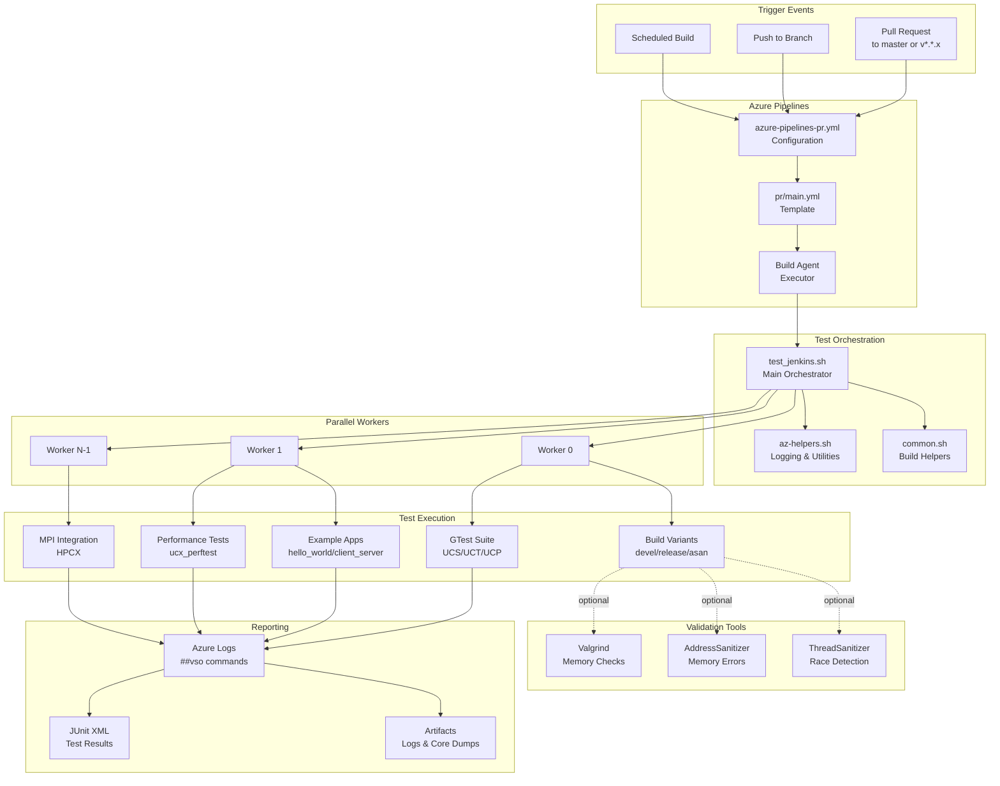
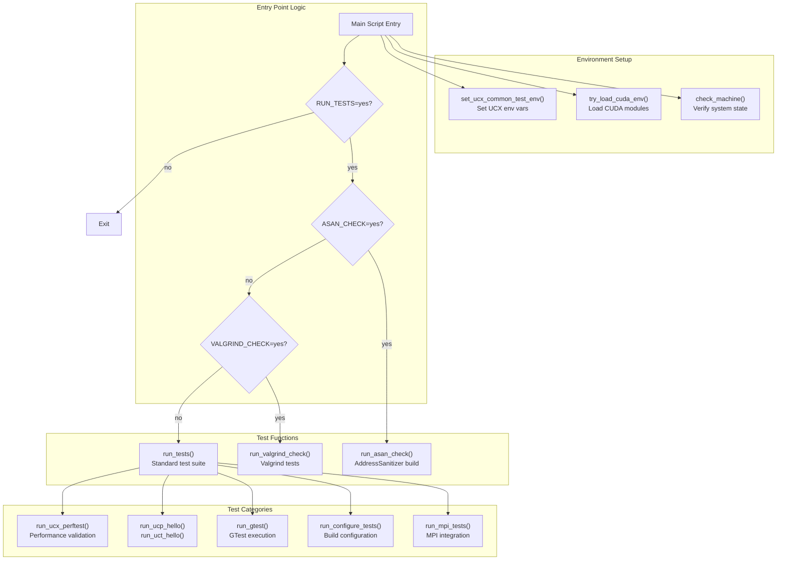
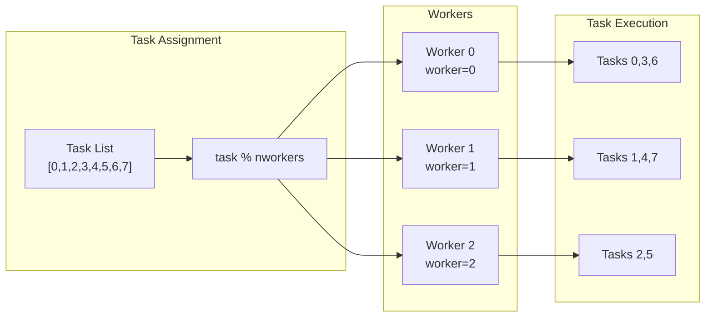

<!-- source: DeepWiki mcp.deepwiki.com · repo openucx/ucx · page 5.4 CI/CD Pipeline and Testing Infrastructure · fetched 2026-11-11 -->

# CI/CD Pipeline and Testing Infrastructure

<details>
<summary>Relevant source files</summary>

The following files were used as context for generating this wiki page:

- [buildlib/az-helpers.sh](buildlib/az-helpers.sh)
- [buildlib/azure-pipelines-pr.yml](buildlib/azure-pipelines-pr.yml)
- [buildlib/tools/builds.sh](buildlib/tools/builds.sh)
- [buildlib/tools/common.sh](buildlib/tools/common.sh)
- [buildlib/tools/coverity.sh](buildlib/tools/coverity.sh)
- [buildlib/tools/perf-common.yml](buildlib/tools/perf-common.yml)
- [contrib/test_jenkins.sh](contrib/test_jenkins.sh)
- [test/apps/uct_info/Makefile.in](test/apps/uct_info/Makefile.in)
- [test/apps/uct_info/configure.m4](test/apps/uct_info/configure.m4)
- [test/apps/uct_info/uct_info.c](test/apps/uct_info/uct_info.c)

</details>


## Purpose and Scope

This document describes UCX's continuous integration and testing infrastructure, including the Azure Pipelines configuration, test orchestration mechanisms, parallel test distribution, and integration with validation tools. It focuses on the CI/CD automation that runs tests, not the test frameworks themselves.

For information about the actual test frameworks and test cases, see:
- [UCP Testing Framework](#5.2) - UCP-level test structure and helpers
- [UCT Testing Framework](#5.3) - UCT-level test structure and transport-specific tests
- [Build System and Configuration](#5.1) - Build configuration and autotools setup

---

## Architecture Overview

The CI/CD pipeline is orchestrated by Azure Pipelines, which triggers the main test script `test_jenkins.sh`. This script manages parallel test execution across multiple workers, runs various test suites (gtest, examples, performance tests, MPI integration), and integrates with validation tools like Valgrind and AddressSanitizer.

**High-Level CI/CD Flow**



Sources: [contrib/test_jenkins.sh:1-1325](), [buildlib/az-helpers.sh:1-309](), [buildlib/azure-pipelines-pr.yml:1-29]()

---

## Azure Pipelines Integration

### Pipeline Configuration

The Azure Pipelines configuration is defined in `azure-pipelines-pr.yml`, which specifies trigger conditions and path exclusions:

```yaml
trigger: none
pr:
  branches:
    include:
    - master
    - v*.*.x
  paths:
    exclude:
    - .gitignore
    - .readthedocs.yaml
    - docs/source
    - README.md
    - NEWS
```

The pipeline triggers on pull requests to `master` or version branches (e.g., `v1.14.x`), but excludes documentation-only changes.

Sources: [buildlib/azure-pipelines-pr.yml:1-29]()

### Azure Logging Commands

The `az-helpers.sh` script provides functions that emit Azure DevOps logging commands to integrate test results with the pipeline UI:

| Function | Purpose | Syntax |
|----------|---------|--------|
| `azure_log_error` | Report error message | `##vso[task.logissue type=error]` |
| `azure_log_warning` | Report warning message | `##vso[task.logissue type=warning]` |
| `azure_set_variable` | Set pipeline variable | `##vso[task.setvariable variable=name]value` |
| `azure_log_issue` | Report issue and fail task | `##vso[task.complete result=Failed;]` |
| `azure_complete_with_issues` | Complete with warnings | `##vso[task.complete result=SucceededWithIssues;]` |

These commands are detected by Azure Pipelines and displayed in the build UI, allowing test failures and warnings to be surfaced prominently.

Sources: [buildlib/az-helpers.sh:16-65](), [contrib/test_jenkins.sh:69-78]()

---

## Test Orchestration Script: test_jenkins.sh

The `test_jenkins.sh` script is the central orchestrator for all CI testing. It coordinates build configurations, test execution, and result reporting.

**test_jenkins.sh Core Structure**



Sources: [contrib/test_jenkins.sh:1309-1325]()

### Environment Variables

The script recognizes several environment variables set by Azure Pipelines or job configuration:

| Variable | Purpose | Default |
|----------|---------|---------|
| `WORKSPACE` | Working directory path | `$PWD` |
| `BUILD_NUMBER` | Azure build number | `1` (interactive) |
| `EXECUTOR_NUMBER` | Executor ID on machine | - |
| `RUN_TESTS` | Whether to run tests | `yes` (interactive) |
| `TEST_PERF` | Validate performance | `1` (interactive) |
| `ASAN_CHECK` | Enable AddressSanitizer | - |
| `VALGRIND_CHECK` | Enable Valgrind | - |
| `worker` | Current worker index | `0` |
| `nworkers` | Total worker count | `1` |

Sources: [contrib/test_jenkins.sh:11-24](), [contrib/test_jenkins.sh:29-47]()

### Common Test Environment Setup

The `set_ucx_common_test_env` function configures UCX environment variables for consistent test behavior:

```bash
export UCX_HANDLE_ERRORS=bt
export UCX_ERROR_SIGNALS=SIGILL,SIGSEGV,SIGBUS,SIGFPE,SIGPIPE,SIGABRT
export UCX_TCP_PORT_RANGE="$((33000 + EXECUTOR_NUMBER * 1000))-$((33999 + EXECUTOR_NUMBER * 1000))"
export UCX_TCP_CM_REUSEADDR=y
export UCX_IB_ROCE_SUBNET_PREFIX_LEN=inf
export LSAN_OPTIONS=suppressions=${WORKSPACE}/contrib/lsan.supp
export ASAN_OPTIONS=protect_shadow_gap=0
```

This ensures:
- Backtrace on errors
- Signal handling for common crashes
- Non-overlapping TCP port ranges per executor
- Socket reuse to avoid `ADDRESS_ALREADY_IN_USE` errors
- No RoCE cross-device connections
- Leak sanitizer suppressions

Sources: [contrib/test_jenkins.sh:1199-1210]()

---

## Parallel Test Distribution

UCX uses a worker-based parallelism model to distribute tests across multiple executors. Each worker runs a subset of tasks based on its index.

**Parallel Distribution Mechanism**



### Distribution Functions

The script provides three key functions for parallel distribution:

**`should_do_task()`** - Determines if current worker should execute a task:

```bash
should_do_task() {
    set +x
    [[ $((task % nworkers)) -eq ${worker} ]]
    rc=$?
    set -x
    return $rc
}
```

**`do_distributed_task()`** - Conditionally executes a task on the appropriate worker:

```bash
do_distributed_task() {
    set +x
    task=$1
    ntasks=$2
    shift 2
    if should_do_task $task $ntasks
    then
        echo "==== Running '$@' (task $task/$ntasks) ===="
        set -x
        $@
    else
        echo "==== Skipping '$@' (task $task/$ntasks) ===="
        set -x
    fi
}
```

**`get_my_tasks()`** - Filters a list of tasks to those assigned to current worker:

```bash
get_my_tasks() {
    set +x
    task_list=$@
    ntasks=$(echo $task_list|wc -w)
    task=0
    my_task_list=""
    for item in $task_list
    do
        should_do_task $task $ntasks && my_task_list="$my_task_list $item"
        task=$((task + 1))
    done
    echo $my_task_list
    set -x
}
```

Sources: [contrib/test_jenkins.sh:84-127]()

### Example: Distributed Test Execution

The `run_tests` function uses this distribution for various test categories:

```bash
# Distribute 4 tasks across workers
do_distributed_task 0 4 test_unused_env_var
do_distributed_task 1 4 run_ucx_info
do_distributed_task 2 4 run_ucx_tl_check
do_distributed_task 3 4 test_ucs_dlopen

# Distribute devices for performance testing
my_devices=$(get_my_tasks $devices)
for ucx_dev in $my_devices
do
    # Run performance tests on assigned devices
    run_client_server_app "$ucx_perftest" "$uct_test_args -d ${ucx_dev} ..."
done
```

Sources: [contrib/test_jenkins.sh:1235-1277](), [contrib/test_jenkins.sh:440-495]()

---

## Test Execution Phases

The CI pipeline executes tests in several phases, each targeting different aspects of UCX functionality.

### Phase 1: MPI Integration Tests

The `run_mpi_tests` function loads the HPCX module and runs UCX with MPI:

```bash
run_mpi_tests() {
    mpi_module=hpcx-ga-gcc
    if module_load ${mpi_module}
    then
        # Prepend local UCX libraries before HPCX
        export LD_LIBRARY_PATH=${ucx_inst}/lib:${MPI_HOME}/lib:${prev_LD_LIBRARY_PATH}
        
        build release-mt --with-mpi --enable-assertions
        
        MPIRUN="mpirun \
                --allow-run-as-root \
                --bind-to none \
                -x UCX_ERROR_SIGNALS \
                -mca pml ob1 \
                -mca btl tcp,self \
                -mca orte_allowed_exit_without_sync 1"
        
        run_ucx_perftest 1  # Run with MPI
        test_malloc_hooks_mpi
    fi
}
```

This tests UCX integration with Open MPI, ensuring compatibility with MPI middleware.

Sources: [contrib/test_jenkins.sh:700-762]()

### Phase 2: Configuration Tests

The `run_configure_tests` function validates build configuration options:

```bash
run_configure_tests() {
    # Test with verbs
    ../contrib/configure-release --with-verbs
    if ! grep -qwE '^build_modules=.*:ib.*:rdmacm.*:mlx5' config.log
    then
        azure_log_error "missing modules configuring with verbs"
        exit 1
    fi
    
    # Test without verbs
    ../contrib/configure-release --without-verbs
    if grep -wE '^build_modules=.*:(ib|rdmacm|efa|mlx5)' config.log
    then
        azure_log_error "some modules were not disabled without verbs"
        exit 1
    fi
}
```

This ensures that build options correctly enable/disable transport modules.

Sources: [contrib/test_jenkins.sh:1212-1230]()

### Phase 3: Example Applications

Example applications are compiled and executed to validate basic functionality:

**UCP Hello World**

```bash
run_ucp_hello() {
    export UCX_KEEPALIVE_INTERVAL=1s
    export UCX_KEEPALIVE_NUM_EPS=10
    export UCX_LOG_LEVEL=info
    
    for tls in all tcp,cuda shm,cuda
    do
        export UCX_TLS=${tls}
        for test_mode in -w -f -b -erecv -esend -ekeepalive
        do
            for mem_type in host cuda cuda-managed
            do
                run_hello ucp ${test_mode} -m ${mem_type}
            done
        done
    done
}
```

This tests UCP with various transport combinations, operation modes (wireup, flush, blocking, error emulation), and memory types.

**UCT Hello World**

```bash
run_uct_hello() {
    for send_func in -i -b -z  # inline, bcopy, zcopy
    do
        for ucx_dev in $(get_active_ib_devices)
        do
            run_hello uct -d ${ucx_dev} -t "rc_verbs" ${send_func} -m ${mem_type}
        done
        for ucx_dev in $(get_active_ip_ifaces)
        do
            run_hello uct -d ${ucx_dev} -t "tcp" ${send_func}
        done
    done
}
```

This tests UCT operations on InfiniBand and TCP devices with different send protocols.

Sources: [contrib/test_jenkins.sh:255-327]()

### Phase 4: Performance Tests

The `run_ucx_perftest` function executes performance benchmarks:

```bash
run_ucx_perftest() {
    ucx_perftest="$ucx_inst/bin/ucx_perftest"
    uct_test_args="-b $ucx_inst_ptest/test_types_short_uct \
                   -b $ucx_inst_ptest/msg_pow2_short -w 1"
    
    # Run on all devices
    my_devices=$(get_my_tasks $devices)
    for ucx_dev in $my_devices
    do
        # Run UCT performance test
        run_client_server_app "$ucx_perftest" "$uct_test_args -d ${ucx_dev} ..."
        
        # Run UCT loopback performance test
        run_loopback_app "$ucx_perftest" "$uct_test_args -d ${ucx_dev} ..."
        
        # Run UCP performance test
        run_client_server_app "$ucx_perftest" "$ucp_test_args" "$(hostname)" 0 0
    done
}
```

For CUDA-enabled builds, additional tests with GPU memory:

```bash
# Test with cuda memory
for memtype_cache in y n
do
    for gdr in $gdr_options
    do
        export UCX_MEMTYPE_CACHE=$memtype_cache
        export UCX_IB_GPU_DIRECT_RDMA=$gdr
        run_client_server_app "$ucx_perftest" "$ucp_test_args" "$(hostname)" 0 0
    done
done
```

Sources: [contrib/test_jenkins.sh:411-561]()

### Phase 5: GTest Suite

The main test suite uses Google Test framework:

**GTest Configuration**

```bash
set_gtest_make_test_flags() {
    export GTEST_RANDOM_SEED=0
    export GTEST_SHUFFLE=1
    export GTEST_UCT_TCP_FASTEST_DEV=1
    export OMP_NUM_THREADS=4
    
    # Distribute tests among workers
    export GTEST_SHARD_INDEX=$worker
    export GTEST_TOTAL_SHARDS=$nworkers
    export GTEST_REPORT_LONGEST_TESTS=20
    
    # Performance validation with retries
    if [ "$TEST_PERF" == 1 ] && [[ "$VALGRIND_CHECK" != "yes" ]]
    then
        GTEST_EXTRA_ARGS="$GTEST_EXTRA_ARGS -p 10 -i 2.0"
    fi
}
```

**GTest Execution**

```bash
run_gtest() {
    compiler_name=$1
    
    run_specific_tests    # Specialized tests (cuda_hooks, malloc_hooks, watchdog)
    run_gtest_make $compiler_name test
}

run_gtest_make() {
    compiler_name=$1
    make_target=$2
    
    set_gtest_make_test_flags
    echo "==== Running make -C test/gtest $make_target, $compiler_name compiler ===="
    $TIMEOUT make -C test/gtest $make_target
    unset_test_flags
}
```

The GTest suite is sharded across workers using `GTEST_SHARD_INDEX` and `GTEST_TOTAL_SHARDS`, with each worker running approximately `1/nworkers` of the tests.

Sources: [contrib/test_jenkins.sh:1020-1096]()

---

## Build Variants

The CI tests multiple build configurations to ensure compatibility and correctness across different environments.

**Build Variants and Test Matrix**

```mermaid
graph TB
    subgraph "Standard Builds"
        DEVEL["build devel<br/>--enable-gtest --without-valgrind"]
        RELEASE["build release<br/>--enable-gtest"]
        RELEASE_MT["build release-mt<br/>--with-mpi --enable-assertions"]
    end
    
    subgraph "Compiler Variants"
        GCC["build_gcc<br/>Latest GCC module"]
        CLANG["build_clang<br/>System clang"]
        ARMCLANG["run_gtest_armclang<br/>ARM compiler"]
        ICC["build_icc<br/>Intel compiler"]
        PGI["build_pgi<br/>NVIDIA HPC SDK"]
    end
    
    subgraph "Sanitizer Builds"
        ASAN["run_asan_check<br/>--enable-asan"]
        VALGRIND["run_valgrind_check<br/>test_valgrind target"]
        TSAN["Optional TSAN<br/>--enable-tsan"]
    end
    
    subgraph "Feature Variants"
        CUDA["build_cuda<br/>--with-cuda --with-gdrcopy"]
        ROCM["build_rocm<br/>--with-rocm"]
        NO_VERBS["build_no_verbs<br/>--without-verbs"]
        FUSE["build_fuse<br/>--with-fuse3"]
    end
    
    subgraph "Test Execution"
        GTEST["GTest Suite"]
        EXAMPLES["Example Apps"]
        PERF["Performance Tests"]
        MPI["MPI Tests"]
    end
    
    DEVEL --> GTEST
    RELEASE --> GTEST
    RELEASE_MT --> MPI
    
    ASAN --> GTEST
    VALGRIND --> GTEST
    
    GCC --> GTEST
    CLANG --> GTEST
    ARMCLANG --> GTEST
    
    CUDA --> PERF
    ROCM --> GTEST
```



Sources: [contrib/test_jenkins.sh:1279-1323](), [buildlib/tools/builds.sh:431-470]()

### Devel Build

The default development build with debugging and assertions:

```bash
build devel --enable-gtest --without-valgrind
```

Configuration flags from `contrib/configure-devel`:
- `--enable-debug`
- `--enable-assertions`
- `--enable-params-check`
- `--enable-mt`

Sources: [contrib/test_jenkins.sh:1245]()

### Release Build

Production configuration with optimizations:

```bash
build release --enable-gtest
```

Configuration flags from `contrib/configure-release`:
- `--disable-logging`
- `--disable-debug`
- `--disable-assertions`
- `--disable-params-check`

Sources: [contrib/test_jenkins.sh:1182]()

### AddressSanitizer Build

Memory error detection build:

```bash
run_asan_check() {
    build devel --enable-gtest --enable-asan --without-valgrind
    
    # Verify ASan is loaded
    if ! ldd ${WORKSPACE}/build-test/test/gtest/gtest | grep -q "libasan.so"
    then
        azure_log_error "Error: ASan is not loaded."
        exit 1
    fi
    
    run_gtest "default"
}
```

ASan detects:
- Use-after-free
- Heap buffer overflow
- Stack buffer overflow
- Memory leaks (via LeakSanitizer)

Sources: [contrib/test_jenkins.sh:1279-1289]()

### Valgrind Build

Memory checking with Valgrind:

```bash
run_valgrind_check() {
    # Load newer valgrind if native is older than 3.10
    if ! (echo "valgrind-3.10.0"; valgrind --version) | sort -CV; then
        module load tools/valgrind-3.12.0
    fi
    
    build devel --enable-gtest
    run_gtest_make "default" test_valgrind
}
```

Valgrind checks:
- Invalid memory access
- Use of uninitialized values
- Memory leaks
- Improper freeing

Tests run with timeout extended to 300 minutes for Valgrind overhead.

Sources: [contrib/test_jenkins.sh:1291-1307](), [contrib/test_jenkins.sh:42-46]()

---

## Validation Tools Integration

### Compiler Sanitizers

UCX supports multiple sanitizers for runtime error detection:

| Sanitizer | Flag | Detects |
|-----------|------|---------|
| AddressSanitizer | `--enable-asan` | Memory errors, leaks |
| ThreadSanitizer | `--enable-tsan` | Data races |
| UndefinedBehaviorSanitizer | `--enable-ubsan` | Undefined behavior |

**ASan Configuration**

```bash
export LSAN_OPTIONS=suppressions=${WORKSPACE}/contrib/lsan.supp
export ASAN_OPTIONS=protect_shadow_gap=0
```

The `lsan.supp` file contains suppressions for known false positives in third-party libraries.

Sources: [contrib/test_jenkins.sh:1207-1209]()

### Valgrind Integration

Valgrind integration uses a special make target:

```bash
make -C test/gtest test_valgrind
```

This target:
1. Runs tests under `valgrind --tool=memcheck`
2. Uses suppressions from `contrib/valgrind.supp`
3. Fails on any memory errors or leaks
4. Generates detailed error reports

Sources: [contrib/test_jenkins.sh:1305]()

### Memory Tracking

UCX has built-in memory tracking for debugging:

```bash
test_memtrack() {
    # Test memory tracking output
    UCX_MEMTRACK_DEST=stdout GTEST_FILTER=test_memtrack.sanity \
        make -C ./test/gtest test
    
    # Test memory limit enforcement
    UCX_MEMTRACK_LIMIT=512MB ./test/apps/test_memtrack_limit
    UCX_MEMTRACK_LIMIT=412MB ./test/apps/test_memtrack_limit  # Should fail
}
```

This tests UCX's internal memory tracking infrastructure.

Sources: [contrib/test_jenkins.sh:872-879]()

---

## Reporting and Logging

### Azure DevOps Integration

The test infrastructure integrates tightly with Azure DevOps through logging commands:

**Error Reporting Example**

```bash
if ! grep -qwE '^build_modules=.*:ib.*:rdmacm.*:mlx5' config.log
then
    azure_log_error "missing modules configuring with verbs"
    exit 1
fi
```

This emits:
```
##vso[task.logissue type=error]missing modules configuring with verbs
```

**Warning Reporting Example**

```bash
if [ -z "${have_ptrace}" ] || [ -z "${have_strace}" ]
then
    log_warning "==== Not running UCS library loading test ===="
    return
fi
```

Sources: [contrib/test_jenkins.sh:69-78](), [buildlib/az-helpers.sh:34-56]()

### JUnit XML Output

GTest automatically generates JUnit XML reports that Azure Pipelines consumes:

```bash
export GTEST_REPORT_LONGEST_TESTS=20
$TIMEOUT make -C test/gtest test
```

GTest produces `test/gtest/test-results/*.xml` files with test results, which Azure Pipelines parses and displays in the test results tab.

Sources: [contrib/test_jenkins.sh:1035]()

### Test Progress Reporting

Progress is reported using Azure task progress commands:

```bash
for ((i=0;i<${num_tests};++i))
do
    test_name=${tests[$i]}
    progress=$(( (i * 100) / num_tests ))
    echo "##vso[task.setprogress value=${progress};]${test_name}"
    $test_name
done
```

This updates the Azure Pipelines UI with current test progress.

Sources: [buildlib/tools/builds.sh:457-470]()

### Artifact Publishing

Test artifacts (logs, core dumps) are preserved for debugging:

```bash
- task: PublishBuildArtifacts@1
  inputs:
    pathToPublish: $(WorkDir)/PerfX/${{ parameters.Name }}.log
    artifactName: perfx_logs
  displayName: Publish log
  condition: always()
```

This ensures logs are available even when tests fail.

Sources: [buildlib/tools/perf-common.yml:47-52]()

---

## Client-Server Test Framework

Many tests use a client-server pattern with affinity control:

**Client-Server App Runner**

```bash
run_client_server_app() {
    test_exe=$1
    test_args=$2
    server_addr_arg=$3
    kill_server=$4
    error_emulation=$5
    
    server_port_arg="-p $server_port"
    step_server_port
    
    affinity_server=$(slice_affinity 0)
    affinity_client=$(slice_affinity 1)
    
    # Start server
    taskset -c $affinity_server ${test_exe} ${test_args} ${server_port_arg} &
    server_pid=$!
    
    sleep 15
    
    # Start client
    taskset -c $affinity_client ${test_exe} ${test_args} ${server_addr_arg} ${server_port_arg} &
    client_pid=$!
    
    wait ${client_pid}
    
    if [ $kill_server -eq 1 ]
    then
        kill -9 ${server_pid} || true
    fi
    wait ${server_pid} || true
}
```

**Port Management**

To avoid port conflicts across parallel executors:

```bash
server_port_range=1000
server_port_min=$((10500 + EXECUTOR_NUMBER * server_port_range))
server_port_max=$((server_port_min + server_port_range))
server_port=${server_port_min}

step_server_port() {
    server_port=$((server_port + 1))
    server_port=$((server_port >= server_port_max ? server_port_min : server_port))
}
```

Each executor gets a dedicated 1000-port range, cycling through ports to avoid reuse conflicts.

**CPU Affinity Management**

```bash
slice_affinity() {
    n=$1
    
    # Get affinity mask of current process
    compact_cpulist=$(bash -c 'taskset -cp $$' | cut -d: -f2)
    cpulist=$(expand_cpulist ${compact_cpulist})
    
    echo "${cpulist}" | head -n $((n + 1)) | tail -1
}
```

This pins server and client to specific CPUs to ensure consistent performance and avoid interference.

Sources: [contrib/test_jenkins.sh:175-213](), [buildlib/tools/common.sh:62-71](), [contrib/test_jenkins.sh:151-161]()

---

## Module Loading Infrastructure

UCX CI uses environment modules to manage dependencies:

**Module Loading Helper**

```bash
az_module_load() {
    module=$1
    retries=5
    
    until module avail -t 2>&1 | grep -q "^$module\$"; do
        if [ $retries -gt 1 ]; then
            echo "Module $module not found, retrying..."
            ls /hpc/local > /dev/null 2>&1  # Refresh automount
            sleep 1
        else
            azure_log_warning "Module $module cannot be loaded"
            return 1
        fi
        ((retries--))
    done
    module load $module
    return 0
}
```

This handles automount failures and retries loading.

**Common Modules**

Modules defined in `common.sh`:

| Module | Purpose |
|--------|---------|
| `dev/cuda13.0.2` | CUDA toolkit |
| `dev/gdrcopy2.5.1_cuda13.0.2` | GPUDirect RDMA |
| `hpcx-ga-gcc` | HPCX with OpenMPI |
| `dev/gcc-10.1.0` | Latest GCC |
| `intel/ics-19.1.1` | Intel compilers |
| `hpc-sdk/nvhpc/21.2` | NVIDIA HPC SDK |
| `dev/fuse-3.10.5` | FUSE3 support |
| `tools/valgrind-3.12.0` | Valgrind 3.12 |

Sources: [buildlib/az-helpers.sh:111-133](), [buildlib/tools/common.sh:7-16]()

### CUDA Environment Setup

The `try_load_cuda_env` function detects and loads CUDA:

```bash
try_load_cuda_env() {
    num_gpus=0
    have_cuda=no
    have_gdrcopy=no
    
    # Check nvidia driver
    [ -f "/proc/driver/nvidia/version" ] || return 0
    
    # Check peer mem driver
    [ -f "/sys/kernel/mm/memory_peers/nv_mem/version" ] || return 0
    
    # Check number of available GPUs
    nvidia-smi -a || true
    num_gpus=$(get_num_gpus)
    [ "${num_gpus}" -gt 0 ] || return 0
    
    # Prefer local CUDA if available
    cuda_local_dir="/usr/local/cuda"
    if find ${cuda_local_dir}/ -name 'libcudart.so.1[2-9]*' | grep -q .; then
        have_cuda="${cuda_local_dir}"
    else
        az_module_load dev/cuda13.0.2 || return 0
        have_cuda=yes
    fi
    
    # Check gdrcopy
    if [ -w "/dev/gdrdrv" ]
    then
        az_module_load dev/gdrcopy2.5.1_cuda13.0.2 && have_gdrcopy=yes
    fi
}
```

This enables CUDA tests only when:
1. NVIDIA driver is loaded
2. GPU peer memory driver is available
3. At least one GPU is present
4. CUDA libraries are found

Sources: [buildlib/az-helpers.sh:177-211]()

---

## Specialized Tests

### Malloc Hooks Testing

Tests UCX's memory hooks (bistro/reloc modes):

```bash
test_malloc_hooks_mpi() {
    for mode in reloc bistro
    do
        for tname in malloc_hooks malloc_hooks_unmapped external_events flag_no_install
        do
            $MPIRUN -np 1 ./test/mpi/test_memhooks -t $tname -m ${mode}
        done
        
        # Test with LD_PRELOAD
        ucm_lib=$PWD/src/ucm/.libs/libucm.so
        $MPIRUN -np 1 -x LD_PRELOAD=$ucm_lib \
            ./test/mpi/test_memhooks -t malloc_hooks -m ${mode}
    done
}
```

Sources: [contrib/test_jenkins.sh:677-695]()

### Watchdog Timeout Testing

Tests the GTest watchdog mechanism:

```bash
run_gtest_watchdog_test() {
    watchdog_timeout=$1
    sleep_time=$2
    expected_runtime=$3
    expected_err_str="Connection timed out - abort testing"
    
    start_time=`date +%s`
    
    env WATCHDOG_GTEST_TIMEOUT_=$watchdog_timeout \
        WATCHDOG_GTEST_SLEEP_TIME_=$sleep_time \
        GTEST_FILTER=test_watchdog.watchdog_timeout \
        make -C ./test/gtest test 2>&1 | tee watchdog_timeout_test &
    pid=$!
    wait $pid
    
    end_time=`date +%s`
    runtime=$(($end_time-$start_time))
    
    # Verify timeout occurred and runtime is reasonable
    if [ $runtime -gt $expected_runtime ]
    then
        echo "Watchdog timeout test takes $runtime seconds that is greater than expected"
        exit 1
    fi
}
```

This ensures the watchdog correctly terminates hung tests.

Sources: [contrib/test_jenkins.sh:944-981]()

### UCX Info and Configuration Tests

Tests `ucx_info` tool and configuration parsing:

```bash
run_ucx_info() {
    ./src/tools/info/ucx_info -s -f -c -v -y -d -b -p -w -e -uart -m 20M -T -M
}

test_unused_env_var() {
    # Check unused variable warnings
    UCX_IB_PORTS=mlx5_0:1 ./src/tools/info/ucx_info -epw -u t | grep "unused" | grep -q "UCX_IB_PORTS"
    
    # Check fuzzy matching for typos
    ../test/apps/test_fuzzy_match.py --ucx_info ./src/tools/info/ucx_info
}

test_env_var_aliases() {
    # Verify RC/DC aliases work
    for var in "TM_ENABLE" "TM_LIST_SIZE" "TX_MAX_BB"
    do
        for tl in "RC_MLX5" "DC_MLX5"
        do
            val=$(./src/tools/info/ucx_info -c | grep "${tl}_${var}" | cut -d'=' -f2)
            # Verify both RC and tl-specific aliases work
            for var_alias in "RC" $tl
            do
                var_name=UCX_${var_alias}_${var}
                val_set=$(export $var_name=$magic_val; ./src/tools/info/ucx_info -c | grep "${tl}_${var}" | cut -d'=' -f2)
            done
        done
    done
}
```

Sources: [contrib/test_jenkins.sh:1161-1165](), [contrib/test_jenkins.sh:881-889](), [contrib/test_jenkins.sh:891-926]()

---

## Summary

The UCX CI/CD infrastructure provides comprehensive automated testing through:

1. **Azure Pipelines Integration** - Triggers on PRs, manages build agents, reports results
2. **test_jenkins.sh Orchestration** - Central script coordinating all test phases
3. **Parallel Distribution** - Worker-based task distribution for efficiency
4. **Multiple Test Categories** - GTest, examples, performance, MPI integration
5. **Build Variants** - Multiple compilers, sanitizers, and feature configurations
6. **Validation Tools** - ASan, Valgrind, custom memory tracking
7. **Azure Logging** - Structured error/warning reporting for pipeline UI
8. **Specialized Tests** - Malloc hooks, watchdog, configuration validation

This infrastructure ensures UCX maintains quality across diverse hardware, compilers, and use cases.