# Page: Overview

# Overview

<details>
<summary>Relevant source files</summary>

The following files were used as context for generating this wiki page:

- [src/tools/info/tl_info.c](src/tools/info/tl_info.c)
- [src/ucp/api/ucp.h](src/ucp/api/ucp.h)
- [src/ucp/api/ucp_compat.h](src/ucp/api/ucp_compat.h)
- [src/ucp/api/ucp_def.h](src/ucp/api/ucp_def.h)
- [src/ucp/core/ucp_context.c](src/ucp/core/ucp_context.c)
- [src/ucp/core/ucp_context.h](src/ucp/core/ucp_context.h)
- [src/ucp/core/ucp_ep.c](src/ucp/core/ucp_ep.c)
- [src/ucp/core/ucp_ep.h](src/ucp/core/ucp_ep.h)
- [src/ucp/core/ucp_ep.inl](src/ucp/core/ucp_ep.inl)
- [src/ucp/core/ucp_worker.c](src/ucp/core/ucp_worker.c)
- [src/ucp/core/ucp_worker.h](src/ucp/core/ucp_worker.h)
- [src/ucp/wireup/select.c](src/ucp/wireup/select.c)
- [src/ucp/wireup/wireup.c](src/ucp/wireup/wireup.c)
- [src/ucp/wireup/wireup.h](src/ucp/wireup/wireup.h)
- [src/ucp/wireup/wireup_cm.c](src/ucp/wireup/wireup_cm.c)
- [src/ucp/wireup/wireup_cm.h](src/ucp/wireup/wireup_cm.h)
- [src/ucp/wireup/wireup_ep.c](src/ucp/wireup/wireup_ep.c)
- [src/ucp/wireup/wireup_ep.h](src/ucp/wireup/wireup_ep.h)
- [src/uct/api/tl.h](src/uct/api/tl.h)
- [src/uct/api/uct.h](src/uct/api/uct.h)
- [src/uct/api/uct_def.h](src/uct/api/uct_def.h)
- [src/uct/api/v2/uct_v2.h](src/uct/api/v2/uct_v2.h)
- [src/uct/base/uct_iface.c](src/uct/base/uct_iface.c)
- [src/uct/base/uct_iface.h](src/uct/base/uct_iface.h)
- [src/uct/cuda/gdr_copy/gdr_copy_iface.c](src/uct/cuda/gdr_copy/gdr_copy_iface.c)
- [test/gtest/ucp/test_ucp_ep.cc](test/gtest/ucp/test_ucp_ep.cc)

</details>


UCX (Unified Communication X) is a communication framework designed for high-performance computing (HPC) and data-intensive applications. It provides a layered architecture that abstracts diverse network hardware through a unified API, enabling applications to achieve optimal performance across different interconnect technologies without modification.

This page introduces UCX's fundamental architecture, design principles, and core abstractions. For detailed information about specific layers, see: UCP layer ([2](#2)), UCT layer ([3](#3)), Memory Management ([4](#4)), and Testing ([5](#5)).

## Three-Layer Architecture

UCX employs a three-layer design that separates protocol semantics from transport mechanisms:

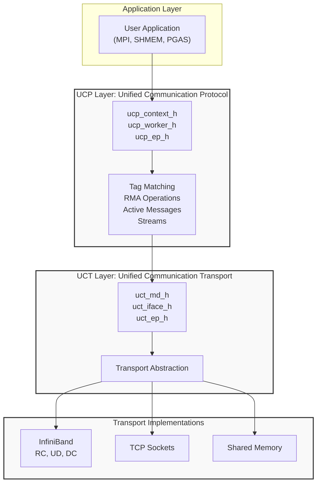

**Sources:** [src/ucp/api/ucp.h:1-100](), [src/uct/api/uct.h:1-100]()

### UCP Layer (Unified Communication Protocol)

UCP provides high-level communication semantics that applications use directly. It implements protocol logic for various communication patterns.

| Feature | API Function Prefix | Description |
|---------|-------------------|-------------|
| Tagged Messages | `ucp_tag_*` | Message matching by software tags |
| RMA | `ucp_put_*`, `ucp_get_*` | Remote Memory Access operations |
| Active Messages | `ucp_am_*` | User-defined message handlers |
| Streams | `ucp_stream_*` | Ordered, connection-oriented data transfer |
| Atomics | `ucp_atomic_*` | Atomic memory operations |

The UCP layer manages:
- **Contexts** (`ucp_context_h`): Global configuration and resource management
- **Workers** (`ucp_worker_h`): Progress engine and event handling per thread
- **Endpoints** (`ucp_ep_h`): Point-to-point connections to remote peers
- **Requests** (`ucp_request_t`): Asynchronous operation tracking

**Sources:** [src/ucp/api/ucp.h:25-100](), [src/ucp/core/ucp_context.h:1-50](), [src/ucp/core/ucp_worker.h:1-50](), [src/ucp/core/ucp_ep.h:1-100]()

### UCT Layer (Unified Communication Transport)

UCT provides a uniform interface over diverse network hardware. It exposes low-level transport capabilities while hiding hardware-specific details.

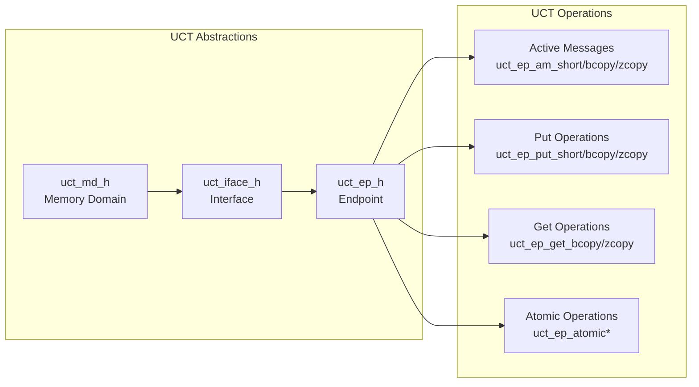

**UCT Components:**

- **Memory Domain** (`uct_md_h`): Manages memory registration and protection
- **Interface** (`uct_iface_h`): Represents a communication channel on a device
- **Endpoint** (`uct_ep_h`): Connection to a specific remote interface

UCT operations come in three flavors:
- **Short**: Inline data in protocol headers (lowest latency)
- **Bcopy**: Buffer copy to pre-registered memory (medium messages)
- **Zcopy**: Zero-copy using registered memory (large messages)

**Sources:** [src/uct/api/uct.h:50-300](), [src/uct/api/uct_def.h:1-100](), [src/uct/base/uct_iface.h:1-100]()

### Transport Layer

The transport layer implements UCT interfaces for specific hardware:

| Transport | Type | Description | Capabilities |
|-----------|------|-------------|--------------|
| RC (Reliable Connection) | InfiniBand | Hardware-reliable, connection-oriented | High bandwidth, hardware reliability |
| UD (Unreliable Datagram) | InfiniBand | Software reliability over UD QPs | Scalability, connectionless |
| DC (Dynamic Connection) | InfiniBand | Scalable connections via DCI pool | Scalable connections, hardware reliability |
| TCP | Network | Socket-based communication | Universal connectivity |
| SHM | Memory | Intra-node shared memory | Lowest latency for same-node |

Each transport is implemented as a separate component that registers with UCT during initialization.

**Sources:** [src/uct/api/uct.h:300-350](), [src/ucp/wireup/select.c:1-100]()

## Core Abstractions and Workflow

### Initialization and Resource Management

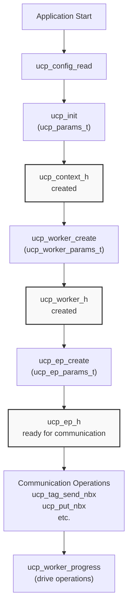

**Initialization Sequence:**

1. **Configuration**: `ucp_config_read()` loads settings from environment variables and configuration files [src/ucp/api/ucp.h:600-650]()
2. **Context Creation**: `ucp_init()` creates a `ucp_context_h` with specified features (TAG, RMA, AMO, etc.) [src/ucp/core/ucp_context.c:1-100]()
3. **Worker Creation**: `ucp_worker_create()` establishes a per-thread progress engine [src/ucp/core/ucp_worker.c:1-100]()
4. **Endpoint Creation**: `ucp_ep_create()` connects to a remote worker [src/ucp/core/ucp_ep.c:1-100]()

**Sources:** [src/ucp/api/ucp.h:1-700](), [src/ucp/core/ucp_context.c:1-200](), [src/ucp/core/ucp_worker.c:1-200](), [src/ucp/core/ucp_ep.c:1-200]()

### Connection Establishment (Wireup)

UCX uses a sophisticated wireup protocol to select optimal transports and establish connections:

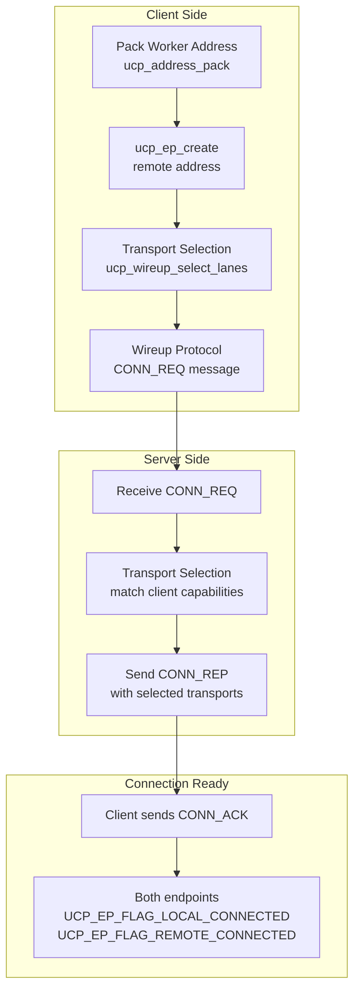

The wireup process:
1. Client packs its worker address containing available transports [src/ucp/wireup/address.c:1-100]()
2. Transport selection algorithm chooses optimal lanes based on bandwidth, latency, and capabilities [src/ucp/wireup/select.c:1-500]()
3. Three-way handshake (REQ/REP/ACK) exchanges connection information [src/ucp/wireup/wireup.c:1-300]()
4. Temporary wireup endpoints proxy operations until connection completes [src/ucp/wireup/wireup_ep.c:1-200]()

**Sources:** [src/ucp/wireup/wireup.c:1-300](), [src/ucp/wireup/select.c:1-500](), [src/ucp/wireup/wireup_ep.c:1-200](), [src/ucp/wireup/address.c:1-200]()

## Communication Models

### Multi-Lane Communication

UCX uses multiple parallel lanes for different operation types to maximize performance:

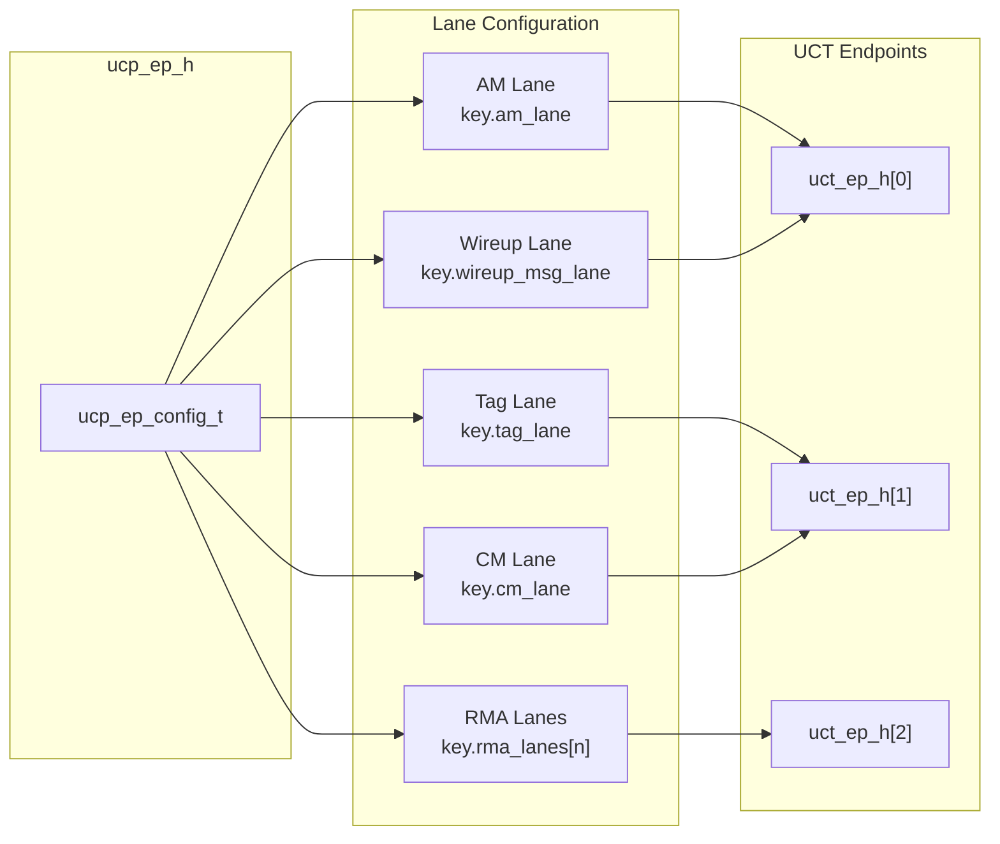

Each endpoint (`ucp_ep_h`) maintains:
- **Lane array**: Up to `UCP_MAX_LANES` (16) UCT endpoints [src/ucp/core/ucp_ep.h:200-250]()
- **Lane types**: Specialized for different operations (AM, RMA, TAG, wireup, CM, keepalive) [src/ucp/proto/lane_type.h:1-100]()
- **Multi-rail**: Multiple lanes can use different devices in parallel for bandwidth aggregation [src/ucp/wireup/select.c:500-700]()

**Sources:** [src/ucp/core/ucp_ep.h:200-250](), [src/ucp/wireup/select.c:500-1000]()

### Request Management and Asynchronous Operations

All communication operations in UCP are non-blocking and return a request handle:

| Return Value | Meaning | Action |
|--------------|---------|--------|
| `NULL` | Completed immediately | No further action needed |
| `UCS_PTR_IS_PTR(req)` | In progress | Test/wait for completion |
| `UCS_PTR_IS_ERR(req)` | Failed | Extract error with `UCS_PTR_STATUS()` |

Requests are allocated from memory pools and tracked through completion:
- **Request structure**: `ucp_request_t` contains operation state [src/ucp/core/ucp_request.h:1-100]()
- **Protocol selection**: Chooses short/bcopy/zcopy/rendezvous based on message size [src/ucp/core/ucp_ep.c:600-800]()
- **Completion**: Via callbacks, polling (`ucp_request_test`), or waiting (`ucp_request_wait`) [src/ucp/api/ucp.h:1500-1600]()

**Sources:** [src/ucp/core/ucp_request.h:1-200](), [src/ucp/api/ucp.h:1500-1700]()

## Design Principles

### Hardware Abstraction

UCX abstracts hardware diversity through:
- **Runtime selection**: Transport and protocol selection at runtime based on available hardware
- **Capability queries**: UCT exposes fine-grained capabilities (`UCT_IFACE_FLAG_*`) [src/uct/api/uct.h:360-450]()
- **Zero-copy**: Direct hardware access for registered memory avoids copies
- **Multi-path**: Automatic use of multiple network paths when available

**Sources:** [src/uct/api/uct.h:300-500](), [src/ucp/wireup/select.c:1-200]()

### Performance Optimization

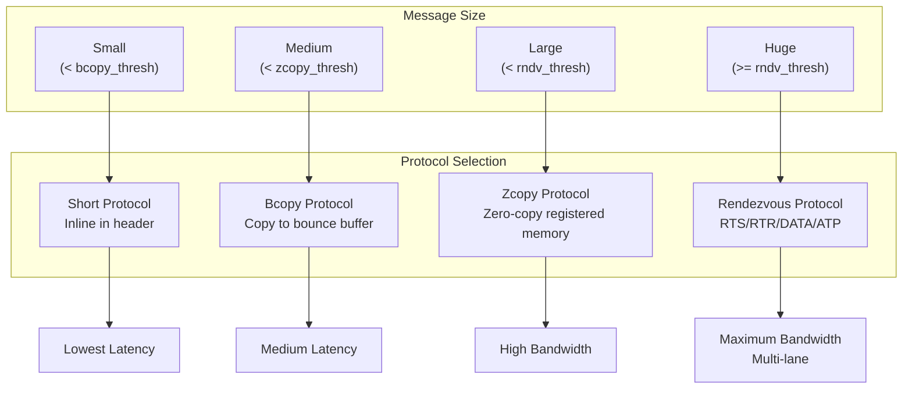

UCX optimizes performance through:
- **Protocol thresholds**: Configurable via `UCX_*_THRESH` environment variables [src/ucp/core/ucp_context.c:150-400]()
- **Memory registration caching**: Reduces registration overhead [src/ucp/core/ucp_rkey.c:1-200]()
- **Progress engine**: Efficient polling with adaptive progress [src/ucp/core/ucp_worker.c:500-800]()
- **Multi-rail**: Parallel data transfer across multiple lanes [src/ucp/wireup/select.c:800-1200]()

**Sources:** [src/ucp/core/ucp_context.c:150-400](), [src/ucp/wireup/select.c:800-1500]()

## Use Cases

UCX serves as the foundation for:

- **MPI Implementations**: OpenMPI, MPICH use UCX for point-to-point and collective operations
- **PGAS Languages**: UPC, Chapel, OpenSHMEM leverage UCX for remote memory access
- **Deep Learning**: TensorFlow, PyTorch use UCX for distributed training communication
- **Storage Systems**: Parallel file systems use UCX for high-performance data movement
- **HPC Applications**: Direct use of UCX API for custom communication patterns

The layered design allows each use case to operate at the appropriate abstraction level:
- MPI/PGAS frameworks use UCP for high-level semantics
- Performance-critical custom protocols may use UCT directly
- Transport developers implement UCT interfaces for new hardware

**Sources:** [src/ucp/api/ucp.h:25-100](), [src/uct/api/uct.h:1-100]()

## Key Files and Entry Points

| Component | Key Files | Entry Points |
|-----------|-----------|--------------|
| UCP API | [src/ucp/api/ucp.h]() | `ucp_init`, `ucp_worker_create`, `ucp_ep_create` |
| UCP Core | [src/ucp/core/ucp_context.c](), [src/ucp/core/ucp_worker.c](), [src/ucp/core/ucp_ep.c]() | Context/worker/endpoint implementation |
| UCT API | [src/uct/api/uct.h]() | `uct_md_open`, `uct_iface_open`, `uct_ep_create` |
| UCT Base | [src/uct/base/uct_iface.c]() | Common UCT infrastructure |
| Wireup | [src/ucp/wireup/wireup.c](), [src/ucp/wireup/select.c]() | Connection establishment and transport selection |
| Transports | `src/uct/{ib,tcp,sm}/` | Transport-specific implementations |

**Sources:** [src/ucp/api/ucp.h:1-100](), [src/uct/api/uct.h:1-100](), [src/ucp/core/](), [src/uct/base/](), [src/ucp/wireup/]()

---

# Page: UCP (Unified Communication Protocol)

# UCP (Unified Communication Protocol)

<details>
<summary>Relevant source files</summary>

The following files were used as context for generating this wiki page:

- [src/ucp/api/ucp.h](src/ucp/api/ucp.h)
- [src/ucp/api/ucp_compat.h](src/ucp/api/ucp_compat.h)
- [src/ucp/api/ucp_def.h](src/ucp/api/ucp_def.h)
- [src/ucp/core/ucp_context.c](src/ucp/core/ucp_context.c)
- [src/ucp/core/ucp_context.h](src/ucp/core/ucp_context.h)
- [src/ucp/core/ucp_ep.c](src/ucp/core/ucp_ep.c)
- [src/ucp/core/ucp_ep.h](src/ucp/core/ucp_ep.h)
- [src/ucp/core/ucp_ep.inl](src/ucp/core/ucp_ep.inl)
- [src/ucp/core/ucp_worker.c](src/ucp/core/ucp_worker.c)
- [src/ucp/core/ucp_worker.h](src/ucp/core/ucp_worker.h)
- [src/ucp/wireup/select.c](src/ucp/wireup/select.c)
- [src/ucp/wireup/wireup.c](src/ucp/wireup/wireup.c)
- [src/ucp/wireup/wireup.h](src/ucp/wireup/wireup.h)
- [src/ucp/wireup/wireup_cm.c](src/ucp/wireup/wireup_cm.c)
- [src/ucp/wireup/wireup_cm.h](src/ucp/wireup/wireup_cm.h)
- [src/ucp/wireup/wireup_ep.c](src/ucp/wireup/wireup_ep.c)
- [src/ucp/wireup/wireup_ep.h](src/ucp/wireup/wireup_ep.h)
- [test/gtest/ucp/test_ucp_ep.cc](test/gtest/ucp/test_ucp_ep.cc)

</details>


**Purpose**: UCP is the high-level protocol layer in UCX that provides portable, feature-rich communication APIs for HPC and data-center applications. This document covers UCP's architecture, core abstractions, communication protocols, and connection establishment mechanisms.

**Scope**: This page focuses on UCP layer implementation (protocol logic, endpoint management, wireup). For UCT transport layer details, see [UCT (Unified Communication Transport)](#3). For memory registration and remote keys, see [Memory Management](#4).

---

## UCP Layer Position in UCX Architecture

UCP sits above the UCT (Unified Communication Transport) layer and provides:
- **Protocol-level features**: Tagged messaging, streams, RMA, active messages, rendezvous
- **Transport abstraction**: Hides UCT complexity from applications
- **Multi-lane optimization**: Uses multiple transports simultaneously for bandwidth
- **Connection management**: Automatic wireup and transport selection

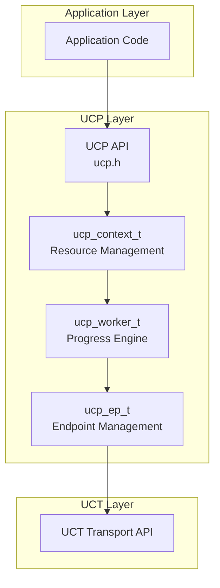

**Sources**: [src/ucp/api/ucp.h:1-900](), [Diagram 1 from overview]()

---

## Core Abstractions

### Context: `ucp_context_t`

The UCP context represents a single communication instance and holds global configuration and resources.

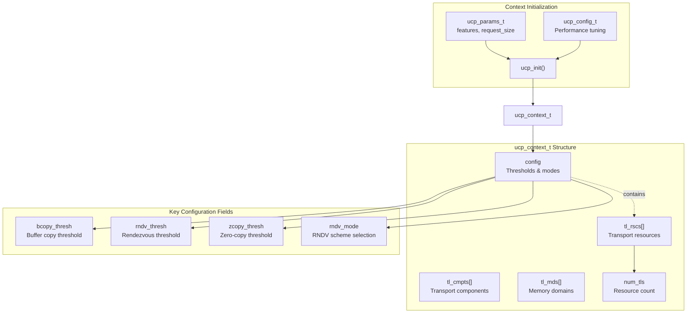

**Key Fields**:
- `config.features`: Enabled features (TAG, RMA, AMO, STREAM, AM)
- `tl_rscs[]`: Array of available transport resources
- `tl_cmpts[]`: Array of UCT components
- `tl_mds[]`: Array of memory domains for registration

**Configuration Parameters** (from `ucp_context_config_t`):
- `bcopy_thresh`: When to switch from short to buffer-copy protocol
- `rndv_thresh`: When to switch from eager to rendezvous (intra/inter node)
- `zcopy_thresh`: When to use zero-copy operations
- `rndv_mode`: Rendezvous scheme (auto, get_zcopy, put_zcopy, rkey_ptr, am)
- `max_eager_lanes`, `max_rndv_lanes`, `max_rma_lanes`: Multi-lane limits

**Sources**: [src/ucp/core/ucp_context.h:56-283](), [src/ucp/core/ucp_context.c:161-452](), [src/ucp/api/ucp.h:119-173]()

---

### Worker: `ucp_worker_t`

The worker is the progress engine that drives communication. Each worker has its own set of UCT interfaces and manages multiple endpoints.

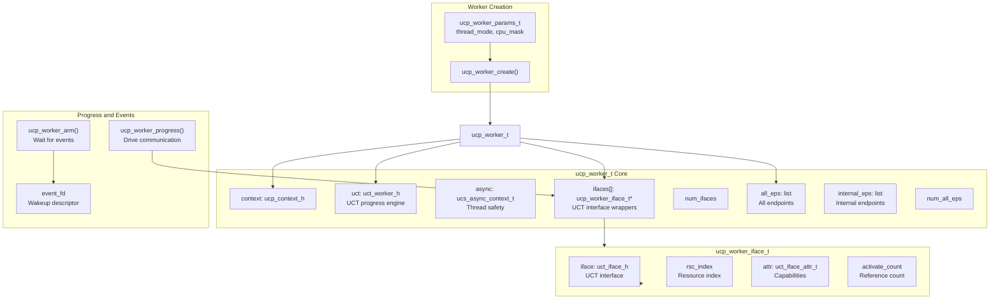

**Key Responsibilities**:
1. **Progress Engine**: `ucp_worker_progress()` polls UCT interfaces
2. **Interface Management**: Opens and activates UCT interfaces on demand
3. **Endpoint Management**: Tracks all endpoints created on this worker
4. **Event Handling**: Supports wakeup via `UCP_FEATURE_WAKEUP`

**Worker Interface (`ucp_worker_iface_t`)** wraps each UCT interface with:
- `activate_count`: Reference counting for on-demand activation
- `proxy_recv_count`: Counts messages received via proxy AM handlers
- `flags`: `UCP_WORKER_IFACE_FLAG_OFFLOAD_ACTIVATED`, `UCP_WORKER_IFACE_FLAG_ON_ARM_LIST`

**Sources**: [src/ucp/core/ucp_worker.h:206-439](), [src/ucp/core/ucp_worker.c:282-375](), [src/ucp/core/ucp_worker.c:576-609]()

---

### Endpoint: `ucp_ep_t`

An endpoint represents a connection to a remote worker. It manages multiple lanes (transport paths) for different operation types.

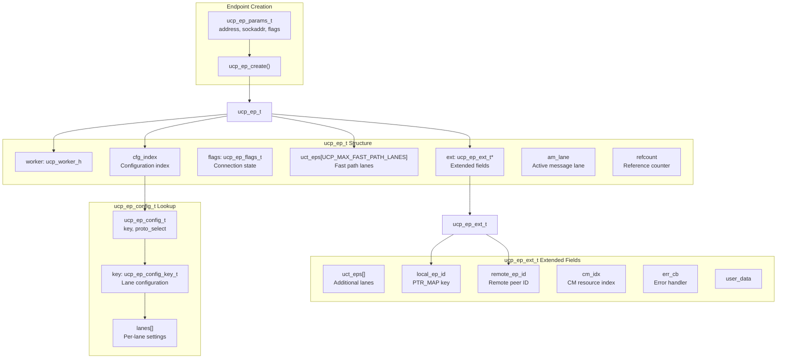

**Key Fields**:
- `cfg_index`: Index into worker's `ep_config[]` array
- `uct_eps[]`: Array of UCT endpoints (one per lane)
- `am_lane`: Primary lane for active messages
- `flags`: Connection state (`UCP_EP_FLAG_LOCAL_CONNECTED`, `UCP_EP_FLAG_REMOTE_CONNECTED`, `UCP_EP_FLAG_FAILED`)

**Endpoint Configuration Key** (`ucp_ep_config_key_t`):
- `num_lanes`: Number of active lanes
- `lanes[]`: Per-lane configuration (resource index, MD index, lane types)
- `am_lane`, `tag_lane`, `wireup_msg_lane`, `cm_lane`, `keepalive_lane`: Special purpose lanes
- `rma_lanes[]`, `rma_bw_lanes[]`, `amo_lanes[]`, `am_bw_lanes[]`: Sorted by priority

**Sources**: [src/ucp/core/ucp_ep.h:207-335](), [src/ucp/core/ucp_ep.c:183-264](), [src/ucp/core/ucp_ep.c:363-417]()

---

### Lanes: Multi-Transport Communication

UCP uses a **lane-based architecture** where each lane uses a different UCT endpoint/transport. Different operation types are mapped to different lanes for optimal performance.

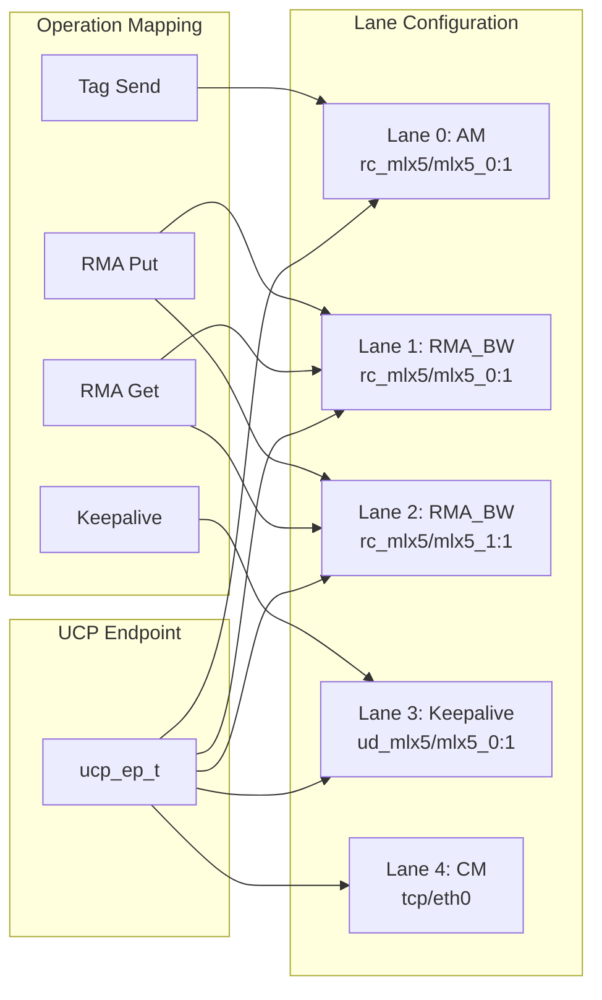

**Lane Types** (`ucp_lane_type_t`):
- `UCP_LANE_TYPE_AM`: Active messages and tag matching
- `UCP_LANE_TYPE_AM_BW`: High-bandwidth active messages
- `UCP_LANE_TYPE_RMA`: Remote memory access
- `UCP_LANE_TYPE_RMA_BW`: High-bandwidth RMA (multi-lane)
- `UCP_LANE_TYPE_AMO`: Atomic operations
- `UCP_LANE_TYPE_TAG`: Hardware tag matching offload
- `UCP_LANE_TYPE_KEEPALIVE`: Connection liveness checking
- `UCP_LANE_TYPE_CM`: Connection manager

**Multi-Lane Optimization**: For large transfers, UCP can stripe data across multiple lanes simultaneously to utilize aggregate bandwidth. Configuration controls:
- `max_eager_lanes`: Max lanes for eager messages
- `max_rndv_lanes`: Max lanes for rendezvous
- `max_rma_lanes`: Max lanes for RMA operations

**Sources**: [src/ucp/core/ucp_ep.h:207-250](), [src/ucp/proto/lane_type.h]()

---

## Connection Establishment (Wireup)

UCP implements a sophisticated wireup protocol to establish connections and select optimal transports.

### Wireup Protocol Flow

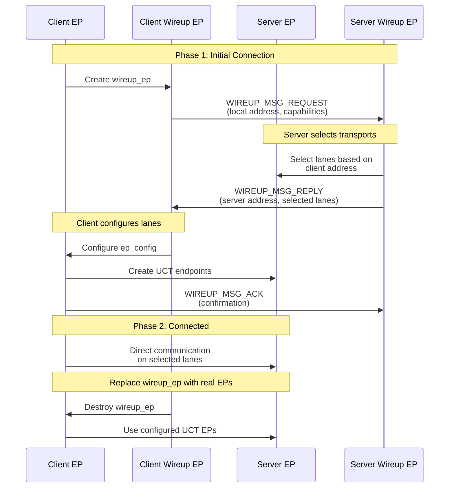

**Wireup Message Types**:
- `UCP_WIREUP_MSG_PRE_REQUEST`: Pre-connection request (CM-based)
- `UCP_WIREUP_MSG_REQUEST`: Connection request with local address
- `UCP_WIREUP_MSG_REPLY`: Connection reply with selected configuration
- `UCP_WIREUP_MSG_ACK`: Acknowledgment, connection complete

**Wireup Endpoint** (`ucp_wireup_ep_t`): A proxy endpoint that queues operations during connection establishment:
- `pending_q`: Queue of pending operations
- `aux_ep`: Auxiliary UCT endpoint for wireup messages
- `flags`: `UCP_WIREUP_EP_FLAG_READY`, `UCP_WIREUP_EP_FLAG_LOCAL_CONNECTED`, `UCP_WIREUP_EP_FLAG_REMOTE_CONNECTED`

**Sources**: [src/ucp/wireup/wireup.c:50-216](), [src/ucp/wireup/wireup.h:40-52](), [src/ucp/wireup/wireup_ep.h:44-60]()

---

### Transport Selection

Transport selection happens during wireup based on multiple criteria.

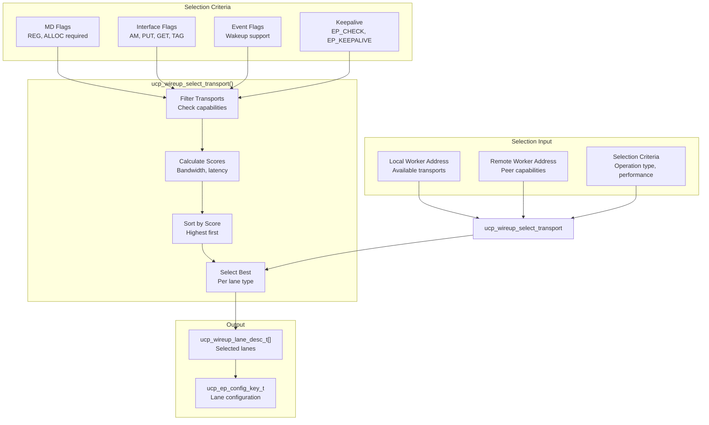

**Selection Algorithm** (`ucp_wireup_select_transport()`):
1. **Filter**: Check mandatory capabilities (MD flags, iface flags, events)
2. **Score**: Calculate transport score based on bandwidth/latency
3. **Prioritize**: Consider device distance, memory type support
4. **Select**: Choose highest scoring transport per lane type

**Scoring Functions**:
- `ucp_wireup_rma_score()`: RMA bandwidth divided by latency
- `ucp_wireup_amo_score()`: Atomic operation support
- `ucp_wireup_am_score()`: Active message bandwidth/latency
- `ucp_wireup_tag_score()`: Tag matching offload capability

**Multi-Lane Selection**: For bandwidth-intensive operations, multiple lanes of same type selected based on:
- `multi_lane_max_ratio`: Max ratio between slowest/fastest lane (default: 4)
- `multi_path_ratio`: Bandwidth efficiency when using multiple paths per device

**Sources**: [src/ucp/wireup/select.c:391-600](), [src/ucp/wireup/select.c:1200-1450](), [src/ucp/wireup/wireup.c:219-252]()

---

## Communication Protocols

### Protocol Selection

UCP dynamically selects communication protocols based on message size and memory type.

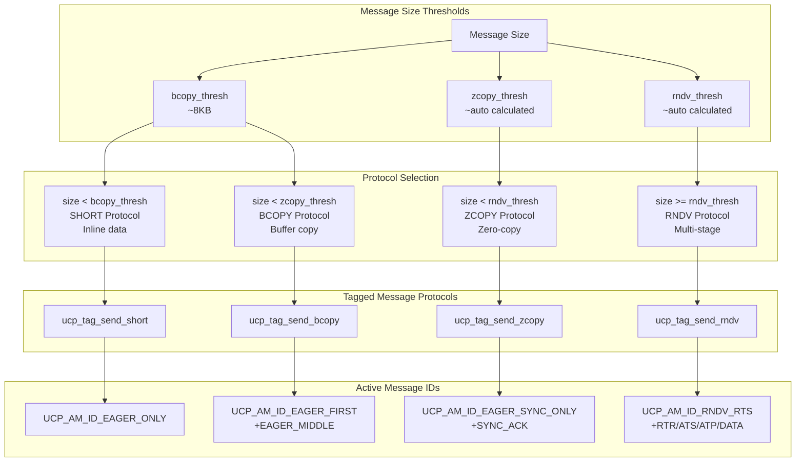

**Protocol Thresholds**:
- `bcopy_thresh`: Switch from inline (short) to buffer-copy (default: auto)
- `zcopy_thresh`: Switch from buffer-copy to zero-copy (default: auto)
- `rndv_thresh`: Switch from eager to rendezvous (default: auto, separate intra/inter node)

**Threshold Calculation**: UCP auto-calculates thresholds based on:
- Transport bandwidth and latency
- Memory copy bandwidth (`bcopy_bw`)
- Memory registration overhead
- Message size distribution

**Sources**: [src/ucp/core/ucp_context.h:56-90](), [src/ucp/core/ucp_context.c:161-199]()

---

### Rendezvous Protocol

The rendezvous protocol is a multi-stage protocol for large messages.

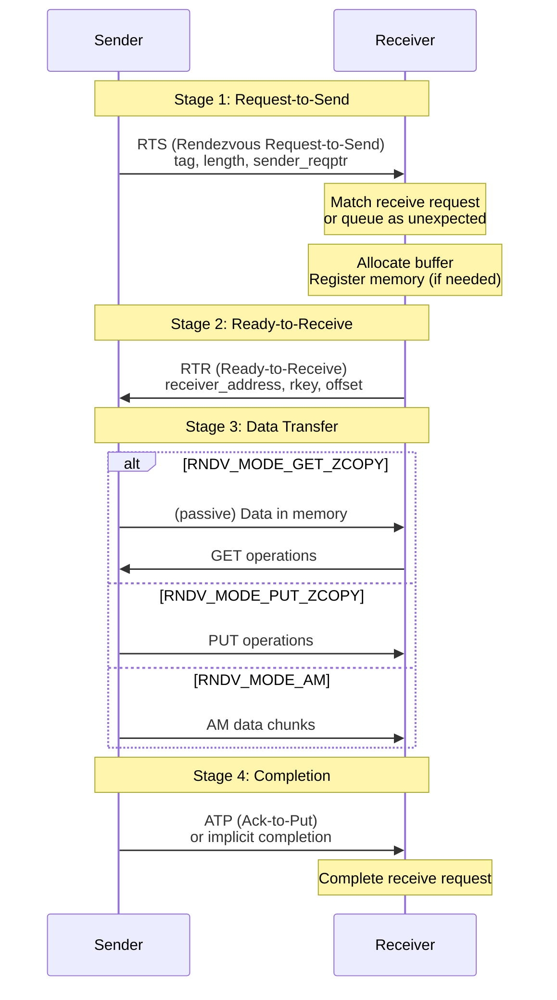

**Rendezvous Modes** (`ucp_rndv_mode_t`):
- `UCP_RNDV_MODE_GET_ZCOPY`: Receiver pulls data via GET operations
- `UCP_RNDV_MODE_PUT_ZCOPY`: Sender pushes data via PUT operations
- `UCP_RNDV_MODE_GET_PIPELINE`: Pipelined GET with staging buffers
- `UCP_RNDV_MODE_PUT_PIPELINE`: Pipelined PUT with staging buffers
- `UCP_RNDV_MODE_AM`: Active message-based transfer
- `UCP_RNDV_MODE_RKEY_PTR`: Direct memory access via rkey_ptr
- `UCP_RNDV_MODE_AUTO`: Runtime selection (default)

**Pipeline Protocol**: For GPU memory and large transfers:
- `rndv_frag_size[]`: Fragment size per memory type (default: 512KB host, 4MB GPU)
- `rndv_num_frags[]`: Number of fragments to pre-allocate (default: 128)
- Allows overlapping data movement with copy operations

**Active Message IDs for Rendezvous**:
- `UCP_AM_ID_RNDV_RTS`: Request-to-Send
- `UCP_AM_ID_RNDV_ATS`: Ack-to-Send (alternative flow)
- `UCP_AM_ID_RNDV_RTR`: Ready-to-Receive
- `UCP_AM_ID_RNDV_DATA`: Data chunks (AM mode)
- `UCP_AM_ID_RNDV_ATP`: Ack-to-Put (completion)

**Sources**: [src/ucp/core/ucp_context.h:79-83](), [src/ucp/rndv/](), [Diagram 7 from overview]()

---

## Request Management

UCP uses an asynchronous request-based model for all communication operations.

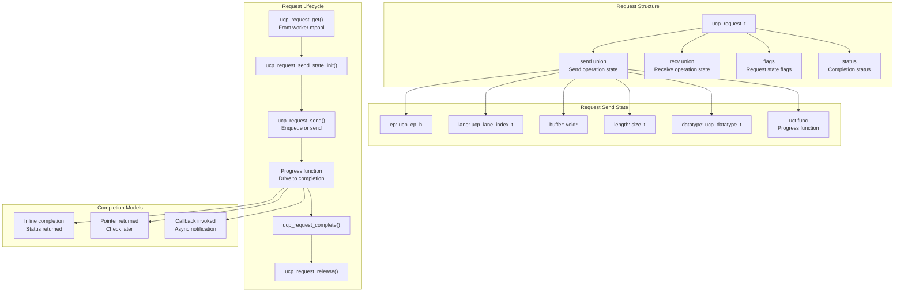

**Request Flags**:
- `UCP_REQUEST_FLAG_COMPLETED`: Request finished
- `UCP_REQUEST_FLAG_RELEASED`: User called release
- `UCP_REQUEST_FLAG_CALLBACK`: Has completion callback
- `UCP_REQUEST_FLAG_RECV_TAG`: Tagged receive
- `UCP_REQUEST_FLAG_RECV_AM`: Active message receive
- `UCP_REQUEST_FLAG_SEND`: Send operation

**Memory Pool**: Requests allocated from worker's memory pool (`ucp_worker_t.req_mp`)

**Progress Functions**: Each request type has a progress function:
- `ucp_proto_progress_am_bcopy()`: Active message bcopy
- `ucp_proto_progress_rma_zcopy()`: RMA zero-copy  
- `ucp_rndv_progress_rts()`: Rendezvous RTS
- `ucp_wireup_msg_progress()`: Wireup messages

**Sources**: [src/ucp/core/ucp_request.h](), [src/ucp/core/ucp_request.inl](), [Diagram 7 from overview]()

---

## Connection Manager (CM) Integration

UCP supports CM-based connection establishment for client-server workflows.

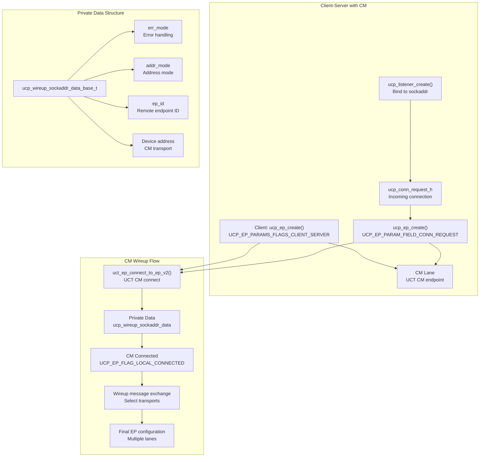

**CM Workflow**:
1. **Server**: `ucp_listener_create()` creates listener on sockaddr
2. **Client**: `ucp_ep_create()` with `UCP_EP_PARAMS_FLAGS_CLIENT_SERVER` flag
3. **UCT CM Connect**: Initial connection via `uct_ep_connect_to_ep_v2()`
4. **Private Data Exchange**: UCP address and configuration in CM private data
5. **Wireup**: Complete transport selection and lane configuration
6. **Multi-Lane**: Final configuration may use multiple transports beyond CM

**CM Lane**: Special lane type (`UCP_LANE_TYPE_CM`) holds the connection manager endpoint:
- Used for initial connection only
- May be replaced or supplemented by other lanes after wireup
- `cm_idx` in `ucp_ep_ext_t` stores CM resource index

**Sources**: [src/ucp/wireup/wireup_cm.c:1-800](), [src/ucp/wireup/wireup_cm.h:1-67](), [src/ucp/core/ucp_listener.c]()

---

## Key API Functions

### Initialization and Cleanup

| Function | Purpose | Key Parameters |
|----------|---------|----------------|
| `ucp_init()` | Initialize UCP context | `ucp_params_t` (features, request_size) |
| `ucp_cleanup()` | Cleanup UCP context | `ucp_context_h` |
| `ucp_worker_create()` | Create worker | `ucp_worker_params_t` (thread_mode, cpu_mask) |
| `ucp_worker_destroy()` | Destroy worker | `ucp_worker_h` |

### Endpoint Management

| Function | Purpose | Key Parameters |
|----------|---------|----------------|
| `ucp_ep_create()` | Create endpoint | `ucp_ep_params_t` (address, sockaddr, flags) |
| `ucp_ep_close_nbx()` | Close endpoint (async) | `ucp_ep_h`, flags |
| `ucp_ep_flush()` | Flush pending operations | `ucp_ep_h` |

### Communication Operations

| Function | Purpose | Protocol |
|----------|---------|----------|
| `ucp_tag_send_nbx()` | Send tagged message | Eager or Rendezvous |
| `ucp_tag_recv_nbx()` | Receive tagged message | Tag matching |
| `ucp_stream_send()` | Send stream data | Ordered delivery |
| `ucp_stream_recv_nbx()` | Receive stream data | FIFO ordering |
| `ucp_am_send_nbx()` | Send active message | User-defined handler |
| `ucp_put_nbx()` | RMA put | Zero-copy PUT |
| `ucp_get_nbx()` | RMA get | Zero-copy GET |
| `ucp_atomic_op_nbx()` | Atomic operation | AMO32/AMO64 |

**Sources**: [src/ucp/api/ucp.h:1-2000]()

---

## Configuration Parameters

Key UCP configuration parameters (environment variables or config file):

| Parameter | Default | Description |
|-----------|---------|-------------|
| `UCX_BCOPY_THRESH` | auto | Threshold for buffer copy protocol |
| `UCX_RNDV_THRESH` | auto | Threshold for rendezvous (intra/inter) |
| `UCX_ZCOPY_THRESH` | auto | Threshold for zero-copy |
| `UCX_RNDV_SCHEME` | auto | Rendezvous mode selection |
| `UCX_MAX_EAGER_RAILS` | 1 | Max lanes for eager messages |
| `UCX_MAX_RNDV_RAILS` | 2 | Max lanes for rendezvous |
| `UCX_MAX_RMA_RAILS` | 1 | Max lanes for RMA |
| `UCX_TM_THRESH` | 1024 | Tag offload threshold |
| `UCX_UNIFIED_MODE` | n | Homogeneous environment optimizations |
| `UCX_CM_USE_ALL_DEVICES` | y | Use all devices in CM mode |
| `UCX_PROTO_ENABLE` | y | Enable protocol selection |

**Sources**: [src/ucp/core/ucp_context.c:161-452]()

---

# Page: UCP API and Core Abstractions

# UCP API and Core Abstractions

<details>
<summary>Relevant source files</summary>

The following files were used as context for generating this wiki page:

- [src/ucp/api/ucp.h](src/ucp/api/ucp.h)
- [src/ucp/api/ucp_compat.h](src/ucp/api/ucp_compat.h)
- [src/ucp/api/ucp_def.h](src/ucp/api/ucp_def.h)
- [src/ucp/core/ucp_context.c](src/ucp/core/ucp_context.c)
- [src/ucp/core/ucp_context.h](src/ucp/core/ucp_context.h)
- [src/ucp/core/ucp_ep.c](src/ucp/core/ucp_ep.c)
- [src/ucp/core/ucp_ep.h](src/ucp/core/ucp_ep.h)
- [src/ucp/core/ucp_ep.inl](src/ucp/core/ucp_ep.inl)
- [src/ucp/core/ucp_worker.c](src/ucp/core/ucp_worker.c)
- [src/ucp/core/ucp_worker.h](src/ucp/core/ucp_worker.h)
- [src/ucp/wireup/select.c](src/ucp/wireup/select.c)
- [src/ucp/wireup/wireup.c](src/ucp/wireup/wireup.c)
- [src/ucp/wireup/wireup.h](src/ucp/wireup/wireup.h)
- [src/ucp/wireup/wireup_cm.c](src/ucp/wireup/wireup_cm.c)
- [src/ucp/wireup/wireup_cm.h](src/ucp/wireup/wireup_cm.h)
- [src/ucp/wireup/wireup_ep.c](src/ucp/wireup/wireup_ep.c)
- [src/ucp/wireup/wireup_ep.h](src/ucp/wireup/wireup_ep.h)
- [test/gtest/ucp/test_ucp_ep.cc](test/gtest/ucp/test_ucp_ep.cc)

</details>


## Purpose and Scope

This page documents the UCP (Unified Communication Protocol) public API and its fundamental abstractions. UCP is the high-level protocol layer in UCX that provides communication operations such as tag matching, streams, RMA, and active messages. This page covers the four core object types that applications interact with: contexts, workers, endpoints, and requests.

For detailed information about context and worker initialization and management, see [Contexts and Workers](#2.2). For endpoint lifecycle and connection establishment, see [Endpoints and Connection Establishment](#2.3). For request management and tag matching details, see [Request Management and Tag Matching](#2.4). For communication protocol specifics, see [Communication Protocols](#2.5).

## UCP Layer Overview

UCP provides a protocol layer that abstracts over multiple UCT (Unified Communication Transport) interfaces. It implements high-level communication semantics while selecting optimal transports based on capabilities and performance characteristics.

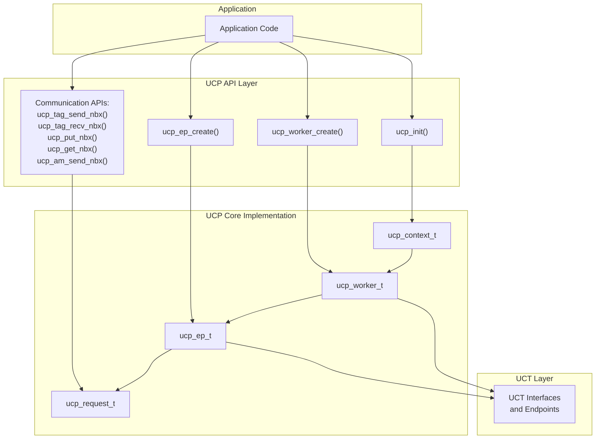

**Sources:** [src/ucp/api/ucp.h:1-1500](), [src/ucp/core/ucp_context.h:1-400](), [src/ucp/core/ucp_worker.h:1-300](), [src/ucp/core/ucp_ep.h:1-500]()

## Core Abstractions

UCP's API is structured around four core abstractions that form a hierarchy of objects. Each abstraction maps to specific opaque handle types and underlying implementation structures.

### Context (ucp_context_h)

The **context** represents a UCP communication instance with its global resources and configuration. It is the root object in the UCP hierarchy.

| API Type | Implementation Type | Purpose |
|----------|-------------------|---------|
| `ucp_context_h` | `struct ucp_context*` | Opaque handle to context |
| `ucp_config_t` | Configuration descriptor | Runtime configuration |
| `ucp_params_t` | Parameter structure | Context initialization parameters |

**Key Operations:**
- `ucp_init()` - Initialize context with configuration and feature flags
- `ucp_cleanup()` - Destroy context and release resources
- `ucp_context_query()` - Query context attributes

**Context Features:** The context is initialized with a bitmask of features defined in `enum ucp_feature` [src/ucp/api/ucp.h:141-172]():
- `UCP_FEATURE_TAG` - Tag matching support
- `UCP_FEATURE_RMA` - Remote memory access
- `UCP_FEATURE_AMO32`/`UCP_FEATURE_AMO64` - Atomic operations
- `UCP_FEATURE_WAKEUP` - Event notification
- `UCP_FEATURE_STREAM` - Stream semantics
- `UCP_FEATURE_AM` - Active messages

**Sources:** [src/ucp/api/ucp.h:60-77](), [src/ucp/api/ucp_def.h:40-60](), [src/ucp/core/ucp_context.h:195-370]()

### Worker (ucp_worker_h)

The **worker** represents a progress engine and communication context on a specific thread. Multiple workers can be created from a single context for multi-threaded applications.

| API Type | Implementation Type | Purpose |
|----------|-------------------|---------|
| `ucp_worker_h` | `struct ucp_worker*` | Opaque handle to worker |
| `ucp_worker_params_t` | Parameter structure | Worker creation parameters |
| `ucp_worker_attr_t` | Attribute structure | Worker attributes |
| `ucp_address_t` | Worker address | Serialized worker address for connection |

**Key Operations:**
- `ucp_worker_create()` - Create worker on context
- `ucp_worker_destroy()` - Destroy worker
- `ucp_worker_progress()` - Make progress on pending operations
- `ucp_worker_get_address()` - Get serialized worker address
- `ucp_worker_flush()` - Flush all outstanding operations

**Thread Modes:** Workers support different thread access modes [src/ucp/core/ucp_worker.h:83-114]():
- `UCP_WORKER_FLAG_THREAD_MULTI` - Concurrent access with locking
- `UCP_WORKER_FLAG_THREAD_SERIALIZED` - Sequential access without locking

**Sources:** [src/ucp/api/ucp.h:176-461](), [src/ucp/core/ucp_worker.h:1-250](), [src/ucp/core/ucp_worker.c:1-1200]()

### Endpoint (ucp_ep_h)

The **endpoint** represents a connection to a remote worker. It manages transport selection, connection establishment, and communication lanes.

| API Type | Implementation Type | Purpose |
|----------|-------------------|---------|
| `ucp_ep_h` | `struct ucp_ep*` | Opaque handle to endpoint |
| `ucp_ep_params_t` | Parameter structure | Endpoint creation parameters |
| `ucp_ep_attr_t` | Attribute structure | Endpoint attributes |

**Key Operations:**
- `ucp_ep_create()` - Create endpoint to remote worker
- `ucp_ep_close_nbx()` - Close endpoint (non-blocking)
- `ucp_ep_flush()` - Flush outstanding operations to endpoint
- `ucp_ep_query()` - Query endpoint attributes

**Endpoint Flags:** Track endpoint state [src/ucp/core/ucp_ep.h:90-132]():
- `UCP_EP_FLAG_LOCAL_CONNECTED` - Local side connected
- `UCP_EP_FLAG_REMOTE_CONNECTED` - Remote side connected
- `UCP_EP_FLAG_FAILED` - Endpoint in failed state
- `UCP_EP_FLAG_USED` - Endpoint in use

**Sources:** [src/ucp/api/ucp.h:252-339](), [src/ucp/core/ucp_ep.h:1-400](), [src/ucp/core/ucp_ep.c:1-1000]()

### Request (ucp_request_t)

The **request** represents an asynchronous communication operation. Requests are the mechanism for non-blocking operations and completion notification.

| Type | Purpose |
|------|---------|
| `void*` | Opaque request handle returned to user |
| `ucp_request_t` | Internal request structure |
| `UCS_PTR_STATUS()` macro | Check if operation completed immediately |

**Request States:**
- **Immediate completion** - Operation completed synchronously, returns `NULL` or status pointer
- **In progress** - Returns valid request pointer, operation proceeds asynchronously
- **Completion** - Request status updated, completion callback invoked (if registered)

**Sources:** [src/ucp/api/ucp.h:700-1500](), [src/ucp/core/ucp_request.h:1-300]()

## Object Hierarchy and Lifecycle

The following diagram shows the hierarchical relationship between UCP objects and their lifecycle operations:

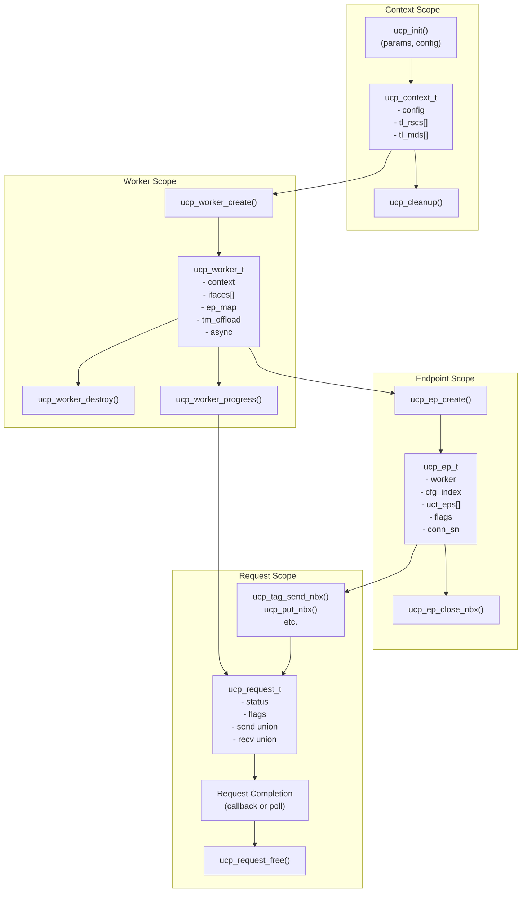

**Key Lifecycle Rules:**

1. **Context** must be created first via `ucp_init()` [src/ucp/core/ucp_context.c:850-950]()
2. **Workers** are created from a context and destroyed before context cleanup [src/ucp/core/ucp_worker.c:380-520]()
3. **Endpoints** are created from a worker and must be closed before worker destruction [src/ucp/core/ucp_ep.c:363-416]()
4. **Requests** are allocated per-operation and freed after completion [src/ucp/core/ucp_request.h:150-250]()

**Sources:** [src/ucp/core/ucp_context.c:850-1200](), [src/ucp/core/ucp_worker.c:380-650](), [src/ucp/core/ucp_ep.c:183-530]()

## Asynchronous Request Model

UCP uses a request-based asynchronous model for all communication operations. This model allows applications to overlap communication with computation and efficiently handle completion.

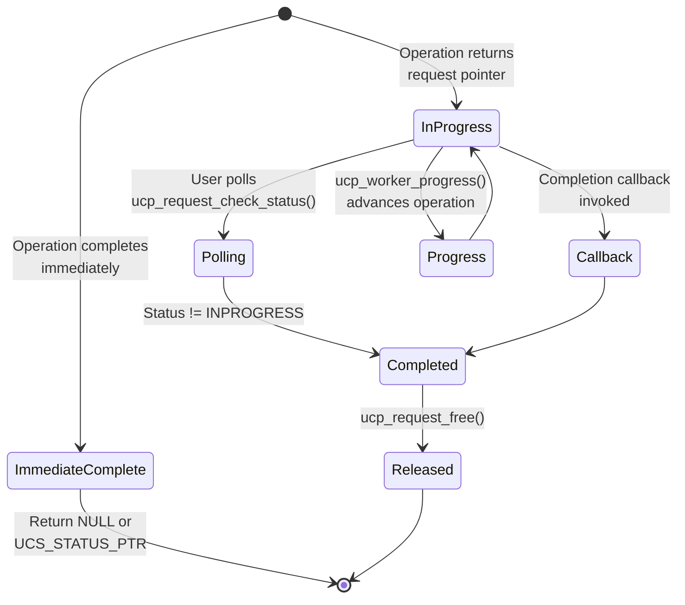

### Request Return Values

Communication functions return a pointer that encodes the operation status:

| Return Value | Meaning | Action |
|--------------|---------|--------|
| `NULL` | Operation completed successfully | No request to free |
| `UCS_STATUS_PTR(status)` | Operation failed immediately | No request to free, check status |
| Valid pointer | Operation in progress | Poll or wait for completion, then free |

**Example Pattern:**
```c
// Non-blocking tagged send
void *request = ucp_tag_send_nbx(ep, buffer, length, tag, &param);

if (request == NULL) {
    // Completed immediately
} else if (UCS_PTR_IS_ERR(request)) {
    // Error occurred
    ucs_status_t status = UCS_PTR_STATUS(request);
} else {
    // In progress - must wait and free
    while (ucp_request_check_status(request) == UCS_INPROGRESS) {
        ucp_worker_progress(worker);
    }
    ucp_request_free(request);
}
```

**Sources:** [src/ucp/api/ucp.h:700-850]()

### Request Structure and Fields

The internal `ucp_request_t` structure tracks operation state [src/ucp/core/ucp_request.h:100-250]():

```mermaid
graph LR
    REQUEST["ucp_request_t"]
    
    subgraph "Common Fields"
        STATUS["status"]
        FLAGS["flags"]
        COMPL["comp_cb"]
    end
    
    subgraph "Send Operation"
        SEND_EP["ep"]
        SEND_BUF["buffer"]
        SEND_LEN["length"]
        SEND_DT["datatype"]
        SEND_TAG["tag (for tag ops)"]
    end
    
    subgraph "Receive Operation"
        RECV_BUF["buffer"]
        RECV_LEN["length"]
        RECV_TAG["tag"]
        RECV_MASK["tag_mask"]
        RECV_INFO["info"]
    end
    
    REQUEST --> STATUS
    REQUEST --> FLAGS
    REQUEST --> COMPL
    REQUEST --> SEND_EP
    REQUEST --> SEND_BUF
    REQUEST --> RECV_BUF
```

**Request Flags:** [src/ucp/core/ucp_request.h:50-100]()
- `UCP_REQUEST_FLAG_COMPLETED` - Operation finished
- `UCP_REQUEST_FLAG_RELEASED` - User released request handle
- `UCP_REQUEST_FLAG_CALLBACK` - Completion callback registered
- `UCP_REQUEST_FLAG_RECV_TAG` - Tagged receive operation

**Sources:** [src/ucp/core/ucp_request.h:80-280](), [src/ucp/core/ucp_request.inl:1-200]()

## API Organization

The UCP API is organized into functional groups, each with its own set of operations and parameters.

### Initialization and Configuration

**Configuration Management:**
- `ucp_config_read()` - Read configuration from environment
- `ucp_config_modify()` - Modify configuration programmatically
- `ucp_config_print()` - Print configuration options
- `ucp_config_release()` - Release configuration structure

**Context Operations:**
- `ucp_init()` - Initialize UCP context [src/ucp/core/ucp_context.c:850-950]()
- `ucp_cleanup()` - Cleanup UCP context [src/ucp/core/ucp_context.c:1400-1500]()

**Sources:** [src/ucp/api/ucp.h:100-200]()

### Worker Management

**Worker Lifecycle:**
- `ucp_worker_create()` - Create worker [src/ucp/core/ucp_worker.c:380-520]()
- `ucp_worker_destroy()` - Destroy worker [src/ucp/core/ucp_worker.c:1150-1250]()
- `ucp_worker_get_address()` - Get serialized address [src/ucp/core/ucp_worker.c:1350-1420]()
- `ucp_worker_release_address()` - Release address buffer

**Progress and Events:**
- `ucp_worker_progress()` - Make progress on operations [src/ucp/core/ucp_worker.c:1500-1600]()
- `ucp_worker_arm()` - Arm event notification
- `ucp_worker_wait()` - Wait for events
- `ucp_worker_signal()` - Signal worker from another thread

**Sources:** [src/ucp/api/ucp.h:400-600](), [src/ucp/core/ucp_worker.c:1-1600]()

### Endpoint Operations

**Endpoint Lifecycle:**
- `ucp_ep_create()` - Create endpoint [src/ucp/core/ucp_ep.c:866-1000]()
- `ucp_ep_close_nbx()` - Close endpoint non-blocking
- `ucp_ep_destroy()` - Deprecated blocking close

**Endpoint Parameters:** [src/ucp/api/ucp.h:258-272]()
- `UCP_EP_PARAM_FIELD_REMOTE_ADDRESS` - Connect via worker address
- `UCP_EP_PARAM_FIELD_SOCK_ADDR` - Connect via socket address
- `UCP_EP_PARAM_FIELD_ERR_HANDLING_MODE` - Error handling mode
- `UCP_EP_PARAM_FIELD_ERR_HANDLER` - Error handler callback

**Sources:** [src/ucp/api/ucp.h:252-400](), [src/ucp/core/ucp_ep.c:780-1100]()

### Communication APIs

**Tagged Messaging:**
- `ucp_tag_send_nbx()` - Non-blocking tagged send
- `ucp_tag_send_sync_nbx()` - Non-blocking synchronous send
- `ucp_tag_recv_nbx()` - Non-blocking tagged receive
- `ucp_tag_probe_nb()` - Probe for incoming message

**Stream Operations:**
- `ucp_stream_send_nbx()` - Non-blocking stream send
- `ucp_stream_recv_nbx()` - Non-blocking stream receive
- `ucp_stream_recv_data_nbx()` - Receive with data pointer

**RMA Operations:**
- `ucp_put_nbx()` - Non-blocking remote put
- `ucp_get_nbx()` - Non-blocking remote get

**Atomic Operations:**
- `ucp_atomic_op_nbx()` - Non-blocking atomic operation
- `ucp_atomic_fetch_nb()` - Fetch atomic (deprecated)

**Active Messages:**
- `ucp_am_send_nbx()` - Send active message
- `ucp_worker_set_am_recv_handler()` - Register AM handler

**Sources:** [src/ucp/api/ucp.h:700-1500]()

### Parameter and Attribute Structures

UCP uses field masks to allow backward-compatible API evolution. Each parameter structure includes a `field_mask` that indicates which fields are valid.

**Common Pattern:**
```c
ucp_ep_params_t ep_params;
ep_params.field_mask = UCP_EP_PARAM_FIELD_REMOTE_ADDRESS |
                       UCP_EP_PARAM_FIELD_ERR_HANDLING_MODE;
ep_params.address    = remote_addr;
ep_params.err_mode   = UCP_ERR_HANDLING_MODE_PEER;
```

**Field Mask Enumerations:** [src/ucp/api/ucp.h:119-537]()
- `ucp_params_field` - Context parameters
- `ucp_worker_params_field` - Worker parameters  
- `ucp_ep_params_field` - Endpoint parameters
- `ucp_mem_map_params_field` - Memory mapping parameters

**Sources:** [src/ucp/api/ucp.h:115-600]()

## Implementation Mapping

The following table maps public API types to their internal implementation structures:

| Public API Handle | Implementation Structure | Definition Location |
|-------------------|-------------------------|---------------------|
| `ucp_context_h` | `struct ucp_context` | [src/ucp/core/ucp_context.h:195-370]() |
| `ucp_worker_h` | `struct ucp_worker` | [src/ucp/core/ucp_worker.h:232-520]() |
| `ucp_ep_h` | `struct ucp_ep` | [src/ucp/core/ucp_ep.h:284-364]() |
| `ucp_request_t*` | `struct ucp_request` | [src/ucp/core/ucp_request.h:82-280]() |
| `ucp_mem_h` | `struct ucp_mem` | [src/ucp/core/ucp_rkey.h:45-85]() |
| `ucp_rkey_h` | `struct ucp_rkey` | [src/ucp/core/ucp_rkey.h:87-130]() |

**Key Implementation Files:**
- **Context:** [src/ucp/core/ucp_context.c]() - Context lifecycle and configuration
- **Worker:** [src/ucp/core/ucp_worker.c]() - Worker creation, progress, and address management
- **Endpoint:** [src/ucp/core/ucp_ep.c]() - Endpoint lifecycle and operations
- **Wireup:** [src/ucp/wireup/wireup.c](), [src/ucp/wireup/select.c]() - Connection establishment
- **Protocols:** [src/ucp/tag/](), [src/ucp/stream/](), [src/ucp/rma/]() - Protocol implementations

**Sources:** [src/ucp/core/ucp_context.h:195-400](), [src/ucp/core/ucp_worker.h:232-600](), [src/ucp/core/ucp_ep.h:284-500](), [src/ucp/core/ucp_request.h:82-350]()

---

# Page: Contexts and Workers

# Contexts and Workers

<details>
<summary>Relevant source files</summary>

The following files were used as context for generating this wiki page:

- [src/ucp/core/ucp_context.c](src/ucp/core/ucp_context.c)
- [src/ucp/core/ucp_context.h](src/ucp/core/ucp_context.h)
- [src/ucp/core/ucp_ep.c](src/ucp/core/ucp_ep.c)
- [src/ucp/core/ucp_ep.h](src/ucp/core/ucp_ep.h)
- [src/ucp/core/ucp_ep.inl](src/ucp/core/ucp_ep.inl)
- [src/ucp/core/ucp_worker.c](src/ucp/core/ucp_worker.c)
- [src/ucp/core/ucp_worker.h](src/ucp/core/ucp_worker.h)
- [src/ucp/wireup/select.c](src/ucp/wireup/select.c)
- [src/ucp/wireup/wireup.c](src/ucp/wireup/wireup.c)
- [src/ucp/wireup/wireup.h](src/ucp/wireup/wireup.h)
- [src/ucp/wireup/wireup_cm.c](src/ucp/wireup/wireup_cm.c)
- [src/ucp/wireup/wireup_cm.h](src/ucp/wireup/wireup_cm.h)
- [src/ucp/wireup/wireup_ep.c](src/ucp/wireup/wireup_ep.c)
- [src/ucp/wireup/wireup_ep.h](src/ucp/wireup/wireup_ep.h)

</details>


This page provides a detailed explanation of `ucp_context_t` and `ucp_worker_t`, the two fundamental abstractions in the UCP layer. These structures manage resources, configuration, and runtime execution within UCX.

**Scope**: This page covers context and worker initialization, configuration, resource management, and the progress engine. For information about endpoint creation and communication protocols, see [Endpoints and Connection Establishment](#2.3). For details about the UCT layer and transport resources, see [UCT API and Interface Design](#3.1).

## Overview

The UCP layer is built on two core abstractions:

- **`ucp_context_t`**: A global application object that holds configuration, available transport resources, memory domains, and protocol definitions. It is shared across all workers in a process.
- **`ucp_worker_t`**: A thread-local execution context that manages communication operations, progress, and endpoints. Each worker owns its set of UCT interfaces and endpoints.

The typical usage pattern is: (1) create a context once per process, (2) create one or more workers, (3) create endpoints on workers, (4) perform communication.

**Key Relationship**: A context can have multiple workers, but each worker belongs to exactly one context. Workers are independent and can run on different threads.

## Context Structure and Initialization

### Context Structure

The `ucp_context_t` structure holds global state and configuration:

```mermaid
graph TD
    subgraph "ucp_context_t Structure"
        CONFIG["config<br/>(ucp_config_t)<br/>User configuration + derived settings"]
        TL_RSCS["tl_rscs[]<br/>(ucp_tl_resource_desc_t)<br/>Available transport resources"]
        TL_MDS["tl_mds[]<br/>(ucp_tl_md_t)<br/>Memory domains with UCT MDs"]
        TL_BITMAP["tl_bitmap<br/>Bitmap of enabled transports"]
        NUM_TLS["num_tls<br/>Number of TL resources"]
        NUM_CMS["num_cms<br/>Number of CM components"]
        EP_CONFIG["ep_config[]<br/>Cached endpoint configurations"]
        RKEY_CONFIG["rkey_config[]<br/>Cached rkey configurations"]
    end
    
    CONFIG --> TL_RSCS
    CONFIG --> TL_MDS
    TL_RSCS --> TL_BITMAP
    TL_MDS --> TL_RSCS
```

**Sources**: [src/ucp/core/ucp_context.h:231-391]()

Key fields in `ucp_context_t`:
- **`config`** (`ucp_config_t`): Contains `features` (UCP_FEATURE_*), `ext` (extended configuration like thresholds), and transport selection criteria
- **`tl_rscs`** (`ucp_tl_resource_desc_t[]`): Array of available transport resources, each containing a `uct_tl_resource_desc_t` and device index
- **`tl_mds`** (`ucp_tl_md_t[]`): Array of memory domains, each wrapping a `uct_md_h` handle
- **`tl_bitmap`**: Static bitmap indicating which transports are enabled
- **`ep_config`**: Cache of endpoint configurations indexed by `ucp_worker_cfg_index_t`
- **`num_tls`**, **`num_cms`**: Counts of transport layers and connection manager components

### Context Initialization Flow

```mermaid
sequenceDiagram
    participant App as Application
    participant API as ucp_init
    participant CFG as ucp_fill_config
    participant CTX as ucp_init_version
    participant RES as Resource Discovery
    participant MD as Memory Domains

    App->>API: ucp_init(config, params)
    API->>CFG: Parse and validate config
    CFG->>CTX: Create ucp_context_t
    CTX->>RES: Query UCT resources
    RES->>RES: Filter by UCX_TLS
    RES->>CTX: Populate tl_rscs[]
    CTX->>MD: Open memory domains
    MD->>CTX: Populate tl_mds[]
    CTX->>CTX: Initialize EP configs
    CTX->>API: Return context handle
    API->>App: context_h
```

**Sources**: [src/ucp/core/ucp_context.c:1-100](), [src/ucp/core/ucp_context.c:2300-2450]()

The initialization sequence:
1. **Configuration Parsing**: `ucp_fill_config` reads environment variables and user parameters to build `ucp_context_config_t` [src/ucp/core/ucp_context.c:161-485]()
2. **Resource Discovery**: `ucp_check_resources` queries all UCT components for available transport resources [src/ucp/core/ucp_context.c:1720-1900]()
3. **Filtering**: Resources are filtered based on `UCX_TLS`, `UCX_NET_DEVICES`, and other configuration variables
4. **Memory Domain Opening**: For each unique memory domain, `uct_md_open` is called to obtain handles [src/ucp/core/ucp_context.c:2050-2150]()
5. **Configuration Caching**: Endpoint and rkey configurations are pre-computed for common patterns

### Context Configuration

The `ucp_context_config_t` structure contains numerous tunable parameters:

| Configuration Parameter | Type | Purpose |
|------------------------|------|---------|
| `bcopy_thresh` | size_t | Threshold to switch from short to bcopy protocol |
| `rndv_intra_thresh`, `rndv_inter_thresh` | size_t | Rendezvous thresholds for intra/inter-node |
| `zcopy_thresh` | size_t | Threshold to switch to zero-copy protocol |
| `max_eager_lanes`, `max_rndv_lanes`, `max_rma_lanes` | unsigned | Max parallel lanes for protocols |
| `estimated_num_eps`, `estimated_num_ppn` | size_t | Hints for transport selection |
| `adaptive_progress` | int | Enable/disable adaptive progress |
| `use_mt_mutex` | int | Use mutex vs spinlock for thread safety |

**Sources**: [src/ucp/core/ucp_context.h:56-224](), [src/ucp/core/ucp_context.c:161-585]()

Configuration is parsed from three sources (in priority order):
1. Environment variables (e.g., `UCX_RNDV_THRESH`)
2. User-provided parameters in `ucp_params_t`
3. Default values

## Worker Structure and Management

### Worker Structure

The `ucp_worker_t` structure manages runtime execution:

```mermaid
graph TD
    subgraph "ucp_worker_t Structure"
        CONTEXT["context<br/>(ucp_context_h)<br/>Parent context"]
        UCT["uct<br/>(uct_worker_h)<br/>UCT worker for polling"]
        IFACES["ifaces[]<br/>(ucp_worker_iface_t*)<br/>UCT interfaces"]
        NUM_IFACES["num_ifaces<br/>Total interfaces"]
        NUM_ACTIVE["num_active_ifaces<br/>Currently active"]
        
        ALL_EPS["all_eps<br/>(list)<br/>User endpoints"]
        INTERNAL_EPS["internal_eps<br/>(list)<br/>Internal endpoints"]
        EP_MAP["ep_map<br/>(ucs_ptr_map_t)<br/>EP ID to pointer map"]
        
        EVENT_FD["event_fd<br/>File descriptor for wakeup"]
        EVENT_SET["event_set<br/>(ucs_event_set_t)<br/>Event polling set"]
        EVENTFD["eventfd<br/>Internal signaling FD"]
        
        ASYNC["async<br/>(ucs_async_context_t)<br/>Async event handling"]
        FLAGS["flags<br/>THREAD_MULTI, EDGE_TRIGGERED, etc"]
        
        MPOOLS["Request mpools<br/>req_mp, rndv_frag_mp"]
    end
    
    CONTEXT --> UCT
    CONTEXT --> IFACES
    IFACES --> NUM_IFACES
    IFACES --> NUM_ACTIVE
    ALL_EPS --> EP_MAP
    EVENT_SET --> EVENT_FD
    EVENT_SET --> EVENTFD
```

**Sources**: [src/ucp/core/ucp_worker.h:230-380]()

Key fields in `ucp_worker_t`:
- **`context`**: Back-reference to parent context
- **`uct`**: UCT worker handle for progress operations
- **`ifaces`**: Array of `ucp_worker_iface_t*` representing opened UCT interfaces
- **`all_eps`**, **`internal_eps`**: Lists of endpoints managed by this worker
- **`ep_map`**: Maps endpoint IDs to `ucp_ep_h` pointers for fast lookup
- **`event_fd`**, **`event_set`**, **`eventfd`**: Wakeup mechanism for event-driven mode
- **`async`**: Async context for thread safety and event delivery
- **`flags`**: Worker configuration flags (thread model, edge-triggered, etc.)

### Worker Initialization Flow

```mermaid
sequenceDiagram
    participant App as Application
    participant API as ucp_worker_create
    participant WKR as ucp_worker_init
    participant UCT_W as UCT Worker
    participant IFACE as Interface Opening
    participant MPOOL as Memory Pools

    App->>API: ucp_worker_create(context, params)
    API->>WKR: Allocate ucp_worker_t
    WKR->>UCT_W: uct_worker_create()
    UCT_W->>WKR: uct_worker_h
    WKR->>WKR: Setup async context
    WKR->>WKR: Initialize wakeup (if enabled)
    WKR->>IFACE: Open UCT interfaces
    loop For each TL resource
        IFACE->>IFACE: uct_iface_open()
        IFACE->>IFACE: Configure iface attributes
        IFACE->>WKR: Add to ifaces[]
    end
    WKR->>MPOOL: Initialize memory pools
    MPOOL->>WKR: Request pools ready
    WKR->>API: Return worker handle
    API->>App: worker_h
```

**Sources**: [src/ucp/core/ucp_worker.c:1200-1550]()

Worker initialization steps:
1. **UCT Worker Creation**: `uct_worker_create` creates an underlying UCT worker for polling [src/ucp/core/ucp_worker.c:1250-1280]()
2. **Async Context Setup**: Initialize `ucs_async_context` for thread safety and callbacks [src/ucp/core/ucp_worker.c:1285-1320]()
3. **Wakeup Initialization**: If `UCP_FEATURE_WAKEUP` is set, create event fd and event set [src/ucp/core/ucp_worker.c:282-362]()
4. **Interface Opening**: For each transport resource in context, call `uct_iface_open` [src/ucp/core/ucp_worker.c:1350-1450]()
5. **Memory Pool Creation**: Initialize request pools (`req_mp`) and fragment pools (`rndv_frag_mp`) [src/ucp/core/ucp_worker.c:1480-1530]()

### Worker Interface Management

Each worker maintains an array of `ucp_worker_iface_t` structures representing opened UCT interfaces:

```mermaid
graph LR
    subgraph "ucp_worker_iface_t"
        IFACE["iface<br/>(uct_iface_h)<br/>UCT interface handle"]
        ATTR["attr<br/>(uct_iface_attr_t)<br/>Cached attributes"]
        RSC_INDEX["rsc_index<br/>Index in context tl_rscs"]
        ACTIVATE_COUNT["activate_count<br/>Activation reference count"]
        FLAGS["flags<br/>OFFLOAD_ACTIVATED, ON_ARM_LIST"]
        EVENT_FD["event_fd<br/>Interface event FD"]
        PROXY_RECV["proxy_recv_count<br/>Proxy AM receive count"]
        PORT_SPEED["port_speed<br/>Quantized bandwidth"]
    end
    
    IFACE --> ATTR
    IFACE --> RSC_INDEX
    ACTIVATE_COUNT --> FLAGS
```

**Sources**: [src/ucp/core/ucp_worker.h:381-445]()

**Interface Activation**: Worker interfaces use adaptive progress to reduce overhead. Interfaces transition between active and inactive states:

- **Activation** (`ucp_worker_iface_activate`): Called when communication is expected. Sets AM handlers, enables progress, and adds to wakeup list [src/ucp/core/ucp_worker.c:576-609]()
- **Deactivation** (`ucp_worker_iface_deactivate`): Called when idle. Disables progress, removes from wakeup list, and sets proxy AM handlers [src/ucp/core/ucp_worker.c:730-765]()
- **Checking Events** (`ucp_worker_iface_check_events`): Monitors for incoming messages and arms interface event if no activity [src/ucp/core/ucp_worker.c:702-728]()

The `activate_count` field tracks nested activation, allowing multiple operations to keep an interface active simultaneously.

**Sources**: [src/ucp/core/ucp_worker.c:173-227](), [src/ucp/core/ucp_worker.c:576-789]()

## Progress Engine

The UCP progress engine drives communication forward by polling UCT interfaces and processing callbacks.

### Progress Mechanisms

```mermaid
graph TD
    APP["Application calls<br/>ucp_worker_progress()"]
    PROG_ENGINE["Progress Engine"]
    
    APP --> PROG_ENGINE
    
    PROG_ENGINE --> CHECK_WAKEUP["Check if wakeup armed"]
    CHECK_WAKEUP --> UCT_PROGRESS["uct_worker_progress(uct)"]
    
    UCT_PROGRESS --> POLL_IFACES["Poll all active interfaces"]
    POLL_IFACES --> IFACE1["uct_iface_progress(iface1)"]
    POLL_IFACES --> IFACE2["uct_iface_progress(iface2)"]
    
    IFACE1 --> RX1["Receive completions"]
    IFACE1 --> TX1["Send completions"]
    IFACE2 --> RX2["Receive completions"]
    IFACE2 --> TX2["Send completions"]
    
    RX1 --> AM_HANDLERS["Call AM handlers"]
    RX2 --> AM_HANDLERS
    TX1 --> CALLBACKS["Invoke completion callbacks"]
    TX2 --> CALLBACKS
    
    AM_HANDLERS --> PROCESS_REQS["Process pending requests"]
    CALLBACKS --> PROCESS_REQS
    
    PROCESS_REQS --> RETURN["Return # events processed"]
    RETURN --> APP
```

**Sources**: [src/ucp/core/ucp_worker.c:2800-2850]()

The progress function `ucp_worker_progress` performs the following:
1. **Disarm wakeup**: If event fd was armed, disarm it [src/ucp/core/ucp_worker.c:2810-2820]()
2. **Poll UCT worker**: Call `uct_worker_progress` which polls all active UCT interfaces [src/ucp/core/ucp_worker.c:2830]()
3. **Process AM callbacks**: UCT delivers received messages via AM handler callbacks registered in `ucp_am_handlers` [src/ucp/core/ucp_worker.c:173-227]()
4. **Execute pending operations**: Process operations queued on endpoints that couldn't be sent immediately
5. **Return event count**: Number of events processed

### Active Message Handlers

Worker interfaces register AM handler callbacks during activation:

```mermaid
graph LR
    subgraph "AM Handler Registration"
        WIFACE["ucp_worker_iface_t"]
        AM_IDS["AM IDs:<br/>UCP_AM_ID_WIREUP,<br/>UCP_AM_ID_EAGER_ONLY,<br/>UCP_AM_ID_RNDV_RTS,<br/>etc."]
        HANDLERS["ucp_am_handlers[]<br/>Global handler array"]
        UCT_IFACE["uct_iface_set_am_handler()"]
    end
    
    WIFACE --> AM_IDS
    AM_IDS --> HANDLERS
    HANDLERS --> UCT_IFACE
    UCT_IFACE --> WIFACE
```

**Sources**: [src/ucp/core/ucp_worker.c:173-227]()

The `ucp_worker_set_am_handlers` function iterates over all AM IDs (0-63) and registers callbacks:
- Checks if the handler is defined in `ucp_am_handlers` array [src/ucp/core/ucp_worker.c:189-191]()
- Verifies required features are enabled in context [src/ucp/core/ucp_worker.c:193-195]()
- Calls `uct_iface_set_am_handler` with the appropriate callback [src/ucp/core/ucp_worker.c:207-221]()
- For proxy mode (inactive interfaces), registers proxy callbacks that increment counters [src/ucp/core/ucp_worker.c:207-215]()

When an AM arrives, UCT invokes the registered handler with the worker as the `arg` parameter.

## Event Handling and Wakeup

Workers support event-driven operation through the `UCP_FEATURE_WAKEUP` feature.

### Wakeup Architecture

```mermaid
graph TD
    subgraph "Wakeup Components"
        USER["User polls event_fd"]
        EVENT_FD["event_fd<br/>(from event_set)"]
        EVENT_SET["event_set<br/>(ucs_event_set_t)<br/>epoll-based"]
        EVENTFD["eventfd<br/>(internal signaling)"]
        IFACE_FDS["Interface event FDs<br/>(from UCT ifaces)"]
        ARM_LIST["arm_ifaces list<br/>(interfaces to arm)"]
    end
    
    EVENT_SET --> EVENT_FD
    EVENTFD --> EVENT_SET
    IFACE_FDS --> EVENT_SET
    ARM_LIST --> IFACE_FDS
    
    USER --> EVENT_FD
    EVENT_FD --> |"epoll_wait returns"| USER
```

**Sources**: [src/ucp/core/ucp_worker.c:282-375]()

**Initialization**: When `UCP_FEATURE_WAKEUP` is enabled:
1. Create an `ucs_event_set_t` (typically backed by epoll) [src/ucp/core/ucp_worker.c:303-312]()
2. Obtain an `event_fd` from the event set [src/ucp/core/ucp_worker.c:314-317]()
3. Create an internal `eventfd` for signaling [src/ucp/core/ucp_worker.c:323-328]()
4. Add the `eventfd` to the event set [src/ucp/core/ucp_worker.c:330]()

**Arming** (`ucp_worker_arm`): Makes the worker wait-able:
1. Flush all pending operations [src/ucp/core/ucp_worker.c:2650-2660]()
2. Iterate over `arm_ifaces` list and call `uct_iface_event_arm` on each [src/ucp/core/ucp_worker.c:2665-2695]()
3. For interfaces supporting event FD, add FD to event set [src/ucp/core/ucp_worker.c:595-598]()
4. Return `UCS_OK` if armed, or `UCS_ERR_BUSY` if new events arrived [src/ucp/core/ucp_worker.c:2700-2710]()

**Signaling** (`ucp_worker_signal_internal`): Wakes up a blocked worker:
1. Write to `eventfd` to trigger event set [src/ucp/core/ucp_worker.c:423-447]()
2. Called internally when operations complete or new work arrives [src/ucp/core/ucp_worker.c:449-454]()

**Sources**: [src/ucp/core/ucp_worker.c:2600-2750](), [src/ucp/core/ucp_worker.c:423-454]()

### Thread Safety

Workers support multiple threading modes controlled by `ucp_worker_params_t.thread_mode`:

| Thread Mode | Flag | Description |
|-------------|------|-------------|
| `UCS_THREAD_MODE_SINGLE` | None | Single-threaded, no locking |
| `UCS_THREAD_MODE_SERIALIZED` | `UCP_WORKER_FLAG_THREAD_SERIALIZED` | Multi-threaded but serialized by user |
| `UCS_THREAD_MODE_MULTI` | `UCP_WORKER_FLAG_THREAD_MULTI` | Multi-threaded with internal locking |

**Sources**: [src/ucp/core/ucp_worker.h:83-114]()

**Async Context**: The worker's `async` field (`ucs_async_context_t`) provides thread safety:
- **Block/Unblock**: `UCS_ASYNC_BLOCK` and `UCS_ASYNC_UNBLOCK` macros control critical sections [src/ucp/core/ucp_worker.h:40-77]()
- **Mutex vs Spinlock**: Controlled by `UCX_USE_MT_MUTEX` configuration [src/ucp/core/ucp_context.h:118]()
- **Nested Blocking**: Reference counting allows nested calls to block the async context

Example usage pattern:
```c
UCS_ASYNC_BLOCK(&worker->async);
// Modify worker state safely
ucp_ep_update_flags(ep, UCP_EP_FLAG_REMOTE_CONNECTED, 0);
UCS_ASYNC_UNBLOCK(&worker->async);
```

**Sources**: [src/ucp/core/ucp_worker.c:130](), [src/ucp/core/ucp_worker.c:543-573]()

## Context-Worker Relationship

### Resource Sharing

```mermaid
graph TD
    subgraph Context["ucp_context_t (Process-wide)"]
        CTX_RSCS["tl_rscs[]<br/>Transport resources"]
        CTX_MDS["tl_mds[]<br/>Memory domains"]
        CTX_CONFIG["config<br/>Configuration"]
        CTX_EP_CFG["ep_config[]<br/>EP config cache"]
    end
    
    subgraph Worker1["ucp_worker_t (Thread 1)"]
        W1_IFACES["ifaces[]<br/>Opened interfaces"]
        W1_EPS["all_eps<br/>Endpoints"]
        W1_UCT["uct_worker"]
    end
    
    subgraph Worker2["ucp_worker_t (Thread 2)"]
        W2_IFACES["ifaces[]<br/>Opened interfaces"]
        W2_EPS["all_eps<br/>Endpoints"]
        W2_UCT["uct_worker"]
    end
    
    CTX_RSCS --> W1_IFACES
    CTX_RSCS --> W2_IFACES
    CTX_MDS --> W1_IFACES
    CTX_MDS --> W2_IFACES
    CTX_CONFIG --> W1_IFACES
    CTX_CONFIG --> W2_IFACES
    CTX_EP_CFG --> W1_EPS
    CTX_EP_CFG --> W2_EPS
    
    W1_IFACES --> W1_UCT
    W2_IFACES --> W2_UCT
```

**Sources**: [src/ucp/core/ucp_context.h:231-391](), [src/ucp/core/ucp_worker.h:230-380]()

**Resource Usage Pattern**:
1. Context owns the **definition** of available resources (which transports, which MDs exist)
2. Each worker **opens its own instance** of UCT interfaces from those resources
3. Workers share cached configurations (EP configs, rkey configs) from context
4. Workers maintain **independent** UCT workers and endpoint lists

This design allows:
- Multiple workers to use the same transport resources without contention
- Configuration changes in context to apply to all workers
- Workers to run on different threads safely
- Efficient resource sharing (shared MD handles, shared configuration cache)

### Lifecycle Management

```mermaid
sequenceDiagram
    participant App
    participant Context
    participant Worker1
    participant Worker2
    participant Endpoints

    App->>Context: ucp_init()
    Note over Context: Open MDs, query resources
    
    App->>Worker1: ucp_worker_create(context)
    Note over Worker1: Open interfaces
    
    App->>Worker2: ucp_worker_create(context)
    Note over Worker2: Open interfaces
    
    App->>Endpoints: ucp_ep_create(worker1)
    App->>Endpoints: ucp_ep_create(worker2)
    
    Note over Worker1,Worker2: Communication phase
    
    App->>Endpoints: ucp_ep_close_nbx()
    App->>Worker2: ucp_worker_destroy()
    Note over Worker2: Close interfaces
    
    App->>Worker1: ucp_worker_destroy()
    Note over Worker1: Close interfaces
    
    App->>Context: ucp_cleanup()
    Note over Context: Close MDs, free resources
```

**Destruction Order**: Workers must be destroyed before their context:
1. Close all endpoints on each worker [src/ucp/core/ucp_ep.c:492-524]()
2. Destroy workers, which closes UCT interfaces [src/ucp/core/ucp_worker.c:2000-2100]()
3. Cleanup context, which closes UCT MDs [src/ucp/core/ucp_context.c:2500-2600]()

Violating this order causes resource leaks or crashes.

**Sources**: [src/ucp/core/ucp_worker.c:2000-2150](), [src/ucp/core/ucp_context.c:2500-2650]()

---

# Page: Endpoints and Connection Establishment

# Endpoints and Wireup

<details>
<summary>Relevant source files</summary>

The following files were used as context for generating this wiki page:

- [src/ucp/core/ucp_context.c](src/ucp/core/ucp_context.c)
- [src/ucp/core/ucp_context.h](src/ucp/core/ucp_context.h)
- [src/ucp/core/ucp_ep.c](src/ucp/core/ucp_ep.c)
- [src/ucp/core/ucp_ep.h](src/ucp/core/ucp_ep.h)
- [src/ucp/core/ucp_ep.inl](src/ucp/core/ucp_ep.inl)
- [src/ucp/core/ucp_listener.c](src/ucp/core/ucp_listener.c)
- [src/ucp/core/ucp_listener.h](src/ucp/core/ucp_listener.h)
- [src/ucp/core/ucp_worker.c](src/ucp/core/ucp_worker.c)
- [src/ucp/core/ucp_worker.h](src/ucp/core/ucp_worker.h)
- [src/ucp/wireup/address.c](src/ucp/wireup/address.c)
- [src/ucp/wireup/address.h](src/ucp/wireup/address.h)
- [src/ucp/wireup/select.c](src/ucp/wireup/select.c)
- [src/ucp/wireup/wireup.c](src/ucp/wireup/wireup.c)
- [src/ucp/wireup/wireup.h](src/ucp/wireup/wireup.h)
- [src/ucp/wireup/wireup_cm.c](src/ucp/wireup/wireup_cm.c)
- [src/ucp/wireup/wireup_cm.h](src/ucp/wireup/wireup_cm.h)
- [src/ucp/wireup/wireup_ep.c](src/ucp/wireup/wireup_ep.c)
- [src/ucp/wireup/wireup_ep.h](src/ucp/wireup/wireup_ep.h)
- [test/gtest/ucp/test_ucp_peer_failure.cc](test/gtest/ucp/test_ucp_peer_failure.cc)
- [test/gtest/ucp/test_ucp_sockaddr.cc](test/gtest/ucp/test_ucp_sockaddr.cc)
- [test/gtest/ucp/test_ucp_wireup.cc](test/gtest/ucp/test_ucp_wireup.cc)
- [test/gtest/ucp/ucp_test.cc](test/gtest/ucp/ucp_test.cc)
- [test/gtest/ucp/ucp_test.h](test/gtest/ucp/ucp_test.h)

</details>


This page documents the UCP endpoint lifecycle, connection establishment through the wireup protocol, transport selection, lane assignment, and client-server connection models. For information about memory management and registration, see [Memory Management](#4).

## 1. Overview

A UCP endpoint (`ucp_ep_h`) represents a communication channel to a remote UCP worker. The **wireup protocol** is responsible for establishing connections between endpoints, exchanging worker addresses, selecting optimal transports, and configuring communication lanes. This page covers the complete endpoint lifecycle from creation through connection establishment to destruction.
</thinking>

**Key Components:**
- `ucp_ep_h` - opaque endpoint handle
- `ucp_ep_config_key_t` - lane configuration for an endpoint
- `ucp_wireup_ep_t` - proxy endpoint used during connection establishment
- Wireup messages - protocol messages for connection negotiation

**UCP Endpoint Architecture: Multi-Lane Communication**

```mermaid
graph TB
    App["Application"] --> ucp_ep["ucp_ep_h<br/>(UCP Endpoint)"]
    
    ucp_ep --> Lane0["Lane 0: am_lane<br/>(Active Messages)"]
    ucp_ep --> Lane1["Lane 1: rma_lanes[0]<br/>(RMA Operations)"]
    ucp_ep --> Lane2["Lane 2: tag_lane<br/>(Tag Matching)"]
    ucp_ep --> Lane3["Lane 3: amo_lanes[0]<br/>(Atomic Operations)"]
    
    Lane0 --> uct_ep0["uct_ep_h<br/>(e.g., TCP)"]
    Lane1 --> uct_ep1["uct_ep_h<br/>(e.g., RC)"]
    Lane2 --> uct_ep2["uct_ep_h<br/>(e.g., DC)"]
    Lane3 --> uct_ep3["uct_ep_h<br/>(e.g., RC)"]
    
    uct_ep0 --> tl0["UCT Transport"]
    uct_ep1 --> tl1["UCT Transport"]
    uct_ep2 --> tl2["UCT Transport"]
    uct_ep3 --> tl3["UCT Transport"]
```

Sources: [src/ucp/core/ucp_ep.h:216-268](), [src/ucp/core/ucp_ep.inl:32-42]()

## 2. Endpoint Structure and Lanes

A UCP endpoint is represented by the `ucp_ep_h` opaque handle. Internally, it consists of several components:

**Core Endpoint Data Structures**

```mermaid
classDiagram
    class ucp_ep {
        +refcount: uint8_t
        +flags: ucp_ep_flags_t
        +worker: ucp_worker_h
        +cfg_index: ucp_worker_cfg_index_t
        +am_lane: ucp_lane_index_t
        +conn_sn: ucp_ep_match_conn_sn_t
        +uct_eps[UCP_MAX_FAST_PATH_LANES]: uct_ep_h
        +ext: ucp_ep_ext_t*
    }
    
    class ucp_ep_ext_t {
        +ep: ucp_ep_h
        +ep_list: ucs_list_link_t
        +user_data: void*
        +cm_idx: ucp_rsc_index_t
        +local_ep_id: ucs_ptr_map_key_t
        +remote_ep_id: ucs_ptr_map_key_t
        +uct_eps: uct_ep_h*
        +ep_match: ucp_ep_match_t
        +flush_state: ucp_ep_flush_state_t
    }

    class ucp_ep_config_key {
        +num_lanes: ucp_lane_index_t
        +lanes[UCP_MAX_LANES]: ucp_ep_config_key_lane_t
        +am_lane: ucp_lane_index_t
        +tag_lane: ucp_lane_index_t
        +wireup_msg_lane: ucp_lane_index_t
        +cm_lane: ucp_lane_index_t
        +keepalive_lane: ucp_lane_index_t
        +rma_lanes[UCP_MAX_LANES]: ucp_lane_index_t
        +rma_bw_lanes[UCP_MAX_LANES]: ucp_lane_index_t
        +amo_lanes[UCP_MAX_LANES]: ucp_lane_index_t
        +am_bw_lanes[UCP_MAX_LANES]: ucp_lane_index_t
        +err_mode: ucp_err_handling_mode_t
    }
    
    class ucp_ep_config_key_lane {
        +rsc_index: ucp_rsc_index_t
        +dst_md_index: ucp_md_index_t
        +dst_sys_dev: ucs_sys_device_t
        +path_index: uint8_t
        +lane_types: ucp_lane_type_mask_t
        +seg_size: size_t
    }

    ucp_ep *-- ucp_ep_ext_t
    ucp_ep --> ucp_ep_config_key : cfg_index
    ucp_ep_config_key *-- ucp_ep_config_key_lane
```

Sources: [src/ucp/core/ucp_ep.h:199-208](), [src/ucp/core/ucp_ep.h:216-268]()

### 2.1 Lane Configuration

Each endpoint has multiple **lanes** - independent communication paths that can use different transports. The `ucp_ep_config_key_t` structure defines which lanes exist and how they map to UCT resources.

**Lane Types and Their Purpose:**

| Lane Type | Purpose | Key Fields |
|-----------|---------|------------|
| `am_lane` | Active message operations | `ucp_ep_config_key.am_lane` |
| `tag_lane` | Tag matching offload | `ucp_ep_config_key.tag_lane` |
| `wireup_msg_lane` | Wireup protocol messages | `ucp_ep_config_key.wireup_msg_lane` |
| `cm_lane` | Connection manager lane | `ucp_ep_config_key.cm_lane` |
| `keepalive_lane` | Connection health checking | `ucp_ep_config_key.keepalive_lane` |
| `rma_lanes[]` | Remote memory access | Array of lane indices |
| `rma_bw_lanes[]` | High-bandwidth RMA | Array of lane indices |
| `amo_lanes[]` | Atomic memory operations | Array of lane indices |
| `am_bw_lanes[]` | High-bandwidth AM | Array of lane indices |

Sources: [src/ucp/core/ucp_ep.h:216-268](), [src/ucp/wireup/select.c:52-61]()

### 2.2 Endpoint Flags

Endpoints maintain various flags to track their state:

| Flag | Description |
|------|-------------|
| UCP_EP_FLAG_LOCAL_CONNECTED | All local endpoints are connected |
| UCP_EP_FLAG_REMOTE_CONNECTED | All remote endpoints are connected |
| UCP_EP_FLAG_CONNECT_REQ_QUEUED | Connection request was queued |
| UCP_EP_FLAG_FAILED | EP is in failed state |
| UCP_EP_FLAG_USED | EP is in use by the user |
| UCP_EP_FLAG_REMOTE_ID | Remote ID is valid |
| UCP_EP_FLAG_CLOSED | EP was closed |
| UCP_EP_FLAG_INTERNAL | Internal EP for temporary wireup or mem-type transfers |

Sources: [src/ucp/core/ucp_ep.h:90-132]()

### 2.3 Endpoint Initialization Flags

When creating an endpoint, several initialization flags can be specified:

| Flag | Description |
|------|-------------|
| UCP_EP_INIT_FLAG_MEM_TYPE | Endpoint for local memory type transfers |
| UCP_EP_INIT_CREATE_AM_LANE | Endpoint requires an AM lane |
| UCP_EP_INIT_CM_WIREUP_CLIENT | Endpoint wireup protocol is based on CM, client side |
| UCP_EP_INIT_CM_WIREUP_SERVER | Endpoint wireup protocol is based on CM, server side |
| UCP_EP_INIT_ERR_MODE_PEER_FAILURE | Endpoint requires peer failure handling |
| UCP_EP_INIT_CM_PHASE | Endpoint connection to a peer is on CM phase |

Sources: [src/ucp/core/ucp_ep.h:149-170]()

## 3. Endpoint Lifecycle

### 3.1 Endpoint Creation

**Endpoint Creation Flow with Wireup**

```mermaid
flowchart TD
    ucp_ep_create["ucp_ep_create()"] --> ucp_ep_create_base["ucp_ep_create_base()"]
    ucp_ep_create_base --> ucp_ep_allocate["ucp_ep_allocate()"]
    ucp_ep_allocate --> ptr_map["UCS_PTR_MAP_PUT()<br/>(assign local_ep_id)"]
    ptr_map --> list_add["Add to worker->all_eps list"]
    list_add --> wireup_init["ucp_wireup_init_lanes()"]
    
    wireup_init --> select_lanes["ucp_wireup_select_lanes()"]
    select_lanes --> select_transport["ucp_wireup_select_transport()<br/>(for each lane type)"]
    select_transport --> score["Calculate transport scores<br/>based on criteria"]
    score --> config["ucp_worker_get_ep_config()<br/>(get or create config)"]
    config --> create_uct["Create UCT endpoints<br/>for each lane"]
    create_uct --> return["Return ucp_ep_h"]
```

The endpoint creation process involves:

1. **Allocation** - `ucp_ep_allocate()` allocates the `ucp_ep` structure and extension
2. **ID Assignment** - `UCS_PTR_MAP_PUT()` assigns a unique `local_ep_id`
3. **Worker Registration** - Endpoint is added to `worker->all_eps` list
4. **Lane Selection** - `ucp_wireup_init_lanes()` calls `ucp_wireup_select_lanes()` to choose transports
5. **Configuration** - `ucp_worker_get_ep_config()` retrieves or creates an endpoint configuration
6. **UCT Endpoint Creation** - Create `uct_ep_h` for each selected lane

Sources: [src/ucp/core/ucp_ep.c:189-261](), [src/ucp/core/ucp_ep.c:361-414](), [src/ucp/core/ucp_ep.c:822-858]()

### 3.2 Connection Establishment and Wireup Protocol

Connections between endpoints can be established in two ways:

1. **Direct connection** - Using explicit UCP worker addresses
2. **Client-Server connection** - Using TCP/IP socket addresses (sockaddr) through a connection manager (CM)

#### 3.2.1 Direct Connection with Wireup Protocol

**Wireup Message Exchange**

```mermaid
sequenceDiagram
    participant PeerA as "Peer A<br/>(ucp_ep_h)"
    participant PeerB as "Peer B<br/>(ucp_ep_h)"
    
    Note over PeerA,PeerB: Both sides have each other's worker address
    
    PeerA->>PeerA: ucp_ep_create()<br/>ucp_wireup_init_lanes()
    PeerB->>PeerB: ucp_ep_create()<br/>ucp_wireup_init_lanes()
    
    PeerA->>PeerB: UCP_WIREUP_MSG_REQUEST<br/>(ucp_wireup_msg_send)
    Note over PeerB: Parse address<br/>ucp_wireup_msg_handler()
    
    PeerB->>PeerA: UCP_WIREUP_MSG_REPLY<br/>(contains selected lanes)
    Note over PeerA: Connect local lanes<br/>ucp_wireup_connect_local()
    
    PeerA->>PeerB: UCP_WIREUP_MSG_ACK
    Note over PeerB: Mark remote connected<br/>ucp_wireup_remote_connected()
    
    Note over PeerA,PeerB: Connection established<br/>UCP_EP_FLAG_LOCAL_CONNECTED<br/>UCP_EP_FLAG_REMOTE_CONNECTED
```

**Wireup Message Structure (`ucp_wireup_msg_t`):**

| Field | Description |
|-------|-------------|
| `type` | Message type (REQUEST/REPLY/ACK) |
| `err_mode` | Error handling mode |
| `conn_sn` | Connection sequence number |
| `src_ep_id` | Source endpoint ID |
| `dst_ep_id` | Destination endpoint ID |
| Packed address | Variable-length worker/device/interface addresses |

Sources: [src/ucp/wireup/wireup.h:122-130](), [src/ucp/wireup/wireup.c:118-215](), [src/ucp/wireup/wireup.c:254-299]()

#### 3.2.2 Client-Server Connection via Connection Manager

**Connection Manager (CM) Flow**

```mermaid
sequenceDiagram
    participant Client as "Client<br/>(ucp_ep_create)"
    participant CM as "UCT CM<br/>(uct_cm_h)"
    participant Listener as "Server Listener<br/>(ucp_listener_h)"
    participant Server as "Server EP<br/>(ucp_ep_h)"
    
    Listener->>Listener: ucp_listener_create()
    Note over Listener: Listening on sockaddr
    
    Client->>Client: ucp_ep_create()<br/>with UCP_EP_PARAM_FIELD_SOCK_ADDR
    Client->>Client: ucp_ep_client_cm_create_uct_ep()
    Client->>CM: uct_ep_create() + uct_ep_connect()
    
    CM->>Listener: Connection request
    Listener->>Listener: ucp_cm_server_conn_request_cb()
    Listener->>Server: ucp_ep_cm_server_create_connected()
    Server->>Server: Create endpoint with<br/>UCP_EP_INIT_CM_WIREUP_SERVER
    
    Server->>Client: Connection accepted
    Client->>Client: ucp_cm_client_connect_cb()
    
    Note over Client,Server: Optional: Exchange wireup messages<br/>to configure additional lanes
    
    Client->>Server: UCP_WIREUP_MSG_REQUEST (optional)
    Server->>Client: UCP_WIREUP_MSG_REPLY (optional)
    
    Note over Client,Server: Connection established
```

**Key Functions in CM Wireup:**

| Function | Purpose |
|----------|---------|
| `ucp_ep_client_cm_create_uct_ep()` | Create UCT CM endpoint on client |
| `ucp_cm_server_conn_request_cb()` | Server callback for incoming connections |
| `ucp_ep_cm_server_create_connected()` | Create server endpoint from connection request |
| `ucp_cm_client_connect_cb()` | Client callback when connection completes |

Sources: [src/ucp/wireup/wireup_cm.c:52-142](), [src/ucp/wireup/wireup_cm.c:165-218](), [src/ucp/core/ucp_listener.c]()

### 3.3 Transport Selection and Lane Assignment

Lane selection is the core responsibility of the wireup subsystem. The `ucp_wireup_select_lanes()` function evaluates all available transports and assigns them to lanes based on communication requirements.

**Transport Selection Process**

```mermaid
flowchart TD
    select_lanes["ucp_wireup_select_lanes()"] --> criteria["Define selection criteria<br/>(ucp_wireup_criteria_t)"]
    
    criteria --> am_lane["Select AM lane<br/>(ucp_wireup_select_transport)"]
    criteria --> rma_lanes["Select RMA lanes<br/>(ucp_wireup_add_bw_lanes)"]
    criteria --> amo_lanes["Select AMO lanes"]
    criteria --> tag_lane["Select TAG lane"]
    criteria --> keepalive["Select keepalive lane"]
    
    am_lane --> score_am["Score transports:<br/>- UCT_IFACE_FLAG_AM_*<br/>- Latency<br/>- Bandwidth"]
    rma_lanes --> score_rma["Score transports:<br/>- UCT_IFACE_FLAG_PUT/GET_*<br/>- Bandwidth<br/>- Multi-rail"]
    amo_lanes --> score_amo["Score transports:<br/>- Atomic flags<br/>- Latency"]
    tag_lane --> score_tag["Score transports:<br/>- UCT_IFACE_FLAG_TAG_*<br/>- Offload capability"]
    
    score_am --> assign["Assign to<br/>ucp_ep_config_key"]
    score_rma --> assign
    score_amo --> assign
    score_tag --> assign
    keepalive --> assign
    
    assign --> config_key["ucp_ep_config_key_t:<br/>num_lanes, lanes[],<br/>am_lane, rma_lanes[],<br/>amo_lanes[], tag_lane"]
```

**Selection Criteria (`ucp_wireup_criteria_t`):**

| Field | Description |
|-------|-------------|
| `title` | Human-readable criteria name (e.g., "active messages") |
| `local_md_flags` | Required local MD flags (e.g., `UCT_MD_FLAG_REG`) |
| `local_iface_flags` | Required local interface flags (e.g., `UCT_IFACE_FLAG_AM_BCOPY`) |
| `remote_iface_flags` | Required remote interface flags |
| `calc_score` | Function pointer to calculate transport score |
| `lane_type` | Lane type being selected (e.g., `UCP_LANE_TYPE_AM`) |
| `tl_rsc_flags` | Transport resource flags (e.g., `UCP_TL_RSC_FLAG_AUX`) |

**Transport Scoring:**

For each candidate transport, `calc_score()` is called to evaluate suitability:
- **Latency-based:** Prefer lower latency for AM and small messages
- **Bandwidth-based:** Prefer higher bandwidth for RMA and large transfers  
- **Capability-based:** Must support required flags (AM, PUT/GET, atomics)
- **Distance-based:** Consider NUMA locality and device distance

Sources: [src/ucp/wireup/wireup.h:58-116](), [src/ucp/wireup/select.c:390-739]()

### 3.4 Wireup Endpoint (`ucp_wireup_ep_t`)

During connection establishment, a special **wireup endpoint** acts as a proxy before the final transport endpoints are ready.

**Wireup Endpoint Structure**

```mermaid
graph TB
    ucp_ep["ucp_ep_h"] --> wireup_ep["ucp_wireup_ep_t<br/>(proxy endpoint)"]
    
    wireup_ep --> pending_q["pending_q<br/>(queued operations)"]
    wireup_ep --> aux_ep["aux_ep<br/>(for wireup messages)"]
    wireup_ep --> next_ep["super.uct_ep<br/>(final transport)"]
    wireup_ep --> flags["flags:<br/>READY, LOCAL_CONNECTED,<br/>REMOTE_CONNECTED"]
    
    aux_ep --> aux_transport["UCT EP<br/>(e.g., TCP for AM)"]
    next_ep -.-> |"switches to"| final_transport["UCT EP<br/>(e.g., IB RC)"]
```

**Wireup EP Lifecycle:**

1. **Creation** - `ucp_wireup_ep_create()` creates proxy endpoint
2. **Auxiliary EP** - `ucp_wireup_ep_set_aux()` sets up aux_ep for wireup messages
3. **Queue Operations** - User operations queued in `pending_q` until connection ready
4. **Ready State** - `UCP_WIREUP_EP_FLAG_READY` set when connection established
5. **Switch** - `ucp_wireup_eps_progress()` switches from wireup_ep to final transport
6. **Replay** - Queued operations replayed on final transport

Sources: [src/ucp/wireup/wireup_ep.h:44-60](), [src/ucp/wireup/wireup_ep.c:66-127](), [src/ucp/wireup/wireup.c:485-557]()

### 3.5 Endpoint ID Mapping

UCX maintains a mapping between local and remote endpoint IDs to ensure proper message routing:

```mermaid
graph LR
    subgraph "Worker A"
        A1["EP ID: 1"] --> A2["Local ptr: 0x1234"]
    end
    
    subgraph "Worker B"
        B1["EP ID: 5"] --> B2["Local ptr: 0x5678"]
    end
    
    A1 --> |"knows remote ID"| B1
    B1 --> |"knows remote ID"| A1
    
    style A1 fill:#f9f9f9, stroke:#333
    style A2 fill:#f9f9f9, stroke:#333
    style B1 fill:#f9f9f9, stroke:#333
    style B2 fill:#f9f9f9, stroke:#333
```

The mapping is implemented using a ptr_map data structure:
1. Each endpoint is assigned a unique ID within its worker
2. During connection, endpoints exchange their IDs
3. Messages include the destination endpoint ID for routing

This indirection helps with:
- Error handling (detecting when an endpoint is destroyed)
- Supporting indirect access in protocols
- Maintaining endpoint validity checks

Sources: [src/ucp/core/ucp_ep.c:552-568](), [src/ucp/core/ucp_worker.h:570-580]()

## 4. Wireup Protocol Details

The wireup protocol establishes connections through a three-way handshake, similar to TCP. It exchanges worker addresses, selects optimal transports, and configures communication lanes.

### 4.1 Wireup Message Types and Handlers

**Wireup Message Types:**

| Type | Value | Purpose |
|------|-------|---------|
| `UCP_WIREUP_MSG_PRE_REQUEST` | 0 | Optional pre-request for preparation |
| `UCP_WIREUP_MSG_REQUEST` | 1 | Connection request with address |
| `UCP_WIREUP_MSG_REPLY` | 2 | Connection reply with selected transports |
| `UCP_WIREUP_MSG_ACK` | 3 | Connection acknowledgment |
| `UCP_WIREUP_MSG_EP_CHECK` | 4 | Keepalive/health check |
| `UCP_WIREUP_MSG_EP_REMOVED` | 5 | Endpoint removal notification |

**Message Handler Flow**

```mermaid
flowchart TD
    recv["Receive wireup message<br/>(ucp_am_handler_wireup)"] --> parse["Parse ucp_wireup_msg_t header"]
    
    parse --> check_type{"Message type?"}
    
    check_type -->|REQUEST| handle_req["ucp_wireup_msg_handler()<br/>- Unpack remote address<br/>- Select lanes<br/>- Create/update endpoint"]
    check_type -->|REPLY| handle_rep["ucp_wireup_process_reply()<br/>- Connect local lanes<br/>- Send ACK"]
    check_type -->|ACK| handle_ack["ucp_wireup_process_ack()<br/>- Mark remote connected<br/>- Switch to final EPs"]
    
    handle_req --> send_reply["ucp_wireup_msg_send()<br/>(REPLY)"]
    handle_rep --> send_ack["ucp_wireup_msg_send()<br/>(ACK)"]
    handle_ack --> done["Connection complete"]
```

Sources: [src/ucp/wireup/wireup.h:43-52](), [src/ucp/wireup/wireup.c:59-77](), [src/ucp/wireup/wireup.c:118-215]()

### 4.2 Address Packing and Unpacking

Wireup messages contain packed worker addresses with device and interface information.

**Address Components:**

```mermaid
graph LR
    addr["Packed Address"] --> header["Header<br/>(version, flags, UUID)"]
    addr --> devices["Device Addresses"]
    addr --> ifaces["Interface Addresses"]
    addr --> eps["Endpoint Addresses"]
    
    devices --> dev1["Device 0:<br/>md_index, dev_addr"]
    devices --> dev2["Device 1:<br/>md_index, dev_addr"]
    
    ifaces --> if1["Interface 0:<br/>tl_name_csum, attrs"]
    ifaces --> if2["Interface 1:<br/>tl_name_csum, attrs"]
    
    eps --> ep1["EP Address 0:<br/>lane, ep_addr"]
    eps --> ep2["EP Address 1:<br/>lane, ep_addr"]
```

**Address Packing Functions:**

| Function | Purpose |
|----------|---------|
| `ucp_address_pack()` | Pack worker address into wire format |
| `ucp_address_unpack()` | Unpack wire format into `ucp_unpacked_address_t` |
| `ucp_wireup_msg_prepare()` | Prepare wireup message with packed address |

Sources: [src/ucp/wireup/address.c:1601-1883](), [src/ucp/wireup/address.h:119-168](), [src/ucp/wireup/wireup.c:218-251]()

### 4.3 Lane Connection (`ucp_wireup_connect_local`)

After selecting transports, the endpoint must connect to remote addresses.

**Connect Local Lanes to Remote Addresses**

```mermaid
flowchart TD
    connect["ucp_wireup_connect_local()"] --> match["ucp_wireup_match_p2p_lanes()<br/>(map local to remote lanes)"]
    
    match --> iterate["For each P2P lane"]
    iterate --> find_remote["ucp_wireup_find_remote_p2p_addr()<br/>(find remote EP address)"]
    
    find_remote --> connect_ep["ucp_wireup_ep_connect_to_ep_v2()<br/>(connect UCT EP)"]
    
    connect_ep --> uct_connect{"Connection type?"}
    uct_connect -->|"CONNECT_TO_EP"| ep_mode["uct_ep_connect_to_ep()"]
    uct_connect -->|"CONNECT_TO_IFACE"| iface_mode["uct_ep_connect_to_iface()"]
    
    ep_mode --> done["Lane connected"]
    iface_mode --> done
```

**P2P Lane Matching:**

The `ucp_wireup_match_p2p_lanes()` function creates a mapping between local lane indices and remote lane indices:

1. For each local lane that requires P2P connection
2. Find the corresponding address entry in remote address
3. Select the appropriate EP address within that entry
4. Store mapping in `lanes2remote[]` array

Sources: [src/ucp/wireup/wireup.c:330-390](), [src/ucp/wireup/wireup.c:416-455]()

## 5. Special Endpoint Types

### 5.1 Memory Type Endpoints

UCX creates special internal endpoints for memory type operations. These are created during worker initialization via `ucp_worker_mem_type_eps_create()`.

**Memory Type Endpoint Creation**

```mermaid
flowchart TD
    init["ucp_worker_mem_type_eps_create()"] --> for_each["For each memory type<br/>(CUDA, ROCM, etc.)"]
    
    for_each --> check["Has memory access TLs?"]
    check -->|Yes| pack["Pack worker address<br/>with mem access TLs"]
    check -->|No| skip["Skip memory type"]
    
    pack --> create["ucp_ep_create_to_worker_addr()<br/>with UCP_EP_INIT_FLAG_MEM_TYPE"]
    create --> store["Store in worker->mem_type_ep[type]"]
    
    store --> internal["Mark as UCP_EP_FLAG_INTERNAL"]
```

**Memory Type Endpoints:**

| Memory Type | Worker Field | Purpose |
|-------------|--------------|---------|
| `UCS_MEMORY_TYPE_CUDA` | `worker->mem_type_ep[CUDA]` | CUDA memory operations |
| `UCS_MEMORY_TYPE_ROCM` | `worker->mem_type_ep[ROCM]` | ROCm memory operations |
| `UCS_MEMORY_TYPE_ZE_*` | `worker->mem_type_ep[ZE_*]` | Intel GPU memory operations |

These endpoints facilitate operations between different memory types:
- Host ↔ GPU memory transfers
- Memory copies between different accelerator types
- Optimized paths for heterogeneous memory

Sources: [src/ucp/core/ucp_ep.c:678-743](), [src/ucp/core/ucp_worker.h:230-284]()

## 6. Error Handling

UCX provides error handling mechanisms for endpoint failures:

```mermaid
flowchart TD
    A["Detect endpoint failure"] --> B["ucp_ep_set_failed()"]
    B --> C{"Error handling mode?"}
    C -->|"PEER_FAILURE"| D["Invoke error callback"]
    C -->|"NONE"| E["Report error to operation"]
    
    D --> F["Application decides how to handle failure"]
    F -->|"Disconnect"| G["ucp_ep_destroy()"]
    F -->|"Reconnect"| H["Create new endpoint"]
    
    style A fill:#f9f9f9, stroke:#333
    style B fill:#f9f9f9, stroke:#333
    style C fill:#f9f9f9, stroke:#333
    style D fill:#f9f9f9, stroke:#333
    style E fill:#f9f9f9, stroke:#333
    style F fill:#f9f9f9, stroke:#333
    style G fill:#f9f9f9, stroke:#333
    style H fill:#f9f9f9, stroke:#333
```

Error handling options:
1. `UCP_ERR_HANDLING_MODE_NONE`: Operations return errors, no special handling
2. `UCP_ERR_HANDLING_MODE_PEER`: Invoke user-provided error callback for peer failures

When an endpoint fails:
1. It's marked with `UCP_EP_FLAG_FAILED`
2. Pending operations are completed with error status
3. Future operations on the failed endpoint immediately return an error

Sources: [src/ucp/core/ucp_ep.c:589-599](), [test/gtest/ucp/test_ucp_peer_failure.cc]()

## 7. Keepalive Mechanism

UCX implements a keepalive mechanism to detect endpoint failures. The keepalive lane is selected during wireup if error handling mode is `UCP_ERR_HANDLING_MODE_PEER`.

**Keepalive Lane Selection**

During lane selection in `ucp_wireup_select_lanes()`, if `err_mode == UCP_ERR_HANDLING_MODE_PEER`, a keepalive lane is chosen. The selection criteria (`ucp_wireup_check_keepalive()`) checks for:

1. **Native keepalive:** `UCT_IFACE_FLAG_EP_KEEPALIVE` + `UCT_IFACE_FLAG_CONNECT_TO_EP`
2. **Endpoint check:** `UCT_IFACE_FLAG_EP_CHECK` + `UCT_IFACE_FLAG_CONNECT_TO_EP`
3. **AM-based keepalive:** `UCT_IFACE_FLAG_CONNECT_TO_IFACE` + `UCT_IFACE_FLAG_AM_BCOPY`

**Keepalive Configuration:**

| Configuration | Description |
|---------------|-------------|
| `UCX_KEEPALIVE_INTERVAL` | Time between keepalive rounds (default: 20s) |
| `UCX_KEEPALIVE_NUM_EPS` | Max endpoints to check per round (default: 128) |

Sources: [src/ucp/wireup/select.c:309-351](), [src/ucp/core/ucp_context.h:152-156]()

## 8. Endpoint Cleanup and Disconnection

### 8.1 Endpoint Disconnection

```mermaid
flowchart TD
    A["ucp_ep_destroy() / ucp_ep_close_nbx()"] --> B["Flush endpoint"]
    B --> C["Disconnect UCT endpoints"]
    C --> D["ucp_ep_cleanup_lanes()"]
    D --> E["Remove from worker's endpoint list"]
    E --> F["Free endpoint resources"]
    
    style A fill:#f9f9f9, stroke:#333
    style B fill:#f9f9f9, stroke:#333
    style C fill:#f9f9f9, stroke:#333
    style D fill:#f9f9f9, stroke:#333
    style E fill:#f9f9f9, stroke:#333
    style F fill:#f9f9f9, stroke:#333
```

The disconnection process ensures:
1. Any in-flight operations are completed
2. Transport-level connections are properly terminated
3. All resources associated with the endpoint are freed

Sources: [src/ucp/core/ucp_ep.c:490-522](), [test/gtest/ucp/test_ucp_wireup.cc:62-64]()

### 8.2 Reference Counting

Endpoints use reference counting to manage their lifecycle:

```mermaid
graph TD
    A["Initial refcount = 1"] --> B["ucp_ep_refcount_add()"]
    B --> C["Operations increase refcount"]
    C --> D["ucp_ep_refcount_remove()"]
    D --> E{"refcount == 0?"}
    E -->|"Yes"| F["Free endpoint"]
    E -->|"No"| G["Endpoint stays alive"]
    
    style A fill:#f9f9f9, stroke:#333
    style B fill:#f9f9f9, stroke:#333
    style C fill:#f9f9f9, stroke:#333
    style D fill:#f9f9f9, stroke:#333
    style E fill:#f9f9f9, stroke:#333
    style F fill:#f9f9f9, stroke:#333
    style G fill:#f9f9f9, stroke:#333
```

Reference counting ensures that:
1. The endpoint isn't destroyed while operations are pending
2. Resources are properly released once all operations complete
3. Multiple components can safely use the same endpoint

Sources: [src/ucp/core/ucp_ep.h:54-74](), [src/ucp/core/ucp_ep.c:181-187]()

## 9. API Examples

Example of creating a UCP endpoint:

```c
/* UCP endpoint parameters */
ucp_ep_params_t ep_params;
ucp_ep_h ep;
ucs_status_t status;

/* Fill endpoint parameters */
ep_params.field_mask        = UCP_EP_PARAM_FIELD_REMOTE_ADDRESS |
                              UCP_EP_PARAM_FIELD_ERR_HANDLER;
ep_params.address           = remote_worker_address;
ep_params.err_handler.cb    = error_handler_cb;
ep_params.err_handler.arg   = NULL;

/* Create the endpoint */
status = ucp_ep_create(worker, &ep_params, &ep);
if (status != UCS_OK) {
    /* Handle error */
}
```

Example of creating a UCP endpoint with sockaddr:

```c
/* UCP endpoint parameters for sockaddr connection */
ucp_ep_params_t ep_params;
ucp_ep_h ep;
ucs_status_t status;
struct sockaddr_in server_addr;

/* Fill sockaddr */
memset(&server_addr, 0, sizeof(server_addr));
server_addr.sin_family      = AF_INET;
server_addr.sin_port        = htons(13337);
inet_pton(AF_INET, "192.168.1.100", &server_addr.sin_addr);

/* Fill endpoint parameters */
ep_params.field_mask        = UCP_EP_PARAM_FIELD_FLAGS |
                              UCP_EP_PARAM_FIELD_SOCK_ADDR |
                              UCP_EP_PARAM_FIELD_ERR_HANDLER;
ep_params.flags             = UCP_EP_PARAMS_FLAGS_CLIENT_SERVER;
ep_params.sockaddr.addr     = (struct sockaddr*)&server_addr;
ep_params.sockaddr.addrlen  = sizeof(server_addr);
ep_params.err_handler.cb    = error_handler_cb;
ep_params.err_handler.arg   = NULL;

/* Create the endpoint */
status = ucp_ep_create(worker, &ep_params, &ep);
if (status != UCS_OK) {
    /* Handle error */
}
```

Sources: [test/gtest/ucp/test_ucp_wireup.cc](), [test/gtest/ucp/test_ucp_sockaddr.cc]()

---

# Page: Request Management and Tag Matching

# Request Management and Tag Matching

<details>
<summary>Relevant source files</summary>

The following files were used as context for generating this wiki page:

- [src/ucp/core/ucp_request.c](src/ucp/core/ucp_request.c)
- [src/ucp/core/ucp_request.h](src/ucp/core/ucp_request.h)
- [src/ucp/core/ucp_request.inl](src/ucp/core/ucp_request.inl)
- [src/ucp/proto/proto_am.inl](src/ucp/proto/proto_am.inl)
- [src/ucp/stream/stream.h](src/ucp/stream/stream.h)
- [src/ucp/stream/stream_recv.c](src/ucp/stream/stream_recv.c)
- [src/ucp/stream/stream_send.c](src/ucp/stream/stream_send.c)
- [src/ucp/tag/eager_rcv.c](src/ucp/tag/eager_rcv.c)
- [src/ucp/tag/eager_snd.c](src/ucp/tag/eager_snd.c)
- [src/ucp/tag/offload.c](src/ucp/tag/offload.c)
- [src/ucp/tag/offload.h](src/ucp/tag/offload.h)
- [src/ucp/tag/tag_match.c](src/ucp/tag/tag_match.c)
- [src/ucp/tag/tag_match.h](src/ucp/tag/tag_match.h)
- [src/ucp/tag/tag_match.inl](src/ucp/tag/tag_match.inl)
- [src/ucp/tag/tag_recv.c](src/ucp/tag/tag_recv.c)
- [src/ucp/tag/tag_send.c](src/ucp/tag/tag_send.c)

</details>


This page documents UCP's request management system and tag matching subsystem. These components form the foundation for asynchronous communication in UCX, managing the lifecycle of send/receive operations and implementing message matching semantics for tagged messaging.

**Scope:** This page covers the `ucp_request_t` structure, request allocation/completion mechanisms, and the tag matching algorithm including expected/unexpected queues, hash-based matching, and hardware offload. For endpoint management and connection establishment, see [Endpoints and Connection Establishment](#2.3). For protocol selection and data transfer mechanisms, see [Communication Protocols](#2.5).

---

## Request Structure and Lifecycle

UCP requests represent asynchronous communication operations. Each request tracks the operation's state, associated resources, and completion information. The request structure is the central data structure for all UCP operations including tagged messaging, streams, RMA, and active messages.

### Request Structure (`ucp_request_t`)

```mermaid
graph TB
    subgraph "ucp_request_t Core Fields"
        STATUS["status<br/>(ucs_status_t)"]
        FLAGS["flags<br/>(uint32_t)"]
        ID["id<br/>(ucs_ptr_map_key_t)"]
        USER_DATA["user_data / super_req<br/>(union)"]
    end
    
    subgraph "Send Union"
        SEND_EP["ep (ucp_ep_h)"]
        SEND_BUFFER["buffer / flushed_cb"]
        SEND_DATATYPE["datatype"]
        SEND_LENGTH["length"]
        SEND_CB["cb (completion callback)"]
        SEND_STATE["state (dt_iter / dt)"]
        SEND_PROTO["proto_config"]
        SEND_LANE["lane, pending_lane"]
    end
    
    subgraph "Recv Union"
        RECV_WORKER["worker"]
        RECV_DT_ITER["dt_iter (datatype iterator)"]
        RECV_TAG["tag, tag_mask"]
        RECV_UCT_CTX["uct_ctx (offload)"]
        RECV_REMAINING["remaining / queue"]
    end
    
    STATUS --> FLAGS
    FLAGS --> ID
    ID --> USER_DATA
    USER_DATA --> SEND_EP
    USER_DATA -.or.-> RECV_WORKER
    
    SEND_EP --> SEND_BUFFER
    SEND_BUFFER --> SEND_DATATYPE
    SEND_DATATYPE --> SEND_LENGTH
    SEND_LENGTH --> SEND_CB
    SEND_CB --> SEND_STATE
    SEND_STATE --> SEND_PROTO
    SEND_PROTO --> SEND_LANE
    
    RECV_WORKER --> RECV_DT_ITER
    RECV_DT_ITER --> RECV_TAG
    RECV_TAG --> RECV_UCT_CTX
    RECV_UCT_CTX --> RECV_REMAINING
```

**Sources:** [src/ucp/core/ucp_request.h:145-488]()

The request structure uses a union to support different operation types (send vs. receive). Key fields include:

| Field | Type | Purpose |
|-------|------|---------|
| `status` | `ucs_status_t` | Operation completion status |
| `flags` | `uint32_t` | Request state flags (see below) |
| `id` | `ucs_ptr_map_key_t` | Request ID for protocol operations |
| `send.ep` | `ucp_ep_h` | Target endpoint for send operations |
| `send.buffer` | `void*` | Send buffer pointer |
| `send.datatype` | `ucp_datatype_t` | Datatype descriptor |
| `send.length` | `size_t` | Total message length |
| `send.state` | Union | Progress state (dt_iter or dt) |
| `recv.tag.tag` | `ucp_tag_t` | Expected receive tag |
| `recv.tag.tag_mask` | `ucp_tag_t` | Tag mask for matching |
| `recv.dt_iter` | `ucp_datatype_iter_t` | Receive buffer iterator |

**Sources:** [src/ucp/core/ucp_request.h:145-488]()

### Request Flags

```mermaid
graph LR
    subgraph "Lifecycle Flags"
        COMPLETED["UCP_REQUEST_FLAG_COMPLETED<br/>0x01"]
        RELEASED["UCP_REQUEST_FLAG_RELEASED<br/>0x02"]
        CALLBACK["UCP_REQUEST_FLAG_CALLBACK<br/>0x40"]
    end
    
    subgraph "Operation Type Flags"
        SEND_TAG["UCP_REQUEST_FLAG_SEND_TAG<br/>0x4000"]
        RECV_TAG["UCP_REQUEST_FLAG_RECV_TAG<br/>0x20000"]
        SEND_AM["UCP_REQUEST_FLAG_SEND_AM<br/>0x2000"]
        RECV_AM["UCP_REQUEST_FLAG_RECV_AM<br/>0x10000"]
    end
    
    subgraph "Protocol Flags"
        PROTO_SEND["UCP_REQUEST_FLAG_PROTO_SEND<br/>0x04"]
        SYNC["UCP_REQUEST_FLAG_SYNC<br/>0x100"]
        OFFLOADED["UCP_REQUEST_FLAG_OFFLOADED<br/>0x400"]
        BLOCK_OFFLOAD["UCP_REQUEST_FLAG_BLOCK_OFFLOAD<br/>0x800"]
    end
    
    COMPLETED --> RELEASED
    RELEASED --> CALLBACK
    SEND_TAG --> RECV_TAG
    RECV_TAG --> SEND_AM
    PROTO_SEND --> SYNC
    SYNC --> OFFLOADED
```

**Sources:** [src/ucp/core/ucp_request.h:36-67]()

Request flags encode the state and operation type:

| Flag | Value | Description |
|------|-------|-------------|
| `UCP_REQUEST_FLAG_COMPLETED` | 0x01 | Operation has completed |
| `UCP_REQUEST_FLAG_RELEASED` | 0x02 | User has released the request |
| `UCP_REQUEST_FLAG_CALLBACK` | 0x40 | Completion callback is set |
| `UCP_REQUEST_FLAG_SEND_TAG` | 0x4000 | Tagged send operation |
| `UCP_REQUEST_FLAG_RECV_TAG` | 0x20000 | Tagged receive operation |
| `UCP_REQUEST_FLAG_SYNC` | 0x100 | Synchronous send (requires ACK) |
| `UCP_REQUEST_FLAG_OFFLOADED` | 0x400 | Posted to hardware tag matching |
| `UCP_REQUEST_FLAG_BLOCK_OFFLOAD` | 0x800 | Cannot be offloaded to hardware |

**Sources:** [src/ucp/core/ucp_request.h:36-67]()

### Request Allocation and Release

```mermaid
sequenceDiagram
    participant User as "User Code"
    participant API as "ucp_tag_send_nbx /<br/>ucp_tag_recv_nbx"
    participant Alloc as "ucp_request_get"
    participant Pool as "worker->req_mp<br/>(ucs_mpool_t)"
    participant Init as "ucp_request_reset_internal"
    
    User->>API: Call send/recv
    API->>Alloc: ucp_request_get(worker)
    Alloc->>Pool: ucs_mpool_get_inline(&worker->req_mp)
    Pool-->>Alloc: req
    Alloc->>Init: ucp_request_reset_internal(req, worker)
    Init->>Init: Set req->id = UCS_PTR_MAP_KEY_INVALID
    Init-->>Alloc: 
    Alloc-->>API: req
    API->>API: Initialize request fields
    API-->>User: req + 1 (user pointer)
    
    Note over User,Pool: Request usage and completion
    
    User->>User: ucp_request_free(req + 1)
    User->>Pool: ucp_request_put(req)
    Pool->>Pool: Return to memory pool
```

**Sources:** [src/ucp/core/ucp_request.inl:56-66](), [src/ucp/core/ucp_request.inl:233-241](), [src/ucp/core/ucp_request.c:272-284]()

Requests are allocated from a per-worker memory pool:

1. **Allocation:** `ucp_request_get(worker)` obtains a request from `worker->req_mp`
2. **Reset:** `ucp_request_reset_internal()` initializes the request ID to invalid
3. **User Pointer:** The returned pointer is `req + 1`, hiding internal UCP header
4. **Release:** User calls `ucp_request_free()` or `ucp_request_release()`
5. **Pool Return:** `ucp_request_put()` returns request to memory pool

**Sources:** [src/ucp/core/ucp_request.inl:56-66](), [src/ucp/core/ucp_request.inl:233-241]()

### Request Completion Model

```mermaid
stateDiagram-v2
    [*] --> Allocated: ucp_request_get
    Allocated --> InProgress: Operation started
    InProgress --> Completed: Operation done
    InProgress --> InProgress: Progress made
    
    Completed --> Released: User calls ucp_request_free
    Completed --> Returned: Immediate completion
    Released --> [*]: ucp_request_put
    Returned --> [*]: Status returned directly
    
    state InProgress {
        [*] --> Sending
        [*] --> Receiving
        Sending --> UCTPending: No resources
        UCTPending --> Sending: Resources available
        Receiving --> Matched: Message arrived
        Matched --> DataUnpack: Copy data
        DataUnpack --> [*]
    }
    
    state Completed {
        CallbackSet --> InvokeCallback: flags & CALLBACK
        InvokeCallback --> CheckReleased
        CheckReleased --> FreeNow: flags & RELEASED
        CheckReleased --> WaitRelease: !(flags & RELEASED)
    }
```

**Sources:** [src/ucp/core/ucp_request.inl:68-88](), [src/ucp/core/ucp_request.c:204-240]()

The completion model handles both synchronous and asynchronous completion:

1. **In Progress:** Request transitions through protocol states (sending, pending, receiving)
2. **Completion:** `UCP_REQUEST_FLAG_COMPLETED` is set and status is updated
3. **Callback:** If `UCP_REQUEST_FLAG_CALLBACK` is set, user callback is invoked
4. **Early Release:** If user called `ucp_request_free()` before completion, request is freed immediately
5. **Deferred Release:** If not released by user, request waits for explicit `ucp_request_free()`

**Macro:** `ucp_request_complete(req, cb, status, ...)` [src/ucp/core/ucp_request.inl:68-88]()

**Sources:** [src/ucp/core/ucp_request.inl:68-88](), [src/ucp/core/ucp_request.c:204-240]()

---

## Tag Matching Architecture

Tag matching enables message passing where sends and receives are matched based on 64-bit tags and tag masks. This is the fundamental mechanism for MPI-like tagged messaging semantics.

### Tag Matching Context (`ucp_tag_match_t`)

```mermaid
graph TB
    subgraph "ucp_tag_match_t"
        EXPECTED["expected<br/>(expected queue structure)"]
        UNEXPECTED["unexpected<br/>(unexpected queue structure)"]
        FRAG_HASH["frag_hash<br/>(fragment assembly)"]
        OFFLOAD["offload<br/>(hardware offload info)"]
    end
    
    subgraph "Expected Structure"
        EXP_WILDCARD["wildcard<br/>(ucp_request_queue_t)"]
        EXP_HASH["hash<br/>(ucp_request_queue_t array)"]
        EXP_SN["sn (sequence number)"]
        EXP_SW_COUNT["sw_all_count"]
    end
    
    subgraph "Unexpected Structure"
        UNEXP_ALL["all<br/>(ucs_list_link_t)"]
        UNEXP_HASH["hash<br/>(ucs_list_link_t array)"]
    end
    
    subgraph "Request Queue"
        QUEUE["queue<br/>(ucs_queue_head_t)"]
        SW_COUNT["sw_count"]
        BLOCK_COUNT["block_count"]
    end
    
    EXPECTED --> EXP_WILDCARD
    EXPECTED --> EXP_HASH
    EXPECTED --> EXP_SN
    EXPECTED --> EXP_SW_COUNT
    
    UNEXPECTED --> UNEXP_ALL
    UNEXPECTED --> UNEXP_HASH
    
    EXP_WILDCARD --> QUEUE
    EXP_HASH --> QUEUE
    QUEUE --> SW_COUNT
    SW_COUNT --> BLOCK_COUNT
```

**Sources:** [src/ucp/tag/tag_match.h:61-101](), [src/ucp/tag/tag_match.h:36-42]()

The tag matching context maintains two primary data structures:

1. **Expected Queue:** Receive requests posted before matching messages arrive
   - `wildcard`: Queue for receives with wildcards in tag mask
   - `hash`: Hash table (size 1021) for specific-tag receives
   - `sn`: Sequence number for ordering
   - `sw_all_count`: Count of requests not offloaded to hardware

2. **Unexpected Queue:** Messages that arrive before matching receive is posted
   - `all`: Linked list of all unexpected messages
   - `hash`: Hash table (size 1021) for fast lookup by tag

**Sources:** [src/ucp/tag/tag_match.h:61-101](), [src/ucp/tag/tag_match.c:15-54]()

### Tag Matching Algorithm

```mermaid
graph TB
    MSG_ARRIVES["Message Arrives<br/>with tag T"]
    
    SEARCH_EXPECTED["ucp_tag_exp_search(tm, T)"]
    
    CHECK_WILDCARD{"Wildcard queue<br/>empty?"}
    
    FAST_PATH["Fast Path:<br/>Search hash[hash(T)] only"]
    SLOW_PATH["Slow Path:<br/>ucp_tag_exp_search_all()<br/>Merge wildcard + hash"]
    
    CHECK_MATCH{"ucp_tag_is_match<br/>(T, req->tag, req->mask)"}
    
    FOUND_EXP["Expected Request Found"]
    NOT_FOUND_EXP["No Expected Request"]
    
    REMOVE_EXP["ucp_tag_exp_delete(req)"]
    COMPLETE_REQ["Complete Request<br/>Copy data to buffer"]
    
    ADD_UNEXP["ucp_tag_unexp_recv(rdesc, T)"]
    CALC_HASH["Calculate hash(T)"]
    ADD_TO_HASH["Add to hash[hash(T)]"]
    ADD_TO_ALL["Add to 'all' list"]
    
    MSG_ARRIVES --> SEARCH_EXPECTED
    SEARCH_EXPECTED --> CHECK_WILDCARD
    
    CHECK_WILDCARD -->|Yes| FAST_PATH
    CHECK_WILDCARD -->|No| SLOW_PATH
    
    FAST_PATH --> CHECK_MATCH
    SLOW_PATH --> CHECK_MATCH
    
    CHECK_MATCH -->|Match| FOUND_EXP
    CHECK_MATCH -->|No Match| NOT_FOUND_EXP
    
    FOUND_EXP --> REMOVE_EXP
    REMOVE_EXP --> COMPLETE_REQ
    
    NOT_FOUND_EXP --> ADD_UNEXP
    ADD_UNEXP --> CALC_HASH
    CALC_HASH --> ADD_TO_HASH
    ADD_TO_HASH --> ADD_TO_ALL
```

**Sources:** [src/ucp/tag/tag_match.inl:97-122](), [src/ucp/tag/tag_match.inl:36-43](), [src/ucp/tag/tag_match.inl:142-150]()

The matching algorithm when a message arrives:

1. **Search Expected:** Call `ucp_tag_exp_search(tm, tag)` to find matching receive
2. **Check Wildcard Queue:** If empty, use fast path; otherwise use slow path
3. **Fast Path:** Search only `hash[hash(tag)]` queue
4. **Slow Path:** Merge-search both wildcard and hash queues by sequence number
5. **Match Check:** `ucp_tag_is_match(tag, req->tag, req->mask)` tests: `(tag ^ req->tag) & req->mask == 0`
6. **Found:** Remove from expected queue, copy data to buffer, complete request
7. **Not Found:** Add to unexpected queue in both hash table and all-list

**Hash Function:** `hash(tag) = (tag % 1021) ^ ((tag >> 32) % 1021)` [src/ucp/tag/tag_match.inl:45-51]()

**Sources:** [src/ucp/tag/tag_match.inl:97-122](), [src/ucp/tag/tag_match.c:104-150]()

### Expected and Unexpected Queue Management

```mermaid
sequenceDiagram
    participant User as "User"
    participant Recv as "ucp_tag_recv_nbx"
    participant Match as "ucp_tag_unexp_search"
    participant ExpQ as "Expected Queue"
    participant UnexpQ as "Unexpected Queue"
    
    User->>Recv: Post receive(tag, mask, buf)
    Recv->>Match: Search unexpected queue
    Match->>UnexpQ: ucp_tag_unexp_search(tm, tag, mask)
    
    alt Message already arrived
        UnexpQ-->>Match: rdesc found
        Match->>UnexpQ: ucp_tag_unexp_remove(rdesc)
        Match-->>Recv: rdesc
        Recv->>Recv: ucp_tag_recv_eager_multi(req, rdesc)
        Recv->>Recv: Copy data and complete
        Recv-->>User: Completed request
    else Message not arrived yet
        UnexpQ-->>Match: NULL
        Match-->>Recv: NULL
        Recv->>ExpQ: ucp_tag_exp_push(req_queue, req)
        Recv->>ExpQ: Assign req->recv.tag.sn = tm->expected.sn++
        Recv->>ExpQ: ucs_queue_push(&req_queue->queue, &req->recv.queue)
        Recv-->>User: Pending request
        
        Note over User,UnexpQ: Later, message arrives
        
        UnexpQ->>ExpQ: ucp_tag_exp_search(tm, tag)
        ExpQ-->>UnexpQ: req found
        UnexpQ->>ExpQ: ucp_tag_exp_delete(req)
        UnexpQ->>User: Complete request with data
    end
```

**Sources:** [src/ucp/tag/tag_recv.c:58-186](), [src/ucp/tag/tag_match.inl:75-81](), [src/ucp/tag/tag_match.inl:142-150]()

Queue management flow:

**Posting a Receive:**
1. Search unexpected queue for matching message
2. If found: Remove from unexpected, complete immediately
3. If not found: Add request to expected queue with sequence number

**Message Arrival:**
1. Search expected queue for matching receive
2. If found: Remove from expected, complete the receive
3. If not found: Add descriptor to unexpected queue

**Sources:** [src/ucp/tag/tag_recv.c:58-186](), [src/ucp/tag/tag_match.inl:75-81]()

---

## Tag Send Operations

Tag send operations initiate message transmission with an associated tag. The sender does not need to match; only the receiver performs matching.

### Send Request Initialization

```mermaid
graph LR
    USER["ucp_tag_send_nbx<br/>(buffer, count, tag, param)"]
    
    INIT["ucp_tag_send_req_init"]
    
    SET_FLAGS["Set flags:<br/>UCP_REQUEST_FLAG_SEND_TAG"]
    SET_EP["req->send.ep = ep"]
    SET_BUFFER["req->send.buffer = buffer"]
    SET_TAG["req->send.msg_proto.tag = tag"]
    SET_DT["req->send.datatype = datatype"]
    CALC_LEN["req->send.length = ucp_dt_length()"]
    SET_LANE["req->send.lane = config->tag.lane"]
    
    PROTO_SELECT["ucp_tag_send_req<br/>Protocol Selection"]
    
    USER --> INIT
    INIT --> SET_FLAGS
    SET_FLAGS --> SET_EP
    SET_EP --> SET_BUFFER
    SET_BUFFER --> SET_TAG
    SET_TAG --> SET_DT
    SET_DT --> CALC_LEN
    CALC_LEN --> SET_LANE
    SET_LANE --> PROTO_SELECT
```

**Sources:** [src/ucp/tag/tag_send.c:129-148](), [src/ucp/tag/tag_send.c:231-307]()

Send initialization steps:

1. **Allocate Request:** `ucp_request_get_param(worker, param)`
2. **Set Flags:** Add `UCP_REQUEST_FLAG_SEND_TAG`
3. **Initialize Fields:**
   - `req->send.ep`: Target endpoint
   - `req->send.buffer`: User buffer pointer
   - `req->send.msg_proto.tag`: User-provided tag
   - `req->send.datatype`: Datatype descriptor
   - `req->send.length`: Total message length (calculated via `ucp_dt_length`)
   - `req->send.lane`: Tag lane from endpoint configuration
4. **Protocol Selection:** Call `ucp_tag_send_req()` to select protocol

**Sources:** [src/ucp/tag/tag_send.c:129-148]()

### Protocol Selection (Eager vs. Rendezvous)

```mermaid
graph TB
    START["ucp_tag_send_req(req, config)"]
    
    THRESHOLDS["Get thresholds:<br/>max_short, zcopy_thresh, rndv_thresh"]
    
    CHECK_SHORT{"length <= max_short?"}
    CHECK_BCOPY{"length < zcopy_thresh?"}
    CHECK_RNDV{"length < rndv_thresh?"}
    
    SHORT["Eager Short<br/>req->send.uct.func = contig_short"]
    BCOPY_SINGLE["Eager Bcopy Single<br/>req->send.uct.func = bcopy_single"]
    BCOPY_MULTI["Eager Bcopy Multi<br/>req->send.uct.func = bcopy_multi"]
    ZCOPY_SINGLE["Eager Zcopy Single<br/>req->send.uct.func = zcopy_single"]
    ZCOPY_MULTI["Eager Zcopy Multi<br/>req->send.uct.func = zcopy_multi"]
    RNDV["Rendezvous<br/>ucp_tag_send_start_rndv"]
    
    SEND["ucp_request_send(req)<br/>Call req->send.uct.func repeatedly"]
    
    START --> THRESHOLDS
    THRESHOLDS --> CHECK_SHORT
    
    CHECK_SHORT -->|Yes| SHORT
    CHECK_SHORT -->|No| CHECK_BCOPY
    
    CHECK_BCOPY -->|Yes| BCOPY_SINGLE
    CHECK_BCOPY -->|No| CHECK_RNDV
    
    CHECK_RNDV -->|Yes| CHECK_MULTI_BCOPY{"Multi-fragment?"}
    CHECK_RNDV -->|No| RNDV
    
    CHECK_MULTI_BCOPY -->|Yes| BCOPY_MULTI
    CHECK_MULTI_BCOPY -->|No| BCOPY_SINGLE
    
    BCOPY_SINGLE --> ZCOPY_CHECK{"Use zcopy?"}
    ZCOPY_CHECK -->|Yes| ZCOPY_SINGLE
    ZCOPY_CHECK -->|No| SEND
    
    ZCOPY_SINGLE --> MULTI_CHECK{"Multi-fragment?"}
    MULTI_CHECK -->|Yes| ZCOPY_MULTI
    MULTI_CHECK -->|No| SEND
    
    SHORT --> SEND
    BCOPY_MULTI --> SEND
    ZCOPY_MULTI --> SEND
    RNDV --> SEND
```

**Sources:** [src/ucp/tag/tag_send.c:49-127](), [src/ucp/core/ucp_request.c:588-655]()

Protocol selection thresholds:

| Protocol | Threshold | Description |
|----------|-----------|-------------|
| **Short** | `length <= max_short` | Inline data in AM header (typically ~128 bytes) |
| **Bcopy** | `length < zcopy_thresh` | Copy to UCT buffer (typically ~8KB) |
| **Zcopy** | `length < rndv_thresh` | Zero-copy with memory registration (typically ~512KB) |
| **Rendezvous** | `length >= rndv_thresh` | Multi-phase protocol for large messages |

**Multi-fragment:** Messages exceeding `max_bcopy` or `max_zcopy` use multi-fragment protocols

**Sources:** [src/ucp/core/ucp_request.c:588-655](), [src/ucp/tag/tag_send.c:49-127]()

---

## Tag Receive Operations

Tag receive operations post a buffer with a tag and tag mask to the expected queue, then wait for a matching message to arrive.

### Receive Request Initialization and Matching

```mermaid
sequenceDiagram
    participant User as "User"
    participant API as "ucp_tag_recv_nbx"
    participant Search as "ucp_tag_unexp_search"
    participant Init as "Initialize Request"
    participant Post as "Post to Expected"
    participant Offload as "ucp_tag_offload_try_post"
    
    User->>API: ucp_tag_recv_nbx(buffer, count, tag, mask, param)
    API->>API: ucp_request_get_param(worker, param)
    API->>Search: Search unexpected queue
    
    alt Message already in unexpected queue
        Search-->>API: rdesc (descriptor with data)
        
        alt Single eager fragment
            API->>API: Fast path - immediate completion
            API->>API: ucp_datatype_iter_unpack_single()
            API->>API: ucp_recv_desc_release(rdesc)
            API->>API: req->status = UCS_OK
            API->>API: req->flags |= COMPLETED
            API-->>User: UCS_STATUS_PTR(UCS_OK) or req+1
        else Multi-fragment or rendezvous
            API->>Init: Initialize recv request
            Init->>Init: req->flags = UCP_REQUEST_FLAG_RECV_TAG
            Init->>Init: req->recv.tag.tag = tag
            Init->>Init: req->recv.tag.tag_mask = mask
            Init->>Init: ucp_datatype_iter_init_unpack()
            Init-->>API: 
            API->>API: ucp_tag_recv_eager_multi(req, rdesc)
            API-->>User: req+1 (pending)
        end
    else No unexpected message
        API->>Init: Initialize recv request
        Init->>Init: req->flags = UCP_REQUEST_FLAG_RECV_TAG
        Init->>Init: req->recv.tag.tag = tag
        Init->>Init: req->recv.tag.tag_mask = mask
        Init->>Init: ucp_datatype_iter_init_unpack()
        Init-->>API: 
        API->>Post: ucp_tag_exp_push(req_queue, req)
        Post->>Post: req->recv.tag.sn = tm->expected.sn++
        Post->>Post: ucs_queue_push(&queue, &req->recv.queue)
        Post-->>API: 
        API->>Offload: Try hardware offload
        Offload->>Offload: if (length >= offload.thresh)
        Offload->>Offload: ucp_tag_offload_post(req)
        Offload-->>API: 
        API-->>User: req+1 (pending)
    end
```

**Sources:** [src/ucp/tag/tag_recv.c:58-186](), [src/ucp/tag/tag_recv.c:224-252]()

Receive flow:

1. **Allocate Request:** Get request from memory pool
2. **Search Unexpected:** Check if matching message already arrived
3. **Fast Path (Eager Only):** 
   - Message is single fragment in unexpected queue
   - Unpack data directly to user buffer
   - Complete immediately with status
4. **Deferred Completion:**
   - Initialize request with tag, mask, and buffer iterator
   - Post to expected queue with sequence number
   - Try to offload to hardware if buffer is large enough
   - Return pending request to user

**Sources:** [src/ucp/tag/tag_recv.c:58-186]()

### Unexpected Message Processing

```mermaid
graph TB
    HANDLER["Active Message Handler<br/>(e.g. ucp_eager_only_handler)"]
    
    SEARCH["ucp_tag_exp_search(tm, recv_tag)"]
    
    FOUND{"Expected<br/>request found?"}
    
    MATCHED["ucp_eager_common_matched"]
    CANCEL_OFFLOAD["ucp_tag_offload_try_cancel"]
    UNPACK["ucp_request_recv_data_unpack"]
    COMPLETE["ucp_request_complete_tag_recv"]
    
    INIT_DESC["ucp_recv_desc_init"]
    ALLOC{"UCT_CB_PARAM_FLAG_DESC?"}
    USE_UCT["Use UCT descriptor<br/>(UCP_RECV_DESC_FLAG_UCT_DESC)"]
    ALLOC_UCP["Allocate from am_mps"]
    COPY_DATA["memcpy(rdesc+1, data, length)"]
    ADD_UNEXP["ucp_tag_unexp_recv(tm, rdesc, tag)"]
    
    HANDLER --> SEARCH
    SEARCH --> FOUND
    
    FOUND -->|Yes| MATCHED
    MATCHED --> CANCEL_OFFLOAD
    CANCEL_OFFLOAD --> UNPACK
    UNPACK --> COMPLETE
    
    FOUND -->|No| INIT_DESC
    INIT_DESC --> ALLOC
    ALLOC -->|Yes| USE_UCT
    ALLOC -->|No| ALLOC_UCP
    ALLOC_UCP --> COPY_DATA
    USE_UCT --> ADD_UNEXP
    COPY_DATA --> ADD_UNEXP
```

**Sources:** [src/ucp/tag/eager_rcv.c:78-136](), [src/ucp/core/ucp_request.inl:613-657]()

When an unexpected message arrives:

1. **Active Message Handler:** UCT calls handler (e.g., `ucp_eager_only_handler`)
2. **Search Expected Queue:** `ucp_tag_exp_search(tm, tag)` looks for matching receive
3. **If Matched:**
   - Cancel hardware offload if request was posted there
   - Unpack data to user buffer
   - Complete the receive request
4. **If Not Matched:**
   - Initialize receive descriptor (`ucp_recv_desc_t`)
   - Either use UCT descriptor directly or allocate from UCP pool
   - Copy data if using UCP pool
   - Add to unexpected queue: `ucp_tag_unexp_recv(tm, rdesc, tag)`
   - Descriptor remains in queue until matched receive is posted

**Sources:** [src/ucp/tag/eager_rcv.c:78-136](), [src/ucp/core/ucp_request.inl:613-657]()

---

## Hardware Tag Matching Offload

Modern RDMA hardware (e.g., Mellanox ConnectX-5 and later) supports hardware-accelerated tag matching. This offloads the matching logic from software to hardware, reducing CPU overhead and latency.

### Offload Architecture

```mermaid
graph TB
    subgraph "Software Tag Matching"
        SW_RECV["ucp_tag_recv_nbx"]
        SW_EXPECTED["Expected Queue<br/>(hash table)"]
        SW_UNEXPECTED["Unexpected Queue<br/>(hash table)"]
        SW_MATCH["ucp_tag_exp_search"]
    end
    
    subgraph "Hardware Offload Interface"
        WIFACE["ucp_worker_iface_t<br/>(offload-capable)"]
        THRESH["tm.offload.thresh<br/>(min size to offload)"]
        POST_COUNT["wiface->post_count<br/>(outstanding posts)"]
    end
    
    subgraph "UCT Tag Interface"
        UCT_POST["uct_iface_tag_recv_zcopy<br/>(tag, mask, iov, ctx)"]
        UCT_CANCEL["uct_iface_tag_recv_cancel<br/>(ctx, force)"]
        UCT_CALLBACKS["Callbacks:<br/>tag_consumed_cb<br/>completed_cb<br/>rndv_cb"]
    end
    
    subgraph "Hardware"
        HW_TM["Hardware Tag Matcher<br/>(ConnectX-5+)"]
        HW_QUEUE["Tag Receive Queue<br/>(posted tags)"]
        HW_MATCH["Hardware Match Logic"]
    end
    
    SW_RECV --> SW_EXPECTED
    SW_RECV -.Try Offload.-> WIFACE
    WIFACE --> THRESH
    THRESH --> POST_COUNT
    POST_COUNT --> UCT_POST
    
    UCT_POST --> UCT_CALLBACKS
    UCT_POST --> HW_TM
    HW_TM --> HW_QUEUE
    HW_QUEUE --> HW_MATCH
    
    SW_EXPECTED -.Cancel.-> UCT_CANCEL
    UCT_CANCEL --> HW_TM
```

**Sources:** [src/ucp/tag/offload.h:99-121](), [src/ucp/tag/offload.c:264-363]()

Offload flow:

1. **Threshold Check:** Only buffers ≥ `worker->tm.offload.thresh` are candidates
2. **Interface Selection:** Choose hardware-capable interface via hash or cached pointer
3. **Post to Hardware:** `uct_iface_tag_recv_zcopy()` posts tag to UCT
4. **Callbacks:**
   - `tag_consumed_cb`: Tag removed from hardware queue
   - `completed_cb`: Message matched and data received
   - `rndv_cb`: Rendezvous message matched (fallback to SW)

**Sources:** [src/ucp/tag/offload.c:264-363]()

### Posting to Hardware Offload

```mermaid
sequenceDiagram
    participant Recv as "ucp_tag_recv_nbx"
    participant Try as "ucp_tag_offload_try_post"
    participant Post as "ucp_tag_offload_post"
    participant DoPost as "ucp_tag_offload_do_post"
    participant Reg as "Memory Registration"
    participant UCT as "uct_iface_tag_recv_zcopy"
    
    Recv->>Try: ucp_tag_offload_try_post(req)
    Try->>Try: if (length >= offload.thresh)
    
    alt Length below threshold
        Try-->>Recv: ++sw_all_count (software path)
    else Length above threshold
        Try->>Post: ucp_tag_offload_post(req, req_queue)
        
        Post->>Post: Check: dt_class == CONTIG?
        Post->>Post: Check: tag_mask allows offload?
        Post->>Post: Check: no SW pending requests?
        
        alt Checks pass
            Post->>DoPost: ucp_tag_offload_do_post(req)
            DoPost->>DoPost: Select wiface for this tag
            
            alt Use bounce buffer
                DoPost->>DoPost: if (length < zcopy_thresh)
                DoPost->>DoPost: rdesc = ucp_worker_mpool_get(&reg_mp)
                DoPost->>DoPost: iov.buffer = rdesc + 1
                DoPost->>DoPost: iov.memh = rdesc->memh->uct[mdi]
            else Use user buffer
                DoPost->>Reg: ucp_datatype_iter_mem_reg(ctx, md_map)
                Reg-->>DoPost: memh
                DoPost->>DoPost: iov.buffer = user buffer
                DoPost->>DoPost: iov.memh = req->dt_iter.type.contig.memh->uct[mdi]
            end
            
            DoPost->>DoPost: Set callbacks:<br/>tag_consumed_cb<br/>completed_cb<br/>rndv_cb
            DoPost->>UCT: uct_iface_tag_recv_zcopy(iface, tag, mask, iov, ctx)
            
            alt Success
                UCT-->>DoPost: UCS_OK
                DoPost->>DoPost: req->flags |= OFFLOADED
                DoPost->>DoPost: ++wiface->post_count
                DoPost-->>Post: 1 (offloaded)
            else Failed (no resources)
                UCT-->>DoPost: UCS_ERR_NO_RESOURCE
                DoPost->>DoPost: Release bounce buffer / dereg
                DoPost-->>Post: 0 (software path)
            end
            
            Post-->>Try: 
        else Checks fail
            Post-->>Try: 0 (software path)
        end
        
        Try-->>Recv: 
    end
```

**Sources:** [src/ucp/tag/offload.c:264-363](), [src/ucp/tag/offload.c:432-467]()

Offload posting conditions:

| Condition | Requirement | Reason |
|-----------|-------------|--------|
| Buffer Size | `length >= tm.offload.thresh` | Small messages don't benefit from offload |
| Datatype | `dt_class == UCP_DATATYPE_CONTIG` | Hardware only supports contiguous buffers |
| Tag Mask | Not a sender wildcard | Hardware needs specific matching |
| SW Queue | No pending SW requests | Maintain ordering |
| Resources | Hardware queue not full | Limited outstanding posts |

**Bounce Buffer vs. Direct:**
- If `length < tm.offload.zcopy_thresh`: Use pre-registered bounce buffer
- Otherwise: Register user buffer directly with hardware

**Sources:** [src/ucp/tag/offload.c:264-363]()

### Offload Cancellation

```mermaid
graph TB
    CANCEL_TRIGGER["Trigger:<br/>- ucp_request_cancel<br/>- Message matched in SW<br/>- Request completed"]
    
    CHECK["ucp_tag_offload_try_cancel"]
    
    IS_OFFLOADED{"req->flags &<br/>OFFLOADED?"}
    
    CANCEL["ucp_tag_offload_cancel"]
    
    UCT_CANCEL["uct_iface_tag_recv_cancel<br/>(wiface->iface, uct_ctx, force)"]
    
    FORCE{"mode &<br/>FORCE?"}
    
    RELEASE_BUF["ucp_tag_offload_release_buf"]
    DEC_COUNT["--wiface->post_count"]
    
    WAIT["Wait for completion<br/>callback from UCT"]
    
    CANCEL_TRIGGER --> CHECK
    CHECK --> IS_OFFLOADED
    
    IS_OFFLOADED -->|No| SKIP["Skip cancellation"]
    IS_OFFLOADED -->|Yes| CANCEL
    
    CANCEL --> UCT_CANCEL
    UCT_CANCEL --> FORCE
    
    FORCE -->|Yes| RELEASE_BUF
    RELEASE_BUF --> DEC_COUNT
    DEC_COUNT --> DONE["req->flags &= ~OFFLOADED"]
    
    FORCE -->|No| WAIT
    WAIT --> COMPLETE["UCT calls completed_cb"]
    COMPLETE --> AUTO_RELEASE["Automatic cleanup in callback"]
```

**Sources:** [src/ucp/tag/offload.h:114-121](), [src/ucp/tag/offload.c:240-262]()

Cancellation scenarios:

1. **User Cancel:** `ucp_request_cancel()` called by user
2. **SW Match:** Message matched in software (peer doesn't support offload)
3. **Mode:**
   - `FORCE`: Immediately cancel and release resources
   - Non-force: Allow hardware completion callback to run

**Process:**
1. Check if request has `UCP_REQUEST_FLAG_OFFLOADED`
2. Call `uct_iface_tag_recv_cancel()` to remove from hardware queue
3. If forced: Release buffer/memh and decrement post count
4. Otherwise: Wait for UCT completion callback

**Sources:** [src/ucp/tag/offload.c:240-262]()

---

## Receive Descriptor Management

Receive descriptors (`ucp_recv_desc_t`) represent incoming data that hasn't been matched to a receive request yet. They're crucial for unexpected message handling.

```mermaid
graph TB
    subgraph "ucp_recv_desc_t Structure"
        UNION["union:<br/>- tag_list[2] (hash + all)<br/>- stream_queue<br/>- tag_frag_queue<br/>- am_first"]
        LENGTH["length (uint32_t)"]
        OFFSET["payload_offset (uint32_t)"]
        FLAGS["flags (uint16_t)"]
        RELEASE_OFF["release_desc_offset (int16_t)"]
    end
    
    subgraph "Descriptor Flags"
        UCT_DESC["UCT_DESC<br/>(from transport)"]
        EAGER["EAGER"]
        EAGER_ONLY["EAGER_ONLY"]
        EAGER_SYNC["EAGER_SYNC"]
        EAGER_OFFLOAD["EAGER_OFFLOAD"]
        RNDV["RNDV"]
    end
    
    subgraph "Layout in Memory"
        RDESC["ucp_recv_desc_t"]
        HEADER["Protocol Header<br/>(ucp_eager_hdr_t, etc.)"]
        PAYLOAD["Payload Data"]
    end
    
    UNION --> LENGTH
    LENGTH --> OFFSET
    OFFSET --> FLAGS
    FLAGS --> RELEASE_OFF
    
    FLAGS --> UCT_DESC
    FLAGS --> EAGER
    FLAGS --> EAGER_ONLY
    
    RDESC --> HEADER
    HEADER --> PAYLOAD
```

**Sources:** [src/ucp/core/ucp_request.h:491-528](), [src/ucp/core/ucp_request.h:85-112]()

Descriptor structure:

| Field | Type | Purpose |
|-------|------|---------|
| `tag_list[2]` | `ucs_list_link_t[2]` | Links in hash table and all-list |
| `length` | `uint32_t` | Total received data length |
| `payload_offset` | `uint32_t` | Offset from rdesc to payload start |
| `flags` | `uint16_t` | Descriptor type and state flags |
| `release_desc_offset` | `int16_t` | Offset for proper release |

**Memory Layout:**
```
+-------------------+
| ucp_recv_desc_t   |
+-------------------+
| Protocol Header   | <- payload_offset points here
+-------------------+
| Payload Data      |
+-------------------+
```

**Descriptor Lifecycle:**
1. **Allocation:** Either UCT descriptor or UCP memory pool
2. **Initialization:** `ucp_recv_desc_init()` sets up fields
3. **Queue Addition:** Added to unexpected queue
4. **Matching:** Found by receive, data copied out
5. **Release:** `ucp_recv_desc_release()` returns to pool

**Sources:** [src/ucp/core/ucp_request.h:491-528](), [src/ucp/core/ucp_request.inl:613-672]()

---

## Summary Tables

### Key Data Structures

| Structure | Location | Purpose |
|-----------|----------|---------|
| `ucp_request_t` | [src/ucp/core/ucp_request.h:145-488]() | Represents asynchronous operation request |
| `ucp_tag_match_t` | [src/ucp/tag/tag_match.h:61-101]() | Tag matching context (expected/unexpected) |
| `ucp_request_queue_t` | [src/ucp/tag/tag_match.h:36-42]() | Queue of expected requests |
| `ucp_recv_desc_t` | [src/ucp/core/ucp_request.h:506-528]() | Unexpected message descriptor |

### Key Functions

| Function | Location | Purpose |
|----------|----------|---------|
| `ucp_request_get()` | [src/ucp/core/ucp_request.inl:56-66]() | Allocate request from pool |
| `ucp_request_complete()` | [src/ucp/core/ucp_request.inl:68-88]() | Complete request, invoke callback |
| `ucp_tag_exp_search()` | [src/ucp/tag/tag_match.inl:97-122]() | Search expected queue for match |
| `ucp_tag_unexp_recv()` | [src/ucp/tag/tag_match.inl:142-150]() | Add descriptor to unexpected queue |
| `ucp_tag_offload_post()` | [src/ucp/tag/offload.c:432-467]() | Post receive to hardware offload |

### Request Flags Summary

| Flag | Hex | Meaning |
|------|-----|---------|
| `COMPLETED` | 0x01 | Operation finished |
| `RELEASED` | 0x02 | User freed request |
| `CALLBACK` | 0x40 | Has completion callback |
| `SEND_TAG` | 0x4000 | Tagged send |
| `RECV_TAG` | 0x20000 | Tagged receive |
| `OFFLOADED` | 0x400 | Posted to hardware |

**Sources:** [src/ucp/core/ucp_request.h:36-67]()

---

# Page: Communication Protocols

# Communication Protocols

<details>
<summary>Relevant source files</summary>

The following files were used as context for generating this wiki page:

- [src/ucp/api/ucp.h](src/ucp/api/ucp.h)
- [src/ucp/api/ucp_compat.h](src/ucp/api/ucp_compat.h)
- [src/ucp/api/ucp_def.h](src/ucp/api/ucp_def.h)
- [src/ucp/core/ucp_request.c](src/ucp/core/ucp_request.c)
- [src/ucp/core/ucp_request.h](src/ucp/core/ucp_request.h)
- [src/ucp/core/ucp_request.inl](src/ucp/core/ucp_request.inl)
- [src/ucp/proto/proto_am.inl](src/ucp/proto/proto_am.inl)
- [src/ucp/stream/stream.h](src/ucp/stream/stream.h)
- [src/ucp/stream/stream_recv.c](src/ucp/stream/stream_recv.c)
- [src/ucp/stream/stream_send.c](src/ucp/stream/stream_send.c)
- [src/ucp/tag/eager_rcv.c](src/ucp/tag/eager_rcv.c)
- [src/ucp/tag/eager_snd.c](src/ucp/tag/eager_snd.c)
- [src/ucp/tag/offload.c](src/ucp/tag/offload.c)
- [src/ucp/tag/offload.h](src/ucp/tag/offload.h)
- [src/ucp/tag/tag_match.c](src/ucp/tag/tag_match.c)
- [src/ucp/tag/tag_match.h](src/ucp/tag/tag_match.h)
- [src/ucp/tag/tag_match.inl](src/ucp/tag/tag_match.inl)
- [src/ucp/tag/tag_recv.c](src/ucp/tag/tag_recv.c)
- [src/ucp/tag/tag_send.c](src/ucp/tag/tag_send.c)
- [test/gtest/ucp/test_ucp_ep.cc](test/gtest/ucp/test_ucp_ep.cc)

</details>


UCP implements multiple communication protocols, each optimized for specific messaging patterns and performance requirements. These protocols operate on top of the UCT transport layer and utilize the request management infrastructure described in page 2.4.

## Protocol Overview

UCP provides five primary communication protocols:

| Protocol | API Feature Flag | Primary Use Case | Key Characteristics |
|----------|------------------|------------------|---------------------|
| **Tagged Messaging** | `UCP_FEATURE_TAG` | MPI-style message passing | Software tag matching, send/receive semantics |
| **Stream** | `UCP_FEATURE_STREAM` | Ordered byte streams | Connection-oriented, FIFO delivery |
| **Active Messages** | `UCP_FEATURE_AM` | Custom message handlers | User-defined callbacks, flexible data handling |
| **RMA** | `UCP_FEATURE_RMA` | One-sided operations | Direct memory access (put/get) |
| **Atomics** | `UCP_FEATURE_AMO32/64` | Atomic operations | Hardware-accelerated atomic memory ops |

All protocols share common protocol selection logic that chooses between eager, bcopy, zcopy, and rendezvous transfer mechanisms based on message size, memory type, and transport capabilities.

Sources: [src/ucp/api/ucp.h:141-172](), [src/ucp/core/ucp_request.h:145-488]()

## Protocol Selection Logic

UCP automatically selects the optimal transfer protocol based on message characteristics and endpoint configuration. The selection hierarchy applies across all communication protocols:

```mermaid
flowchart TD
    START["Send Operation<br/>(Tag/Stream/AM/RMA)"] --> SIZE{"Message<br/>Size?"}
    
    SIZE -- "< max_short" --> SHORT["Short Protocol<br/>Inline in header"]
    SIZE -- "< zcopy_thresh" --> BCOPY["Bcopy Protocol<br/>Copy to UCT buffer"]
    SIZE -- "< rndv_thresh" --> ZCOPY["Zcopy Protocol<br/>Zero-copy with memh"]
    SIZE -- ">= rndv_thresh" --> RNDV["Rendezvous Protocol<br/>Multi-phase transfer"]
    
    SHORT --> SEND["uct_ep_am_short()/<br/>uct_ep_tag_eager_short()"]
    BCOPY --> PACK["uct_ep_am_bcopy()/<br/>uct_ep_tag_eager_bcopy()"]
    ZCOPY --> REG["uct_ep_am_zcopy()/<br/>uct_ep_put_zcopy()"]
    RNDV --> RTS["Send RTS message"]
    
    SEND --> COMPLETE["Request Complete"]
    PACK --> COMPLETE
    REG --> WAIT["Wait for UCT completion"]
    WAIT --> COMPLETE
    RTS --> NEGOTIATE["RTR negotiation"]
    NEGOTIATE --> XFER["Data transfer<br/>(GET/PUT/pipeline)"]
    XFER --> ATP["ATP completion"]
    ATP --> COMPLETE
```

Sources: [src/ucp/core/ucp_request.c:572-592](), [src/ucp/tag/tag_send.c:24-127]()

### Protocol Thresholds

Protocol selection is controlled by configurable thresholds stored in `ucp_ep_msg_config_t`:

| Threshold | Typical Value | Determines |
|-----------|---------------|------------|
| `max_short` | ~8-128 bytes | Short vs. bcopy boundary |
| `max_bcopy` | ~8-32 KB | Maximum bcopy size |
| `zcopy_thresh` | ~4-16 KB | Bcopy vs. zcopy boundary |
| `rndv_thresh` | ~8-256 KB | Zcopy vs. rendezvous boundary |

These thresholds vary by transport (e.g., RC vs. UD vs. TCP) and are computed during endpoint configuration based on transport capabilities and memory type.

Sources: [src/ucp/tag/tag_send.c:49-127](), [src/ucp/core/ucp_request.c:572-592]()

## Tagged Messaging

Tagged messaging provides MPI-style send/receive semantics with software-based tag matching. Messages are identified by 64-bit tags, and receives can specify tag masks to match multiple senders.

### Tag Matching Architecture

The tag matching system maintains two primary queues per worker:

```mermaid
graph TB
    subgraph "Tag Matching Context (ucp_tag_match_t)"
        EXP["Expected Queue<br/>ucp_request_queue_t"]
        UNEXP["Unexpected Queue<br/>ucs_list_head_t"]
        HASH["Hash Tables<br/>(expected/unexpected)"]
    end
    
    subgraph "Send Side"
        TSEND["ucp_tag_send_nbx()"] --> PROTO_SEL["Protocol Selection"]
        PROTO_SEL --> EAGER["Eager Send<br/>ucp_tag_pack_eager_*()"]
        PROTO_SEL --> RNDV_S["Rendezvous Send<br/>ucp_tag_send_start_rndv()"]
    end
    
    subgraph "Receive Side"
        TRECV["ucp_tag_recv_nbx()"] --> SEARCH["Search Unexpected<br/>ucp_tag_unexp_search()"]
        SEARCH -- "Found" --> MATCH["Process Match<br/>ucp_tag_recv_common()"]
        SEARCH -- "Not Found" --> POST["Post to Expected<br/>ucp_tag_exp_push()"]
        
        INCOMING["Incoming Message"] --> SEARCH_EXP["Search Expected<br/>ucp_tag_exp_search()"]
        SEARCH_EXP -- "Found" --> MATCH
        SEARCH_EXP -- "Not Found" --> QUEUE_UNEXP["Queue as Unexpected<br/>ucp_tag_unexp_recv()"]
    end
    
    EAGER -.->INCOMING
    RNDV_S -.->INCOMING
```

Sources: [src/ucp/tag/tag_match.inl:98-187](), [src/ucp/tag/tag_send.c:179-307](), [src/ucp/tag/tag_recv.c:58-186]()

### Tagged Send Operations

The `ucp_tag_send_nbx()` function initiates a tagged send:

1. **Request Initialization**: Allocate `ucp_request_t` and initialize `send.msg_proto.tag` field
2. **Protocol Selection**: Determine threshold based on datatype and message size
3. **Send Dispatch**: Choose between short, bcopy, zcopy, or rendezvous protocols
4. **Progress**: Drive send operation via `ucp_request_send()`

For multi-fragment messages, the first fragment includes `ucp_eager_first_hdr_t` with `total_len` and `msg_id` fields, while subsequent fragments use `ucp_eager_middle_hdr_t` with `offset` and `msg_id`.

Sources: [src/ucp/tag/tag_send.c:231-307](), [src/ucp/tag/eager_snd.c:18-112]()

### Tagged Receive Operations

The `ucp_tag_recv_nbx()` function posts a tagged receive:

1. **Fast Path**: Check for single-fragment eager-only match in unexpected queue
2. **Slow Path**: Initialize receive request with `recv.tag.tag` and `recv.tag.tag_mask`
3. **Search Unexpected**: Scan hash table for matching message
4. **Post Expected**: If no match, add to expected queue and potentially offload to hardware

Receive requests use `ucp_datatype_iter_t` for unpacking data incrementally as fragments arrive.

Sources: [src/ucp/tag/tag_recv.c:58-186](), [src/ucp/tag/tag_match.inl:98-187]()

### Hardware Tag Offload

UCP can offload tag matching to capable transports (e.g., InfiniBand Tag Matching):

```mermaid
sequenceDiagram
    participant App as "Application"
    participant UCP as "UCP Tag Layer"
    participant UCT as "UCT Tag Interface"
    participant HW as "Hardware TM"
    
    App->>UCP: ucp_tag_recv_nbx(tag, tag_mask)
    UCP->>UCP: Check if eligible for offload
    alt Offload Supported
        UCP->>UCT: uct_iface_tag_recv_zcopy()
        UCT->>HW: Post tag to hardware
        Note over HW: Hardware matches<br/>incoming messages
        HW-->>UCT: Message matched callback
        UCT-->>UCP: ucp_tag_offload_completed()
        UCP->>App: Complete receive request
    else SW Match Required
        UCP->>UCP: Queue in expected hash
        Note over UCP: Software matching<br/>on message arrival
    end
```

Offload is controlled by thresholds in `worker->tm.offload` and requires contiguous buffers with specific tag masks.

Sources: [src/ucp/tag/offload.c:23-467](), [src/ucp/tag/offload.h:1-80]()

## Stream Messaging

Stream protocol provides connection-oriented, ordered byte-stream semantics similar to TCP. Messages are delivered in FIFO order per endpoint without explicit matching.

### Stream Architecture

Stream endpoints maintain a match queue per endpoint extension (`ucp_ep_ext_t`):

```mermaid
graph LR
    subgraph "Stream Send"
        SSEND["ucp_stream_send_nbx()"] --> INIT_REQ["Initialize Request<br/>flags=0 (no tag)"]
        INIT_REQ --> SEL["Protocol Selection"]
        SEL --> SHORT_S["ucp_stream_send_am_short()"]
        SEL --> BCOPY_S["ucp_stream_pack_am_*()"]
        SEL --> ZCOPY_S["ucp_stream_zcopy_*()"]
    end
    
    subgraph "Endpoint Stream Queue"
        MATCH_Q["ep_ext->stream.match_q<br/>ucs_queue_head_t"]
        READY["ep_ext->stream.ready_list<br/>List of EPs with data"]
    end
    
    subgraph "Stream Receive"
        POLL["ucp_stream_recv_nbx()"] --> CHECK{"Data<br/>Available?"}
        CHECK -- "Yes" --> DEQUEUE["ucp_stream_rdesc_dequeue()"]
        CHECK -- "No" --> POST_REQ["Post Request<br/>to match_q"]
        DEQUEUE --> UNPACK["ucp_stream_rdata_unpack()"]
        UNPACK --> COMPLETE_R["Complete Request"]
    end
    
    SHORT_S -.AM_ID_STREAM_DATA.-> MATCH_Q
    BCOPY_S -.AM_ID_STREAM_DATA.-> MATCH_Q
    ZCOPY_S -.AM_ID_STREAM_DATA.-> MATCH_Q
    MATCH_Q --> CHECK
```

Sources: [src/ucp/stream/stream_send.c:27-199](), [src/ucp/stream/stream_recv.c:22-273](), [src/ucp/stream/stream.h:15-69]()

### Stream vs. Tag Comparison

| Aspect | Stream | Tagged |
|--------|--------|--------|
| **Matching** | Implicit (FIFO per EP) | Explicit (64-bit tag + mask) |
| **Ordering** | Strict per-endpoint | Message-level only |
| **Unexpected Queue** | Per-endpoint | Global with hash table |
| **Partial Receive** | Supported with `WAITALL` flag | Not supported |
| **Use Case** | Streaming data, pipes | MPI-style messaging |

Sources: [src/ucp/stream/stream_recv.c:153-244](), [src/ucp/tag/tag_recv.c:58-186]()

## Active Messages

### Overview of Active Messages

Active messaging represents a powerful communication pattern where messages trigger specific actions at the destination. The key concept involves:

1. The sender attaches an ID to each message
2. The receiver has previously registered a callback function associated with that ID
3. When the message arrives, the corresponding callback is automatically invoked
4. The callback can process the message data immediately or defer processing

Sources: [src/ucp/core/ucp_am.h:12-33](), [src/ucp/core/ucp_am.c:27-44](), [test/gtest/ucp/test_ucp_am.cc:70-141]()

```mermaid
graph TD
    A["Application"] --> |"Register AM handler"| B["UCP Worker"]
    A --> |"Send AM"| C["UCP Endpoint"]
    C --> |"AM transfer"| D["Network"]
    D --> |"AM reception"| E["Receiver UCP Worker"]
    E --> |"Invoke registered handler"| F["Application callback"]
    
    subgraph "Sender Side"
        A
        B
        C
    end
    
    subgraph "Receiver Side"
        E
        F
    end

    class A,F lightgray;
    class B,C,E darkgray;
    class D gray;
```

## Handler Registration

Before receiving active messages, applications must register their callback handlers with the worker. Each handler is identified by a unique integer ID (0-65535) and is invoked when a message with the matching ID is received.

Sources: [src/ucp/core/ucp_am.c:167-184](), [src/ucp/core/ucp_am.c:213-232](), [src/ucp/core/ucp_am.c:323-359]()

```c
typedef ucs_status_t (*ucp_am_recv_callback_t)(
    void *arg,             /* User-defined argument passed during registration */
    const void *header,    /* Points to user header (may be NULL) */
    size_t header_length,  /* Length of user header */
    void *data,            /* Points to data buffer */
    size_t length,         /* Length of data */
    const ucp_am_recv_param_t *param /* Additional receive parameters */
);
```

Registration can be done with either the older API (`ucp_worker_set_am_handler()`) or the newer NBX API (`ucp_worker_set_am_recv_handler()`). The NBX API offers more flexibility and is recommended for new applications.

```mermaid
sequenceDiagram
    participant App as "Application"
    participant Worker as "UCP Worker"
    participant CBArray as "Callbacks Array"
    
    App->>Worker: ucp_worker_set_am_recv_handler(worker, id, callback, arg, flags)
    Worker->>CBArray: Resize array if needed
    Worker->>CBArray: Store callback, context, and flags at position [id]
    Worker->>App: Return status
```

Sources: [src/ucp/core/ucp_am.c:167-210](), [src/ucp/core/ucp_am.c:323-359]()

## Sending Active Messages

UCX provides several API functions for sending active messages:

1. `ucp_am_send_nbx()` - Main NBX-style API for sending AM with flexible parameter passing
2. `ucp_am_send_nb()` - Legacy API for sending active messages

Messages can be sent with various options, including:
- Header data (optional) for control information
- Payload data in various formats (contiguous, IOV, generic)
- Flags controlling behavior (e.g., reply expectation)

Sources: [src/ucp/core/ucp_am.c:477-745](), [test/gtest/ucp/test_ucp_am.cc:164-218]()

### Protocol Selection

When sending an active message, UCX automatically selects the most efficient protocol based on message size, memory type, and available hardware capabilities:

| Protocol | Typical Use Case | Description |
|----------|------------------|-------------|
| Short    | Small messages (< 8KB) | Single copy, inline with the control message |
| Bcopy    | Medium messages  | Sender copies data into UCT buffer before sending |
| Zcopy    | Large messages   | Zero-copy transfer using memory registration |
| Rendezvous | Very large messages | Handshake-based protocol with direct memory access |

The specific thresholds for protocol selection are configurable and depend on the transport capabilities.

Sources: [src/ucp/core/ucp_am.c:773-834](), [src/ucp/am/eager_single.c:32-189](), [src/ucp/am/eager_multi.c:19-79]()

```mermaid
flowchart TD
    start["AM Send Request"] --> size{"Message Size?"}
    
    size -- "Small" --> short["Short Protocol"]
    size -- "Medium" --> bcopy["Bcopy Protocol"]
    size -- "Large" --> zcopy["Zcopy Protocol"]
    size -- "Very Large" --> config{"Is RNDV allowed?"}
    
    config -- "Yes" --> rndv["Rendezvous Protocol"]
    config -- "No" --> zcopy
    
    short --> end["Complete Send"]
    bcopy --> end
    zcopy --> end
    rndv --> end
```

Sources: [src/ucp/core/ucp_am.c:773-834](), [src/ucp/rndv/rndv.c:138-157]()

## Message Format and Headers

Active messages contain several structural components that vary depending on the protocol used. The basic format includes:

```mermaid
graph LR
    subgraph "AM Message Structure"
        A["AM Header"] --> B["User Header (optional)"]
        B --> C["Payload Data"]
    end
```

The AM header itself contains:
- Message ID: Identifies which callback to invoke
- Flags: Control message handling behavior
- Header length: Size of the optional user header

For multi-fragment messages, additional information is included:
- For first fragments: total message length and message ID
- For middle fragments: fragment offset and message ID

Sources: [src/ucp/core/ucp_am.c:262-291](), [src/ucp/proto/proto_am.inl:175-312]()

## Receiving and Processing Messages

When an active message arrives, UCX invokes the registered callback associated with the message ID. The callback can process the data immediately or defer processing by returning appropriate status codes:

- `UCS_OK`: Data was fully consumed, UCX can release the buffer
- `UCS_INPROGRESS`: Application needs the data buffer, will release it later with `ucp_am_data_release()`

If the callback returns `UCS_INPROGRESS`, the application must either:
1. Call `ucp_am_recv_data_nbx()` to obtain a persistent data buffer
2. Eventually call `ucp_am_data_release()` when done with the data

Sources: [src/ucp/core/ucp_am.c:108-137](), [src/ucp/core/ucp_am.c:139-165]()

```mermaid
sequenceDiagram
    participant Network
    participant Worker as "UCP Worker"
    participant Handler as "AM Handler"
    participant App as "Application"
    
    Network->>Worker: Active Message Arrives
    Worker->>Worker: Lookup Handler for ID
    Worker->>Handler: Invoke Callback
    
    alt Immediate Processing
        Handler->>Handler: Process Data
        Handler->>Worker: Return UCS_OK
        Worker->>Worker: Release Buffer
    else Deferred Processing
        Handler->>Worker: Return UCS_INPROGRESS
        Handler->>App: Notify About Data
        App->>Worker: ucp_am_recv_data_nbx()
        Worker->>App: Return Data Pointer
        App->>App: Process Data
        App->>Worker: ucp_am_data_release()
        Worker->>Worker: Release Buffer
    end
```

Sources: [src/ucp/core/ucp_am.c:139-165](), [test/gtest/ucp/test_ucp_am.cc:92-141]()

## Rendezvous Protocol for Large Messages

For large active messages, UCX employs a rendezvous protocol to avoid overwhelming receiver buffers and to enable direct data transfers:

1. Sender sends a small Rendezvous Request To Send (RTS) message
2. Receiver allocates buffer and responds with Ready To Receive (RTR)
3. Data is transferred directly using RDMA or multi-fragment messages
4. Sender is notified when transfer completes

This protocol is particularly beneficial for GPU memory or other non-host memory types, as it avoids unnecessary copying.

Sources: [src/ucp/core/ucp_am.c:689-727](), [src/ucp/rndv/rndv.c:159-199]()

```mermaid
sequenceDiagram
    participant Sender
    participant Receiver
    
    Sender->>Receiver: AM RTS (ID, size, sender info)
    Note over Receiver: Allocate buffer
    Receiver->>Sender: RTR (buffer address, rkeys)
    
    alt RDMA Available
        Sender->>Receiver: RDMA Write/Get Data
    else RDMA Not Available
        Sender->>Receiver: Multi-fragment Transfer
    end
    
    Sender->>Receiver: Transfer Complete
    Note over Receiver: Invoke AM Handler
```

Sources: [src/ucp/rndv/rndv.c:159-199](), [src/ucp/core/ucp_am.c:689-727]()

## Active Message Flags

UCX supports various flags that control the behavior of active messages:

| Flag | Description |
|------|-------------|
| `UCP_AM_FLAG_WHOLE_MSG` | Handler receives only complete messages |
| `UCP_AM_SEND_FLAG_REPLY` | Message expects a reply |
| `UCP_AM_SEND_FLAG_EAGER` | Force eager protocol (avoid rendezvous) |
| `UCP_AM_SEND_FLAG_RNDV` | Force rendezvous protocol |
| `UCP_AM_SEND_FLAG_COPY_HEADER` | Copy user header (allows release of user header buffer) |

Sources: [src/ucp/core/ucp_am.c:773-834](), [test/gtest/ucp/test_ucp_am.cc:164-218]()

## Performance Considerations

Several factors affect active message performance:

1. **Protocol Selection**: Choosing appropriate protocols based on message size can significantly impact performance
2. **Memory Registration**: Zero-copy transfers require memory registration, which has overhead
3. **Header Size**: Keeping header size small reduces protocol overhead
4. **Memory Type**: Host memory generally performs better than GPU memory for small messages
5. **Reply Messages**: Using reply flag can reduce connection setup overhead

Sources: [src/ucp/core/ucp_am.c:773-834](), [src/ucp/am/eager_single.c:19-79]()

## Internal Implementation

The internal implementation of active messages involves several core components:

```mermaid
classDiagram
    class ucp_worker {
        ucs_array_t am_cbs
        set_am_handler()
        am_init()
        am_cleanup()
    }
    
    class ucp_am_entry {
        ucp_am_recv_callback_t cb
        void* context
        unsigned flags
    }
    
    class ucp_request {
        send.msg_proto.am.am_id
        send.msg_proto.am.flags
        send.msg_proto.am.header
    }
    
    class ucp_ep_ext {
        am.started_ams
        am.mid_rdesc_q
    }
    
    ucp_worker "1" -- "many" ucp_am_entry: contains
    ucp_worker "1" -- "many" ucp_request: manages
    ucp_worker "1" -- "many" ucp_ep_ext: owns
```

The AM system processes requests through several stages:

1. Send request initialization and protocol selection
2. Protocol-specific send operations (short, bcopy, zcopy, rndv)
3. Reception and callback invocation
4. Data processing and buffer release

Sources: [src/ucp/core/ucp_am.c:46-86](), [src/ucp/core/ucp_request.h:127-469]()

## Integration with Other UCX Components

Active messages are integrated with other UCX components:

1. **Memory Management**: Uses UCX memory registration system for zero-copy transfers
2. **Endpoint Management**: Active messages are sent through UCX endpoints
3. **Transport Selection**: Leverages UCX transport selection for optimal performance
4. **Request Handling**: Uses the common UCX request infrastructure

Sources: [src/ucp/core/ucp_am.c:27-44](), [src/ucp/core/ucp_request.h:127-469]()

## Conclusion

Active Messages provide a flexible and efficient mechanism for implementing complex communication patterns in UCX. By combining data transfer with immediate action at the destination, they enable one-sided communication models that can simplify application design and improve performance for many distributed applications.

The AM system's selection of appropriate protocols based on message size and its integration with UCX's memory management facilities allows it to deliver excellent performance across a wide range of message sizes and memory types.

---

# Page: UCT (Unified Communication Transport)

# UCT (Unified Communication Transport)

<details>
<summary>Relevant source files</summary>

The following files were used as context for generating this wiki page:

- [src/tools/info/tl_info.c](src/tools/info/tl_info.c)
- [src/uct/api/tl.h](src/uct/api/tl.h)
- [src/uct/api/uct.h](src/uct/api/uct.h)
- [src/uct/api/uct_def.h](src/uct/api/uct_def.h)
- [src/uct/api/v2/uct_v2.h](src/uct/api/v2/uct_v2.h)
- [src/uct/base/uct_iface.c](src/uct/base/uct_iface.c)
- [src/uct/base/uct_iface.h](src/uct/base/uct_iface.h)
- [src/uct/cuda/gdr_copy/gdr_copy_iface.c](src/uct/cuda/gdr_copy/gdr_copy_iface.c)

</details>


## Purpose and Scope

UCT (Unified Communication Transport) is the middle layer in UCX's three-layer architecture, providing a **transport-agnostic interface** that abstracts diverse network hardware and communication mechanisms. UCT sits between the high-level UCP protocol layer and the low-level transport implementations (InfiniBand, TCP, shared memory).

UCT enables:
- Uniform API across different network hardware (InfiniBand, Ethernet, shared memory, GPUs)
- Multiple communication primitives: Active Messages (AM), Remote Memory Access (RMA), Atomic operations
- Zero-copy, buffered, and inline operation variants
- Hardware offload capabilities when available
- Memory registration and remote key management

For high-level protocol features like tag matching and rendezvous, see [UCP (Unified Communication Protocol)](#2). For specific transport implementations, see [InfiniBand Base Infrastructure](#3.2), [RC Transport](#3.3), [UD Transport](#3.4), [DC Transport](#3.5), and [TCP Transport](#3.6).

---

## Core Abstractions

### Three Primary Objects

UCT organizes communication around three main abstractions:

```mermaid
graph TB
    subgraph "UCT Core Abstractions"
        MD["uct_md_t<br/>Memory Domain<br/>Memory registration<br/>Remote key management"]
        IFACE["uct_iface_t<br/>Interface<br/>Communication resource<br/>Operation capabilities"]
        EP["uct_ep_t<br/>Endpoint<br/>Connection to remote peer<br/>Send/Receive operations"]
    end
    
    subgraph "Worker Context"
        WORKER["uct_worker_t<br/>Progress engine<br/>Callback queue<br/>ucs_callbackq_t"]
    end
    
    subgraph "Component System"
        COMPONENT["uct_component_t<br/>Transport provider<br/>MD and TL registration"]
        TL["uct_tl_t<br/>Transport implementation<br/>Device query<br/>Interface open"]
    end
    
    COMPONENT --> MD
    COMPONENT --> TL
    TL --> IFACE
    WORKER --> IFACE
    IFACE --> EP
    MD --> IFACE
    
    style MD fill:#e1f5ff
    style IFACE fill:#ffe1e1
    style EP fill:#e1ffe1
```

**Memory Domain (`uct_md_t`)**: Manages memory registration, allocation, and remote key packing. Each MD corresponds to a specific device or memory region type. Operations include `uct_md_mem_reg()`, `uct_md_mkey_pack()`, and `uct_md_query()`.

**Interface (`uct_iface_t`)**: Represents a communication resource (e.g., an InfiniBand port, a TCP socket interface). Provides capabilities like maximum message sizes, supported operations, and bandwidth/latency characteristics.

**Endpoint (`uct_ep_t`)**: A connection to a remote peer, created on an interface. Through endpoints, applications invoke communication operations like `uct_ep_put_short()`, `uct_ep_am_bcopy()`, or `uct_ep_atomic64_fetch()`.

Sources: [src/uct/api/uct.h:1-210](), [src/uct/api/uct_def.h:78-121](), [src/uct/api/tl.h:382-409](), [src/uct/base/uct_iface.h:336-395]()

---

## UCT API Organization

### API Structure and Operations

```mermaid
graph TB
    subgraph "UCT API Categories"
        RESOURCE["Resource Management<br/>Component/MD/Interface query<br/>Device enumeration"]
        CONTEXT["Communication Context<br/>Worker creation<br/>Interface opening"]
        MEMORY["Memory Operations<br/>Registration (uct_md_mem_reg)<br/>Remote key packing"]
        COMM["Communication Operations"]
    end
    
    subgraph "Communication Primitives"
        AM["Active Messages (AM)<br/>uct_ep_am_short<br/>uct_ep_am_bcopy<br/>uct_ep_am_zcopy"]
        RMA["Remote Memory Access<br/>PUT: uct_ep_put_*<br/>GET: uct_ep_get_*"]
        ATOMIC["Atomic Operations<br/>uct_ep_atomic32/64_post<br/>uct_ep_atomic32/64_fetch<br/>ADD, AND, OR, XOR, SWAP, CSWAP"]
        TAG["Tag Matching (HW offload)<br/>uct_ep_tag_eager_*<br/>uct_ep_tag_rndv_zcopy<br/>uct_iface_tag_recv_zcopy"]
    end
    
    subgraph "Operation Variants"
        SHORT["Short: inline data<br/>No memory registration<br/>< max_short bytes"]
        BCOPY["Bcopy: buffered copy<br/>Pack callback<br/>< max_bcopy bytes"]
        ZCOPY["Zcopy: zero-copy<br/>Requires memory handle<br/>min_zcopy to max_zcopy"]
    end
    
    COMM --> AM
    COMM --> RMA
    COMM --> ATOMIC
    COMM --> TAG
    
    AM --> SHORT
    AM --> BCOPY
    AM --> ZCOPY
    RMA --> SHORT
    RMA --> BCOPY
    RMA --> ZCOPY
    
    style AM fill:#e1f5ff
    style RMA fill:#ffe1e1
    style ATOMIC fill:#e1ffe1
```

**Active Messages**: User-defined message handlers identified by an 8-bit ID. Supports inline data (short), callback packing (bcopy), or registered buffers (zcopy).

**RMA Operations**: Direct read (GET) and write (PUT) to remote memory using remote keys. All three variants (short, bcopy, zcopy) are available.

**Atomic Operations**: Hardware atomic operations (32-bit and 64-bit). Post operations (no return value) and fetch operations (return old/new value). Supported operations: ADD, AND, OR, XOR, SWAP, CSWAP.

**Tag Matching**: Hardware-offloaded tag matching for message-passing protocols. Eager and rendezvous variants supported by capable hardware (e.g., InfiniBand with tag matching).

Sources: [src/uct/api/uct.h:44-111](), [src/uct/api/tl.h:27-194](), [src/uct/api/v2/uct_v2.h:34-54]()

---

## Interface Operations Table

### `uct_iface_ops_t` Structure

The `uct_iface_ops_t` structure defines all operations that a transport must implement. Here's the complete operation table:

| Category | Operation | Function Signature |
|----------|-----------|-------------------|
| **PUT Operations** | `ep_put_short` | `(ep, buffer, length, remote_addr, rkey)` |
|  | `ep_put_bcopy` | `(ep, pack_cb, arg, remote_addr, rkey)` |
|  | `ep_put_zcopy` | `(ep, iov, iovcnt, remote_addr, rkey, comp)` |
| **GET Operations** | `ep_get_short` | `(ep, buffer, length, remote_addr, rkey)` |
|  | `ep_get_bcopy` | `(ep, unpack_cb, arg, length, remote_addr, rkey, comp)` |
|  | `ep_get_zcopy` | `(ep, iov, iovcnt, remote_addr, rkey, comp)` |
| **Active Messages** | `ep_am_short` | `(ep, id, header, payload, length)` |
|  | `ep_am_short_iov` | `(ep, id, iov, iovcnt)` |
|  | `ep_am_bcopy` | `(ep, id, pack_cb, arg, flags)` |
|  | `ep_am_zcopy` | `(ep, id, header, header_length, iov, iovcnt, flags, comp)` |
| **Atomics** | `ep_atomic32_post` | `(ep, opcode, value, remote_addr, rkey)` |
|  | `ep_atomic64_post` | `(ep, opcode, value, remote_addr, rkey)` |
|  | `ep_atomic32_fetch` | `(ep, opcode, value, result, remote_addr, rkey, comp)` |
|  | `ep_atomic64_fetch` | `(ep, opcode, value, result, remote_addr, rkey, comp)` |
|  | `ep_atomic_cswap32` | `(ep, compare, swap, remote_addr, rkey, result, comp)` |
|  | `ep_atomic_cswap64` | `(ep, compare, swap, remote_addr, rkey, result, comp)` |
| **Tag Matching** | `ep_tag_eager_short` | `(ep, tag, data, length)` |
|  | `ep_tag_eager_bcopy` | `(ep, tag, imm, pack_cb, arg, flags)` |
|  | `ep_tag_eager_zcopy` | `(ep, tag, imm, iov, iovcnt, flags, comp)` |
|  | `ep_tag_rndv_zcopy` | `(ep, tag, header, header_length, iov, iovcnt, flags, comp)` |
|  | `iface_tag_recv_zcopy` | `(iface, tag, tag_mask, iov, iovcnt, ctx)` |
| **Flow Control** | `ep_pending_add` | `(ep, req, flags)` |
|  | `ep_pending_purge` | `(ep, cb, arg)` |
|  | `ep_flush` | `(ep, flags, comp)` |
|  | `ep_fence` | `(ep, flags)` |
|  | `ep_check` | `(ep, flags, comp)` |
| **Connection** | `ep_create` | `(params, ep_p)` |
|  | `ep_connect` | `(ep, params)` |
|  | `ep_disconnect` | `(ep, flags)` |
|  | `ep_destroy` | `(ep)` |
|  | `ep_get_address` | `(ep, addr)` |
|  | `ep_connect_to_ep` | `(ep, dev_addr, ep_addr)` |
| **Interface** | `iface_flush` | `(iface, flags, comp)` |
|  | `iface_fence` | `(iface, flags)` |
|  | `iface_progress` | `(iface)` → returns count |
|  | `iface_query` | `(iface, iface_attr)` |
|  | `iface_get_address` | `(iface, addr)` |
|  | `iface_get_device_address` | `(iface, addr)` |
|  | `iface_is_reachable` | `(iface, dev_addr, iface_addr)` → bool |

Sources: [src/uct/api/tl.h:295-375](), [src/uct/base/uct_iface.c:26-43]()

---

## Base Interface Implementation

### `uct_base_iface_t` Structure

```mermaid
graph TB
    subgraph "uct_base_iface_t Structure"
        SUPER["super: uct_iface_t<br/>ops: uct_iface_ops_t"]
        INTERNAL["internal_ops<br/>uct_iface_internal_ops_t<br/>iface_query_v2<br/>iface_estimate_perf<br/>ep_query, ep_invalidate"]
        MD_REF["md: uct_md_h<br/>Memory domain reference"]
        WORKER_REF["worker: uct_priv_worker_t*<br/>Progress engine"]
    end
    
    subgraph "Active Message Handling"
        AM_TABLE["am[UCT_AM_ID_MAX]<br/>uct_am_handler_t array<br/>cb, arg, flags per ID"]
        AM_TRACER["am_tracer<br/>am_tracer_arg<br/>Debug tracing"]
    end
    
    subgraph "Error Handling"
        ERR_HANDLER["err_handler<br/>err_handler_arg<br/>err_handler_flags<br/>uct_error_handler_t"]
    end
    
    subgraph "Progress Management"
        PROG["prog: uct_worker_progress_t<br/>id: callback queue ID<br/>progress_flags"]
    end
    
    subgraph "Configuration"
        CONFIG["config.num_alloc_methods<br/>config.alloc_methods[]<br/>config.failure_level<br/>config.max_num_eps"]
    end
    
    subgraph "Statistics"
        STATS["stats: UCS_STATS_NODE<br/>RX_AM, RX_AM_BYTES<br/>TX_NO_DESC, FLUSH, FENCE"]
    end
    
    SUPER --> INTERNAL
    SUPER --> MD_REF
    SUPER --> WORKER_REF
    SUPER --> AM_TABLE
    SUPER --> AM_TRACER
    SUPER --> ERR_HANDLER
    SUPER --> PROG
    SUPER --> CONFIG
    SUPER --> STATS
    
    style SUPER fill:#e1f5ff
    style AM_TABLE fill:#ffe1e1
    style ERR_HANDLER fill:#e1ffe1
```

The `uct_base_iface_t` structure (defined at [src/uct/base/uct_iface.h:340-363]()) provides common functionality for all UCT transport implementations:

**Active Message Handlers**: Array of 32 handler slots (`UCT_AM_ID_MAX` = 32), each containing a callback function, user argument, and flags. Set via `uct_iface_set_am_handler()` at [src/uct/base/uct_iface.c:107-145]().

**Error Handling**: User-provided error handler invoked when endpoint operations fail. Called via `uct_iface_handle_ep_err()` at [src/uct/base/uct_iface.c:495-507]().

**Progress Control**: Integration with worker's callback queue for driving send/receive progress. Enabled/disabled via `uct_base_iface_progress_enable()` and `uct_base_iface_progress_disable()` at [src/uct/base/uct_iface.c:406-467]().

Sources: [src/uct/base/uct_iface.h:336-363](), [src/uct/base/uct_iface.c:100-467]()

---

## Interface Capabilities

### `uct_iface_attr_t` and Capability Flags

Each interface reports its capabilities through `uct_iface_attr_t` queried via `uct_iface_query()`:

```mermaid
graph LR
    subgraph "Capability Flags (cap.flags)"
        AM_FLAGS["AM Operations<br/>UCT_IFACE_FLAG_AM_SHORT<br/>UCT_IFACE_FLAG_AM_BCOPY<br/>UCT_IFACE_FLAG_AM_ZCOPY"]
        PUT_FLAGS["PUT Operations<br/>UCT_IFACE_FLAG_PUT_SHORT<br/>UCT_IFACE_FLAG_PUT_BCOPY<br/>UCT_IFACE_FLAG_PUT_ZCOPY"]
        GET_FLAGS["GET Operations<br/>UCT_IFACE_FLAG_GET_SHORT<br/>UCT_IFACE_FLAG_GET_BCOPY<br/>UCT_IFACE_FLAG_GET_ZCOPY"]
        CONN_FLAGS["Connection<br/>UCT_IFACE_FLAG_CONNECT_TO_IFACE<br/>UCT_IFACE_FLAG_CONNECT_TO_EP<br/>UCT_IFACE_FLAG_CONNECT_TO_SOCKADDR"]
        ERR_FLAGS["Error Handling<br/>UCT_IFACE_FLAG_ERRHANDLE_*_BUF<br/>UCT_IFACE_FLAG_ERRHANDLE_PEER_FAILURE<br/>UCT_IFACE_FLAG_EP_CHECK"]
        ATOMIC_FLAGS["Atomic Domain<br/>UCT_IFACE_FLAG_ATOMIC_CPU<br/>UCT_IFACE_FLAG_ATOMIC_DEVICE"]
    end
    
    subgraph "Size Limits (cap.*)"
        AM_SIZES["am.max_short<br/>am.max_bcopy<br/>am.min_zcopy, am.max_zcopy<br/>am.max_iov, am.max_hdr"]
        PUT_SIZES["put.max_short<br/>put.max_bcopy<br/>put.min_zcopy, put.max_zcopy<br/>put.max_iov"]
        GET_SIZES["get.max_short<br/>get.max_bcopy<br/>get.min_zcopy, get.max_zcopy<br/>get.max_iov"]
        ATOMIC_SIZES["atomic32.op_flags<br/>atomic32.fop_flags<br/>atomic64.op_flags<br/>atomic64.fop_flags"]
    end
    
    subgraph "Performance"
        PERF["bandwidth.dedicated<br/>bandwidth.shared<br/>latency: ucs_linear_func_t<br/>overhead: double"]
    end
    
    AM_FLAGS -.limits.-> AM_SIZES
    PUT_FLAGS -.limits.-> PUT_SIZES
    GET_FLAGS -.limits.-> GET_SIZES
    ATOMIC_FLAGS -.limits.-> ATOMIC_SIZES
```

**Operation Flags**: Define which operation variants are supported. For example, `UCT_IFACE_FLAG_AM_SHORT` indicates short active messages are available.

**Size Limits**: Specify maximum sizes for each operation variant. For example, `cap.am.max_short` is typically 2KB or less, while `cap.am.max_bcopy` can be 64KB or larger.

**Performance Characteristics**: Include bandwidth (dedicated and shared), latency as a linear function `c + m*N`, and per-operation overhead.

**Connection Models**: Interfaces may support connecting to another interface's address (`CONNECT_TO_IFACE`), a specific endpoint's address (`CONNECT_TO_EP`), or IP/port sockaddr (`CONNECT_TO_SOCKADDR`).

Sources: [src/uct/api/uct.h:360-443](), [src/tools/info/tl_info.c:124-358]()

---

## Transport Layer Architecture

### Component and Transport Registration

```mermaid
graph TB
    subgraph "Component Registration"
        COMP_LIST["Global Component List<br/>ucs_list_link_t"]
        REGISTER["uct_component_register()<br/>Add to global list"]
    end
    
    subgraph "uct_component_t"
        COMP_NAME["name: char[UCT_COMPONENT_NAME_MAX]"]
        MD_QUERY["query_md_resources()<br/>List memory domains"]
        MD_OPEN["md_open()<br/>Open memory domain"]
        CM_OPEN["cm_open()<br/>Open connection manager"]
        TL_LIST["tl_list: ucs_list_head_t<br/>Registered transports"]
    end
    
    subgraph "uct_tl_t Transport"
        TL_NAME["name: char[UCT_TL_NAME_MAX]"]
        TL_QUERY["query_devices()<br/>Enumerate devices"]
        TL_IFACE_OPEN["iface_open()<br/>Create interface"]
        TL_CONFIG["config: ucs_config_global_list_entry_t"]
    end
    
    subgraph "Transport Examples"
        IB["IB Component<br/>rc, ud, dc transports"]
        TCP["TCP Component<br/>tcp transport"]
        CUDA["CUDA Component<br/>cuda_copy, cuda_ipc<br/>gdr_copy transports"]
        SHM["SHM Component<br/>posix, sysv, xpmem"]
    end
    
    COMP_LIST --> REGISTER
    REGISTER --> COMP_NAME
    COMP_NAME --> MD_QUERY
    COMP_NAME --> MD_OPEN
    COMP_NAME --> CM_OPEN
    COMP_NAME --> TL_LIST
    
    TL_LIST --> TL_NAME
    TL_NAME --> TL_QUERY
    TL_NAME --> TL_IFACE_OPEN
    TL_NAME --> TL_CONFIG
    
    IB --> TL_LIST
    TCP --> TL_LIST
    CUDA --> TL_LIST
    SHM --> TL_LIST
    
    style COMP_NAME fill:#e1f5ff
    style TL_NAME fill:#ffe1e1
```

**Component**: Top-level structure representing a class of transports (e.g., InfiniBand, TCP). Components provide memory domains and transports. Defined at [src/uct/base/uct_component.h]().

**Transport (`uct_tl_t`)**: Specific transport implementation within a component. Each transport can query available devices and open interfaces on those devices. Defined at [src/uct/base/uct_iface.h:414-428]().

**Registration Macros**:
- `UCT_TL_DEFINE()`: Register a transport with a component at [src/uct/base/uct_iface.h:490-498]()
- `UCT_COMPONENT_DEFINE()`: Register a component globally

Transport registration happens at initialization time, populating the component's transport list which is queried by higher layers during resource discovery.

Sources: [src/uct/base/uct_iface.h:414-551](), [src/uct/base/uct_component.h]()

---

## Memory Domain Operations

### Registration and Remote Keys

```mermaid
graph TB
    subgraph "Memory Domain API"
        MD_QUERY["uct_md_query(md, md_attr)<br/>Query capabilities"]
        MD_MEM_REG["uct_md_mem_reg(md, addr, len, flags, memh_p)<br/>Register memory"]
        MD_MEM_DEREG["uct_md_mem_dereg(md, memh)<br/>Deregister memory"]
        MD_MKEY_PACK["uct_md_mkey_pack(md, memh, rkey_buffer)<br/>Pack remote key"]
    end
    
    subgraph "uct_md_attr_t Capabilities"
        MD_FLAGS["flags:<br/>UCT_MD_FLAG_ALLOC - allocate<br/>UCT_MD_FLAG_REG - register<br/>UCT_MD_FLAG_NEED_MEMH - local handle<br/>UCT_MD_FLAG_NEED_RKEY - remote key<br/>UCT_MD_FLAG_INVALIDATE - invalidation"]
        MD_SIZES["max_alloc: size_t<br/>max_reg: size_t<br/>rkey_packed_size: size_t<br/>reg_alignment: size_t"]
        MD_COST["reg_cost: ucs_linear_func_t<br/>Cost of registration"]
        MD_MEMTYPES["reg_mem_types: uint64_t<br/>alloc_mem_types: uint64_t<br/>access_mem_types: uint64_t<br/>Supported memory types"]
    end
    
    subgraph "Memory Types"
        HOST["UCS_MEMORY_TYPE_HOST<br/>malloc, mmap"]
        CUDA_MEM["UCS_MEMORY_TYPE_CUDA<br/>cudaMalloc"]
        ROCM_MEM["UCS_MEMORY_TYPE_ROCM<br/>hipMalloc"]
        MANAGED["UCS_MEMORY_TYPE_CUDA_MANAGED<br/>cudaMallocManaged"]
    end
    
    subgraph "Remote Key Flow"
        LOCAL_REG["Local: uct_md_mem_reg()<br/>Returns uct_mem_h"]
        PACK["uct_md_mkey_pack()<br/>Serialize to buffer"]
        SEND["Send buffer to remote<br/>(via AM or other)"]
        UNPACK["Remote: uct_rkey_unpack()<br/>Returns uct_rkey_t"]
        RMA["Remote: Use in RMA ops<br/>uct_ep_put/get_*(rkey)"]
        RELEASE["Remote: uct_rkey_release(rkey)"]
    end
    
    MD_QUERY --> MD_FLAGS
    MD_QUERY --> MD_SIZES
    MD_QUERY --> MD_COST
    MD_QUERY --> MD_MEMTYPES
    
    MD_MEMTYPES --> HOST
    MD_MEMTYPES --> CUDA_MEM
    MD_MEMTYPES --> ROCM_MEM
    MD_MEMTYPES --> MANAGED
    
    MD_MEM_REG --> LOCAL_REG
    LOCAL_REG --> PACK
    PACK --> SEND
    SEND --> UNPACK
    UNPACK --> RMA
    RMA --> RELEASE
    
    style MD_FLAGS fill:#e1f5ff
    style LOCAL_REG fill:#ffe1e1
```

**Memory Registration Flow**:
1. Application registers memory with `uct_md_mem_reg()` to obtain a `uct_mem_h` handle
2. Handle is packed into a portable buffer with `uct_md_mkey_pack()`
3. Buffer is sent to remote peer (e.g., via Active Message)
4. Remote peer unpacks with `uct_rkey_unpack()` to obtain `uct_rkey_t`
5. Remote key is used in RMA operations (`uct_ep_put_zcopy()`, `uct_ep_get_zcopy()`)
6. When done, remote releases key with `uct_rkey_release()`
7. Local deregisters with `uct_md_mem_dereg()`

**Memory Domain Flags**:
- `UCT_MD_FLAG_REG`: Supports memory registration
- `UCT_MD_FLAG_NEED_MEMH`: Zero-copy operations require local memory handle
- `UCT_MD_FLAG_NEED_RKEY`: RMA operations require remote key
- `UCT_MD_FLAG_ALLOC`: Can allocate memory with specific properties
- `UCT_MD_FLAG_INVALIDATE`: Supports memory invalidation (deregistration with callback)

Sources: [src/uct/api/uct.h:709-777](), [src/uct/api/v2/uct_v2.h:224-825]()

---

## Connection Models

### Three Connection Establishment Patterns

```mermaid
graph TB
    subgraph "1. Connect to Interface"
        CI_DESC["Connection established using<br/>remote iface_addr only<br/>No per-peer state"]
        CI_CREATE["uct_ep_create(iface_addr)<br/>UCT_IFACE_FLAG_CONNECT_TO_IFACE"]
        CI_EXAMPLE["Examples: UD transport<br/>Datagram-based"]
    end
    
    subgraph "2. Connect to Endpoint"
        CE_DESC["Connection to specific endpoint<br/>Using device_addr + ep_addr<br/>Per-peer state maintained"]
        CE_CREATE["ep1 = uct_ep_create(iface1)<br/>uct_ep_get_address(ep1, addr1)"]
        CE_CONNECT["ep2 = uct_ep_create(iface2)<br/>uct_ep_connect_to_ep(ep2, dev_addr, addr1)<br/>UCT_IFACE_FLAG_CONNECT_TO_EP"]
        CE_EXAMPLE["Examples: RC, DC transports<br/>Connection-oriented"]
        CE_CREATE --> CE_CONNECT
    end
    
    subgraph "3. Connect via Sockaddr"
        CS_DESC["Client-server using IP:port<br/>Connection manager handles setup<br/>UCT_IFACE_FLAG_CONNECT_TO_SOCKADDR"]
        CS_SERVER["Server: uct_listener_create(sockaddr)<br/>Callback on connection request"]
        CS_CLIENT["Client: uct_ep_create(sockaddr)<br/>Connect to listening address"]
        CS_HANDSHAKE["3-way handshake:<br/>CONN_REQ → CONN_RESP → ACK"]
        CS_EXAMPLE["Examples: TCP, RDMA_CM<br/>Network-addressable"]
        CS_SERVER --> CS_HANDSHAKE
        CS_CLIENT --> CS_HANDSHAKE
    end
    
    CI_DESC --> CI_CREATE
    CI_CREATE --> CI_EXAMPLE
    
    CE_DESC --> CE_CREATE
    CE_CONNECT --> CE_EXAMPLE
    
    CS_DESC --> CS_SERVER
    CS_DESC --> CS_CLIENT
    CS_HANDSHAKE --> CS_EXAMPLE
    
    style CI_CREATE fill:#e1f5ff
    style CE_CONNECT fill:#ffe1e1
    style CS_HANDSHAKE fill:#e1ffe1
```

**Connect to Interface**: Lightweight connection model where endpoints address peers using only the interface address. No per-peer state. Used by unreliable datagram transports like UD.

**Connect to Endpoint**: Full connection model requiring both device and endpoint addresses. Establishes dedicated resources per peer. Used by reliable connection-oriented transports like RC and DC.

**Connect via Sockaddr**: Client-server model using standard IP address and port. Involves connection manager for protocol negotiation and private data exchange. Used by TCP and RDMA CM transports.

Sources: [src/uct/api/uct.h:404-407](), [src/uct/api/uct.h:118-210]()

---

## Completion and Flow Control

### Asynchronous Operations

```mermaid
graph LR
    subgraph "Completion Handling"
        COMP_STRUCT["uct_completion_t<br/>func: callback<br/>count: atomic counter<br/>status: ucs_status_t"]
        COMP_INIT["Initialize: count = 1"]
        COMP_DECR["Each operation: count--<br/>When count reaches 0:<br/>invoke callback"]
        COMP_CALLBACK["User callback(self)<br/>Handle completion"]
    end
    
    subgraph "Pending Operations"
        PEND_STRUCT["uct_pending_req_t<br/>func: callback<br/>priv[40]: transport data"]
        PEND_ADD["uct_ep_pending_add(ep, req)<br/>Queue when NO_RESOURCE"]
        PEND_DISPATCH["Transport drives queue:<br/>Call req->func(req)<br/>Until UCS_OK returned"]
        PEND_PURGE["uct_ep_pending_purge()<br/>Cancel all pending"]
    end
    
    subgraph "Return Codes"
        OK["UCS_OK<br/>Operation completed"]
        INPROGRESS["UCS_INPROGRESS<br/>Async, use completion"]
        NO_RESOURCE["UCS_ERR_NO_RESOURCE<br/>Queue to pending"]
        ERROR["Other errors<br/>Fatal failure"]
    end
    
    COMP_INIT --> COMP_DECR
    COMP_DECR --> COMP_CALLBACK
    
    NO_RESOURCE --> PEND_ADD
    PEND_ADD --> PEND_DISPATCH
    
    style COMP_STRUCT fill:#e1f5ff
    style PEND_STRUCT fill:#ffe1e1
```

**Completion Object** (`uct_completion_t`): Used for asynchronous operations that may not complete immediately. The application initializes `count` to 1, then passes it to operations. Each operation decrements the count when it completes. When count reaches 0, the callback is invoked. Defined at [src/uct/api/uct.h:1327-1360]().

**Pending Queue** (`uct_pending_req_t`): When an operation returns `UCS_ERR_NO_RESOURCE`, the user can add it to the endpoint's pending queue via `uct_ep_pending_add()`. The transport will later retry by calling the request's callback. The callback should return `UCS_OK` when successful, `UCS_INPROGRESS` to keep processing, or an error to stop. Defined at [src/uct/api/uct.h:1375-1411]().

**Flow Control**:
- **Flush**: `uct_ep_flush()` ensures all outstanding operations on an endpoint complete. Returns `UCS_OK` or `UCS_INPROGRESS`.
- **Fence**: `uct_ep_fence()` ensures ordering of operations. Operations after fence will not start until all before complete.

Sources: [src/uct/api/uct.h:1327-1411](), [src/uct/base/uct_iface.h:662-748]()

---

## Progress and Event-Driven I/O

### Worker Progress Engine

```mermaid
graph TB
    subgraph "uct_worker_t"
        WORKER_Q["progress_q: ucs_callbackq_t<br/>Callback queue for all interfaces"]
    end
    
    subgraph "Interface Progress"
        IFACE_PROG["uct_iface_progress(iface)<br/>Returns number of events processed"]
        PROG_ENABLE["uct_iface_progress_enable(iface, flags)<br/>UCT_PROGRESS_SEND<br/>UCT_PROGRESS_RECV<br/>UCT_PROGRESS_THREAD_SAFE"]
        PROG_DISABLE["uct_iface_progress_disable(iface, flags)<br/>Remove from callback queue"]
    end
    
    subgraph "Event Arm"
        EVENT_FD["uct_iface_event_fd_get(iface, fd)<br/>Get pollable file descriptor"]
        EVENT_ARM["uct_iface_event_arm(iface, events)<br/>UCT_EVENT_SEND_COMP<br/>UCT_EVENT_RECV<br/>UCT_EVENT_RECV_SIG"]
        EVENT_FLAGS["UCT_IFACE_FLAG_EVENT_FD<br/>UCT_IFACE_FLAG_EVENT_ASYNC_CB"]
    end
    
    subgraph "Progress Models"
        POLLING["Polling Model:<br/>Application calls<br/>ucp_worker_progress()<br/>repeatedly"]
        EVENT_DRIVEN["Event-Driven:<br/>epoll() on event_fd<br/>call progress on wake"]
        ASYNC_THREAD["Async Thread:<br/>UCT_IFACE_FLAG_CB_ASYNC<br/>Callback from any thread"]
    end
    
    WORKER_Q --> IFACE_PROG
    PROG_ENABLE --> WORKER_Q
    
    IFACE_PROG --> POLLING
    EVENT_FD --> EVENT_DRIVEN
    EVENT_ARM --> EVENT_DRIVEN
    EVENT_FLAGS --> ASYNC_THREAD
    
    style WORKER_Q fill:#e1f5ff
    style IFACE_PROG fill:#ffe1e1
```

**Progress Function**: Each interface implements `iface_progress()` which polls for completions and incoming messages. Returns the number of events processed. Applications must call this regularly (either via polling or event-driven).

**Progress Control**:
- Enable: `uct_iface_progress_enable()` adds the interface's progress function to the worker's callback queue
- Disable: `uct_iface_progress_disable()` removes it
- Flags: `UCT_PROGRESS_SEND` (send completions), `UCT_PROGRESS_RECV` (receive messages), `UCT_PROGRESS_THREAD_SAFE` (safe concurrent calls)

**Event Arm**: For event-driven I/O, interfaces can provide a file descriptor via `uct_iface_event_fd_get()`. The application uses `uct_iface_event_arm()` to request notification when events occur, then uses epoll/select on the FD.

**Callback Flags**:
- `UCT_CB_FLAG_ASYNC`: Callback can be invoked from any thread (requires `UCT_IFACE_FLAG_CB_ASYNC`)
- Without flag: Callback only from `uct_iface_progress()` context (requires `UCT_IFACE_FLAG_CB_SYNC`)

Sources: [src/uct/api/uct.h:456-470](), [src/uct/api/uct.h:500-506](), [src/uct/api/uct.h:585-602](), [src/uct/base/uct_iface.c:406-467]()

---

## Error Handling

### Error Handler Callback

```mermaid
graph TB
    subgraph "Error Detection"
        OP_ERROR["Operation failure<br/>(e.g., peer unreachable)"]
        KEEPALIVE["UCT_IFACE_FLAG_EP_KEEPALIVE<br/>Periodic peer checks"]
        EP_CHECK["uct_ep_check(ep, flags, comp)<br/>Explicit connectivity check"]
    end
    
    subgraph "Error Handler"
        HANDLER["uct_error_handler_t<br/>handler(arg, ep, status)"]
        STATUSES["status values:<br/>UCS_ERR_ENDPOINT_TIMEOUT<br/>UCS_ERR_CONNECTION_RESET<br/>UCS_ERR_UNREACHABLE<br/>UCS_ERR_CANCELED"]
        RETURN["Return UCS_OK:<br/>Error handled<br/>Return other:<br/>Propagate error"]
    end
    
    subgraph "Error Capabilities"
        ERR_CAP["UCT_IFACE_FLAG_ERRHANDLE_*:<br/>ERRHANDLE_SHORT_BUF<br/>ERRHANDLE_BCOPY_BUF<br/>ERRHANDLE_ZCOPY_BUF<br/>ERRHANDLE_AM_ID<br/>ERRHANDLE_REMOTE_MEM<br/>ERRHANDLE_PEER_FAILURE"]
    end
    
    subgraph "Application Response"
        PURGE["uct_ep_pending_purge()<br/>Cancel pending ops"]
        FLUSH_CANCEL["uct_ep_flush(UCT_FLUSH_FLAG_CANCEL)<br/>Cancel outstanding ops"]
        DESTROY["uct_ep_destroy(ep)<br/>Clean up endpoint"]
    end
    
    OP_ERROR --> HANDLER
    KEEPALIVE --> HANDLER
    EP_CHECK --> HANDLER
    
    HANDLER --> STATUSES
    STATUSES --> RETURN
    
    RETURN --> PURGE
    PURGE --> FLUSH_CANCEL
    FLUSH_CANCEL --> DESTROY
    
    ERR_CAP -.defines.-> HANDLER
    
    style HANDLER fill:#e1f5ff
    style PURGE fill:#ffe1e1
```

**Error Handler Setup**: Applications register an error handler via `uct_iface_params_t.err_handler` when opening an interface. The handler receives the failing endpoint, error status, and user argument.

**Error Scenarios**:
- **Buffer Errors**: Invalid buffer for operation (controlled by `ERRHANDLE_*_BUF` flags)
- **Remote Memory**: Invalid remote address or permissions
- **Peer Failure**: Remote endpoint disconnected or crashed
- **AM ID**: Invalid active message ID on receive

**Error Recovery**:
1. Error handler is invoked with endpoint and status
2. Application should purge pending operations
3. Cancel outstanding operations with `uct_ep_flush(UCT_FLUSH_FLAG_CANCEL)`
4. Destroy the failed endpoint
5. Optionally re-establish connection

**Keepalive**: Transports with `UCT_IFACE_FLAG_EP_KEEPALIVE` automatically detect dead peers without active operations, guaranteeing error callback invocation.

Sources: [src/uct/api/uct.h:394-401](), [src/uct/api/uct.h:426-430](), [src/uct/api/uct.h:562-576](), [src/uct/base/uct_iface.h:340-363](), [src/uct/base/uct_iface.c:495-507]()

---

## Transport Query and Resource Discovery

### Device and Interface Enumeration

```mermaid
graph TB
    subgraph "Component Discovery"
        COMP_QUERY["uct_component_query(component, attr)<br/>Get component info"]
        MD_RESOURCES["attr.md_resources[]<br/>List of available MDs"]
        MD_NAMES["Each MD has md_name"]
    end
    
    subgraph "MD Opening"
        MD_CONFIG["uct_md_config_read(component, NULL, NULL, &config)<br/>Read configuration"]
        MD_OPEN["uct_md_open(component, md_name, config, &md)<br/>Open memory domain"]
        MD_QUERY_ATTR["uct_md_query(md, &md_attr)<br/>Get MD capabilities"]
    end
    
    subgraph "Transport Resources"
        TL_QUERY["uct_md_query_tl_resources(md, &resources, &count)<br/>Query transport devices"]
        TL_RESOURCE["uct_tl_resource_desc_t[]<br/>tl_name: e.g., 'rc_mlx5'<br/>dev_name: e.g., 'mlx5_0'<br/>dev_type: NET/SHM/ACC/SELF<br/>sys_device: PCI bus ID"]
    end
    
    subgraph "Interface Opening"
        IFACE_CONFIG["uct_md_iface_config_read(md, tl_name, NULL, NULL, &config)"]
        IFACE_PARAMS["uct_iface_params_t<br/>open_mode: DEVICE<br/>tl_name, dev_name<br/>stats_root, rx_headroom"]
        IFACE_OPEN["uct_iface_open(md, worker, &params, config, &iface)"]
        IFACE_QUERY["uct_iface_query(iface, &attr)<br/>Get capabilities"]
    end
    
    COMP_QUERY --> MD_RESOURCES
    MD_RESOURCES --> MD_NAMES
    MD_NAMES --> MD_CONFIG
    MD_CONFIG --> MD_OPEN
    MD_OPEN --> MD_QUERY_ATTR
    MD_OPEN --> TL_QUERY
    
    TL_QUERY --> TL_RESOURCE
    TL_RESOURCE --> IFACE_CONFIG
    IFACE_CONFIG --> IFACE_PARAMS
    IFACE_PARAMS --> IFACE_OPEN
    IFACE_OPEN --> IFACE_QUERY
    
    style TL_RESOURCE fill:#e1f5ff
    style IFACE_PARAMS fill:#ffe1e1
```

**Discovery Flow**:

1. **Query Components**: Enumerate all available components (IB, TCP, SHM, CUDA, etc.)
2. **Query MDs per Component**: Each component lists its memory domains (e.g., mlx5_0, mlx5_1 for InfiniBand)
3. **Query Transport Resources**: Each MD lists available transport/device pairs (e.g., rc_mlx5/mlx5_0, ud_mlx5/mlx5_0)
4. **Open Interface**: Select a transport/device pair and open an interface on it
5. **Query Interface**: Get capabilities, size limits, performance characteristics

**Resource Descriptor** (`uct_tl_resource_desc_t`):
- `tl_name`: Transport name (e.g., "rc_mlx5", "tcp", "cuda_copy")
- `dev_name`: Device name (e.g., "mlx5_0", "eth0", "cuda0")
- `dev_type`: Device type (NET, SHM, ACC, SELF)
- `sys_device`: System topology information (PCI bus ID, NUMA node)

**Interface Parameters** (`uct_iface_params_t`):
- `open_mode`: DEVICE, SOCKADDR_SERVER, or SOCKADDR_CLIENT
- `mode.device.{tl_name, dev_name}`: For DEVICE mode
- `err_handler`, `err_handler_arg`: Error handling
- `rx_headroom`: Reserve space before received messages

Sources: [src/uct/api/uct.h:218-279](), [src/uct/api/uct.h:318-336](), [src/uct/api/uct.h:630-689](), [src/tools/info/tl_info.c:360-396]()

---

## Operation Patterns

### Short, Bcopy, and Zcopy Variants

Each communication primitive (AM, PUT, GET) typically provides three variants with different tradeoffs:

```mermaid
graph LR
    subgraph "Short Operations"
        SHORT_DESC["Data passed inline<br/>No memory registration<br/>Typically ≤ 2KB"]
        SHORT_SYNC["Synchronous return<br/>UCS_OK or error"]
        SHORT_EXAMPLE["uct_ep_put_short(ep, buffer,<br/>  length, remote_addr, rkey)<br/>uct_ep_am_short(ep, id,<br/>  header, payload, length)"]
    end
    
    subgraph "Bcopy Operations"
        BCOPY_DESC["Data via pack callback<br/>Transport provides buffer<br/>Typically ≤ 64KB"]
        BCOPY_CALLBACK["User callback:<br/>pack_cb(dest, arg)<br/>Copies data to dest"]
        BCOPY_RETURN["Returns bytes packed<br/>or error"]
        BCOPY_EXAMPLE["uct_ep_put_bcopy(ep, pack_cb,<br/>  arg, remote_addr, rkey)<br/>uct_ep_am_bcopy(ep, id,<br/>  pack_cb, arg, flags)"]
    end
    
    subgraph "Zcopy Operations"
        ZCOPY_DESC["Zero-copy from<br/>registered memory<br/>min_zcopy to max_zcopy"]
        ZCOPY_IOV["Scatter-gather:<br/>uct_iov_t array<br/>buffer, length, memh"]
        ZCOPY_COMP["Completion object<br/>uct_completion_t<br/>Async notification"]
        ZCOPY_EXAMPLE["uct_ep_put_zcopy(ep, iov,<br/>  iovcnt, remote_addr,<br/>  rkey, comp)<br/>uct_ep_am_zcopy(ep, id, hdr,<br/>  hdr_len, iov, iovcnt, flags, comp)"]
    end
    
    SHORT_DESC --> SHORT_SYNC
    SHORT_SYNC --> SHORT_EXAMPLE
    
    BCOPY_DESC --> BCOPY_CALLBACK
    BCOPY_CALLBACK --> BCOPY_RETURN
    BCOPY_RETURN --> BCOPY_EXAMPLE
    
    ZCOPY_DESC --> ZCOPY_IOV
    ZCOPY_IOV --> ZCOPY_COMP
    ZCOPY_COMP --> ZCOPY_EXAMPLE
    
    style SHORT_DESC fill:#e1f5ff
    style BCOPY_DESC fill:#ffe1e1
    style ZCOPY_DESC fill:#e1ffe1
```

**Short Operations**:
- **Pros**: Lowest latency, simplest API, no memory registration
- **Cons**: Limited size (typically ≤ 2KB), data must be immediately available
- **Use Cases**: Small control messages, headers, metadata

**Bcopy (Buffered Copy)**:
- **Pros**: Moderate size (up to ~64KB), transport manages buffer, no registration required
- **Cons**: Copy overhead, pack callback complexity
- **Use Cases**: Medium messages where registration overhead not justified

**Zcopy (Zero-Copy)**:
- **Pros**: No copy overhead, large transfers efficient, scatter-gather support
- **Cons**: Requires memory registration, asynchronous completion, size limits
- **Use Cases**: Large data transfers, registered buffers, high bandwidth

**Size Selection**:
```
if (size <= max_short)
    use short
else if (size <= max_bcopy)
    use bcopy
else if (size <= max_zcopy && registered)
    use zcopy
else
    multi-fragment or rendezvous
```

Sources: [src/uct/api/tl.h:26-96](), [src/uct/base/uct_iface.h:620-641]()

---

## Interface Base Classes

### Inheritance Hierarchy

Transport implementations typically derive from base classes that provide common functionality:

```mermaid
graph TB
    UCT_IFACE["uct_iface_t<br/>ops: uct_iface_ops_t<br/>Base interface structure"]
    
    UCT_BASE_IFACE["uct_base_iface_t<br/>+ internal_ops<br/>+ md, worker refs<br/>+ AM handler table<br/>+ error handler<br/>+ statistics"]
    
    IB_IFACE["uct_ib_iface_t<br/>+ ib_device ref<br/>+ GID, PKEY<br/>+ path_bits<br/>+ completion queues"]
    
    RC_IFACE["uct_rc_iface_t<br/>+ SRQ<br/>+ TX/RX pools<br/>+ flow control<br/>+ arbiter"]
    
    RC_VERBS["uct_rc_verbs_iface_t<br/>Verbs API implementation"]
    
    RC_MLX5["uct_rc_mlx5_iface_t<br/>MLX5 accelerated<br/>Direct Verbs/DEVX"]
    
    UD_IFACE["uct_ud_iface_t<br/>+ connection table<br/>+ timer wheel<br/>+ PSN tracking"]
    
    DC_IFACE["uct_dc_mlx5_iface_t<br/>+ DCI pool<br/>+ TX policies<br/>+ keepalive"]
    
    TCP_IFACE["uct_tcp_iface_t<br/>+ listening socket<br/>+ event set<br/>+ connection matching"]
    
    UCT_IFACE --> UCT_BASE_IFACE
    UCT_BASE_IFACE --> IB_IFACE
    UCT_BASE_IFACE --> TCP_IFACE
    
    IB_IFACE --> RC_IFACE
    IB_IFACE --> UD_IFACE
    IB_IFACE --> DC_IFACE
    
    RC_IFACE --> RC_VERBS
    RC_IFACE --> RC_MLX5
    
    style UCT_IFACE fill:#e1f5ff
    style UCT_BASE_IFACE fill:#ffe1e1
    style IB_IFACE fill:#e1ffe1
```

**Base Classes**:

- **`uct_iface_t`**: Minimal interface with operation table only
  - Defined at [src/uct/api/tl.h:390-392]()

- **`uct_base_iface_t`**: Adds common infrastructure
  - Active message handler table (32 slots)
  - Error handler and flags
  - Progress control integration
  - Statistics collection
  - Memory allocation methods configuration
  - Defined at [src/uct/base/uct_iface.h:340-363]()

- **`uct_ib_iface_t`**: InfiniBand-specific base
  - Device and port management
  - GID, PKEY, path bits
  - Completion queue handling
  - Async event processing
  - Defined in [src/uct/ib/base/ib_iface.h]()

**Transport-Specific Interfaces**: Each transport (RC, UD, DC, TCP) extends the appropriate base with specialized structures for flow control, connection management, and protocol state.

Sources: [src/uct/api/tl.h:382-409](), [src/uct/base/uct_iface.h:340-363]()

---

## Key Files Reference

### Core API Headers

| File | Purpose | Key Structures |
|------|---------|----------------|
| [src/uct/api/uct.h:1-2650]() | Main UCT API | Operation function prototypes, capability flags, attribute structures |
| [src/uct/api/uct_def.h:1-900]() | Type definitions | `uct_iface_h`, `uct_ep_h`, `uct_md_h`, `uct_completion_t`, `uct_pending_req_t` |
| [src/uct/api/tl.h:1-428]() | Transport layer | `uct_iface_ops_t`, `uct_worker_t`, `uct_iface_t`, `uct_ep_t` |
| [src/uct/api/v2/uct_v2.h:1-1100]() | API v2 extensions | `uct_perf_attr_t`, `uct_iface_is_reachable_params_t`, memory registration v2 |

### Implementation Files

| File | Purpose | Key Functions |
|------|---------|---------------|
| [src/uct/base/uct_iface.c:1-1047]() | Base interface | `uct_iface_set_am_handler()`, `uct_base_iface_progress_enable()`, error handling |
| [src/uct/base/uct_iface.h:1-1200]() | Base structures | `uct_base_iface_t`, `uct_base_ep_t`, transport registration macros |
| [src/uct/base/uct_component.h]() | Component system | Component registration and query |

### Example Transport

| File | Purpose |
|------|---------|
| [src/uct/cuda/gdr_copy/gdr_copy_iface.c:1-268]() | GDR_COPY transport example showing interface implementation |

Sources: All files listed above

---

# Page: UCT API and Interface Design

# UCT API

<details>
<summary>Relevant source files</summary>

The following files were used as context for generating this wiki page:

- [src/tools/info/tl_info.c](src/tools/info/tl_info.c)
- [src/uct/api/tl.h](src/uct/api/tl.h)
- [src/uct/api/uct.h](src/uct/api/uct.h)
- [src/uct/api/uct_def.h](src/uct/api/uct_def.h)
- [src/uct/api/v2/uct_v2.h](src/uct/api/v2/uct_v2.h)
- [src/uct/base/uct_iface.c](src/uct/base/uct_iface.c)
- [src/uct/base/uct_iface.h](src/uct/base/uct_iface.h)
- [src/uct/cuda/gdr_copy/gdr_copy_iface.c](src/uct/cuda/gdr_copy/gdr_copy_iface.c)

</details>


## Purpose and Scope

The UCT (Unified Communication Transport) API provides a low-level, transport-agnostic abstraction layer for network communication operations. UCT sits between the high-level UCP protocol layer and the hardware-specific transport implementations, enabling portable access to diverse network technologies including InfiniBand, shared memory, TCP, and GPU interconnects.

This document covers the core UCT API including the object model, resource enumeration, capability queries, communication operations, and connection establishment. For higher-level protocol abstractions built on top of UCT, see [UCP API](#2.1). For UCT transport implementations (IB RC, DC, UD, etc.), see [InfiniBand Base Infrastructure](#3.2), [RC Transport](#3.3), and [Other Transports](#3.5).

**Sources:** [src/uct/api/uct.h:1-112]()

---

## UCT Object Model and Hierarchy

The UCT API is organized around a four-level object hierarchy that mirrors the hardware structure:

```mermaid
graph TB
    COMP["uct_component_h<br/>Component"]
    MD["uct_md_h<br/>Memory Domain"]
    IFACE["uct_iface_h<br/>Interface"]
    EP["uct_ep_h<br/>Endpoint"]
    WORKER["uct_worker_h<br/>Worker"]
    
    COMP -->|"uct_md_open()"| MD
    MD -->|"uct_iface_open()"| IFACE
    IFACE -->|"uct_ep_create()"| EP
    WORKER -->|"provides progress"| IFACE
    
    COMP_DESC["Component:<br/>- Plugin/module (ib, tcp, shm)<br/>- Provides MDs"]
    MD_DESC["Memory Domain:<br/>- Per-device resources<br/>- Memory registration<br/>- Protection domain"]
    IFACE_DESC["Interface:<br/>- Communication channel<br/>- Transport type (RC, UD, DC)<br/>- Capability flags<br/>- Operations table"]
    EP_DESC["Endpoint:<br/>- Connection to remote peer<br/>- Send/receive operations<br/>- Per-connection state"]
    
    COMP -.-> COMP_DESC
    MD -.-> MD_DESC
    IFACE -.-> IFACE_DESC
    EP -.-> EP_DESC
```

### Object Definitions

| Handle Type | Structure | Description |
|-------------|-----------|-------------|
| `uct_component_h` | Opaque pointer | Represents a transport plugin (e.g., `mlx5`, `tcp`, `cma`) |
| `uct_md_h` | `uct_md_t*` | Memory Domain - manages memory registration for a device |
| `uct_iface_h` | `uct_iface_t*` | Interface - communication channel with specific transport type |
| `uct_ep_h` | `uct_ep_t*` | Endpoint - connection to a remote peer |
| `uct_worker_h` | `uct_worker_t*` | Worker - progress engine for driving communication |

The `uct_iface_t` structure contains the operations table:

```c
typedef struct uct_iface {
    uct_iface_ops_t ops;
} uct_iface_t;
```

The `uct_ep_t` structure links back to its interface:

```c
typedef struct uct_ep {
    uct_iface_h iface;
} uct_ep_t;
```

**Sources:** [src/uct/api/uct_def.h:78-114](), [src/uct/api/tl.h:382-420]()

---

## Resource Enumeration

UCT provides a multi-stage resource discovery process to enumerate available components, memory domains, and transport resources.

```mermaid
graph TB
    START["Application Start"]
    QUERY_COMP["uct_query_components()"]
    COMP_LIST["uct_component_h* components"]
    QUERY_COMP_ATTR["uct_component_query()"]
    MD_LIST["uct_md_resource_desc_t array"]
    OPEN_MD["uct_md_open()"]
    MD["uct_md_h"]
    QUERY_TL["uct_md_query_tl_resources()"]
    TL_LIST["uct_tl_resource_desc_t array"]
    OPEN_IFACE["uct_iface_open()"]
    IFACE["uct_iface_h"]
    
    START --> QUERY_COMP
    QUERY_COMP --> COMP_LIST
    COMP_LIST --> QUERY_COMP_ATTR
    QUERY_COMP_ATTR --> MD_LIST
    MD_LIST --> OPEN_MD
    OPEN_MD --> MD
    MD --> QUERY_TL
    QUERY_TL --> TL_LIST
    TL_LIST --> OPEN_IFACE
    OPEN_IFACE --> IFACE
```

### Component Query

Components represent transport plugins. Applications enumerate all available components:

```c
uct_component_h *components;
unsigned num_components;
uct_query_components(&components, &num_components);
```

Each component has attributes queried via `uct_component_query()`:

| Attribute | Type | Description |
|-----------|------|-------------|
| `name` | `char[UCT_COMPONENT_NAME_MAX]` | Component name (e.g., "ib", "tcp") |
| `md_resource_count` | `unsigned` | Number of memory domains |
| `md_resources` | `uct_md_resource_desc_t*` | Array of MD descriptors |
| `flags` | `uint64_t` | Capability flags (CM support, RKEY_PTR) |

**Sources:** [src/uct/api/uct.h:230-302](), [src/tools/info/tl_info.c:625-663]()

### Memory Domain Resources

Each component provides memory domain resources, one per hardware device:

```c
typedef struct uct_md_resource_desc {
    char md_name[UCT_MD_NAME_MAX];  // e.g., "mlx5_0", "mlx5_1"
} uct_md_resource_desc_t;
```

Opening a memory domain:

```c
uct_md_config_t *md_config;
uct_md_h md;
uct_md_config_read(component, NULL, NULL, &md_config);
uct_md_open(component, md_name, md_config, &md);
```

**Sources:** [src/uct/api/uct.h:218-221](), [src/tools/info/tl_info.c:414-425]()

### Transport Layer Resources

Each memory domain provides transport layer resources describing available communication channels:

```c
typedef struct uct_tl_resource_desc {
    char              tl_name[UCT_TL_NAME_MAX];      // "rc_mlx5", "ud_mlx5", etc.
    char              dev_name[UCT_DEVICE_NAME_MAX];  // "mlx5_0:1", "eth0"
    uct_device_type_t dev_type;                       // NET, SHM, ACC, SELF
    ucs_sys_device_t  sys_device;                     // PCIe bus ID
} uct_tl_resource_desc_t;
```

Querying transport resources:

```c
uct_tl_resource_desc_t *resources;
unsigned num_resources;
uct_md_query_tl_resources(md, &resources, &num_resources);
```

**Sources:** [src/uct/api/uct.h:328-339](), [src/tools/info/tl_info.c:427-433]()

---

## Interface Capabilities and Attributes

### Capability Flags

Interfaces advertise their capabilities through bit flags in `uct_iface_attr_t.cap.flags`:

| Flag Category | Flags | Description |
|--------------|-------|-------------|
| **Active Messages** | `UCT_IFACE_FLAG_AM_SHORT`<br/>`UCT_IFACE_FLAG_AM_BCOPY`<br/>`UCT_IFACE_FLAG_AM_ZCOPY` | Short (inline), buffered-copy, or zero-copy active messages |
| **PUT Operations** | `UCT_IFACE_FLAG_PUT_SHORT`<br/>`UCT_IFACE_FLAG_PUT_BCOPY`<br/>`UCT_IFACE_FLAG_PUT_ZCOPY` | Remote write operations |
| **GET Operations** | `UCT_IFACE_FLAG_GET_SHORT`<br/>`UCT_IFACE_FLAG_GET_BCOPY`<br/>`UCT_IFACE_FLAG_GET_ZCOPY` | Remote read operations |
| **Tag Matching** | `UCT_IFACE_FLAG_TAG_EAGER_SHORT`<br/>`UCT_IFACE_FLAG_TAG_EAGER_BCOPY`<br/>`UCT_IFACE_FLAG_TAG_EAGER_ZCOPY`<br/>`UCT_IFACE_FLAG_TAG_RNDV_ZCOPY` | Hardware tag matching support |
| **Atomics** | `UCT_IFACE_FLAG_ATOMIC_CPU`<br/>`UCT_IFACE_FLAG_ATOMIC_DEVICE` | Atomic operation consistency domain |
| **Connection** | `UCT_IFACE_FLAG_CONNECT_TO_EP`<br/>`UCT_IFACE_FLAG_CONNECT_TO_IFACE`<br/>`UCT_IFACE_FLAG_CONNECT_TO_SOCKADDR` | Connection establishment method |
| **Error Handling** | `UCT_IFACE_FLAG_ERRHANDLE_*`<br/>`UCT_IFACE_FLAG_EP_CHECK`<br/>`UCT_IFACE_FLAG_EP_KEEPALIVE` | Error detection and handling |
| **Callbacks** | `UCT_IFACE_FLAG_CB_SYNC`<br/>`UCT_IFACE_FLAG_CB_ASYNC` | Callback invocation context |

**Sources:** [src/uct/api/uct.h:360-443]()

### Interface Attributes Structure

The `uct_iface_attr_t` structure contains detailed capability information:

```mermaid
graph LR
    ATTR["uct_iface_attr_t"]
    BANDWIDTH["bandwidth<br/>(ppn_bandwidth_t)"]
    LATENCY["latency<br/>(linear_func)"]
    CAP["cap<br/>(capabilities)"]
    
    ATTR --> BANDWIDTH
    ATTR --> LATENCY
    ATTR --> CAP
    
    CAP --> FLAGS["flags (uint64_t)"]
    CAP --> PUT["put (short/bcopy/zcopy limits)"]
    CAP --> GET["get (short/bcopy/zcopy limits)"]
    CAP --> AM["am (short/bcopy/zcopy limits)"]
    CAP --> TAG["tag (eager/rndv limits)"]
    CAP --> ATOMIC["atomic32/atomic64"]
```

Key attributes:

| Field | Type | Description |
|-------|------|-------------|
| `cap.flags` | `uint64_t` | Capability flags |
| `cap.put.max_short` | `size_t` | Maximum inline PUT size |
| `cap.put.max_bcopy` | `size_t` | Maximum buffered PUT size |
| `cap.put.max_zcopy` | `size_t` | Maximum zero-copy PUT size |
| `cap.put.max_iov` | `size_t` | Maximum IOV entries for PUT |
| `cap.am.max_short` | `size_t` | Maximum inline AM size |
| `cap.am.max_hdr` | `size_t` | Maximum AM header for zcopy |
| `cap.atomic*.op_flags` | `uint64_t` | Supported atomic operations (ADD, AND, OR, XOR) |
| `cap.atomic*.fop_flags` | `uint64_t` | Supported fetch-atomic operations (SWAP, CSWAP) |
| `device_addr_len` | `size_t` | Size of device address |
| `iface_addr_len` | `size_t` | Size of interface address |
| `ep_addr_len` | `size_t` | Size of endpoint address |
| `max_num_eps` | `size_t` | Maximum endpoints per interface |
| `priority` | `int` | Device priority for selection |

**Sources:** [src/uct/api/uct.h:1049-1159](), [src/tools/info/tl_info.c:172-297]()

---

## Communication Operations

### Operation Table Structure

All UCT communication operations are accessed through function pointers in the `uct_iface_ops_t` structure:

```mermaid
graph TB
    OPS["uct_iface_ops_t"]
    
    PUT_GROUP["PUT Operations"]
    GET_GROUP["GET Operations"]
    AM_GROUP["Active Messages"]
    ATOMIC_GROUP["Atomic Operations"]
    TAG_GROUP["Tag Matching"]
    MGMT_GROUP["Management"]
    
    OPS --> PUT_GROUP
    OPS --> GET_GROUP
    OPS --> AM_GROUP
    OPS --> ATOMIC_GROUP
    OPS --> TAG_GROUP
    OPS --> MGMT_GROUP
    
    PUT_GROUP --> PUT_SHORT["ep_put_short"]
    PUT_GROUP --> PUT_BCOPY["ep_put_bcopy"]
    PUT_GROUP --> PUT_ZCOPY["ep_put_zcopy"]
    
    GET_GROUP --> GET_SHORT["ep_get_short"]
    GET_GROUP --> GET_BCOPY["ep_get_bcopy"]
    GET_GROUP --> GET_ZCOPY["ep_get_zcopy"]
    
    AM_GROUP --> AM_SHORT["ep_am_short"]
    AM_GROUP --> AM_BCOPY["ep_am_bcopy"]
    AM_GROUP --> AM_ZCOPY["ep_am_zcopy"]
    
    ATOMIC_GROUP --> ATOMIC_POST["ep_atomic32/64_post"]
    ATOMIC_GROUP --> ATOMIC_FETCH["ep_atomic32/64_fetch"]
    ATOMIC_GROUP --> CSWAP["ep_atomic_cswap32/64"]
    
    TAG_GROUP --> TAG_EAGER["ep_tag_eager_*"]
    TAG_GROUP --> TAG_RNDV["ep_tag_rndv_*"]
    TAG_GROUP --> TAG_RECV["iface_tag_recv_*"]
```

**Sources:** [src/uct/api/tl.h:295-376]()

### Active Messages

Active messages provide low-latency notification-style communication with immediate handler invocation:

| Variant | Function Pointer Type | Description |
|---------|----------------------|-------------|
| **Short** | `uct_ep_am_short_func_t` | Inline message with 8-byte header + small payload |
| **Bcopy** | `uct_ep_am_bcopy_func_t` | Buffered-copy using pack callback |
| **Zcopy** | `uct_ep_am_zcopy_func_t` | Zero-copy from registered memory with separate header |

Active message callback signature:
```c
typedef ucs_status_t (*uct_am_callback_t)(void *arg, void *data, 
                                          size_t length, unsigned flags);
```

Handlers are registered with `uct_iface_set_am_handler()` for AM IDs 0-31.

**Sources:** [src/uct/api/tl.h:70-95](), [src/uct/api/uct_def.h:484-529](), [src/uct/api/uct.h:369-372]()

### RMA Operations

Remote Memory Access (RMA) operations provide one-sided PUT and GET:

| Operation | Function Pointer Type | Parameters |
|-----------|----------------------|------------|
| **PUT Short** | `uct_ep_put_short_func_t` | `buffer, length, remote_addr, rkey` |
| **PUT Bcopy** | `uct_ep_put_bcopy_func_t` | `pack_cb, arg, remote_addr, rkey` |
| **PUT Zcopy** | `uct_ep_put_zcopy_func_t` | `iov, iovcnt, remote_addr, rkey, comp` |
| **GET Short** | `uct_ep_get_short_func_t` | `buffer, length, remote_addr, rkey` |
| **GET Bcopy** | `uct_ep_get_bcopy_func_t` | `unpack_cb, arg, length, remote_addr, rkey, comp` |
| **GET Zcopy** | `uct_ep_get_zcopy_func_t` | `iov, iovcnt, remote_addr, rkey, comp` |

All RMA operations require a remote key (`uct_rkey_t`) obtained from the target process's memory registration.

**Sources:** [src/uct/api/tl.h:28-68](), [src/uct/api/uct.h:376-384]()

### Atomic Operations

Atomic operations provide hardware-accelerated atomic memory operations:

**Post Operations (fire-and-forget):**
- `ep_atomic32_post` / `ep_atomic64_post`
- Supported ops: `UCT_ATOMIC_OP_ADD`, `UCT_ATOMIC_OP_AND`, `UCT_ATOMIC_OP_OR`, `UCT_ATOMIC_OP_XOR`

**Fetch Operations (with returned value):**
- `ep_atomic32_fetch` / `ep_atomic64_fetch`
- Additional ops: `UCT_ATOMIC_OP_SWAP`
- `ep_atomic_cswap32` / `ep_atomic_cswap64` - Compare-and-swap

Atomic consistency domain:
- `UCT_IFACE_FLAG_ATOMIC_CPU` - Consistent with CPU operations
- `UCT_IFACE_FLAG_ATOMIC_DEVICE` - Consistent only with other device atomics

**Sources:** [src/uct/api/tl.h:97-141](), [src/uct/api/uct.h:342-356](), [src/uct/api/uct.h:386-392]()

### Tag Matching Operations

Hardware tag matching offloads message matching to the NIC:

| Operation | Direction | Description |
|-----------|-----------|-------------|
| `ep_tag_eager_short` | Send | Short eager tagged message |
| `ep_tag_eager_bcopy` | Send | Bcopy eager with tag and immediate data |
| `ep_tag_eager_zcopy` | Send | Zcopy eager with tag and immediate data |
| `ep_tag_rndv_zcopy` | Send | Rendezvous protocol initiation |
| `iface_tag_recv_zcopy` | Receive | Post receive buffer with tag/mask |
| `iface_tag_recv_cancel` | Receive | Cancel posted receive |

Tag matching uses 64-bit tags with mask-based matching:
```c
typedef uint64_t uct_tag_t;

ucs_status_t uct_iface_tag_recv_zcopy(uct_iface_h iface,
                                      uct_tag_t tag,
                                      uct_tag_t tag_mask,
                                      const uct_iov_t *iov,
                                      size_t iovcnt,
                                      uct_tag_context_t *ctx);
```

**Sources:** [src/uct/api/tl.h:143-193](), [src/uct/api/uct.h:432-437]()

---

## Connection Establishment Models

UCT supports multiple connection establishment paradigms:

### Connection Model Matrix

```mermaid
graph TB
    CONNECT["Connection Models"]
    
    EP_TO_EP["CONNECT_TO_EP<br/>Endpoint-to-Endpoint"]
    EP_TO_IFACE["CONNECT_TO_IFACE<br/>Endpoint-to-Interface"]
    SOCKADDR["CONNECT_TO_SOCKADDR<br/>Socket Address"]
    CM_BASED["Connection Manager<br/>(CM-based)"]
    
    CONNECT --> EP_TO_EP
    CONNECT --> EP_TO_IFACE
    CONNECT --> SOCKADDR
    CONNECT --> CM_BASED
    
    EP_TO_EP --> EP_DESC["Exchange endpoint addresses<br/>uct_ep_connect_to_ep()"]
    EP_TO_IFACE --> IFACE_DESC["Share interface address<br/>One-to-many connections"]
    SOCKADDR --> SOCK_DESC["TCP-style connect<br/>IP address + port"]
    CM_BASED --> CM_DESC["Listener + callbacks<br/>Server-client model"]
```

### Endpoint-to-Endpoint Connection

Used by RC (Reliable Connection) transports where each endpoint has a unique address:

1. Create endpoint: `uct_ep_create(&params, &ep)`
2. Get local endpoint address: `uct_ep_get_address(ep, &ep_addr)`
3. Exchange addresses with peer (out-of-band)
4. Connect: `uct_ep_connect_to_ep(ep, &remote_dev_addr, &remote_ep_addr)`

**Sources:** [src/uct/api/tl.h:231-236](), [src/uct/api/uct.h:405-407]()

### Endpoint-to-Interface Connection

Used by UD (Unreliable Datagram) where one interface address is shared:

1. Open interface: `uct_iface_open(md, worker, &params, config, &iface)`
2. Get interface address: `uct_iface_get_address(iface, &iface_addr)`
3. Broadcast interface address to all peers
4. Create endpoint to peer: `uct_ep_create()` with `UCT_EP_PARAM_FIELD_IFACE_ADDR`

**Sources:** [src/uct/api/tl.h:279-287](), [src/uct/api/uct.h:404-407]()

### Connection Manager Based

Used for TCP-like transports with listener/accept model:

**Server Side:**
```c
// Open CM
uct_cm_open(component, worker, cm_config, &cm);

// Create listener
uct_listener_params_t params = {
    .field_mask = UCT_LISTENER_PARAM_FIELD_CONN_REQUEST_CB,
    .conn_request_cb = server_conn_request_handler,
    .user_data = ctx
};
uct_listener_create(cm, &sockaddr, &params, &listener);

// In connection request callback:
void server_conn_request_handler(...) {
    // Accept connection
    uct_ep_create(&ep_params, &ep);  // Creates endpoint for this client
}
```

**Client Side:**
```c
// Open CM
uct_cm_open(component, worker, cm_config, &cm);

// Create endpoint
uct_ep_params_t params = {
    .field_mask = UCT_EP_PARAM_FIELD_CM | UCT_EP_PARAM_FIELD_SOCKADDR,
    .cm = cm,
    .sockaddr = &server_addr,
    .sockaddr_cb_client = client_connect_callback
};
uct_ep_create(&params, &ep);

// Connect after address resolution
uct_ep_connect(ep, &connect_params);
```

**Sources:** [src/uct/api/uct.h:113-210](), [src/uct/api/uct_def.h:643-800]()

---

## Memory Management at UCT Level

### Memory Domains

Memory domains (`uct_md_h`) manage memory registration and provide memory-related capabilities:

| Capability Flag | Description |
|----------------|-------------|
| `UCT_MD_FLAG_ALLOC` | Can allocate memory (registered by default) |
| `UCT_MD_FLAG_REG` | Can register external memory |
| `UCT_MD_FLAG_NEED_MEMH` | Zero-copy operations require local memory handle |
| `UCT_MD_FLAG_NEED_RKEY` | RMA operations require remote key |
| `UCT_MD_FLAG_ADVISE` | Supports memory advice (e.g., `madvise`) |
| `UCT_MD_FLAG_FIXED` | Supports fixed-address allocation |
| `UCT_MD_FLAG_RKEY_PTR` | Supports direct pointer from remote key |
| `UCT_MD_FLAG_SOCKADDR` | Supports socket address communication |
| `UCT_MD_FLAG_INVALIDATE` | Supports memory invalidation |
| `UCT_MD_FLAG_EXPORTED_MKEY` | Supports exporting memory keys |
| `UCT_MD_FLAG_REG_DMABUF` | Supports registering DMA-BUF file descriptors |

**Sources:** [src/uct/api/uct.h:708-777]()

### Memory Registration

Memory registration pins and prepares memory for RDMA operations:

```c
// Memory registration parameters
uct_mem_alloc_params_t params = {
    .field_mask = UCT_MEM_ALLOC_PARAM_FIELD_FLAGS |
                  UCT_MEM_ALLOC_PARAM_FIELD_ADDRESS |
                  UCT_MEM_ALLOC_PARAM_FIELD_MEM_TYPE,
    .flags = UCT_MD_MEM_ACCESS_ALL,
    .address = buffer,
    .mem_type = UCS_MEMORY_TYPE_HOST
};

uct_mem_h memh;
uct_md_mem_reg(md, buffer, length, &params, &memh);
```

Memory registration flags:

| Flag | Description |
|------|-------------|
| `UCT_MD_MEM_FLAG_NONBLOCK` | Non-blocking registration (deferred pinning) |
| `UCT_MD_MEM_FLAG_FIXED` | Fixed address allocation |
| `UCT_MD_MEM_FLAG_LOCK` | Lock pages in memory |
| `UCT_MD_MEM_ACCESS_REMOTE_PUT` | Allow remote PUT |
| `UCT_MD_MEM_ACCESS_REMOTE_GET` | Allow remote GET |
| `UCT_MD_MEM_ACCESS_REMOTE_ATOMIC` | Allow remote atomics |
| `UCT_MD_MEM_ACCESS_LOCAL_READ` | Local read access |
| `UCT_MD_MEM_ACCESS_LOCAL_WRITE` | Local write access |
| `UCT_MD_MEM_SYMMETRIC_RKEY` | Generate symmetric remote key |

**Sources:** [src/uct/api/uct.h:783-863]()

### Remote Keys

Remote keys (rkeys) enable remote access to registered memory:

```c
// Pack remote key for transmission
void *rkey_buffer;
size_t rkey_size;
uct_md_mkey_pack(md, memh, &rkey_buffer);

// Send rkey_buffer to remote peer...

// On remote side: unpack
uct_rkey_bundle_t rkey_bundle;
uct_rkey_unpack(component, rkey_buffer, &rkey_bundle);

// Use rkey in RMA operation
uct_ep_put_short(ep, buffer, length, remote_addr, rkey_bundle.rkey);

// Release rkey
uct_rkey_release(component, &rkey_bundle);
```

**Sources:** Memory domain operations for packing/unpacking rkeys are defined in MD operations (not shown in provided files but referenced in [src/uct/api/uct.h:1583-1650]())

### IOV Structure

Scatter-gather I/O uses the `uct_iov_t` structure:

```c
typedef struct uct_iov {
    void     *buffer;    // Data buffer
    size_t    length;    // Payload length in bytes
    uct_mem_h memh;      // Local memory handle
    size_t    stride;    // Stride between elements (for strided access)
    unsigned  count;     // Number of elements
} uct_iov_t;
```

The IOV structure supports:
- Contiguous buffers (`count == 1`)
- Strided access (`count > 1`, elements separated by `stride` bytes)

**Sources:** [src/uct/api/uct_def.h:149-156]()

---

## Worker and Progress Engine

### Worker Structure

The `uct_worker_t` provides the progress engine:

```c
typedef struct uct_worker {
    ucs_callbackq_t progress_q;  // Callback queue for progress
} uct_worker_t;
```

Creating a worker:
```c
ucs_async_context_t *async;
uct_worker_h worker;
uct_worker_create(async, UCS_THREAD_MODE_SINGLE, &worker);
```

**Sources:** [src/uct/api/tl.h:382-384]()

### Progress Operations

Progress drives communication forward by polling completion queues and invoking callbacks:

| Function | Description |
|----------|-------------|
| `uct_iface_progress_enable()` | Enable progress on interface |
| `uct_iface_progress_disable()` | Disable progress on interface |
| `uct_iface_progress()` | Poll interface and make progress |
| `uct_worker_progress()` | Progress all interfaces on worker |

Progress types (flags):
- `UCT_PROGRESS_SEND` - Progress send operations
- `UCT_PROGRESS_RECV` - Progress receive operations
- `UCT_PROGRESS_THREAD_SAFE` - Thread-safe progress

**Sources:** [src/uct/api/tl.h:254-260](), [src/uct/api/uct.h:548-554]()

### Event Notification

Interfaces can support event-driven progress:

```c
// Get file descriptor for epoll/select
int fd;
uct_iface_event_fd_get(iface, &fd);

// Arm event (must be called before waiting)
uct_iface_event_arm(iface, UCT_EVENT_RECV | UCT_EVENT_SEND_COMP);

// Wait on fd, then progress
poll(&pollfd, 1, -1);
uct_iface_progress(iface);
```

Event types:
- `UCT_EVENT_SEND_COMP` - Send completion event
- `UCT_EVENT_RECV` - Receive event
- `UCT_EVENT_RECV_SIG` - Signaled receive event

**Sources:** [src/uct/api/tl.h:264-268](), [src/uct/api/uct.h:456-505]()

---

## Interface Parameters and Configuration

### Interface Opening Parameters

The `uct_iface_params_t` structure specifies interface configuration:

```c
typedef struct uct_iface_params {
    uint64_t                  field_mask;      // Which fields are valid
    uct_iface_open_mode_t     open_mode;       // Device or sockaddr mode
    ucs_cpu_set_t             cpu_mask;        // CPU affinity
    size_t                    rx_headroom;     // RX descriptor headroom
    uct_error_handler_t       err_handler;     // Error callback
    void                     *err_handler_arg;
    unsigned                  err_handler_flags;
    
    // Hardware tag matching callbacks
    uct_tag_unexp_eager_cb_t  eager_cb;
    void                     *eager_arg;
    uct_tag_unexp_rndv_cb_t   rndv_cb;
    void                     *rndv_arg;
    
    uct_async_event_cb_t      async_event_cb;  // Async event callback
    void                     *async_event_arg;
    
    ucs_stats_node_t         *stats_root;      // Statistics node
    uint64_t                  features;        // Requested features
    
    // Mode-specific parameters
    union {
        struct {
            const char *tl_name;
            const char *dev_name;
        } device;
        struct {
            ucs_sock_addr_t sockaddr;
            ...
        } sockaddr;
    } mode;
} uct_iface_params_t;
```

Field mask values enable specific fields (see `enum uct_iface_params_field` at [src/uct/api/uct.h:629-688]()).

**Sources:** [src/uct/api/uct.h:629-688](), Interface params structure definition

### Endpoint Parameters

The `uct_ep_params_t` structure specifies endpoint creation parameters:

Key fields:
- `iface` - Interface to create endpoint on
- `dev_addr` - Device address of remote peer
- `iface_addr` - Interface address (for CONNECT_TO_IFACE)
- `ep_addr` - Endpoint address (for CONNECT_TO_EP)
- `sockaddr` - Socket address (for CONNECT_TO_SOCKADDR)
- `cm` - Connection manager handle
- `conn_request` - Connection request (server side)
- `user_data` - User context pointer
- Various callbacks for CM-based connections

**Sources:** [src/uct/api/uct.h:931-988]()

---

## Key Data Structures Summary

### Core Types Reference

| Type | Definition Location | Purpose |
|------|-------------------|---------|
| `uct_component_h` | [src/uct/api/uct_def.h:78]() | Transport plugin handle |
| `uct_md_h` | [src/uct/api/uct_def.h:86]() | Memory domain handle |
| `uct_iface_h` | [src/uct/api/uct_def.h:79]() | Interface handle |
| `uct_ep_h` | [src/uct/api/uct_def.h:83]() | Endpoint handle |
| `uct_worker_h` | [src/uct/api/uct_def.h:95]() | Worker handle |
| `uct_mem_h` | [src/uct/api/uct_def.h:84]() | Memory handle (opaque) |
| `uct_rkey_t` | [src/uct/api/uct_def.h:85]() | Remote key (uintptr_t) |
| `uct_completion_t` | [src/uct/api/uct_def.h:93]() | Completion structure |
| `uct_pending_req_t` | [src/uct/api/uct_def.h:94]() | Pending request structure |
| `uct_iface_ops_t` | [src/uct/api/tl.h:295-375]() | Interface operations table |
| `uct_iface_attr_t` | [src/uct/api/uct_def.h:89]() | Interface attributes |
| `uct_md_attr_t` | [src/uct/api/uct_def.h:92]() | Memory domain attributes |

### Resource Descriptor Types

| Type | Purpose |
|------|---------|
| `uct_md_resource_desc_t` | Describes available memory domain |
| `uct_tl_resource_desc_t` | Describes available transport resource |
| `uct_component_attr_t` | Component attributes and capabilities |

### Operation Parameter Types

| Type | Used For |
|------|----------|
| `uct_iface_params_t` | Interface opening |
| `uct_ep_params_t` | Endpoint creation |
| `uct_ep_connect_params_t` | Endpoint connection (CM) |
| `uct_listener_params_t` | Listener creation (CM) |
| `uct_iov_t` | Scatter-gather I/O |

**Sources:** [src/uct/api/uct_def.h:75-118](), [src/uct/api/tl.h:295-420]()

---

## Usage Pattern Example

```mermaid
sequenceDiagram
    participant App
    participant UCT
    participant MD
    participant Iface
    participant EP
    
    App->>UCT: uct_query_components()
    UCT-->>App: component list
    App->>UCT: uct_component_query()
    UCT-->>App: MD resources
    App->>MD: uct_md_open()
    MD-->>App: md handle
    App->>MD: uct_md_query_tl_resources()
    MD-->>App: TL resources
    App->>MD: uct_worker_create()
    MD-->>App: worker handle
    App->>Iface: uct_iface_open(md, worker, params)
    Iface-->>App: iface handle
    App->>Iface: uct_iface_query()
    Iface-->>App: capabilities
    App->>EP: uct_ep_create(iface, params)
    EP-->>App: ep handle
    Note over App,EP: Exchange addresses out-of-band
    App->>EP: uct_ep_connect_to_ep() or connect()
    Note over App,EP: Now ready for communication
    App->>EP: uct_ep_am_short() / put / get / atomic
    EP-->>App: UCS_OK or UCS_INPROGRESS
    App->>Iface: uct_worker_progress()
    Note over Iface: Poll CQs, invoke callbacks
```

**Sources:** Typical usage pattern derived from [src/tools/info/tl_info.c:360-396]()

---

# Page: InfiniBand Base Infrastructure

# InfiniBand Base Infrastructure

<details>
<summary>Relevant source files</summary>

The following files were used as context for generating this wiki page:

- [src/uct/ib/base/ib_device.c](src/uct/ib/base/ib_device.c)
- [src/uct/ib/base/ib_device.h](src/uct/ib/base/ib_device.h)
- [src/uct/ib/base/ib_iface.c](src/uct/ib/base/ib_iface.c)
- [src/uct/ib/base/ib_iface.h](src/uct/ib/base/ib_iface.h)
- [src/uct/ib/base/ib_md.c](src/uct/ib/base/ib_md.c)
- [src/uct/ib/base/ib_md.h](src/uct/ib/base/ib_md.h)
- [src/uct/ib/configure.m4](src/uct/ib/configure.m4)
- [src/uct/ib/mlx5/dv/ib_mlx5_dv.c](src/uct/ib/mlx5/dv/ib_mlx5_dv.c)
- [src/uct/ib/mlx5/dv/ib_mlx5_ifc.h](src/uct/ib/mlx5/dv/ib_mlx5_ifc.h)
- [src/uct/ib/mlx5/dv/ib_mlx5dv_md.c](src/uct/ib/mlx5/dv/ib_mlx5dv_md.c)
- [src/uct/ib/mlx5/ib_mlx5.c](src/uct/ib/mlx5/ib_mlx5.c)
- [src/uct/ib/mlx5/ib_mlx5.h](src/uct/ib/mlx5/ib_mlx5.h)
- [src/uct/ib/mlx5/ib_mlx5.inl](src/uct/ib/mlx5/ib_mlx5.inl)
- [test/gtest/uct/ib/test_cqe_zipping.cc](test/gtest/uct/ib/test_cqe_zipping.cc)
- [test/gtest/uct/ib/test_ib.cc](test/gtest/uct/ib/test_ib.cc)
- [test/gtest/uct/ib/test_ib.h](test/gtest/uct/ib/test_ib.h)
- [test/gtest/uct/ib/test_ib_pkey.cc](test/gtest/uct/ib/test_ib_pkey.cc)
- [test/gtest/uct/ib/test_ud_ds.cc](test/gtest/uct/ib/test_ud_ds.cc)

</details>


## Purpose and Scope

This page documents the foundational InfiniBand (IB) transport components that underlie all IB-based UCT transports in UCX. These components provide hardware abstraction, address management, reachability determination, and event handling that higher-level transports (RC, DC, UD) build upon.

For information about specific transport implementations, see:
- RC (Reliable Connection) Transport: [3.3](#3.3)
- MLX5 Hardware Acceleration: [3.4](#3.4)
- Other Transports (UD, DC, TCP, SHM): [3.5](#3.5)

For memory management aspects, see [Memory Domains](#4.1) and [Memory Registration and Remote Keys](#4.2).

## Core Abstractions

The IB base layer defines three primary abstractions that work together to provide communication services:

```mermaid
graph TB
    subgraph "Core IB Abstractions"
        MD["uct_ib_md_t<br/>Memory Domain<br/>(ib_md.h)"]
        DEV["uct_ib_device_t<br/>IB Device<br/>(ib_device.h)"]
        IFACE["uct_ib_iface_t<br/>IB Interface<br/>(ib_iface.h)"]
    end
    
    subgraph "Hardware"
        HCA["HCA (Host Channel Adapter)<br/>Physical InfiniBand Card"]
        PORT["Physical Port<br/>Network Connection"]
    end
    
    subgraph "Verbs Layer"
        CTX["ibv_context<br/>Device Context"]
        PD["ibv_pd<br/>Protection Domain"]
        CQ["ibv_cq<br/>Completion Queue"]
    end
    
    MD -->|contains| DEV
    MD -->|owns| PD
    DEV -->|wraps| CTX
    IFACE -->|uses| DEV
    IFACE -->|owns| CQ
    IFACE -->|references| MD
    
    CTX -->|represents| HCA
    PD -->|protects memory on| HCA
    CQ -->|processes events from| PORT
    
    DEV -->|queries| PORT
    IFACE -->|binds to| PORT
```

**Sources:** [src/uct/ib/base/ib_device.h:218-253](), [src/uct/ib/base/ib_iface.h:327-372](), [src/uct/ib/base/ib_md.h:141-175]()

### IB Device (`uct_ib_device_t`)

The `uct_ib_device_t` structure represents a single InfiniBand Host Channel Adapter (HCA). It encapsulates hardware capabilities, port information, and event handling state.

#### Key Components

| Field | Type | Purpose |
|-------|------|---------|
| `ibv_context` | `struct ibv_context*` | Verbs device context for all operations |
| `dev_attr` | `uct_ib_device_attr` | Cached device attributes (vendor, max QPs, etc.) |
| `port_attr[]` | `struct ibv_port_attr[2]` | Cached attributes for up to 2 physical ports |
| `local_cpus` | `ucs_sys_cpuset_t` | CPUs physically close to this device |
| `pci_id` | `uct_ib_pci_id_t` | PCI vendor and device ID |
| `sys_dev` | `ucs_sys_device_t` | System device identifier for topology |
| `pci_bw` | `double` | Measured/configured PCI bandwidth |
| `ah_hash` | `khash_t(uct_ib_ah)` | Cached address handles for performance |
| `async_events_hash` | `khash_t(uct_ib_async_event)` | Registered async event handlers |

**Sources:** [src/uct/ib/base/ib_device.h:218-253]()

#### Device Discovery and Initialization

The device discovery process queries available IB devices and initializes their state:

```mermaid
sequenceDiagram
    participant APP as Application
    participant MD as uct_ib_md_open
    participant QUERY as uct_ib_base_query_md_resources
    participant INIT as uct_ib_device_init
    participant VERBS as libibverbs
    
    APP->>MD: Open MD for device
    MD->>QUERY: Query available devices
    QUERY->>VERBS: ibv_get_device_list()
    VERBS-->>QUERY: List of ibv_device
    
    loop For each device
        QUERY->>QUERY: uct_ib_device_is_accessible()
        Note over QUERY: Check /dev/infiniband/* permissions
    end
    
    QUERY-->>MD: Accessible devices
    MD->>INIT: Initialize selected device
    INIT->>VERBS: ibv_query_device()
    INIT->>VERBS: ibv_query_port() for each port
    INIT->>INIT: uct_ib_device_get_locality()
    Note over INIT: Read /sys/class/infiniband/.../local_cpus
    INIT->>INIT: ucs_async_set_event_handler()
    Note over INIT: Register async event handler
    INIT-->>MD: Device initialized
```

**Sources:** [src/uct/ib/base/ib_md.c:834-895](), [src/uct/ib/base/ib_device.c:604-657]()

#### Device Specifications

UCX maintains a table of known device specifications for optimizations:

```c
// Built-in device specifications
static uct_ib_device_spec_t uct_ib_builtin_device_specs[] = {
  {"ConnectX-3", {0x15b3, 4099}, UCT_IB_DEVICE_FLAG_MLX4_PRM, 10},
  {"ConnectX-5", {0x15b3, 4119}, UCT_IB_DEVICE_FLAG_MLX5_PRM | 
                                  UCT_IB_DEVICE_FLAG_DC_V2, 38},
  {"ConnectX-6", {0x15b3, 4123}, UCT_IB_DEVICE_FLAG_MLX5_PRM | 
                                  UCT_IB_DEVICE_FLAG_DC_V2, 50},
  // ... more devices
};
```

Each specification includes:
- Device name and PCI ID (vendor:device)
- Capability flags (MLX4/MLX5 PRM, DC versions, etc.)
- Priority for device selection

**Sources:** [src/uct/ib/base/ib_device.c:131-204]()

### IB Interface (`uct_ib_iface_t`)

The `uct_ib_iface_t` structure represents a communication endpoint bound to a specific port on an IB device. It manages queues, addressing, and configuration for a single communication path.

#### Key Components

| Field | Type | Purpose |
|-------|------|---------|
| `super` | `uct_base_iface_t` | Base interface inheritance |
| `cq[2]` | `struct ibv_cq*` | Completion queues (TX and RX) |
| `comp_channel` | `struct ibv_comp_channel*` | Async completion notification channel |
| `path_bits` | `uint8_t*` | Array of path bits for multipath |
| `path_bits_count` | `unsigned` | Number of available path bits |
| `num_paths` | `unsigned` | Number of paths to use |
| `pkey` | `uint16_t` | Partition key value |
| `pkey_index` | `uint16_t` | Index into port's pkey table |
| `gid_info` | `uct_ib_device_gid_info_t` | GID and RoCE information |
| `config` | `struct { ... }` | Interface-specific configuration |

**Sources:** [src/uct/ib/base/ib_iface.h:327-372]()

#### Interface Configuration

The interface configuration controls queue lengths, inline sizes, and other operational parameters:

```mermaid
graph LR
    subgraph "TX Configuration"
        TX_QUEUE["queue_len<br/>Send queue depth"]
        TX_BATCH["max_batch<br/>WQEs per doorbell"]
        TX_POLL["max_poll<br/>Completions per poll"]
        TX_INLINE["min_inline<br/>Inline data threshold"]
        TX_SGE["min_sge<br/>Scatter-gather entries"]
    end
    
    subgraph "RX Configuration"
        RX_QUEUE["queue_len<br/>Receive queue depth"]
        RX_BATCH["max_batch<br/>Receives per post"]
        RX_POLL["max_poll<br/>Completions per poll"]
        RX_INLINE["inl<br/>Inline receive size"]
    end
    
    subgraph "Common Configuration"
        SEG_SIZE["seg_size<br/>Segment size"]
        PATH_MTU["path_mtu<br/>Maximum transmission unit"]
        SL["sl<br/>Service level"]
        TC["traffic_class<br/>QoS priority"]
    end
```

**Sources:** [src/uct/ib/base/ib_iface.h:169-248](), [src/uct/ib/base/ib_iface.c:94-268]()

### IB Memory Domain (`uct_ib_md_t`)

The `uct_ib_md_t` structure manages memory registration and provides the memory domain (protection domain) for all memory operations.

#### Key Components

| Field | Type | Purpose |
|-------|------|---------|
| `super` | `uct_md_t` | Base MD inheritance |
| `pd` | `struct ibv_pd*` | IB protection domain |
| `dev` | `uct_ib_device_t` | Associated IB device |
| `reg_cost` | `ucs_linear_func_t` | Memory registration cost model |
| `config` | `uct_ib_md_ext_config_t` | Extended configuration |
| `relaxed_order` | `int` | PCI relaxed ordering support |
| `flush_rkey` | `uint32_t` | Special rkey for flush operations |

**Sources:** [src/uct/ib/base/ib_md.h:141-175]()

## Address Handling

IB addresses encode network location information for endpoint reachability. UCX supports both InfiniBand native addresses (LID + GID) and RoCE Ethernet addresses.

### Address Structure

```mermaid
graph TB
    subgraph "uct_ib_address_t"
        FLAGS["flags: uint8_t<br/>Address type and contents"]
        
        subgraph "IB Native Address"
            LID["lid: uint16_t<br/>Local Identifier"]
            IF_ID["if_id: uint64_t<br/>Interface ID (GUID)"]
            SUBNET["subnet: 16 or 64 bits<br/>Subnet prefix"]
        end
        
        subgraph "RoCE Address"
            GID["gid: 128 bits<br/>IPv4/IPv6 address"]
            ROCE_VER["RoCE version<br/>In upper flags bits"]
            ADDR_FAM["Address family<br/>IPv4 or IPv6"]
        end
        
        subgraph "Optional Fields"
            PATH_MTU["path_mtu: uint8_t<br/>If not 4096"]
            GID_IDX["gid_index: uint8_t<br/>If specified"]
            PKEY["pkey: uint16_t<br/>If not default"]
        end
    end
    
    FLAGS -->|IB| LID
    FLAGS -->|ETH| GID
    LID --> IF_ID
    LID --> SUBNET
    GID --> ROCE_VER
    GID --> ADDR_FAM
```

**Sources:** [src/uct/ib/base/ib_device.h:137-152](), [src/uct/ib/base/ib_iface.h:131-150]()

### Address Packing and Unpacking

The address packing functions serialize network addresses into a compact wire format:

```mermaid
sequenceDiagram
    participant IFACE as uct_ib_iface_t
    participant PACK as uct_ib_address_pack
    participant UNPACK as uct_ib_address_unpack
    participant REMOTE as Remote Interface
    
    Note over IFACE: Determine address type
    IFACE->>IFACE: uct_ib_iface_address_pack_flags()
    Note over IFACE: IB: pack LID + optional GID<br/>RoCE: pack full GID + version
    
    IFACE->>PACK: Pack local address
    PACK->>PACK: Serialize flags byte
    
    alt InfiniBand
        PACK->>PACK: Write LID (16 bits)
        opt Global routing
            PACK->>PACK: Write interface_id (64 bits)
            PACK->>PACK: Write subnet_prefix (16 or 64 bits)
        end
    else RoCE
        PACK->>PACK: Write full GID (128 bits)
        PACK->>PACK: Encode RoCE version in flags
        PACK->>PACK: Encode IPv4/IPv6 in flags
    end
    
    opt Non-default values
        PACK->>PACK: Write path_mtu
        PACK->>PACK: Write gid_index
        PACK->>PACK: Write pkey
    end
    
    PACK-->>REMOTE: Packed address buffer
    
    REMOTE->>UNPACK: Unpack received address
    UNPACK->>UNPACK: Read flags byte
    UNPACK->>UNPACK: Deserialize based on type
    UNPACK-->>REMOTE: uct_ib_address_pack_params_t
```

**Sources:** [src/uct/ib/base/ib_iface.c:424-487](), [src/uct/ib/base/ib_iface.c:541-613]()

### Address Types and Flags

The address flags indicate what fields are present and the link layer type:

| Flag | Value | Meaning |
|------|-------|---------|
| `UCT_IB_ADDRESS_FLAG_LINK_LAYER_ETH` | 0x08 | Ethernet/RoCE link layer |
| `UCT_IB_ADDRESS_FLAG_ROCE_IPV6` | 0x10 | RoCE uses IPv6 (vs IPv4) |
| `UCT_IB_ADDRESS_FLAG_SUBNET16` | 0x10 | 16-bit site-local subnet |
| `UCT_IB_ADDRESS_FLAG_SUBNET64` | 0x20 | 64-bit global subnet |
| `UCT_IB_ADDRESS_FLAG_IF_ID` | 0x40 | Interface ID present |
| `UCT_IB_ADDRESS_FLAG_PATH_MTU` | 0x02 | Path MTU specified |
| `UCT_IB_ADDRESS_FLAG_PKEY` | 0x04 | PKEY specified |

**Sources:** [src/uct/ib/base/ib_device.h:109-131]()

## Reachability Checks

Reachability determination answers whether two endpoints can communicate directly. This involves checking subnet compatibility, routing, and port capabilities.

### Reachability Modes

UCX supports three reachability modes configurable via `UCX_IB_ROCE_REACHABILITY_MODE`:

```mermaid
graph TB
    subgraph "Reachability Mode Selection"
        MODE_ROUTE["ROUTE<br/>Use netlink routing tables"]
        MODE_SUBNET["LOCAL_SUBNET<br/>Same subnet check"]
        MODE_ALL["ALL<br/>Assume all reachable"]
    end
    
    subgraph "Route Mode Checks"
        NDEV["Get ndev_index<br/>from GID"]
        NETLINK["Query netlink<br/>ucs_netlink_route_exists()"]
        LOOPBACK["Fallback to loopback<br/>for VRF routing"]
    end
    
    subgraph "Subnet Mode Checks"
        PREFIX_LEN["Get subnet prefix length"]
        ADDR_CMP["Compare address prefixes<br/>ucs_sockaddr_is_same_subnet()"]
    end
    
    MODE_ROUTE --> NDEV
    NDEV --> NETLINK
    NETLINK --> LOOPBACK
    
    MODE_SUBNET --> PREFIX_LEN
    PREFIX_LEN --> ADDR_CMP
    
    MODE_ALL -->|Skip checks| RESULT["Assume reachable"]
```

**Sources:** [src/uct/ib/base/ib_iface.c:68-73](), [src/uct/ib/base/ib_iface.h:115-120]()

### InfiniBand Reachability

For native InfiniBand, reachability is determined by subnet prefix matching:

```c
// Link-local prefix: fe80:0:0:0
#define UCT_IB_LINK_LOCAL_PREFIX  be64toh(0xfe80000000000000ul)

// Site-local prefix: fec0:0:0:0
#define UCT_IB_SITE_LOCAL_PREFIX  be64toh(0xfec0000000000000ul)
#define UCT_IB_SITE_LOCAL_MASK    be64toh(0xffffffffffff0000ul)
```

Endpoints are reachable if:
1. Both have link-local prefix (same fabric)
2. Both have matching site-local subnet (same site)
3. Both have matching global subnet prefix (routable)

**Sources:** [src/uct/ib/base/ib_device.h:52-54](), [src/uct/ib/base/ib_iface.c:1463-1527]()

### RoCE Reachability

For RoCE (RDMA over Converged Ethernet), reachability checking is more complex:

```mermaid
graph TB
    START["RoCE Reachability Check"]
    
    START --> MODE{Reachability Mode?}
    
    MODE -->|ALL| PASS["Return reachable"]
    
    MODE -->|LOCAL_SUBNET| SUBNET_CHECK["Check subnet match"]
    SUBNET_CHECK --> PREFIX_LEN{Prefix length?}
    PREFIX_LEN -->|auto| DETECT["Detect from device"]
    PREFIX_LEN -->|numeric| USE_VAL["Use specified value"]
    PREFIX_LEN -->|inf| SAME_DEV["Same device only"]
    DETECT --> CMP["ucs_sockaddr_is_same_subnet()"]
    USE_VAL --> CMP
    SAME_DEV --> CMP
    CMP -->|match| PASS
    CMP -->|no match| FAIL["Return not reachable"]
    
    MODE -->|ROUTE| ROUTE_CHECK["Check routing table"]
    ROUTE_CHECK --> GET_NDEV["uct_ib_device_get_roce_ndev_index()"]
    GET_NDEV -->|found| NETLINK["ucs_netlink_route_exists()"]
    GET_NDEV -->|not found| FAIL
    NETLINK -->|route exists| PASS
    NETLINK -->|no route| TRY_LOOPBACK["Try loopback interface"]
    TRY_LOOPBACK -->|route exists| PASS
    TRY_LOOPBACK -->|no route| FAIL
```

**Sources:** [src/uct/ib/base/ib_iface.c:694-771](), [src/uct/ib/base/ib_iface.c:774-864]()

## Async Event Processing

InfiniBand devices generate asynchronous events for various hardware and network conditions. UCX handles these events through a centralized dispatch mechanism.

### Event Types

```mermaid
graph TB
    subgraph "Port Events"
        PORT_ACTIVE["IBV_EVENT_PORT_ACTIVE<br/>Port came up"]
        PORT_ERR["IBV_EVENT_PORT_ERR<br/>Port error"]
        LID_CHANGE["IBV_EVENT_LID_CHANGE<br/>LID changed"]
        PKEY_CHANGE["IBV_EVENT_PKEY_CHANGE<br/>Partition key changed"]
        GID_CHANGE["IBV_EVENT_GID_CHANGE<br/>GID table changed"]
    end
    
    subgraph "QP Events"
        QP_FATAL["IBV_EVENT_QP_FATAL<br/>Fatal QP error"]
        QP_REQ_ERR["IBV_EVENT_QP_REQ_ERR<br/>Request error"]
        QP_ACCESS_ERR["IBV_EVENT_QP_ACCESS_ERR<br/>Access violation"]
        LAST_WQE["IBV_EVENT_QP_LAST_WQE_REACHED<br/>SRQ flush complete"]
    end
    
    subgraph "CQ Events"
        CQ_ERR["IBV_EVENT_CQ_ERR<br/>Completion queue error"]
    end
    
    subgraph "Device Events"
        DEV_FATAL["IBV_EVENT_DEVICE_FATAL<br/>Device failed"]
    end
```

**Sources:** [src/uct/ib/base/ib_device.c:391-444](), [src/uct/ib/base/ib_device.c:446-520]()

### Event Handling Flow

```mermaid
sequenceDiagram
    participant HW as IB Hardware
    participant FD as async_fd
    participant ASYNC as ucs_async
    participant HANDLER as uct_ib_async_event_handler
    participant DISPATCH as Event Dispatcher
    participant SUBSCRIBER as Event Subscribers
    
    Note over HW: Hardware event occurs
    HW->>FD: Write to async file descriptor
    
    Note over FD: epoll/poll detects ready
    FD->>ASYNC: Event notification
    ASYNC->>HANDLER: Callback invoked
    
    HANDLER->>HW: ibv_get_async_event()
    HW-->>HANDLER: struct ibv_async_event
    
    HANDLER->>HANDLER: Extract event details
    Note over HANDLER: event_type, qp_num, port_num, etc.
    
    HANDLER->>DISPATCH: uct_ib_handle_async_event()
    
    alt Fatal Device Event
        DISPATCH->>DISPATCH: Set UCT_IB_DEVICE_FAILED flag
        DISPATCH->>SUBSCRIBER: Notify all subscribers
    else QP/CQ Event
        DISPATCH->>DISPATCH: Look up in async_events_hash
        DISPATCH->>SUBSCRIBER: Notify specific subscriber
    else Port Event
        DISPATCH->>DISPATCH: Log event
        Note over DISPATCH: May trigger reconnection
    end
    
    HANDLER->>HW: ibv_ack_async_event()
```

**Sources:** [src/uct/ib/base/ib_device.c:391-444](), [src/uct/ib/base/ib_device.c:256-292]()

### Event Subscription

Components can subscribe to specific events using the registration API:

```c
// Register for an event
ucs_status_t uct_ib_device_async_event_register(
    uct_ib_device_t *dev,
    enum ibv_event_type event_type,
    uint32_t resource_id);

// Wait for an event with callback
ucs_status_t uct_ib_device_async_event_wait(
    uct_ib_device_t *dev,
    enum ibv_event_type event_type,
    uint32_t resource_id,
    uct_ib_async_event_wait_t *wait_ctx);

// Unregister event
void uct_ib_device_async_event_unregister(
    uct_ib_device_t *dev,
    enum ibv_event_type event_type,
    uint32_t resource_id);
```

The event hash table (`async_events_hash`) maps event identifiers to subscriber contexts:

```c
typedef struct uct_ib_async_event {
    enum ibv_event_type event_type;  // Type of event
    union {
        uint32_t qp_num;             // For QP events
        uint8_t  port_num;           // For port events
        void     *cookie;            // For CQ/SRQ events
        uint32_t resource_id;        // Opaque identifier
    };
} uct_ib_async_event_t;

typedef struct {
    unsigned                  fired;      // Event occurred
    uct_ib_async_event_wait_t *wait_ctx;  // Waiting context
} uct_ib_async_event_val_t;
```

**Sources:** [src/uct/ib/base/ib_device.h:178-212](), [src/uct/ib/base/ib_device.c:294-389]()

## Device Discovery

### Query and Initialization

The device discovery process identifies available IB devices and validates their accessibility:

```mermaid
graph TB
    START["uct_ib_base_query_md_resources()"]
    
    START --> GET_LIST["ibv_get_device_list()"]
    GET_LIST --> DEVICES["Array of ibv_device*"]
    
    DEVICES --> LOOP{For each device}
    
    LOOP --> ACCESS_CHECK["uct_ib_device_is_accessible()"]
    ACCESS_CHECK --> STAT["stat(/dev/infiniband/device)"]
    STAT -->|exists & accessible| SUPPORT_CHECK["uct_ib_device_is_supported()"]
    STAT -->|not accessible| SKIP["Skip device"]
    
    SUPPORT_CHECK --> TRANSPORT{Transport type?}
    TRANSPORT -->|IBV_TRANSPORT_IB| CHECK_SMI["Check if SMI device"]
    TRANSPORT -->|Other| SKIP
    
    CHECK_SMI -->|not SMI| ADD["Add to resources list"]
    CHECK_SMI -->|is SMI| SKIP
    
    ADD --> LOOP
    SKIP --> LOOP
    
    LOOP -->|done| RETURN["Return resource list"]
```

The accessibility check verifies:
1. Device node exists at `/dev/infiniband/{device}`
2. Node is a character device
3. User has read/write permissions
4. Transport type is supported (currently IB only)
5. Device is not an SMI (Subnet Management Interface) device

**Sources:** [src/uct/ib/base/ib_md.c:834-895](), [src/uct/ib/base/ib_md.c:813-831]()

### CPU Locality Detection

UCX detects which CPUs are physically close to each IB device for optimal thread placement:

```c
static void uct_ib_device_get_locality(const char *dev_name, 
                                       ucs_sys_cpuset_t *cpu_mask)
{
    // Read /sys/class/infiniband/{dev}/device/local_cpus
    // Parse hexadecimal CPU mask
    // Set bits in cpu_mask for local CPUs
}
```

The locality information is stored in `dev.local_cpus` and used by higher layers for:
- Worker thread affinity
- Memory allocation on local NUMA node
- Multi-threaded registration core selection

**Sources:** [src/uct/ib/base/ib_device.c:206-243]()

## GID Index Selection

For RoCE and global routing, selecting the correct GID (Global Identifier) index is critical:

```mermaid
graph TB
    START["Select GID Index"]
    
    START --> CONFIG{UCX_IB_GID_INDEX?}
    CONFIG -->|auto| DEFAULT["Use UCT_IB_DEVICE_DEFAULT_GID_INDEX (0)"]
    CONFIG -->|specified| USE_CONFIG["Use configured value"]
    
    DEFAULT --> CHECK_ROUTABLE{"Site-local with FLID routing?"}
    CHECK_ROUTABLE -->|yes| ROUTABLE_GID["Use UCT_IB_DEVICE_ROUTABLE_FLID_GID_INDEX (1)"]
    CHECK_ROUTABLE -->|no| GID_0["Use index 0"]
    
    USE_CONFIG --> VALIDATE["Validate GID index"]
    ROUTABLE_GID --> VALIDATE
    GID_0 --> VALIDATE
    
    VALIDATE --> QUERY["ibv_query_gid()"]
    QUERY -->|success| CHECK_TYPE["Check GID type"]
    QUERY -->|error| FAIL["Report error"]
    
    CHECK_TYPE --> ROCE_VER{RoCE version?}
    ROCE_VER -->|v1| CHECK_FILTER["Check subnet filter"]
    ROCE_VER -->|v2| CHECK_FILTER
    ROCE_VER -->|IB| DONE["GID selected"]
    
    CHECK_FILTER -->|matches| DONE
    CHECK_FILTER -->|filtered| FAIL
```

**Sources:** [src/uct/ib/base/ib_device.c:715-722](), [src/uct/ib/base/ib_device.c:1007-1151]()

## Summary

The IB base infrastructure provides:

1. **Hardware Abstraction**: `uct_ib_device_t` wraps IB devices with cached attributes and event handling
2. **Interface Management**: `uct_ib_iface_t` manages queues, addressing, and configuration per port
3. **Memory Protection**: `uct_ib_md_t` provides protection domains and registration services
4. **Address Handling**: Compact serialization of LID/GID addresses for both IB and RoCE
5. **Reachability**: Flexible checking of endpoint connectivity via subnet or routing
6. **Event Processing**: Centralized async event dispatch to interested subscribers

These components form the foundation that specific transports (RC, DC, UD) build upon to provide reliable or unreliable communication services.

**Sources:** [src/uct/ib/base/ib_device.h:1-289](), [src/uct/ib/base/ib_iface.h:1-672](), [src/uct/ib/base/ib_md.h:1-428]()

---

# Page: RC (Reliable Connection) Transport

# RC (Reliable Connection) Transport

<details>
<summary>Relevant source files</summary>

The following files were used as context for generating this wiki page:

- [src/uct/ib/rc/base/rc_ep.c](src/uct/ib/rc/base/rc_ep.c)
- [src/uct/ib/rc/base/rc_ep.h](src/uct/ib/rc/base/rc_ep.h)
- [src/uct/ib/rc/base/rc_iface.c](src/uct/ib/rc/base/rc_iface.c)
- [src/uct/ib/rc/base/rc_iface.h](src/uct/ib/rc/base/rc_iface.h)
- [src/uct/ib/rc/verbs/rc_verbs.h](src/uct/ib/rc/verbs/rc_verbs.h)
- [src/uct/ib/rc/verbs/rc_verbs_ep.c](src/uct/ib/rc/verbs/rc_verbs_ep.c)
- [src/uct/ib/rc/verbs/rc_verbs_iface.c](src/uct/ib/rc/verbs/rc_verbs_iface.c)
- [test/gtest/uct/ib/test_dc.cc](test/gtest/uct/ib/test_dc.cc)
- [test/gtest/uct/ib/test_rc.cc](test/gtest/uct/ib/test_rc.cc)
- [test/gtest/uct/ib/test_rc.h](test/gtest/uct/ib/test_rc.h)

</details>


The RC transport is a connection-oriented InfiniBand transport providing reliable point-to-point communication through dedicated Queue Pairs (QPs). Each endpoint maintains a dedicated QP with hardware-level retransmission, flow control, and support for RDMA and atomic operations. The implementation centers around `uct_rc_iface_t` (interface management), `uct_rc_ep_t` (per-connection state), and `uct_rc_txqp_t` (transmission queue management).

## Overview

The Reliable Connection transport establishes a dedicated Queue Pair (QP) between each pair of communicating endpoints, providing a reliable channel with hardware-level retransmission, congestion control, and flow control. RC offers the richest feature set among InfiniBand transports including Remote Memory Access (RMA) and atomic operations.

### RC in UCX Architecture

```mermaid
flowchart TD
    subgraph "UCX Transport Layer [UCT]"
        subgraph "InfiniBand Transport"
            RC["Reliable Connection (RC)"]
            UD["Unreliable Datagram (UD)"]
            DC["Dynamic Connected (DC)"]
        end
    end
    
    subgraph "RC Implementations"
        RC_VERBS["RC Verbs Implementation"]
        RC_MLX5["RC MLX5 Implementation"]
    end
    
    RC --> RC_VERBS
    RC --> RC_MLX5
    
    subgraph "Key Components"
        rc_iface["uct_rc_iface_t\nRC Interface"]
        rc_ep["uct_rc_ep_t\nRC Endpoint"]
        rc_txqp["uct_rc_txqp_t\nTransmission Queue"]
        rc_fc["uct_rc_fc_t\nFlow Control"]
    end
    
    RC_VERBS --> rc_iface
    RC_MLX5 --> rc_iface
    rc_iface --> rc_ep
    rc_ep --> rc_txqp
    rc_ep --> rc_fc
```

Sources: [src/uct/ib/rc/base/rc_iface.h:9-645](), [src/uct/ib/rc/base/rc_ep.h:7-591]()

## Key Components

### RC Interface (`uct_rc_iface_t`)

The RC interface manages shared resources including completion queues, shared receive queues (SRQs), memory pools, and a two-level QP lookup table. The interface tracks available TX resources (CQ credits, RDMA read credits, send operations) and coordinates progress across all endpoints.

**uct_rc_iface_t Structure Layout**

```mermaid
classDiagram
    class uct_rc_iface_t {
        +uct_ib_iface_t super
        +tx.mp: Memory pool for send descriptors
        +tx.pending_mp: Pending request pool
        +tx.send_op_mp: Send operation pool
        +tx.cq_available: CQ credits (signed)
        +tx.reads_available: RDMA read bytes
        +tx.reads_completed: Completed reads
        +tx.free_ops: Stack of free send ops
        +tx.arbiter: Pending operation arbiter
        +tx.ops_buffer: Pre-allocated ops array
        +tx.fi: Fence information
        +rx.mp: RX descriptor pool
        +rx.srq: Shared receive queue
        +config: Interface configuration
        +eps[UCT_RC_QP_TABLE_SIZE]: 2-level QP table
        +ep_list: Active endpoint list
        +qp_gc_list: QPs pending cleanup
        +progress: Progress function pointer
    }
    
    class uct_rc_iface_config {
        +tx_qp_len: Queue pair length
        +tx_cq_len: CQ length
        +tx_moderation: Moderation count
        +fc_enabled: Flow control on/off
        +fc_wnd_size: FC window size
        +fc_soft_thresh: Soft FC threshold
        +fc_hard_thresh: Hard FC threshold
        +max_rd_atomic: Max outstanding reads
        +timeout: Transport timeout
        +retry_cnt: Retry count
        +rnr_retry: RNR retry count
        +max_get_zcopy: Max GET size
        +fence_mode: Fence mode
    }
    
    class uct_rc_iface_send_op_t {
        +queue/next/status: Union field
        +handler: Completion handler
        +sn: Sequence number
        +flags: Operation flags
        +length: Operation length
        +buffer/unpack_arg/iface/ep: Union
        +user_comp: User completion
    }
    
    uct_rc_iface_t --> uct_rc_iface_config: "configured by"
    uct_rc_iface_t --> uct_rc_iface_send_op_t: "manages pool of"
```

**QP Table Management**

The interface maintains a two-level QP number to endpoint mapping table (`eps[][]`) for fast endpoint lookup during completion processing:

- First level: `UCT_RC_QP_TABLE_SIZE` (4096) entries
- Second level: Allocated on-demand per first-level entry
- Functions: `uct_rc_iface_add_qp()` [src/uct/ib/rc/base/rc_iface.c:263-281](), `uct_rc_iface_remove_qp()` [src/uct/ib/rc/base/rc_iface.c:283-291](), `uct_rc_iface_lookup_ep()` [src/uct/ib/rc/base/rc_iface.h:468-474]()

**Resource Management**

TX resources are tracked to prevent queue overflow:
- CQ credits (`tx.cq_available`): Decremented per posted operation, replenished on completion polling
- RDMA read credits (`tx.reads_available`): Limits outstanding GET operations in bytes
- Send operations (`tx.free_ops`): Pre-allocated completion tracking structures

Sources: [src/uct/ib/rc/base/rc_iface.h:245-319](), [src/uct/ib/rc/base/rc_iface.h:326-353](), [src/uct/ib/rc/base/rc_iface.c:573-756](), [src/uct/ib/rc/base/rc_iface.c:263-291]()

### RC Endpoint (`uct_rc_ep_t`)

An RC endpoint represents a connection to a remote peer with an associated InfiniBand Queue Pair. The endpoint tracks transmission queue state, flow control window, pending operations, and connection status.

**uct_rc_ep_t Structure and Hierarchy**

```mermaid
classDiagram
    class uct_rc_ep_t {
        +uct_base_ep_t super
        +uct_rc_txqp_t txqp
        +ucs_list_link_t list
        +ucs_arbiter_group_t arb_group
        +uct_rc_fc_t fc
        +uint32_t flush_rkey
        +uint16_t atomic_mr_offset
        +uint8_t path_index
        +uint8_t flags
        ---
        Key Functions:
        +uct_rc_ep_pending_add()
        +uct_rc_ep_flush()
        +uct_rc_ep_has_tx_resources()
    }
    
    class uct_rc_txqp_t {
        +ucs_queue_head_t outstanding
        +uint16_t unsignaled
        +int16_t available
        +UCS_STATS_NODE stats
        ---
        Key Functions:
        +uct_rc_txqp_init()
        +uct_rc_txqp_add_send_op()
        +uct_rc_txqp_completion_desc()
        +uct_rc_txqp_purge_outstanding()
    }
    
    class uct_rc_fc_t {
        +int16_t fc_wnd
        +UCS_STATS_NODE stats
        ---
        Key Functions:
        +uct_rc_fc_init()
        +uct_rc_fc_restore_wnd()
        +uct_rc_fc_has_resources()
    }
    
    class uct_rc_verbs_ep_t {
        +uct_rc_ep_t super
        +uct_rc_verbs_txcnt_t txcnt
        +uct_ib_fence_info_t fi
        +struct ibv_qp* qp
        ---
        Key Functions:
        +uct_rc_verbs_ep_post_send()
        +uct_rc_verbs_ep_am_short()
        +uct_rc_verbs_ep_put_zcopy()
    }
    
    class uct_rc_verbs_txcnt_t {
        +uint16_t pi
        +uint16_t ci
        ---
        Key Functions:
        +uct_rc_verbs_txcnt_init()
        +uct_rc_verbs_txqp_posted()
    }
    
    uct_rc_ep_t --> uct_rc_txqp_t: contains
    uct_rc_ep_t --> uct_rc_fc_t: contains
    uct_rc_verbs_ep_t --|> uct_rc_ep_t: extends
    uct_rc_verbs_ep_t --> uct_rc_verbs_txcnt_t: contains
```

**Endpoint State Flags**

The `flags` field tracks endpoint state using these bits:
- `UCT_RC_EP_FLAG_KEEPALIVE_PENDING`: Keepalive request scheduled
- `UCT_RC_EP_FLAG_CONNECTED`: Connection established
- `UCT_RC_EP_FLAG_FLUSH_CANCEL`: Flush cancel executed
- `UCT_RC_EP_FLAG_ERR_HANDLER_INVOKED`: Error handler called
- `UCT_RC_EP_FLAG_FLUSH_REMOTE`: Remote flush needed
- `UCT_RC_EP_FLAG_FC_SOFT_REQ`: FC soft request bit (piggyback grant)
- `UCT_RC_EP_FLAG_FC_HARD_REQ`: FC hard request bit (urgent grant)
- `UCT_RC_EP_FLAG_FC_GRANT`: FC grant notification

**TX Queue Management (`uct_rc_txqp_t`)**

The transmission queue manages per-endpoint send resources:

- **`outstanding`**: Queue of in-flight `uct_rc_iface_send_op_t` structures tracking operations awaiting completion. Each operation has a sequence number (`sn`) for ordered completion processing.

- **`unsignaled`**: Count of posted work requests without `IBV_SEND_SIGNALED` flag. Used for CQ moderation - when approaching `tx_moderation` threshold, forces next post to be signaled. Set to `RC_UNSIGNALED_INF` (65535) when CQ credits are low to force immediate signaling.

- **`available`**: Available send queue slots (max = `tx_qp_len`). Decremented by `uct_rc_txqp_available_add()` [src/uct/ib/rc/base/rc_ep.h:315-318]() on post, incremented on completion. Prevents QP overflow checked via `UCT_RC_CHECK_TXQP_RET()` [src/uct/ib/rc/base/rc_ep.h:108-113]().

**Key Functions**

- **`uct_rc_txqp_init()`** [src/uct/ib/rc/base/rc_ep.c:56-66](): Initializes `outstanding` queue and stats, sets `unsignaled=0` and `available=0` (updated by first completion).

- **`uct_rc_txqp_add_send_op()`** [src/uct/ib/rc/base/rc_ep.h:353-365](): Adds operation to outstanding queue. Sets `UCT_RC_IFACE_SEND_OP_FLAG_INUSE` flag and pushes to queue.

- **`uct_rc_txqp_add_send_op_sn()`** [src/uct/ib/rc/base/rc_ep.h:367-374](): Wrapper that sets sequence number before adding to queue.

- **`uct_rc_txqp_completion_desc()`** [src/uct/ib/rc/base/rc_ep.h:444-454](): Removes and invokes handlers for all operations with `sn <= completed_sn`.

- **`uct_rc_txqp_purge_outstanding()`** [src/uct/ib/rc/base/rc_ep.c:443-503](): Called on error to purge all outstanding operations with `sn <= error_sn`, invoking user completions with error status and releasing resources.

Sources: [src/uct/ib/rc/base/rc_ep.h:198-205](), [src/uct/ib/rc/base/rc_ep.c:56-72](), [src/uct/ib/rc/base/rc_ep.h:310-374](), [src/uct/ib/rc/base/rc_ep.h:444-454](), [src/uct/ib/rc/base/rc_ep.c:443-503]()

## QP Management

RC endpoints manage InfiniBand Queue Pairs through their entire lifecycle: creation, initialization, connection, operation, and cleanup.

### QP Creation and Initialization

**QP Lifecycle State Transitions**

```mermaid
stateDiagram-v2
    [*] --> RESET: ibv_create_qp()
    RESET --> INIT: uct_rc_iface_qp_init()
    note right of INIT: Configure port, pkey, access flags
    
    INIT --> RTR: uct_rc_iface_qp_connect()
    note right of RTR: Configure remote QP num, path MTU,\nmax_rd_atomic, min_rnr_timer
    
    RTR --> RTS: uct_rc_iface_qp_connect()
    note right of RTS: Configure timeout, retry_cnt,\nrnr_retry, max_rd_atomic
    
    RTS --> CONNECTED: Set UCT_RC_EP_FLAG_CONNECTED
    
    CONNECTED --> ERR: Error/Flush Cancel
    ERR --> CLEANUP: Last WQE reached
    CLEANUP --> [*]: Destroy QP
```

**Key Functions**

1. **`uct_rc_iface_qp_create()`** [src/uct/ib/rc/base/rc_iface.c:835-842](): Creates QP with attributes
   - Fills `uct_ib_qp_attr_t` via `uct_rc_iface_fill_attr()` [src/uct/ib/rc/base/rc_iface.c:820-833]()
   - Sets `max_send_wr`, `max_send_sge`, `max_inline_data`, `sq_sig_all`
   - Calls `uct_ib_iface_create_qp()`

2. **`uct_rc_iface_qp_init()`** [src/uct/ib/rc/base/rc_iface.c:844-869](): Transitions RESET→INIT
   - Sets `qp_state = IBV_QPS_INIT`
   - Configures `pkey_index`, `port_num`
   - Sets access flags: `IBV_ACCESS_LOCAL_WRITE | IBV_ACCESS_REMOTE_WRITE | IBV_ACCESS_REMOTE_READ | IBV_ACCESS_REMOTE_ATOMIC`

3. **`uct_rc_iface_qp_connect()`** [src/uct/ib/rc/base/rc_iface.c:871-940](): Transitions INIT→RTR→RTS
   - **RTR stage**: Configures `dest_qp_num`, `path_mtu`, `max_dest_rd_atomic`, `min_rnr_timer`, `ah_attr`
   - **RTS stage**: Configures `timeout`, `retry_cnt`, `rnr_retry`, `max_rd_atomic`
   - Applies ECE settings via `uct_ib_device_set_ece()`

### Connection Establishment Sequence

```mermaid
sequenceDiagram
    participant App
    participant EP as uct_rc_verbs_ep_t
    participant Iface as uct_rc_iface_t
    participant IB as ibv_*
    
    App->>EP: ucp_ep_create(params)
    EP->>Iface: uct_rc_iface_qp_create()
    Iface->>IB: ibv_create_qp(pd, attr)
    IB-->>Iface: qp handle
    Iface->>IB: uct_rc_iface_qp_init(qp)
    IB-->>Iface: QP in INIT state
    Iface->>Iface: uct_rc_iface_add_qp(ep, qp_num)
    note right of Iface: Add to QP table
    EP->>EP: uct_rc_txqp_init(&ep->txqp)
    
    App->>EP: connect_to_ep_v2(dev_addr, ep_addr)
    EP->>EP: Extract remote QP num from ep_addr
    EP->>Iface: uct_rc_iface_qp_connect(qp, remote_qp_num)
    Iface->>IB: ibv_modify_qp(qp, INIT→RTR)
    IB-->>Iface: QP in RTR
    Iface->>IB: ibv_modify_qp(qp, RTR→RTS)
    IB-->>Iface: QP in RTS
    EP->>EP: ep->flags |= UCT_RC_EP_FLAG_CONNECTED
```

### QP Cleanup

When an endpoint is destroyed, the QP must be cleaned up asynchronously:

1. **Initiate Cleanup**: `uct_rc_ep_cleanup_qp()` [src/uct/ib/rc/base/rc_ep.c:110-135]()
   - Removes EP from QP table via `uct_rc_iface_remove_qp()`
   - Allocates `uct_rc_iface_qp_cleanup_ctx_t` and adds to `qp_gc_list`
   - Registers for `IBV_EVENT_QP_LAST_WQE_REACHED` async event

2. **Wait for Drain**: Progress handler waits for event

3. **Complete Cleanup**: `uct_rc_iface_qp_cleanup_progress()` [src/uct/ib/rc/base/rc_iface.c:758-779]()
   - Calls transport-specific `cleanup_qp()` (destroys QP)
   - Returns CQ credits via `uct_rc_iface_add_cq_credits()`
   - Removes from `qp_gc_list`

Sources: [src/uct/ib/rc/base/rc_iface.c:820-940](), [src/uct/ib/rc/verbs/rc_verbs_ep.c:629-703](), [src/uct/ib/rc/base/rc_ep.c:110-135](), [src/uct/ib/rc/base/rc_iface.c:758-791]()

## Operation Posting

RC endpoints post operations to InfiniBand Queue Pairs through work requests. Each operation type (AM, PUT, GET, atomic) constructs an appropriate work request and posts it using verbs or direct hardware access.

### Work Request Construction and Posting

**RC Verbs Operation Posting Flow**

```mermaid
flowchart TD
    app["Application Call"] --> select{"Operation Type?"}
    
    select -->|"AM Short"| am_short["uct_rc_verbs_ep_am_short()"]
    select -->|"PUT"| put["uct_rc_verbs_ep_put_*()"]
    select -->|"GET"| get["uct_rc_verbs_ep_get_*()"]
    select -->|"Atomic"| atomic["uct_rc_verbs_ep_atomic*()"]
    
    am_short --> fill_am["Fill inline SGE\nuct_rc_verbs_iface_fill_inl_am_sge()"]
    put --> fill_put["Fill RDMA write WR\nUCT_RC_VERBS_FILL_RDMA_WR()"]
    get --> fill_get["Fill RDMA read WR"]
    atomic --> fill_atomic["Fill atomic WR\nUCT_RC_VERBS_FILL_ATOMIC_WR()"]
    
    fill_am --> check["Check Resources\nUCT_RC_CHECK_RES()"]
    fill_put --> check
    fill_get --> check
    fill_atomic --> check
    
    check --> post["uct_rc_verbs_ep_post_send()"]
    post --> moderation["Apply TX Moderation\nuct_rc_iface_tx_moderation()"]
    moderation --> ibv["ibv_post_send(ep->qp, wr)"]
    ibv --> track["Track Operation\nuct_rc_txqp_add_send_op()"]
    track --> update["Update Counters\nuct_rc_verbs_txqp_posted()"]
```

**uct_rc_verbs_ep_post_send() Details**

This function [src/uct/ib/rc/verbs/rc_verbs_ep.c:34-63]() is the central posting function:

1. **Apply Moderation**: Determine if `IBV_SEND_SIGNALED` flag needed based on `unsignaled` counter
2. **Apply Fence**: Add `IBV_SEND_FENCE` flag for RDMA reads if needed
3. **Set Work Request Fields**:
   - `wr->send_flags`: Combined signaling + fence flags
   - `wr->wr_id`: Set to `ep->txcnt.pi + 1` (producer index)
4. **Post to Hardware**: Call `ibv_post_send(ep->qp, wr, &bad_wr)`
5. **Update TX Counter**: Call `uct_rc_verbs_txqp_posted()` to update `pi` and resource counts

### Operation Variants and Implementations

| Operation | Variants | Function | Work Request Type |
|-----------|----------|----------|-------------------|
| AM | short | `uct_rc_verbs_ep_am_short()` [src/uct/ib/rc/verbs/rc_verbs_ep.c:270-285]() | `IBV_WR_SEND` with inline data |
| AM | bcopy | `uct_rc_verbs_ep_am_bcopy()` [src/uct/ib/rc/verbs/rc_verbs_ep.c:306-330]() | `IBV_WR_SEND` with descriptor |
| AM | zcopy | `uct_rc_verbs_ep_am_zcopy()` [src/uct/ib/rc/verbs/rc_verbs_ep.c:332-367]() | `IBV_WR_SEND` with SGE list |
| PUT | short | `uct_rc_verbs_ep_put_short()` [src/uct/ib/rc/verbs/rc_verbs_ep.c:154-171]() | `IBV_WR_RDMA_WRITE` inline |
| PUT | bcopy | `uct_rc_verbs_ep_put_bcopy()` [src/uct/ib/rc/verbs/rc_verbs_ep.c:173-193]() | `IBV_WR_RDMA_WRITE` with buffer |
| PUT | zcopy | `uct_rc_verbs_ep_put_zcopy()` [src/uct/ib/rc/verbs/rc_verbs_ep.c:195-214]() | `IBV_WR_RDMA_WRITE` with IOVs |
| GET | bcopy | `uct_rc_verbs_ep_get_bcopy()` [src/uct/ib/rc/verbs/rc_verbs_ep.c:216-240]() | `IBV_WR_RDMA_READ` |
| GET | zcopy | `uct_rc_verbs_ep_get_zcopy()` [src/uct/ib/rc/verbs/rc_verbs_ep.c:242-268]() | `IBV_WR_RDMA_READ` with IOVs |
| Atomic | add | `uct_rc_verbs_ep_atomic64_post()` [src/uct/ib/rc/verbs/rc_verbs_ep.c:369-389]() | `IBV_WR_ATOMIC_FETCH_AND_ADD` |
| Atomic | cswap | `uct_rc_verbs_ep_atomic_cswap64()` [src/uct/ib/rc/verbs/rc_verbs_ep.c:405-412]() | `IBV_WR_ATOMIC_CMP_AND_SWP` |

### Resource Checking Macros

Operations check resources before posting using layered macros:

**`UCT_RC_CHECK_CQE_RET(iface, ep, ret)`** [src/uct/ib/rc/base/rc_ep.h:96-106](): Checks CQ credits available. If `cq_available <= tx_moderation`, attempts to find available credit or sets `unsignaled = RC_UNSIGNALED_INF` to force signaling. Updates `UCT_RC_IFACE_STAT_NO_CQE` stat on failure.

**`UCT_RC_CHECK_TXQP_RET(iface, ep, ret)`** [src/uct/ib/rc/base/rc_ep.h:108-113](): Checks TX queue slots via `uct_rc_txqp_available()` [src/uct/ib/rc/base/rc_ep.h:310-313](). Updates `UCT_RC_TXQP_STAT_QP_FULL` stat on failure.

**`UCT_RC_CHECK_NUM_RDMA_READ_RET(iface, ret)`** [src/uct/ib/rc/base/rc_ep.h:115-120](): Checks RDMA read byte credits (`reads_available > 0`). Updates `UCT_RC_IFACE_STAT_NO_READS` stat on failure.

**`UCT_RC_CHECK_RES(iface, ep)`** [src/uct/ib/rc/base/rc_ep.h:138-141](): Combined check of CQ credits, TX queue slots, and RDMA read credits. Also asserts `UCT_RC_EP_FLAG_CONNECTED`.

**`UCT_RC_CHECK_RES_AND_FC(iface, ep, am_id)`** [src/uct/ib/rc/base/rc_ep.h:192-195](): Combines `UCT_RC_CHECK_RES()` with flow control checks (`UCT_RC_CHECK_FC()`) and pending queue validation (`uct_rc_iface_check_pending()`).

Sources: [src/uct/ib/rc/base/rc_ep.h:96-141](), [src/uct/ib/rc/base/rc_ep.h:192-195](), [src/uct/ib/rc/base/rc_ep.h:310-313](), [src/uct/ib/rc/base/rc_iface.h:604-607]()

## TX Resource Management

RC interface tracks multiple resource types to prevent queue overflow and ensure correct operation ordering:

**TX Resource Tracking**

```mermaid
graph TD
    subgraph "uct_rc_iface_t TX Resources"
        cq_credits["tx.cq_available (signed)\nCQ credits for completions"]
        reads_available["tx.reads_available (ssize_t)\nBytes for outstanding GETs"]
        reads_completed["tx.reads_completed\nCompleted but not released"]
        free_ops["tx.free_ops\nStack of send_op structures"]
        ops_buffer["tx.ops_buffer\nPre-allocated array"]
        send_op_mp["tx.send_op_mp\nMemory pool for flush ops"]
    end
    
    post["Operation Posted"] --> decrement_cq["Decrement cq_available"]
    post --> decrement_reads["Decrement reads_available (GET ops)"]
    post --> alloc_op["Allocate from free_ops"]
    
    completion["Completion Polled"] --> increment_cq["Add to cq_available"]
    completion --> complete_reads["Add to reads_completed"]
    completion --> arbiter["Dispatch arbiter"]
    
    arbiter --> release_reads["Move reads_completed to reads_available"]
```

**CQ Credits** (`tx.cq_available`): Tracks available completion queue entries. Initialized to `tx_cq_len - 2` to prevent overflow. Each posted operation decrements this counter; completion polling increments it. Operations are blocked when credits are exhausted via `UCT_RC_CHECK_CQE_RET()` [src/uct/ib/rc/base/rc_ep.h:96-106]().

**RDMA Read Credits** (`tx.reads_available`): Limits outstanding GET operations in bytes. Configured via `RC_TX_NUM_GET_BYTES` (default: infinite). GET operations decrement this value via `UCT_RC_RDMA_READ_POSTED()` [src/uct/ib/rc/base/rc_ep.h:122-126](). Completions update `reads_completed`, which is released to `reads_available` by `uct_rc_iface_update_reads()` [src/uct/ib/rc/base/rc_iface.h:490-497]() during arbiter dispatch to avoid out-of-order operations.

**Send Operation Pool**: Pre-allocated array of `uct_rc_iface_send_op_t` structures (size = `tx_cq_len`) maintained as a LIFO stack via `tx.free_ops`. Operations are allocated via `uct_rc_iface_get_send_op()` [src/uct/ib/rc/base/rc_iface.h:509-516]() and released via `uct_rc_iface_put_send_op()` [src/uct/ib/rc/base/rc_iface.h:518-528](). Each structure tracks completion handler, sequence number, flags, and user completion.

Sources: [src/uct/ib/rc/base/rc_iface.h:245-268](), [src/uct/ib/rc/base/rc_iface.c:438-498](), [src/uct/ib/rc/base/rc_iface.h:490-528]()

## Pending Operations and Arbiter

When resources are unavailable, operations are queued in a pending queue managed by the arbiter (`ucs_arbiter_t`). Each endpoint has an arbiter group (`ucs_arbiter_group_t arb_group`) that holds its pending operations.

**Pending Operation Flow**

```mermaid
sequenceDiagram
    participant App
    participant EP as uct_rc_ep_t
    participant Iface as uct_rc_iface_t
    participant Arb as tx.arbiter
    
    App->>EP: Operation (e.g., uct_ep_am_short)
    EP->>EP: Check resources (UCT_RC_CHECK_RES)
    alt Resources Available
        EP->>EP: Post operation
        EP-->>App: UCS_OK
    else No Resources
        EP-->>App: UCS_ERR_NO_RESOURCE
        App->>EP: uct_ep_pending_add(req)
        EP->>EP: uct_pending_req_arb_group_push(&arb_group, req)
        EP->>Arb: ucs_arbiter_group_schedule(&arb_group)
        note over EP,Arb: Operation queued for later dispatch
    end
    
    Note over Iface: Resources become available (completion)
    Iface->>Arb: uct_rc_iface_arbiter_dispatch()
    Arb->>Arb: ucs_arbiter_dispatch(uct_rc_ep_process_pending)
    Arb->>EP: uct_rc_ep_process_pending(elem)
    EP->>EP: uct_rc_iface_invoke_pending_cb(req->func)
    alt Callback returns UCS_OK
        Arb->>Arb: Remove from pending queue
    else Returns UCS_INPROGRESS
        Arb->>Arb: Move to next group
    else Returns error and no resources
        Arb->>Arb: Deschedule group
    end
```

**Key Functions**

- **`uct_rc_ep_pending_add()`** [src/uct/ib/rc/base/rc_ep.c:311-333](): Adds request to endpoint's arbiter group. Checks if resources are actually available (returns `UCS_ERR_BUSY` if so). Schedules the group if endpoint has resources but interface doesn't.

- **`uct_rc_ep_process_pending()`** [src/uct/ib/rc/base/rc_ep.c:335-365](): Arbiter callback that invokes pending request's callback. Returns:
  - `UCS_ARBITER_CB_RESULT_REMOVE_ELEM` if `UCS_OK` (operation completed)
  - `UCS_ARBITER_CB_RESULT_NEXT_GROUP` if `UCS_INPROGRESS` (try other groups)
  - `UCS_ARBITER_CB_RESULT_DESCHED_GROUP` if no EP resources
  - `UCS_ARBITER_CB_RESULT_STOP` if no interface resources

- **`uct_rc_iface_arbiter_dispatch()`** [src/uct/ib/rc/base/rc_iface.h:452-457](): Wrapper that calls `ucs_arbiter_dispatch()` to process one pending operation per group.

**Pending Purge**: When an endpoint is destroyed or flushed with cancel, pending operations are purged via `uct_rc_ep_pending_purge()` [src/uct/ib/rc/base/rc_ep.c:415-424]() which calls `ucs_arbiter_group_purge()` with callback `uct_rc_ep_arbiter_purge_cb()` [src/uct/ib/rc/base/rc_ep.c:391-413]().

Sources: [src/uct/ib/rc/base/rc_ep.c:311-365](), [src/uct/ib/rc/base/rc_ep.c:391-424](), [src/uct/ib/rc/base/rc_iface.h:452-457]()

## Flow Control Mechanism

RC implements a credit-based flow control protocol to prevent senders from overwhelming receivers with active messages. Each endpoint maintains a flow control window (`fc_wnd`) that tracks available credits.

**Flow Control State Machine**

```mermaid
stateDiagram-v2
    [*] --> FullWindow: fc_wnd = fc_wnd_size
    
    FullWindow --> Normal: Send AM (fc_wnd--)
    Normal --> SoftThreshold: fc_wnd <= fc_soft_thresh
    SoftThreshold --> HardThreshold: fc_wnd <= fc_hard_thresh
    
    state SoftThreshold {
        [*] --> PiggybackRequest
        PiggybackRequest: Set UCT_RC_EP_FLAG_FC_SOFT_REQ
        PiggybackRequest: Piggyback grant request on next AM
    }
    
    state HardThreshold {
        [*] --> UrgentRequest
        UrgentRequest: Set UCT_RC_EP_FLAG_FC_HARD_REQ
        UrgentRequest: Peer sends pure grant ASAP
    }
    
    HardThreshold --> NoCredits: fc_wnd <= 0
    NoCredits --> Blocked: UCS_ERR_NO_RESOURCE
    
    Blocked --> Normal: Receive UCT_RC_EP_FLAG_FC_GRANT
    SoftThreshold --> Normal: Receive grant
    HardThreshold --> Normal: Receive grant
    Normal --> FullWindow: fc_wnd restored
```

**Flow Control Flags in AM Header**

The `am_id` field in `uct_rc_hdr_t` uses upper bits for FC flags:
- Bit 5: `UCT_RC_EP_FLAG_FC_SOFT_REQ` - Request for piggybacked grant
- Bit 6: `UCT_RC_EP_FLAG_FC_HARD_REQ` - Urgent grant needed
- Bit 7: `UCT_RC_EP_FLAG_FC_GRANT` - Grant notification
- All 3 bits set: `UCT_RC_EP_FC_PURE_GRANT` - Pure grant message (no payload)

**Sender Side Flow Control**

Checked via `UCT_RC_CHECK_FC()` [src/uct/ib/rc/base/rc_ep.h:162-174]() before sending AM:

1. If `fc_wnd <= fc_soft_thresh`: Add soft or hard request flag via `uct_rc_fc_req_moderation()` [src/uct/ib/rc/base/rc_ep.h:498-521]()
2. If `fc_wnd <= 0`: Return `UCS_ERR_NO_RESOURCE` via `UCT_RC_CHECK_FC_WND()` [src/uct/ib/rc/base/rc_ep.h:146-151]()
3. Decrement `fc_wnd` via `UCT_RC_UPDATE_FC_WND()` [src/uct/ib/rc/base/rc_ep.h:154-160]()
4. Extract grant bit from `ep->flags` and add to AM header

**Receiver Side Flow Control**

Handled by `uct_rc_iface_fc_handler()` [src/uct/ib/rc/base/rc_iface.c:356-436]():

1. **Process Grant**: If `UCT_RC_EP_FLAG_FC_GRANT` received, restore sender's window via `uct_rc_fc_restore_wnd()` [src/uct/ib/rc/base/rc_ep.h:338-343]() and schedule arbiter to dispatch pending operations.

2. **Handle Soft Request**: Set `UCT_RC_EP_FLAG_FC_GRANT` on endpoint to piggyback grant on next outgoing AM.

3. **Handle Hard Request**: Allocate `uct_rc_pending_req_t` and post pure grant via `uct_rc_ep_fc_grant()` [src/uct/ib/rc/base/rc_ep.c:426-441]() immediately (or queue if no resources).

**Configuration Parameters**

| Parameter | Default | Description |
|-----------|---------|-------------|
| `FC_ENABLE` | y | Enable/disable flow control |
| `FC_WND_SIZE` | 512 | Initial window size (# of AMs) |
| `FC_HARD_THRESH` | 0.25 | Hard request threshold (% of window) |
| `FC_SOFT_THRESH` | 0.5 | Soft request threshold (% of window, RC only) |

Sources: [src/uct/ib/rc/base/rc_ep.h:41-79](), [src/uct/ib/rc/base/rc_ep.h:146-174](), [src/uct/ib/rc/base/rc_iface.c:356-436](), [src/uct/ib/rc/base/rc_iface.c:30-106]()

## Completion Processing and Progress

RC interface processes completions through a polling-based progress model that updates resource counters and dispatches pending operations.

**Progress Flow**

```mermaid
flowchart TD
    progress["uct_rc_iface_do_progress()"] --> impl["iface->progress(iface)"]
    impl --> poll_impl{Implementation}
    
    poll_impl -->|"RC Verbs"| poll_verbs["uct_rc_verbs_iface_progress()"]
    poll_impl -->|"RC MLX5"| poll_mlx5["uct_rc_mlx5_iface_progress()"]
    
    poll_verbs --> poll_rx["uct_rc_verbs_iface_poll_rx_common()"]
    poll_verbs --> poll_tx_check{tx_poll_always?}
    poll_tx_check -->|"Yes or RX==0"| poll_tx["uct_rc_verbs_iface_poll_tx()"]
    
    poll_tx --> cq["uct_ib_poll_cq(cq[TX])"]
    cq --> foreach["For each WC"]
    
    foreach --> check_status{WC Status}
    check_status -->|"Success"| lookup["uct_rc_iface_lookup_ep(qp_num)"]
    check_status -->|"Error"| error_handler["iface->ops->handle_failure()"]
    
    lookup --> count["uct_rc_verbs_get_tx_res_count()"]
    count --> complete["uct_rc_txqp_completion_desc()"]
    complete --> update["uct_rc_verbs_update_tx_res()"]
    update --> schedule["ucs_arbiter_group_schedule()"]
    schedule --> dispatch["ucs_arbiter_dispatch()"]
    
    error_handler --> purge_tx["uct_rc_txqp_purge_outstanding()"]
    error_handler --> purge_arb["ucs_arbiter_group_purge()"]
    error_handler --> invoke["uct_iface_handle_ep_err()"]
```

**RC Verbs Completion Polling**

`uct_rc_verbs_iface_poll_tx()` [src/uct/ib/rc/verbs/rc_verbs_iface.c:134-167]() polls TX CQ:

1. Poll up to `tx_max_poll` work completions from TX CQ
2. For each completion:
   - Look up endpoint via `uct_rc_iface_lookup_ep()` [src/uct/ib/rc/base/rc_iface.h:468-474]()
   - Calculate completed operations: `wc.wr_id - ep->txcnt.ci`
   - Process completions: `uct_rc_txqp_completion_desc()` [src/uct/ib/rc/base/rc_ep.h:444-454]()
   - Update resources: `uct_rc_verbs_update_tx_res()` [src/uct/ib/rc/verbs/rc_verbs_iface.c:70-78]()
     - Increment `ep->txcnt.ci` (consumer index)
     - Add to `txqp.available`
     - Update `reads_completed` → `reads_available`
     - Add to `cq_available`
   - Schedule endpoint's arbiter group
3. Dispatch arbiter to process one pending operation

**Error Handling**

`uct_rc_verbs_handle_failure()` [src/uct/ib/rc/verbs/rc_verbs_iface.c:80-132]():

1. Calculate failed operation count from work completion
2. Purge outstanding ops: `uct_rc_txqp_purge_outstanding()` [src/uct/ib/rc/base/rc_ep.c:443-503]()
   - Invoke user completions with error status
   - Release RDMA read resources
   - Clear operation flags
3. Purge arbiter pending queue
4. Update TX resources
5. Invoke error handler via `uct_iface_handle_ep_err()` if not already invoked
6. Restore FC window
7. Dispatch arbiter for other endpoints

Sources: [src/uct/ib/rc/base/rc_iface.c:500-504](), [src/uct/ib/rc/verbs/rc_verbs_iface.c:169-180](), [src/uct/ib/rc/verbs/rc_verbs_iface.c:134-167](), [src/uct/ib/rc/verbs/rc_verbs_iface.c:70-78](), [src/uct/ib/rc/verbs/rc_verbs_iface.c:80-132]()

## Performance Considerations

RC provides the richest set of features but has some performance limitations:

1. **Scalability**: Creates one QP per connection, which limits scalability for large numbers of peers
2. **Resource Usage**: Each QP consumes non-trivial hardware resources
3. **Connection Setup**: Requires explicit connection establishment adding latency
4. **Reliability Overhead**: Reliability mechanisms add some overhead compared to UD

The RC transport is optimized for:
- Performance-critical point-to-point communication
- Operations requiring RDMA or atomics
- Applications with a moderate number of communicating pairs

Sources: [src/uct/ib/rc/verbs/rc_verbs_iface.c:196-225]()

## Configuration

RC transport can be tuned through various configuration parameters:

| Parameter | Default | Description |
|-----------|---------|-------------|
| MAX_RD_ATOMIC | auto | Maximum outstanding RDMA read/atomic operations |
| TIMEOUT | 1.0s | Transport timeout for retransmissions |
| RETRY_COUNT | 7 | Number of retry attempts for failed operations |
| RNR_TIMEOUT | 1ms | Receiver Not Ready timeout |
| RNR_RETRY_COUNT | 7 | Number of RNR retry attempts |
| FC_ENABLE | y | Enable flow control |
| FC_WND_SIZE | 512 | Flow control window size |
| TX_CQ_LEN | 4096 | Send completion queue length |

Sources: [src/uct/ib/rc/base/rc_iface.c:30-129](), [src/uct/ib/rc/verbs/rc_verbs_iface.c:38-61]()

## Implementation Details

RC has two main implementations in UCX:

1. **Verbs-based** (`uct_rc_verbs_*`): Uses the standard verbs API for broader hardware compatibility
2. **MLX5** (`uct_rc_mlx5_*`): Uses Mellanox-specific optimizations for better performance on supported hardware

The Verbs implementation is contained in:
- [src/uct/ib/rc/verbs/rc_verbs_ep.c]()
- [src/uct/ib/rc/verbs/rc_verbs_iface.c]()

Base RC functionality shared by both implementations is in:
- [src/uct/ib/rc/base/rc_ep.c]()
- [src/uct/ib/rc/base/rc_iface.c]()

---

# Page: UD (Unreliable Datagram) Transport

# UD (Unreliable Datagram) Transport

<details>
<summary>Relevant source files</summary>

The following files were used as context for generating this wiki page:

- [src/uct/ib/ud/base/ud_def.h](src/uct/ib/ud/base/ud_def.h)
- [src/uct/ib/ud/base/ud_ep.c](src/uct/ib/ud/base/ud_ep.c)
- [src/uct/ib/ud/base/ud_ep.h](src/uct/ib/ud/base/ud_ep.h)
- [src/uct/ib/ud/base/ud_iface.c](src/uct/ib/ud/base/ud_iface.c)
- [src/uct/ib/ud/base/ud_iface.h](src/uct/ib/ud/base/ud_iface.h)
- [src/uct/ib/ud/base/ud_inl.h](src/uct/ib/ud/base/ud_inl.h)
- [src/uct/ib/ud/base/ud_log.c](src/uct/ib/ud/base/ud_log.c)
- [src/uct/ib/ud/verbs/ud_verbs.c](src/uct/ib/ud/verbs/ud_verbs.c)

</details>


## Purpose and Scope

The UD (Unreliable Datagram) transport implements reliable, connection-oriented communication over InfiniBand Unreliable Datagram queue pairs. While native IB UD provides unreliable, unordered packet delivery, UCX's UD transport adds a software reliability layer that includes:

- **Packet sequencing** using PSNs (Packet Sequence Numbers)
- **ACK/NACK protocol** for reliability
- **Retransmission** of lost packets
- **Congestion control** using additive increase/multiplicative decrease (AIMD)
- **Connection establishment** via CREQ/CREP handshake

This transport is part of the UCT layer and provides a scalable alternative to RC (Reliable Connection) for many-to-many communication patterns. For RC transport details, see [3.3](#3.3). For DC transport, see [3.5](#3.5).

---

## Core Components

### Component Architecture

```mermaid
graph TB
    subgraph "UD Interface - uct_ud_iface_t"
        IFACE[uct_ud_iface_t]
        QP[ibv_qp<br/>UD Queue Pair]
        TX_MP[TX Memory Pool<br/>uct_ud_send_skb_t]
        RX_MP[RX Memory Pool<br/>uct_ud_recv_skb_t]
        TIMER[ucs_twheel_t<br/>Timer Wheel]
        PENDING[ucs_arbiter_t<br/>Pending Queue]
        OUTSTANDING["Outstanding TX<br/>queue/map"]
        CEP[ucs_conn_match_ctx_t<br/>Connection Matching]
        
        IFACE --> QP
        IFACE --> TX_MP
        IFACE --> RX_MP
        IFACE --> TIMER
        IFACE --> PENDING
        IFACE --> OUTSTANDING
        IFACE --> CEP
    end
    
    subgraph "UD Endpoint - uct_ud_ep_t"
        EP[uct_ud_ep_t]
        TX_STATE["tx state<br/>psn, acked_psn, max_psn"]
        TX_WINDOW["tx.window<br/>ucs_queue_head_t"]
        RX_STATE["rx state<br/>acked_psn"]
        OOO["rx.ooo_pkts<br/>ucs_frag_list_t"]
        CA["ca state<br/>cwnd, wmax"]
        RESEND["resend state<br/>psn, pos, max_psn"]
        
        EP --> TX_STATE
        EP --> TX_WINDOW
        EP --> RX_STATE
        EP --> OOO
        EP --> CA
        EP --> RESEND
    end
    
    subgraph "Packet Structure"
        SKB[uct_ud_send_skb_t]
        NETH[uct_ud_neth_t<br/>Network Header]
        PAYLOAD[Payload Data]
        
        SKB --> NETH
        NETH --> PAYLOAD
    end
    
    IFACE -.manages.-> EP
    EP -.sends via.-> QP
    EP -.uses.-> TX_MP
    EP -.queues in.-> TX_WINDOW
```

**Sources:** [src/uct/ib/ud/base/ud_iface.h:161-220](), [src/uct/ib/ud/base/ud_ep.h:224-269](), [src/uct/ib/ud/base/ud_def.h:153-159]()

### UD Interface Structure

The `uct_ud_iface_t` manages the UD queue pair and all endpoints created on it. Key members include:

| Component | Type | Purpose |
|-----------|------|---------|
| `super` | `uct_ib_iface_t` | Base IB interface |
| `qp` | `struct ibv_qp*` | UD queue pair |
| `tx.mp` | `ucs_mpool_t` | TX buffer memory pool |
| `rx.mp` | `ucs_mpool_t` | RX buffer memory pool |
| `tx.timer` | `ucs_twheel_t` | Timer wheel for retransmissions |
| `tx.pending_q` | `ucs_arbiter_t` | Pending operations arbiter |
| `tx.outstanding` | `queue/map` | Outstanding control packets |
| `conn_match_ctx` | `ucs_conn_match_ctx_t` | Connection matching context |
| `eps` | `ucs_ptr_array_t` | Array of all endpoints |

**Sources:** [src/uct/ib/ud/base/ud_iface.h:161-220](), [src/uct/ib/ud/base/ud_iface.c:412-598]()

### UD Endpoint Structure

The `uct_ud_ep_t` maintains per-connection state for reliability and flow control:

| Component | Type | Purpose |
|-----------|------|---------|
| `ep_id` | `uint32_t` | Local endpoint ID |
| `dest_ep_id` | `uint32_t` | Remote endpoint ID |
| `tx.psn` | `uct_ud_psn_t` | Next PSN to send |
| `tx.acked_psn` | `uct_ud_psn_t` | Last PSN acked by remote |
| `tx.max_psn` | `uct_ud_psn_t` | Maximum PSN allowed (flow control) |
| `tx.window` | `ucs_queue_head_t` | Unacknowledged packets |
| `rx.acked_psn` | `uct_ud_psn_t` | Last PSN we acked |
| `rx.ooo_pkts` | `ucs_frag_list_t` | Out-of-order packet reassembly |
| `ca.cwnd` | `uct_ud_psn_t` | Congestion window size |
| `resend` | `struct` | Retransmission state |

**Sources:** [src/uct/ib/ud/base/ud_ep.h:224-269](), [src/uct/ib/ud/base/ud_ep.c:403-428]()

---

## Packet Structure and Network Header

### Network Header Layout

```mermaid
graph LR
    subgraph "uct_ud_neth_t - 8 bytes"
        PT["packet_type (32-bit)<br/>bits 0-23: dest_ep_id<br/>bit 24: AM flag<br/>bit 25: ACK_REQ<br/>bit 26: ECN<br/>bit 27+: control flags"]
        PSN["psn (16-bit)<br/>Packet Sequence Number"]
        ACK_PSN["ack_psn (16-bit)<br/>Acknowledged PSN"]
    end
    
    PT --> PSN
    PSN --> ACK_PSN
```

The `uct_ud_neth_t` header appears at the beginning of every UD packet:

```c
typedef struct uct_ud_neth {
    uint32_t            packet_type;  // dest_ep_id[23:0] | flags[31:24]
    uct_ud_psn_t        psn;          // This packet's sequence number
    uct_ud_psn_t        ack_psn;      // Latest received PSN being acked
} UCS_S_PACKED uct_ud_neth_t;
```

**Packet Type Flags:**

| Flag | Bit | Purpose |
|------|-----|---------|
| `UCT_UD_PACKET_FLAG_AM` | 24 | Active Message packet |
| `UCT_UD_PACKET_FLAG_ACK_REQ` | 25 | Sender requests ACK |
| `UCT_UD_PACKET_FLAG_ECN` | 26 | Explicit Congestion Notification |
| `UCT_UD_PACKET_FLAG_NACK` | 27 | Negative acknowledgment |
| `UCT_UD_PACKET_FLAG_PUT` | 28 | PUT operation |
| `UCT_UD_PACKET_FLAG_CTL` | 29 | Control packet |

**Sources:** [src/uct/ib/ud/base/ud_def.h:118-122](), [src/uct/ib/ud/base/ud_def.h:47-62]()

### Send Buffer Structure

```mermaid
graph TB
    subgraph "uct_ud_send_skb_t"
        QUEUE[queue<br/>ucs_queue_elem_t]
        LKEY[lkey<br/>uint32_t]
        LEN[len<br/>uint16_t]
        FLAGS[flags<br/>uint16_t]
        NETH[neth<br/>uct_ud_neth_t]
        DATA[Payload Data]
        
        QUEUE --> LKEY
        LKEY --> LEN
        LEN --> FLAGS
        FLAGS --> NETH
        NETH --> DATA
    end
    
    subgraph "Optional Descriptors (after payload)"
        COMP[uct_ud_comp_desc_t<br/>if COMP flag set]
        ZCOPY[uct_ud_zcopy_desc_t<br/>if ZCOPY flag set]
        CTL[uct_ud_ctl_desc_t<br/>if CTL flag set]
    end
    
    DATA -.may have.-> COMP
    DATA -.may have.-> ZCOPY
    DATA -.may have.-> CTL
```

**SKB Flags:**

| Flag | Purpose |
|------|---------|
| `UCT_UD_SEND_SKB_FLAG_ACK_REQ` | ACK was requested for this packet |
| `UCT_UD_SEND_SKB_FLAG_COMP` | Contains user completion callback |
| `UCT_UD_SEND_SKB_FLAG_ZCOPY` | Contains zero-copy IOV descriptors |
| `UCT_UD_SEND_SKB_FLAG_RESENDING` | Active control skb refers to this skb |
| `UCT_UD_SEND_SKB_FLAG_CTL_ACK` | Control ACK packet |
| `UCT_UD_SEND_SKB_FLAG_CTL_RESEND` | Control resend packet |

**Sources:** [src/uct/ib/ud/base/ud_def.h:153-159](), [src/uct/ib/ud/base/ud_def.h:128-144]()

---

## Reliability Protocol

### Sequence Number Management

The UD transport uses 16-bit circular sequence numbers (`uct_ud_psn_t`) with comparison via `UCT_UD_PSN_COMPARE`:

```mermaid
graph TB
    subgraph "Endpoint TX State"
        PSN["tx.psn<br/>Next PSN to send"]
        ACKED["tx.acked_psn<br/>Last PSN acked by remote"]
        MAX["tx.max_psn<br/>Max PSN allowed<br/>(flow control limit)"]
        
        ACKED --> |"+ cwnd"| MAX
        PSN --> |"increments on send"| PSN
    end
    
    subgraph "TX Window"
        WIN["tx.window queue<br/>[acked_psn+1, psn-1]"]
    end
    
    subgraph "RX State"
        RX_ACKED["rx.acked_psn<br/>Last PSN we acked"]
        OOO["rx.ooo_pkts<br/>Out-of-order packets"]
    end
    
    PSN -.cannot exceed.-> MAX
    WIN -.contains unacked.-> ACKED
```

**Key Invariants:**
- TX window = `[tx.acked_psn + 1, tx.psn - 1]`
- `tx.max_psn = tx.acked_psn + ca.cwnd` (congestion window)
- Cannot send if `tx.psn >= tx.max_psn` (window full)
- Initial PSN = `UCT_UD_INITIAL_PSN` (1)

**Sources:** [src/uct/ib/ud/base/ud_ep.h:224-269](), [src/uct/ib/ud/base/ud_ep.c:119-139](), [src/uct/ib/ud/base/ud_def.h:21]()

### ACK/NACK Protocol

Every packet carries an `ack_psn` field that acknowledges all packets up to that PSN:

```mermaid
sequenceDiagram
    participant Sender as Sender EP
    participant Receiver as Receiver EP
    
    Note over Sender: tx.psn=100, acked_psn=95
    Sender->>Receiver: DATA psn=100 ack_psn=50
    Note over Receiver: rx successfully, update rx.acked_psn
    
    Sender->>Receiver: DATA psn=101 ack_psn=50
    Sender->>Receiver: DATA psn=102 ack_psn=50 (ACK_REQ set)
    
    Note over Receiver: Process psn=100,101,102
    Receiver->>Sender: RESPONSE ack_psn=102
    
    Note over Sender: Process ack_psn=102<br/>Release packets [96-102] from window<br/>Update tx.acked_psn=102
    
    Note over Sender: Packet 103 lost
    Sender->>Receiver: DATA psn=104 ack_psn=102
    
    Note over Receiver: Gap detected (expect 103, got 104)<br/>Queue in ooo_pkts
    Receiver->>Sender: NACK ack_psn=102
    
    Note over Sender: Receive NACK<br/>Schedule resend of [103...]
```

**ACK Processing Flow:**

1. **On packet receive:** Extract `neth->ack_psn` [src/uct/ib/ud/base/ud_ep.c:723-754]()
2. **Validate ACK PSN:** Must be in range `(tx.acked_psn, tx.psn)` [src/uct/ib/ud/base/ud_ep.c:727-738]()
3. **Release window:** Remove packets `[old_acked+1, new_acked]` from `tx.window` [src/uct/ib/ud/base/ud_ep.c:167-197]()
4. **Update congestion:** Call `uct_ud_ep_ca_ack()` to increase window [src/uct/ib/ud/base/ud_ep.c:106-112]()
5. **Update resend state:** Check if resend operation can complete [src/uct/ib/ud/base/ud_ep.c:68-89]()

**ACK Request Strategy:**

ACK is requested when:
- PSN reaches 25% through the window: `psn == (acked_psn*3 + max_psn)/4`
- PSN reaches window end: `psn + 1 == max_psn`
- Explicit ACK_REQ operation is pending

**Sources:** [src/uct/ib/ud/base/ud_ep.c:722-754](), [src/uct/ib/ud/base/ud_ep.h:421-432]()

### Retransmission Mechanism

```mermaid
stateDiagram-v2
    [*] --> Normal: Packets sent normally
    
    Normal --> TimerExpired: Timer fires<br/>(tx.tick * backoff)
    
    TimerExpired --> CheckActivity: Check send_time
    
    CheckActivity --> ScheduleACKREQ: Recent activity<br/>(diff < 3*tick)
    CheckActivity --> ScheduleResend: No recent activity<br/>(diff > 3*tick)
    
    ScheduleACKREQ --> Normal: Request ACK from remote
    
    ScheduleResend --> DecreaseWindow: CA drop window/2
    ScheduleResend --> SetResendWindow: [acked+1, psn-1]
    
    SetResendWindow --> ResendLoop: Add RESEND op
    
    ResendLoop --> ResendPackets: Resend up to cwnd packets
    ResendPackets --> WaitForACK: Wait for ACKs
    
    WaitForACK --> Normal: ACK received
    WaitForACK --> ResendLoop: Partial ACK
    WaitForACK --> Timeout: peer_timeout exceeded
    
    Timeout --> ErrorHandler: Invoke error handler
    ErrorHandler --> [*]
```

**Resend State:**

| Field | Purpose |
|-------|---------|
| `resend.psn` | Next PSN to retransmit |
| `resend.max_psn` | Upper bound of resend window |
| `resend.pos` | Iterator position in tx.window queue |

**Resend Algorithm:**

1. **Timer expiration:** [src/uct/ib/ud/base/ud_ep.c:341-401]()
   - Check if `tx.window` is non-empty
   - Check time since last send: `now - max(send_time, resend_time)`
   - If `diff > 3 * tick`: trigger resend

2. **Decrease congestion window:** [src/uct/ib/ud/base/ud_ep.c:91-104]()
   ```c
   ep->ca.cwnd /= UCT_UD_CA_MD_FACTOR;  // Divide by 2
   if (ep->ca.cwnd < UCT_UD_CA_MIN_WINDOW)
       ep->ca.cwnd = UCT_UD_CA_MIN_WINDOW;
   ```

3. **Set resend window:** [src/uct/ib/ud/base/ud_ep.c:54-60]()
   ```c
   ep->resend.max_psn = ep->tx.psn - 1;
   ep->resend.psn = ep->tx.acked_psn + 1;
   ep->resend.pos = ucs_queue_iter_begin(&ep->tx.window);
   ```

4. **Resend packets:** During progress, resend up to `cwnd` packets with ACK_REQ flag set every `UCT_UD_RESENDS_PER_ACK` (4) packets

**Sources:** [src/uct/ib/ud/base/ud_ep.c:54-104](), [src/uct/ib/ud/base/ud_ep.c:341-401]()

---

## Congestion Control

### AIMD Algorithm

The UD transport implements Additive Increase / Multiplicative Decrease (AIMD) congestion control:

```mermaid
graph TB
    subgraph "Congestion Window State"
        CWND[ca.cwnd<br/>Current window size]
        WMAX[ca.wmax<br/>Maximum window<br/>from config]
    end
    
    subgraph "Events"
        ACK[ACK Received]
        DROP[Resend Triggered]
    end
    
    ACK --> |"if cwnd < wmax:<br/>cwnd += AI_VALUE(1)"| CWND
    DROP --> |"cwnd /= MD_FACTOR(2)<br/>max(cwnd, MIN_WINDOW)"| CWND
    
    CWND --> |"tx.max_psn =<br/>acked_psn + cwnd"| FLOW[Flow Control]
```

**Parameters:**

| Constant | Value | Purpose |
|----------|-------|---------|
| `UCT_UD_CA_MIN_WINDOW` | 2 | Minimum congestion window |
| `UCT_UD_CA_MAX_WINDOW` | 1025 | Maximum congestion window (configurable) |
| `UCT_UD_CA_AI_VALUE` | 1 | Additive increase value |
| `UCT_UD_CA_MD_FACTOR` | 2 | Multiplicative decrease divisor |

**Additive Increase:** [src/uct/ib/ud/base/ud_ep.c:106-112]()
```c
static UCS_F_ALWAYS_INLINE void uct_ud_ep_ca_ack(uct_ud_ep_t *ep)
{
    if (ep->ca.cwnd < ep->ca.wmax) {
        ep->ca.cwnd += UCT_UD_CA_AI_VALUE;
    }
    ep->tx.max_psn = ep->tx.acked_psn + ep->ca.cwnd;
}
```

**Multiplicative Decrease:** [src/uct/ib/ud/base/ud_ep.c:91-104]()
```c
static void uct_ud_ep_ca_drop(uct_ud_ep_t *ep)
{
    ep->ca.cwnd /= UCT_UD_CA_MD_FACTOR;
    if (ep->ca.cwnd < UCT_UD_CA_MIN_WINDOW) {
        ep->ca.cwnd = UCT_UD_CA_MIN_WINDOW;
    }
    ep->tx.max_psn = ep->tx.acked_psn + ep->ca.cwnd;
}
```

**Sources:** [src/uct/ib/ud/base/ud_ep.c:91-112](), [src/uct/ib/ud/base/ud_def.h:23-35]()

---

## Connection Establishment

### CREQ/CREP Protocol

UD endpoints establish connections using a 3-way handshake:

```mermaid
sequenceDiagram
    participant A as Endpoint A<br/>(ep_id=10)
    participant B as Endpoint B<br/>(ep_id=20)
    
    Note over A: ucp_ep_create_connected()
    Note over A: Get conn_sn for peer B
    
    A->>B: CREQ psn=1<br/>src_ep_addr(iface_qpn, ep_id=10)<br/>conn_sn=5, path_index=0<br/>IB address
    
    Note over B: Create passive EP<br/>or find existing EP
    Note over B: dest_ep_id = 10
    
    B->>A: CREP psn=1 ack_psn=1<br/>src_ep_id=20
    
    Note over A: Process CREP<br/>dest_ep_id = 20<br/>connected!
    
    A->>B: DATA psn=2 ack_psn=1<br/>(implicit ACK)
    
    Note over B: connected!
```

**Connection Establishment Steps:**

1. **Get Connection SN:** [src/uct/ib/ud/base/ud_iface.c:69-87]()
   - Compute peer address from IB address + interface address
   - Get next connection sequence number via `ucs_conn_match_get_next_sn()`

2. **Check for Existing EP:** [src/uct/ib/ud/base/ud_iface.c:118-155]()
   - Look up EP in connection matching context by `(peer_addr, conn_sn)`
   - Reuse if found (e.g., passive EP from earlier CREQ)

3. **Send CREQ:** [src/uct/ib/ud/base/ud_ep.c:956-1009]()
   - Prepare `uct_ud_ctl_hdr_t` with type `UCT_UD_PACKET_CREQ`
   - Include: `ep_addr`, `conn_sn`, `path_index`, IB device address
   - Set PSN = `UCT_UD_INITIAL_PSN` (1)

4. **Receive CREQ:** [src/uct/ib/ud/base/ud_ep.c:820-924]()
   - Create passive EP via `uct_ud_ep_create_passive()`
   - Set `rx.ooo_pkts.head_sn = neth->psn`
   - Schedule CREP control operation

5. **Send CREP:** 
   - `uct_ud_ctl_hdr_t` with type `UCT_UD_PACKET_CREP`
   - Include `src_ep_id` so sender knows remote EP ID

6. **Receive CREP:** [src/uct/ib/ud/base/ud_ep.c:926-954]()
   - Set `dest_ep_id = ctl->conn_rep.src_ep_id`
   - Mark connection as established
   - Schedule pending operations

**Simultaneous Connection:**

If both sides initiate connection simultaneously:
- Both send CREQ
- Each creates passive EP upon receiving peer's CREQ
- EP with NULL `dest_ep_id` receives CREQ: treat as simultaneous connection
- Process peer's CREQ (treat as ACK for our CREQ) and send CREP

**Sources:** [src/uct/ib/ud/base/ud_ep.c:597-682](), [src/uct/ib/ud/base/ud_ep.c:766-803](), [src/uct/ib/ud/base/ud_ep.c:820-924](), [src/uct/ib/ud/base/ud_ep.c:926-954]()

### Control Packet Structure

```mermaid
graph TB
    subgraph "uct_ud_ctl_hdr_t"
        TYPE[type<br/>CREQ=1, CREP=2]
        RESERVED[reserved<br/>3 bytes]
        UNION[union data]
        PEER[uct_ud_peer_name_t<br/>hostname, pid]
    end
    
    subgraph "CREQ-specific (conn_req)"
        EP_ADDR[uct_ud_ep_addr_t<br/>iface_qpn, ep_id]
        CONN_SN[conn_sn<br/>Connection sequence]
        PATH[path_index]
        IB_ADDR[IB address<br/>follows struct]
    end
    
    subgraph "CREP-specific (conn_rep)"
        SRC_EP[src_ep_id<br/>Remote EP ID]
    end
    
    TYPE --> RESERVED
    RESERVED --> UNION
    UNION --> PEER
    
    UNION -.CREQ.-> EP_ADDR
    EP_ADDR --> CONN_SN
    CONN_SN --> PATH
    
    UNION -.CREP.-> SRC_EP
```

**Sources:** [src/uct/ib/ud/base/ud_iface.h:228-244]()

---

## Send and Receive Flow

### Send Path

```mermaid
graph TB
    START[uct_ud_verbs_ep_am_short/bcopy/zcopy]
    
    START --> CHECK_CONN{EP connected?<br/>No pending?<br/>Window available?}
    CHECK_CONN -->|No| RETURN_NO_RES[Return UCS_ERR_NO_RESOURCE]
    
    CHECK_CONN -->|Yes| GET_SKB[uct_ud_iface_get_tx_skb]
    GET_SKB --> CHECK_SKB{SKB available?}
    CHECK_SKB -->|No| RETURN_NO_RES
    
    CHECK_SKB -->|Yes| FILL_NETH[Fill uct_ud_neth_t<br/>dest_ep_id, AM_ID<br/>psn, ack_psn]
    FILL_NETH --> ACK_REQ{Need ACK_REQ?}
    ACK_REQ -->|Yes| SET_ACK[Set ACK_REQ flag]
    ACK_REQ -->|No| PACK_DATA
    SET_ACK --> PACK_DATA[Pack payload data]
    
    PACK_DATA --> POST_SEND[Post to UD QP<br/>uct_ud_verbs_post_send]
    POST_SEND --> UPDATE_EP[Update EP state<br/>tx.psn++<br/>Queue SKB in tx.window]
    
    UPDATE_EP --> START_TIMER[Add timer to wheel<br/>if window was empty]
    START_TIMER --> RETURN_OK[Return UCS_OK/INPROGRESS]
```

**Key Functions:**

1. **Get TX buffer:** [src/uct/ib/ud/base/ud_inl.h:44-69]()
   - Check TX queue space available
   - Get cached or new SKB from mpool

2. **Prepare network header:** [src/uct/ib/ud/base/ud_ep.h:344-361]()
   - Set `dest_ep_id`, packet flags
   - Set `psn = ep->tx.psn`
   - Set `ack_psn = ep->rx.acked_psn`

3. **Post send:** [src/uct/ib/ud/verbs/ud_verbs.c:73-108]()
   - Fill `ibv_send_wr` with AH, QPN, SGEs
   - Set signaling based on moderation
   - Call `ibv_post_send()`

4. **Complete TX:** [src/uct/ib/ud/base/ud_inl.h:158-178]()
   - Increment `tx.psn`
   - Queue SKB in `tx.window`
   - Start timer if window was empty

**Sources:** [src/uct/ib/ud/verbs/ud_verbs.c:173-207](), [src/uct/ib/ud/verbs/ud_verbs.c:246-274](), [src/uct/ib/ud/base/ud_inl.h:158-178]()

### Receive Path

```mermaid
graph TB
    START[Poll RX CQ<br/>uct_ud_verbs_iface_poll_rx]
    
    START --> CHECK_GRH{GRH valid?<br/>DGID check}
    CHECK_GRH -->|Invalid| DROP[Drop packet<br/>Update stats]
    
    CHECK_GRH -->|Valid| EXTRACT_NETH[Extract uct_ud_neth_t]
    EXTRACT_NETH --> LOOKUP_EP[Lookup EP by dest_ep_id<br/>from iface->eps array]
    
    LOOKUP_EP --> CHECK_EP{EP found?}
    CHECK_EP -->|No + CTL CREQ| HANDLE_CREQ[Create passive EP<br/>uct_ud_ep_create_passive]
    CHECK_EP -->|No + other| DROP
    
    CHECK_EP -->|Yes| PROCESS_ACK[Process ack_psn<br/>uct_ud_ep_process_ack]
    HANDLE_CREQ --> PROCESS_ACK
    
    PROCESS_ACK --> UPDATE_WINDOW[Release window packets<br/>Invoke completions<br/>Update CA]
    
    UPDATE_WINDOW --> CHECK_PSN{Check PSN}
    CHECK_PSN -->|Expected PSN| DISPATCH[Dispatch to AM handler<br/>or control handler]
    CHECK_PSN -->|Duplicate| DROP
    CHECK_PSN -->|Gap/Future| QUEUE_OOO[Queue in ooo_pkts<br/>Send NACK]
    
    DISPATCH --> UPDATE_RX[Update rx.acked_psn<br/>Process queued OOO]
    UPDATE_RX --> END[Return]
    
    QUEUE_OOO --> END
    DROP --> END
```

**Key Functions:**

1. **Poll CQ:** [src/uct/ib/ud/verbs/ud_verbs.c:433-471]()
   - Call `uct_ib_poll_cq()` for RX completions
   - Check GRH DGID if RoCE

2. **Process RX:** [src/uct/ib/ud/base/ud_ep.c:1011-1158]()
   - Extract `dest_ep_id` from `neth->packet_type`
   - Lookup EP: `iface->eps[dest_ep_id]`
   - Process `ack_psn` field

3. **Check PSN:** [src/uct/ib/ud/base/ud_ep.c:1057-1112]()
   - Compare `neth->psn` with `rx.ooo_pkts.head_sn`
   - If gap: queue in `rx.ooo_pkts`, send NACK
   - If expected: dispatch to handler

4. **Dispatch:**
   - **AM packet:** Call registered AM handler [src/uct/ib/ud/base/ud_ep.c:1124-1146]()
   - **CTL packet:** Handle CREQ/CREP [src/uct/ib/ud/base/ud_ep.c:820-954]()
   - **PUT packet:** Inline copy to target [src/uct/ib/ud/base/ud_ep.c:756-764]()

**Sources:** [src/uct/ib/ud/verbs/ud_verbs.c:433-471](), [src/uct/ib/ud/base/ud_ep.c:1011-1158]()

---

## Progress and Timer Management

### Timer Wheel

The UD interface uses `ucs_twheel_t` for managing retransmission timers:

```mermaid
graph LR
    subgraph "Timer Wheel - tx.timer"
        WHEEL[ucs_twheel_t<br/>Resolution: tick/4]
    end
    
    subgraph "Per-Endpoint Timer"
        EP_TIMER[uct_ud_ep_t.timer<br/>ucs_wtimer_t]
        TICK[ep->tx.tick<br/>Initial: iface->tx.tick<br/>Backoff: tick * backoff]
    end
    
    subgraph "Timer Callback"
        CALLBACK[uct_ud_ep_timer]
        CHECK[Check window empty?<br/>Check resend in progress?<br/>Check activity time?]
        ACTION[Schedule ACK_REQ or<br/>Schedule RESEND or<br/>Timeout error]
    end
    
    WHEEL -.sweeps on progress.-> EP_TIMER
    EP_TIMER -.fires after tick.-> CALLBACK
    CALLBACK --> CHECK
    CHECK --> ACTION
    ACTION -.rearm with backoff.-> EP_TIMER
```

**Timer Management:**

1. **Initialization:** [src/uct/ib/ud/base/ud_iface.c:314-319]()
   ```c
   ucs_twheel_init(&iface->tx.timer, iface->tx.tick / 4, ucs_get_time());
   ```

2. **EP timer start:** [src/uct/ib/ud/base/ud_inl.h:174-177]()
   - Add to wheel when first packet sent (window empty → non-empty)
   - Scheduled at `now + ep->tx.tick`

3. **Timer sweep:** [src/uct/ib/ud/base/ud_iface.h:443-455]()
   - Called every `UCT_UD_SKIP_SWEEP` (8) progress calls
   - `ucs_twheel_sweep(&iface->tx.timer, ucs_get_time())`

4. **Timer callback:** [src/uct/ib/ud/base/ud_ep.c:341-401]()
   - Check if all ACKed: remove timer
   - Check resend in progress: backoff and rearm
   - Check activity time: schedule ACK_REQ or RESEND
   - Check peer timeout: invoke error handler

5. **Timer backoff:** [src/uct/ib/ud/base/ud_ep.c:306-313]()
   ```c
   ep->tx.tick = min(ep->tx.tick * iface->tx.timer_backoff, 
                     iface->config.peer_timeout / 3);
   ```

**Sources:** [src/uct/ib/ud/base/ud_ep.c:341-401](), [src/uct/ib/ud/base/ud_ep.c:306-313](), [src/uct/ib/ud/base/ud_iface.h:443-455]()

### Asynchronous Progress

```mermaid
graph TB
    ASYNC[uct_ud_verbs_iface_async_progress]
    
    ASYNC --> POLL_RX[Poll RX CQ<br/>up to async_max_poll]
    POLL_RX --> POLL_TX[Poll TX CQ]
    POLL_TX --> PENDING[Process pending queue<br/>uct_ud_iface_progress_pending]
    
    PENDING --> SWEEP[Timer wheel sweep<br/>if counter % SKIP == 0]
    SWEEP --> ARBITER[Dispatch arbiter<br/>Control ops + user pending]
    
    ARBITER --> END[Return event count]
```

Async progress is triggered by:
- Completion channel events (if enabled)
- Explicit `uct_iface_progress()` calls
- Timer events

**Sources:** [src/uct/ib/ud/verbs/ud_verbs.c:473-488](), [src/uct/ib/ud/verbs/ud_verbs.c:490-511]()

---

## Verbs vs MLX5 Implementations

The UD transport has two implementations:

### Common Base (`ud_base`)

Provides:
- Reliability protocol (ACK/NACK, retransmit)
- Congestion control
- Connection establishment
- Timer management
- Packet structure

**Sources:** [src/uct/ib/ud/base/]()

### Verbs Implementation (`ud_verbs`)

Uses standard IB Verbs API:

| Component | Implementation |
|-----------|----------------|
| Interface | `uct_ud_verbs_iface_t` |
| Endpoint | `uct_ud_verbs_ep_t` containing `peer_address.ah` |
| Send | `ibv_post_send()` with `ibv_send_wr` |
| Recv | `ibv_poll_cq()` on RX CQ |
| AH | Create `ibv_ah` from peer address |

**Key Operations:**

- **Send control:** [src/uct/ib/ud/verbs/ud_verbs.c:131-170]()
  - Fills `ibv_send_wr` with dest QPN and AH
  - Supports inline, bcopy, zcopy
  - Moderation for signaled sends

- **Send data:** [src/uct/ib/ud/verbs/ud_verbs.c:173-363]()
  - AM short/bcopy/zcopy operations
  - PUT short operation

- **Poll TX:** [src/uct/ib/ud/verbs/ud_verbs.c:366-417]()
  - Process completions ordered or unordered
  - Call `uct_ud_iface_send_completion_*()`

- **Poll RX:** [src/uct/ib/ud/verbs/ud_verbs.c:433-471]()
  - Extract GRH, validate DGID
  - Call `uct_ud_ep_process_rx()`

**Sources:** [src/uct/ib/ud/verbs/ud_verbs.c]()

### MLX5 Implementation (referenced but not detailed)

Uses MLX5 Direct Verbs for hardware acceleration:
- Direct QP access
- Optimized send/recv paths
- Hardware-assisted features

For MLX5 optimizations, see [3.7](#3.7).

---

## Configuration Parameters

### Interface Configuration

From `uct_ud_iface_config_t`:

| Parameter | Default | Description |
|-----------|---------|-------------|
| `LINGER_TIMEOUT` | 5.0m | Keep closed connection open internally |
| `TIMEOUT` | 30s | Peer unreachable timeout |
| `TIMER_TICK` | 10ms | Initial retransmission timeout |
| `TIMER_BACKOFF` | 2.0 | Timeout multiplier (min 1.0) |
| `ASYNC_TIMER_TICK` | 100ms | Async timer resolution |
| `MIN_POKE_TIME` | 250ms | Min interval for solicited ACK requests |
| `ETH_DGID_CHECK` | y | Check destination GID for RoCE |
| `MAX_WINDOW` | 1025 | Max congestion window size |
| `RX_ASYNC_MAX_POLL` | 64 | Max RX polls during async progress |

**Sources:** [src/uct/ib/ud/base/ud_iface.c:651-703]()

### Queue Configuration

From `uct_ib_iface_config_t`:

| Parameter | Purpose |
|-----------|---------|
| `TX_QUEUE_LEN` | UD QP send queue length |
| `RX_QUEUE_LEN` | UD QP receive queue length |
| `TX_MIN_INLINE` | Max inline data size |
| `TX_MIN_SGE` | Min scatter-gather entries |

**Sources:** [src/uct/ib/ud/base/ud_iface.c:186-253]()

---

## Key Data Structures Summary

### Interface State

```c
struct uct_ud_iface {
    uct_ib_iface_t           super;           // Base IB interface
    struct ibv_qp           *qp;              // UD queue pair
    struct {
        ucs_mpool_t          mp;              // RX buffer pool
        unsigned             available;       // RX buffers available
        ucs_queue_head_t     pending_q;       // Pending RX packets
    } rx;
    struct {
        uct_ud_send_skb_t   *skb;             // Cached TX skb
        ucs_mpool_t          mp;              // TX buffer pool
        int16_t              available;       // TX queue slots
        unsigned             unsignaled;      // Unsignaled sends
        union {
            ucs_queue_head_t                queue;  // Ordered device
            khash_t(uct_ud_iface_ctl_desc_hash) map; // Unordered
        } outstanding;                        // Outstanding control
        ucs_arbiter_t        pending_q;       // Pending operations
        ucs_twheel_t         timer;           // Timer wheel
    } tx;
    ucs_conn_match_ctx_t     conn_match_ctx;  // Connection matching
    ucs_ptr_array_t          eps;             // Endpoint array
};
```

**Sources:** [src/uct/ib/ud/base/ud_iface.h:161-220]()

### Endpoint State

```c
struct uct_ud_ep {
    uct_base_ep_t           super;            // Base endpoint
    uint32_t                ep_id;            // Local EP ID
    uint32_t                dest_ep_id;       // Remote EP ID
    struct {
        uct_ud_psn_t        psn;              // Next PSN to send
        uct_ud_psn_t        max_psn;          // Max allowed PSN
        uct_ud_psn_t        acked_psn;        // Last ACKed PSN
        ucs_queue_head_t    window;           // Unacked packets
        ucs_time_t          send_time;        // Last send time
        ucs_time_t          tick;             // Timer interval
    } tx;
    struct {
        uct_ud_psn_t        acked_psn;        // Last PSN acked
        ucs_frag_list_t     ooo_pkts;         // Out-of-order queue
    } rx;
    struct {
        uct_ud_psn_t        wmax;             // Max window size
        uct_ud_psn_t        cwnd;             // Current window
    } ca;
    struct {
        ucs_queue_iter_t    pos;              // Resend position
        uct_ud_psn_t        psn;              // Resend PSN
        uct_ud_psn_t        max_psn;          // Resend upper bound
    } resend;
    ucs_wtimer_t            timer;            // Retransmit timer
    uct_ud_ep_conn_sn_t     conn_sn;          // Connection SN
};
```

**Sources:** [src/uct/ib/ud/base/ud_ep.h:224-269]()

---

# Page: DC (Dynamic Connection) Transport

# DC (Dynamic Connection) Transport

<details>
<summary>Relevant source files</summary>

The following files were used as context for generating this wiki page:

- [test/gtest/uct/ib/test_dc.cc](test/gtest/uct/ib/test_dc.cc)
- [test/gtest/uct/ib/test_rc.cc](test/gtest/uct/ib/test_rc.cc)
- [test/gtest/uct/ib/test_rc.h](test/gtest/uct/ib/test_rc.h)

</details>


## Purpose and Scope

This page documents the DC (Dynamic Connection) transport, a scalable InfiniBand transport implementation in UCX that uses Mellanox MLX5 hardware features. DC enables efficient many-to-many communication by dynamically sharing a pool of connection resources (DCIs) among multiple endpoints. This design provides scalability advantages over RC (Reliable Connection) transport in scenarios with large numbers of communicating peers.

For information about RC transport, see [RC (Reliable Connection) Transport](#3.3). For UD transport, see [UD (Unreliable Datagram) Transport](#3.4). For general UCT layer concepts, see [UCT API and Interface Design](#3.1).

---

## Overview

### What is DC Transport?

DC (Dynamic Connection) transport is a hardware-accelerated transport for Mellanox ConnectX-4 and later adapters that provides reliable, ordered delivery similar to RC transport, but with a fundamentally different connection model. Instead of maintaining a dedicated QP (Queue Pair) for each endpoint connection as RC does, DC uses a pool of Dynamic Connection Initiators (DCIs) that are dynamically assigned to endpoints on-demand.

**Key characteristics:**
- **Scalability**: Supports many endpoints with a small number of DCIs
- **Dynamic assignment**: DCIs are allocated from a pool and returned after use
- **Hardware reliability**: Provides reliable, ordered delivery like RC
- **MLX5-specific**: Requires Mellanox ConnectX-4 or newer hardware

### DC vs RC Comparison

| Aspect | RC Transport | DC Transport |
|--------|--------------|--------------|
| Connection model | One QP per endpoint | DCI pool shared across endpoints |
| Memory footprint | O(N) connections | O(1) DCI pool + O(N) endpoints |
| Connection setup | Pre-allocated QPs | Dynamic DCI assignment |
| Scalability | Limited by QP resources | Scales to many endpoints |
| Hardware support | All IB adapters | MLX5 (ConnectX-4+) only |

**Sources:** [test/gtest/uct/ib/test_dc.cc:1-25](), [test/gtest/uct/ib/test_rc.h:1-18]()

---

## Architecture Overview

### DC Interface and Endpoint Structure

```mermaid
graph TB
    subgraph "DC Interface (uct_dc_mlx5_iface_t)"
        IFACE["uct_dc_mlx5_iface_t<br/>DC Interface"]
        DCI_POOL["DCI Pool Management<br/>tx.dci_pool[]<br/>tx.ndci"]
        FC_HASH["Flow Control Hash<br/>tx.fc_hash"]
        FC_EP["Fake FC Endpoint<br/>tx.fc_ep"]
        TX_POLICY["TX Policy<br/>tx.policy"]
    end
    
    subgraph "DCI Pool"
        STACK["LIFO Stack<br/>stack[]<br/>stack_top"]
        DCI0["DCI 0<br/>uct_dc_dci_t<br/>txqp, txwq"]
        DCI1["DCI 1<br/>uct_dc_dci_t"]
        DCIN["DCI N<br/>uct_dc_dci_t"]
        HW_DCI["Hardware DCI<br/>UCT_DC_MLX5_HW_DCI_INDEX"]
    end
    
    subgraph "DC Endpoints"
        EP0["uct_dc_mlx5_ep_t<br/>ep[0]<br/>dci = index<br/>fc"]
        EP1["uct_dc_mlx5_ep_t<br/>ep[1]<br/>dci = NO_DCI<br/>fc"]
        EP2["uct_dc_mlx5_ep_t<br/>ep[2]<br/>dci = NO_DCI<br/>fc"]
    end
    
    IFACE --> DCI_POOL
    IFACE --> FC_HASH
    IFACE --> FC_EP
    IFACE --> TX_POLICY
    
    DCI_POOL --> STACK
    STACK --> DCI0
    STACK --> DCI1
    STACK --> DCIN
    DCI_POOL --> HW_DCI
    
    EP0 -.assigned.-> DCI0
    EP1 -.unassigned.-> STACK
    EP2 -.unassigned.-> STACK
    
    DCI0 -.owns.-> EP0
```

**DC Interface Components:**
- **`uct_dc_mlx5_iface_t`**: Main interface structure containing DCI pool and configuration
- **DCI Pool**: Array of DCI structures (`tx.dci_pool[]`) with LIFO allocation stack
- **Flow Control Hash**: Tracks FC state for endpoints (`tx.fc_hash`)
- **Fake FC Endpoint**: Special endpoint for receiving FC grants (`tx.fc_ep`)
- **TX Policy**: Determines DCI allocation strategy (`tx.policy`)

**DC Endpoint:**
- **`uct_dc_mlx5_ep_t`**: Endpoint structure with DCI index field
- **`dci`**: Current DCI assignment (or `UCT_DC_MLX5_EP_NO_DCI` if unassigned)
- **`fc`**: Per-endpoint flow control structure

**Sources:** [test/gtest/uct/ib/test_dc.cc:48-54](), [test/gtest/uct/ib/test_dc.cc:175-204]()

---

## DCI Pool Management

### DCI Structure and Lifecycle

Each DCI (`uct_dc_dci_t`) represents a hardware Dynamic Connection Initiator with its own send queue and resources. DCIs are managed in pools and allocated on-demand to endpoints.

```mermaid
stateDiagram-v2
    [*] --> Free: DCI initialized
    Free --> Assigned: Endpoint sends operation
    Assigned --> Free: Flush completes / EP released
    Assigned --> Assigned: Endpoint continues sending
    
    note right of Free
        DCI on stack
        stack[stack_top++] = dci_index
        dci->ep = NULL
    end note
    
    note right of Assigned
        DCI assigned to EP
        ep->dci = dci_index
        dci->ep = ep
        Available resources tracked
    end note
```

### DCI Allocation Algorithm

DCIs are allocated from a LIFO (Last-In-First-Out) stack per pool:

**Allocation:**
1. Check if endpoint already has a DCI assigned (`ep->dci != UCT_DC_MLX5_EP_NO_DCI`)
2. If not, pop DCI from pool stack: `dci_index = stack[--stack_top]`
3. Assign DCI to endpoint: `ep->dci = dci_index; dci->ep = ep`
4. Return success or `UCS_ERR_NO_RESOURCE` if stack empty

**Release:**
1. Complete all outstanding operations on DCI
2. Clear endpoint assignment: `ep->dci = UCT_DC_MLX5_EP_NO_DCI; dci->ep = NULL`
3. Push DCI back to stack: `stack[stack_top++] = dci_index`

**Sources:** [test/gtest/uct/ib/test_dc.cc:175-204](), [test/gtest/uct/ib/test_dc.cc:206-245]()

### Multiple DCI Test

The following test demonstrates multi-DCI behavior:

```cpp
// From test_dc.cc:206-245
// Create more endpoints than DCIs available
for (i = 0; i < iface->tx.ndci; i++) {
    m_e1->connect_to_iface(i, *m_e2);
    ep = dc_ep(m_e1, i);
    EXPECT_EQ(UCT_DC_MLX5_EP_NO_DCI, ep->dci);  // Initially unassigned
    
    status = uct_ep_am_short(m_e1->ep(i), 0, 0, NULL, 0);
    EXPECT_UCS_OK(status);
    
    // Verify DCI was allocated from stack
    EXPECT_EQ(ucs_array_elem(&iface->tx.dci_pool[0].stack, i), ep->dci);
    EXPECT_EQ(i+1, iface->tx.dci_pool[0].stack_top);
    EXPECT_EQ(ep, uct_dc_mlx5_iface_dci(iface, ep->dci)->ep);
}

// This should fail - no free DCIs
status = uct_ep_am_short(m_e1->ep(i), 0, 0, NULL, 0);
if (!uct_dc_mlx5_iface_is_hybrid(iface)) {
    EXPECT_EQ(UCS_ERR_NO_RESOURCE, status);
}
```

**Sources:** [test/gtest/uct/ib/test_dc.cc:206-245]()

### Multiple DCI Pools

DC supports multiple DCI pools for path diversity (multi-path routing):

**Pool Indices:**
- Maximum pools: `UCT_DC_MLX5_IFACE_MAX_DCI_POOLS`
- Pool selection based on endpoint path configuration
- Each pool maintains independent DCI stack

**Pool Index Test:**
```cpp
// From test_dc.cc:476-500
constexpr uint8_t max_dci_pools = UCT_DC_MLX5_IFACE_MAX_DCI_POOLS;

// Set num paths to max
modify_config("IB_NUM_PATHS", std::to_string(max_dci_pools).c_str());

// Create an ep for each pool
for (int i = 0; i < max_dci_pools; i++) {
    rand_e->connect_to_iface(i, *m_e2, i);  // Path index i
    uct_dc_mlx5_ep_t *ep = dc_ep(rand_e, i);
    if (uct_dc_mlx5_ep_pool_index(ep) == last_dci_pool_index) {
        used_last_pool = true;
    }
}

uint8_t num_dci_pools = dc_iface(rand_e)->tx.num_dci_pools;
EXPECT_EQ(num_dci_pools, max_dci_pools);
```

**Sources:** [test/gtest/uct/ib/test_dc.cc:476-500]()

---

## DC Endpoint Management

### Endpoint Lifecycle

```mermaid
graph LR
    CREATE["Endpoint Created<br/>uct_ep_create<br/>dci = NO_DCI"]
    CONNECT["Connect to Peer<br/>Store address<br/>dci = NO_DCI"]
    FIRST_OP["First Operation<br/>Allocate DCI<br/>dci = index"]
    ACTIVE["Active State<br/>Operations use DCI<br/>dci = index"]
    FLUSH["Flush<br/>Wait completions<br/>Release DCI"]
    IDLE["Idle State<br/>dci = NO_DCI"]
    DESTROY["Endpoint Destroyed<br/>Force DCI release"]
    
    CREATE --> CONNECT
    CONNECT --> FIRST_OP
    FIRST_OP --> ACTIVE
    ACTIVE --> ACTIVE
    ACTIVE --> FLUSH
    FLUSH --> IDLE
    IDLE --> FIRST_OP
    ACTIVE --> DESTROY
    IDLE --> DESTROY
```

### Endpoint Creation and Connection

DC endpoints are lightweight structures that do not allocate DCIs until first use:

**Initial State:**
- Endpoint allocated with `ep->dci = UCT_DC_MLX5_EP_NO_DCI`
- Remote address information stored
- Flow control state initialized

**First Operation:**
- DCI allocated on-demand when first send operation is issued
- If no DCI available, returns `UCS_ERR_NO_RESOURCE`
- Pending operations may be queued until DCI available

**Sources:** [test/gtest/uct/ib/test_dc.cc:175-204]()

### Endpoint Flush and DCI Release

Flushing an endpoint completes all outstanding operations and releases its DCI:

**Flush Operation:**
```cpp
// From test_dc.cc:281-309
status = uct_ep_flush(m_e1->ep(0), 0, &comp.uct_comp);
do {
    progress();
} while (comp.uct_comp.count > 0);

// After flush, DCI is released
EXPECT_EQ(UCT_DC_MLX5_EP_NO_DCI, ep->dci);
EXPECT_EQ(0, iface->tx.dci_pool[0].stack_top);  // DCI back in stack
```

**Flush from Completion Callback:**
- DC supports destroying endpoints from flush completion callbacks
- This is safe because DCIs are independent of specific endpoints
- Test: [test/gtest/uct/ib/test_dc.cc:281-309]()

**Sources:** [test/gtest/uct/ib/test_dc.cc:281-309]()

### Endpoint Destruction

Destroying an endpoint with outstanding operations:

**Behavior:**
- DCI is released after outstanding operations complete
- Warning message logged if operations outstanding
- DCI becomes available for other endpoints

**Test Example:**
```cpp
// From test_dc.cc:251-275
send_am_messages(m_e1, 2, UCS_OK);  // Send with outstanding ops

// DCI assigned to EP
EXPECT_EQ(ucs_array_elem(&iface->tx.dci_pool[0].stack, 0), ep->dci);
EXPECT_EQ(ep, uct_dc_mlx5_iface_dci(iface, ep->dci)->ep);

m_e1->destroy_eps();  // Destroy with ops outstanding
EXPECT_EQ(1, iface->tx.dci_pool[0].stack_top);  // DCI still assigned

flush();  // Complete operations
EXPECT_EQ(0, iface->tx.dci_pool[0].stack_top);  // DCI released
```

**Warning Detection:**
```cpp
// Log handler counts warnings
static ucs_log_func_rc_t log_ep_destroy(...) {
    if (strcmp("ep (%p) is destroyed with %d outstanding ops", message) == 0) {
        n_warnings++;
    }
    return UCS_LOG_FUNC_RC_STOP;
}
```

**Sources:** [test/gtest/uct/ib/test_dc.cc:251-275](), [test/gtest/uct/ib/test_dc.cc:73-87]()

---

## TX Policies

DC supports multiple transmission policies that determine how DCIs are assigned to endpoints. The policy affects scalability, latency, and resource utilization characteristics.

### Policy Types

| Policy | Configuration Value | Description |
|--------|-------------------|-------------|
| **LIFO/Quota** | `dcs` or `dcs_quota` | Default LIFO allocation with quota limits |
| **Hybrid** | `dcs_hybrid` | Combines hardware DCI with software DCIs |
| **Random** | `rand` | Random DCI assignment to endpoints |
| **Hardware** | `hw_dcs` | Use hardware DCI only |

Configuration: `UCX_DC_TX_POLICY` or `UCX_DC_MLX5_TX_POLICY`

### LIFO/Quota Policy (Default)

**Characteristics:**
- DCIs allocated in LIFO order from stack
- Most recently released DCI is reused first
- Promotes DCI cache locality
- Simple and efficient for most workloads

**Stack Management:**
```
Initial state: stack = [0, 1, 2, 3, ..., N-1], stack_top = 0

Allocate:  dci = stack[stack_top++]
Release:   stack[--stack_top] = dci
```

**Sources:** [test/gtest/uct/ib/test_dc.cc:175-204]()

### Random Policy

**Characteristics:**
- DCIs assigned randomly to new endpoints
- Reduces contention for specific DCIs
- Better load distribution across DCIs
- Useful for many-endpoint scenarios

**Random Assignment Test:**
```cpp
// From test_dc.cc:403-432
// Enable random policy
if (UCS_OK != uct_config_modify(m_iface_config, "DC_TX_POLICY", "rand")) {
    UCS_TEST_ABORT("Error: cannot enable random DCI policy");
}

int num_eps = 2 * iface->tx.ndci;  // More EPs than DCIs

// Create many endpoints - all should get valid DCIs via random assignment
for (int i = 0; i < num_eps; i++) {
    rand_e->connect_to_iface(i, *m_e2);
    ep = dc_ep(rand_e, i);
    EXPECT_NE(UCT_DC_MLX5_EP_NO_DCI, ep->dci);  // Always has DCI
}
```

**Sources:** [test/gtest/uct/ib/test_dc.cc:39-46](), [test/gtest/uct/ib/test_dc.cc:403-432]()

### Hybrid Policy

**Characteristics:**
- Combines hardware DCI (`UCT_DC_MLX5_HW_DCI_INDEX`) with software DCIs
- Hardware DCI used for certain operations
- Software DCIs managed in pool
- Special handling for pending operations

**Hybrid Detection:**
```cpp
// From test_dc.cc:184-186, 320-322
bool is_hybrid = uct_dc_mlx5_iface_is_hybrid(iface);
if (is_hybrid) {
    // Skip certain tests or adjust expectations
    UCS_TEST_SKIP_R("hybrid DCI policy does not support...");
}
```

**Sources:** [test/gtest/uct/ib/test_dc.cc:184-186](), [test/gtest/uct/ib/test_dc.cc:320-322]()

### Policy Selection and Configuration

```mermaid
graph TB
    CONFIG["Configuration<br/>UCX_DC_TX_POLICY"]
    
    LIFO["LIFO Policy<br/>dcs/dcs_quota<br/>Stack-based allocation"]
    HYBRID["Hybrid Policy<br/>dcs_hybrid<br/>HW + SW DCIs"]
    RAND["Random Policy<br/>rand<br/>Random assignment"]
    HW["Hardware Policy<br/>hw_dcs<br/>HW DCI only"]
    
    CONFIG --> LIFO
    CONFIG --> HYBRID
    CONFIG --> RAND
    CONFIG --> HW
    
    LIFO --> LIFO_ALLOC["Allocate from stack top<br/>Release to stack top<br/>Good cache locality"]
    HYBRID --> HYBRID_ALLOC["Special HW DCI handling<br/>Mixed allocation strategy"]
    RAND --> RAND_ALLOC["Random DCI per EP<br/>Load distribution<br/>Many endpoints"]
    HW --> HW_ALLOC["Single HW DCI<br/>Shared across all EPs"]
```

**Sources:** [test/gtest/uct/ib/test_dc.cc:511-558]()

### Policy Test Framework

The test framework enumerates all policies:

```cpp
// From test_dc_flow_control.cc:520-548
static std::vector<const struct resource*>
enum_resources(const std::string &tl_name) {
    std::vector<uct_dc_tx_policy_t> policies = {
        UCT_DC_TX_POLICY_DCS_QUOTA,
        UCT_DC_TX_POLICY_DCS_HYBRID,
        UCT_DC_TX_POLICY_RAND,
        UCT_DC_TX_POLICY_HW_DCS
    };
    
    for (auto policy : policies) {
        for (const auto &elem : resources) {
            struct resource rsc = *elem;
            rsc.variant         = policy;
            rsc.variant_name    = uct_dc_tx_policy_names[policy];
            all_resources.push_back(rsc);
        }
    }
}
```

**Sources:** [test/gtest/uct/ib/test_dc.cc:520-548]()

---

## Flow Control

DC transport inherits flow control mechanisms from RC but with modifications for the shared DCI model.

### DC Flow Control Architecture

```mermaid
graph TB
    subgraph "Sender (m_e1)"
        EP1["DC Endpoint<br/>ep->fc.fc_wnd<br/>ep->fc.flags"]
        SEND["Send Operation<br/>Check FC window<br/>Decrement fc_wnd"]
        FC_REQ["FC Hard Request<br/>Send when fc_wnd low"]
    end
    
    subgraph "DC Interface Hash"
        FC_HASH["Flow Control Hash<br/>tx.fc_hash<br/>Maps EP to FC entry"]
        FC_ENTRY["FC Entry<br/>send_time<br/>flags"]
    end
    
    subgraph "Receiver (m_e2)"
        FAKE_EP["Fake FC Endpoint<br/>tx.fc_ep<br/>Receives FC requests"]
        GRANT["FC Grant<br/>Send grant message<br/>Restore fc_wnd"]
    end
    
    EP1 --> SEND
    SEND --> FC_REQ
    FC_REQ --> FC_HASH
    FC_HASH --> FC_ENTRY
    FC_ENTRY --> FAKE_EP
    FAKE_EP --> GRANT
    GRANT --> EP1
```

### Flow Control Differences from RC

**DC-Specific Behavior:**

1. **Fake FC Endpoint**: DC uses a special "fake" endpoint (`tx.fc_ep`) to handle incoming FC grant messages
2. **Per-Endpoint FC State**: Each DC endpoint maintains its own `fc` structure despite sharing DCIs
3. **FC Hash Table**: Tracks pending FC requests using hash of endpoint pointers
4. **No Soft Requests**: DC ignores soft FC requests (only hard requests supported)

**Flow Control Structures:**
```cpp
// DC Endpoint FC state
uct_dc_mlx5_ep_t {
    uct_rc_fc_t fc;           // Per-endpoint flow control
    uint8_t dci;              // Current DCI assignment
    ...
};

// DC Interface FC structures
uct_dc_mlx5_iface_t {
    struct {
        uct_dc_mlx5_ep_t *fc_ep;       // Fake FC endpoint
        khash_t(uct_dc_mlx5_fc_hash) fc_hash;  // FC request tracking
        ...
    } tx;
};
```

**Sources:** [test/gtest/uct/ib/test_dc.cc:560-563](), [test/gtest/uct/ib/test_dc.cc:900-903]()

### Flow Control Test Cases

**General FC Test:**
```cpp
// From test_dc_flow_control.cc:621-632
test_general(8, 4, 1, true);  // wnd=8, soft_thresh=4, hard_thresh=1

// Test verifies:
// - FC window limits sending
// - FC grant restores window
// - Pending operations queue correctly
```

**FC with Pending Operations:**
```cpp
// From test_dc_flow_control.cc:634-637
test_pending_grant(5);  // Window size 5

// Test verifies:
// - Pending queue correctly stores FC grant requests
// - Grant dispatch when resources available
// - DCI release after grant processing
```

**FC Disabled Tests:**
```cpp
// From test_dc_flow_control.cc:639-672
set_fc_disabled(m_e1);
set_fc_wnd(m_e1, ep_index, 0);  // Set window to 0

// Should still allow operations even with fc_wnd=0
status = uct_ep_pending_add(m_e1->ep(ep_index), &pending_req.uct, 0);
ASSERT_UCS_OK(status);
```

**Sources:** [test/gtest/uct/ib/test_dc.cc:621-672]()

### Soft Request Behavior

DC transport does not support soft FC requests (unlike RC):

```cpp
// From test_dc_flow_control.cc:675-690
int wnd = 8, s_thresh = 4, h_thresh = 1;
set_fc_attributes(m_e1, true, wnd, s_thresh, h_thresh);

send_am_and_flush(m_e1, wnd - (s_thresh - 1));  // Trigger soft threshold
send_am_and_flush(m_e2, 1);                      // Peer sends message

// Check that window is NOT updated (soft request ignored)
EXPECT_EQ(get_fc_ptr(m_e1)->fc_wnd, s_thresh - 1);
```

**Sources:** [test/gtest/uct/ib/test_dc.cc:675-690]()

### FC Deadlock Prevention

DC handles potential FC deadlock scenarios:

```cpp
// From test_dc_fc_deadlock.cc:846-880
// Setup: m_e1 exhausted DCIs and FC window=0
// m_e2 wants to send grant but m_e1 has no resources

// Key: DC must send grant even when FC window empty
// to prevent deadlock
validate_grant(m_e2);  // Grant successfully received

// Test verifies grant sent despite empty FC window
```

**Deadlock Scenario:**
1. Endpoint A exhausts DCI resources and FC window
2. Endpoint B needs to send FC grant to A
3. Grant added to pending on A (no resources)
4. A must dispatch grant even with empty FC window
5. Otherwise, deadlock: A waits for resources, B waits for grant

**Sources:** [test/gtest/uct/ib/test_dc.cc:826-882]()

### FC Statistics

DC maintains FC statistics (when `ENABLE_STATS` defined):

```cpp
// From test_dc_flow_control_stats.cc:911-933
// Fake EP statistics
v = UCS_STATS_GET_COUNTER(fake_ep_fc_ptr(m_e2)->stats, 
                          UCT_RC_FC_STAT_RX_HARD_REQ);
EXPECT_EQ(1ul, v);

v = UCS_STATS_GET_COUNTER(fake_ep_fc_ptr(m_e2)->stats,
                          UCT_RC_FC_STAT_TX_PURE_GRANT);
EXPECT_EQ(1ul, v);
```

**FC Statistics Counters:**
- `UCT_RC_FC_STAT_NO_CRED`: Operations blocked by FC
- `UCT_RC_FC_STAT_TX_HARD_REQ`: Hard FC requests sent
- `UCT_RC_FC_STAT_TX_SOFT_REQ`: Soft FC requests sent (DC: always 0)
- `UCT_RC_FC_STAT_RX_HARD_REQ`: Hard FC requests received
- `UCT_RC_FC_STAT_TX_GRANT`: Grants sent
- `UCT_RC_FC_STAT_RX_GRANT`: Grants received
- `UCT_RC_FC_STAT_RX_PURE_GRANT`: Pure grants received
- `UCT_RC_FC_STAT_TX_PURE_GRANT`: Pure grants sent

**Sources:** [test/gtest/uct/ib/test_dc.cc:886-937]()

### Hard Request Resend

DC supports retransmission of hard FC requests:

```cpp
// From test_dc_flow_control_with_hard_req_resend.cc:776-802
// Configure short timeout for testing
modify_config("DC_FC_HARD_REQ_TIMEOUT", "0.1s");

// Find FC entry in hash
khiter_t it = kh_get(uct_dc_mlx5_fc_hash, &iface->tx.fc_hash, (uint64_t)ep);
uct_dc_mlx5_ep_fc_entry_t *fc_entry = &kh_value(&iface->tx.fc_hash, it);

// Wait for resend
ucs_time_t fc_send_time = fc_entry->send_time;
wait_for_value_change(&fc_entry->send_time, e);
EXPECT_NE(fc_send_time, fc_entry->send_time);  // Verify resent
```

**Sources:** [test/gtest/uct/ib/test_dc.cc:775-809]()

---

## Pending Operations

DC supports queueing operations when resources (DCIs or FC credits) are unavailable.

### Pending Queue Architecture

```mermaid
graph TB
    subgraph "Operation Submission"
        OP["Send Operation<br/>uct_ep_am_short"]
        CHECK["Check Resources<br/>DCI available?<br/>FC credits?"]
    end
    
    subgraph "Resource Available Path"
        ASSIGN["Assign DCI<br/>Post operation<br/>Return SUCCESS"]
    end
    
    subgraph "Resource Unavailable Path"
        NO_RES["Return<br/>UCS_ERR_NO_RESOURCE"]
        ADD_PEND["User calls<br/>uct_ep_pending_add<br/>Queue operation"]
        PEND_Q["Pending Queue<br/>On DCI or arbiter"]
    end
    
    subgraph "Dispatch"
        PROGRESS["Progress Engine<br/>Resources freed"]
        DISPATCH["Dispatch Pending<br/>Call pending callbacks"]
        RETRY["Retry Operation<br/>Return UCS_OK/INPROGRESS"]
    end
    
    OP --> CHECK
    CHECK -->|Available| ASSIGN
    CHECK -->|Unavailable| NO_RES
    NO_RES --> ADD_PEND
    ADD_PEND --> PEND_Q
    
    PROGRESS --> DISPATCH
    DISPATCH --> PEND_Q
    PEND_Q --> RETRY
```

### Pending Flush Operations

DC supports adding flush operations to pending queue:

```cpp
// From test_dc.cc:311-361
// Exhaust DCI resources
do {
    status = uct_ep_am_short(m_e1->ep(1), 0, 0, NULL, 0);
} while (status == UCS_OK);
EXPECT_EQ(UCS_ERR_NO_RESOURCE, status);

// Flush another ep - fails due to no free DCI
status = uct_ep_flush(m_e1->ep(0), 0, NULL);
EXPECT_EQ(UCS_ERR_NO_RESOURCE, status);

// Add flush to pending
preq.is_done = 0;
preq.e = m_e1;
preq.uct_req.func = uct_pending_flush;
status = uct_ep_pending_add(m_e1->ep(0), &preq.uct_req, 0);
EXPECT_UCS_OK(status);

// Progress until flush completes
do {
    progress();
} while (!preq.is_done);
```

**Pending Flush Callback:**
```cpp
static ucs_status_t uct_pending_flush(uct_pending_req_t *uct_req) {
    struct dcs_pending *preq = (struct dcs_pending *)uct_req;
    
    // Verify DCI assigned
    ep = dc_ep(preq->e, 0);
    EXPECT_NE(UCT_DC_MLX5_EP_NO_DCI, ep->dci);
    
    status = uct_ep_flush(preq->e->ep(0), 0, NULL);
    if (status == UCS_OK) {
        preq->is_done = 1;
    }
    return status;
}
```

**Sources:** [test/gtest/uct/ib/test_dc.cc:311-361](), [test/gtest/uct/ib/test_dc.cc:125-139]()

### Pending Purge

Purging pending operations releases queued operations and their associated resources:

```cpp
// From test_dc.cc:365-401
// Exhaust resources
do {
    status = uct_ep_am_short(m_e1->ep(0), 0, 0, NULL, 0);
} while (status == UCS_OK);

// Add flush to pending
status = uct_ep_pending_add(m_e1->ep(0), &preq.uct_req, 0);
EXPECT_UCS_OK(status);

// Purge pending operations
uct_ep_pending_purge(m_e1->ep(0), purge_cb, NULL);

flush();
// Verify DCI released after purge
EXPECT_EQ(UCT_DC_MLX5_EP_NO_DCI, ep->dci);
```

**Purge Callback:**
```cpp
static void purge_cb(uct_pending_req_t *uct_req, void *arg) {
    struct dcs_pending *preq = (struct dcs_pending *)uct_req;
    
    // Verify EP still has DCI during purge
    EXPECT_NE(UCT_DC_MLX5_EP_NO_DCI, dc_ep(preq->e, 0)->dci);
}
```

**Sources:** [test/gtest/uct/ib/test_dc.cc:365-401](), [test/gtest/uct/ib/test_dc.cc:157-162]()

### Random Policy Pending Purge

Random policy with many endpoints and pending operations:

```cpp
// From test_dc.cc:434-474
int num_eps = 5;
int ndci = iface->tx.ndci;
int num_reqs = 10;

// Create endpoints and exhaust DCI resources
for (dci_id = 0; dci_id < ndci; ++dci_id) {
    for (int i = 0; i < num_eps; i++) {
        rand_e->connect_to_iface(ep_id, *m_e2);
        ep = dc_ep(rand_e, ep_id);
        
        // Exhaust DCI TX resources
        uct_dc_dci_t *dci = uct_dc_mlx5_iface_dci(iface, ep->dci);
        dci->txqp.available = 0;
        
        // Add pending requests
        for (int j = 0; j < num_reqs; ++j) {
            ASSERT_UCS_OK(uct_ep_pending_add(rand_e->ep(ep_id), &preq[idx], 0));
        }
        dci->txqp.available = available;  // Restore
    }
}

// Purge all and verify count
for (dci_id = 0; dci_id < ndci; ++dci_id) {
    for (int i = 0; i < num_eps; i++) {
        m_purge_count = 0;
        uct_ep_pending_purge(rand_e->ep(i + dci_id*ndci), purge_count_cb, NULL);
        EXPECT_EQ(num_reqs, m_purge_count);
    }
}
```

**Sources:** [test/gtest/uct/ib/test_dc.cc:434-474]()

---

## Testing and Validation

### Test Structure Overview

DC transport tests are organized in `test/gtest/uct/ib/test_dc.cc` and inherit from RC test infrastructure:

```mermaid
graph TB
    UCT_TEST["uct_test<br/>Base UCT test class"]
    TEST_RC["test_rc<br/>RC transport tests<br/>test_rc.h"]
    TEST_DC["test_dc<br/>DC transport tests<br/>test_dc.cc"]
    
    TEST_RC_FC["test_rc_flow_control<br/>RC FC tests"]
    TEST_DC_FC["test_dc_flow_control<br/>DC FC tests<br/>Policy variants"]
    
    TEST_DC_FC_HARD["test_dc_flow_control_with_hard_req_resend<br/>FC hard request resend"]
    TEST_DC_FC_DEADLOCK["test_dc_fc_deadlock<br/>FC deadlock prevention"]
    TEST_DC_FC_STATS["test_dc_flow_control_stats<br/>FC statistics validation"]
    
    UCT_TEST --> TEST_RC
    TEST_RC --> TEST_DC
    TEST_RC --> TEST_RC_FC
    TEST_RC_FC --> TEST_DC_FC
    TEST_DC_FC --> TEST_DC_FC_HARD
    TEST_DC_FC --> TEST_DC_FC_DEADLOCK
    TEST_DC_FC --> TEST_DC_FC_STATS
```

**Sources:** [test/gtest/uct/ib/test_dc.cc:1-25](), [test/gtest/uct/ib/test_rc.h:1-61]()

### Key Test Categories

**DCI Management Tests:**
- `dcs_single`: Single DCI allocation and release [test/gtest/uct/ib/test_dc.cc:175-204]()
- `dcs_multi`: Multiple DCIs with resource exhaustion [test/gtest/uct/ib/test_dc.cc:206-245]()
- `dcs_ep_destroy`: Endpoint destruction with active DCI [test/gtest/uct/ib/test_dc.cc:251-275]()
- `pool_indices`: Multiple DCI pools for path diversity [test/gtest/uct/ib/test_dc.cc:476-500]()

**Endpoint Lifecycle Tests:**
- `dcs_ep_flush_destroy`: Flush with completion callback [test/gtest/uct/ib/test_dc.cc:281-309]()
- `dcs_ep_flush_pending`: Flush operations in pending queue [test/gtest/uct/ib/test_dc.cc:311-361]()
- `dcs_ep_purge_pending`: Pending operation purge [test/gtest/uct/ib/test_dc.cc:365-401]()

**TX Policy Tests:**
- `rand_dci_many_eps`: Random policy with many endpoints [test/gtest/uct/ib/test_dc.cc:403-432]()
- `rand_dci_pending_purge`: Random policy pending purge [test/gtest/uct/ib/test_dc.cc:434-474]()
- All FC tests run with all policy variants [test/gtest/uct/ib/test_dc.cc:520-548]()

**Flow Control Tests:**
- `general_enabled`/`general_disabled`: Basic FC behavior [test/gtest/uct/ib/test_dc.cc:621-632]()
- `pending_grant`: FC grant in pending queue [test/gtest/uct/ib/test_dc.cc:634-637]()
- `fc_disabled_flush`: Flush with FC disabled [test/gtest/uct/ib/test_dc.cc:639-642]()
- `soft_request`: Soft request handling [test/gtest/uct/ib/test_dc.cc:675-690]()
- `flush_destroy`: Flush and destroy with pending grant [test/gtest/uct/ib/test_dc.cc:695-735]()
- `dci_leak`: DCI leak prevention [test/gtest/uct/ib/test_dc.cc:740-770]()
- `basic` (deadlock): FC deadlock prevention [test/gtest/uct/ib/test_dc.cc:846-880]()

**Sources:** [test/gtest/uct/ib/test_dc.cc:1-939]()

### Test Utilities

**DC-Specific Accessors:**
```cpp
// From test_dc.cc:48-54
static uct_dc_mlx5_iface_t* dc_iface(entity *e) {
    return ucs_derived_of(e->iface(), uct_dc_mlx5_iface_t);
}

static uct_dc_mlx5_ep_t* dc_ep(entity *e, int idx) {
    return ucs_derived_of(e->ep(idx), uct_dc_mlx5_ep_t);
}
```

**DCI Availability Control:**
```cpp
// From test_dc.cc:56-65
// Reduce DCI QP resources for faster testing
void set_first_dci_availability(uct_ep_h ep, int available = 8) {
    ucs_status_t status = uct_ep_am_short(ep, 0, 0, NULL, 0);
    EXPECT_UCS_OK(status);
    uct_dc_mlx5_iface_dci(dc_iface(m_e1), 0)->txqp.available = available;
}
```

**Entity Disabling for FC Tests:**
```cpp
// From test_dc_flow_control.cc:577-612
virtual void disable_entity(entity *e) {
    uct_dc_mlx5_iface_t *iface = ucs_derived_of(e->iface(), uct_dc_mlx5_iface_t);
    uct_dci_index_t dci_index;
    uct_dc_dci_t *dci;
    
    // Set all DCI resources to 0
    uct_dc_iface_for_each_valid_dci(dci_index, dci, iface) {
        uct_rc_txqp_available_set(&dci->txqp, 0);
    }
    
    // Fill stack (simulate all allocated)
    for (int i = ucs_array_length(stack); i < iface->tx.ndci; i++) {
        *ucs_array_append(stack, FAIL()) = i;
    }
    iface->tx.dci_pool[0].stack_top = iface->tx.ndci;
}
```

**Sources:** [test/gtest/uct/ib/test_dc.cc:48-65](), [test/gtest/uct/ib/test_dc.cc:577-612]()

### Test Configuration

**Common Configuration Options:**
- `UCX_DC_TX_POLICY`: Set TX policy (`dcs`, `dcs_quota`, `dcs_hybrid`, `rand`, `hw_dcs`)
- `UCX_DC_NUM_DCI`: Number of DCIs (default: auto-detect)
- `UCX_RC_FC_ENABLE`: Enable flow control
- `UCX_DC_FC_HARD_REQ_TIMEOUT`: FC hard request timeout
- `UCX_IB_NUM_PATHS`: Number of paths/DCI pools

**Test Instantiation:**
```cpp
// From test_dc.cc:20-21, 508
#define UCT_DC_INSTANTIATE_TEST_CASE(_test_case) \
    _UCT_INSTANTIATE_TEST_CASE(_test_case, dc_mlx5)

UCT_DC_INSTANTIATE_TEST_CASE(test_dc)
```

**Sources:** [test/gtest/uct/ib/test_dc.cc:20-21](), [test/gtest/uct/ib/test_dc.cc:508]()

---

## Summary

DC (Dynamic Connection) transport provides a scalable alternative to RC transport for InfiniBand networks with MLX5 hardware. Key characteristics:

**Scalability:**
- Shared DCI pool reduces memory footprint from O(N) to O(1) + O(N) endpoints
- Supports large-scale many-to-many communication patterns
- Multiple TX policies optimize for different workload characteristics

**Resource Management:**
- Dynamic DCI allocation/release on-demand
- LIFO stack-based allocation promotes cache locality
- Support for multiple DCI pools for path diversity

**Reliability:**
- Hardware-guaranteed reliable, ordered delivery
- Per-endpoint flow control prevents resource exhaustion
- Pending queue handles resource contention gracefully

**Implementation:**
- MLX5-specific hardware features (`uct/ib/mlx5/dc/`)
- Inherits from RC base infrastructure
- Extensive test coverage for correctness and edge cases

**Trade-offs:**
- Requires MLX5 hardware (ConnectX-4+)
- Slightly higher latency than dedicated RC connections for first operation
- Flow control more complex than RC due to shared DCI model

**Sources:** [test/gtest/uct/ib/test_dc.cc:1-939](), [test/gtest/uct/ib/test_rc.h:1-185]()

---

# Page: TCP and Network Transports

# TCP and Network Transports

<details>
<summary>Relevant source files</summary>

The following files were used as context for generating this wiki page:

- [src/ucs/sys/sock.c](src/ucs/sys/sock.c)
- [src/ucs/sys/sock.h](src/ucs/sys/sock.h)
- [src/uct/tcp/tcp.h](src/uct/tcp/tcp.h)
- [src/uct/tcp/tcp_cm.c](src/uct/tcp/tcp_cm.c)
- [src/uct/tcp/tcp_ep.c](src/uct/tcp/tcp_ep.c)
- [src/uct/tcp/tcp_iface.c](src/uct/tcp/tcp_iface.c)
- [src/uct/tcp/tcp_net.c](src/uct/tcp/tcp_net.c)
- [test/gtest/ucs/test_sock.cc](test/gtest/ucs/test_sock.cc)
- [test/gtest/uct/tcp/test_tcp.cc](test/gtest/uct/tcp/test_tcp.cc)

</details>


## Purpose and Scope

This document describes the TCP transport implementation in UCX, which provides network-based communication over standard TCP/IP sockets. The TCP transport implements the UCT (Unified Communication Transport) API to enable UCX to work on systems without RDMA hardware, using standard socket-based networking. For information about the UCT API layer, see [UCT (Unified Communication Transport)](#3). For information about other transport implementations like InfiniBand RC/UD/DC, see sections [3.3](#3.3), [3.4](#3.4), and [3.5](#3.5).

The TCP transport is particularly important for:
- Environments without RDMA-capable hardware
- Cross-network communication where RDMA is not available
- Development and testing on standard workstations
- Hybrid deployments mixing RDMA and TCP connectivity

## Architecture Overview

The TCP transport consists of several key components that work together to provide reliable communication over TCP sockets:

```mermaid
graph TB
    subgraph "UCT API Layer"
        UCT_API["uct_iface_ops_t<br/>Interface Operations"]
        UCT_EP["uct_ep_h<br/>Endpoint Handle"]
    end
    
    subgraph "TCP Transport Implementation"
        TCP_IFACE["uct_tcp_iface_t<br/>tcp_iface.c<br/>- listen_fd<br/>- event_set<br/>- ep_list<br/>- conn_match_ctx"]
        TCP_EP["uct_tcp_ep_t<br/>tcp_ep.c<br/>- fd<br/>- conn_state<br/>- tx/rx contexts<br/>- pending_q"]
        TCP_CM["Connection Manager<br/>tcp_cm.c<br/>- State machine<br/>- CONN_REQ/ACK/FIN<br/>- Match context"]
        TCP_NET["Network Layer<br/>tcp_net.c<br/>- Capabilities query<br/>- Route detection"]
    end
    
    subgraph "Socket Abstraction"
        SOCK_API["Socket API<br/>sock.c/sock.h<br/>ucs_socket_*"]
        SOCK_OPS["Socket Operations<br/>- create/connect<br/>- send_nb/recv_nb<br/>- accept"]
        EVENT_SET["Event Set<br/>ucs_sys_event_set_t<br/>epoll-based"]
    end
    
    subgraph "System Layer"
        POSIX["POSIX Sockets<br/>socket()<br/>connect()<br/>send()/recv()"]
        EPOLL["epoll<br/>Event notification"]
    end
    
    UCT_API --> TCP_IFACE
    UCT_EP --> TCP_EP
    TCP_IFACE --> TCP_CM
    TCP_IFACE --> EVENT_SET
    TCP_EP --> TCP_CM
    TCP_EP --> SOCK_API
    SOCK_API --> SOCK_OPS
    SOCK_OPS --> POSIX
    EVENT_SET --> EPOLL
    TCP_NET --> SOCK_API
```

Sources: [src/uct/tcp/tcp.h:1-433](), [src/uct/tcp/tcp_iface.c:539-566](), [src/ucs/sys/sock.h:1-600]()

## Core Data Structures

### TCP Interface (`uct_tcp_iface_t`)

The TCP interface structure manages all endpoints and provides the listening socket for incoming connections:

| Field | Type | Description |
|-------|------|-------------|
| `super` | `uct_base_iface_t` | Base interface structure |
| `listen_fd` | `int` | Server socket for accepting connections |
| `conn_match_ctx` | `ucs_conn_match_ctx_t` | Connection matching context for CONNECT_TO_IFACE |
| `ep_ptr_map` | `UCS_PTR_MAP_T(tcp_ep)` | Endpoint pointer map for CONNECT_TO_EP |
| `ep_list` | `ucs_list_link_t` | List of all endpoints |
| `event_set` | `ucs_sys_event_set_t*` | Event set for epoll-based I/O |
| `tx_mpool` | `ucs_mpool_t` | TX buffer memory pool |
| `rx_mpool` | `ucs_mpool_t` | RX buffer memory pool |
| `outstanding` | `size_t` | Outstanding operations counter |

Sources: [src/uct/tcp/tcp.h:367-432]()

### TCP Endpoint (`uct_tcp_ep_t`)

Each TCP endpoint represents a connection to a remote peer:

| Field | Type | Description |
|-------|------|-------------|
| `super` | `uct_base_ep_t` | Base endpoint structure |
| `fd` | `int` | Socket file descriptor |
| `conn_state` | `uint8_t` | Connection state (see state machine) |
| `flags` | `uint16_t` | Endpoint flags (TX/RX capabilities, etc.) |
| `events` | `ucs_event_set_types_t` | Current event notifications (EVREAD/EVWRITE) |
| `tx` | `uct_tcp_ep_ctx_t` | TX context (buffer, offset, length) |
| `rx` | `uct_tcp_ep_ctx_t` | RX context (buffer, offset, length) |
| `pending_q` | `ucs_queue_head_t` | Pending operations queue |
| `cm_id` | `uct_tcp_ep_cm_id_t` | Connection manager ID |
| `peer_addr` | `char[0]` | Remote address (variable length) |

Sources: [src/uct/tcp/tcp.h:336-358]()

### EP Context (`uct_tcp_ep_ctx_t`)

The TX and RX contexts manage partial send/receive operations:

```mermaid
graph LR
    subgraph "uct_tcp_ep_ctx_t"
        BUF["buf<br/>Buffer pointer"]
        LENGTH["length<br/>Total data length"]
        OFFSET["offset<br/>Sent/processed bytes"]
        PUT_SN["put_sn<br/>PUT sequence number"]
    end
    
    subgraph "Buffer States"
        EMPTY["Empty<br/>buf == NULL"]
        PARTIAL["Partial<br/>offset < length"]
        COMPLETE["Complete<br/>offset == length"]
    end
    
    BUF -.state.-> EMPTY
    BUF -.state.-> PARTIAL
    BUF -.state.-> COMPLETE
```

Sources: [src/uct/tcp/tcp.h:267-274]()

## Connection State Machine

The TCP transport implements a sophisticated connection state machine to handle connection establishment, including simultaneous connection attempts:

```mermaid
stateDiagram-v2
    [*] --> CLOSED
    
    CLOSED --> CONNECTING: connect() called
    CLOSED --> RECV_MAGIC_NUMBER: accept() called
    CLOSED --> ACCEPTING: CONNECT_TO_EP waiting
    
    CONNECTING --> WAITING_ACK: CONN_REQ sent
    CONNECTING --> CONNECTED: Simultaneous connect
    
    RECV_MAGIC_NUMBER --> ACCEPTING: Magic number verified
    
    ACCEPTING --> CONNECTED: CONN_REQ received
    
    WAITING_ACK --> CONNECTED: CONN_ACK received
    
    CONNECTED --> CLOSED: Connection closed/failed
    CONNECTING --> CLOSED: Connection failed
    WAITING_ACK --> CLOSED: Connection failed
    ACCEPTING --> CLOSED: Connection failed
    RECV_MAGIC_NUMBER --> CLOSED: Invalid magic number
```

### Connection States

| State | Name | TX Progress | RX Progress | Description |
|-------|------|-------------|-------------|-------------|
| 0 | `UCT_TCP_EP_CONN_STATE_CLOSED` | None | None | No active connection |
| 1 | `UCT_TCP_EP_CONN_STATE_CONNECTING` | `uct_tcp_cm_conn_progress` | `uct_tcp_ep_progress_data_rx` | Non-blocking connect() in progress |
| 2 | `UCT_TCP_EP_CONN_STATE_RECV_MAGIC_NUMBER` | None | `uct_tcp_ep_progress_magic_number_rx` | Receiving and verifying magic number |
| 3 | `UCT_TCP_EP_CONN_STATE_ACCEPTING` | None | `uct_tcp_ep_progress_data_rx` | Waiting for CONN_REQ |
| 4 | `UCT_TCP_EP_CONN_STATE_WAITING_ACK` | None | `uct_tcp_ep_progress_data_rx` | Waiting for CONN_ACK |
| 5 | `UCT_TCP_EP_CONN_STATE_CONNECTED` | `uct_tcp_ep_progress_data_tx` | `uct_tcp_ep_progress_data_rx` | Fully connected |

Sources: [src/uct/tcp/tcp_ep.c:23-54](), [src/uct/tcp/tcp.h:124-147]()

## Connection Management Protocol

The TCP transport uses a custom connection management protocol to establish connections reliably:

```mermaid
sequenceDiagram
    participant Client_EP as Client EP
    participant Client_Socket as Client Socket
    participant Server_Socket as Server Socket
    participant Server_EP as Server EP
    
    Note over Client_EP: CLOSED
    Client_EP->>Client_Socket: socket() + connect()
    Note over Client_EP: CONNECTING
    
    Client_Socket->>Server_Socket: TCP SYN
    Server_Socket->>Server_Socket: accept()
    Server_Socket->>Server_EP: Create EP (fd)
    Note over Server_EP: RECV_MAGIC_NUMBER
    
    Client_Socket-->>Server_Socket: TCP connection established
    Client_EP->>Server_Socket: Magic Number (0xCAFEBABE12345678)
    Server_EP->>Server_EP: Verify magic number
    Note over Server_EP: ACCEPTING
    
    Client_EP->>Server_EP: CONN_REQ (with cm_id + addr)
    Note over Client_EP: WAITING_ACK
    
    Server_EP->>Server_EP: Match/create EP
    Server_EP->>Client_EP: CONN_ACK
    Note over Server_EP: CONNECTED
    
    Client_EP->>Client_EP: Process CONN_ACK
    Note over Client_EP: CONNECTED
    
    Note over Client_EP,Server_EP: Data transfer
```

### Connection Request Packet

The `uct_tcp_cm_conn_req_pkt_t` structure carries connection establishment information:

| Field | Type | Description |
|-------|------|-------------|
| `event` | `uct_tcp_cm_conn_event_t` | Event type (CONN_REQ/CONN_ACK/CONN_FIN) |
| `flags` | `uint8_t` | Packet flags (e.g., CONNECT_TO_EP) |
| `cm_id` | `uct_tcp_ep_cm_id_t` | Connection manager ID (conn_sn or ptr_map_key) |
| (variable) | `sockaddr` | Socket address follows |

Sources: [src/uct/tcp/tcp.h:199-205](), [src/uct/tcp/tcp_cm.c:184-259]()

## Socket Abstraction Layer

The TCP transport uses a socket abstraction layer (`ucs/sys/sock.c`) that wraps POSIX socket APIs with UCX-specific error handling and non-blocking I/O:

### Key Socket Operations

```mermaid
graph TB
    subgraph "Socket Creation"
        CREATE["ucs_socket_create()"]
        SETOPT["ucs_socket_setopt()"]
        SERVER_INIT["ucs_socket_server_init()"]
    end
    
    subgraph "Connection"
        CONNECT["ucs_socket_connect()"]
        ACCEPT["ucs_socket_accept()"]
        GETPEERNAME["ucs_socket_getpeername()"]
        IS_CONNECTED["ucs_socket_is_connected()"]
    end
    
    subgraph "I/O Operations"
        SEND_NB["ucs_socket_send_nb()"]
        RECV_NB["ucs_socket_recv_nb()"]
        SENDV_NB["ucs_socket_sendv_nb()"]
        SEND["ucs_socket_send()"]
        RECV["ucs_socket_recv()"]
    end
    
    subgraph "Address Utilities"
        SIZEOF["ucs_sockaddr_sizeof()"]
        GET_PORT["ucs_sockaddr_get_port()"]
        SET_PORT["ucs_sockaddr_set_port()"]
        SOCKADDR_STR["ucs_sockaddr_str()"]
        IP_TO_SOCKADDR["ucs_sock_ipstr_to_sockaddr()"]
    end
    
    CREATE --> SETOPT
    CREATE --> CONNECT
    SERVER_INIT --> ACCEPT
    ACCEPT --> IS_CONNECTED
    CONNECT --> SEND_NB
    CONNECT --> RECV_NB
```

### Error Handling

The socket layer maps system errors to UCX status codes:

| errno | UCS Status | Description |
|-------|-----------|-------------|
| `EAGAIN`, `EWOULDBLOCK`, `EINTR` | `UCS_ERR_NO_PROGRESS` | Operation would block, try again |
| `ECONNRESET` | `UCS_ERR_CONNECTION_RESET` | Connection reset by peer |
| `ECONNREFUSED` | `UCS_ERR_REJECTED` | Connection refused |
| `ETIMEDOUT` | `UCS_ERR_TIMED_OUT` | Connection timed out |
| `EPIPE` | `UCS_ERR_CONNECTION_RESET` | Broken pipe |
| `EINPROGRESS` | `UCS_INPROGRESS` | Non-blocking operation in progress |

Sources: [src/ucs/sys/sock.c:291-314]()

## Event-Driven Progress

The TCP transport uses an epoll-based event system for efficient I/O handling:

```mermaid
graph TB
    subgraph "Progress Function"
        PROGRESS["uct_tcp_iface_progress()"]
        WAIT["ucs_event_set_wait()"]
        HANDLE["uct_tcp_iface_handle_events()"]
    end
    
    subgraph "Event Set"
        EVSET["ucs_sys_event_set_t<br/>epoll fd"]
        EPOLL_WAIT["epoll_wait()"]
        EVENTS["Event array"]
    end
    
    subgraph "EP Events"
        EVREAD["UCS_EVENT_SET_EVREAD<br/>Socket readable"]
        EVWRITE["UCS_EVENT_SET_EVWRITE<br/>Socket writable"]
    end
    
    subgraph "EP Progress"
        RX_PROG["rx_progress()"]
        TX_PROG["tx_progress()"]
        DATA_RX["uct_tcp_ep_progress_data_rx"]
        DATA_TX["uct_tcp_ep_progress_data_tx"]
        CM_PROG["uct_tcp_cm_conn_progress"]
    end
    
    PROGRESS --> WAIT
    WAIT --> EVSET
    EVSET --> EPOLL_WAIT
    EPOLL_WAIT --> EVENTS
    EVENTS --> HANDLE
    HANDLE --> EVREAD
    HANDLE --> EVWRITE
    EVREAD --> RX_PROG
    EVWRITE --> TX_PROG
    RX_PROG --> DATA_RX
    RX_PROG --> CM_PROG
    TX_PROG --> DATA_TX
    TX_PROG --> CM_PROG
```

### Event Management

Endpoints register for events dynamically based on their state and pending operations:

- **EVREAD**: Registered when waiting for incoming data or connection events
- **EVWRITE**: Registered when there is data to send or connection in progress

The function `uct_tcp_ep_mod_events()` manages event registration:

Sources: [src/uct/tcp/tcp_ep.c:982-1011](), [src/uct/tcp/tcp_iface.c:435-457]()

## Address Structures and Connection Methods

The TCP transport supports two connection establishment methods with different addressing schemes:

### CONNECT_TO_IFACE Method

Used for traditional UCX connections where endpoints are matched by address and connection sequence number:

```mermaid
graph LR
    subgraph "Device Address"
        DEV_ADDR["uct_tcp_device_addr_t<br/>- flags<br/>- sa_family"]
        IP_ADDR["IP Address<br/>in_addr/in6_addr"]
        LOOPBACK["Loopback Info<br/>uct_iface_local_addr_ns_t"]
    end
    
    subgraph "Interface Address"
        IFACE_ADDR["uct_tcp_iface_addr_t<br/>- port"]
    end
    
    subgraph "Connection Matching"
        CONN_MATCH["ucs_conn_match_ctx_t<br/>Address + conn_sn<br/>Expected/Unexpected queues"]
    end
    
    DEV_ADDR --> IP_ADDR
    DEV_ADDR --> LOOPBACK
    IFACE_ADDR --> CONN_MATCH
    IP_ADDR --> CONN_MATCH
```

### CONNECT_TO_EP Method

Used for explicit endpoint-to-endpoint connections using pointer map keys:

```mermaid
graph LR
    subgraph "Endpoint Address"
        EP_ADDR["uct_tcp_ep_addr_t<br/>- iface_addr<br/>- ptr_map_key"]
    end
    
    subgraph "Pointer Map"
        PTR_MAP["UCS_PTR_MAP_T tcp_ep<br/>Maps keys to EP pointers"]
    end
    
    EP_ADDR --> PTR_MAP
```

Sources: [src/uct/tcp/tcp.h:304-330](), [src/uct/tcp/tcp_ep.c:867-904]()

## Data Transfer Operations

### Active Message Protocol

TCP active messages use a simple header followed by payload:

```mermaid
graph TB
    subgraph "AM Header uct_tcp_am_hdr_t"
        AM_ID["am_id<br/>uint8_t<br/>UCX AM ID"]
        LENGTH["length<br/>uint32_t<br/>Payload length"]
    end
    
    subgraph "AM Types"
        SHORT["AM Short<br/>uct_tcp_ep_am_short<br/>Inline data"]
        BCOPY["AM Bcopy<br/>uct_tcp_ep_am_bcopy<br/>Buffered copy"]
        ZCOPY["AM Zcopy<br/>uct_tcp_ep_am_zcopy<br/>Zero-copy IOV"]
    end
    
    subgraph "Send Path"
        CHECK["Check TX resources"]
        ALLOC["Allocate TX buffer"]
        FILL["Fill buffer"]
        SEND["ucs_socket_send_nb()"]
        PENDING["Add to pending_q"]
    end
    
    AM_ID --> SHORT
    AM_ID --> BCOPY
    AM_ID --> ZCOPY
    SHORT --> CHECK
    BCOPY --> CHECK
    ZCOPY --> CHECK
    CHECK -->|OK| ALLOC
    CHECK -->|NO_RESOURCE| PENDING
    ALLOC --> FILL
    FILL --> SEND
```

### Reserved AM IDs

The TCP transport reserves several AM IDs for internal protocols:

| AM ID | Name | Purpose |
|-------|------|---------|
| `UCT_AM_ID_MAX` | `UCT_TCP_EP_CM_AM_ID` | Connection manager messages |
| `UCT_AM_ID_MAX + 1` | `UCT_TCP_EP_PUT_REQ_AM_ID` | PUT Zcopy request |
| `UCT_AM_ID_MAX + 2` | `UCT_TCP_EP_PUT_ACK_AM_ID` | PUT Zcopy acknowledgment |
| `UCT_AM_ID_MAX + 3` | `UCT_TCP_EP_KEEPALIVE_AM_ID` | Keepalive messages |

Sources: [src/uct/tcp/tcp.h:211-229]()

### PUT Zcopy Protocol

The TCP transport supports zero-copy PUT operations with acknowledgment:

```mermaid
sequenceDiagram
    participant Sender as Sender EP
    participant Network as TCP Connection
    participant Receiver as Receiver EP
    
    Sender->>Sender: uct_tcp_ep_put_zcopy()
    Sender->>Sender: Prepare PUT_REQ header
    Note over Sender: addr, length, sn
    Sender->>Network: Send PUT_REQ + data IOVs
    Note over Sender: Set PUT_TX_WAITING_ACK flag
    
    Network->>Receiver: Receive PUT_REQ header
    Receiver->>Receiver: Validate addr/length
    Receiver->>Receiver: Receive data to target buffer
    Note over Receiver: Set PUT_RX flag
    
    Receiver->>Network: Send PUT_ACK (sn)
    Note over Receiver: Clear PUT_RX flag
    
    Network->>Sender: Receive PUT_ACK
    Sender->>Sender: Match sn, complete requests
    Note over Sender: Clear PUT_TX_WAITING_ACK
    Sender->>Sender: Invoke completions
```

Sources: [src/uct/tcp/tcp.h:235-261]()

## Network Capabilities Query

The TCP transport queries network interface capabilities to estimate bandwidth and latency:

### Bandwidth Estimation

The bandwidth calculation considers:

1. **Link Speed**: Obtained via `ETHTOOL_GSET` ioctl
2. **MTU**: Maximum transmission unit from `SIOCGIFMTU` ioctl
3. **Link Layer Headers**: Protocol-specific overheads
4. **TCP/IP Headers**: 40 bytes per packet

Formula for effective bandwidth:
```
bandwidth = (link_speed_bps / 8) * (mtu - 40) / (mtu + ll_headers)
```

### Latency Estimation

Latency is estimated based on serialization delay and processing overhead:
```
latency = (576 bytes / link_speed_bps) + 5.2 microseconds
```

Sources: [src/uct/tcp/tcp_net.c:28-107]()

## Configuration Parameters

The TCP interface supports numerous configuration parameters:

| Parameter | Default | Description |
|-----------|---------|-------------|
| `TX_SEG_SIZE` | 8KB | Size of TX copy-out buffer |
| `RX_SEG_SIZE` | 64KB | Size of RX copy-out buffer |
| `MAX_IOV` | 6 | Maximum IOV count for vectored I/O |
| `SENDV_THRESH` | 2KB | Threshold for using sendmsg() vs send() |
| `PUT_ENABLE` | yes | Enable PUT Zcopy support |
| `CONN_NB` | no | Use non-blocking connect() |
| `MAX_POLL` | 16 | Number of events to poll per progress |
| `MAX_CONN_RETRIES` | 25 | Connection retry attempts |
| `NODELAY` | yes | TCP_NODELAY socket option |
| `PORT_RANGE` | 0 | Port range for bind() |
| `KEEPIDLE` | 10s | TCP keepalive idle time |
| `KEEPCNT` | auto | TCP keepalive probe count |
| `KEEPINTVL` | 2s | TCP keepalive interval |

Sources: [src/uct/tcp/tcp_iface.c:28-123]()

## Interface Operations Summary

The TCP transport implements the full UCT interface operations table:

| Operation | Function | Description |
|-----------|----------|-------------|
| `ep_am_short` | `uct_tcp_ep_am_short` | Short active message |
| `ep_am_short_iov` | `uct_tcp_ep_am_short_iov` | Short active message with IOV |
| `ep_am_bcopy` | `uct_tcp_ep_am_bcopy` | Buffered copy active message |
| `ep_am_zcopy` | `uct_tcp_ep_am_zcopy` | Zero-copy active message |
| `ep_put_zcopy` | `uct_tcp_ep_put_zcopy` | Zero-copy PUT operation |
| `ep_pending_add` | `uct_tcp_ep_pending_add` | Add pending operation |
| `ep_pending_purge` | `uct_tcp_ep_pending_purge` | Purge pending operations |
| `ep_flush` | `uct_tcp_ep_flush` | Flush endpoint |
| `ep_create` | `uct_tcp_ep_create` | Create endpoint |
| `ep_destroy` | `uct_tcp_ep_destroy` | Destroy endpoint |
| `ep_get_address` | `uct_tcp_ep_get_address` | Get endpoint address |
| `ep_connect_to_ep` | `uct_tcp_ep_connect_to_ep_v2` | Connect to endpoint |
| `iface_flush` | `uct_tcp_iface_flush` | Flush interface |
| `iface_progress` | `uct_tcp_iface_progress` | Progress I/O |
| `iface_query` | `uct_tcp_iface_query` | Query interface attributes |
| `iface_is_reachable` | `uct_tcp_iface_is_reachable_v2` | Check reachability |

Sources: [src/uct/tcp/tcp_iface.c:539-566]()

---

# Page: MLX5 Hardware Acceleration

# MLX5 Hardware Acceleration

<details>
<summary>Relevant source files</summary>

The following files were used as context for generating this wiki page:

- [src/uct/ib/base/ib_md.c](src/uct/ib/base/ib_md.c)
- [src/uct/ib/base/ib_md.h](src/uct/ib/base/ib_md.h)
- [src/uct/ib/configure.m4](src/uct/ib/configure.m4)
- [src/uct/ib/mlx5/dv/ib_mlx5_dv.c](src/uct/ib/mlx5/dv/ib_mlx5_dv.c)
- [src/uct/ib/mlx5/dv/ib_mlx5_ifc.h](src/uct/ib/mlx5/dv/ib_mlx5_ifc.h)
- [src/uct/ib/mlx5/dv/ib_mlx5dv_md.c](src/uct/ib/mlx5/dv/ib_mlx5dv_md.c)
- [src/uct/ib/mlx5/ib_mlx5.c](src/uct/ib/mlx5/ib_mlx5.c)
- [src/uct/ib/mlx5/ib_mlx5.h](src/uct/ib/mlx5/ib_mlx5.h)
- [src/uct/ib/mlx5/ib_mlx5.inl](src/uct/ib/mlx5/ib_mlx5.inl)
- [src/uct/ib/rc/base/rc_ep.c](src/uct/ib/rc/base/rc_ep.c)
- [src/uct/ib/rc/base/rc_ep.h](src/uct/ib/rc/base/rc_ep.h)
- [src/uct/ib/rc/base/rc_iface.c](src/uct/ib/rc/base/rc_iface.c)
- [src/uct/ib/rc/base/rc_iface.h](src/uct/ib/rc/base/rc_iface.h)
- [src/uct/ib/rc/verbs/rc_verbs.h](src/uct/ib/rc/verbs/rc_verbs.h)
- [src/uct/ib/rc/verbs/rc_verbs_ep.c](src/uct/ib/rc/verbs/rc_verbs_ep.c)
- [src/uct/ib/rc/verbs/rc_verbs_iface.c](src/uct/ib/rc/verbs/rc_verbs_iface.c)

</details>


This document covers MLX5-specific hardware acceleration features in UCX. These optimizations target Mellanox ConnectX-5, ConnectX-6, and ConnectX-7 network adapters, providing direct hardware access and specialized features that bypass or extend standard InfiniBand Verbs.

**Code Organization**: MLX5 support is implemented in [src/uct/ib/mlx5/]() with:
- **Core abstractions**: [src/uct/ib/mlx5/ib_mlx5.h](), [src/uct/ib/mlx5/ib_mlx5.c]()
- **Inline helpers**: [src/uct/ib/mlx5/ib_mlx5.inl]()
- **Direct Verbs wrapper**: [src/uct/ib/mlx5/dv/ib_mlx5_dv.c]()
- **DEVX memory domain**: [src/uct/ib/mlx5/dv/ib_mlx5dv_md.c]()
- **Hardware interface definitions**: [src/uct/ib/mlx5/dv/ib_mlx5_ifc.h]()

**Scope**: This page documents the low-level MLX5 hardware interface layer including Direct Verbs (DV), DEVX (Direct Hardware Access), optimized WQE posting mechanisms, CQE compression, and advanced memory key management. For RC/DC/UD transport protocols that use these facilities, see [3.3](#3.3), [3.4](#3.4), and [3.5](#3.5). For general IB infrastructure, see [3.2](#3.2).

**Sources**: [src/uct/ib/mlx5/ib_mlx5.h:1-10](), [src/uct/ib/mlx5/ib_mlx5.c:1-10]()

## MLX5 Hardware Interface Methods

MLX5 hardware can be accessed through two primary interfaces that provide different levels of hardware control and performance optimization.

### Verbs vs Direct Verbs vs DEVX

MLX5 hardware access levels (from most portable to most optimized):

```mermaid
graph TB
    subgraph "Hardware Access Methods"
        VERBS["Standard Verbs<br/>ibv_create_qp()<br/>ibv_create_cq()<br/>ibv_reg_mr()"]
        DV["Direct Verbs<br/>mlx5dv_init_obj()<br/>mlx5dv_create_cq()<br/>Hardware info exposure"]
        DEVX["DEVX<br/>mlx5dv_devx_obj_create()<br/>mlx5dv_devx_general_cmd()<br/>Direct firmware commands"]
    end
    
    subgraph "UCT Object Type Enum"
        OBJ_TYPE["uct_ib_mlx5_obj_type_t<br/>(ib_mlx5.h:495-500)"]
        VERBS_OBJ["UCT_IB_MLX5_OBJ_TYPE_VERBS<br/>Standard QP/CQ creation"]
        DEVX_OBJ["UCT_IB_MLX5_OBJ_TYPE_DEVX<br/>DEVX-created objects"]
        NULL_OBJ["UCT_IB_MLX5_OBJ_TYPE_NULL<br/>Not yet initialized"]
    end
    
    subgraph "Capability Detection"
        MD_FLAGS["uct_ib_mlx5_md_t::flags<br/>(ib_mlx5.h:402)"]
        FLAG_DEVX["UCT_IB_MLX5_MD_FLAG_DEVX<br/>Basic DEVX support"]
        FLAG_DEVX_QP["UCT_IB_MLX5_MD_FLAG_DEVX_RC_QP<br/>_DEVX_DC_QP, _DEVX_DCI<br/>Create transport QPs via DEVX"]
        FLAG_DEVX_CQ["UCT_IB_MLX5_MD_FLAG_DEVX_CQ<br/>Create CQs via DEVX"]
        FLAG_DEVX_SRQ["UCT_IB_MLX5_MD_FLAG_DEVX_RC_SRQ<br/>_DEVX_DC_SRQ<br/>Create SRQs via DEVX"]
    end
    
    VERBS -.-> VERBS_OBJ
    DV -.-> VERBS_OBJ
    DEVX -.-> DEVX_OBJ
    
    OBJ_TYPE --> VERBS_OBJ
    OBJ_TYPE --> DEVX_OBJ
    OBJ_TYPE --> NULL_OBJ
    
    MD_FLAGS --> FLAG_DEVX
    FLAG_DEVX --> FLAG_DEVX_QP
    FLAG_DEVX --> FLAG_DEVX_CQ
    FLAG_DEVX --> FLAG_DEVX_SRQ
    
    FLAG_DEVX_QP -.->|"Enables"| DEVX_OBJ
    FLAG_DEVX_CQ -.->|"Enables"| DEVX_OBJ
```

**Sources**: [src/uct/ib/mlx5/ib_mlx5.h:172-220](), [src/uct/ib/mlx5/ib_mlx5.h:495-502]()

**Hardware Access Levels**:

1. **Standard Verbs**: Portable `ibv_*` API functions. Maximum compatibility but limited optimization.
2. **Direct Verbs (DV)**: `mlx5dv_init_obj()` extracts hardware-specific fields from Verbs objects (queue buffer addresses, doorbells, etc.). Enables zero-copy posting. Function: [src/uct/ib/mlx5/dv/ib_mlx5_dv.c:15-26]()
3. **DEVX**: `mlx5dv_devx_obj_create()` creates objects via firmware commands, bypassing kernel. Enables advanced features (UMR, KSM, cross-device access). Code: [src/uct/ib/mlx5/dv/ib_mlx5dv_md.c]()

**Object Type Selection**: The `uct_ib_mlx5_obj_type_t` enum (lines 495-502) tags each QP, CQ, and SRQ object with its creation method. The `type` field appears in:
- `uct_ib_mlx5_qp_t::type` [src/uct/ib/mlx5/ib_mlx5.h:658]()
- `uct_ib_mlx5_cq_t::type` [src/uct/ib/mlx5/ib_mlx5.h:600]()
- `uct_ib_mlx5_srq_t::type` [src/uct/ib/mlx5/ib_mlx5.h:505]()

**Capability Flags**: The `uct_ib_mlx5_md_t::flags` field (line 402) is a bitmask set during MD initialization. DEVX object creation flags are configured via `UCX_IB_MLX5_DEVX_OBJECTS` environment variable, parsed at [src/uct/ib/base/ib_md.c:144-147]().

### Hardware Access Code Paths

QP and CQ Creation Flows

```mermaid
graph TB
    subgraph "QP Creation: uct_ib_mlx5_iface_create_qp()"
        CREATE_QP["uct_ib_mlx5_iface_create_qp()<br/>(ib_mlx5.c:348)"]
        GET_RES["uct_ib_mlx5_iface_get_res_domain()<br/>Get/create resource domain"]
        CHECK_DEVX{"Check qp_type-specific<br/>DEVX flag in md->flags"}
        VERBS_PATH["Verbs Path"]
        DEVX_PATH["DEVX Path"]
        
        VERBS_QP["uct_ib_iface_create_qp()<br/>ibv_create_qp_ex()"]
        VERBS_DV["mlx5dv_init_obj()<br/>Extract HW info"]
        
        DEVX_QP["uct_ib_mlx5_devx_create_qp()<br/>Build firmware command"]
        DEVX_CMD["mlx5dv_devx_obj_create()<br/>Execute CREATE_QP"]
        DEVX_QUERY["mlx5dv_devx_obj_query()<br/>Get qp_num"]
    end
    
    subgraph "CQ Creation: uct_ib_mlx5_create_cq()"
        CREATE_CQ["uct_ib_mlx5_create_cq()<br/>(ib_mlx5.c:117)"]
        CQ_DV_CREATE["mlx5dv_create_cq()<br/>Set CQE size (64/128)"]
        CQ_FILL["uct_ib_mlx5_fill_cq()<br/>mlx5dv_init_obj() + parse"]
        CQ_INIT["uct_ib_mlx5_init_cq_common()<br/>Initialize fields"]
        CQ_FILLBUF["uct_ib_mlx5_fill_cq_buf()<br/>Set owner bits"]
        
        CQ_DEVX_PATH["DEVX CQ Path"]
        DEVX_CQ["uct_ib_mlx5_devx_create_cq()<br/>Build CQ firmware cmd"]
        DEVX_CQ_CMD["mlx5dv_devx_obj_create()<br/>Execute CREATE_CQ"]
    end
    
    CREATE_QP --> GET_RES
    GET_RES --> CHECK_DEVX
    CHECK_DEVX -->|"No DEVX flag"| VERBS_PATH
    CHECK_DEVX -->|"Has DEVX flag"| DEVX_PATH
    
    VERBS_PATH --> VERBS_QP
    VERBS_QP --> VERBS_DV
    
    DEVX_PATH --> DEVX_QP
    DEVX_QP --> DEVX_CMD
    DEVX_CMD --> DEVX_QUERY
    
    CREATE_CQ --> CQ_DV_CREATE
    CQ_DV_CREATE --> CQ_FILL
    CQ_FILL --> CQ_INIT
    CQ_INIT --> CQ_FILLBUF
    
    CREATE_CQ -.->|"If DEVX_CQ flag"| CQ_DEVX_PATH
    CQ_DEVX_PATH --> DEVX_CQ
    DEVX_CQ --> DEVX_CQ_CMD
```

**Sources**: [src/uct/ib/mlx5/ib_mlx5.c:348-373](), [src/uct/ib/mlx5/ib_mlx5.c:117-157](), [src/uct/ib/mlx5/ib_mlx5.c:174-198]()

**QP Creation Path** [src/uct/ib/mlx5/ib_mlx5.c:348-373]():
1. `uct_ib_mlx5_iface_create_qp()` entry point
2. `uct_ib_mlx5_iface_get_res_domain()` obtains resource domain (thread domain + PD)
3. Checks transport-specific DEVX flags: `UCT_IB_MLX5_MD_FLAG_DEVX_RC_QP`, `UCT_IB_MLX5_MD_FLAG_DEVX_DCI`, etc.
4. **Verbs path**: `uct_ib_iface_create_qp()` → `ibv_create_qp_ex()` → `mlx5dv_init_obj()` to extract hardware fields
5. **DEVX path**: `uct_ib_mlx5_devx_create_qp()` builds firmware command buffer → `mlx5dv_devx_obj_create()` → `mlx5dv_devx_obj_query()` for QP number

**CQ Creation Path** [src/uct/ib/mlx5/ib_mlx5.c:117-157]():
1. `uct_ib_mlx5_create_cq()` entry point
2. `mlx5dv_create_cq()` creates CQ with specified CQE size (64 or 128 bytes based on inline data requirements)
3. `uct_ib_mlx5_fill_cq()` calls `mlx5dv_init_obj()` to extract hardware info (CQ buffer, doorbell, CQN)
4. `uct_ib_mlx5_init_cq_common()` initializes CQ structure fields
5. `uct_ib_mlx5_fill_cq_buf()` sets owner bits on all CQEs
6. **DEVX CQ alternative** (if `UCT_IB_MLX5_MD_FLAG_DEVX_CQ` set): `uct_ib_mlx5_devx_create_cq()` creates CQ via firmware command

## MMIO Posting Modes

Memory-Mapped I/O (MMIO) posting determines how Work Queue Entries are written to hardware. MLX5 supports multiple posting modes optimized for different threading and latency requirements.

### Posting Mode Selection

```mermaid
graph TB
    subgraph "MMIO Mode Types"
        MODE_ENUM["uct_ib_mlx5_mmio_mode_t"]
        BF_POST["UCT_IB_MLX5_MMIO_MODE_BF_POST<br/>BlueFlame without flush<br/>Single-threaded only"]
        BF_POST_MT["UCT_IB_MLX5_MMIO_MODE_BF_POST_MT<br/>BlueFlame with ordering<br/>Serialized multi-threaded"]
        DB["UCT_IB_MLX5_MMIO_MODE_DB<br/>8-byte doorbell + flush<br/>Standard mode"]
        DB_LOCK["UCT_IB_MLX5_MMIO_MODE_DB_LOCK<br/>8-byte doorbell + spinlock<br/>Concurrent multi-threaded"]
        MODE_AUTO["UCT_IB_MLX5_MMIO_MODE_AUTO<br/>Auto-select based on capabilities"]
    end
    
    subgraph "Selection Logic"
        SELECT["uct_ib_mlx5_get_mmio_mode()"]
        CHECK_AUTO{"cfg_mmio_mode ==<br/>AUTO?"}
        CHECK_LOCK{"need_lock?"}
        CHECK_BF{"bf_size > 0?"}
        CHECK_THREAD{"thread_mode?"}
    end
    
    subgraph "Hardware Resources"
        BF_REG["BlueFlame Register<br/>UCT_IB_MLX5_BF_REG_SIZE (256B)<br/>Write-combining memory"]
        MMIO_REG["uct_ib_mlx5_mmio_reg_t<br/>addr.ptr: register address<br/>mode: selected posting mode<br/>db_lock: spinlock for DB_LOCK"]
    end
    
    MODE_ENUM --> BF_POST
    MODE_ENUM --> BF_POST_MT
    MODE_ENUM --> DB
    MODE_ENUM --> DB_LOCK
    MODE_ENUM --> MODE_AUTO
    
    SELECT --> CHECK_AUTO
    CHECK_AUTO -->|No| BF_POST
    CHECK_AUTO -->|Yes| CHECK_LOCK
    CHECK_LOCK -->|Yes| DB_LOCK
    CHECK_LOCK -->|No| CHECK_BF
    CHECK_BF -->|Yes| CHECK_THREAD
    CHECK_BF -->|No| DB
    CHECK_THREAD -->|"SINGLE"| BF_POST
    CHECK_THREAD -->|"SERIALIZED"| BF_POST_MT
    
    BF_POST --> BF_REG
    BF_POST_MT --> BF_REG
    DB --> MMIO_REG
    DB_LOCK --> MMIO_REG
```

**Sources**: [src/uct/ib/mlx5/ib_mlx5.h:457-468](), [src/uct/ib/mlx5/ib_mlx5.c:738-764]()

The mode selection at [src/uct/ib/mlx5/ib_mlx5.c:738-764]() follows this logic:
1. If user specified non-AUTO mode, use that
2. If need_lock is true (no thread domain support), use `DB_LOCK`
3. If BlueFlame register available (bf_size > 0):
   - Single-threaded: `BF_POST` (maximum performance)
   - Serialized multi-threaded: `BF_POST_MT` (with WC fence)
4. Otherwise: `DB` (8-byte doorbell with memory fence)

### WQE Posting Implementation

```mermaid
graph TB
    subgraph "Post Send Flow"
        POST_START["uct_ib_mlx5_post_send()"]
        CALC_BB["Calculate num_bb<br/>= ceil(wqe_size / 64)"]
        VALIDATE["uct_ib_mlx5_txwq_validate()<br/>Check space available"]
        STORE_FENCE["ucs_memory_cpu_store_fence()<br/>Ensure WQE visibility"]
        WRITE_DBREC["Write doorbell record<br/>*wq->dbrec = htonl(sw_pi)"]
        BUS_FENCE["ucs_memory_bus_store_fence()<br/>Ensure dbrec visible"]
    end
    
    subgraph "Mode-Specific Posting"
        CHECK_MODE{"wq->reg->mode"}
        BF_COPY["BF_POST:<br/>uct_ib_mlx5_bf_copy()<br/>Copy WQE to BF register<br/>ucs_memory_bus_cacheline_wc_flush()"]
        BF_COPY_MT["BF_POST_MT:<br/>uct_ib_mlx5_bf_copy()<br/>ucs_memory_cpu_wc_fence()<br/>(Multi-thread ordering)"]
        DB_POST["DB:<br/>Write 8 bytes to register<br/>ucs_memory_bus_store_fence()"]
        DB_LOCK_POST["DB_LOCK:<br/>ucs_spin_lock()<br/>Write 8 bytes<br/>ucs_spin_unlock()"]
    end
    
    subgraph "Queue Management"
        UPDATE_PI["Update sw_pi, prev_sw_pi"]
        FLIP_BF["Flip BF register<br/>addr.uint ^= 256"]
        WRAP_CURR["Update wq->curr<br/>Handle wrap-around"]
    end
    
    POST_START --> CALC_BB
    CALC_BB --> VALIDATE
    VALIDATE --> STORE_FENCE
    STORE_FENCE --> WRITE_DBREC
    WRITE_DBREC --> BUS_FENCE
    BUS_FENCE --> CHECK_MODE
    
    CHECK_MODE -->|"BF_POST"| BF_COPY
    CHECK_MODE -->|"BF_POST_MT"| BF_COPY_MT
    CHECK_MODE -->|"DB"| DB_POST
    CHECK_MODE -->|"DB_LOCK"| DB_LOCK_POST
    
    BF_COPY --> UPDATE_PI
    BF_COPY_MT --> UPDATE_PI
    DB_POST --> UPDATE_PI
    DB_LOCK_POST --> UPDATE_PI
    
    UPDATE_PI --> FLIP_BF
    FLIP_BF --> WRAP_CURR
```

**Sources**: [src/uct/ib/mlx5/ib_mlx5.inl:576-647]()

The posting flow at [src/uct/ib/mlx5/ib_mlx5.inl:576-647]() implements hardware-specific optimizations:

**BlueFlame Posting** (BF_POST/BF_POST_MT):
- Copies entire WQE (up to 256 bytes) to write-combining BlueFlame register via `uct_ib_mlx5_bf_copy()` [src/uct/ib/mlx5/ib_mlx5.inl:559-574]()
- Hardware DMAs directly from register to NIC, reducing latency by ~10-30ns
- `uct_ib_mlx5_bf_copy_bb()` [src/uct/ib/mlx5/ib_mlx5.inl:536-557]() uses SIMD:
  - ARM NEON: `vst4q_u64()` / `vld4q_u64()` for 4× 64-bit stores
  - x86 SSE4.2: `_mm_load_si128()` / `_mm_store_si128()` for 128-bit moves
- BF register flips between two 256-byte regions (`addr.uint ^= UCT_IB_MLX5_BF_REG_SIZE`) to allow pipelining
- `ucs_memory_bus_cacheline_wc_flush()` ensures WC buffer flushed to bus

**Doorbell Posting** (DB/DB_LOCK):
- Writes only 8 bytes (control segment header) to MMIO register at [src/uct/ib/mlx5/ib_mlx5.inl:633-634]()
- Hardware fetches full WQE from memory using DMA
- `ucs_memory_bus_store_fence()` ensures WQE written before doorbell [src/uct/ib/mlx5/ib_mlx5.inl:629]()
- DB_LOCK adds `ucs_spin_lock(&wq->reg->db_lock)` for concurrent thread access [src/uct/ib/mlx5/ib_mlx5.inl:636-641]()

## CQE Zipping (Compression)

CQE zipping reduces PCIe bandwidth by merging multiple similar Completion Queue Entries into a compressed block. This is especially effective for bulk data transfers with similar completion patterns.

### CQE Zipping Architecture

```mermaid
graph TB
    subgraph "CQE Formats"
        NORMAL_CQE["Normal CQE<br/>struct mlx5_cqe64<br/>64 or 128 bytes"]
        TITLE_CQE["Title CQE<br/>Contains common fields<br/>op_own & 0x0C = 0x0C"]
        MINI_CQE["Mini CQE<br/>uct_ib_mlx5_mini_cqe8_t<br/>8 bytes: wqe_counter,<br/>s_wqe_opcode, byte_cnt"]
    end
    
    subgraph "Unzip State"
        UNZIP["uct_ib_mlx5_cq_unzip_t"]
        TITLE_COPY["title: Copy of title CQE"]
        MINI_ARR["mini_arr[7]:<br/>Array of mini CQEs"]
        BLOCK_SIZE["block_size:<br/>Number of CQEs compressed"]
        CURRENT_IDX["current_idx:<br/>Next mini CQE to process"]
        TITLE_VALID["title_cqe_valid:<br/>Have valid title"]
    end
    
    subgraph "Detection & Init"
        CHECK_ZIP["uct_ib_mlx5_check_and_init_zipped()"]
        CHECK_FORMAT{"cqe->op_own &<br/>0x0C == 0x0C?"}
        INIT_UNZIP["uct_ib_mlx5_iface_cqe_unzip_init()<br/>- Copy title CQE<br/>- Copy mini_arr from next CQE<br/>- Extract block_size from mini CQE"]
    end
    
    subgraph "Unzipping Process"
        UNZIP_NEXT["uct_ib_mlx5_iface_cqe_unzip()"]
        FILL_UNIQUE["uct_ib_mlx5_iface_cqe_unzip_fill_unique()<br/>- Copy title fields<br/>- Overlay mini CQE unique fields"]
        UPDATE_IDX["current_idx++"]
        CHECK_DONE{"current_idx <<br/>block_size?"}
    end
    
    NORMAL_CQE -.->|"Compressed"| TITLE_CQE
    TITLE_CQE --> MINI_CQE
    
    UNZIP --> TITLE_COPY
    UNZIP --> MINI_ARR
    UNZIP --> BLOCK_SIZE
    UNZIP --> CURRENT_IDX
    UNZIP --> TITLE_VALID
    
    CHECK_ZIP --> CHECK_FORMAT
    CHECK_FORMAT -->|Yes| INIT_UNZIP
    INIT_UNZIP --> TITLE_COPY
    INIT_UNZIP --> MINI_ARR
    
    UNZIP_NEXT --> FILL_UNIQUE
    FILL_UNIQUE --> UPDATE_IDX
    UPDATE_IDX --> CHECK_DONE
    CHECK_DONE -->|Yes| UNZIP_NEXT
    CHECK_DONE -->|No| CHECK_ZIP
```

**Sources**: [src/uct/ib/mlx5/ib_mlx5.h:544-559](), [src/uct/ib/mlx5/ib_mlx5.c:415-487](), [src/uct/ib/mlx5/ib_mlx5.inl:139-153]()

**Compression Format**:
- **Title CQE**: First CQE in block contains common fields (timestamp, vendor_syndrome, etc.)
  - Detection: `uct_ib_mlx5_cqe_is_error_or_zipped(cqe->op_own)` checks `(op_own & 0x0C) == 0x0C` [src/uct/ib/mlx5/ib_mlx5.inl:50-56]()
- **Mini CQE Array**: Following CQE(s) contain up to 7 mini-CQEs (8 bytes each)
  - `uct_ib_mlx5_mini_cqe8_t` struct [src/uct/ib/mlx5/ib_mlx5.h:533-538](): `wqe_counter`, `s_wqe_opcode`, `byte_cnt`
  - Extracted at [src/uct/ib/mlx5/ib_mlx5.c:432-448]() into `cq->cq_unzip.mini_arr[]`
- **Block Size**: Stored in mini CQE `op_own` field, extracted via `((miniCQE[0]->op_own >> 4) & 7) + 1` [src/uct/ib/mlx5/ib_mlx5.c:443]()

**Unzipping Process**:
1. **Detection** [src/uct/ib/mlx5/ib_mlx5.inl:139-153](): `uct_ib_mlx5_check_and_init_zipped()` identifies title CQE
2. **Initialization** [src/uct/ib/mlx5/ib_mlx5.c:415-456](): `uct_ib_mlx5_iface_cqe_unzip_init()`
   - Copies title CQE to `cq->cq_unzip.title`
   - Extracts mini CQE array from next CQE(s)
   - Sets `cq->cq_unzip.block_size` and `current_idx = 1` (skipping title)
3. **Reconstruction** [src/uct/ib/mlx5/ib_mlx5.c:458-487](): `uct_ib_mlx5_iface_cqe_unzip()`
   - Calls `uct_ib_mlx5_iface_cqe_unzip_fill_unique()` [src/uct/ib/mlx5/ib_mlx5.inl:155-184]()
   - Copies title fields, overlays mini CQE unique fields
   - Increments `current_idx`, returns pointer to reconstructed CQE
4. **Continuation**: Loop until `current_idx >= block_size`, then resume normal CQ polling

**Configuration** [src/uct/ib/mlx5/ib_mlx5.c:88-106]():
- Function: `uct_ib_mlx5_parse_cqe_zipping()` sets `init_attr->cqe_zip_sizes[dir]` based on:
  - Environment variables: `UCX_IB_TX_CQE_ZIP_ENABLE`, `UCX_IB_RX_CQE_ZIP_ENABLE`
  - Hardware flags: `UCT_IB_MLX5_MD_FLAG_CQE64_ZIP` or `UCT_IB_MLX5_MD_FLAG_CQE128_ZIP`
- Zipping enabled by passing `UCT_IB_MLX5_CQ_CQE_ZIP` flag to `uct_ib_mlx5_create_cq()`

## Queue Pair and Work Queue Structures

MLX5 extends standard IB queue structures with hardware-specific fields for direct hardware access and optimized posting.

### Send Work Queue (TXWQ)

```mermaid
graph TB
    subgraph "uct_ib_mlx5_txwq_t Structure"
        TXWQ["uct_ib_mlx5_txwq_t"]
        SUPER["super: uct_ib_mlx5_qp_t<br/>- qp_num: QP number<br/>- type: VERBS/DEVX/NULL"]
        SW_PI["sw_pi: Software producer index<br/>Next WQE to post"]
        PREV_SW_PI["prev_sw_pi: Previous sw_pi<br/>First BB of last posted WQE"]
        REG["reg: uct_ib_mlx5_mmio_reg_t*<br/>BlueFlame/Doorbell register"]
        CURR["curr: void*<br/>Current WQE pointer"]
        DBREC["dbrec: volatile uint32_t*<br/>Doorbell record"]
        QSTART["qstart: void*<br/>Queue start address"]
        QEND["qend: void*<br/>Queue end address"]
        BB_MAX["bb_max: uint16_t<br/>Max BBs minus 2*MAX_BB"]
        SIG_PI["sig_pi: uint16_t<br/>PI of last signaled WQE"]
        HW_CI["hw_ci: uint16_t (ASSERT)<br/>Hardware consumer index"]
        FI["fi: uct_ib_fence_info_t<br/>Fence tracking"]
    end
    
    subgraph "Basic Block (BB) Concept"
        BB_SIZE["BB Size = 64 bytes<br/>MLX5_SEND_WQE_BB"]
        WQE_LAYOUT["WQE spans 1-4 BBs<br/>UCT_IB_MLX5_MAX_BB = 4"]
        BB_CALC["num_bb = ceil(wqe_size / 64)"]
    end
    
    subgraph "Wrap-Around Handling"
        WRAP_NONE["uct_ib_mlx5_txwq_wrap_none()<br/>No wrap expected"]
        WRAP_EXACT["uct_ib_mlx5_txwq_wrap_exact()<br/>Wrap only at qend"]
        WRAP_ANY["uct_ib_mlx5_txwq_wrap_any()<br/>Wrap past qend"]
        WRAP_DATA["uct_ib_mlx5_txwq_wrap_data()<br/>Wrap without alignment check"]
    end
    
    TXWQ --> SUPER
    TXWQ --> SW_PI
    TXWQ --> PREV_SW_PI
    TXWQ --> REG
    TXWQ --> CURR
    TXWQ --> DBREC
    TXWQ --> QSTART
    TXWQ --> QEND
    TXWQ --> BB_MAX
    TXWQ --> SIG_PI
    TXWQ --> HW_CI
    TXWQ --> FI
    
    BB_SIZE --> WQE_LAYOUT
    WQE_LAYOUT --> BB_CALC
    
    QEND -.-> WRAP_NONE
    QEND -.-> WRAP_EXACT
    QEND -.-> WRAP_ANY
    QEND -.-> WRAP_DATA
```

**Sources**: [src/uct/ib/mlx5/ib_mlx5.h:676-693](), [src/uct/ib/mlx5/ib_mlx5.inl:289-333]()

**Key Fields**:
- **sw_pi** (software producer index): Points to next WQE to post, incremented by `num_bb`
- **prev_sw_pi**: Starting BB index of last posted WQE; used to calculate available space
- **curr**: Pointer to next WQE location in queue buffer
- **bb_max**: Available space = `qp_wqe_cnt - 2*UCT_IB_MLX5_MAX_BB`
  - Reserve 2×MAX_BB because: (1) CQE gives index of last BB, not first; (2) we check space before knowing exact WQE size
- **dbrec**: Doorbell record written to notify hardware of new WQEs
- **reg**: MMIO register for BlueFlame or Doorbell posting

**Wrap-Around Functions** at [src/uct/ib/mlx5/ib_mlx5.inl:289-333]():
- Used to handle circular queue buffer when `curr` reaches `qend`
- `wrap_none`: Asserts no wrap needed (internal queue segments)
- `wrap_exact`: Handles wrap exactly at `qend` boundary
- `wrap_any`: Handles wrap past `qend` (when adding variable sizes)
- `wrap_data`: Like `wrap_any` but no alignment checks (for inline data)

### Completion Queue (CQ)

```mermaid
graph TB
    subgraph "uct_ib_mlx5_cq_t Structure"
        CQ["uct_ib_mlx5_cq_t"]
        CQ_TYPE["type: uct_ib_mlx5_obj_type_t<br/>VERBS or DEVX"]
        CQ_BUF["cq_buf: void*<br/>CQ buffer base"]
        CQ_CI["cq_ci: unsigned<br/>Consumer index"]
        CQ_SN["cq_sn: unsigned<br/>Sequence number"]
        CQ_LEN_LOG["cq_length_log: unsigned<br/>log2(cq_size)"]
        CQ_LEN_MASK["cq_length_mask: unsigned<br/>cq_size - 1"]
        CQE_SIZE_LOG["cqe_size_log: unsigned<br/>log2(64 or 128)"]
        CQ_NUM["cq_num: unsigned<br/>CQ number"]
        UAR["uar: void*<br/>CQ doorbell register"]
        DBREC["dbrec: volatile uint32_t*<br/>Consumer index record"]
        ZIP["zip: int<br/>Zipping enabled flag"]
        OWN_OFFSET["own_field_offset: unsigned<br/>Ownership field offset"]
        OWN_MASK["own_mask: unsigned<br/>Ownership bit mask"]
        UNZIP["cq_unzip: uct_ib_mlx5_cq_unzip_t<br/>Unzipping state"]
    end
    
    subgraph "CQE Polling"
        GET_CQE["uct_ib_mlx5_get_cqe(cq, idx)<br/>= cq_buf + (idx & mask) << size_log"]
        CHECK_OWN["uct_ib_mlx5_cqe_is_hw_owned()<br/>Check ownership bit:<br/>sw_count = idx >> length_log<br/>(sw_count ^ cqe->op_own) & mask"]
        POLL_CQ["uct_ib_mlx5_poll_cq()<br/>- Get CQE at cq_ci<br/>- Check ownership<br/>- Memory fence<br/>- Check for error/zip<br/>- Increment cq_ci"]
    end
    
    subgraph "CQ Creation"
        CREATE["uct_ib_mlx5_create_cq()"]
        DV_CREATE["mlx5dv_create_cq()<br/>Set CQE size 64/128"]
        FILL_CQ["uct_ib_mlx5_fill_cq()<br/>Query DV info"]
        INIT_COMMON["uct_ib_mlx5_init_cq_common()<br/>Initialize fields"]
        FILL_BUF["uct_ib_mlx5_fill_cq_buf()<br/>Set owner bits"]
    end
    
    CQ --> CQ_TYPE
    CQ --> CQ_BUF
    CQ --> CQ_CI
    CQ --> CQ_SN
    CQ --> CQ_LEN_LOG
    CQ --> CQ_LEN_MASK
    CQ --> CQE_SIZE_LOG
    CQ --> CQ_NUM
    CQ --> UAR
    CQ --> DBREC
    CQ --> ZIP
    CQ --> OWN_OFFSET
    CQ --> OWN_MASK
    CQ --> UNZIP
    
    CQ_BUF --> GET_CQE
    GET_CQE --> CHECK_OWN
    CHECK_OWN --> POLL_CQ
    
    CREATE --> DV_CREATE
    DV_CREATE --> FILL_CQ
    FILL_CQ --> INIT_COMMON
    INIT_COMMON --> FILL_BUF
```

**Sources**: [src/uct/ib/mlx5/ib_mlx5.h:599-632](), [src/uct/ib/mlx5/ib_mlx5.c:117-254](), [src/uct/ib/mlx5/ib_mlx5.inl:21-188]()

**Ownership Tracking**:
- Hardware and software maintain iteration counters for the circular CQ
- **sw_count** = `cq_ci >> cq_length_log`: Software's lap number around CQ
- **hw_count**: Hardware's lap number, stored in CQE
- CQE is hardware-owned when `(sw_count ^ hw_count) & own_mask != 0`
- For zipping: `own_field_offset` points to signature field; `own_mask = 0xff`
- For normal: `own_field_offset` points to op_own field; `own_mask = MLX5_CQE_OWNER_MASK`

**CQE Size Selection** at [src/uct/ib/mlx5/ib_mlx5.c:133]():
- 64-byte CQE: Up to 32 bytes inline receive data
- 128-byte CQE: Up to 64 bytes inline receive data
- Selected based on `inl > 32` during CQ creation

## Memory Key Management

MLX5 provides advanced memory key (MKEY) features for indirect addressing, atomic operations, and cross-device access.

### MKEY Types and Usage

```mermaid
graph TB
    subgraph "MKEY Types"
        DIRECT["Direct MKEY<br/>Standard memory region<br/>Physical address translation"]
        ATOMIC["Atomic MKEY<br/>With offset for atomic ops<br/>Separate rkey for atomics"]
        INDIRECT["Indirect MKEY<br/>UMR (User Mode Registration)<br/>KSM (Kernel Shared Memory)<br/>Points to other MKEYs"]
        SMKEY["Symmetric MKEY<br/>Reserved index across devices<br/>UCT_IB_MLX5_MKEY_TAG_UMR"]
    end
    
    subgraph "uct_ib_mlx5_devx_mem_t"
        DEVX_MEM["uct_ib_mlx5_devx_mem_t"]
        SUPER["super: uct_ib_mem_t"]
        ADDRESS["address: void*"]
        ATOMIC_DVMR["atomic_dvmr:<br/>mlx5dv_devx_obj*"]
        INDIRECT_DVMR["indirect_dvmr:<br/>mlx5dv_devx_obj*"]
        CROSS_MR["cross_mr:<br/>mlx5dv_devx_obj*<br/>XGVMI alias"]
        EXPORTED_UMR["exported_umr_mkey:<br/>uct_ib_mlx5_devx_umr_mkey_t*"]
        SMKEY_MR["smkey_mr:<br/>mlx5dv_devx_obj*"]
        ATOMIC_RKEY["atomic_rkey: uint32_t"]
        INDIRECT_RKEY["indirect_rkey: uint32_t"]
        EXPORTED_LKEY["exported_lkey: uint32_t"]
        MRS["mrs[]: uct_ib_mlx5_devx_mr_t<br/>Array of MRs (for KSM)"]
    end
    
    subgraph "MKEY Features"
        UMR_FEAT["UMR Features<br/>- Indirect addressing<br/>- Translation table<br/>- Cached in pool"]
        KSM_FEAT["KSM Features<br/>- Multi-threaded registration<br/>- Parallel chunks<br/>- Single indirect MKEY"]
        XGVMI_FEAT["XGVMI Features<br/>- Cross-device access<br/>- DPU to host<br/>- Requires UMR workflow"]
    end
    
    DIRECT --> DEVX_MEM
    ATOMIC --> ATOMIC_DVMR
    ATOMIC --> ATOMIC_RKEY
    INDIRECT --> INDIRECT_DVMR
    INDIRECT --> INDIRECT_RKEY
    INDIRECT --> UMR_FEAT
    INDIRECT --> KSM_FEAT
    SMKEY --> SMKEY_MR
    SMKEY --> EXPORTED_LKEY
    
    DEVX_MEM --> SUPER
    DEVX_MEM --> ADDRESS
    DEVX_MEM --> ATOMIC_DVMR
    DEVX_MEM --> INDIRECT_DVMR
    DEVX_MEM --> CROSS_MR
    DEVX_MEM --> EXPORTED_UMR
    DEVX_MEM --> SMKEY_MR
    DEVX_MEM --> ATOMIC_RKEY
    DEVX_MEM --> INDIRECT_RKEY
    DEVX_MEM --> EXPORTED_LKEY
    DEVX_MEM --> MRS
    
    INDIRECT --> XGVMI_FEAT
    CROSS_MR --> XGVMI_FEAT
```

**Sources**: [src/uct/ib/mlx5/ib_mlx5.h:316-332](), [src/uct/ib/mlx5/ib_mlx5.h:344-366]()

**MKEY Types**:

1. **Direct MKEY**: Standard memory region with direct physical address translation
   - Created via `ibv_reg_mr()` or DEVX `mlx5dv_devx_obj_create()`

2. **Atomic MKEY** (lines 328-329): Separate rkey with offset for atomic operations
   - Required when atomics need different addressing than regular RDMA
   - `atomic_dvmr` stores the DEVX object, `atomic_rkey` is the packed remote key

3. **Indirect MKEY** (lines 319-330): Points to other MKEYs, provides indirection
   - **UMR (User Mode Registration)**: Creates indirect MKEY through QP operations
   - **KSM (Kernel Shared Memory)**: Indirect MKEY pointing to multiple memory regions
   - Used for multi-threaded registration: register chunks in parallel, wrap with single KSM
   - `indirect_dvmr` stores object, `indirect_rkey` for remote access

4. **Symmetric MKEY** (line 323): Reserved MKEY index for cross-device communication
   - `smkey_mr` and `exported_lkey` allow predictable addressing
   - Identified by `mkey_tag == UCT_IB_MLX5_MKEY_TAG_UMR` (line 382)

5. **XGVMI MKEY** (line 321): Cross-device access from DPU to host
   - `cross_mr` provides alias for UMR mkeys on remote device
   - Requires `UCT_IB_MLX5_MD_FLAG_XGVMI_UMR` support (line 204)

### MKEY Tag and LRU Cache

```mermaid
graph TB
    subgraph "MKEY Tag Management"
        TAG_MAX["UCT_IB_MLX5_MKEY_TAG_MAX = 251<br/>Modulo for tag increment"]
        TAG_UMR["UCT_IB_MLX5_MKEY_TAG_UMR = 251<br/>Indicates indirect UMR mkey"]
        MD_TAG["uct_ib_mlx5_md_t::mkey_tag<br/>Current tag value"]
        TAG_INC["Increment on each mkey create<br/>Reduces mkey reuse probability"]
    end
    
    subgraph "LRU Cache"
        LRU_STRUCT["uct_ib_mlx5_md_t::lru_rkeys"]
        LRU_LIST["list: ucs_list_link_t<br/>LRU ordered list"]
        LRU_HASH["hash: khash_t(rkeys)<br/>rkey -> entry mapping"]
        LRU_COUNT["count: size_t<br/>Number of cached entries"]
    end
    
    subgraph "LRU Entry"
        ENTRY["uct_ib_mlx5_mem_lru_entry_t"]
        ENTRY_LIST["list: ucs_list_link_t<br/>LRU list link"]
        ENTRY_MR["indirect_mr:<br/>mlx5dv_devx_obj*"]
        ENTRY_RKEY["rkey: uint32_t<br/>Hash key"]
        ENTRY_DUMMY["is_dummy: uint8_t<br/>Placeholder to prevent reuse"]
    end
    
    subgraph "Cache Operations"
        LOOKUP["Hash lookup by rkey"]
        HIT["Cache hit: Move to list head"]
        MISS["Cache miss:<br/>Create new indirect_mr"]
        EVICT["Cache full:<br/>Evict LRU entry<br/>Destroy if is_dummy=false"]
    end
    
    TAG_MAX --> MD_TAG
    TAG_UMR --> MD_TAG
    MD_TAG --> TAG_INC
    TAG_INC -.->|"Encoded in rkey"| ENTRY_RKEY
    
    LRU_STRUCT --> LRU_LIST
    LRU_STRUCT --> LRU_HASH
    LRU_STRUCT --> LRU_COUNT
    
    LRU_LIST --> ENTRY_LIST
    LRU_HASH --> ENTRY_RKEY
    
    ENTRY --> ENTRY_LIST
    ENTRY --> ENTRY_MR
    ENTRY --> ENTRY_RKEY
    ENTRY --> ENTRY_DUMMY
    
    ENTRY_RKEY --> LOOKUP
    LOOKUP --> HIT
    LOOKUP --> MISS
    LRU_COUNT --> EVICT
```

**Sources**: [src/uct/ib/mlx5/ib_mlx5.h:376-383](), [src/uct/ib/mlx5/ib_mlx5.h:344-366](), [src/uct/ib/mlx5/ib_mlx5.h:411-415]()

**MKEY Tag** (lines 376-383):
- 8 LSB of mkey index incremented for each new mkey
- Uses modulo 251 (`UCT_IB_MLX5_MKEY_TAG_MAX`) to avoid hitting reserved values
- Reduces probability of accidentally reusing same mkey value across registrations
- Special tag `UCT_IB_MLX5_MKEY_TAG_UMR` (251) indicates exported indirect UMR mkey

**LRU Cache** (lines 344-366, 411-415):
- Caches indirect rkeys to avoid repeatedly creating/destroying indirect MKEYs
- **Hash table**: Fast lookup by rkey value
- **Linked list**: Maintains LRU ordering for eviction
- **is_dummy flag**: Entry holds rkey reservation but no active memh reference
  - When `is_dummy=true`: Placeholder to prevent rkey reuse, destroy indirect_mr on eviction
  - When `is_dummy=false`: Active memh reference, don't destroy on eviction
- Cache operations:
  - Hit: Move entry to list head (most recently used)
  - Miss: Create new indirect_mr, add to cache
  - Full: Evict tail entry (least recently used)

### UMR MKEY Pool and Cross-Device Mapping

```mermaid
graph TB
    subgraph "UMR Infrastructure"
        UMR_STRUCT["uct_ib_mlx5_md_t::umr"]
        UMR_CQ["cq: ibv_cq*<br/>Completion queue for UMR ops"]
        UMR_QP["qp: ibv_qp*<br/>Queue pair for UMR posting"]
        UMR_POOL["mkey_pool: ucs_list_link_t<br/>Pool of available UMR mkeys"]
        UMR_HASH["mkey_hash:<br/>khash_t(umr_mkey_map)<br/>Host mkey -> DPU alias"]
    end
    
    subgraph "UMR MKEY"
        HOST_MKEY["uct_ib_mlx5_devx_umr_mkey_t<br/>On host"]
        HOST_LIST["super: ucs_list_link_t<br/>Pool list link"]
        HOST_MKEY_PTR["mkey: mlx5dv_mkey*<br/>Indirect mkey object"]
        HOST_LKEY["mkey->lkey<br/>Local key on host"]
        HOST_INDEX["uct_ib_mlx5_mkey_index(lkey)<br/>MKEY index"]
    end
    
    subgraph "XGVMI Cross-Device Alias"
        ALIAS["uct_ib_mlx5_devx_umr_alias_t<br/>On DPU"]
        ALIAS_MR["cross_mr: mlx5dv_devx_obj*<br/>Cross-device MR"]
        ALIAS_LKEY["lkey: uint32_t<br/>Local key on DPU"]
        ALIAS_UUID["md_uuid: uint64_t<br/>MD identifier"]
        HASH_KEY["Hash key:<br/>(gvmi_id << 32) | host_mkey_index"]
    end
    
    subgraph "Usage Flow"
        ALLOC_UMR["Allocate from pool"]
        CREATE_INDIRECT["Create indirect mkey<br/>pointing to memory chunks"]
        EXPORT["Export to remote:<br/>Pack lkey for transfer"]
        IMPORT["Import on DPU:<br/>Create cross_mr alias"]
        STORE_MAP["Store in mkey_hash"]
        USE["Use alias lkey for RDMA"]
    end
    
    UMR_STRUCT --> UMR_CQ
    UMR_STRUCT --> UMR_QP
    UMR_STRUCT --> UMR_POOL
    UMR_STRUCT --> UMR_HASH
    
    UMR_POOL --> HOST_MKEY
    HOST_MKEY --> HOST_LIST
    HOST_MKEY --> HOST_MKEY_PTR
    HOST_MKEY_PTR --> HOST_LKEY
    HOST_LKEY --> HOST_INDEX
    
    UMR_HASH --> HASH_KEY
    HASH_KEY --> ALIAS
    ALIAS --> ALIAS_MR
    ALIAS --> ALIAS_LKEY
    ALIAS --> ALIAS_UUID
    
    HOST_MKEY --> ALLOC_UMR
    ALLOC_UMR --> CREATE_INDIRECT
    CREATE_INDIRECT --> EXPORT
    EXPORT --> IMPORT
    IMPORT --> ALIAS
    ALIAS --> STORE_MAP
    STORE_MAP --> USE
```

**Sources**: [src/uct/ib/mlx5/ib_mlx5.h:286-304](), [src/uct/ib/mlx5/ib_mlx5.h:298-309](), [src/uct/ib/mlx5/ib_mlx5.h:424-433]()

**UMR MKEY Pool** (lines 424-433):
- `umr.cq` and `umr.qp`: Used to post UMR operations creating indirect mkeys
- `umr.mkey_pool`: Linked list of available `uct_ib_mlx5_devx_umr_mkey_t` objects
- Each entry contains `mlx5dv_mkey*` representing an indirect mkey
- Mkeys allocated from pool, returned after use for reuse

**XGVMI Cross-Device Mapping** (lines 298-313):
- Enables DPU to access host memory through UMR mkeys
- **Host side** (lines 286-295):
  - Creates UMR mkey with `mlx5dv_mkey`
  - Exports `lkey` to DPU via packed buffer
  - Stored in `uct_ib_mlx5_devx_mem_t::exported_umr_mkey`
- **DPU side** (lines 298-309):
  - Creates `cross_mr` alias for host's UMR mkey
  - `uct_ib_mlx5_devx_umr_alias_t` contains local `lkey` on DPU
  - Stored in hash map with key = `(gvmi_id << 32) | host_mkey_index`
  - GVMI (Global Virtual Memory Identifier) identifies source device
- Requires `UCT_IB_MLX5_MD_FLAG_XGVMI_UMR` support
- Workflow enables zero-copy DMA between host and DPU

## Work Queue Element (WQE) Helpers

MLX5 provides optimized inline functions for constructing and copying WQE segments with SIMD acceleration.

### WQE Segment Construction

```mermaid
graph TB
    subgraph "Control Segment"
        CTRL_SEG["struct mlx5_wqe_ctrl_seg"]
        SET_CTRL["uct_ib_mlx5_set_ctrl_seg()"]
        SET_CTRL_IMM["uct_ib_mlx5_set_ctrl_seg_with_imm()"]
        CTRL_FIELDS["- opmod_idx_opcode<br/>- qpn_ds<br/>- dci_stream_channel_id<br/>- fm_ce_se<br/>- imm (optional)"]
        SIMD_CTRL["SIMD optimization:<br/>SSE4.2: _mm_shuffle_epi8<br/>ARM NEON: vqtbl1q_u8"]
    end
    
    subgraph "Data Segment"
        DATA_SEG["struct mlx5_wqe_data_seg"]
        SET_DATA["uct_ib_mlx5_set_data_seg()"]
        SET_DATA_IOV["uct_ib_mlx5_set_data_seg_iov()"]
        DATA_FIELDS["- byte_count: htonl(length)<br/>- lkey: htonl(lkey)<br/>- addr: htobe64(address)"]
    end
    
    subgraph "RDMA Segment"
        RDMA_SEG["struct mlx5_wqe_raddr_seg"]
        SET_RDMA["uct_ib_mlx5_ep_set_rdma_seg()"]
        RDMA_FIELDS["- raddr: htobe64(rdma_raddr)<br/>- rkey: htonl(rdma_rkey)<br/>- reserved: 0"]
        SIMD_RDMA["SIMD optimization:<br/>SSE4.2: _mm_shuffle_epi8<br/>ARM NEON: vqtbl1q_u8"]
    end
    
    subgraph "Datagram Segment"
        DGRAM_SEG["struct mlx5_wqe_datagram_seg"]
        SET_DGRAM_GRH["uct_ib_mlx5_set_dgram_seg_grh()"]
        AV_BASE["av.base:<br/>uct_ib_mlx5_base_av_t"]
        AV_GRH["av.grh (optional):<br/>mlx5_grh_av"]
        DGRAM_SIZE["Returns:<br/>UCT_IB_MLX5_AV_BASE_SIZE (16)<br/>or UCT_IB_MLX5_AV_FULL_SIZE (48)"]
    end
    
    subgraph "Inline Data"
        INLINE_COPY["uct_ib_mlx5_inline_copy()"]
        INLINE_IOV["uct_ib_mlx5_inline_iov_copy()"]
        WRAP_CHECK["Handle wrap-around at qend<br/>- Copy to qend<br/>- Continue from qstart"]
    end
    
    SET_CTRL --> CTRL_SEG
    SET_CTRL_IMM --> CTRL_SEG
    CTRL_SEG --> CTRL_FIELDS
    CTRL_FIELDS --> SIMD_CTRL
    
    SET_DATA --> DATA_SEG
    SET_DATA_IOV --> DATA_SEG
    DATA_SEG --> DATA_FIELDS
    
    SET_RDMA --> RDMA_SEG
    RDMA_SEG --> RDMA_FIELDS
    RDMA_FIELDS --> SIMD_RDMA
    
    SET_DGRAM_GRH --> DGRAM_SEG
    DGRAM_SEG --> AV_BASE
    DGRAM_SEG --> AV_GRH
    AV_GRH --> DGRAM_SIZE
    
    INLINE_COPY --> WRAP_CHECK
    INLINE_IOV --> WRAP_CHECK
```

**Sources**: [src/uct/ib/mlx5/ib_mlx5.inl:390-506](), [src/uct/ib/mlx5/ib_mlx5.inl:336-387](), [src/uct/ib/mlx5/ib_mlx5.inl:238-285]()

**Control Segment** at [src/uct/ib/mlx5/ib_mlx5.inl:390-494]():
- `uct_ib_mlx5_set_ctrl_seg()`: Sets opcode, QP number, data size, fence/signal flags
- Uses SIMD shuffle instructions (SSE4.2 `_mm_shuffle_epi8` or ARM NEON `vqtbl1q_u8`) to arrange bytes
- `uct_ib_mlx5_set_ctrl_seg_with_imm()`: Variant that includes immediate data field
- `uct_ib_mlx5_set_ctrl_qpn_ds()`: Helper to set QP number and data size fields

**Data Segment** at [src/uct/ib/mlx5/ib_mlx5.inl:498-533]():
- `uct_ib_mlx5_set_data_seg()`: Single scatter-gather entry with address, length, lkey
- `uct_ib_mlx5_set_data_seg_iov()`: Constructs multiple data segments from `uct_iov_t` array
- Handles wrap-around for each segment using `uct_ib_mlx5_txwq_wrap_any()`

**RDMA Segment** at [src/uct/ib/mlx5/ib_mlx5.inl:337-357]():
- `uct_ib_mlx5_ep_set_rdma_seg()`: Sets remote address and remote key for RDMA operations
- SIMD optimized to pack 8-byte address and 4-byte rkey efficiently

**Datagram Segment** at [src/uct/ib/mlx5/ib_mlx5.inl:361-387]():
- `uct_ib_mlx5_set_dgram_seg_grh()`: Sets address vector for UD transport
- Returns base size (16 bytes) or full size (48 bytes) if GRH (Global Routing Header) included
- Copies rmac, tclass, hop_limit, GID fields when GRH present

**Inline Copy** at [src/uct/ib/mlx5/ib_mlx5.inl:238-285]():
- `uct_ib_mlx5_inline_copy()`: Copies data to inline segment, handling queue wrap-around
- `uct_ib_mlx5_inline_iov_copy()`: Copies from `uct_iov_t` array to inline segment
- Checks if destination exceeds `qend`; if so, splits copy between end and start of queue

### BlueFlame Copy Optimization

BlueFlame WQE Copy with SIMD Acceleration

```mermaid
graph TB
    subgraph "uct_ib_mlx5_bf_copy() Flow"
        BF_ENTRY["uct_ib_mlx5_bf_copy()<br/>(ib_mlx5.inl:559)"]
        BF_PARAMS["Parameters:<br/>dst: BF register address<br/>src: WQE in queue buffer<br/>num_bb: Number of 64B blocks"]
        BF_LOOP["Loop: for i in 0..num_bb"]
        BF_COPY_BB["uct_ib_mlx5_bf_copy_bb(dst, src)<br/>Copy 64 bytes"]
        BF_WRAP{"src == wq->qend?"}
        BF_WRAP_SRC["src = wq->qstart<br/>Handle circular queue"]
        BF_ADVANCE["dst += 64<br/>src += 64"]
        BF_RETURN["Return updated src"]
    end
    
    subgraph "uct_ib_mlx5_bf_copy_bb() SIMD Variants"
        BB_ENTRY["uct_ib_mlx5_bf_copy_bb()<br/>(ib_mlx5.inl:536)"]
        BB_CHECK{"Architecture?"}
        
        BB_ARM["ARM NEON:<br/>uint64x2x4_t tmp =<br/>  vld4q_u64((uint64_t*)src)<br/>vst4q_u64((uint64_t*)dst, tmp)"]
        BB_ARM_DESC["4x 16-byte loads/stores<br/>Total: 64 bytes"]
        
        BB_SSE["x86_64 SSE4.2:<br/>__m128i t0 = _mm_load_si128(src+0)<br/>__m128i t1 = _mm_load_si128(src+1)<br/>__m128i t2 = _mm_load_si128(src+2)<br/>__m128i t3 = _mm_load_si128(src+3)<br/>_mm_store_si128(dst+0/1/2/3, t0/1/2/3)"]
        BB_SSE_DESC["4x 16-byte SIMD moves<br/>Total: 64 bytes"]
        
        BB_SCALAR["Fallback:<br/>UCS_WORD_COPY(dst, src, 64)<br/>or memcpy()"]
    end
    
    subgraph "Memory Ordering"
        FLUSH["After all BBs copied"]
        BUS_FLUSH["ucs_memory_bus_cacheline_wc_flush()<br/>SFENCE instruction<br/>Flush WC buffer to bus"]
        MT_FENCE["If BF_POST_MT mode:<br/>ucs_memory_cpu_wc_fence()<br/>Additional WC ordering"]
    end
    
    BF_ENTRY --> BF_PARAMS
    BF_PARAMS --> BF_LOOP
    BF_LOOP --> BF_COPY_BB
    BF_COPY_BB --> BF_WRAP
    BF_WRAP -->|"Yes"| BF_WRAP_SRC
    BF_WRAP -->|"No"| BF_ADVANCE
    BF_WRAP_SRC --> BF_ADVANCE
    BF_ADVANCE -.->|"Next iteration"| BF_LOOP
    BF_LOOP -->|"Done"| BF_RETURN
    
    BF_COPY_BB -.-> BB_ENTRY
    BB_ENTRY --> BB_CHECK
    BB_CHECK -->|"__aarch64__"| BB_ARM
    BB_CHECK -->|"__x86_64__ + SSE4.2"| BB_SSE
    BB_CHECK -->|"Other"| BB_SCALAR
    
    BB_ARM --> BB_ARM_DESC
    BB_SSE --> BB_SSE_DESC
    
    BB_ARM_DESC -.-> FLUSH
    BB_SSE_DESC -.-> FLUSH
    BB_SCALAR -.-> FLUSH
    FLUSH --> BUS_FLUSH
    BUS_FLUSH -.->|"Multi-thread"| MT_FENCE
```

**Sources**: [src/uct/ib/mlx5/ib_mlx5.inl:536-574]()

**Copy Loop** [src/uct/ib/mlx5/ib_mlx5.inl:559-574]():
- `uct_ib_mlx5_bf_copy(dst, src, num_bb, wq)` copies `num_bb` Basic Blocks (64 bytes each)
- Queue wrap-around: `if (src == wq->qend) src = wq->qstart`
- Returns updated `src` pointer for next operation

**SIMD Implementations** [src/uct/ib/mlx5/ib_mlx5.inl:536-557]():

1. **ARM NEON** (lines 540-544):
   - `vld4q_u64()`: Loads 4× 16-byte chunks (64 bytes total) with de-interleaving
   - `vst4q_u64()`: Stores 4× 16-byte chunks with interleaving
   - Single load/store pair handles entire 64-byte block

2. **x86 SSE4.2** (lines 545-552):
   - `_mm_load_si128()`: 4 consecutive 16-byte aligned loads
   - `_mm_store_si128()`: 4 consecutive 16-byte stores
   - Requires 16-byte alignment (guaranteed by WQE layout)

3. **Scalar Fallback** (lines 554-556):
   - `UCS_WORD_COPY(dst, src, 64)` or `memcpy(dst, src, 64)`
   - Used when SIMD unavailable

**Memory Ordering**:
- `ucs_memory_bus_cacheline_wc_flush()`: Issues `SFENCE` or equivalent to flush write-combining buffer to PCIe bus
- Required because BlueFlame registers are write-combining memory
- `ucs_memory_cpu_wc_fence()`: Additional ordering for `BF_POST_MT` mode to prevent reordering between threads

## Memory Domain and Object Lifecycle

The MLX5 memory domain manages device-specific resources including doorbell records, UAR allocation, and indirect mkey infrastructure.

### MLX5 Memory Domain Structure

```mermaid
graph TB
    subgraph "uct_ib_mlx5_md_t"
        MD["uct_ib_mlx5_md_t"]
        SUPER["super: uct_ib_md_t<br/>Base IB MD"]
        FLAGS["flags: uint32_t<br/>Capability flags"]
        DBREC_POOL["dbrec_pool: ucs_mpool_t<br/>Doorbell record pool"]
        DBREC_LOCK["dbrec_lock:<br/>ucs_recursive_spinlock_t"]
    end
    
    subgraph "Device Memory Buffers"
        ZERO_BUF["zero_buf: void*<br/>Buffer filled with zeros"]
        ZERO_MEM["zero_mem:<br/>uct_ib_mlx5_devx_umem_t<br/>DEVX umem for zero_buf"]
        FLUSH_MR["flush_mr: ibv_mr*<br/>For flush operations"]
        FLUSH_DVMR["flush_dvmr:<br/>mlx5dv_devx_obj*"]
    end
    
    subgraph "Port Configuration"
        PORT_SELECT["port_select_mode:<br/>uct_ib_port_select_mode_t"]
        DIRECT_NIC["direct_nic_sys_dev:<br/>ucs_sys_device_t"]
        PORT_COUNTER["port_counter_set_ids[8]:<br/>Cached counter set IDs"]
    end
    
    subgraph "Transport Ratios"
        DV_RATIO["dv_tx_wqe_ratio"]
        DC_RATIO["dc: size_t<br/>DC WQE ratio"]
        UD_RATIO["ud: size_t<br/>UD WQE ratio"]
        MAX_RD_ATOMIC["max_rd_atomic_dc: uint8_t<br/>Max outstanding ops"]
    end
    
    subgraph "Data Path Ordering"
        DP_ORDER_CAP["dp_ordering_cap_devx"]
        DP_RC["rc: uint8_t<br/>RC ordering level"]
        DP_DC["dc: uint8_t<br/>DC ordering level"]
        DDP_SUPPORT["ddp_support_dv"]
        DDP_RC["rc: uint8_t<br/>RC DDP support"]
        DDP_DC["dc: uint8_t<br/>DC DDP support"]
    end
    
    MD --> SUPER
    MD --> FLAGS
    MD --> DBREC_POOL
    MD --> DBREC_LOCK
    MD --> ZERO_BUF
    MD --> ZERO_MEM
    MD --> FLUSH_MR
    MD --> FLUSH_DVMR
    MD --> PORT_SELECT
    MD --> DIRECT_NIC
    MD --> PORT_COUNTER
    MD --> DV_RATIO
    DV_RATIO --> DC_RATIO
    DV_RATIO --> UD_RATIO
    MD --> MAX_RD_ATOMIC
    MD --> DP_ORDER_CAP
    DP_ORDER_CAP --> DP_RC
    DP_ORDER_CAP --> DP_DC
    MD --> DDP_SUPPORT
    DDP_SUPPORT --> DDP_RC
    DDP_SUPPORT --> DDP_DC
```

**Sources**: [src/uct/ib/mlx5/ib_mlx5.h:400-454]()

**Key Components**:

- **flags** (lines 402): Bitmask of `UCT_IB_MLX5_MD_FLAG_*` indicating hardware capabilities (KSM, DEVX, MP_RQ, CQE zipping, etc.)
- **dbrec_pool** (lines 403-404): Memory pool for doorbell records
  - Allocated via `uct_ib_mlx5_get_dbrec()`, freed via `uct_ib_mlx5_put_dbrec()`
  - Each dbrec contains 2× uint32_t for send/receive doorbells
  - Recursive spinlock protects concurrent pool access
- **zero_buf/zero_mem** (lines 408-409): DEVX umem buffer filled with zeros, used for padding operations
- **flush_mr/flush_dvmr** (lines 417-418): Memory region for remote flush operations
- **port_counter_set_ids** (line 422): Cached counter set IDs per port to avoid repeated queries
- **dv_tx_wqe_ratio** (lines 435-438): Ratios for DC/UD transport WQE sizes, used in resource calculations
- **max_rd_atomic_dc** (line 440): Maximum outstanding RDMA Read/Atomic operations for DC QPs
- **dp_ordering_cap_devx** (lines 443-448): Data path ordering capabilities per transport (RC/DC)
  - Controls out-of-order RDMA read/write/send/recv semantics
  - Enum values: IBTA (standard), OOO_RW (reads/writes), OOO_ALL (all ops)
- **ddp_support_dv** (lines 449-453): Direct Data Placement support flags per transport

### Doorbell Record Management

```mermaid
graph TB
    subgraph "Doorbell Record Structure"
        DBREC["uct_ib_mlx5_dbrec_t"]
        DB_ARRAY["db[2]: volatile uint32_t<br/>[0] = Send doorbell<br/>[1] = Receive doorbell"]
        MEM_ID["mem_id: uint32_t<br/>Memory allocation ID"]
        OFFSET["offset: size_t<br/>Offset in allocation"]
        MD_PTR["md: uct_ib_mlx5_md_t*<br/>Parent MD"]
    end
    
    subgraph "Allocation Flow"
        GET["uct_ib_mlx5_get_dbrec()"]
        LOCK["ucs_recursive_spin_lock()"]
        MPOOL_GET["ucs_mpool_get_inline()"]
        INIT["Initialize db[0]=0, db[1]=0"]
        UNLOCK["ucs_recursive_spin_unlock()"]
    end
    
    subgraph "Deallocation Flow"
        PUT["uct_ib_mlx5_put_dbrec()"]
        PUT_LOCK["ucs_recursive_spin_lock()"]
        MPOOL_PUT["ucs_mpool_put_inline()"]
        PUT_UNLOCK["ucs_recursive_spin_unlock()"]
    end
    
    subgraph "Usage"
        TXWQ_DBREC["uct_ib_mlx5_txwq_t::dbrec<br/>Points to db[MLX5_SND_DBR]"]
        RXWQ_DBREC["uct_ib_mlx5_rxwq_t::dbrec<br/>Points to db[MLX5_RCV_DBR]"]
        CQ_DBREC["uct_ib_mlx5_cq_t::dbrec<br/>CQ consumer index"]
        WRITE_DB["Write doorbell:<br/>*dbrec = htonl(index)"]
    end
    
    DBREC --> DB_ARRAY
    DBREC --> MEM_ID
    DBREC --> OFFSET
    DBREC --> MD_PTR
    
    GET --> LOCK
    LOCK --> MPOOL_GET
    MPOOL_GET --> INIT
    INIT --> UNLOCK
    
    PUT --> PUT_LOCK
    PUT_LOCK --> MPOOL_PUT
    MPOOL_PUT --> PUT_UNLOCK
    
    DB_ARRAY --> TXWQ_DBREC
    DB_ARRAY --> RXWQ_DBREC
    DB_ARRAY --> CQ_DBREC
    TXWQ_DBREC --> WRITE_DB
    RXWQ_DBREC --> WRITE_DB
    CQ_DBREC --> WRITE_DB
```

**Sources**: [src/uct/ib/mlx5/ib_mlx5.h:487-492](), [src/uct/ib/mlx5/ib_mlx5.h:1285-1308]()

**Doorbell Record (DBRec)** at [src/uct/ib/mlx5/ib_mlx5.h:487-492]():
- Two 32-bit fields: `db[MLX5_SND_DBR]` for send, `db[MLX5_RCV_DBR]` for receive
- Hardware reads doorbell records to determine which WQEs/CQEs to process
- Software writes updated indices (PI for send, CI for CQ) to notify hardware
- Stored in pinned memory for direct hardware access

**Allocation** at [src/uct/ib/mlx5/ib_mlx5.h:1285-1299]():
- `uct_ib_mlx5_get_dbrec()`: Allocates from memory pool with locking
- Initializes both doorbells to 0
- Sets `md` pointer for deallocation

**Deallocation** at [src/uct/ib/mlx5/ib_mlx5.h:1301-1308]():
- `uct_ib_mlx5_put_dbrec()`: Returns to pool with locking
- Must be called from same thread/context that allocated

**Usage**: TXWQs, RXWQs, and CQs store pointers to appropriate doorbell field and write indices during operation

### DEVX UAR Allocation

```mermaid
graph TB
    subgraph "UAR Types"
        WC_UAR["Write-Combining UAR<br/>UCT_IB_MLX5_UAR_ALLOC_TYPE_WC<br/>Optimal for BlueFlame"]
        NC_UAR["Non-Cacheable UAR<br/>UCT_IB_MLX5_UAR_ALLOC_TYPE_NC<br/>Fallback mode"]
    end
    
    subgraph "uct_ib_mlx5_devx_uar_t"
        UAR["uct_ib_mlx5_devx_uar_t"]
        UAR_SUPER["super: uct_ib_mlx5_mmio_reg_t<br/>addr.ptr: Register address<br/>mode: MMIO posting mode"]
        UAR_OBJ["uar: mlx5dv_devx_uar*<br/>DEVX UAR object"]
        UAR_CTX["ctx: ibv_context*<br/>Device context"]
    end
    
    subgraph "Allocation Flow"
        CHECK["uct_ib_mlx5_devx_check_uar()"]
        TRY_WC["Try WC allocation"]
        CHECK_WC{"Success?"}
        TRY_NC["Try NC allocation"]
        CHECK_NC{"Success?"}
        SET_FLAG["Set UCT_IB_MLX5_MD_FLAG_UAR_USE_WC"]
        FAIL["Return UNSUPPORTED"]
    end
    
    subgraph "Usage"
        INIT_UAR["uct_ib_mlx5_devx_uar_init()"]
        ALLOC_UAR["mlx5dv_devx_alloc_uar()"]
        ASSIGN["uar->super.addr.ptr =<br/>uar->uar->reg_addr"]
        TL_DATA["Store in worker TL data<br/>key: UCT_IB_MLX5_DEVX_UAR_KEY"]
        CLEANUP["uct_ib_mlx5_devx_uar_cleanup()"]
        FREE_UAR["mlx5dv_devx_free_uar()"]
    end
    
    WC_UAR -.-> UAR_OBJ
    NC_UAR -.-> UAR_OBJ
    
    UAR --> UAR_SUPER
    UAR --> UAR_OBJ
    UAR --> UAR_CTX
    
    CHECK --> TRY_WC
    TRY_WC --> CHECK_WC
    CHECK_WC -->|Yes| SET_FLAG
    CHECK_WC -->|No| TRY_NC
    TRY_NC --> CHECK_NC
    CHECK_NC -->|Yes| FAIL
    CHECK_NC -->|No| SET_FLAG
    
    INIT_UAR --> ALLOC_UAR
    ALLOC_UAR --> ASSIGN
    ASSIGN --> TL_DATA
    
    CLEANUP --> FREE_UAR
```

**Sources**: [src/uct/ib/mlx5/ib_mlx5.h:574-580](), [src/uct/ib/mlx5/ib_mlx5.c:621-692]()

**UAR (User Access Region)** provides memory-mapped access to hardware registers:
- **Write-Combining (WC)**: Allows CPU to buffer multiple writes, optimal for BlueFlame posting
- **Non-Cacheable (NC)**: Guaranteed ordering, required when WC not available

**Allocation Check** at [src/uct/ib/mlx5/ib_mlx5.c:621-655]():
- `uct_ib_mlx5_devx_check_uar()`: Probes UAR support at MD initialization
- Tries WC first via `mlx5dv_devx_alloc_uar(ctx, UCT_IB_MLX5_UAR_ALLOC_TYPE_WC)`
- Falls back to NC if WC unsupported
- Sets `UCT_IB_MLX5_MD_FLAG_UAR_USE_WC` flag if WC succeeds
- Returns `UCS_ERR_UNSUPPORTED` if neither type available

**UAR Initialization** at [src/uct/ib/mlx5/ib_mlx5.c:657-685]():
- `uct_ib_mlx5_devx_uar_init()`: Allocates UAR with appropriate flags based on `UCT_IB_MLX5_MD_FLAG_UAR_USE_WC`
- Stores register address in `super.addr.ptr` for WQE posting
- UAR shared across QPs via worker TL data with key `UCT_IB_MLX5_DEVX_UAR_KEY` (line 53)

**Cleanup** at [src/uct/ib/mlx5/ib_mlx5.c:687-692]():
- `uct_ib_mlx5_devx_uar_cleanup()`: Calls `mlx5dv_devx_free_uar()`
- Managed through TL data reference counting

---

# Page: Memory Management

# Memory Management

<details>
<summary>Relevant source files</summary>

The following files were used as context for generating this wiki page:

- [src/ucp/core/ucp_request.c](src/ucp/core/ucp_request.c)
- [src/ucp/core/ucp_request.h](src/ucp/core/ucp_request.h)
- [src/ucp/core/ucp_request.inl](src/ucp/core/ucp_request.inl)
- [src/ucp/proto/proto_am.inl](src/ucp/proto/proto_am.inl)
- [src/ucp/stream/stream.h](src/ucp/stream/stream.h)
- [src/ucp/stream/stream_recv.c](src/ucp/stream/stream_recv.c)
- [src/ucp/stream/stream_send.c](src/ucp/stream/stream_send.c)
- [src/ucp/tag/eager_rcv.c](src/ucp/tag/eager_rcv.c)
- [src/ucp/tag/eager_snd.c](src/ucp/tag/eager_snd.c)
- [src/ucp/tag/offload.c](src/ucp/tag/offload.c)
- [src/ucp/tag/offload.h](src/ucp/tag/offload.h)
- [src/ucp/tag/tag_match.c](src/ucp/tag/tag_match.c)
- [src/ucp/tag/tag_match.h](src/ucp/tag/tag_match.h)
- [src/ucp/tag/tag_match.inl](src/ucp/tag/tag_match.inl)
- [src/ucp/tag/tag_recv.c](src/ucp/tag/tag_recv.c)
- [src/ucp/tag/tag_send.c](src/ucp/tag/tag_send.c)
- [src/uct/ib/base/ib_md.c](src/uct/ib/base/ib_md.c)
- [src/uct/ib/base/ib_md.h](src/uct/ib/base/ib_md.h)
- [src/uct/ib/configure.m4](src/uct/ib/configure.m4)
- [src/uct/ib/mlx5/dv/ib_mlx5_dv.c](src/uct/ib/mlx5/dv/ib_mlx5_dv.c)
- [src/uct/ib/mlx5/dv/ib_mlx5_ifc.h](src/uct/ib/mlx5/dv/ib_mlx5_ifc.h)
- [src/uct/ib/mlx5/dv/ib_mlx5dv_md.c](src/uct/ib/mlx5/dv/ib_mlx5dv_md.c)
- [src/uct/ib/mlx5/ib_mlx5.c](src/uct/ib/mlx5/ib_mlx5.c)
- [src/uct/ib/mlx5/ib_mlx5.h](src/uct/ib/mlx5/ib_mlx5.h)
- [src/uct/ib/mlx5/ib_mlx5.inl](src/uct/ib/mlx5/ib_mlx5.inl)

</details>


## Purpose and Scope

This document describes UCX's memory management system, which handles registration, protection, and remote access of memory regions. Memory management in UCX operates across two layers: the high-level UCP layer provides portable memory handles for applications, while the lower UCT layer implements transport-specific memory registration and key generation for hardware like InfiniBand NICs and GPUs.

For information about memory domains as UCT components, see [Memory Domains](#4.1). For details on memory types and GPU-specific handling, see [Memory Types and GPU Support](#4.3). For memory registration and remote key mechanisms, see [Memory Registration and Remote Keys](#4.2).

## Architecture Overview

Memory management in UCX spans both the UCP (Protocol) and UCT (Transport) layers, with the UCP layer providing a unified interface while UCT handles hardware-specific registration.

```mermaid
graph TB
    subgraph "Application"
        APP_BUF["Application Buffer<br/>(malloc/GPU alloc)"]
    end
    
    subgraph "UCP Memory Management"
        UCP_MEM_MAP["ucp_mem_map()<br/>Map/Register Memory"]
        UCP_MEMH["ucp_mem_h<br/>UCP Memory Handle"]
        UCP_MEMH_PACK["ucp_memh_pack()<br/>Serialize for Network"]
        UCP_RKEY["ucp_rkey_h<br/>Remote Access Key"]
    end
    
    subgraph "UCT Memory Management"
        UCT_MD["uct_md_h<br/>Memory Domain"]
        UCT_MEM_REG["uct_md_mem_reg()<br/>Hardware Registration"]
        UCT_MEMH["uct_mem_h<br/>Local Memory Handle"]
        UCT_RKEY["Packed RKEY Buffer<br/>Wire Format"]
    end
    
    subgraph "Hardware Layer"
        IB_PD["Protection Domain<br/>ibv_pd"]
        IB_MR["Memory Region<br/>ibv_mr with lkey/rkey"]
        DEVX_MKEY["DEVX MKEY<br/>Direct HW Access"]
    end
    
    APP_BUF --> UCP_MEM_MAP
    UCP_MEM_MAP --> UCP_MEMH
    UCP_MEMH --> UCP_MEMH_PACK
    UCP_MEMH_PACK --> UCP_RKEY
    
    UCP_MEM_MAP --> UCT_MD
    UCT_MD --> UCT_MEM_REG
    UCT_MEM_REG --> UCT_MEMH
    UCT_MEMH --> UCT_RKEY
    
    UCT_MEM_REG --> IB_PD
    IB_PD --> IB_MR
    IB_PD --> DEVX_MKEY
    IB_MR -.->|standard path| UCT_MEMH
    DEVX_MKEY -.->|optimized path| UCT_MEMH
```

**Sources:** [src/ucp/api/ucp.h:369-400](), [src/uct/ib/base/ib_md.h:116-126](), [src/uct/ib/base/ib_md.h:141-175]()

## UCP Memory API

The UCP layer provides application-facing memory management through handles and operations that abstract transport-specific details.

### Memory Handle Structure

```mermaid
graph LR
    subgraph "ucp_mem_h Structure"
        MEMH["ucp_mem_h<br/>Opaque Handle"]
        ADDR["address<br/>Virtual Address"]
        LEN["length<br/>Size in Bytes"]
        MEMTYPE["mem_type<br/>HOST/CUDA/ROCM"]
    end
    
    subgraph "Memory Registration Parameters"
        PARAMS["ucp_mem_map_params_t"]
        FLAGS["flags<br/>ALLOCATE/FIXED/LOCK"]
        PROT["prot<br/>LOCAL_READ/WRITE<br/>REMOTE_READ/WRITE"]
        MEMTYPE_PARAM["memory_type<br/>Explicit Type"]
    end
    
    subgraph "Memory Attributes"
        ATTRS["ucp_mem_attr_t"]
        ATTR_ADDR["address"]
        ATTR_LEN["length"]
        ATTR_TYPE["mem_type"]
    end
    
    PARAMS --> MEMH
    MEMH --> ATTRS
```

The `ucp_mem_h` handle represents a registered memory region. Applications create it using `ucp_mem_map()` and can query its properties using `ucp_mem_query()`.

Key API functions:
- `ucp_mem_map()` - Register or allocate memory [src/ucp/api/ucp.h:377-400]()
- `ucp_mem_unmap()` - Unregister memory
- `ucp_memh_pack()` - Serialize for remote access [src/ucp/api/ucp.h:1156-1215]()
- `ucp_mem_query()` - Query memory attributes

**Sources:** [src/ucp/api/ucp_def.h:155-167](), [src/ucp/api/ucp_def.h:185-207](), [src/ucp/api/ucp.h:547-582]()

### Memory Mapping Flags

| Flag | Value | Description |
|------|-------|-------------|
| `UCP_MEM_MAP_NONBLOCK` | `UCS_BIT(0)` | Complete mapping faster, populate pages lazily |
| `UCP_MEM_MAP_ALLOCATE` | `UCS_BIT(1)` | Allocate memory (not just register) |
| `UCP_MEM_MAP_FIXED` | `UCS_BIT(2)` | Use exact address provided |
| `UCP_MEM_MAP_SYMMETRIC_RKEY` | `UCS_BIT(3)` | Generate symmetric remote keys |
| `UCP_MEM_MAP_LOCK` | `UCS_BIT(4)` | Pin and populate pages immediately |

**Sources:** [src/ucp/api/ucp.h:547-582]()

### Remote Key Management

Remote keys enable memory access from remote endpoints:

```mermaid
graph TB
    subgraph "Local Node"
        LOCAL_MEMH["ucp_mem_h<br/>Local Memory Handle"]
        PACK["ucp_memh_pack()<br/>Serialize RKEY"]
        PACKED_BUF["Packed Buffer<br/>Wire Format"]
    end
    
    subgraph "Network Transfer"
        WIRE["Application sends<br/>packed buffer via<br/>control channel"]
    end
    
    subgraph "Remote Node"
        REMOTE_BUF["Received Buffer"]
        UNPACK["ucp_ep_rkey_unpack()<br/>Deserialize"]
        RKEY["ucp_rkey_h<br/>Remote Key Handle"]
        RMA_OPS["RMA Operations<br/>ucp_put/get/atomic"]
    end
    
    LOCAL_MEMH --> PACK
    PACK --> PACKED_BUF
    PACKED_BUF --> WIRE
    WIRE --> REMOTE_BUF
    REMOTE_BUF --> UNPACK
    UNPACK --> RKEY
    RKEY --> RMA_OPS
```

**Sources:** [src/ucp/api/ucp.h:1156-1215](), [src/ucp/api/ucp.h:1227-1264](), [src/ucp/api/ucp_def.h:142-152]()

## UCT Memory Domains

At the UCT layer, memory domains (`uct_md_h`) represent physical devices capable of memory registration. Each transport (IB, TCP, GPU) provides its own memory domain implementation.

### Memory Domain Structure

```mermaid
graph TB
    subgraph "uct_ib_md_t Structure"
        MD["uct_ib_md_t"]
        PD["pd<br/>ibv_pd*<br/>Protection Domain"]
        DEV["dev<br/>uct_ib_device_t<br/>IB Device Info"]
        REG_COST["reg_cost<br/>ucs_linear_func_t<br/>Registration Cost Model"]
        CONFIG["config<br/>uct_ib_md_ext_config_t"]
    end
    
    subgraph "Configuration"
        MT_REG["min_mt_reg<br/>MT Registration Threshold"]
        CHUNK["mt_reg_chunk<br/>Chunk Size"]
        ODP["odp.prefetch<br/>ODP Prefetch"]
        RETRY["reg_retry_cnt<br/>Retry Count"]
    end
    
    subgraph "Capabilities"
        CAP_FLAGS["cap_flags<br/>UCT_MD_FLAG_*"]
        REG_TYPES["reg_mem_types<br/>Supported Types"]
        NONBLOCK_TYPES["reg_nonblock_mem_types<br/>ODP Types"]
    end
    
    MD --> PD
    MD --> DEV
    MD --> REG_COST
    MD --> CONFIG
    CONFIG --> MT_REG
    CONFIG --> CHUNK
    CONFIG --> ODP
    CONFIG --> RETRY
    MD --> CAP_FLAGS
    MD --> REG_TYPES
    MD --> NONBLOCK_TYPES
```

**Sources:** [src/uct/ib/base/ib_md.h:141-175](), [src/uct/ib/base/ib_md.h:87-113](), [src/uct/ib/base/ib_md.h:188-209]()

### Memory Registration Flow

```mermaid
sequenceDiagram
    participant App as Application
    participant UCP as UCP Layer
    participant UCT as UCT MD
    participant Verbs as IB Verbs
    participant HW as Hardware

    App->>UCP: ucp_mem_map(buffer, size, params)
    UCP->>UCT: uct_md_mem_reg(address, length, flags)
    
    alt Standard Registration
        UCT->>UCT: uct_ib_reg_mr()
        UCT->>Verbs: ibv_reg_mr(pd, addr, len, access)
        Verbs->>HW: Pin pages, create MR
        HW-->>Verbs: lkey/rkey
        Verbs-->>UCT: ibv_mr*
    else DEVX Registration
        UCT->>UCT: mlx5dv_devx_obj_create(CREATE_MKEY)
        UCT->>HW: Direct DEVX command
        HW-->>UCT: MKEY
    end
    
    UCT->>UCT: Store lkey/rkey in uct_ib_mem_t
    UCT-->>UCP: uct_mem_h
    UCP-->>App: ucp_mem_h
```

**Sources:** [src/uct/ib/base/ib_md.c:469-528](), [src/uct/ib/mlx5/dv/ib_mlx5dv_md.c:136-189]()

## Memory Registration Methods

UCX supports multiple memory registration paths with different characteristics.

### Standard Verbs Registration

The standard path uses `ibv_reg_mr()` to register memory:

```mermaid
graph LR
    subgraph "uct_ib_reg_mr()"
        ADDR["address<br/>Virtual Address"]
        LEN["length<br/>Size"]
        FLAGS["access_flags<br/>LOCAL_WRITE<br/>REMOTE_READ/WRITE<br/>REMOTE_ATOMIC"]
    end
    
    subgraph "ibv_reg_mr()"
        PD["pd<br/>Protection Domain"]
        PIN["Pin Physical Pages"]
        CREATE["Create MR Entry"]
    end
    
    subgraph "Result"
        MR["ibv_mr"]
        LKEY["lkey<br/>Local Key"]
        RKEY["rkey<br/>Remote Key"]
    end
    
    ADDR --> PIN
    LEN --> PIN
    FLAGS --> CREATE
    PD --> CREATE
    PIN --> CREATE
    CREATE --> MR
    MR --> LKEY
    MR --> RKEY
```

The function `uct_ib_reg_mr()` wraps `ibv_reg_mr()` with retry logic and profiling. On success, it returns an `ibv_mr` structure containing local and remote keys.

**Sources:** [src/uct/ib/base/ib_md.c:469-528](), [src/uct/ib/base/ib_md.c:269-297]()

### Multi-Threaded Registration

For large memory regions (>= `IB_REG_MT_THRESH`), UCX uses multi-threaded registration to parallelize the work:

```mermaid
graph TB
    subgraph "Large Memory Region"
        REGION["Memory Region<br/>Size >= mt_reg_chunk"]
    end
    
    subgraph "Chunking"
        CHUNK1["Chunk 1<br/>mt_reg_chunk"]
        CHUNK2["Chunk 2<br/>mt_reg_chunk"]
        CHUNK3["Chunk 3<br/>mt_reg_chunk"]
        CHUNKN["Chunk N<br/>remaining"]
    end
    
    subgraph "Parallel Registration"
        THREAD1["Thread 1<br/>ibv_reg_mr(chunk1)"]
        THREAD2["Thread 2<br/>ibv_reg_mr(chunk2)"]
        THREAD3["Thread 3<br/>ibv_reg_mr(chunk3)"]
        THREADN["Thread N<br/>ibv_reg_mr(chunkN)"]
    end
    
    subgraph "KSM Wrapping"
        KSM["Create KSM MKEY<br/>mlx5dv_devx_obj_create"]
        KLM["KLM List<br/>Points to all MRs"]
        INDIRECT["Indirect MKEY<br/>Single rkey"]
    end
    
    REGION --> CHUNK1
    REGION --> CHUNK2
    REGION --> CHUNK3
    REGION --> CHUNKN
    
    CHUNK1 --> THREAD1
    CHUNK2 --> THREAD2
    CHUNK3 --> THREAD3
    CHUNKN --> THREADN
    
    THREAD1 --> KLM
    THREAD2 --> KLM
    THREAD3 --> KLM
    THREADN --> KLM
    
    KLM --> KSM
    KSM --> INDIRECT
```

Multi-threaded registration creates multiple `ibv_mr` structures in parallel, then wraps them with a KSM (Kernel Shared Memory) indirect MKEY that provides a single rkey for the entire region.

**Sources:** [src/uct/ib/base/ib_md.c:308-349](), [src/uct/ib/base/ib_md.c:351-467](), [src/uct/ib/mlx5/dv/ib_mlx5dv_md.c:229-282]()

### Configuration Parameters

| Parameter | Default | Description |
|-----------|---------|-------------|
| `IB_REG_MT_THRESH` | 4GB | Minimum size for multi-threaded registration |
| `IB_REG_MT_CHUNK` | 2GB | Size of each chunk in MT registration |
| `IB_REG_MT_BIND` | no | Bind registration threads to CPUs |
| `IB_REG_RETRY_CNT` | inf | Number of registration retry attempts |

**Sources:** [src/uct/ib/base/ib_md.c:144-169]()

## Memory Keys and RKEY Packing

Memory keys enable local and remote access to registered memory.

### Key Structure

```mermaid
graph TB
    subgraph "uct_ib_mem_t"
        MEMH["Memory Handle"]
        LKEY["lkey<br/>uint32_t<br/>Local Access Key"]
        RKEY["rkey<br/>uint32_t<br/>Remote Access Key"]
        FLAGS["flags<br/>ODP/ATOMIC/RMA/GVA"]
    end
    
    subgraph "Packed RKEY Format"
        PACKED["uint64_t packed_rkey"]
        DIRECT["Bits 0-31<br/>Direct RKEY"]
        ATOMIC["Bits 32-63<br/>Atomic RKEY or INVALID"]
    end
    
    subgraph "RKEY Resolution"
        RESOLVE["uct_ib_resolve_atomic_rkey()"]
        CHECK_ATOMIC["Check if atomic access<br/>needed"]
        OFFSET["Add atomic_mr_offset<br/>if indirect key"]
    end
    
    MEMH --> LKEY
    MEMH --> RKEY
    MEMH --> FLAGS
    
    RKEY --> PACKED
    PACKED --> DIRECT
    PACKED --> ATOMIC
    
    PACKED --> RESOLVE
    RESOLVE --> CHECK_ATOMIC
    CHECK_ATOMIC --> OFFSET
```

The packed RKEY format encodes both a direct key (for standard operations) and optionally an atomic key (for atomic operations requiring special alignment):

```c
packed_rkey = (atomic_rkey << 32) | direct_rkey
```

**Sources:** [src/uct/ib/base/ib_md.h:116-126](), [src/uct/ib/base/ib_md.h:260-278](), [src/uct/ib/base/ib_md.h:301-312]()

### RKEY Packing Function Flow

```mermaid
sequenceDiagram
    participant App as Application
    participant UCP as ucp_memh_pack()
    participant UCT_MD as uct_md_mkey_pack()
    participant IB as uct_ib_verbs_mkey_pack()
    participant Pack as uct_ib_md_pack_rkey()

    App->>UCP: Pack memory handle
    UCP->>UCT_MD: Pack local memh
    UCT_MD->>IB: mkey_pack operation
    
    alt Needs Atomic Key
        IB->>IB: Get atomic_mr_type
        IB->>IB: Determine atomic_rkey
    else Standard Key
        IB->>IB: Use direct rkey only
        IB->>IB: Set atomic_rkey = INVALID
    end
    
    IB->>Pack: Pack both keys
    Pack->>Pack: Combine into uint64_t
    Pack-->>IB: Packed buffer
    IB-->>UCT_MD: Success
    UCT_MD-->>UCP: Packed RKEY
    UCP-->>App: Serialized buffer
```

**Sources:** [src/uct/ib/base/ib_md.c:732-752](), [src/uct/ib/base/ib_md.h:272-279]()

## MLX5 DEVX Memory Management

MLX5 devices support DEVX (Direct Export Verbs) for optimized memory registration and key management.

### DEVX Memory Handle

```mermaid
graph TB
    subgraph "uct_ib_mlx5_devx_mem_t"
        BASE["super<br/>uct_ib_mem_t<br/>Base Handle"]
        ADDR["address<br/>Virtual Address"]
        MRS["mrs[]<br/>Array of MRs"]
        INDIRECT_MR["indirect_dvmr<br/>struct mlx5dv_devx_obj*"]
        INDIRECT_KEY["indirect_rkey<br/>uint32_t"]
        ATOMIC_MR["atomic_dvmr<br/>struct mlx5dv_devx_obj*"]
        ATOMIC_KEY["atomic_rkey<br/>uint32_t"]
    end
    
    subgraph "MR Types"
        DEFAULT["UCT_IB_MR_DEFAULT<br/>Standard MR"]
        STRICT["UCT_IB_MR_STRICT_ORDER<br/>Non-relaxed Order"]
    end
    
    subgraph "KSM Data"
        KSM["ksm_data<br/>For MT registration"]
        KSM_MRS["mrs[]<br/>Array of chunk MRs"]
        KSM_DVMR["dvmr<br/>KSM wrapper"]
    end
    
    BASE --> MRS
    BASE --> INDIRECT_MR
    BASE --> INDIRECT_KEY
    BASE --> ATOMIC_MR
    BASE --> ATOMIC_KEY
    MRS --> DEFAULT
    MRS --> STRICT
    BASE --> KSM
    KSM --> KSM_MRS
    KSM --> KSM_DVMR
```

**Sources:** [src/uct/ib/mlx5/dv/ib_mlx5dv_md.c:542-575](), [src/uct/ib/mlx5/dv/ib_mlx5dv_md.c:593-616]()

### KSM (Kernel Shared Memory) Registration

KSM allows creating an indirect memory key that points to multiple underlying memory regions:

```mermaid
graph TB
    subgraph "Input"
        ADDR["Virtual Address"]
        LEN["Length"]
        ATOMIC_FLAG["atomic flag"]
    end
    
    subgraph "KLM List Creation"
        ALLOC["Allocate KLM array<br/>uct_ib_mlx5_alloc_mkey_inbox()"]
        FILL["Fill KLM entries<br/>uct_ib_mlx5_devx_klm_entry_set()"]
    end
    
    subgraph "KSM Creation"
        MKEY_IN["create_mkey_in"]
        SET_ADDR["Set start_addr, length"]
        SET_MODE["Set access_mode = KSM"]
        SET_TRANS["Set translations_octword_size"]
        DEVX["mlx5dv_devx_obj_create()"]
    end
    
    subgraph "Output"
        MKEY["MKEY Index"]
        RKEY["rkey = (mkey_index << 8) | mkey_tag"]
    end
    
    ADDR --> ALLOC
    LEN --> ALLOC
    ALLOC --> FILL
    FILL --> MKEY_IN
    MKEY_IN --> SET_ADDR
    SET_ADDR --> SET_MODE
    SET_MODE --> SET_TRANS
    SET_TRANS --> DEVX
    DEVX --> MKEY
    MKEY --> RKEY
    ATOMIC_FLAG --> SET_MODE
```

KSM registration creates a hardware memory key that references a list of KLM (Key-List-Memory) entries, where each entry points to an underlying memory region. This enables:
1. Wrapping multiple MRs with a single rkey
2. Creating atomic-aligned indirect keys
3. Supporting very large memory registrations

**Sources:** [src/uct/ib/mlx5/dv/ib_mlx5dv_md.c:136-189](), [src/uct/ib/mlx5/dv/ib_mlx5dv_md.c:214-227](), [src/uct/ib/mlx5/dv/ib_mlx5dv_md.c:324-350]()

### Indirect and Atomic Keys

MLX5 creates specialized keys for different access patterns:

| Key Type | Purpose | Creation |
|----------|---------|----------|
| Direct Key | Standard RMA operations | From `ibv_mr->rkey` |
| Indirect Key | Single key for multi-MR regions | `uct_ib_mlx5_devx_reg_indirect_key()` |
| Atomic Key | Atomic operations with alignment | `uct_ib_mlx5_devx_reg_atomic_key()` |

**Atomic Key Requirements:**
- Address aligned to `UCT_IB_MD_MAX_MR_SIZE` (2GB)
- Length aligned to device atomic_align
- Offset added for actual atomic access address

**Sources:** [src/uct/ib/mlx5/dv/ib_mlx5dv_md.c:542-575](), [src/uct/ib/mlx5/dv/ib_mlx5dv_md.c:593-616](), [src/uct/ib/mlx5/dv/ib_mlx5dv_md.c:324-350]()

## LRU Cache for Indirect Keys

MLX5 maintains an LRU (Least Recently Used) cache for indirect memory keys to avoid recreating them:

```mermaid
graph LR
    subgraph "LRU Structure"
        LIST["lru_rkeys.list<br/>ucs_list_head"]
        HASH["lru_rkeys.hash<br/>kh_rkeys_t"]
        COUNT["lru_rkeys.count<br/>Total created"]
    end
    
    subgraph "Cache Entry"
        ENTRY["uct_ib_mlx5_mem_lru_entry_t"]
        RKEY["rkey<br/>uint32_t"]
        MR["indirect_mr<br/>mlx5dv_devx_obj*"]
        DUMMY["is_dummy<br/>bool"]
    end
    
    subgraph "Operations"
        PUSH["uct_ib_md_mlx5_devx_mr_lru_push()"]
        POP["uct_ib_mlx5_devx_md_mr_lru_pop()"]
        UPDATE["Update entry"]
    end
    
    LIST --> ENTRY
    HASH --> ENTRY
    ENTRY --> RKEY
    ENTRY --> MR
    ENTRY --> DUMMY
    
    PUSH --> HASH
    POP --> LIST
```

The LRU cache:
- Stores up to `max_idle_rkey_count` entries (default 16)
- Evicts oldest entry when full
- Enables RKEY reuse without HW resources
- Increments `mkey_tag` periodically to prevent collisions

**Sources:** [src/uct/ib/mlx5/dv/ib_mlx5dv_md.c:376-404](), [src/uct/ib/mlx5/dv/ib_mlx5dv_md.c:429-492](), [src/uct/ib/mlx5/dv/ib_mlx5dv_md.c:494-513]()

## Special Features

### On-Demand Paging (ODP)

ODP enables registration without pre-faulting pages:

```mermaid
graph TB
    subgraph "Registration"
        CHECK["Check ODP support<br/>md->reg_nonblock_mem_types"]
        FLAG["Set UCT_IB_MEM_FLAG_ODP"]
        ACCESS["Add IBV_ACCESS_ON_DEMAND"]
        REG["ibv_reg_mr() with ODP"]
    end
    
    subgraph "Page Fault Handling"
        FAULT["Page Fault on Access"]
        KERNEL["Kernel Handler"]
        PIN["Pin Page"]
        RETRY["Retry Access"]
    end
    
    subgraph "Optional Prefetch"
        CONFIG["IB_ODP_PREFETCH=y"]
        ADVISE["ibv_advise_mr()<br/>IBV_ADVISE_MR_ADVICE_PREFETCH_WRITE"]
        POPULATE["Populate Pages"]
    end
    
    CHECK --> FLAG
    FLAG --> ACCESS
    ACCESS --> REG
    REG --> FAULT
    FAULT --> KERNEL
    KERNEL --> PIN
    PIN --> RETRY
    
    CONFIG --> ADVISE
    ADVISE --> POPULATE
```

ODP registration:
- Uses `UCT_MD_MEM_FLAG_NONBLOCK` flag
- Sets `memh->flags |= UCT_IB_MEM_FLAG_ODP`
- Adds `IBV_ACCESS_ON_DEMAND` to access flags
- Optionally prefetches via `uct_ib_mem_prefetch()`

**Sources:** [src/uct/ib/base/ib_md.c:592-631](), [src/uct/ib/base/ib_md.c:546-577](), [src/uct/ib/base/ib_md.c:579-590]()

### Relaxed Ordering

PCIe relaxed ordering improves performance on some systems:

```mermaid
graph LR
    subgraph "Configuration"
        CONFIG["IB_PCI_RELAXED_ORDERING=try/yes/no"]
        PARSE["Parse setting"]
        CHECK["Check HW support"]
    end
    
    subgraph "MR Creation"
        DEFAULT["Default MR<br/>With relaxed order"]
        STRICT["Strict Order MR<br/>Without relaxed order"]
    end
    
    subgraph "Selection"
        ATOMIC["Atomic operations?"]
        SELECT_STRICT["Use STRICT MR"]
        SELECT_DEFAULT["Use DEFAULT MR"]
    end
    
    CONFIG --> PARSE
    PARSE --> CHECK
    CHECK --> DEFAULT
    CHECK --> STRICT
    
    ATOMIC -->|yes| SELECT_STRICT
    ATOMIC -->|no| SELECT_DEFAULT
    SELECT_STRICT --> STRICT
    SELECT_DEFAULT --> DEFAULT
```

When enabled:
- Creates two MRs: `UCT_IB_MR_DEFAULT` (relaxed), `UCT_IB_MR_STRICT_ORDER`
- Atomic operations use strict-order MR
- Adds `IBV_ACCESS_RELAXED_ORDERING` flag to default MR
- Atomic RKEY provides strict-order access

**Sources:** [src/uct/ib/base/ib_md.c:648-703](), [src/uct/ib/base/ib_md.h:128-135](), [src/uct/ib/base/ib_md.c:634-646]()

### Symmetric Keys

Symmetric keys enable RKEY comparison across peers:

```mermaid
graph TB
    subgraph "Allocation"
        FLAG["UCP_MEM_MAP_SYMMETRIC_RKEY"]
        RESERVE["mkey_by_name_reserve<br/>Reserved MKEY range"]
        BLOCK["smkey_block_size<br/>Block allocation"]
    end
    
    subgraph "Registration"
        CREATE["Create symmetric MKEY"]
        INDEX["Use reserved index"]
        DEVX["mlx5dv_devx_obj_create()"]
    end
    
    subgraph "Properties"
        COMPARE["Keys from different<br/>nodes are comparable"]
        OFFSET["Consistent offset<br/>between direct/atomic"]
        REUSE["Can interchange keys"]
    end
    
    FLAG --> RESERVE
    RESERVE --> BLOCK
    BLOCK --> CREATE
    CREATE --> INDEX
    INDEX --> DEVX
    DEVX --> COMPARE
    COMPARE --> OFFSET
    OFFSET --> REUSE
```

Symmetric keys are allocated from a reserved MKEY space, ensuring that peers registering the same memory region get comparable keys.

**Sources:** [test/gtest/uct/ib/test_ib_md.cc:190-249](), [src/ucp/api/ucp.h:574-575]()

## Memory Types and GPU Support

UCX supports heterogeneous memory including GPU memory.

### Memory Type Detection

```mermaid
graph TB
    subgraph "Memory Type Enum"
        HOST["UCS_MEMORY_TYPE_HOST<br/>Standard host memory"]
        CUDA["UCS_MEMORY_TYPE_CUDA<br/>NVIDIA GPU memory"]
        CUDA_MANAGED["UCS_MEMORY_TYPE_CUDA_MANAGED<br/>Unified memory"]
        ROCM["UCS_MEMORY_TYPE_ROCM<br/>AMD GPU memory"]
        ROCM_MANAGED["UCS_MEMORY_TYPE_ROCM_MANAGED<br/>AMD unified memory"]
    end
    
    subgraph "Detection"
        DETECT["ucs_memtype_detect()"]
        CACHE["Memory type cache"]
        QUERY["Query device APIs"]
    end
    
    subgraph "Registration"
        CHECK_TYPE["Check md->reg_mem_types"]
        SUPPORT["Verify type supported"]
        GPU_REG["GPU-specific registration"]
    end
    
    DETECT --> CACHE
    DETECT --> QUERY
    CACHE --> CHECK_TYPE
    QUERY --> CHECK_TYPE
    CHECK_TYPE --> SUPPORT
    SUPPORT --> GPU_REG
```

Memory types are detected and cached. Each memory domain reports supported types via `md_attr.reg_mem_types`.

**Sources:** [src/ucp/api/ucp.h:396-397](), [src/uct/ib/base/ib_md.h:158-160]()

### GPU Direct RDMA

GPU Direct RDMA enables direct NIC-to-GPU transfers:

```mermaid
graph LR
    subgraph "GPU Memory"
        GPU_BUF["GPU Buffer<br/>cudaMalloc/hipMalloc"]
        GPU_PHYSICAL["Physical GPU Pages"]
    end
    
    subgraph "Registration"
        CHECK_GDR["IB_GPU_DIRECT_RDMA=try/yes"]
        REG["ibv_reg_mr() with GPU buffer"]
        PIN["Pin GPU pages<br/>via driver"]
    end
    
    subgraph "RDMA Operations"
        NIC["IB NIC"]
        DMA["Direct DMA<br/>NIC <-> GPU"]
        NO_CPU["Bypass CPU"]
    end
    
    GPU_BUF --> GPU_PHYSICAL
    GPU_PHYSICAL --> CHECK_GDR
    CHECK_GDR --> REG
    REG --> PIN
    PIN --> NIC
    NIC --> DMA
    DMA --> NO_CPU
```

GPU Direct RDMA:
- Enabled via `IB_GPU_DIRECT_RDMA` configuration
- Requires GPU driver support (nvidia-peermem, ROCm KFD)
- Registers GPU memory directly with IB NIC
- Enables zero-copy GPU-to-GPU transfers

**Sources:** [src/uct/ib/base/ib_md.c:118-120](), [src/uct/ib/base/ib_md.h:207]()

### DMA-BUF Support

DMA-BUF provides another mechanism for GPU memory:

```mermaid
graph TB
    subgraph "DMA-BUF Export"
        GPU_MEM["GPU Memory"]
        EXPORT["Export as DMA-BUF"]
        FD["DMA-BUF File Descriptor"]
        OFFSET["Buffer Offset"]
    end
    
    subgraph "Registration"
        PARAMS["UCT_MD_MEM_REG_FIELD_DMABUF_FD"]
        DMABUF_REG["ibv_reg_dmabuf_mr()"]
        MR["Memory Region"]
    end
    
    subgraph "Properties"
        SHARE["Shareable across processes"]
        IMPORT["Can import from other device"]
    end
    
    GPU_MEM --> EXPORT
    EXPORT --> FD
    EXPORT --> OFFSET
    FD --> PARAMS
    OFFSET --> PARAMS
    PARAMS --> DMABUF_REG
    DMABUF_REG --> MR
    MR --> SHARE
    MR --> IMPORT
```

DMA-BUF allows GPU memory to be:
- Exported as a file descriptor
- Registered with `ibv_reg_dmabuf_mr()`
- Shared across processes
- Imported from other devices

**Sources:** [src/uct/ib/base/ib_md.c:483-486](), [src/uct/ib/base/ib_md.c:507-514]()

## Memory Registration Statistics

UCX tracks memory registration costs for optimization:

```mermaid
graph LR
    subgraph "Cost Model"
        OVERHEAD["MEM_REG_OVERHEAD<br/>Fixed cost (16us)"]
        GROWTH["MEM_REG_GROWTH<br/>Per-byte cost (0.06ns)"]
        FORMULA["Cost = overhead + size * growth"]
    end
    
    subgraph "Statistics"
        MEM_ALLOC["UCT_IB_MD_STAT_MEM_ALLOC<br/>Allocations"]
        MEM_REG["UCT_IB_MD_STAT_MEM_REG<br/>Registrations"]
    end
    
    subgraph "Usage"
        PROFILE["UCS_PROFILE_CALL"]
        TRACE["Registration tracing"]
        TIMING["Measure actual time"]
    end
    
    OVERHEAD --> FORMULA
    GROWTH --> FORMULA
    FORMULA --> MEM_REG
    MEM_ALLOC --> PROFILE
    MEM_REG --> TRACE
    TRACE --> TIMING
```

The cost model helps UCX decide between eager, zcopy, and rendezvous protocols based on registration overhead.

**Sources:** [src/uct/ib/base/ib_md.c:55-59](), [src/uct/ib/base/ib_md.c:192-200](), [src/uct/ib/base/ib_md.h:50-54]()

## Key API Functions Summary

### UCP Layer

| Function | Purpose | Returns |
|----------|---------|---------|
| `ucp_mem_map()` | Register or allocate memory | `ucs_status_t` |
| `ucp_mem_unmap()` | Unregister memory | `ucs_status_t` |
| `ucp_mem_query()` | Query memory attributes | `ucs_status_t` |
| `ucp_memh_pack()` | Serialize memory handle | `ucs_status_t` |
| `ucp_ep_rkey_unpack()` | Deserialize remote key | `ucs_status_t` |
| `ucp_rkey_destroy()` | Release remote key | `void` |

### UCT Layer

| Function | Purpose | File Location |
|----------|---------|---------------|
| `uct_md_mem_reg()` | Register memory | [src/uct/ib/base/ib_md.c:648-703]() |
| `uct_md_mem_dereg()` | Deregister memory | [src/uct/ib/base/ib_md.c:706-730]() |
| `uct_md_mkey_pack()` | Pack memory key | [src/uct/ib/base/ib_md.c:732-752]() |
| `uct_ib_reg_mr()` | IB registration | [src/uct/ib/base/ib_md.c:469-528]() |
| `uct_ib_dereg_mr()` | IB deregistration | [src/uct/ib/base/ib_md.c:530-544]() |

### MLX5 DEVX

| Function | Purpose | File Location |
|----------|---------|---------------|
| `uct_ib_mlx5_devx_reg_ksm_data()` | Create KSM key | [src/uct/ib/mlx5/dv/ib_mlx5dv_md.c:519-540]() |
| `uct_ib_mlx5_devx_reg_indirect_key()` | Register indirect key | [src/uct/ib/mlx5/dv/ib_mlx5dv_md.c:542-575]() |
| `uct_ib_mlx5_devx_reg_atomic_key()` | Register atomic key | [src/uct/ib/mlx5/dv/ib_mlx5dv_md.c:593-616]() |
| `uct_ib_md_mlx5_devx_mr_lru_push()` | Add to LRU cache | [src/uct/ib/mlx5/dv/ib_mlx5dv_md.c:429-492]() |

**Sources:** [src/ucp/api/ucp.h:369-400](), [src/uct/ib/base/ib_md.c:241-268](), [src/uct/ib/base/ib_md.h:354-440]()

---

# Page: Memory Domains and Registration

# Memory Domains and Registration

<details>
<summary>Relevant source files</summary>

The following files were used as context for generating this wiki page:

- [src/uct/ib/base/ib_md.c](src/uct/ib/base/ib_md.c)
- [src/uct/ib/base/ib_md.h](src/uct/ib/base/ib_md.h)
- [src/uct/ib/configure.m4](src/uct/ib/configure.m4)
- [src/uct/ib/mlx5/dv/ib_mlx5_dv.c](src/uct/ib/mlx5/dv/ib_mlx5_dv.c)
- [src/uct/ib/mlx5/dv/ib_mlx5_ifc.h](src/uct/ib/mlx5/dv/ib_mlx5_ifc.h)
- [src/uct/ib/mlx5/dv/ib_mlx5dv_md.c](src/uct/ib/mlx5/dv/ib_mlx5dv_md.c)
- [src/uct/ib/mlx5/ib_mlx5.c](src/uct/ib/mlx5/ib_mlx5.c)
- [src/uct/ib/mlx5/ib_mlx5.h](src/uct/ib/mlx5/ib_mlx5.h)
- [src/uct/ib/mlx5/ib_mlx5.inl](src/uct/ib/mlx5/ib_mlx5.inl)

</details>


## Purpose and Scope

This page documents UCX's memory domain (MD) abstraction and memory registration mechanisms at the UCT layer. A memory domain represents a hardware device's capability to perform DMA operations on registered memory regions. This page covers:

- Memory domain structures and initialization
- Memory registration flows (Verbs and DEVX APIs)
- Memory handle management and remote key generation
- Multi-threaded registration for large buffers
- MLX5-specific optimizations (KSM, UMR, indirect atomics)

For higher-level UCP memory management including multi-MD registration and caching, see [Memory Registration Flows and Caching](#4.2). For remote key lifecycle and zero-copy RMA operations, see [Remote Keys and Zero-Copy Operations](#4.3). For GPU memory type handling, see [GPU Memory Support](#4.4).

---

## Memory Domain Architecture

The memory domain (`uct_ib_md_t`) is the core abstraction that owns the protection domain and provides memory registration services. Each IB device has one or more memory domains depending on the transport implementation.

### Memory Domain Structure

```mermaid
graph TB
    subgraph "Memory Domain Hierarchy"
        UCT_MD["uct_md_t<br/>(base)"]
        IB_MD["uct_ib_md_t<br/>struct ibv_pd *pd<br/>device, config, stats"]
        MLX5_MD["uct_ib_mlx5_md_t<br/>flags, dbrec_pool<br/>lru_rkeys, umr"]
        
        UCT_MD --> IB_MD
        IB_MD --> MLX5_MD
    end
    
    subgraph "Key Components"
        PD["Protection Domain<br/>struct ibv_pd"]
        DEV["uct_ib_device_t<br/>ibv_context<br/>device attributes"]
        CONFIG["uct_ib_md_ext_config_t<br/>registration parameters"]
        STATS["Statistics<br/>mem_alloc, mem_reg"]
        
        IB_MD --> PD
        IB_MD --> DEV
        IB_MD --> CONFIG
        IB_MD --> STATS
    end
    
    subgraph "MLX5 Extensions"
        DBREC["Doorbell Record Pool<br/>ucs_mpool_t"]
        LRU["LRU RKey Cache<br/>lru_rkeys.hash<br/>lru_rkeys.list"]
        UMR_QP["UMR Resources<br/>umr.qp, umr.cq<br/>umr.mkey_pool"]
        
        MLX5_MD --> DBREC
        MLX5_MD --> LRU
        MLX5_MD --> UMR_QP
    end
```

**Sources:**
- [src/uct/ib/base/ib_md.h:145-179]()
- [src/uct/ib/mlx5/ib_mlx5.h:403-457]()

### Memory Domain Operations

The memory domain exposes operations through `uct_md_ops_t` extended by `uct_ib_md_ops_t`:

| Operation | Function | Purpose |
|-----------|----------|---------|
| Query | `uct_ib_md_query` | Return MD capabilities and attributes |
| Register | `uct_ib_verbs_mem_reg` or DEVX variant | Register memory region |
| Deregister | `uct_ib_verbs_mem_dereg` | Unregister memory region |
| Pack mkey | `uct_ib_verbs_mkey_pack` | Serialize remote key for transmission |
| Advise | `uct_ib_mem_advise` | Prefetch or advise memory usage |

**Sources:**
- [src/uct/ib/base/ib_md.h:231-234]()
- [src/uct/ib/base/ib_md.c:246-273]()

---

## Memory Registration Flow

Memory registration creates a Memory Region (MR) that pins physical pages and generates local and remote keys for DMA access.

### Basic Registration Path (Verbs)

```mermaid
sequenceDiagram
    participant App as Application
    participant UCP as UCP Layer
    participant UCT as UCT MD
    participant Verbs as IB Verbs
    participant HW as Hardware
    
    App->>UCP: ucp_mem_map(address, length)
    UCP->>UCT: uct_md_mem_reg(params)
    UCT->>UCT: uct_ib_memh_alloc()<br/>allocate handle
    UCT->>UCT: uct_ib_memh_access_flags()<br/>compute access flags
    
    alt Single-threaded registration
        UCT->>Verbs: ibv_reg_mr(pd, address, length, access)
        Verbs->>HW: Pin pages, setup DMA
        HW-->>Verbs: lkey, rkey
        Verbs-->>UCT: struct ibv_mr
    else Multi-threaded registration
        UCT->>UCT: uct_ib_md_handle_mr_list_mt()<br/>parallel registration
        loop For each chunk
            UCT->>Verbs: ibv_reg_mr(chunk_addr, chunk_size)
            Verbs-->>UCT: struct ibv_mr
        end
    end
    
    UCT->>UCT: Store lkey/rkey in memh
    UCT-->>UCP: uct_mem_h
    UCP-->>App: ucp_mem_h
```

**Sources:**
- [src/uct/ib/base/ib_md.c:653-708]()
- [src/uct/ib/base/ib_md.c:474-533]()

### Memory Handle Structure

After registration, UCT maintains a memory handle that tracks the registration state:

```mermaid
graph LR
    subgraph "Memory Handle"
        MEMH["uct_ib_mem_t<br/>lkey: local key<br/>rkey: remote key<br/>flags: UCT_IB_MEM_FLAG_*"]
        
        MR_DEFAULT["uct_ib_mr_t (DEFAULT)<br/>struct ibv_mr *ib"]
        MR_STRICT["uct_ib_mr_t (STRICT_ORDER)<br/>struct ibv_mr *ib<br/>(if relaxed_order enabled)"]
        
        MEMH --> MR_DEFAULT
        MEMH -.optional.-> MR_STRICT
    end
    
    subgraph "Memory Flags"
        ODP["UCT_IB_MEM_FLAG_ODP<br/>On-demand paging enabled"]
        ATOMIC["UCT_IB_MEM_ACCESS_REMOTE_ATOMIC<br/>Atomic operations allowed"]
        MT["UCT_IB_MEM_MULTITHREADED<br/>Multi-threaded registration"]
        GVA["UCT_IB_MEM_FLAG_GVA<br/>Global virtual address"]
    end
```

**Sources:**
- [src/uct/ib/base/ib_md.h:120-139]()
- [src/uct/ib/base/ib_md.h:58-78]()

---

## Multi-Threaded Registration

For large memory regions (> `REG_MT_THRESH`, default 4GB), UCX parallelizes registration across multiple threads to reduce latency.

### Multi-Threaded Registration Flow

```mermaid
graph TB
    START["uct_ib_md_handle_mr_list_mt()"]
    
    CHECK_SIZE{"length ><br/>min_mt_reg?"}
    CHECK_CPUS{"CPU count > 1?"}
    
    CHUNK["Calculate chunk_size<br/>(mt_reg_chunk, default 2GB)"]
    THREADS["Spawn worker threads<br/>affinity: optional CPU binding"]
    
    subgraph "Per-Thread Context"
        CTX["uct_ib_md_mem_reg_thread_t<br/>address, length<br/>first_mr_size, mrs[]"]
        THREAD_FUNC["uct_ib_md_mem_handle_thread_func()"]
        REG_LOOP["Loop: register chunks<br/>ibv_reg_mr() per chunk"]
    end
    
    JOIN["pthread_join() all threads"]
    VALIDATE["Verify all MRs created"]
    RETURN["Return MR array"]
    
    START --> CHECK_SIZE
    CHECK_SIZE -->|No| RETURN
    CHECK_SIZE -->|Yes| CHECK_CPUS
    CHECK_CPUS -->|No| RETURN
    CHECK_CPUS -->|Yes| CHUNK
    CHUNK --> THREADS
    THREADS --> CTX
    CTX --> THREAD_FUNC
    THREAD_FUNC --> REG_LOOP
    REG_LOOP --> JOIN
    JOIN --> VALIDATE
    VALIDATE --> RETURN
```

**Key Parameters:**
- `REG_MT_THRESH`: Minimum buffer size for multi-threaded registration (default: 4GB)
- `REG_MT_CHUNK`: Chunk size per thread (default: 2GB, must be power of 2)
- `REG_MT_BIND`: Whether to bind registration threads to specific CPUs

**Sources:**
- [src/uct/ib/base/ib_md.c:356-472]()
- [src/uct/ib/base/ib_md.c:313-354]()
- [src/uct/ib/base/ib_md.h:105-107]()

### Registration Thread Implementation

The thread worker function handles chunk-based registration:

```mermaid
graph LR
    subgraph "Thread Worker: uct_ib_md_mem_handle_thread_func"
        INIT["Initialize:<br/>chunk_size = mt_reg_chunk<br/>length = first_mr_size"]
        
        LOOP{"length > 0?"}
        
        REG["ibv_reg_mr()<br/>(address, length, access_flags)"]
        ADVANCE["address += length<br/>length = min(remaining, chunk_size)"]
        
        INIT --> LOOP
        LOOP -->|Yes| REG
        REG --> ADVANCE
        ADVANCE --> LOOP
        LOOP -->|No| RETURN["Return mr_count"]
    end
```

**Sources:**
- [src/uct/ib/base/ib_md.c:313-354]()

---

## Remote Key Management

Remote keys (rkeys) enable remote peers to perform RDMA operations on registered memory.

### Remote Key Format

UCX packs two keys into a 64-bit value to support both normal and atomic operations:

```mermaid
graph TB
    subgraph "Packed RKey Format (64 bits)"
        RKEY_64["uint64_t packed_rkey"]
        
        DIRECT["Bits 0-31:<br/>Direct RKey<br/>(normal RMA operations)"]
        ATOMIC["Bits 32-63:<br/>Atomic RKey<br/>(atomic operations)<br/>UCT_IB_INVALID_MKEY if N/A"]
        
        RKEY_64 --> DIRECT
        RKEY_64 --> ATOMIC
    end
    
    subgraph "Key Functions"
        PACK["uct_ib_md_pack_rkey()<br/>Combine direct + atomic keys"]
        UNPACK["uct_ib_rkey_unpack()<br/>Extract from buffer"]
        EXTRACT_DIR["uct_ib_md_direct_rkey()<br/>Extract bits 0-31"]
        EXTRACT_ATOM["uct_ib_md_atomic_rkey()<br/>Extract bits 32-63"]
        
        PACK --> RKEY_64
        RKEY_64 --> UNPACK
        UNPACK --> EXTRACT_DIR
        UNPACK --> EXTRACT_ATOM
    end
```

**Sources:**
- [src/uct/ib/base/ib_md.h:276-283]()
- [src/uct/ib/base/ib_md.h:264-273]()
- [src/uct/ib/base/ib_md.c:759-772]()

### Remote Key Packing/Unpacking

```mermaid
sequenceDiagram
    participant Sender as Sender Process
    participant MD_S as Local MD
    participant Network as Network
    participant MD_R as Remote MD
    participant Receiver as Receiver Process
    
    Sender->>MD_S: uct_md_mkey_pack(memh, address, length)
    MD_S->>MD_S: uct_ib_verbs_mkey_pack()
    
    alt Relaxed ordering enabled
        MD_S->>MD_S: Get atomic_mr_type<br/>(UCT_IB_MR_STRICT_ORDER)
        MD_S->>MD_S: Extract mrs[atomic_mr_type].rkey
    else Standard
        MD_S->>MD_S: atomic_rkey = UCT_IB_INVALID_MKEY
    end
    
    MD_S->>MD_S: uct_ib_md_pack_rkey(rkey, atomic_rkey)
    MD_S-->>Sender: 64-bit packed_rkey
    
    Sender->>Network: Send packed_rkey in message
    Network->>Receiver: Deliver message with rkey
    
    Receiver->>MD_R: uct_rkey_unpack(rkey_buffer)
    MD_R->>MD_R: uct_ib_rkey_unpack()
    MD_R-->>Receiver: uct_rkey_t handle
    
    Note over Receiver: Use rkey for RDMA operations
```

**Sources:**
- [src/uct/ib/base/ib_md.c:737-757]()
- [src/uct/ib/base/ib_md.c:759-772]()

---

## MLX5 DEVX Registration

MLX5 devices support advanced registration through DEVX (Direct Verbs Extensions) which enables optimizations like KSM and UMR.

### MLX5 Memory Handle Structure

```mermaid
graph TB
    subgraph "uct_ib_mlx5_devx_mem_t"
        BASE["uct_ib_mem_t super<br/>(base memory handle)"]
        ADDR["void *address<br/>(original address)"]
        
        MRS["uct_ib_mlx5_devx_mr_t mrs[]<br/>(DEFAULT, STRICT_ORDER)"]
        
        ATOMIC_DVMR["atomic_dvmr<br/>(for atomic operations)"]
        ATOMIC_RKEY["atomic_rkey<br/>(atomic remote key)"]
        
        INDIRECT_DVMR["indirect_dvmr<br/>(KSM indirect MR)"]
        INDIRECT_RKEY["indirect_rkey<br/>(indirect remote key)"]
        
        CROSS_MR["cross_mr<br/>(cross-GVMI import)"]
        SMKEY["smkey_mr<br/>(symmetric mkey)"]
        
        BASE --> MRS
        BASE --> ATOMIC_DVMR
        BASE --> ATOMIC_RKEY
        BASE --> INDIRECT_DVMR
        BASE --> INDIRECT_RKEY
        BASE -.optional.-> CROSS_MR
        BASE -.optional.-> SMKEY
    end
    
    subgraph "uct_ib_mlx5_devx_mr_t"
        MR_UNION["Union:<br/>uct_ib_mr_t super (ibv_mr)<br/>OR<br/>ksm_data (KSM entries)"]
    end
    
    MRS --> MR_UNION
```

**Sources:**
- [src/uct/ib/mlx5/ib_mlx5.h:319-335]()
- [src/uct/ib/mlx5/ib_mlx5.h:283-286]()

### KSM (Kernel Shared Memory) Registration

KSM allows creating indirect memory keys that reference multiple base MRs, used for:
1. **Multi-threaded registration**: Each chunk gets its own MR, then KSM aggregates them
2. **Large buffer optimization**: Split >2GB regions into manageable pieces
3. **Atomic operation support**: Create indirect keys with atomic access rights

```mermaid
graph TB
    START["uct_ib_mlx5_devx_reg_ksm_data()"]
    
    CHECK_MT{"Multi-threaded<br/>registration?"}
    
    subgraph "Multi-threaded Path"
        MT_ALLOC["Allocate KSM mailbox<br/>(list_size entries)"]
        MT_LOOP["Fill KLM entries:<br/>per-chunk MRs"]
        MT_CREATE["mlx5dv_devx_obj_create()<br/>CREATE_MKEY with KSM"]
    end
    
    subgraph "Contiguous Path"
        ST_CALC["Calculate aligned address/length<br/>(for atomic access)"]
        ST_ALLOC["Allocate KSM mailbox"]
        ST_LOOP["Fill KLM entries:<br/>spanning MAX_MR_SIZE chunks"]
        ST_CREATE["mlx5dv_devx_obj_create()<br/>CREATE_MKEY with KSM"]
    end
    
    LRU_PUSH["uct_ib_md_mlx5_devx_mr_lru_push()<br/>Cache rkey to prevent reuse"]
    
    START --> CHECK_MT
    CHECK_MT -->|Yes| MT_ALLOC
    MT_ALLOC --> MT_LOOP
    MT_LOOP --> MT_CREATE
    
    CHECK_MT -->|No| ST_CALC
    ST_CALC --> ST_ALLOC
    ST_ALLOC --> ST_LOOP
    ST_LOOP --> ST_CREATE
    
    MT_CREATE --> LRU_PUSH
    ST_CREATE --> LRU_PUSH
```

**KSM Mailbox Structure:**
```
CREATE_MKEY_IN:
  opcode: CREATE_MKEY
  input_mkey_index: <mkey_index>
  memory_key_mkey_entry (mkc):
    access_mode: KSM
    access rights: rw, rr, lw, lr, [a]
    pd: <protection domain>
    translations_octword_size: <list_size>
    log_entity_size: log2(chunk_size)
    start_addr: <iova>
    len: <total_length>
  klm_pas_mtt[]: array of KLM entries
    - address: <chunk_address>
    - mkey: <base_mr_lkey>
    - byte_count: <chunk_size>
```

**Sources:**
- [src/uct/ib/mlx5/dv/ib_mlx5dv_md.c:525-546]()
- [src/uct/ib/mlx5/dv/ib_mlx5dv_md.c:141-195]()
- [src/uct/ib/mlx5/dv/ib_mlx5dv_md.c:239-288]()

### LRU RKey Cache

To prevent rkey reuse issues (stale rkeys accessing new registrations), MLX5 maintains an LRU cache:

```mermaid
graph TB
    subgraph "LRU Cache Structure"
        LIST["Linked List<br/>ucs_list_link_t<br/>(insertion order)"]
        HASH["Hash Table<br/>khash_t(rkeys)<br/>(rkey -> entry)"]
        
        ENTRY["uct_ib_mlx5_mem_lru_entry_t<br/>rkey: remote key value<br/>indirect_mr: devx object<br/>is_dummy: placeholder flag"]
        
        LIST --> ENTRY
        HASH --> ENTRY
    end
    
    subgraph "Operations"
        PUSH["uct_ib_md_mlx5_devx_mr_lru_push()"]
        POP["uct_ib_mlx5_devx_md_mr_lru_pop()"]
        
        CHECK{"rkey exists?"}
        FULL{"cache full?"}
        
        PUSH --> CHECK
        CHECK -->|Yes| UPDATE["Mark as dummy,<br/>move to tail"]
        CHECK -->|No| FULL
        FULL -->|Yes| POP
        FULL -->|No| INSERT["Insert new entry"]
        
        POP --> DESTROY["Destroy oldest<br/>indirect_mr if dummy"]
    end
    
    CONFIG["MAX_IDLE_RKEY_COUNT<br/>default: 16<br/>Max cached entries"]
    
    CONFIG -.configures.-> FULL
```

**LRU Cache Invariant:**
- When an rkey is reused, the old `indirect_mr` is destroyed and marked as dummy
- This prevents remote peers from accidentally accessing new memory with stale rkeys
- Every ~MAX_IDLE_RKEY_COUNT registrations, mkey_tag is incremented to further reduce collisions

**Sources:**
- [src/uct/ib/mlx5/ib_mlx5.h:347-369]()
- [src/uct/ib/mlx5/dv/ib_mlx5dv_md.c:435-498]()
- [src/uct/ib/mlx5/dv/ib_mlx5dv_md.c:382-410]()

---

## Registration Access Flags

Access flags control what operations can be performed on registered memory:

### Standard Access Flags

| Flag | Constant | Purpose |
|------|----------|---------|
| Local Write | `IBV_ACCESS_LOCAL_WRITE` | Allow local write access |
| Remote Write | `IBV_ACCESS_REMOTE_WRITE` | Allow remote RDMA write |
| Remote Read | `IBV_ACCESS_REMOTE_READ` | Allow remote RDMA read |
| Remote Atomic | `IBV_ACCESS_REMOTE_ATOMIC` | Allow remote atomic operations |
| On-Demand | `IBV_ACCESS_ON_DEMAND` | Enable ODP (if supported) |
| Relaxed Ordering | `IBV_ACCESS_RELAXED_ORDERING` | Allow PCIe relaxed ordering |

**Sources:**
- [src/uct/ib/base/ib_md.h:21-24]()
- [src/uct/ib/base/ib_md.c:639-651]()

### Access Flag Computation

```mermaid
graph TB
    START["uct_ib_memh_access_flags()"]
    
    BASE["base_flags = device MR access flags"]
    
    CHECK_ODP{"memh flags &<br/>UCT_IB_MEM_FLAG_ODP?"}
    CHECK_RELAX{"relaxed_order<br/>enabled?"}
    
    ADD_ODP["base_flags |= IBV_ACCESS_ON_DEMAND"]
    ADD_RELAX["base_flags |= IBV_ACCESS_RELAXED_ORDERING"]
    
    RETURN["Return access_flags"]
    
    START --> BASE
    BASE --> CHECK_ODP
    CHECK_ODP -->|Yes| ADD_ODP
    CHECK_ODP -->|No| CHECK_RELAX
    ADD_ODP --> CHECK_RELAX
    CHECK_RELAX -->|Yes| ADD_RELAX
    CHECK_RELAX -->|No| RETURN
    ADD_RELAX --> RETURN
```

**Sources:**
- [src/uct/ib/base/ib_md.c:639-651]()

---

## Memory Domain Configuration

The MD configuration controls registration behavior:

### Key Configuration Parameters

| Parameter | Config Variable | Default | Description |
|-----------|----------------|---------|-------------|
| Registration Cost | `MEM_REG_OVERHEAD` | 16us | Fixed registration overhead |
| Registration Growth | `MEM_REG_GROWTH` | 0.06ns | Cost per byte |
| Multi-thread Threshold | `REG_MT_THRESH` | 4G | Minimum size for MT registration |
| Multi-thread Chunk | `REG_MT_CHUNK` | 2G | Chunk size per thread (power of 2) |
| Multi-thread Bind | `REG_MT_BIND` | no | Bind registration threads to CPUs |
| Max Idle RKey Count | `MAX_IDLE_RKEY_COUNT` | 16 | LRU cache size for rkeys |
| Registration Retry | `REG_RETRY_CNT` | inf | Retry count for ODP registration |
| Relaxed Ordering | `PCI_RELAXED_ORDERING` | auto | Enable PCIe relaxed ordering |
| ODP Prefetch | `ODP_PREFETCH` | no | Force prefetch for ODP regions |

**Sources:**
- [src/uct/ib/base/ib_md.c:52-194]()

### Registration Cost Model

UCX estimates registration cost using a linear model:

```
cost = reg_cost.c + (reg_cost.m * size)
```

Where:
- `c` = overhead (default 16 microseconds)
- `m` = growth rate (default 0.06 nanoseconds/byte)

This model helps UCP decide whether to register memory or use staged copy.

**Sources:**
- [src/uct/ib/base/ib_md.c:56-60]()

---

## On-Demand Paging (ODP)

ODP allows registration without pinning physical pages, enabling larger registrations with lazy page faulting.

### ODP Registration Flow

```mermaid
sequenceDiagram
    participant App
    participant UCT_MD
    participant Kernel
    participant HW
    
    App->>UCT_MD: mem_reg(flags=NONBLOCK)
    
    alt ODP Supported
        UCT_MD->>UCT_MD: memh->flags |= UCT_IB_MEM_FLAG_ODP
        UCT_MD->>UCT_MD: access |= IBV_ACCESS_ON_DEMAND
        UCT_MD->>Kernel: ibv_reg_mr(access)
        
        loop Retry on EAGAIN
            Kernel-->>UCT_MD: EAGAIN (prefetch collision)
            UCT_MD->>Kernel: ibv_reg_mr() retry
        end
        
        Kernel-->>UCT_MD: Memory region (no pinning)
        
        opt ODP Prefetch Enabled
            UCT_MD->>Kernel: ibv_advise_mr(PREFETCH_WRITE)
            Kernel->>HW: Populate page table
        end
        
        UCT_MD-->>App: memh
        
        Note over App,HW: First access triggers page fault
        App->>HW: RDMA operation
        HW->>Kernel: Page fault
        Kernel->>Kernel: Pin page on-demand
        Kernel-->>HW: Page translation
        HW-->>App: Operation completes
    else ODP Not Supported
        UCT_MD->>UCT_MD: Standard registration<br/>(pin all pages)
    end
```

**Sources:**
- [src/uct/ib/base/ib_md.c:616-620]()
- [src/uct/ib/base/ib_md.c:642-644]()
- [src/uct/ib/base/ib_md.c:551-582]()

---

## Relaxed Ordering Support

For systems with PCIe relaxed ordering, UCX creates two MRs per registration:

```mermaid
graph TB
    subgraph "Relaxed Ordering Configuration"
        MD["uct_ib_md_t<br/>relaxed_order = 1"]
        
        MEMH["uct_ib_mem_t"]
        
        MR_DEFAULT["mrs[UCT_IB_MR_DEFAULT]<br/>WITH IBV_ACCESS_RELAXED_ORDERING<br/>lkey stored in memh->lkey"]
        
        MR_STRICT["mrs[UCT_IB_MR_STRICT_ORDER]<br/>WITHOUT relaxed ordering<br/>Used for atomic operations"]
        
        MD --> MEMH
        MEMH --> MR_DEFAULT
        MEMH --> MR_STRICT
    end
    
    subgraph "Usage"
        RMA["Normal RMA<br/>(PUT/GET)"]
        ATOMIC["Atomic Operations"]
        
        RMA -->|Use| MR_DEFAULT
        ATOMIC -->|Use| MR_STRICT
    end
```

**Rationale:**
- Relaxed ordering improves performance for bulk transfers
- Atomic operations require strict ordering for correctness
- Solution: dual registration with different access flags

**Sources:**
- [src/uct/ib/base/ib_md.c:686-693]()
- [src/uct/ib/base/ib_md.h:132-138]()

---

## Key Data Structures Summary

### Core Structures

```c
// Base memory domain
typedef struct uct_ib_md {
    uct_md_t                 super;
    struct ibv_pd            *pd;              // Protection domain
    uct_ib_device_t          dev;              // IB device
    ucs_linear_func_t        reg_cost;         // Registration cost model
    uct_ib_md_ext_config_t   config;           // Configuration
    int                      relaxed_order;    // Relaxed ordering enabled
    uint64_t                 reg_mem_types;    // Supported memory types
    uint64_t                 cap_flags;        // Capability flags
    uint32_t                 flush_rkey;       // Flush remote key
} uct_ib_md_t;

// Memory handle
typedef struct {
    uint32_t lkey;   // Local key for local DMA
    uint32_t rkey;   // Remote key for remote RDMA
    uint32_t flags;  // UCT_IB_MEM_FLAG_*
} uct_ib_mem_t;

// Memory region (Verbs)
typedef struct {
    struct ibv_mr *ib;  // Verbs MR handle
} uct_ib_mr_t;

// MLX5 memory domain extensions
typedef struct uct_ib_mlx5_md {
    uct_ib_md_t               super;
    uint32_t                  flags;              // MLX5 feature flags
    ucs_mpool_t               dbrec_pool;         // Doorbell records
    struct {
        ucs_list_link_t      list;               // LRU list
        khash_t(rkeys)       hash;               // RKey hash table
        size_t               count;              // Total registrations
    } lru_rkeys;
    struct {
        struct ibv_cq         *cq;               // UMR CQ
        struct ibv_qp         *qp;               // UMR QP
        ucs_list_link_t       mkey_pool;         // UMR mkey pool
    } umr;
} uct_ib_mlx5_md_t;
```

**Sources:**
- [src/uct/ib/base/ib_md.h:145-179]()
- [src/uct/ib/base/ib_md.h:120-139]()
- [src/uct/ib/mlx5/ib_mlx5.h:403-457]()

---

# Page: Memory Registration Flows and Caching

# Memory Registration

<details>
<summary>Relevant source files</summary>

The following files were used as context for generating this wiki page:

- [src/ucp/core/ucp_request.c](src/ucp/core/ucp_request.c)
- [src/ucp/core/ucp_request.h](src/ucp/core/ucp_request.h)
- [src/ucp/core/ucp_request.inl](src/ucp/core/ucp_request.inl)
- [src/ucp/proto/proto_am.inl](src/ucp/proto/proto_am.inl)
- [src/ucp/stream/stream.h](src/ucp/stream/stream.h)
- [src/ucp/stream/stream_recv.c](src/ucp/stream/stream_recv.c)
- [src/ucp/stream/stream_send.c](src/ucp/stream/stream_send.c)
- [src/ucp/tag/eager_rcv.c](src/ucp/tag/eager_rcv.c)
- [src/ucp/tag/eager_snd.c](src/ucp/tag/eager_snd.c)
- [src/ucp/tag/offload.c](src/ucp/tag/offload.c)
- [src/ucp/tag/offload.h](src/ucp/tag/offload.h)
- [src/ucp/tag/tag_match.c](src/ucp/tag/tag_match.c)
- [src/ucp/tag/tag_match.h](src/ucp/tag/tag_match.h)
- [src/ucp/tag/tag_match.inl](src/ucp/tag/tag_match.inl)
- [src/ucp/tag/tag_recv.c](src/ucp/tag/tag_recv.c)
- [src/ucp/tag/tag_send.c](src/ucp/tag/tag_send.c)
- [src/uct/ib/base/ib_md.c](src/uct/ib/base/ib_md.c)
- [src/uct/ib/base/ib_md.h](src/uct/ib/base/ib_md.h)
- [src/uct/ib/configure.m4](src/uct/ib/configure.m4)
- [src/uct/ib/mlx5/dv/ib_mlx5_dv.c](src/uct/ib/mlx5/dv/ib_mlx5_dv.c)
- [src/uct/ib/mlx5/dv/ib_mlx5_ifc.h](src/uct/ib/mlx5/dv/ib_mlx5_ifc.h)
- [src/uct/ib/mlx5/dv/ib_mlx5dv_md.c](src/uct/ib/mlx5/dv/ib_mlx5dv_md.c)
- [src/uct/ib/mlx5/ib_mlx5.c](src/uct/ib/mlx5/ib_mlx5.c)
- [src/uct/ib/mlx5/ib_mlx5.h](src/uct/ib/mlx5/ib_mlx5.h)
- [src/uct/ib/mlx5/ib_mlx5.inl](src/uct/ib/mlx5/ib_mlx5.inl)

</details>


Memory registration is a critical process in UCX that prepares memory regions for use in communication operations, particularly for RDMA (Remote Direct Memory Access). It involves making memory accessible to network hardware by pinning physical pages, generating access keys, and setting up appropriate permissions. This page details the memory registration mechanisms in UCX, focusing on the IB (InfiniBand) transport implementation.

For information about memory domains that manage registration, see [Memory Domains](#4.1).

## Memory Registration Concepts

Memory registration is necessary because high-performance network devices like InfiniBand adapters need direct access to memory for RDMA operations. Registration provides the following:

1. **Memory Pinning**: Prevents the operating system from swapping out memory pages during communication operations
2. **Key Generation**: Creates local and remote keys (lkey/rkey) that hardware uses to access memory 
3. **Access Control**: Defines which operations (read/write/atomic) are allowed on the registered memory
4. **Hardware Resources**: Allocates hardware resources to track the registered memory region

```mermaid
flowchart TD
    A["Application Memory"] --> B["Memory Registration"]
    B --> C["Registered Memory"]
    C --> D1["Local Access (lkey)"]
    C --> D2["Remote Access (rkey)"]
    C --> D3["Atomic Access"]
    
    B --> E["Registration Metadata"]
    E --> E1["Memory Keys"]
    E --> E2["Access Permissions"]
    E --> E3["Physical-to-Virtual Mapping"]
    
    style A fill:#f5f5f5, stroke:#333
    style B fill:#f5f5f5, stroke:#333
    style C fill:#f5f5f5, stroke:#333
```

Sources: [src/uct/ib/base/ib_md.c:400-432](), [src/uct/ib/base/ib_md.h:118-133]()

## Memory Registration API

UCX provides a layered API for memory registration:

1. **UCP Layer**: Application-facing high-level API
2. **UCT Layer**: Transport-level registration operations
3. **Transport-Specific Implementation**: Hardware-specific registration code (e.g., InfiniBand verbs or Mellanox DEVX)

The core function for memory registration at the UCT layer is:

```c
ucs_status_t uct_md_mem_reg(uct_md_h md, void *address, size_t length,
                            const uct_md_mem_reg_params_t *params,
                            uct_mem_h *memh_p);
```

The corresponding deregistration function is:

```c
ucs_status_t uct_md_mem_dereg(uct_md_h md, 
                             const uct_md_mem_dereg_params_t *params);
```

Sources: [src/uct/ib/base/ib_md.c:460-523](), [src/uct/ib/base/ib_md.c:525-539]()

## Memory Registration Parameters

The registration API uses a parameters structure that contains:

| Parameter | Description |
|-----------|-------------|
| `flags` | Controls memory access permissions and registration behavior |
| `dmabuf_fd` | File descriptor for DMABUF (device memory buffer) |
| `dmabuf_offset` | Offset within the DMABUF |
| `field_mask` | Bitmap indicating which fields are valid |

Common memory access flags include:

| Flag | Description |
|------|-------------|
| `UCT_MD_MEM_ACCESS_LOCAL_READ` | Local read access |
| `UCT_MD_MEM_ACCESS_LOCAL_WRITE` | Local write access |
| `UCT_MD_MEM_ACCESS_REMOTE_READ` | Remote read access |
| `UCT_MD_MEM_ACCESS_REMOTE_WRITE` | Remote write access |
| `UCT_MD_MEM_ACCESS_REMOTE_ATOMIC` | Remote atomic operations |
| `UCT_MD_MEM_FLAG_NONBLOCK` | Non-blocking registration (uses ODP if supported) |
| `UCT_MD_MEM_FLAG_HIDE_ERRORS` | Suppress error messages |
| `UCT_MD_MEM_FLAG_FIXED` | Use fixed address mapping |
| `UCT_MD_MEM_FLAG_SYMMETRIC_RKEY` | Request symmetric remote key |

Sources: [src/uct/ib/base/ib_md.c:53-80](), [src/uct/ib/base/ib_md.h:58-76]()

## Memory Registration Flow

The following diagram illustrates the memory registration flow in UCX, focusing on the InfiniBand implementation:

```mermaid
sequenceDiagram
    participant App as "Application"
    participant UCPAPI as "UCP API"
    participant UCTMD as "UCT Memory Domain"
    participant IBMD as "IB Memory Domain"
    participant Verbs as "IB Verbs / DEVX"
    participant HW as "Hardware"
    
    App->>UCPAPI: ucp_mem_map()
    UCPAPI->>UCTMD: uct_md_mem_reg()
    UCTMD->>IBMD: uct_ib_verbs_mem_reg()
    
    alt Multi-threaded registration
        IBMD->>IBMD: Split into chunks
        loop For each chunk
            IBMD->>Verbs: Register chunk in parallel threads
        end
    else Single-threaded registration
        IBMD->>Verbs: ibv_reg_mr()
    end
    
    Verbs->>HW: Program hardware
    HW-->>Verbs: Return memory keys
    Verbs-->>IBMD: Return memory handle
    IBMD-->>UCTMD: Return memory handle with keys
    UCTMD-->>UCPAPI: Return memory handle
    UCPAPI-->>App: Return memory handle
```

Sources: [src/uct/ib/base/ib_md.c:300-432](), [src/uct/ib/base/ib_md.c:460-539]()

## InfiniBand Memory Registration Implementation

The InfiniBand transport implements memory registration using either the standard Verbs API or the DEVX API for Mellanox adapters:

1. **Standard Verbs registration**:
   - Uses `ibv_reg_mr()` to register memory with the InfiniBand HCA
   - Returns local and remote keys for memory access

2. **DEVX registration** (Mellanox specific):
   - Uses direct command interface to hardware
   - Provides optimizations like Key Shared Memory (KSM)
   - Supports advanced features like indirect memory keys

Registration may require special handling for:
- Huge pages
- Memory alignment
- RDMA-capable GPU memory
- Relaxed ordering operations

Sources: [src/uct/ib/base/ib_md.c:460-523](), [src/uct/ib/mlx5/dv/ib_mlx5dv_md.c:457-762]()

## Memory Handle Structure

After registration, a memory handle (`uct_mem_h`) is returned which contains:

```mermaid
classDiagram
    class uct_ib_mem_t {
        +uint32_t lkey
        +uint32_t rkey
        +uint32_t flags
    }
    
    class uct_ib_mr_t {
        +struct ibv_mr* ib
    }
    
    class uct_ib_verbs_mem_t {
        +uct_ib_mem_t super
        +uct_ib_mr_t mrs[]
    }
    
    class uct_ib_mlx5_devx_mem_t {
        +uct_ib_mem_t super
        +void* address
        +uct_ib_mlx5_devx_mr_t mrs[]
        +struct mlx5dv_devx_obj* atomic_dvmr
        +struct mlx5dv_devx_obj* indirect_dvmr
        +uint32_t atomic_rkey
        +uint32_t indirect_rkey
    }
    
    uct_ib_mem_t <|-- uct_ib_verbs_mem_t : inherits
    uct_ib_mem_t <|-- uct_ib_mlx5_devx_mem_t : inherits
    uct_ib_verbs_mem_t o-- uct_ib_mr_t : contains
    uct_ib_mlx5_devx_mem_t o-- "uct_ib_mlx5_devx_mr_t" : contains
```

Sources: [src/uct/ib/base/ib_md.h:118-134](), [src/uct/ib/base/ib_md.c:214]()

## Multi-threaded Registration

For large memory regions, UCX can use multi-threaded registration to improve performance. This works by:

1. Splitting the memory region into chunks
2. Registering chunks in parallel using multiple threads
3. Combining the results into a single memory handle

Multi-threaded registration is enabled when:
- The memory region size exceeds `min_mt_reg` (default: 4GB)
- The registration isn't using On-Demand Paging (ODP)
- The registration doesn't request symmetric remote keys

```mermaid
flowchart TD
    A["Memory Registration Request"] --> B{"Size > min_mt_reg?"}
    B -- Yes --> C["Calculate Optimal Chunk Size"]
    B -- No --> D["Single-threaded Registration"]
    
    C --> E["Determine Number of Threads"]
    E --> F["Create Thread Pool"]
    F --> G["Assign Chunks to Threads"]
    G --> H["Parallel Registration"]
    H --> I["Combine Results"]
    I --> J["Return Memory Handle"]
    
    D --> J
    
    style A fill:#f5f5f5, stroke:#333
    style J fill:#f5f5f5, stroke:#333
```

Sources: [src/uct/ib/base/ib_md.c:299-458](), [src/uct/ib/mlx5/dv/ib_mlx5dv_md.c:561-669]()

## On-Demand Paging (ODP)

UCX supports On-Demand Paging for memory registration which:

1. Allows registration of memory without pinning it immediately
2. Pages are faulted and pinned only when actually accessed
3. Reduces registration overhead for large memory regions
4. Enables more efficient memory utilization

ODP is enabled when:
- The `UCT_MD_MEM_FLAG_NONBLOCK` flag is set
- The memory domain supports ODP (reported in capabilities)
- The memory type is supported for ODP operations

Sources: [src/uct/ib/base/ib_md.c:606-610](), [src/uct/ib/base/ib_md.c:174-177]()

## Memory Key Packing and Handling

After registration, memory keys can be packed for remote use:

1. **Local Key (lkey)**: Used by the local adapter for accessing memory
2. **Remote Key (rkey)**: Sent to remote peers for RDMA operations
3. **Atomic Key**: Special key for atomic operations

The packed key format combines both the direct access key and atomic access key:

```
+----------------+----------------+
| Atomic Key     | Direct Key     |
| (32 bits)      | (32 bits)      |
+----------------+----------------+
```

Sources: [src/uct/ib/base/ib_md.h:270-276](), [src/uct/ib/base/ib_md.c:726-747]()

## Relaxed Ordering

UCX supports relaxed ordering memory access which can improve performance but requires special handling:

1. Multiple memory keys may be created for a single memory region:
   - Default key with relaxed ordering enabled
   - Strict ordering key for operations that require it

2. The appropriate key is selected based on the operation:
   - Regular operations use the relaxed ordering key
   - Atomic operations use the strict ordering key

Sources: [src/uct/ib/base/ib_md.c:591-594](), [src/uct/ib/base/ib_md.c:662-683]()

## Error Handling

Common registration errors include:

| Error | Possible Causes | Resolution |
|-------|-----------------|------------|
| `EINVAL` | Invalid parameters, HUGEPAGE issues | Set `RDMAV_HUGEPAGES_SAFE=1` |
| `ENOMEM` | Insufficient memory or locked pages limit | Increase memlock limit (ulimit -l) |
| `ENOSPC` | Reached system limits for shared segments | Check/increase kernel settings (shmmax, etc.) |
| `EAGAIN` | Registration collided with invalidation | Retry registration |

```mermaid
flowchart TD
    A["Registration Error"] --> B{"Error Type?"}
    
    B -- ENOMEM --> C["Check Memlock Limit"]
    C --> C1["ulimit -l"]
    C --> C2["/etc/security/limits.conf"]
    
    B -- EINVAL --> D["Check HUGEPAGE Configuration"]
    D --> D1["Set RDMAV_HUGEPAGES_SAFE=1"]
    
    B -- ENOSPC --> E["Check System Limits"]
    E --> E1["/proc/sys/kernel/shmmax"]
    E --> E2["/proc/sys/kernel/shmmni"]
    
    B -- EAGAIN --> F["Retry Registration"]
    
    style A fill:#f5f5f5, stroke:#333
```

Sources: [src/uct/ib/base/ib_md.c:261-288](), [src/ucs/sys/sys.c:739-774]()

## Memory Registration Best Practices

1. **Registration Size**:
   - Register large contiguous regions rather than many small ones
   - Consider using ODP for very large regions

2. **Registration Lifetime**:
   - Register memory once and reuse it when possible
   - Deregister memory when no longer needed to free resources

3. **Memory Alignment**:
   - Align memory to page boundaries for best performance
   - Use huge pages for large memory regions

4. **Registration Flags**:
   - Request only necessary access permissions
   - Use `UCT_MD_MEM_FLAG_NONBLOCK` for large regions

Sources: [src/uct/ib/base/ib_md.c:587-627](), [src/uct/base/uct_mem.c:72-554]()

---

# Page: Remote Keys and Zero-Copy Operations

# Remote Keys and Zero-Copy Operations

<details>
<summary>Relevant source files</summary>

The following files were used as context for generating this wiki page:

- [src/uct/ib/base/ib_md.c](src/uct/ib/base/ib_md.c)
- [src/uct/ib/base/ib_md.h](src/uct/ib/base/ib_md.h)
- [src/uct/ib/configure.m4](src/uct/ib/configure.m4)
- [src/uct/ib/mlx5/dv/ib_mlx5_dv.c](src/uct/ib/mlx5/dv/ib_mlx5_dv.c)
- [src/uct/ib/mlx5/dv/ib_mlx5_ifc.h](src/uct/ib/mlx5/dv/ib_mlx5_ifc.h)
- [src/uct/ib/mlx5/dv/ib_mlx5dv_md.c](src/uct/ib/mlx5/dv/ib_mlx5dv_md.c)
- [src/uct/ib/mlx5/ib_mlx5.c](src/uct/ib/mlx5/ib_mlx5.c)
- [src/uct/ib/mlx5/ib_mlx5.h](src/uct/ib/mlx5/ib_mlx5.h)
- [src/uct/ib/mlx5/ib_mlx5.inl](src/uct/ib/mlx5/ib_mlx5.inl)
- [src/uct/ib/rc/base/rc_ep.c](src/uct/ib/rc/base/rc_ep.c)
- [src/uct/ib/rc/base/rc_ep.h](src/uct/ib/rc/base/rc_ep.h)
- [src/uct/ib/rc/base/rc_iface.c](src/uct/ib/rc/base/rc_iface.c)
- [src/uct/ib/rc/base/rc_iface.h](src/uct/ib/rc/base/rc_iface.h)
- [src/uct/ib/rc/verbs/rc_verbs.h](src/uct/ib/rc/verbs/rc_verbs.h)
- [src/uct/ib/rc/verbs/rc_verbs_ep.c](src/uct/ib/rc/verbs/rc_verbs_ep.c)
- [src/uct/ib/rc/verbs/rc_verbs_iface.c](src/uct/ib/rc/verbs/rc_verbs_iface.c)

</details>


## Purpose and Scope

This document describes UCX's remote key (rkey) management system and zero-copy RDMA operations. Remote keys enable direct memory access operations (RDMA READ/WRITE, atomic operations) by providing remote peers with access credentials to locally registered memory regions. Zero-copy operations use these keys to transfer data without intermediate buffering.

This page covers:
- Memory registration flows and memory handle creation
- Remote key structure, packing, and unpacking mechanisms
- Direct memory regions (MR) vs indirect keys (KSM/UMR)
- Remote key lifecycle management and LRU caching to prevent reuse
- Zero-copy operation implementations (PUT/GET/ATOMIC)

For information about memory domain operations and registration caching, see [Memory Domains and Registration](#4.1). For GPU memory handling, see [GPU Memory Support](#4.4).

---

## Memory Registration and Remote Key Creation

Memory must be registered with the InfiniBand hardware before it can be accessed remotely. Registration produces a memory handle containing local keys (lkey) for local access and remote keys (rkey) for remote access.

### Registration Flow

```mermaid
graph TB
    subgraph "Application"
        APP_ADDR["Application Buffer<br/>void *address<br/>size_t length"]
    end
    
    subgraph "UCP Layer"
        UCP_MEM_MAP["ucp_mem_map()"]
        UCP_MEMH["ucp_mem_h<br/>Multi-MD handle"]
        UCP_RKEY_PACK["ucp_rkey_pack()"]
        UCP_RKEY_BUF["Packed rkey buffer<br/>Network serialization"]
    end
    
    subgraph "UCT Memory Domain"
        UCT_MEM_REG["uct_md_mem_reg()"]
        UCT_MEMH["uct_mem_h<br/>MD-specific handle"]
        UCT_MKEY_PACK["uct_md_mkey_pack()"]
    end
    
    subgraph "IB Memory Domain"
        IB_REG_MR["uct_ib_reg_mr()"]
        IB_VERBS_MEM["uct_ib_verbs_mem_t<br/>lkey, rkey, flags"]
        IB_MR["ibv_mr[]<br/>default + strict_order"]
    end
    
    subgraph "Hardware Registration"
        IBV_REG["ibv_reg_mr()"]
        PD["Protection Domain"]
        HW_MR["Hardware MR<br/>lkey: 0xXXXXXXXX<br/>rkey: 0xXXXXXXXX"]
    end
    
    APP_ADDR --> UCP_MEM_MAP
    UCP_MEM_MAP --> UCP_MEMH
    UCP_MEMH --> UCT_MEM_REG
    UCT_MEM_REG --> UCT_MEMH
    UCT_MEMH --> IB_REG_MR
    IB_REG_MR --> IB_VERBS_MEM
    IB_VERBS_MEM --> IB_MR
    IB_MR --> IBV_REG
    IBV_REG --> PD
    PD --> HW_MR
    
    UCP_MEMH --> UCP_RKEY_PACK
    UCP_RKEY_PACK --> UCP_RKEY_BUF
    UCT_MEMH --> UCT_MKEY_PACK
```

**Sources:** [src/uct/ib/base/ib_md.c:653-708](), [src/uct/ib/base/ib_md.c:474-533]()

The registration process flows from application memory through multiple layers:

1. **Application calls** `ucp_mem_map()` with a memory buffer
2. **UCP layer** creates a multi-MD handle that may span multiple memory domains
3. **UCT layer** calls `uct_md_mem_reg()` for each relevant memory domain
4. **IB MD layer** calls `uct_ib_reg_mr()` to register with verbs
5. **Verbs layer** calls `ibv_reg_mr()` which programs the hardware

The resulting memory handle contains both local and remote keys that are used for subsequent data transfer operations.

---

## Remote Key Structure and Format

### Packed Remote Key Format

Remote keys are packed into a 64-bit structure for network transmission:

```mermaid
graph LR
    subgraph "64-bit Packed RKey"
        DIRECT["Bits 0-31:<br/>Direct RKey<br/>Used for RMA ops"]
        ATOMIC["Bits 32-63:<br/>Atomic RKey<br/>Used for atomic ops"]
    end
    
    subgraph "Unpacked Usage"
        RMA_OPS["RDMA Write/Read<br/>uses direct rkey"]
        ATOMIC_OPS["Atomic Operations<br/>uses atomic rkey"]
    end
    
    DIRECT --> RMA_OPS
    ATOMIC --> ATOMIC_OPS
```

**Sources:** [src/uct/ib/base/ib_md.h:264-283]()

The packing is implemented in `uct_ib_md_pack_rkey()`:

| Field | Bits | Purpose |
|-------|------|---------|
| Direct RKey | 0-31 | Used for RDMA Read/Write operations |
| Atomic RKey | 32-63 | Used for atomic operations (may differ for relaxed ordering) |

**Sources:** [src/uct/ib/base/ib_md.h:276-283]()

### Memory Handle Structure

```mermaid
graph TB
    subgraph "uct_ib_verbs_mem_t"
        SUPER["uct_ib_mem_t super<br/>lkey, rkey, flags"]
        MR_ARRAY["uct_ib_mr_t mrs[]"]
    end
    
    subgraph "Memory Region Array"
        MR_DEFAULT["mrs[UCT_IB_MR_DEFAULT]<br/>Default MR"]
        MR_STRICT["mrs[UCT_IB_MR_STRICT_ORDER]<br/>Strict ordering MR"]
    end
    
    subgraph "ibv_mr - Verbs MR"
        IBV_ADDR["addr: memory address"]
        IBV_LEN["length: region size"]
        IBV_LKEY["lkey: local key"]
        IBV_RKEY["rkey: remote key"]
        IBV_PD["pd: protection domain"]
    end
    
    SUPER --> MR_ARRAY
    MR_ARRAY --> MR_DEFAULT
    MR_ARRAY --> MR_STRICT
    MR_DEFAULT --> IBV_ADDR
    MR_DEFAULT --> IBV_LEN
    MR_DEFAULT --> IBV_LKEY
    MR_DEFAULT --> IBV_RKEY
    MR_DEFAULT --> IBV_PD
```

**Sources:** [src/uct/ib/base/ib_md.c:226-228](), [src/uct/ib/base/ib_md.h:121-129]()

The memory handle may contain two memory regions when relaxed ordering is enabled:
- `UCT_IB_MR_DEFAULT`: Primary MR (may have relaxed ordering)
- `UCT_IB_MR_STRICT_ORDER`: Strict ordering MR for atomic operations

**Sources:** [src/uct/ib/base/ib_md.h:132-139](), [src/uct/ib/base/ib_md.c:686-693]()

---

## Direct vs Indirect Memory Keys

UCX supports two types of remote keys for different use cases:

### Direct Keys (Standard MR)

Direct keys map directly to a single hardware memory region registered via `ibv_reg_mr()`.

```mermaid
graph LR
    subgraph "Application Memory"
        APP_BUF["Contiguous Buffer<br/>4KB - 2GB"]
    end
    
    subgraph "Direct Registration"
        REG["ibv_reg_mr()<br/>Single call"]
        MR["Single ibv_mr<br/>lkey, rkey"]
    end
    
    subgraph "Usage"
        RKEY["Remote Key<br/>0xXXXXXXXX"]
        RDMA["RDMA Operations<br/>Direct HW access"]
    end
    
    APP_BUF --> REG
    REG --> MR
    MR --> RKEY
    RKEY --> RDMA
```

**Sources:** [src/uct/ib/base/ib_md.c:653-708]()

### Indirect Keys (KSM/UMR)

Indirect keys use Key by Name (KSM) or User Mode Registration (UMR) for special cases:

```mermaid
graph TB
    subgraph "Large or Special Memory"
        LARGE_BUF["Large Buffer > 2GB<br/>OR<br/>Multi-threaded registration<br/>OR<br/>Atomic alignment needs"]
    end
    
    subgraph "KSM Registration"
        CHUNK_REG["Register in chunks<br/>Multiple ibv_mr"]
        KSM_CREATE["Create KSM indirect key<br/>mlx5dv_devx_obj_create()"]
        KLM_LIST["KLM list<br/>Points to multiple MRs"]
    end
    
    subgraph "Indirect Key"
        INDIRECT_MR["Indirect MR<br/>mkey points to KLM"]
        INDIRECT_RKEY["Indirect RKey<br/>References list"]
    end
    
    subgraph "Hardware Translation"
        HW_LOOKUP["HW translates<br/>indirect key to<br/>actual MRs"]
    end
    
    LARGE_BUF --> CHUNK_REG
    CHUNK_REG --> KLM_LIST
    KLM_LIST --> KSM_CREATE
    KSM_CREATE --> INDIRECT_MR
    INDIRECT_MR --> INDIRECT_RKEY
    INDIRECT_RKEY --> HW_LOOKUP
```

**Sources:** [src/uct/ib/mlx5/dv/ib_mlx5dv_md.c:142-195](), [src/uct/ib/mlx5/dv/ib_mlx5dv_md.c:239-288]()

KSM registration creates a Key-by-Name mapping with a list of Key-Length-Memory (KLM) entries:

**Multi-threaded Registration Flow:**

1. Split large buffer into chunks (configurable, default 2GB)
2. Register each chunk with `ibv_reg_mr()` in parallel threads
3. Create KSM with KLM list pointing to all chunks
4. Hardware resolves indirect key to actual memory regions

**Sources:** [src/uct/ib/mlx5/dv/ib_mlx5dv_md.c:625-677](), [src/uct/ib/base/ib_md.c:313-354]()

---

## Remote Key Lifecycle and LRU Caching

### Key Creation and Export

```mermaid
graph TB
    subgraph "Local Side"
        MEM_REG["Memory Registration"]
        MEMH["Memory Handle<br/>lkey + rkey"]
        PACK["uct_ib_md_pack_rkey()"]
        PACKED["uint64_t packed_rkey<br/>direct | atomic"]
    end
    
    subgraph "Network"
        TRANSFER["Send to Remote"]
    end
    
    subgraph "Remote Side"
        UNPACK["uct_ib_rkey_unpack()"]
        RKEY_BUNDLE["uct_rkey_t<br/>Can access memory"]
        USE["RDMA Operations"]
    end
    
    MEM_REG --> MEMH
    MEMH --> PACK
    PACK --> PACKED
    PACKED --> TRANSFER
    TRANSFER --> UNPACK
    UNPACK --> RKEY_BUNDLE
    RKEY_BUNDLE --> USE
```

**Sources:** [src/uct/ib/base/ib_md.c:737-757](), [src/uct/ib/base/ib_md.c:759-772]()

### LRU Cache for Key Reuse Prevention

MLX5 maintains an LRU cache of invalidated rkeys to prevent premature key reuse, which could cause data corruption:

```mermaid
graph TB
    subgraph "Problem: RKey Reuse"
        OLD_RKEY["Old RKey: 0x12345678<br/>References freed memory"]
        HW_ASSIGN["HW assigns same key<br/>to new memory"]
        STALE_ACCESS["Stale remote access<br/>Data corruption!"]
        
        OLD_RKEY --> HW_ASSIGN
        HW_ASSIGN --> STALE_ACCESS
    end
    
    subgraph "Solution: LRU Cache"
        DEREG["Memory deregistration"]
        LRU_PUSH["Push rkey to LRU<br/>kh_put(rkeys)"]
        LRU_LIST["LRU List<br/>Max 16 entries"]
        LRU_POP["Pop oldest when full"]
        SAFE_REUSE["Safe for HW reuse"]
        
        DEREG --> LRU_PUSH
        LRU_PUSH --> LRU_LIST
        LRU_LIST --> LRU_POP
        LRU_POP --> SAFE_REUSE
    end
```

**Sources:** [src/uct/ib/mlx5/dv/ib_mlx5dv_md.c:435-498](), [src/uct/ib/mlx5/ib_mlx5.h:347-369]()

**LRU Cache Structure:**

```c
struct {
    ucs_list_link_t    list;      // Ordered by age
    khash_t(rkeys)     hash;      // Fast lookup by rkey
    size_t             count;     // Total keys processed
} lru_rkeys;
```

**Sources:** [src/uct/ib/mlx5/ib_mlx5.h:415-418]()

Each LRU entry tracks:

| Field | Type | Purpose |
|-------|------|---------|
| `rkey` | `uint32_t` | The remote key value (hash key) |
| `indirect_mr` | `mlx5dv_devx_obj*` | Associated MR object (or NULL) |
| `is_dummy` | `uint8_t` | True if created only to block reuse |
| `list` | `ucs_list_link_t` | Position in LRU list |

**Sources:** [src/uct/ib/mlx5/ib_mlx5.h:347-369]()

**Cache Operations:**

1. **Push:** When MR is destroyed, rkey enters cache with `uct_ib_md_mlx5_devx_mr_lru_push()`
2. **Pop:** When cache reaches `max_idle_rkey_count` (default 16), oldest entry is evicted
3. **Tag Increment:** After every N keys, mkey tag increments to vary key space

**Sources:** [src/uct/ib/mlx5/dv/ib_mlx5dv_md.c:382-410](), [src/uct/ib/mlx5/dv/ib_mlx5dv_md.c:492-495](), [src/uct/ib/base/ib_md.c:168-170]()

---

## Zero-Copy RDMA Operations

Zero-copy operations transfer data directly between registered memory regions without intermediate buffering.

### RDMA Write (PUT) Operation

```mermaid
graph LR
    subgraph "Local Side - Initiator"
        LOCAL_BUF["Registered Buffer<br/>lkey: 0xAAAAAAAA"]
        PUT_OP["uct_ep_put_zcopy()<br/>remote_addr<br/>rkey"]
        WQE["Work Queue Entry<br/>RDMA_WRITE"]
    end
    
    subgraph "Network"
        FABRIC["InfiniBand Fabric"]
    end
    
    subgraph "Remote Side - Target"
        REMOTE_BUF["Registered Buffer<br/>rkey: 0xBBBBBBBB"]
        HW_WRITE["Hardware writes<br/>directly to memory"]
        COMPLETE["Data in place<br/>No CPU involved"]
    end
    
    LOCAL_BUF --> PUT_OP
    PUT_OP --> WQE
    WQE --> FABRIC
    FABRIC --> HW_WRITE
    HW_WRITE --> REMOTE_BUF
    REMOTE_BUF --> COMPLETE
```

**Sources:** [src/uct/ib/rc/verbs/rc_verbs_ep.c:154-170](), [src/uct/ib/rc/verbs/rc_verbs_ep.c:82-114]()

**PUT Operation Code Path:**

```
uct_rc_verbs_ep_put_short()           // Short inline PUT
  └─> uct_ib_resolve_atomic_rkey()    // Handle atomic offset
  └─> UCT_RC_VERBS_FILL_INL_PUT_WR()  // Build inline WR
  └─> uct_rc_verbs_ep_post_send()     // Post to QP

uct_rc_verbs_ep_put_zcopy()           // Zero-copy PUT
  └─> uct_ib_verbs_sge_fill_iov()     // Build scatter-gather list
  └─> UCT_RC_VERBS_FILL_RDMA_WR_IOV() // Build RDMA WR
  └─> uct_rc_verbs_ep_post_send()     // Post to QP
```

**Sources:** [src/uct/ib/rc/verbs/rc_verbs_ep.c:154-170](), [src/uct/ib/rc/verbs/rc_verbs_ep.c:172-196]()

### RDMA Read (GET) Operation

```mermaid
graph LR
    subgraph "Local Side - Initiator"
        GET_OP["uct_ep_get_zcopy()<br/>remote_addr<br/>rkey"]
        LOCAL_BUF["Local Buffer<br/>lkey: 0xAAAAAAAA"]
        WQE["Work Queue Entry<br/>RDMA_READ"]
        CQE["Completion<br/>Data arrived"]
    end
    
    subgraph "Network"
        REQUEST["Read Request"]
        RESPONSE["Data Response"]
    end
    
    subgraph "Remote Side - Target"
        REMOTE_BUF["Registered Buffer<br/>rkey: 0xBBBBBBBB"]
        HW_READ["Hardware reads<br/>from memory"]
    end
    
    GET_OP --> WQE
    WQE --> REQUEST
    REQUEST --> HW_READ
    HW_READ --> REMOTE_BUF
    REMOTE_BUF --> RESPONSE
    RESPONSE --> LOCAL_BUF
    LOCAL_BUF --> CQE
```

**Sources:** [src/uct/ib/rc/verbs/rc_verbs_ep.c:198-231]()

**GET Operation Details:**

- Requires available RDMA_READ credit (tracked per-interface)
- Consumes QP send queue entry
- Always signaled for completion
- May require fence bit if previous operations pending

**Sources:** [src/uct/ib/rc/verbs/rc_verbs_ep.c:45-49](), [src/uct/ib/rc/base/rc_ep.h:115-126]()

---

## MLX5 Advanced Memory Key Features

### UMR (User Mode Registration) Keys

UMR provides fast memory registration by posting work requests to a special QP instead of system calls:

```mermaid
graph TB
    subgraph "Traditional Registration"
        TRAD_SYSCALL["ibv_reg_mr()<br/>System call"]
        TRAD_KERNEL["Kernel processing<br/>~16us overhead"]
        TRAD_MR["Registered MR"]
        
        TRAD_SYSCALL --> TRAD_KERNEL
        TRAD_KERNEL --> TRAD_MR
    end
    
    subgraph "UMR Fast Path"
        UMR_POOL["UMR mkey pool<br/>Pre-allocated"]
        UMR_WR["Post UMR WQE<br/>To special QP"]
        UMR_COMPLETE["Poll CQ<br/>Fast completion"]
        UMR_MKEY["Registered mkey"]
        
        UMR_POOL --> UMR_WR
        UMR_WR --> UMR_COMPLETE
        UMR_COMPLETE --> UMR_MKEY
    end
    
    subgraph "UMR Infrastructure"
        UMR_CQ["Dedicated CQ<br/>For UMR operations"]
        UMR_QP["Dedicated QP<br/>For posting UMRs"]
        MKEY_HASH["Hash map<br/>Host key to DPU alias"]
        
        UMR_QP --> UMR_CQ
        UMR_MKEY --> MKEY_HASH
    end
```

**Sources:** [src/uct/ib/mlx5/ib_mlx5.h:427-436](), [src/uct/ib/mlx5/ib_mlx5.h:290-293]()

**UMR Components:**

| Component | Type | Purpose |
|-----------|------|---------|
| `umr.cq` | `ibv_cq*` | Completion queue for UMR operations |
| `umr.qp` | `ibv_qp*` | Queue pair for posting UMR requests |
| `umr.mkey_pool` | `ucs_list_link_t` | Pool of pre-allocated indirect mkeys |
| `umr.mkey_hash` | `khash_t(umr_mkey_map)` | Maps host mkey to DPU mkey alias |

**Sources:** [src/uct/ib/mlx5/ib_mlx5.h:427-436]()

### Exported Memory Keys

For memory exported across processes or to accelerators:

```mermaid
graph TB
    subgraph "Host Process"
        HOST_REG["Register Memory"]
        HOST_MKEY["Host MKey<br/>Indirect UMR key"]
        EXPORT["Export to DPU"]
    end
    
    subgraph "DPU / Remote Process"
        IMPORT["Import Memory"]
        CROSS_MR["Cross-reference MR<br/>mlx5dv_devx_obj"]
        ALIAS_KEY["Alias Key<br/>DPU-local access"]
    end
    
    subgraph "Key Mapping"
        HASH_MAP["umr_mkey_map<br/>gvmi_id << 32 | mkey"]
        ALIAS_ENTRY["uct_ib_mlx5_devx_umr_alias_t<br/>cross_mr, lkey, md_uuid"]
    end
    
    HOST_REG --> HOST_MKEY
    HOST_MKEY --> EXPORT
    EXPORT --> IMPORT
    IMPORT --> CROSS_MR
    CROSS_MR --> ALIAS_KEY
    HOST_MKEY --> HASH_MAP
    ALIAS_KEY --> HASH_MAP
    HASH_MAP --> ALIAS_ENTRY
```

**Sources:** [src/uct/ib/mlx5/ib_mlx5.h:301-312](), [src/uct/ib/mlx5/ib_mlx5.h:314-316]()

The hash map uses a composite key: `(gvmi_id << 32) | mkey_index` to track the relationship between host and DPU memory keys.

**Sources:** [src/uct/ib/mlx5/ib_mlx5.h:315]()

### Relaxed Ordering

MLX5 supports PCIe relaxed ordering for improved performance:

```mermaid
graph LR
    subgraph "Memory Registration"
        REG_DEFAULT["Default MR<br/>relaxed ordering"]
        REG_STRICT["Strict ordering MR<br/>for atomics"]
    end
    
    subgraph "Operation Selection"
        RMA_OP["RMA Operations<br/>PUT/GET"]
        ATOMIC_OP["Atomic Operations<br/>FADD/CSWAP"]
    end
    
    subgraph "Key Usage"
        USE_DEFAULT["Use default rkey<br/>Bits 0-31"]
        USE_ATOMIC["Use atomic rkey<br/>Bits 32-63"]
    end
    
    REG_DEFAULT --> RMA_OP
    REG_STRICT --> ATOMIC_OP
    RMA_OP --> USE_DEFAULT
    ATOMIC_OP --> USE_ATOMIC
```

**Sources:** [src/uct/ib/base/ib_md.c:686-693](), [src/uct/ib/base/ib_md.c:639-651]()

When relaxed ordering is enabled:
- Two MRs are created: `UCT_IB_MR_DEFAULT` (relaxed) and `UCT_IB_MR_STRICT_ORDER`
- RMA operations use the default relaxed MR for performance
- Atomic operations use the strict ordering MR for correctness
- The packed rkey contains both keys in a single 64-bit value

**Sources:** [src/uct/ib/base/ib_md.h:132-139](), [src/uct/ib/base/ib_md.h:276-283]()

---

## Configuration Parameters

Key configuration parameters affecting remote key behavior:

| Parameter | Default | Description |
|-----------|---------|-------------|
| `UCX_IB_REG_MT_THRESH` | 4G | Minimum size for multi-threaded registration with KSM |
| `UCX_IB_REG_MT_CHUNK` | 2G | Chunk size for parallel registration |
| `UCX_IB_MAX_IDLE_RKEY_COUNT` | 16 | LRU cache size for invalidated rkeys |
| `UCX_IB_PCI_RELAXED_ORDERING` | auto | Enable relaxed ordering for PCIe |
| `UCX_IB_REG_RETRY_CNT` | inf | Retries for memory registration with ODP |

**Sources:** [src/uct/ib/base/ib_md.c:149-174]()

These parameters can be tuned based on:
- Memory region sizes (use KSM for large regions)
- Performance requirements (relaxed ordering for throughput)
- System characteristics (ODP retry for page faults)

---

## Code Entity Reference

### Key Functions

| Function | File | Purpose |
|----------|------|---------|
| `uct_ib_reg_mr()` | [src/uct/ib/base/ib_md.c:474-533]() | Register memory region with verbs |
| `uct_ib_dereg_mr()` | [src/uct/ib/base/ib_md.c:535-549]() | Deregister memory region |
| `uct_ib_md_pack_rkey()` | [src/uct/ib/base/ib_md.h:276-283]() | Pack rkey for network transmission |
| `uct_ib_rkey_unpack()` | [src/uct/ib/base/ib_md.c:759-772]() | Unpack received rkey |
| `uct_ib_mlx5_devx_reg_ksm()` | [src/uct/ib/mlx5/dv/ib_mlx5dv_md.c:142-195]() | Register KSM indirect key |
| `uct_ib_md_mlx5_devx_mr_lru_push()` | [src/uct/ib/mlx5/dv/ib_mlx5dv_md.c:435-498]() | Add rkey to LRU cache |
| `uct_rc_verbs_ep_put_zcopy()` | [src/uct/ib/rc/verbs/rc_verbs_ep.c:172-196]() | Zero-copy PUT operation |
| `uct_rc_verbs_ep_get_zcopy()` | [src/uct/ib/rc/verbs/rc_verbs_ep.c:198-231]() | Zero-copy GET operation |

### Key Data Structures

| Structure | File | Purpose |
|-----------|------|---------|
| `uct_ib_mem_t` | [src/uct/ib/base/ib_md.h:121-124]() | Base IB memory handle |
| `uct_ib_verbs_mem_t` | [src/uct/ib/base/ib_md.c:226-228]() | Verbs memory handle with MR array |
| `uct_ib_mlx5_devx_mem_t` | [src/uct/ib/mlx5/ib_mlx5.h:319-335]() | MLX5 DEVX memory handle with indirect keys |
| `uct_ib_mlx5_mem_lru_entry_t` | [src/uct/ib/mlx5/ib_mlx5.h:347-369]() | LRU cache entry for rkeys |
| `uct_ib_md_packed_mkey_t` | [src/uct/ib/base/ib_md.h:182-186]() | Packed exported mkey format |

**Sources:** Multiple files as cited above

---

# Page: GPU Memory Support

# GPU Memory Support

<details>
<summary>Relevant source files</summary>

The following files were used as context for generating this wiki page:

- [src/uct/ib/base/ib_md.c](src/uct/ib/base/ib_md.c)
- [src/uct/ib/base/ib_md.h](src/uct/ib/base/ib_md.h)
- [src/uct/ib/configure.m4](src/uct/ib/configure.m4)
- [src/uct/ib/mlx5/dv/ib_mlx5_dv.c](src/uct/ib/mlx5/dv/ib_mlx5_dv.c)
- [src/uct/ib/mlx5/dv/ib_mlx5_ifc.h](src/uct/ib/mlx5/dv/ib_mlx5_ifc.h)
- [src/uct/ib/mlx5/dv/ib_mlx5dv_md.c](src/uct/ib/mlx5/dv/ib_mlx5dv_md.c)
- [src/uct/ib/mlx5/ib_mlx5.c](src/uct/ib/mlx5/ib_mlx5.c)
- [src/uct/ib/mlx5/ib_mlx5.h](src/uct/ib/mlx5/ib_mlx5.h)
- [src/uct/ib/mlx5/ib_mlx5.inl](src/uct/ib/mlx5/ib_mlx5.inl)

</details>


## Purpose and Scope

This page documents UCX's support for GPU memory across the InfiniBand transport layer. GPU memory support enables zero-copy communication with GPU-resident data through GPUDirect RDMA and Direct NIC technologies. This includes memory type detection, registration workflows, and hardware acceleration for CUDA and ROCm memory.

For general memory registration mechanisms, see [Memory Domains and Registration](#4.1). For remote key management, see [Remote Keys and Zero-Copy Operations](#4.3).

---

## Memory Type Framework

UCX distinguishes between different memory types to handle GPU memory appropriately. The memory domain tracks which memory types support registration, Global Virtual Addressing (GVA), and non-blocking (on-demand paging) access.

```mermaid
graph TB
    subgraph "Memory Type Categories"
        HOST["UCS_MEMORY_TYPE_HOST<br/>System RAM"]
        CUDA["UCS_MEMORY_TYPE_CUDA<br/>NVIDIA GPU Memory"]
        ROCM["UCS_MEMORY_TYPE_ROCM<br/>AMD GPU Memory"]
    end
    
    subgraph "uct_ib_md_t Memory Type Tracking"
        REG_MEM["reg_mem_types<br/>Registrable memory types"]
        GVA_MEM["gva_mem_types<br/>GVA-capable types"]
        NONBLOCK["reg_nonblock_mem_types<br/>ODP-capable types"]
    end
    
    subgraph "Memory Handle Flags"
        MEMH["uct_ib_mem_t"]
        FLAGS["flags field"]
        GVA_FLAG["UCT_IB_MEM_FLAG_GVA"]
        DIRECT_NIC["UCT_IB_MEM_DIRECT_NIC"]
    end
    
    HOST --> REG_MEM
    CUDA --> REG_MEM
    ROCM --> REG_MEM
    
    REG_MEM --> MEMH
    GVA_MEM --> GVA_FLAG
    NONBLOCK --> FLAGS
    
    GVA_FLAG --> FLAGS
    DIRECT_NIC --> FLAGS
    
    style CUDA fill:#f9f9f9
    style ROCM fill:#f9f9f9
    style MEMH fill:#f0f0f0
```

**Sources:** [src/uct/ib/base/ib_md.h:146-179](), [src/uct/ib/base/ib_md.h:58-78]()

The `uct_ib_md_t` structure maintains three bitmasks for memory type capabilities:
- **`reg_mem_types`**: Memory types that can be registered with hardware
- **`gva_mem_types`**: Memory types supporting Global Virtual Addressing
- **`reg_nonblock_mem_types`**: Memory types supporting On-Demand Paging (ODP)

Each registered memory handle (`uct_ib_mem_t`) carries flags indicating its characteristics, including whether it was registered as GVA or through Direct NIC.

**Sources:** [src/uct/ib/base/ib_md.h:120-124](), [src/uct/ib/base/ib_md.c:256-260]()

---

## GPUDirect RDMA Configuration

GPUDirect RDMA allows InfiniBand adapters to directly access GPU memory without involving the CPU, enabling true zero-copy GPU-to-GPU transfers. UCX provides configuration controls for this functionality.

```mermaid
graph LR
    subgraph "Configuration Parameter"
        CONFIG["UCT_IB_MD_CONFIG_T"]
        GPUDIRECT["enable_gpudirect_rdma<br/>Type: ternary<br/>Values: yes/no/try"]
    end
    
    subgraph "Initialization Flow"
        PARSE["uct_ib_md_parse_device_config"]
        OPEN["uct_ib_md_open_common"]
        CHECK["Check GPU memory support"]
    end
    
    subgraph "Runtime State"
        MD["uct_ib_md_t"]
        REG_TYPES["reg_mem_types bitmask"]
        CUDA_BIT["UCS_BIT(UCS_MEMORY_TYPE_CUDA)"]
        ROCM_BIT["UCS_BIT(UCS_MEMORY_TYPE_ROCM)"]
    end
    
    CONFIG --> GPUDIRECT
    GPUDIRECT --> PARSE
    PARSE --> OPEN
    OPEN --> CHECK
    CHECK --> REG_TYPES
    
    REG_TYPES --> CUDA_BIT
    REG_TYPES --> ROCM_BIT
    
    style GPUDIRECT fill:#f9f9f9
    style CHECK fill:#f0f0f0
```

**Sources:** [src/uct/ib/base/ib_md.c:119-121](), [src/uct/ib/md_config_table]()

| Parameter | Type | Default | Description |
|-----------|------|---------|-------------|
| `GPU_DIRECT_RDMA` | ternary | try | Enable GPU Direct RDMA for HCA to access GPU pages directly |
| `DIRECT_NIC` | bool | yes | Use Direct NIC functionality for GPU memory access |
| `GDA_MAX_HCA_PER_GPU` | uint | 1 | Max number of HCA devices to use per GPU device |
| `GDA_DMABUF_ENABLE` | ternary | try | Enable DMA-BUF in GDA |

When `enable_gpudirect_rdma` is set to "try" (default), UCX attempts to enable GPU memory registration and gracefully falls back if unsupported. Setting it to "yes" requires GPU support and fails initialization if unavailable.

**Sources:** [src/uct/ib/base/ib_md.c:119-131]()

---

## Direct NIC Support

Direct NIC (Data Direct NIC) is an NVIDIA technology that provides optimized data paths between GPU memory and network adapters. It creates a separate DMA device from a topology perspective, enabling better NUMA affinity and bandwidth utilization.

```mermaid
graph TB
    subgraph "uct_ib_mlx5_md_t Structure"
        MD["uct_ib_mlx5_md_t"]
        DIRECT_NIC_SYS["direct_nic_sys_dev<br/>ucs_sys_device_t"]
    end
    
    subgraph "Initialization: uct_ib_mlx5dv_check_direct_nic"
        CHECK_CONFIG["Check md_config->ext.direct_nic"]
        MLX5_CALL["mlx5dv_get_data_direct_sysfs_path()"]
        SYSFS_PATH["Extract sysfs path"]
        CREATE_DEV["ucs_topo_get_sysfs_dev()"]
        SET_AUX["ucs_topo_sys_device_set_sys_dev_aux()"]
    end
    
    subgraph "Result"
        VALID_DEV["valid sys_dev_aux"]
        UNKNOWN["UCS_SYS_DEVICE_ID_UNKNOWN"]
    end
    
    MD --> DIRECT_NIC_SYS
    CHECK_CONFIG --> MLX5_CALL
    MLX5_CALL --> SYSFS_PATH
    SYSFS_PATH --> CREATE_DEV
    CREATE_DEV --> SET_AUX
    SET_AUX --> VALID_DEV
    SET_AUX -.failure.-> UNKNOWN
    
    VALID_DEV --> DIRECT_NIC_SYS
    UNKNOWN --> DIRECT_NIC_SYS
    
    style MLX5_CALL fill:#f9f9f9
    style SET_AUX fill:#f0f0f0
```

**Sources:** [src/uct/ib/mlx5/ib_mlx5.h:409](), [src/uct/ib/mlx5/dv/ib_mlx5dv_md.c:39-92]()

The Direct NIC initialization process:

1. **Configuration Check**: Verify `DIRECT_NIC` configuration is enabled ([src/uct/ib/base/ib_md.c:190-191]())
2. **Query System Path**: Call `mlx5dv_get_data_direct_sysfs_path()` to obtain the Direct NIC sysfs path ([src/uct/ib/mlx5/dv/ib_mlx5dv_md.c:57]())
3. **Create Topology Device**: Register a separate system device for DMA operations ([src/uct/ib/mlx5/dv/ib_mlx5dv_md.c:65-67]())
4. **Set Auxiliary Device**: Associate the Direct NIC device as auxiliary to the main IB device ([src/uct/ib/mlx5/dv/ib_mlx5dv_md.c:69]())

If Direct NIC is supported, `direct_nic_sys_dev` contains a valid system device ID. Otherwise, it is set to `UCS_SYS_DEVICE_ID_UNKNOWN` ([src/uct/ib/mlx5/dv/ib_mlx5dv_md.c:91]()).

Memory registered through Direct NIC receives the `UCT_IB_MEM_DIRECT_NIC` flag ([src/uct/ib/base/ib_md.h:76-77]()).

**Sources:** [src/uct/ib/mlx5/dv/ib_mlx5dv_md.c:39-92](), [src/uct/ib/base/ib_md.h:114]()

---

## Memory Registration with GPU Memory

GPU memory registration follows specialized paths to accommodate hardware requirements and optimizations. The registration process differs based on whether multi-threaded registration is used and whether indirect keys (KSM) are employed.

### Registration Entry Point

```mermaid
graph TB
    subgraph "Entry Points"
        UCP_MEM_MAP["ucp_mem_map()<br/>UCP API"]
        UCT_REG["uct_ib_verbs_mem_reg()<br/>or<br/>uct_ib_mlx5_devx_mem_reg()"]
    end
    
    subgraph "Parameter Handling"
        PARAMS["uct_md_mem_reg_params_t"]
        DMABUF_FD["dmabuf_fd field"]
        DMABUF_OFFSET["dmabuf_offset field"]
        FLAGS["flags field"]
    end
    
    subgraph "Registration Path Selection"
        CHECK_MT["length >= min_mt_reg?"]
        CHECK_KSM["KSM support available?"]
        MT_PATH["Multi-threaded Registration<br/>uct_ib_md_handle_mr_list_mt()"]
        ST_PATH["Single-threaded Registration<br/>uct_ib_reg_mr()"]
        KSM_PATH["KSM Registration<br/>uct_ib_mlx5_devx_reg_ksm_data()"]
    end
    
    subgraph "Registration Types"
        IBV_REG["ibv_reg_mr()"]
        IBV_DMABUF["ibv_reg_dmabuf_mr()"]
        DEVX_KSM["mlx5dv_devx_obj_create()<br/>with KSM"]
    end
    
    UCP_MEM_MAP --> UCT_REG
    UCT_REG --> PARAMS
    PARAMS --> DMABUF_FD
    PARAMS --> FLAGS
    
    UCT_REG --> CHECK_MT
    CHECK_MT -->|Yes| MT_PATH
    CHECK_MT -->|No| CHECK_KSM
    CHECK_KSM -->|Yes| KSM_PATH
    CHECK_KSM -->|No| ST_PATH
    
    MT_PATH --> KSM_PATH
    ST_PATH --> IBV_REG
    DMABUF_FD --> IBV_DMABUF
    KSM_PATH --> DEVX_KSM
    
    style MT_PATH fill:#f9f9f9
    style KSM_PATH fill:#f0f0f0
```

**Sources:** [src/uct/ib/base/ib_md.c:653-708](), [src/uct/ib/base/ib_md.c:474-533]()

### Registration Options

The registration flow accommodates three distinct registration mechanisms:

**1. Standard Registration (`ibv_reg_mr`)**:
Direct registration with the verbs API. Supports host and GPU memory when GPUDirect RDMA is enabled. The access flags are determined by `uct_ib_memh_access_flags()` which may include `IBV_ACCESS_ON_DEMAND` for ODP.

**Sources:** [src/uct/ib/base/ib_md.c:502-510](), [src/uct/ib/base/ib_md.c:639-651]()

**2. DMA-BUF Registration (`ibv_reg_dmabuf_mr`)**:
Used when `dmabuf_fd` is provided in registration parameters. Enables sharing of GPU memory across process boundaries using file descriptors. Requires `HAVE_DECL_IBV_REG_DMABUF_MR` capability.

**Sources:** [src/uct/ib/base/ib_md.c:512-519](), [src/uct/ib/base/ib_md.c:488-491]()

**3. KSM (Key by Name) Registration**:
MLX5-specific indirect memory key mechanism. Creates a kernel-managed list of memory regions that can span discontiguous memory or support special access patterns. Used for:
- Multi-threaded registration splitting large buffers into chunks
- Atomic memory access requiring aligned indirect keys
- GPU memory with special addressing requirements

**Sources:** [src/uct/ib/mlx5/dv/ib_mlx5dv_md.c:142-194](), [src/uct/ib/mlx5/dv/ib_mlx5dv_md.c:239-288]()

### Multi-threaded GPU Memory Registration

```mermaid
graph TB
    subgraph "Thread Distribution"
        MAIN["Main Thread"]
        CALC["Calculate chunk_size<br/>and thread_num"]
        CONTEXT["Allocate contexts[]"]
    end
    
    subgraph "Worker Threads"
        T1["Thread 1<br/>uct_ib_md_mem_handle_thread_func"]
        T2["Thread 2<br/>..."]
        TN["Thread N<br/>..."]
    end
    
    subgraph "Per-Thread State"
        CTX["uct_ib_md_mem_reg_thread_t"]
        ADDRESS["address + offset"]
        LENGTH["chunk length"]
        MRS["mrs[] array"]
        FIRST_SIZE["first_mr_size<br/>(aligned)"]
    end
    
    subgraph "Registration in Thread"
        LOOP["while length > 0"]
        REG_CHUNK["uct_ib_reg_mr()<br/>register chunk"]
        ADVANCE["address += chunk_size"]
    end
    
    subgraph "Aggregation"
        JOIN["pthread_join() all threads"]
        BUILD_KSM["uct_ib_mlx5_devx_reg_ksm_data_mt()"]
        INDIRECT["Create indirect KSM mkey"]
    end
    
    MAIN --> CALC
    CALC --> CONTEXT
    CONTEXT --> T1
    CONTEXT --> T2
    CONTEXT --> TN
    
    T1 --> CTX
    CTX --> ADDRESS
    CTX --> LENGTH
    CTX --> FIRST_SIZE
    
    T1 --> LOOP
    LOOP --> REG_CHUNK
    REG_CHUNK --> MRS
    REG_CHUNK --> ADVANCE
    ADVANCE --> LOOP
    
    T1 --> JOIN
    T2 --> JOIN
    TN --> JOIN
    JOIN --> BUILD_KSM
    BUILD_KSM --> INDIRECT
    
    style T1 fill:#f9f9f9
    style BUILD_KSM fill:#f0f0f0
```

**Sources:** [src/uct/ib/base/ib_md.c:356-472](), [src/uct/ib/mlx5/dv/ib_mlx5dv_md.c:239-288]()

Multi-threaded registration is triggered when the memory size exceeds `min_mt_reg` threshold (default 4GB). The process:

1. **Thread Distribution**: Determine thread count based on CPU affinity mask ([src/uct/ib/base/ib_md.c:375-383]())
2. **Chunk Calculation**: Divide memory into `chunk_size` blocks (default 2GB), with first chunk aligned to chunk boundary ([src/uct/ib/base/ib_md.c:415-417]())
3. **Parallel Registration**: Each thread registers its chunks sequentially via `uct_ib_md_mem_handle_thread_func()` ([src/uct/ib/base/ib_md.c:313-354]())
4. **KSM Creation**: Aggregate all MRs into a single indirect KSM key via `uct_ib_mlx5_devx_reg_ksm_data_mt()` ([src/uct/ib/mlx5/dv/ib_mlx5dv_md.c:239-288]())

The multi-threaded path does **not** support DMA-BUF registration ([src/uct/ib/mlx5/dv/ib_mlx5dv_md.c:646-651]()).

**Sources:** [src/uct/ib/base/ib_md.c:356-472](), [src/uct/ib/base/ib_md.h:105-107]()

---

## KSM (Kernel Scalable Memory) for GPU Memory

KSM provides indirect memory keys that reference a list of base memory regions. This is critical for GPU memory to support atomic operations and large registrations.

### KSM Structure and Creation

```mermaid
graph TB
    subgraph "KSM Mailbox Structure"
        IN["create_mkey_in"]
        MKC["mkc (memory_key_mkey_entry)"]
        KLM_LIST["klm_pas_mtt[]<br/>Key-List Memory entries"]
    end
    
    subgraph "KLM Entry Format"
        KLM["struct klm"]
        ADDRESS["address (64-bit)"]
        MKEY["mkey (base MR lkey)"]
        BYTE_COUNT["byte_count"]
    end
    
    subgraph "MKC Configuration"
        ACCESS_MODE["access_mode_1_0 = KSM"]
        ATOMIC_FLAG["a = 1 (if atomic)"]
        ACCESS_RW["rw, rr, lw, lr = 1"]
        PD["pd (protection domain)"]
        SIZE["log_entity_size"]
        OCTWORDS["translations_octword_size"]
        MKEY_TAG["mkey_7_0 (tag)"]
    end
    
    subgraph "DEVX Creation"
        DEVX["mlx5dv_devx_obj_create()"]
        OUT["create_mkey_out"]
        MKEY_INDEX["mkey_index"]
        FINAL_KEY["final_mkey = (index << 8) | tag"]
    end
    
    IN --> MKC
    IN --> KLM_LIST
    KLM_LIST --> KLM
    
    KLM --> ADDRESS
    KLM --> MKEY
    KLM --> BYTE_COUNT
    
    MKC --> ACCESS_MODE
    MKC --> ATOMIC_FLAG
    MKC --> ACCESS_RW
    MKC --> PD
    MKC --> SIZE
    MKC --> OCTWORDS
    MKC --> MKEY_TAG
    
    IN --> DEVX
    DEVX --> OUT
    OUT --> MKEY_INDEX
    MKEY_INDEX --> FINAL_KEY
    
    style DEVX fill:#f9f9f9
    style MKC fill:#f0f0f0
```

**Sources:** [src/uct/ib/mlx5/dv/ib_mlx5dv_md.c:142-194](), [src/uct/ib/mlx5/dv/ib_mlx5dv_md.c:220-233]()

The KSM creation flow (`uct_ib_mlx5_devx_reg_ksm`):

1. **Allocate Mailbox**: Create input buffer sized for command plus KLM entries ([src/uct/ib/mlx5/dv/ib_mlx5dv_md.c:120-139]())
2. **Configure MKC**: Set access mode to `UCT_IB_MLX5_MKC_ACCESS_MODE_KSM`, atomic flag, and permissions ([src/uct/ib/mlx5/dv/ib_mlx5dv_md.c:151-167]())
3. **Populate KLM List**: Fill each KLM entry with base MR address, lkey, and byte count ([src/uct/ib/mlx5/dv/ib_mlx5dv_md.c:220-233]())
4. **Create DEVX Object**: Issue `CREATE_MKEY` command via DevX ([src/uct/ib/mlx5/dv/ib_mlx5dv_md.c:169-180]())
5. **Extract MKey**: Combine returned index with mkey_tag to form final 32-bit key ([src/uct/ib/mlx5/dv/ib_mlx5dv_md.c:183-184]())

### Atomic Access Requirements

For GPU memory requiring atomic operations, the indirect KSM key must be aligned:

```c
// Address alignment for atomic indirect MR
ksm_address = ucs_align_down_pow2((uint64_t)address, UCT_IB_MD_MAX_MR_SIZE);
ksm_length = ucs_align_up(ksm_length, md->super.dev.atomic_align);
```

**Sources:** [src/uct/ib/mlx5/dv/ib_mlx5dv_md.c:330-356](), [src/uct/ib/mlx5/dv/ib_mlx5dv_md.c:343-346]()

The atomic KSM registration (`uct_ib_mlx5_devx_reg_atomic_key`) determines the appropriate MR type (default or strict-order), calculates the atomic offset, and creates an indirect key with the atomic flag set in the MKC ([src/uct/ib/mlx5/dv/ib_mlx5dv_md.c:599-622]()).

**Sources:** [src/uct/ib/mlx5/dv/ib_mlx5dv_md.c:588-622]()

---

## ODP (On-Demand Paging) for GPU Memory

On-Demand Paging enables page-fault-based memory registration, avoiding upfront pinning costs. GPU memory can leverage ODP when supported by hardware and configured appropriately.

### ODP Capability Detection

```mermaid
graph TB
    subgraph "Configuration"
        ODP_MEM_TYPES["ODP_MEM_TYPES config<br/>Default: host"]
        NONBLOCK_FLAG["UCT_MD_MEM_FLAG_NONBLOCK"]
    end
    
    subgraph "MD Initialization"
        CHECK["uct_ib_mlx5_md_check_odp_common()"]
        CHECK_BASE["uct_ib_md_check_odp_common()"]
        CHECK_DDP["Check DDP compatibility"]
    end
    
    subgraph "Runtime State"
        MD["uct_ib_md_t"]
        REG_NONBLOCK["reg_nonblock_mem_types"]
        MEMH["uct_ib_mem_t"]
        ODP_FLAG["UCT_IB_MEM_FLAG_ODP"]
    end
    
    subgraph "Registration with ODP"
        REG_CALL["uct_ib_reg_mr()"]
        ACCESS_FLAGS["access_flags | IBV_ACCESS_ON_DEMAND"]
        PREFETCH["uct_ib_mem_prefetch()<br/>ibv_advise_mr()"]
    end
    
    ODP_MEM_TYPES --> CHECK
    CHECK --> CHECK_BASE
    CHECK --> CHECK_DDP
    CHECK_BASE --> REG_NONBLOCK
    
    NONBLOCK_FLAG --> MEMH
    REG_NONBLOCK --> ODP_FLAG
    ODP_FLAG --> MEMH
    
    MEMH --> REG_CALL
    ODP_FLAG --> ACCESS_FLAGS
    ACCESS_FLAGS --> REG_CALL
    REG_CALL --> PREFETCH
    
    style CHECK fill:#f9f9f9
    style REG_CALL fill:#f0f0f0
```

**Sources:** [src/uct/ib/mlx5/dv/ib_mlx5dv_md.c:102-118](), [src/uct/ib/base/ib_md.c:616-620]()

ODP is disabled for GPU memory by default due to compatibility issues with DDP (Data Direct Placement) ordering modes:

```c
/* Issue 4238670 */
if ((md->dp_ordering_cap_devx.rc == UCT_IB_MLX5_DP_ORDERING_OOO_ALL) ||
    (md->dp_ordering_cap_devx.dc == UCT_IB_MLX5_DP_ORDERING_OOO_ALL) ||
    md->ddp_support_dv.rc || md->ddp_support_dv.dc) {
    *reason_ptr = "ODP does not work with DDP";
    return 0;
}
```

**Sources:** [src/uct/ib/mlx5/dv/ib_mlx5dv_md.c:110-115]()

When ODP is enabled for a memory type (configured via `ODP_MEM_TYPES`), registration includes the `IBV_ACCESS_ON_DEMAND` flag ([src/uct/ib/base/ib_md.c:643]()). Optional prefetching can warm pages via `ibv_advise_mr()` ([src/uct/ib/base/ib_md.c:551-582]()).

**Sources:** [src/uct/ib/base/ib_md.c:184-189](), [src/uct/ib/base/ib_md.c:551-595]()

---

## Configuration Parameters Summary

| Parameter | Location | Type | Default | Purpose |
|-----------|----------|------|---------|---------|
| `GPU_DIRECT_RDMA` | `ib_md_config_table` | ternary | try | Enable GPU memory registration via RDMA |
| `DIRECT_NIC` | `ib_md_config_table` | bool | yes | Enable Direct NIC DMA paths for GPU |
| `GDA_MAX_HCA_PER_GPU` | `ib_md_config_table` | uint | 1 | Maximum HCAs to associate per GPU |
| `GDA_DMABUF_ENABLE` | `ib_md_config_table` | ternary | try | Enable DMA-BUF sharing for GDA |
| `REG_MT_THRESH` | `ib_md_config_table` | memunits | 4G | Minimum size for multi-threaded registration |
| `REG_MT_CHUNK` | `ib_md_config_table` | memunits | 2G | Chunk size in multi-threaded registration |
| `REG_MT_BIND` | `ib_md_config_table` | bool | no | Bind registration threads to CPUs |
| `ODP_MEM_TYPES` | `ib_md_config_table` | bitmap | host | Memory types supporting ODP |
| `ODP_PREFETCH` | `ib_md_config_table` | bool | no | Force prefetch of ODP regions |

**Sources:** [src/uct/ib/base/ib_md.c:52-194]()

---

# Page: Testing and Development

# Testing and Development

<details>
<summary>Relevant source files</summary>

The following files were used as context for generating this wiki page:

- [buildlib/az-helpers.sh](buildlib/az-helpers.sh)
- [buildlib/azure-pipelines-pr.yml](buildlib/azure-pipelines-pr.yml)
- [buildlib/tools/builds.sh](buildlib/tools/builds.sh)
- [buildlib/tools/common.sh](buildlib/tools/common.sh)
- [buildlib/tools/coverity.sh](buildlib/tools/coverity.sh)
- [buildlib/tools/perf-common.yml](buildlib/tools/perf-common.yml)
- [contrib/test_jenkins.sh](contrib/test_jenkins.sh)
- [src/ucs/Makefile.am](src/ucs/Makefile.am)
- [src/ucs/type/float8.h](src/ucs/type/float8.h)
- [src/ucs/type/init_once.h](src/ucs/type/init_once.h)
- [src/ucs/type/serialize.h](src/ucs/type/serialize.h)
- [test/apps/uct_info/Makefile.in](test/apps/uct_info/Makefile.in)
- [test/apps/uct_info/configure.m4](test/apps/uct_info/configure.m4)
- [test/apps/uct_info/uct_info.c](test/apps/uct_info/uct_info.c)
- [test/gtest/Makefile.am](test/gtest/Makefile.am)
- [test/gtest/ucs/test_type.cc](test/gtest/ucs/test_type.cc)

</details>


This document provides an overview of UCX's testing infrastructure and development workflows. UCX maintains a comprehensive testing framework based on Google Test, an autotools-based build system, and an automated CI/CD pipeline using Azure Pipelines and Jenkins.

## Overview

UCX testing and development infrastructure consists of:

- **Build System**: Autotools-based configuration with multiple build profiles (page 5.1)
- **Testing Framework**: Google Test-based unit and integration tests for UCP (page 5.2) and UCT (page 5.3) layers
- **CI/CD Pipeline**: Automated testing on Azure Pipelines with parallel test distribution (page 5.4)
- **Development Tools**: Profiling, memory tracking, and debugging utilities

Testing covers all UCX layers (UCS, UCT, UCP) and validates functionality across diverse hardware (InfiniBand, TCP, shared memory) and memory types (host, CUDA, ROCm).

## Build System

UCX uses GNU Autotools (autoconf, automake, libtool) for configuration and build management. The build system detects available hardware, enables appropriate transport modules, and generates optimized builds for various configurations.

### Build Configuration Scripts

The `contrib/` directory provides wrapper scripts for common build profiles:

| Script | Purpose |
|--------|---------|
| `contrib/configure-devel` | Development build with debug symbols and assertions |
| `contrib/configure-release` | Optimized production build |
| `contrib/configure-prof` | Build with profiling instrumentation |
| `contrib/buildrpm.sh` | Generate RPM packages |

**Build System Flow**

```mermaid
flowchart LR
    A["autogen.sh"] --> B["configure"]
    B --> C["config.h<br/>Makefiles"]
    C --> D["make"]
    D --> E["libucs.la<br/>libuct.la<br/>libucp.la"]
    D --> F["ucx_info<br/>ucx_perftest"]
    D --> G["gtest"]
    E --> H["make install"]
    F --> H
```

**Configuration Phase**

The `configure` script detects system capabilities and generates build configurations. Key detection includes:

- Available transports (IB verbs, TCP, shared memory)
- CUDA/ROCm support for GPU communication
- Hardware acceleration features (MLX5 DV, DEVX)
- Build options (debug, optimization level, assertions)

**Build Phase**

The build compiles three main libraries:
- `libucs.la`: Core utilities and system abstractions [src/ucs/Makefile.am:12-223]()
- `libuct.la`: Transport layer implementations
- `libucp.la`: Protocol layer

It also builds tools (`ucx_info`, `ucx_perftest`) and test executables (`gtest`).

**Package Generation**

The build system can generate distribution packages:
- RPM packages via `contrib/buildrpm.sh` [buildlib/tools/builds.sh:87-96]()
- Debian packages via `dpkg-buildpackage` [buildlib/tools/builds.sh:78-85]()

For detailed build system documentation, see page 5.1.

Sources: [buildlib/tools/common.sh:76-143](), [buildlib/tools/builds.sh:56-111](), [src/ucs/Makefile.am:1-252]()

## Testing Framework

UCX uses Google Test (gtest) for comprehensive unit and integration testing. The test suite is organized into three main categories:

1. **UCS Tests**: Core utility and data structure tests (page 5.2)
2. **UCT Tests**: Transport layer tests for all transport implementations (page 5.3)
3. **UCP Tests**: Protocol layer tests for tagged messaging, streams, RMA, and active messages (page 5.2)

**Google Test Integration**

The gtest executable is built by [test/gtest/Makefile.am]() and links against all UCX libraries:

```mermaid
flowchart TD
    subgraph "Test Executable: gtest"
        A["main.cc"] --> B["gtest"]
        C["UCS Tests"] --> B
        D["UCT Tests"] --> B
        E["UCP Tests"] --> B
    end
    
    subgraph "UCX Libraries"
        F["libucs.la"]
        G["libuct.la"]
        H["libucp.la"]
        I["libucxperf.la"]
    end
    
    subgraph "Google Test Framework"
        J["libgtest.la"]
    end
    
    B --> F
    B --> G
    B --> H
    B --> I
    B --> J
```

**Test Organization**

Tests are organized by layer and component:

| Test Suite | Source Files | Purpose |
|------------|--------------|---------|
| UCS Tests | `test/gtest/ucs/test_*.cc` | Data structures, utilities, memory management |
| UCT Tests | `test/gtest/uct/test_*.cc` | Transport operations, MD tests, P2P communication |
| UCT IB Tests | `test/gtest/uct/ib/test_*.cc` | InfiniBand-specific tests (RC, UD, DC) |
| UCP Tests | `test/gtest/ucp/test_*.cc` | Protocol operations, wireup, request management |

**Test Execution Control**

The gtest framework supports test filtering and sharding:

```bash
# Run specific tests
./test/gtest/gtest --gtest_filter='test_ucp_tag.*'

# Distribute tests across workers
GTEST_SHARD_INDEX=0 GTEST_TOTAL_SHARDS=4 ./test/gtest/gtest

# Run with specific transport
UCX_TLS=rc,tcp ./test/gtest/gtest
```

Configuration is managed through environment variables defined in [test/gtest/Makefile.am:16-29]():
- `UCX_HANDLE_ERRORS`: Error handling mode (freeze, bt, none)
- `UCX_LOG_LEVEL`: Logging verbosity
- `GTEST_FILTER`: Test name filter pattern
- `GTEST_EXTRA_ARGS`: Additional gtest arguments

For detailed testing framework documentation, see pages 5.2 (UCP Testing) and 5.3 (UCT Testing).

Sources: [test/gtest/Makefile.am:13-392](), [test/gtest/common/main.cc](), [test/gtest/common/test_helpers.h]()

### Test Helper Infrastructure

The testing framework provides common utilities in `test/gtest/common/`:

- **test_helpers.cc/h**: Entity creation, resource management, memory buffers
- **mem_buffer.cc/h**: Memory allocation for different memory types (host, CUDA, ROCm)
- **test_watchdog.cc/h**: Test timeout detection and termination
- **test_perf.cc/h**: Performance measurement utilities

**Memory Buffer Management**

Tests support multiple memory types for validating GPU communication:

```mermaid
flowchart LR
    A["mem_buffer"] --> B["host"]
    A --> C["cuda"]
    A --> D["cuda-managed"]
    A --> E["rocm"]
    
    B --> F["malloc/mmap"]
    C --> G["cudaMalloc"]
    D --> H["cudaMallocManaged"]
    E --> I["hipMalloc"]
```

Memory buffers are filled with patterns and validated after transfers to detect corruption [test/gtest/common/mem_buffer.cc]().

Sources: [test/gtest/common/test_helpers.h](), [test/gtest/common/test_helpers.cc](), [test/gtest/common/mem_buffer.h](), [test/gtest/common/test_watchdog.cc]()

## CI/CD Pipeline

UCX uses Azure Pipelines for continuous integration, orchestrated by the `contrib/test_jenkins.sh` script. The CI system performs parallel test execution across multiple workers and validates builds on diverse hardware configurations.

**CI Pipeline Trigger**

Azure Pipelines triggers on pull requests via [buildlib/azure-pipelines-pr.yml:1-29]():

```yaml
trigger: none
pr:
  branches:
    include:
    - master
    - v*.*.x
```

**Test Orchestration**

The main test script `contrib/test_jenkins.sh` orchestrates the entire CI workflow:

```mermaid
flowchart TD
    A["Azure Pipeline"] --> B["test_jenkins.sh"]
    B --> C["prepare<br/>autogen.sh<br/>configure"]
    C --> D["Build UCX<br/>make -j"]
    
    D --> E["Unit Tests<br/>gtest"]
    D --> F["Examples<br/>ucp_hello_world<br/>uct_hello_world"]
    D --> G["Performance Tests<br/>ucx_perftest"]
    D --> H["MPI Tests<br/>test_memhooks<br/>test_mpi_cuda"]
    
    E --> I["Optional Checks"]
    F --> I
    G --> I
    H --> I
    
    I --> J["Valgrind<br/>valgrind --tool=memcheck"]
    I --> K["ASAN<br/>-fsanitize=address"]
```

**Parallel Test Distribution**

Tests are distributed across workers using sharding [contrib/test_jenkins.sh:84-127]():

```bash
# Worker assignment
worker=$1    # Current worker index
nworkers=$2  # Total number of workers

should_do_task() {
    [[ $((task % nworkers)) -eq ${worker} ]]
}
```

Environment variables control CI execution:

| Variable | Purpose | Set By |
|----------|---------|--------|
| `WORKSPACE` | Work directory | Azure Pipelines |
| `BUILD_NUMBER` | Build identifier | Azure Pipelines |
| `EXECUTOR_NUMBER` | Executor index | Azure Pipelines |
| `worker` / `nworkers` | Parallel distribution | Job configuration |
| `RUN_TESTS` | Enable unit tests | Job configuration |
| `TEST_PERF` | Enable performance validation | Job configuration |
| `ASAN_CHECK` | Enable AddressSanitizer | Job configuration |
| `VALGRIND_CHECK` | Enable Valgrind checks | Job configuration |

**Test Categories in CI**

The CI pipeline runs multiple test categories [contrib/test_jenkins.sh:1235-1277]():

1. **MPI Tests**: Memory hooks, CUDA transfers with MPI [contrib/test_jenkins.sh:700-762]()
2. **Configuration Tests**: Module detection, feature flags [contrib/test_jenkins.sh:1212-1230]()
3. **Development Tests**: UCX info, transport selection, dlopen [contrib/test_jenkins.sh:1248-1260]()
4. **Example Applications**: Hello world, client-server, IO demo [contrib/test_jenkins.sh:215-404]()
5. **Performance Tests**: UCX perftest with various transports [contrib/test_jenkins.sh:411-561]()
6. **Google Test Suite**: All gtest tests with sharding [contrib/test_jenkins.sh:1074-1096]()

**Memory Sanitizers**

The CI supports multiple sanitizer modes [test/gtest/Makefile.am:30-38]():

- **AddressSanitizer (ASAN)**: Detects memory errors, leaks, use-after-free
- **Valgrind**: Memory leak detection with suppressions
- **ThreadSanitizer (TSAN)**: Race condition detection

For detailed CI/CD pipeline documentation, see page 5.4.

Sources: [contrib/test_jenkins.sh:1-1325](), [buildlib/az-helpers.sh:1-309](), [buildlib/azure-pipelines-pr.yml:1-29](), [test/gtest/Makefile.am:30-392]()

## Development Workflow

UCX development follows standard open-source practices with automated testing and validation.

**Typical Development Cycle**

```mermaid
flowchart TD
    A["Clone Repository"] --> B["Create Branch"]
    B --> C["Make Changes"]
    C --> D["Build Locally<br/>./autogen.sh<br/>./configure<br/>make"]
    D --> E["Run Tests Locally<br/>make -C test/gtest test"]
    E --> F{Tests Pass?}
    F -->|No| C
    F -->|Yes| G["Create Pull Request"]
    G --> H["Azure CI Tests"]
    H --> I{CI Pass?}
    I -->|No| C
    I -->|Yes| J["Code Review"]
    J --> K["Merge"]
```

**Local Testing**

Developers can run tests locally before submitting:

```bash
# Build with gtest support
./contrib/configure-devel --enable-gtest
make -j

# Run all tests
make -C test/gtest test

# Run specific test suites
GTEST_FILTER='test_ucp_tag.*' make -C test/gtest test

# Run with Valgrind
make -C test/gtest test_valgrind

# Run examples
./examples/ucp_hello_world
./examples/uct_hello_world -d mlx5_0:1 -t rc_verbs
```

**Environment Module Loading**

The CI system uses environment modules to load dependencies [buildlib/az-helpers.sh:99-133]():

```bash
# Initialize module system
az_init_modules

# Load CUDA for GPU testing
az_module_load dev/cuda13.0.2

# Load MPI for MPI tests
az_module_load hpcx-ga-gcc
```

**Build Configuration Detection**

The CI validates that UCX correctly detects and enables features [contrib/test_jenkins.sh:1212-1230]():

```bash
# Test with verbs
./contrib/configure-release --with-verbs
grep 'build_modules=.*:ib.*:rdmacm.*:mlx5' config.log

# Test without verbs
./contrib/configure-release --without-verbs
! grep 'build_modules=.*:(ib|rdmacm|efa|mlx5)' config.log
```

**Performance Testing**

The CI includes performance validation [contrib/test_jenkins.sh:411-561]():

```bash
# Run ucx_perftest with various transports
ucx_perftest -t tag_lat -s 8 -n 1000
ucx_perftest -t tag_bw -s 65536 -n 1000

# Measure latency/bandwidth across devices
for device in $(get_active_ib_devices); do
    ucx_perftest -d $device -x rc_verbs -t tag_lat
done
```

**Debugging Utilities**

UCX provides several tools for debugging [contrib/test_jenkins.sh:773-889]():

- **ucx_info**: Display UCX configuration and capabilities [contrib/test_jenkins.sh:1162-1165]()
- **ucx_read_profile**: Analyze profiling data [contrib/test_jenkins.sh:780-783]()
- **Memory tracking**: Track allocations with `UCX_MEMTRACK_DEST=stdout`
- **Fuzzy matching**: Suggest similar environment variables for typos [contrib/test_jenkins.sh:887-888]()

Sources: [contrib/test_jenkins.sh:1235-1324](), [buildlib/tools/common.sh:76-143](), [buildlib/az-helpers.sh:99-309]()

## Debugging and Analysis Tools

### Logging Infrastructure

UCX provides a flexible logging system with different verbosity levels:

| Level | Description |
|-------|-------------|
| FATAL | Fatal errors that cause immediate termination |
| ERROR | Errors that prevent normal operation |
| WARN | Warnings about potential issues |
| INFO | Informational messages |
| DEBUG | Detailed debugging information |
| TRACE | Very detailed tracing information |
| TRACE_REQ | Request tracing information |
| TRACE_DATA | Data tracing (very verbose) |

Sources: [test/gtest/uct/uct_p2p_test.cc:102-145]()

### Memory Tracking

The memory tracking infrastructure helps detect memory leaks and track memory usage:

```
UCX_MEMTRACK_DEST=stdout ./test_app
```

Sources: [contrib/test_jenkins.sh:819-825]()

### Profiling

UCX includes profiling tools to analyze performance:

1. `ucx_read_profile`: Reads and analyzes profile data
2. Built-in profiling API for instrumenting code

Sources: [contrib/test_jenkins.sh:720-730]()

## Conclusion

This document provided an overview of the development and testing infrastructure in UCX. It covered build systems, testing frameworks, continuous integration, and debugging tools. For more detailed information about specific components, please refer to the corresponding documentation.

For information about UCX installation, see the [Overview](#1) section. For information about specific transport types, see the [UCT (Unified Communication Transport)](#3) section.

Sources: [Makefile.am:1-151](), [test/gtest/uct/uct_test.h:9-642](), [test/gtest/uct/uct_test.cc:1-835](), [contrib/test_jenkins.sh:1-1272]()

---

# Page: Build System and Configuration

# Build System and Configuration

<details>
<summary>Relevant source files</summary>

The following files were used as context for generating this wiki page:

- [src/ucs/Makefile.am](src/ucs/Makefile.am)
- [src/ucs/type/float8.h](src/ucs/type/float8.h)
- [src/ucs/type/init_once.h](src/ucs/type/init_once.h)
- [src/ucs/type/serialize.h](src/ucs/type/serialize.h)
- [test/gtest/Makefile.am](test/gtest/Makefile.am)
- [test/gtest/ucs/test_type.cc](test/gtest/ucs/test_type.cc)

</details>


## Purpose and Scope

This document describes UCX's build system architecture, library structure, and configuration options. It covers the autotools-based build infrastructure, library dependencies, conditional compilation, and how tests are integrated into the build process. For information about running tests and CI/CD pipelines, see [CI/CD Pipeline and Testing Infrastructure](#5.4). For details about specific test frameworks, see [UCP Testing Framework](#5.2) and [UCT Testing Framework](#5.3).

## Build System Architecture

UCX uses GNU Autotools (autoconf, automake, libtool) as its build system. The build process follows the standard configure-make-install workflow with extensive feature detection and conditional compilation support.

### Build Workflow

```mermaid
graph LR
    AUTOGEN["autogen.sh"]
    CONFIGURE["configure"]
    MAKE["make"]
    INSTALL["make install"]
    TEST["make test"]
    
    AUTOGEN --> CONFIGURE
    CONFIGURE --> MAKE
    MAKE --> INSTALL
    MAKE --> TEST
    
    subgraph "Configure Phase"
        CONFIGURE --> FEATURE_DETECT["Feature Detection<br/>--enable-*/--disable-*<br/>--with-*/--without-*"]
        FEATURE_DETECT --> MAKEFILES["Generate Makefiles"]
    end
    
    subgraph "Build Phase"
        MAKE --> LIBUCS["libucs.la"]
        MAKE --> LIBUCM["libucm.la"]
        MAKE --> LIBUCT["libuct.la"]
        MAKE --> LIBUCP["libucp.la"]
        MAKE --> GTEST_BIN["gtest executable"]
    end
```

**Sources:** [test/gtest/Makefile.am:1-393](), [src/ucs/Makefile.am:1-253]()

The build process generates several key artifacts:
- **Shared libraries** (`.la` files): Core UCX libraries
- **Test executables**: Including the main `gtest` binary
- **Utility programs**: Such as `ucs_stats_parser`
- **Header files**: Installed to system include directories

## Library Structure and Dependencies

UCX consists of multiple libraries with clear dependency relationships. The library hierarchy reflects the layered architecture described in the overall system design.

### Library Dependency Graph

```mermaid
graph TB
    LIBUCS["libucs.la<br/>UCS - Utility Layer"]
    LIBUCM["libucm.la<br/>UCM - Memory Hooks"]
    LIBUCT["libuct.la<br/>UCT - Transport Layer"]
    LIBUCP["libucp.la<br/>UCP - Protocol Layer"]
    LIBUCXPERF["libucxperf.la<br/>Performance Library"]
    
    subgraph "Transport-Specific Libraries"
        LIBUCT_IB["libuct_ib.la<br/>InfiniBand Base"]
        LIBUCT_IB_MLX5["libuct_ib_mlx5.la<br/>MLX5 Accelerated"]
        LIBUCT_CUDA["libuct_cuda.la<br/>CUDA Transport"]
        LIBUCT_ROCM["libuct_rocm.la<br/>ROCm Transport"]
    end
    
    subgraph "VFS Libraries"
        LIBUCS_VFS_SOCK["libucs_vfs_sock.la<br/>VFS Socket Interface"]
    end
    
    LIBUCT --> LIBUCS
    LIBUCP --> LIBUCT
    LIBUCP --> LIBUCS
    LIBUCXPERF --> LIBUCP
    LIBUCXPERF --> LIBUCS
    
    LIBUCT_IB --> LIBUCT
    LIBUCT_IB_MLX5 --> LIBUCT_IB
    LIBUCT_CUDA --> LIBUCT
    LIBUCT_ROCM --> LIBUCT
    
    LIBUCS --> LIBUCM
    LIBUCS --> LIBUCS_VFS_SOCK
```

**Sources:** [test/gtest/Makefile.am:62-71](), [src/ucs/Makefile.am:12-21]()

### Library Definitions

| Library | Description | Key Dependencies |
|---------|-------------|------------------|
| `libucs.la` | Core utility library providing data structures, memory management, async services | `libucm.la`, system libraries (libdl, libm) |
| `libucm.la` | Memory event hooks for tracking memory operations | None |
| `libuct.la` | Transport abstraction layer | `libucs.la` |
| `libucp.la` | High-level protocol layer | `libuct.la`, `libucs.la` |
| `libucxperf.la` | Performance benchmarking library | `libucp.la`, `libucs.la` |
| `libuct_ib.la` | InfiniBand transport base | `libuct.la`, verbs libraries |
| `libuct_ib_mlx5.la` | MLX5-accelerated InfiniBand | `libuct_ib.la`, MLX5 DV libraries |
| `libuct_cuda.la` | CUDA memory and IPC transport | `libuct.la`, CUDA runtime |
| `libuct_rocm.la` | ROCm memory transport | `libuct.la`, HIP runtime |

### Test Executable Dependencies

The `gtest` test executable links against all UCX libraries to enable comprehensive testing:

[test/gtest/Makefile.am:62-71]()
```
gtest_LDADD = \
    $(top_builddir)/src/ucs/libucs.la \
    $(top_builddir)/src/ucs/vfs/sock/libucs_vfs_sock.la \
    $(top_builddir)/src/uct/libuct.la \
    $(top_builddir)/src/ucm/libucm.la \
    $(top_builddir)/src/ucp/libucp.la \
    $(top_builddir)/src/tools/perf/lib/libucxperf.la \
    common/googletest/libgtest.la
```

**Sources:** [test/gtest/Makefile.am:55-93]()

## UCS Utility Library Structure

The UCS (Unified Communication Services) library provides foundational utilities used throughout UCX. It is organized into logical subdirectories based on functionality.

### UCS Component Organization

```mermaid
graph TB
    LIBUCS["libucs.la"]
    
    subgraph "Core Modules"
        ARCH["arch/<br/>CPU architecture abstractions<br/>atomic operations, bitops"]
        ALGORITHM["algorithm/<br/>CRC, qsort_r<br/>string distance"]
        ASYNC["async/<br/>Async framework<br/>pipes, eventfd, signals"]
        CONFIG["config/<br/>Configuration parser<br/>INI files, global_opts"]
        DATASTRUCT["datastruct/<br/>Data structures<br/>mpool, khash, lists, queues"]
        DEBUG["debug/<br/>Logging, assertions<br/>memtrack"]
        MEMORY["memory/<br/>Registration cache<br/>memory type detection<br/>NUMA"]
        PROFILE["profile/<br/>Profiling support"]
        STATS["stats/<br/>Statistics collection"]
        SYS["sys/<br/>System utilities<br/>sockets, event_set<br/>topology"]
        TIME["time/<br/>Time utilities<br/>timer_wheel, timerq"]
        TYPE["type/<br/>Type definitions<br/>spinlock, status<br/>serialize, init_once"]
        VFS["vfs/<br/>Virtual filesystem<br/>callback interface"]
    end
    
    LIBUCS --> ARCH
    LIBUCS --> ALGORITHM
    LIBUCS --> ASYNC
    LIBUCS --> CONFIG
    LIBUCS --> DATASTRUCT
    LIBUCS --> DEBUG
    LIBUCS --> MEMORY
    LIBUCS --> PROFILE
    LIBUCS --> STATS
    LIBUCS --> SYS
    LIBUCS --> TIME
    LIBUCS --> TYPE
    LIBUCS --> VFS
```

**Sources:** [src/ucs/Makefile.am:23-149]()

### Public vs. Private Headers

UCS distinguishes between public API headers (installed for external use) and internal implementation headers:

| Category | Location | Purpose |
|----------|----------|---------|
| Public Headers | `nobase_dist_libucs_la_HEADERS` | Stable API exposed to users, installed to `$(includedir)/ucs` |
| Private Headers | `noinst_HEADERS` | Internal implementation details, not installed |

Public headers include:
- [src/ucs/Makefile.am:23-91](): Type definitions (`type/status.h`, `type/spinlock.h`), data structures (`datastruct/mpool.h`, `datastruct/list.h`), architecture-specific interfaces (`arch/atomic.h`, `arch/bitops.h`)

Private headers include:
- [src/ucs/Makefile.am:93-148](): Internal implementations (`debug/log.h`, `memory/rcache_int.h`), inline implementations (`.inl` files), advanced data structures

## Configuration Options

UCX's configure script provides extensive options for customizing the build. These options control feature enablement, transport selection, and optimization settings.

### Feature Detection and Conditional Compilation

```mermaid
graph TB
    CONFIGURE["./configure"]
    
    subgraph "Feature Flags"
        HAVE_GTEST["HAVE_GTEST<br/>--enable-gtest"]
        HAVE_IB["HAVE_IB<br/>InfiniBand support"]
        HAVE_MLX5_DV["HAVE_MLX5_DV<br/>MLX5 Direct Verbs"]
        HAVE_DEVX["HAVE_DEVX<br/>DEVX API"]
        HAVE_TL_UD["HAVE_TL_UD<br/>UD transport"]
        HAVE_TL_RC["HAVE_TL_RC<br/>RC transport"]
        HAVE_TL_DC["HAVE_TL_DC<br/>DC transport"]
        HAVE_CUDA["HAVE_CUDA<br/>CUDA support"]
        HAVE_HIP["HAVE_HIP<br/>ROCm/HIP support"]
        HAVE_ASAN["HAVE_ASAN<br/>AddressSanitizer"]
        HAVE_STATS["HAVE_STATS<br/>Statistics support"]
    end
    
    CONFIGURE --> HAVE_GTEST
    CONFIGURE --> HAVE_IB
    CONFIGURE --> HAVE_MLX5_DV
    CONFIGURE --> HAVE_DEVX
    CONFIGURE --> HAVE_TL_UD
    CONFIGURE --> HAVE_TL_RC
    CONFIGURE --> HAVE_TL_DC
    CONFIGURE --> HAVE_CUDA
    CONFIGURE --> HAVE_HIP
    CONFIGURE --> HAVE_ASAN
    CONFIGURE --> HAVE_STATS
    
    HAVE_GTEST --> |"if HAVE_GTEST"| BUILD_GTEST["Build gtest executable<br/>test suite"]
    HAVE_IB --> |"if HAVE_IB"| BUILD_IB["Build libuct_ib.la<br/>IB tests"]
    HAVE_MLX5_DV --> |"if HAVE_MLX5_DV"| BUILD_MLX5["Build libuct_ib_mlx5.la<br/>MLX5 optimizations"]
    HAVE_CUDA --> |"if HAVE_CUDA"| BUILD_CUDA["Build libuct_cuda.la<br/>CUDA tests"]
    HAVE_STATS --> |"if HAVE_STATS"| BUILD_STATS["Build ucs_stats_parser<br/>stats code"]
```

**Sources:** [test/gtest/Makefile.am:13-316](), [src/ucs/Makefile.am:230-240]()

### Conditional Build Sections

The Makefile uses Automake conditionals to include or exclude code based on detected features:

#### InfiniBand Support
[test/gtest/Makefile.am:219-265]()
```automake
if HAVE_IB
gtest_SOURCES += \
    uct/ib/test_ib.cc \
    uct/ib/test_ib_md.cc
gtest_LDADD += \
    $(top_builddir)/src/uct/ib/libuct_ib.la
if HAVE_MLX5_DV
gtest_LDADD += \
    $(top_builddir)/src/uct/ib/mlx5/libuct_ib_mlx5.la
endif
if HAVE_TL_UD
gtest_SOURCES += \
    uct/ib/test_ud.cc
endif
```

#### CUDA Support
[test/gtest/Makefile.am:267-301]()
```automake
if HAVE_CUDA
gtest_SOURCES += \
    ucm/cuda_hooks.cc \
    uct/cuda/test_cuda_ipc_md.cc
gtest_CPPFLAGS += $(CUDA_CPPFLAGS)
gtest_LDFLAGS += $(CUDA_LDFLAGS)
gtest_LDADD += $(CUDA_LIBS) $(CUDART_LIBS)
endif
```

#### Statistics Support
[src/ucs/Makefile.am:230-240]()
```automake
if HAVE_STATS
libucs_la_SOURCES += \
    stats/client_server.c \
    stats/serialization.c
bin_PROGRAMS += ucs_stats_parser
ucs_stats_parser_LDADD = libucs.la
endif
```

**Sources:** [test/gtest/Makefile.am:219-316](), [src/ucs/Makefile.am:230-240]()

### Common Configuration Flags

| Configure Flag | Purpose | Default |
|----------------|---------|---------|
| `--enable-gtest` | Enable Google Test framework and test building | Auto-detect |
| `--with-verbs=<path>` | Specify InfiniBand Verbs library location | Auto-detect |
| `--with-cuda=<path>` | Enable CUDA support and specify path | Auto-detect |
| `--with-rocm=<path>` | Enable ROCm/HIP support and specify path | Auto-detect |
| `--enable-debug` | Build with debug symbols and assertions | Disabled |
| `--enable-optimizations` | Enable compiler optimizations | Enabled |
| `--enable-stats` | Enable statistics collection | Disabled |
| `--enable-mt` | Enable thread safety | Enabled |
| `--enable-assertions` | Enable runtime assertions | Debug only |

## Build Flags and Compiler Options

UCX uses consistent compiler flags across all components, defined through base variables and extended per-component.

### Base Compiler Flags

```mermaid
graph LR
    BASE_CPPFLAGS["BASE_CPPFLAGS<br/>Preprocessor flags"]
    BASE_CFLAGS["BASE_CFLAGS<br/>C compiler flags"]
    BASE_CXXFLAGS["BASE_CXXFLAGS<br/>C++ compiler flags"]
    
    subgraph "Library-Specific Flags"
        LIBUCS_FLAGS["libucs_la_CPPFLAGS<br/>-DUCX_MODULE_DIR<br/>-DUCX_CONFIG_DIR"]
        GTEST_FLAGS["gtest_CPPFLAGS<br/>-DTOP_SRCDIR<br/>Include paths"]
    end
    
    BASE_CPPFLAGS --> LIBUCS_FLAGS
    BASE_CPPFLAGS --> GTEST_FLAGS
    BASE_CFLAGS --> LIBUCS_FLAGS
    BASE_CXXFLAGS --> GTEST_FLAGS
```

### Test Executable Configuration

The `gtest` executable has extensive configuration for testing all UCX components:

[test/gtest/Makefile.am:74-93]()
```automake
gtest_CPPFLAGS = \
    $(BASE_CPPFLAGS) \
    -DTOP_SRCDIR=\"$(abs_top_srcdir)\" \
    -I$(top_srcdir)/src \
    -I$(top_builddir)/src \
    $(GTEST_CPPFLAGS) \
    $(OPENMP_CFLAGS)

gtest_CXXFLAGS = \
    $(BASE_CXXFLAGS) $(GTEST_CXXFLAGS) -std=c++11 \
    -DGTEST_UCM_HOOK_LIB_DIR="\"${abs_builddir}/ucm/test_dlopen/.libs\""

gtest_LDFLAGS = $(GTEST_LDFLAGS) -no-install $(LDFLAGS_DYNAMIC_LIST_DATA)
gtest_LDFLAGS += -Wl,--disable-new-dtags
```

Key flags:
- `-DTOP_SRCDIR`: Absolute path to source root, used by tests to locate configuration files
- `-no-install`: Test executable is not installed
- `-Wl,--disable-new-dtags`: Force RPATH instead of RUNPATH to prevent loading incorrect shared libraries

**Sources:** [test/gtest/Makefile.am:74-93]()

## Sanitizer Integration

UCX supports Address Sanitizer (ASAN) for memory error detection during testing:

[test/gtest/Makefile.am:30-38]()
```automake
if HAVE_ASAN
export LSAN_OPTIONS=suppressions=$(abs_top_srcdir)/contrib/lsan.supp
export ASAN_OPTIONS=protect_shadow_gap=0

# LD_PRELOAD puts ASAN first in initial library list
ASAN_LIB=$(shell ldd $(abs_builddir)/gtest | grep libasan.so | cut -d' ' -f3)
TEST_ENV=LD_PRELOAD=$(ASAN_LIB):$(LD_PRELOAD)
endif
```

When ASAN is enabled:
1. ASAN library is preloaded before all other libraries
2. Leak suppression file is loaded from `contrib/lsan.supp`
3. Shadow gap protection is disabled for compatibility

**Sources:** [test/gtest/Makefile.am:30-38]()

## Test Targets and Execution

The build system provides several targets for running tests with different tools:

### Available Test Targets

```mermaid
graph TB
    MAKE["make"]
    
    TEST["test<br/>Run unit tests"]
    TEST_GDB["test_gdb<br/>Run with GDB debugger"]
    TEST_VALGRIND["test_valgrind<br/>Run with Valgrind"]
    LIST["list<br/>List all unit tests"]
    HELP["help<br/>Show help message"]
    
    MAKE --> TEST
    MAKE --> TEST_GDB
    MAKE --> TEST_VALGRIND
    MAKE --> LIST
    MAKE --> HELP
    
    subgraph "Test Execution"
        TEST --> LAUNCHER["LAUNCHER env"]
        TEST --> TEST_ENV["TEST_ENV<br/>ASAN support"]
        TEST --> GTEST_BIN["./gtest executable"]
        TEST --> GTEST_ARGS["GTEST_ARGS<br/>--gtest_filter"]
    end
    
    subgraph "Debugging"
        TEST_GDB --> GDB["gdb -x .gdbcommands"]
        TEST_GDB --> UCX_HANDLE_ERRORS_NONE["UCX_HANDLE_ERRORS=none"]
    end
    
    subgraph "Memory Check"
        TEST_VALGRIND --> VALGRIND["valgrind"]
        TEST_VALGRIND --> VALGRIND_ARGS["--leak-check=full<br/>--track-origins=yes<br/>--suppressions=valgrind.supp"]
    end
```

**Sources:** [test/gtest/Makefile.am:340-392]()

### Test Execution Environment Variables

[test/gtest/Makefile.am:15-22]()
```automake
UCX_HANDLE_ERRORS        ?= freeze
UCX_LOG_LEVEL            ?= warn
UCX_LOG_PRINT_ENABLE     ?= y
GTEST_FILTER             ?= *
GTEST_EXTRA_ARGS         ?=
LAUNCHER                 ?=
VALGRIND_EXTRA_ARGS      ?=
```

| Variable | Default | Purpose |
|----------|---------|---------|
| `UCX_HANDLE_ERRORS` | freeze | Error handling mode (freeze, bt, debug) |
| `UCX_LOG_LEVEL` | warn | Logging verbosity |
| `UCX_LOG_PRINT_ENABLE` | y | Enable log output |
| `GTEST_FILTER` | * | Filter which tests to run |
| `LAUNCHER` | (empty) | Custom test launcher (e.g., mpirun) |
| `VALGRIND_EXTRA_ARGS` | (empty) | Additional Valgrind arguments |

### Valgrind Configuration

[test/gtest/Makefile.am:44-53]()
```automake
VALGRIND_ARGS = \
    --tool=memcheck \
    --leak-check=full \
    --track-origins=yes \
    --fair-sched=try \
    --num-callers=25 \
    --error-exitcode=1 \
    --child-silent-after-fork=yes \
    --suppressions=$(top_srcdir)/contrib/valgrind.supp
```

Valgrind is configured for:
- **Full leak checking**: Detect all memory leaks
- **Origin tracking**: Track where uninitialized values originated
- **Fair scheduling**: Improve detection of race conditions
- **Custom suppressions**: Filter known false positives from `contrib/valgrind.supp`
- **Non-zero exit on error**: Fail CI builds on memory errors

**Sources:** [test/gtest/Makefile.am:44-53](), [test/gtest/Makefile.am:389-391]()

## Module and Plugin System

UCX uses a dynamic module system for loading transport and memory domain plugins at runtime.

### Module Installation Paths

[src/ucs/Makefile.am:15-17]()
```automake
libucs_la_CPPFLAGS = $(BASE_CPPFLAGS) $(BFD_CPPFLAGS) \
    -DUCX_MODULE_DIR=\"$(moduledir)\" \
    -DUCX_CONFIG_DIR=\"$(ucx_config_dir)\"
```

- `UCX_MODULE_DIR`: Directory where transport modules (`.so` files) are installed
- `UCX_CONFIG_DIR`: Directory containing default configuration files

At build time, a symbolic link is created for module discovery:

[src/ucs/Makefile.am:242-245]()
```automake
$(objdir)/$(modulesubdir): $(lib_LTLIBRARIES)
    $(AM_V_at)$(LN_RS) -fn $(localmoduledir) $(objdir)/$(modulesubdir)
```

This allows the build tree to be used without installation for testing purposes.

**Sources:** [src/ucs/Makefile.am:15-17](), [src/ucs/Makefile.am:242-245]()

## Architecture-Specific Code

UCX includes optimized implementations for different CPU architectures, conditionally compiled based on architecture detection.

### Architecture Support

[src/ucs/Makefile.am:225-228]()
```automake
if HAVE_AARCH64_THUNDERX2
libucs_la_SOURCES += \
    arch/aarch64/memcpy_thunderx2.S
endif
```

Supported architectures include:
- **x86_64**: Intel/AMD processors with SSE/AVX optimizations
- **aarch64**: ARM 64-bit, including ThunderX2 optimizations
- **ppc64**: IBM POWER processors
- **rv64**: RISC-V 64-bit

Architecture-specific code includes:
- CPU feature detection ([src/ucs/Makefile.am:154-161]())
- Atomic operations ([src/ucs/Makefile.am:84-88]())
- Bit manipulation routines ([src/ucs/Makefile.am:24-27]())
- Memory copy optimizations

**Sources:** [src/ucs/Makefile.am:154-161](), [src/ucs/Makefile.am:225-228]()

## Type System and Serialization Utilities

UCX provides several utility types and macros that are core to the build system's type safety and serialization capabilities.

### UCS Type Utilities Overview

```mermaid
graph TB
    TYPE_SYSTEM["UCS Type System"]
    
    subgraph "Synchronization Primitives"
        INIT_ONCE["ucs_init_once_t<br/>type/init_once.h<br/>One-time initialization"]
        SPINLOCK["ucs_spinlock_t<br/>type/spinlock.h<br/>Spinlocks"]
        RWLOCK["ucs_rw_spinlock_t<br/>type/rwlock.h<br/>Read-write locks"]
    end
    
    subgraph "Data Representation"
        SERIALIZE["ucs_serialize_next<br/>type/serialize.h<br/>Buffer serialization"]
        FLOAT8["ucs_fp8_t<br/>type/float8.h<br/>8-bit float packing"]
        STATUS["ucs_status_t<br/>type/status.h<br/>Error codes"]
    end
    
    subgraph "Testing Support"
        CPU_SET["ucs_cpu_set_t<br/>type/cpu_set.h<br/>CPU affinity masks"]
        THREAD_MODE["ucs_thread_mode_t<br/>type/thread_mode.h<br/>Threading modes"]
    end
    
    TYPE_SYSTEM --> INIT_ONCE
    TYPE_SYSTEM --> SPINLOCK
    TYPE_SYSTEM --> RWLOCK
    TYPE_SYSTEM --> SERIALIZE
    TYPE_SYSTEM --> FLOAT8
    TYPE_SYSTEM --> STATUS
    TYPE_SYSTEM --> CPU_SET
    TYPE_SYSTEM --> THREAD_MODE
```

**Sources:** [src/ucs/Makefile.am:74-80](), [test/gtest/ucs/test_type.cc:1-372]()

### Init Once Mechanism

The `ucs_init_once_t` type provides thread-safe one-time initialization:

[src/ucs/type/init_once.h:17-25]()
```c
typedef struct ucs_init_once {
    pthread_mutex_t lock;        /* Protects the initialization */
    int             initialized; /* Whether initialization took place */
} ucs_init_once_t;

#define UCS_INIT_ONCE_INITIALIZER \
    { PTHREAD_MUTEX_INITIALIZER, 0 }
```

Usage pattern:
[src/ucs/type/init_once.h:56-59]()
```c
#define UCS_INIT_ONCE(_once) \
    for (pthread_mutex_lock(&(_once)->lock); \
         !(_once)->initialized || ucs_init_once_mutex_unlock(&(_once)->lock); \
         (_once)->initialized = 1)
```

This macro ensures initialization code runs exactly once, even with multiple threads. Tests verify this behavior in [test/gtest/ucs/test_type.cc:361-370]().

**Sources:** [src/ucs/type/init_once.h:1-82](), [test/gtest/ucs/test_type.cc:347-370]()

### Serialization Support

The serialization utilities enable type-safe buffer packing and unpacking:

[src/ucs/type/serialize.h:26-31]()
```c
#define ucs_serialize_next_raw(_iter, _type, _offset) \
    ({ \
        _type *_result = (_type*)(*(_iter)); \
        *(_iter)       = UCS_PTR_BYTE_OFFSET(*(_iter), _offset); \
        _result; \
    })
```

[src/ucs/type/serialize.h:44-45]()
```c
#define ucs_serialize_next(_iter, _type) \
    ucs_serialize_next_raw(_iter, _type, sizeof(_type))
```

These macros advance a pointer and return typed references, used extensively for:
- Network protocol packing/unpacking
- Memory buffer management
- Configuration serialization

Test coverage in [test/gtest/ucs/test_type.cc:58-104]() validates serialization of various data types.

**Sources:** [src/ucs/type/serialize.h:1-48](), [test/gtest/ucs/test_type.cc:58-104]()

### Floating Point Compression

UCX includes a specialized 8-bit floating point representation for compressing performance metrics:

[src/ucs/type/float8.h:195-210]()
```c
#define UCS_FP8_DECLARE_TYPE(_name, _min, _max) \
    static UCS_F_ALWAYS_INLINE ucs_fp8_t _UCS_FP8_IDENTIFIER(_name, _pack)( \
            double value) \
    { \
        ucs_assert(ucs_ilog2((_max) / (_min)) < \
                   UCS_BIT(_UCS_FP8_EXPONENT_BITS) - 2); \
        return ucs_fp8_pack(value, _min, _max); \
    }
```

This allows representing values in a configurable range (e.g., latencies from 128ns to 1ms) with ~6% precision loss, using only one byte instead of eight. Test coverage in [test/gtest/ucs/test_type.cc:109-144]() validates precision throughout the supported range.

**Sources:** [src/ucs/type/float8.h:1-257](), [test/gtest/ucs/test_type.cc:109-144]()

## Summary

UCX's build system provides:

1. **Modular architecture**: Separate libraries for utilities (UCS), transports (UCT), and protocols (UCP)
2. **Extensive configurability**: Feature detection and conditional compilation for hardware support
3. **Comprehensive testing**: Integrated Google Test framework with sanitizer support
4. **Cross-platform support**: Architecture-specific optimizations for x86_64, ARM, POWER, and RISC-V
5. **Runtime flexibility**: Dynamic module loading for transport plugins
6. **Type safety utilities**: Serialization, synchronization primitives, and specialized data types

The autotools-based build system ensures portability across different Unix-like systems while maximizing performance through conditional compilation of hardware-specific optimizations.

---

# Page: UCP Testing Framework

# UCP Testing Framework

<details>
<summary>Relevant source files</summary>

The following files were used as context for generating this wiki page:

- [src/ucp/core/ucp_listener.c](src/ucp/core/ucp_listener.c)
- [src/ucp/core/ucp_listener.h](src/ucp/core/ucp_listener.h)
- [src/ucp/wireup/address.c](src/ucp/wireup/address.c)
- [src/ucp/wireup/address.h](src/ucp/wireup/address.h)
- [test/gtest/ucp/test_ucp_peer_failure.cc](test/gtest/ucp/test_ucp_peer_failure.cc)
- [test/gtest/ucp/test_ucp_sockaddr.cc](test/gtest/ucp/test_ucp_sockaddr.cc)
- [test/gtest/ucp/test_ucp_wireup.cc](test/gtest/ucp/test_ucp_wireup.cc)
- [test/gtest/ucp/ucp_test.cc](test/gtest/ucp/ucp_test.cc)
- [test/gtest/ucp/ucp_test.h](test/gtest/ucp/ucp_test.h)

</details>


## Purpose and Scope

The UCP Testing Framework provides a Google Test-based infrastructure for testing the UCP (Unified Communication Protocol) layer of UCX. This framework enables systematic testing of UCP's high-level communication protocols including tag matching, streams, active messages, and RMA operations across different transport configurations. For information about UCT layer testing, see [UCT Testing Framework](#5.3). For CI/CD integration, see [CI/CD Pipeline and Testing Infrastructure](#5.4).

**Sources:** [test/gtest/ucp/ucp_test.h:1-492](), [test/gtest/ucp/ucp_test.cc:1-100]()

---

## Core Architecture

The UCP testing framework is built on three fundamental components: the base test infrastructure, the parameterized test class, and the entity abstraction for managing UCP resources.

### Test Class Hierarchy

```mermaid
classDiagram
    class ucp_test_base {
        +entity class
        +SINGLE_THREAD
        +MULTI_THREAD_CONTEXT
        +MULTI_THREAD_WORKER
        +is_request_completed()
        +ep_close_nbx()
    }

    class ucp_test {
        +ucp_config_t* m_ucp_config
        +entities() vector~entity~
        +init()
        +cleanup()
        +create_entity()
        +get_ep_params()
        +get_worker_params()
        +progress()
        +request_wait()
        +flush_worker()
        +disconnect()
    }

    class TestWithParam_ucp_test_param_ {
        <<Google Test>>
        +GetParam()
    }

    class entities_storage {
        +m_entities ptr_vector
        +sender()
        +receiver()
    }

    ucp_test_base <|-- ucp_test
    TestWithParam_ucp_test_param_ <|-- ucp_test
    entities_storage <|-- ucp_test

    class entity {
        -ucp_context_h m_ucph
        -worker_vec_t m_workers
        -ucp_listener_h m_listener
        -queue~ucp_conn_request_h~ m_conn_reqs
        +connect()
        +listen()
        +accept()
        +ep()
        +worker()
        +progress()
        +flush_ep_nb()
        +disconnect_nb()
    }

    ucp_test_base *-- entity
```

**Sources:** [test/gtest/ucp/ucp_test.h:58-195](), [test/gtest/ucp/ucp_test.h:200-392](), [test/gtest/ucp/ucp_test.cc:57-78]()

---

## Entity Abstraction

The `entity` class encapsulates a complete UCP communication peer, including context, workers, endpoints, and listeners. This abstraction allows tests to easily create and manage multiple communicating entities.

### Entity Resource Management

```mermaid
graph TB
    subgraph "entity Class"
        ENTITY["ucp_test_base::entity"]
        CONTEXT["m_ucph<br/>ucp_context_h"]
        WORKERS["m_workers<br/>vector of worker handles"]
        LISTENER["m_listener<br/>ucp_listener_h"]
        EPS["endpoint vectors<br/>per worker"]
        CONN_REQS["m_conn_reqs<br/>queue of conn requests"]
    end

    ENTITY --> CONTEXT
    ENTITY --> WORKERS
    ENTITY --> LISTENER
    ENTITY --> CONN_REQS
    WORKERS --> EPS

    subgraph "Entity Lifecycle"
        CREATE["entity constructor<br/>creates context + workers"]
        CONNECT["connect()<br/>creates endpoints"]
        LISTEN["listen()<br/>creates listener"]
        ACCEPT["accept()<br/>handles conn request"]
        CLEANUP["cleanup()<br/>destroys resources"]
    end

    CREATE --> CONNECT
    CREATE --> LISTEN
    LISTEN --> ACCEPT
    CONNECT --> CLEANUP
    ACCEPT --> CLEANUP

    subgraph "Helper Methods"
        PROGRESS["progress()<br/>ucp_worker_progress"]
        EP_ACCESS["ep(worker_idx, ep_idx)<br/>get endpoint handle"]
        WORKER_ACCESS["worker(worker_idx)<br/>get worker handle"]
        FLUSH["flush_ep_nb()<br/>flush endpoint"]
        DISCONNECT["disconnect_nb()<br/>close endpoint"]
    end
```

### Entity Creation and Configuration

The entity constructor is called with test parameters that configure the UCP context and workers:

```mermaid
sequenceDiagram
    participant Test as ucp_test
    participant Entity as entity
    participant UCP as UCP API

    Test->>Entity: new entity(test_param, config, worker_params)
    Entity->>Entity: Parse thread_type from test_param
    Entity->>Entity: Set num_workers based on thread_type
    Entity->>UCP: ucp_init(&ctx_params, config, &m_ucph)
    
    loop For each worker
        Entity->>UCP: ucp_worker_create(m_ucph, &worker_params, &worker)
        Entity->>Entity: Store in m_workers[i]
    end
    
    Entity-->>Test: Return configured entity
```

**Sources:** [test/gtest/ucp/ucp_test.cc:634-686](), [test/gtest/ucp/ucp_test.h:66-190]()

---

## Connection Establishment Patterns

The framework provides multiple patterns for establishing connections between entities, supporting both traditional address exchange and client-server (sockaddr) connections.

### Traditional Address-Based Connection

```mermaid
sequenceDiagram
    participant Sender as Sender Entity
    participant Receiver as Receiver Entity
    participant UCP as UCP API

    Note over Sender,Receiver: Address Exchange Pattern
    Sender->>Receiver: ucp_worker_get_address(receiver.worker())
    Receiver-->>Sender: address + address_length
    
    Sender->>UCP: ucp_ep_create(worker, ep_params)
    Note right of Sender: ep_params.address = receiver_address
    UCP-->>Sender: ucp_ep_h
    
    Note over Sender,Receiver: Endpoint is connected
```

### Client-Server (Sockaddr) Connection

```mermaid
sequenceDiagram
    participant Client as Client Entity (sender)
    participant Server as Server Entity (receiver)
    participant Listener as ucp_listener_h
    participant UCP as UCP CM

    Server->>Listener: listen(sockaddr, accept_cb)
    Note right of Server: Creates UCT listeners on CM resources
    
    Client->>UCP: ucp_ep_create with sockaddr
    Note right of Client: UCP_EP_PARAMS_FLAGS_CLIENT_SERVER
    
    UCP->>Listener: Connection request arrives
    Listener->>Server: conn_request_cb(conn_request)
    Server->>Server: Queue or schedule accept_cb
    
    alt Accept with endpoint callback
        Server->>UCP: ucp_ep_create with conn_request
        UCP-->>Server: ucp_ep_h
        Server->>Client: Send connection response
    else Accept with connection request callback
        Server->>Server: Store conn_request
        Note right of Server: User calls ucp_ep_create later
    end
    
    Note over Client,Server: Connection established
```

**Sources:** [test/gtest/ucp/ucp_test.cc:692-728](), [test/gtest/ucp/test_ucp_sockaddr.cc:227-262](), [test/gtest/ucp/test_ucp_sockaddr.cc:650-678]()

---

## Test Parameters and Variants

Tests are parameterized using the `ucp_test_param` structure, which includes transport lists and variant specifications. This enables the same test to run across multiple configurations.

### Test Parameter Structure

```mermaid
graph LR
    subgraph "ucp_test_param"
        TRANSPORTS["transports<br/>vector~string~<br/>'tcp', 'rc_x', 'dc_x'"]
        VARIANT["variant<br/>ucp_test_variant"]
    end

    subgraph "ucp_test_variant"
        CTX_PARAMS["ctx_params<br/>ucp_params_t<br/>features, field_mask"]
        THREAD_TYPE["thread_type<br/>SINGLE_THREAD<br/>MULTI_THREAD_CONTEXT<br/>MULTI_THREAD_WORKER"]
        VALUES["values<br/>vector~variant_value~"]
    end

    subgraph "ucp_test_variant_value"
        VALUE["value<br/>int<br/>test-specific flags"]
        NAME["name<br/>string<br/>variant description"]
    end

    TRANSPORTS --> |combined with| VARIANT
    VARIANT --> CTX_PARAMS
    VARIANT --> THREAD_TYPE
    VARIANT --> VALUES
    VALUES --> VALUE
    VALUES --> NAME
```

### Variant Generation Example

```mermaid
graph TB
    START["Test defines get_test_variants()"]
    
    ADD_VARIANT["add_variant_with_value()<br/>features, value, name"]
    
    ENUM_PARAMS["enum_test_params()<br/>generates test parameters"]
    
    INSTANTIATE["UCP_INSTANTIATE_TEST_CASE<br/>creates test instances"]
    
    subgraph "Generated Test Instances"
        TCP["MyTest/tcp/variant1"]
        RC["MyTest/rc_x/variant1"]
        DC["MyTest/dc_x/variant1"]
        TCP2["MyTest/tcp/variant2"]
    end
    
    START --> ADD_VARIANT
    ADD_VARIANT --> ENUM_PARAMS
    ENUM_PARAMS --> INSTANTIATE
    INSTANTIATE --> TCP
    INSTANTIATE --> RC
    INSTANTIATE --> DC
    INSTANTIATE --> TCP2
```

**Sources:** [test/gtest/ucp/ucp_test.h:33-53](), [test/gtest/ucp/ucp_test.cc:431-509](), [test/gtest/ucp/test_ucp_wireup.cc:101-152]()

---

## Test Utilities and Helpers

The framework provides extensive helper functions for common testing operations, reducing boilerplate code in individual tests.

### Progress and Request Handling

| Function | Purpose | Behavior |
|----------|---------|----------|
| `progress(worker_index)` | Drive UCP progress | Calls `ucp_worker_progress()` on all entities |
| `request_wait(req, entities, worker_index, wakeup)` | Wait for request completion | Polls progress until request completes or timeout |
| `requests_wait(reqs, worker_index)` | Wait for multiple requests | Waits for all requests in vector |
| `request_release(req)` | Release completed request | Calls `ucp_request_release()` |
| `flush_ep(entity, worker_index, ep_index)` | Flush endpoint | Waits for `ucp_ep_flush_nb()` completion |
| `flush_worker(entity, worker_index)` | Flush worker | Waits for `ucp_worker_flush_nb()` completion |

### Memory and Buffer Management

```mermaid
classDiagram
    class mapped_buffer {
        -mem_buffer base
        -ucp_mem_h m_memh
        -void* m_rkey_buffer
        -entity& m_entity
        +mapped_buffer(size, entity, flags, mem_type)
        +~mapped_buffer()
        +rkey(entity) ucp_rkey_h
        +memh() ucp_mem_h
    }

    class mem_buffer {
        +ptr()
        +size()
        +pattern_fill(seed, size)
        +pattern_check(seed)
    }

    mem_buffer <|-- mapped_buffer
    
    note for mapped_buffer "Automatically calls ucp_mem_map()<br/>and ucp_rkey_pack()<br/>in constructor"
```

### Wait and Polling Helpers

| Function | Purpose | Usage Example |
|----------|---------|---------------|
| `wait_for_flag(flag, timeout)` | Wait for volatile flag | `wait_for_flag(&received, 10.0)` |
| `wait_for_value(var, value, timeout)` | Wait for specific value | `wait_for_value(&count, 5, 10.0)` |
| `message_wait(entity, tag, tag_mask, info)` | Wait for tagged message | Tag matching probe with progress |
| `wait_for_wakeup(entities, poll_timeout)` | Wait for event notification | Polls `epoll` on worker event FDs |

**Sources:** [test/gtest/ucp/ucp_test.cc:162-394](), [test/gtest/ucp/ucp_test.h:372-390](), [test/gtest/ucp/ucp_test.h:352-366]()

---

## Test Categories and Examples

### Wireup Tests

Wireup tests validate connection establishment, address packing/unpacking, and endpoint configuration.

```mermaid
graph TB
    subgraph "test_ucp_wireup"
        BASE["test_ucp_wireup<br/>Base class"]
        ONE_SIDED["test_ucp_wireup_1sided<br/>One-sided connections"]
        TWO_SIDED["test_ucp_wireup_2sided<br/>Two-sided connections"]
    end

    subgraph "Key Test Methods"
        SEND_RECV["send_recv()<br/>Test data transfer"]
        SEND_NB["send_nb()<br/>Non-blocking send"]
        RECV_B["recv_b()<br/>Blocking receive"]
        DISCONNECT["disconnect()<br/>Close endpoint"]
    end

    subgraph "Test Scenarios"
        ADDR["address<br/>Pack/unpack worker address"]
        EP_ADDR["ep_address<br/>Pack/unpack EP address"]
        ONE_WIRE["one_sided_wireup<br/>Sender creates EP only"]
        TWO_WIRE["two_sided_wireup<br/>Both sides create EPs"]
        MULTI["multi_wireup<br/>Connect to multiple peers"]
        STRESS["stress_connect<br/>Repeated connect/disconnect"]
    end

    BASE --> ONE_SIDED
    BASE --> TWO_SIDED
    BASE --> SEND_RECV
    SEND_RECV --> SEND_NB
    SEND_RECV --> RECV_B
    ONE_SIDED --> ADDR
    ONE_SIDED --> EP_ADDR
    ONE_SIDED --> ONE_WIRE
    TWO_SIDED --> TWO_WIRE
    ONE_SIDED --> MULTI
    ONE_SIDED --> STRESS
```

**Key wireup test functions:**
- **Address packing tests** [test/gtest/ucp/test_ucp_wireup.cc:452-506](): Validate `ucp_address_pack()` and `ucp_address_unpack()`
- **One-sided wireup** [test/gtest/ucp/test_ucp_wireup.cc:567-571](): Only sender creates endpoint to receiver
- **Multi-endpoint tests** [test/gtest/ucp/test_ucp_wireup.cc:747-757](): Multiple endpoints from one sender

**Sources:** [test/gtest/ucp/test_ucp_wireup.cc:23-99](), [test/gtest/ucp/test_ucp_wireup.cc:162-241]()

### Sockaddr Tests

Sockaddr tests validate client-server connection establishment using socket addresses and listeners.

```mermaid
graph TB
    subgraph "test_ucp_sockaddr Test Structure"
        BASE["test_ucp_sockaddr<br/>inherits ucp_test"]
        ADDR["m_test_addr<br/>sock_addr_storage<br/>Selected from available interfaces"]
    end

    subgraph "Listener Management"
        START_LISTENER["start_listener(cb_type)<br/>Create UCP listener"]
        CB_TYPE_EP["LISTEN_CB_EP<br/>Accept callback gets ucp_ep_h"]
        CB_TYPE_CONN["LISTEN_CB_CONN<br/>Accept callback gets conn_request"]
        CB_TYPE_REJECT["LISTEN_CB_REJECT<br/>Reject connections"]
    end

    subgraph "Connection Patterns"
        CLIENT_CONNECT["client_ep_connect()<br/>Create EP with sockaddr"]
        WAIT_SERVER["wait_for_server_ep()<br/>Wait for server to accept"]
        SEND_RECV["send_recv(from, to, type)<br/>Data transfer"]
    end

    subgraph "Test Variants"
        TAG_VARIANT["CONN_REQ_TAG<br/>Use tag API"]
        STREAM_VARIANT["CONN_REQ_STREAM<br/>Use stream API"]
        MT["TEST_MODIFIER_MT<br/>Multi-threaded worker"]
        CM_DEVICES["CM_USE_ALL_DEVICES<br/>Test all CM devices"]
    end

    BASE --> ADDR
    START_LISTENER --> CB_TYPE_EP
    START_LISTENER --> CB_TYPE_CONN
    START_LISTENER --> CB_TYPE_REJECT
    CB_TYPE_EP --> CLIENT_CONNECT
    CB_TYPE_CONN --> CLIENT_CONNECT
    CLIENT_CONNECT --> WAIT_SERVER
    WAIT_SERVER --> SEND_RECV
    
    BASE --> TAG_VARIANT
    BASE --> STREAM_VARIANT
    BASE --> MT
    BASE --> CM_DEVICES
```

**Key sockaddr test patterns:**
- **Interface selection** [test/gtest/ucp/test_ucp_sockaddr.cc:180-225](): Choose network interface for testing
- **Listener creation** [test/gtest/ucp/test_ucp_sockaddr.cc:227-262](): Start UCP listener on sockaddr
- **Client connection** [test/gtest/ucp/test_ucp_sockaddr.cc:650-678](): Connect client to server using sockaddr
- **Send/receive with callbacks** [test/gtest/ucp/test_ucp_sockaddr.cc:549-595](): Test data transfer with various completion callbacks

**Sources:** [test/gtest/ucp/test_ucp_sockaddr.cc:38-109](), [test/gtest/ucp/test_ucp_sockaddr.cc:158-178]()

### Peer Failure Tests

Peer failure tests validate error handling when remote peers become unreachable or timeout.

```mermaid
graph TB
    subgraph "test_ucp_peer_failure Setup"
        TWO_ENTITIES["Create 2 receiver entities<br/>stable_receiver + failing_receiver"]
        TWO_EPS["Sender has 2 EPs<br/>stable_sender + failing_sender"]
        ERR_CB["err_cb registers errors<br/>m_err_count, m_err_status"]
    end

    subgraph "Test Flow"
        SMOKE_STABLE["smoke_test(stable=true)<br/>Verify stable pair works"]
        SMOKE_FAILING["smoke_test(stable=false)<br/>Verify failing pair works"]
        FAIL["fail_receiver()<br/>Destroy failing receiver"]
        SEND_FAIL["send_nb(failing_sender)<br/>Should trigger error"]
        WAIT_ERR["Wait for m_err_count > 0"]
        VERIFY_STABLE["smoke_test(stable=true)<br/>Stable pair still works"]
    end

    subgraph "Error Scenarios"
        BASIC["basic: fail immediately"]
        ZCOPY["zcopy: fail during transfer"]
        FORCE["force_close: test forced close"]
    end

    TWO_ENTITIES --> SMOKE_STABLE
    TWO_EPS --> SMOKE_STABLE
    SMOKE_STABLE --> SMOKE_FAILING
    SMOKE_FAILING --> FAIL
    FAIL --> SEND_FAIL
    SEND_FAIL --> WAIT_ERR
    WAIT_ERR --> VERIFY_STABLE
    
    ERR_CB -.monitors.-> WAIT_ERR
```

**Sources:** [test/gtest/ucp/test_ucp_peer_failure.cc:22-92](), [test/gtest/ucp/test_ucp_peer_failure.cc:354-474]()

---

## Test Configuration Macros

The framework provides macros to instantiate tests across multiple transport configurations:

### Transport Instantiation

```mermaid
graph TB
    MACRO["UCP_INSTANTIATE_TEST_CASE(test_name)"]
    
    subgraph "Generated Test Suites"
        DCX["test_name/dcx<br/>TLS='dc_x'"]
        UD["test_name/ud<br/>TLS='ud_v'"]
        UDX["test_name/udx<br/>TLS='ud_x'"]
        RC["test_name/rc<br/>TLS='rc_v'"]
        RCX["test_name/rcx<br/>TLS='rc_x'"]
        TCP["test_name/tcp<br/>TLS='tcp'"]
        SELF["test_name/self<br/>TLS='self'"]
    end
    
    MACRO --> DCX
    MACRO --> UD
    MACRO --> UDX
    MACRO --> RC
    MACRO --> RCX
    MACRO --> TCP
    MACRO --> SELF
    
    CUSTOM["UCP_INSTANTIATE_TEST_CASE_TLS<br/>(test, name, 'tls_list')"]
    
    subgraph "Custom Transport List"
        CUSTOM_INST["test/name with<br/>specified transports"]
    end
    
    CUSTOM --> CUSTOM_INST
```

**Common instantiation patterns:**

| Macro | Purpose | Example Usage |
|-------|---------|---------------|
| `UCP_INSTANTIATE_TEST_CASE(test)` | All standard transports | `UCP_INSTANTIATE_TEST_CASE(test_ucp_wireup_1sided)` |
| `UCP_INSTANTIATE_TEST_CASE_TLS(test, name, tls)` | Specific transport list | `UCP_INSTANTIATE_TEST_CASE_TLS(test, dc_mlx5, "dc_mlx5")` |
| `UCP_INSTANTIATE_ALL_TEST_CASE(test)` | Include "all" transport | For comprehensive coverage |

**Sources:** [test/gtest/ucp/ucp_test.h:414-455](), [test/gtest/ucp/test_ucp_sockaddr.cc:26-36]()

---

## Send/Receive Operations

The framework provides unified interfaces for different communication types, enabling tests to be protocol-agnostic.

### Unified Send/Receive Interface

```mermaid
graph LR
    subgraph "Send Operations"
        SEND["send(entity, buffer, length,<br/>send_type, callback)"]
        TAG_SEND["ucp_tag_send_nbx()"]
        STREAM_SEND["ucp_stream_send_nbx()"]
        AM_SEND["ucp_am_send_nbx()"]
        RMA_PUT["ucp_put_nbx()"]
    end

    subgraph "Receive Operations"
        RECV["recv(entity, buffer, length,<br/>callback, user_data)"]
        TAG_RECV["ucp_tag_recv_nbx()"]
        STREAM_RECV["ucp_stream_recv_nbx()"]
        AM_CB["AM callback handler"]
        RMA_WAIT["Wait for flush + check data"]
    end

    SEND -->|send_type=TAG| TAG_SEND
    SEND -->|send_type=STREAM| STREAM_SEND
    SEND -->|send_type=AM| AM_SEND
    SEND -->|send_type=RMA| RMA_PUT

    RECV -->|send_type=TAG| TAG_RECV
    RECV -->|send_type=STREAM| STREAM_RECV
    RECV -->|send_type=AM| AM_CB
    RECV -->|send_type=RMA| RMA_WAIT
```

**Send/receive implementation:**
- **Generic send** [test/gtest/ucp/test_ucp_sockaddr.cc:396-418](): Dispatches to appropriate UCP API based on `send_recv_type_t`
- **Generic receive** [test/gtest/ucp/test_ucp_sockaddr.cc:420-473](): Handles tag, stream, and AM receives uniformly
- **Completion callbacks** [test/gtest/ucp/test_ucp_sockaddr.cc:281-369](): Various callback types for different test scenarios

**Sources:** [test/gtest/ucp/test_ucp_sockaddr.cc:60-64](), [test/gtest/ucp/test_ucp_wireup.cc:247-362]()

---

## Error Handling and Validation

The framework provides mechanisms for testing error scenarios and validating error handling.

### Error Detection and Logging

```mermaid
sequenceDiagram
    participant Test as Test Code
    participant Handler as scoped_log_handler
    participant Entity as entity
    participant UCP as UCP Layer

    Test->>Handler: Create with detect_error_logger
    Note over Handler: Intercepts UCS log messages
    
    Test->>UCP: Operation that may fail
    UCP->>Handler: Log error message
    Handler->>Handler: Check if expected error
    
    alt Expected Error
        Handler->>Test: Suppress (return STOP)
        Note right of Test: Test continues
    else Unexpected Error
        Handler->>Test: Pass through (return CONTINUE)
        Note right of Test: Error reported
    end
    
    Test->>Entity: Check entity.get_err_num()
    Entity-->>Test: Error count
```

**Error handling patterns:**
- **Error callbacks** [test/gtest/ucp/test_ucp_sockaddr.cc:842-867](): Register `err_handler_cb` to track errors
- **Log filtering** [test/gtest/ucp/test_ucp_sockaddr.cc:110-156](): Filter expected log messages during error tests
- **Error verification** [test/gtest/ucp/test_ucp_sockaddr.cc:271-279](): Check status codes match expected errors
- **Cleanup after errors** [test/gtest/ucp/test_ucp_peer_failure.cc:230-248](): Handle resource cleanup when errors occur

**Sources:** [test/gtest/ucp/ucp_test.cc:210-224](), [test/gtest/ucp/test_ucp_sockaddr.cc:127-156]()

---

## Multi-Threading Support

The framework supports testing with different threading modes to validate thread-safety.

### Thread Mode Configuration

```mermaid
graph TB
    subgraph "Thread Mode Variants"
        SINGLE["SINGLE_THREAD<br/>Single worker, no MT"]
        MULTI_CTX["MULTI_THREAD_CONTEXT<br/>Multiple workers<br/>Shared context<br/>mt_workers_shared=1"]
        MULTI_WORKER["MULTI_THREAD_WORKER<br/>Single worker<br/>Thread mode MULTI"]
    end

    subgraph "Entity Creation"
        PARAMS["test_param.variant.thread_type"]
        NUM_WORKERS["Determine num_workers"]
        CTX_CONFIG["Configure context params"]
        WORKER_CONFIG["Configure worker params"]
    end

    PARAMS -->|SINGLE_THREAD| NUM_WORKERS
    PARAMS -->|MULTI_THREAD_CONTEXT| NUM_WORKERS
    PARAMS -->|MULTI_THREAD_WORKER| NUM_WORKERS
    
    NUM_WORKERS -->|=1| SINGLE
    NUM_WORKERS -->|=mt_num_threads| MULTI_CTX
    NUM_WORKERS -->|=1 with thread_mode| MULTI_WORKER
    
    SINGLE --> CTX_CONFIG
    MULTI_CTX --> CTX_CONFIG
    MULTI_WORKER --> WORKER_CONFIG
    
    CTX_CONFIG --> CREATE["Create UCP context + workers"]
    WORKER_CONFIG --> CREATE
```

**Threading test setup:**
- **Thread mode selection** [test/gtest/ucp/ucp_test.cc:646-663](): Configure based on `thread_type` in test variant
- **Worker count** [test/gtest/ucp/ucp_test.cc:617-631](): Calculate number of workers for multi-threading tests
- **Multi-threaded variants** [test/gtest/ucp/test_ucp_sockaddr.cc:84-101](): Add MT variants to test parameters

**Sources:** [test/gtest/ucp/ucp_test.h:60-64](), [test/gtest/ucp/ucp_test.cc:634-686]()

---

# Page: UCT Testing Framework

# UCT Testing Framework

<details>
<summary>Relevant source files</summary>

The following files were used as context for generating this wiki page:

- [test/gtest/common/test_helpers.cc](test/gtest/common/test_helpers.cc)
- [test/gtest/common/test_helpers.h](test/gtest/common/test_helpers.h)
- [test/gtest/uct/ib/test_dc.cc](test/gtest/uct/ib/test_dc.cc)
- [test/gtest/uct/ib/test_ib_md.cc](test/gtest/uct/ib/test_ib_md.cc)
- [test/gtest/uct/ib/test_rc.cc](test/gtest/uct/ib/test_rc.cc)
- [test/gtest/uct/ib/test_rc.h](test/gtest/uct/ib/test_rc.h)
- [test/gtest/uct/test_md.cc](test/gtest/uct/test_md.cc)
- [test/gtest/uct/test_md.h](test/gtest/uct/test_md.h)
- [test/gtest/uct/test_p2p_am.cc](test/gtest/uct/test_p2p_am.cc)
- [test/gtest/uct/test_p2p_rma.cc](test/gtest/uct/test_p2p_rma.cc)
- [test/gtest/uct/test_p2p_rma.h](test/gtest/uct/test_p2p_rma.h)
- [test/gtest/uct/uct_p2p_test.cc](test/gtest/uct/uct_p2p_test.cc)
- [test/gtest/uct/uct_p2p_test.h](test/gtest/uct/uct_p2p_test.h)
- [test/gtest/uct/uct_test.cc](test/gtest/uct/uct_test.cc)
- [test/gtest/uct/uct_test.h](test/gtest/uct/uct_test.h)

</details>


This page documents the UCT (Unified Communication Transport) testing framework, which provides a comprehensive Google Test-based infrastructure for testing UCX transport layer functionality. The framework handles resource enumeration, entity lifecycle management, and provides specialized test classes for different transport types.

## Overview

The UCT testing framework is built on Google Test and provides:
- Resource enumeration for discovering available transports and devices
- Entity abstractions for managing UCT workers, interfaces, and endpoints
- Base test classes for common UCT testing patterns
- Transport-specific test classes (RC, DC, UD)
- Memory domain testing infrastructure
- Utilities for memory allocation, registration, and pattern validation

```mermaid
flowchart TD
    subgraph "UCT Test Class Hierarchy"
        A["gtest::Test"] --> B["ucs::test_base"]
        B --> C["uct_test_base"]
        C --> D["uct_test"]
        D --> E["uct_p2p_test"]
        E --> F["test_rc"]
        E --> G["test_dc"]
        C --> H["test_md"]
    end
```

Sources: [test/gtest/uct/uct_test.h:92-108](), [test/gtest/uct/uct_p2p_test.h:15-88](), [test/gtest/uct/ib/test_rc.h:20-61]()

## UCT Test Organization

The UCT testing framework is organized into several test categories:

| Test Category | Purpose | Key Files |
|---------------|---------|-----------|
| **Memory Domain Tests** | Test memory registration, allocation, and remote key management | `test/gtest/uct/test_md.cc`, `test/gtest/uct/ib/test_ib_md.cc` |
| **Point-to-Point Tests** | Test bidirectional communication between entities | `test/gtest/uct/uct_p2p_test.cc` |
| **Active Message Tests** | Test AM short/bcopy/zcopy operations | `test/gtest/uct/test_p2p_am.cc` |
| **RMA Tests** | Test put/get operations | `test/gtest/uct/test_p2p_rma.cc` |
| **RC Transport Tests** | Test Reliable Connection transport | `test/gtest/uct/ib/test_rc.cc` |
| **DC Transport Tests** | Test Dynamic Connection transport | `test/gtest/uct/ib/test_dc.cc` |
| **UD Transport Tests** | Test Unreliable Datagram transport | Various UD test files |

Sources: [test/gtest/uct/test_md.cc:1-10](), [test/gtest/uct/test_p2p_am.cc:1-10](), [test/gtest/uct/test_p2p_rma.cc:1-10](), [test/gtest/uct/ib/test_rc.cc:1-10](), [test/gtest/uct/ib/test_dc.cc:1-10]()

## Core UCT Test Classes

### uct_test_base

The `uct_test_base` class provides the foundation for all UCT tests:

**Key Responsibilities:**
- Enumerates memory domain resources via `enum_md_resources()`
- Provides base test infrastructure inherited from `ucs::test_base`

**Core Structure:**
```
struct md_resource {
    uct_component_h        cmpt;
    uct_component_attr_t   cmpt_attr;
    uct_md_resource_desc_t rsc_desc;
};
```

Sources: [test/gtest/uct/uct_test.h:92-101](), [test/gtest/uct/uct_test.cc:113-172]()

### uct_test

The `uct_test` class extends `uct_test_base` and is parameterized on `resource*`:

**Key Methods:**

| Method | Purpose |
|--------|---------|
| `enum_resources()` | Enumerates available UCT transport resources |
| `create_entity()` | Creates a UCT entity (worker + iface + MD) |
| `create_connected_entities()` | Creates and connects two entities |
| `check_caps()` | Verifies interface capabilities |
| `modify_config()` | Modifies interface/MD configuration |
| `progress()` | Progresses all entities |
| `flush()` | Flushes all interfaces |

**Member Variables:**
- `m_entities`: Vector of test entities
- `m_iface_config`: Interface configuration
- `m_md_config`: Memory domain configuration
- `m_cm_config`: Connection manager configuration (for sockaddr transports)

Sources: [test/gtest/uct/uct_test.h:107-455](), [test/gtest/uct/uct_test.cc:174-235]()

### UCT Test Entity

The `uct_test::entity` class encapsulates a complete UCT communication endpoint:

**Core Components Diagram:**

```mermaid
classDiagram
    class entity {
        -m_async: async_wrapper
        -m_worker: uct_worker_h
        -m_md: uct_md_h
        -m_iface: uct_iface_h
        -m_eps: vector~uct_ep_h~
        -m_cm: uct_cm_h
        -m_listener: uct_listener_h
        +worker() uct_worker_h
        +iface() uct_iface_h
        +md() uct_md_h
        +ep(index) uct_ep_h
        +create_ep(index)
        +connect(index, other, other_index)
        +progress() unsigned
        +flush()
        +mem_alloc()
        +mem_free()
    }
    
    class async_wrapper {
        +m_async: ucs_async_context_t
        +check_miss()
    }
    
    entity *-- async_wrapper
```

Sources: [test/gtest/uct/uct_test.h:131-244](), [test/gtest/uct/uct_test.cc:839-904]()

### mapped_buffer

The `mapped_buffer` utility class manages memory buffers for testing:

**Functionality:**
- Allocates memory via entity's MD
- Registers memory and obtains remote keys
- Fills buffers with test patterns
- Validates buffer contents
- Handles different memory types (host, CUDA, ROCm)

**Key Methods:**
```
mapped_buffer(size, seed, entity, offset, mem_type, flags);
void* ptr();
size_t length();
uct_mem_h memh();
uct_rkey_t rkey();
void pattern_fill(seed);
void pattern_check(seed);
```

Sources: [test/gtest/uct/uct_test.h:246-288](), [test/gtest/uct/uct_test.cc:1360-1516]()

## Resource Enumeration

### Resource Structure

The `resource` structure identifies a UCT transport:

```
struct resource {
    uct_component_h     component;
    std::string         component_name;
    std::string         md_name;
    ucs_cpu_set_t       local_cpus;
    std::string         tl_name;        // Transport layer name
    std::string         dev_name;       // Device name
    std::string         variant_name;
    uct_device_type_t   dev_type;
    ucs_sys_device_t    sys_device;
    int                 variant;
    
    std::string name() const;  // Returns "tl_name/dev_name"
};
```

Sources: [test/gtest/uct/uct_test.h:45-74](), [test/gtest/uct/uct_test.cc:21-64]()

### Resource Enumeration Flow

**Resource Discovery Diagram:**

```mermaid
flowchart TD
    A["enum_resources(tl_name)"] --> B["Check cached resources"]
    B --> C{"Cache empty?"}
    C -->|Yes| D["uct_query_components()"]
    C -->|No| M["Filter by tl_name"]
    D --> E["For each component"]
    E --> F["uct_component_query()"]
    F --> G["uct_md_open()"]
    G --> H["uct_md_query()"]
    H --> I["uct_md_query_tl_resources()"]
    I --> J["Create resource objects"]
    J --> K{"Sockaddr MD?"}
    K -->|Yes| L["set_md_sockaddr_resources()"]
    K -->|No| M
    L --> M
    M --> N["Return filtered resources"]
```

**Key Functions:**
- `enum_md_resources()`: Enumerates all MD resources across components
- `enum_resources(tl_name)`: Enumerates transport resources, optionally filtered by transport name
- `set_md_sockaddr_resources()`: Creates sockaddr-specific resources for network interfaces

Sources: [test/gtest/uct/uct_test.cc:113-172](), [test/gtest/uct/uct_test.cc:398-478]()

### Resource Filtering

Resources can be filtered using helper functions:

```
std::vector<const resource*> filter_resources(
    const std::vector<T> &resources,
    bool is_equal(const resource&, const std::string&),
    const std::string &filter
);
```

**Built-in Filters:**
- `resource::is_equal_tl_name()`: Filter by transport name
- `resource::is_equal_component_name()`: Filter by component name

Sources: [test/gtest/uct/uct_test.h:318-330](), [test/gtest/uct/uct_test.cc:66-74]()

### Sockaddr Resources

For connection-manager based transports (TCP, RDMACM), the framework creates multiple resource variants per interface:

1. **Variant 0**: Connect to interface's IP address
2. **Variant 1**: Connect to interface's IP with source address specified
3. **Variant 2**: Listen on `INADDR_ANY`, connect to interface's IP

This tests different address binding scenarios.

Sources: [test/gtest/uct/uct_test.cc:249-305](), [test/gtest/uct/uct_test.cc:320-366]()

## Entity Creation and Management

### Creating UCT Entities

The `uct_test::create_entity()` method creates a complete UCT entity:

**Entity Creation Flow:**

```mermaid
sequenceDiagram
    participant Test as Test Class
    participant Entity as entity Constructor
    participant UCT as UCT Layer
    
    Test->>Entity: create_entity(params)
    Entity->>UCT: uct_worker_create()
    Entity->>UCT: uct_md_open()
    Entity->>UCT: uct_md_query_v2()
    Entity->>UCT: uct_iface_open()
    Entity->>UCT: uct_iface_query()
    Entity->>UCT: uct_iface_progress_enable()
    Entity-->>Test: entity*
```

**Parameters:**
- `rx_headroom`: Receive buffer headroom
- `err_handler`: Error callback handler
- `eager_cb` / `rndv_cb`: Tag matching callbacks
- `async_event_cb`: Async event handler

Sources: [test/gtest/uct/uct_test.cc:652-702](), [test/gtest/uct/uct_test.cc:839-904]()

### Creating Connected Entities

The `create_connected_entities()` helper creates and connects two entities:

**Connection Types:**
- **Loopback**: Entity connects to itself (for SELF device type)
- **Peer-to-peer**: Two entities connect to each other

```
void create_connected_entities(
    size_t rx_headroom,
    uct_error_handler_t err_handler = NULL,
    ...
);
```

Sources: [test/gtest/uct/uct_test.cc:704-733]()

### Endpoint Management

Entities manage multiple endpoints via the `eps_vec_t` vector:

**Key Methods:**

| Method | Purpose |
|--------|---------|
| `create_ep(index)` | Creates endpoint at specified index |
| `destroy_ep(index)` | Destroys endpoint at index |
| `destroy_eps()` | Destroys all endpoints |
| `ep(index)` | Returns endpoint handle |
| `reserve_ep(index)` | Pre-allocates space in endpoint vector |

Sources: [test/gtest/uct/uct_test.cc:1139-1241]()

### Connection Establishment

**Connection Methods:**

```mermaid
flowchart TD
    A["connect(idx, other, other_idx)"] --> B{"dev_type?"}
    B -->|"DEVICE"| C["connect_to_ep()"]
    B -->|"SOCKADDR"| D["connect_to_sockaddr()"]
    C --> E["uct_ep_create()"]
    C --> F["connect_p2p_ep()"]
    F --> G["uct_ep_connect_to_ep()"]
    D --> H["uct_ep_create() with sockaddr"]
```

**Key Functions:**
- `connect_to_iface()`: Connects to peer's interface address
- `connect_to_ep()`: Connects to peer's endpoint address
- `connect_to_sockaddr()`: Connects to sockaddr (for TCP/RDMACM)
- `listen()`: Creates listener for incoming connections

Sources: [test/gtest/uct/uct_test.cc:1243-1310](), [test/gtest/uct/uct_test.cc:1312-1358]()

## Memory Domain Testing

### test_md Class

The `test_md` class provides infrastructure for testing memory domain functionality:

**Class Structure:**

```mermaid
classDiagram
    class test_md {
        -m_md_config: uct_md_config_t*
        -m_md: uct_md_h
        -m_md_attr: uct_md_attr_v2_t
        +init()
        +cleanup()
        +check_caps(flags) bool
        +check_reg_mem_type(mem_type) bool
        +check_alloc_mem_type(mem_type) bool
        +reg_mem(flags, addr, len, memh) status
        +test_reg_mem(access_mask, invalidate_flag)
        +alloc_memory(addr, size, fill, mem_type)
        +check_memory(addr, expect, size, mem_type)
        +free_memory(addr, mem_type)
    }
```

**Test Categories:**
- Memory registration with different access flags
- Memory allocation via MD
- Remote key packing/unpacking
- Memory type detection (host/CUDA/ROCm)
- Memory advise operations

Sources: [test/gtest/uct/test_md.h:23-88](), [test/gtest/uct/test_md.cc:170-221]()

### Memory Registration Testing

The framework tests various memory registration scenarios:

**Registration Flags:**
- `UCT_MD_MEM_ACCESS_ALL`: Full access
- `UCT_MD_MEM_ACCESS_RMA`: RMA access only
- `UCT_MD_MEM_ACCESS_REMOTE_ATOMIC`: Atomic access
- `UCT_MD_MEM_SYMMETRIC_RKEY`: Symmetric remote key

**Test Pattern:**
```
1. Allocate memory buffer
2. Register with specified flags: uct_md_mem_reg_v2()
3. Pack remote key: uct_md_mkey_pack_v2()
4. Unpack on remote side: uct_rkey_unpack()
5. Verify access capabilities
6. Deregister: uct_md_mem_dereg_v2()
```

Sources: [test/gtest/uct/test_md.cc:66-150]()

### IB-Specific MD Tests

The `test_ib_md` class extends `test_md` for InfiniBand-specific testing:

**Special Features Tested:**
- UMR (User Mode Registration) for large buffers
- KSM (Key by Name) indirect registration
- Atomic memory key management
- Relaxed ordering support
- DEVX-based registration

Sources: [test/gtest/uct/ib/test_ib_md.cc:17-51](), [test/gtest/uct/ib/test_ib_md.cc:95-162]()

## Transport-Specific Test Patterns

### Point-to-Point Tests (uct_p2p_test)

The `uct_p2p_test` class provides a base for testing bidirectional communication:

**Key Features:**
- Supports loopback and peer-to-peer configurations
- Tests multiple protocol variants (short/bcopy/zcopy)
- Tests different memory types
- Handles completion tracking

**p2p_resource Structure:**
```
struct p2p_resource : public resource {
    bool loopback;  // Self-connection vs peer connection
    std::string name() const;  // "tl_name/dev_name/loopback"
};
```

**Test Pattern:**
```
void test_xfer(send_func_t send, size_t length, 
               unsigned flags, ucs_memory_type_t mem_type);
void test_xfer_multi(send_func_t send, size_t min_length, 
                     size_t max_length, unsigned flags);
void blocking_send(send_func_t send, uct_ep_h ep, 
                   const mapped_buffer &sendbuf,
                   const mapped_buffer &recvbuf, 
                   bool wait_for_completion);
```

Sources: [test/gtest/uct/uct_p2p_test.h:15-88](), [test/gtest/uct/uct_p2p_test.cc:17-48]()

### Active Message Tests

The `uct_p2p_am_test` class tests UCT active message operations:

**AM Operations Tested:**
- `uct_ep_am_short()`: Short messages with inline data
- `uct_ep_am_short_iov()`: Short messages with IOV
- `uct_ep_am_bcopy()`: Buffered copy messages
- `uct_ep_am_zcopy()`: Zero-copy messages

**Handler Registration:**
```
uct_iface_set_am_handler(iface, AM_ID, am_handler, arg, flags);
```

**Test Modes:**
- Synchronous callbacks (`UCT_CB_FLAG_SYNC=0`)
- Asynchronous callbacks (`UCT_CB_FLAG_ASYNC`)

Sources: [test/gtest/uct/test_p2p_am.cc:12-328]()

### RMA Tests

The `uct_p2p_rma_test` class tests put/get operations:

**Operations:**
- `uct_ep_put_short/bcopy/zcopy()`
- `uct_ep_get_short/bcopy/zcopy()`

**Test Flow:**
```
1. Allocate sendbuf (source) and recvbuf (target)
2. Fill sendbuf with pattern
3. Execute put/get operation
4. Wait for completion
5. Verify recvbuf contents
```

Sources: [test/gtest/uct/test_p2p_rma.h:12-45](), [test/gtest/uct/test_p2p_rma.cc:12-139]()

### RC Transport Tests (test_rc)

The `test_rc` class tests Reliable Connection transport:

**RC-Specific Components Tested:**

```mermaid
flowchart TD
    A["test_rc"] --> B["Flow Control"]
    A --> C["TX Queue Management"]
    A --> D["CQ Moderation"]
    A --> E["Pending Operations"]
    B --> F["FC Window"]
    B --> G["Soft/Hard Thresholds"]
    C --> H["TX Queue Depth"]
    C --> I["Available Resources"]
    D --> J["TX Moderation"]
    E --> K["Arbiter"]
```

**Key Methods:**
- `rc_iface()`: Returns `uct_rc_iface_t*`
- `rc_ep()`: Returns `uct_rc_ep_t*`
- `send_am_messages()`: Sends multiple AM messages
- `test_iface_ops()`: Tests interface operation management

**Test Categories:**
- Flow control (`test_rc_flow_control`)
- Max work requests (`test_rc_max_wr`)
- Flush operations
- Interface resource management

Sources: [test/gtest/uct/ib/test_rc.h:20-185](), [test/gtest/uct/ib/test_rc.cc:13-145]()

### DC Transport Tests (test_dc)

The `test_dc` class tests Dynamic Connection transport:

**DC-Specific Features:**

```mermaid
flowchart LR
    A["test_dc"] --> B["DCI Pool"]
    A --> C["DCI Assignment"]
    A --> D["TX Policies"]
    B --> E["LIFO Stack"]
    B --> F["Quota Management"]
    C --> G["Dynamic Allocation"]
    C --> H["Release on Flush"]
    D --> I["DCS"]
    D --> J["Random"]
```

**Key Methods:**
- `dc_iface()`: Returns `uct_dc_mlx5_iface_t*`
- `dc_ep()`: Returns `uct_dc_mlx5_ep_t*`
- `create_rand_entity()`: Creates entity with random DCI policy
- `set_first_dci_availability()`: Modifies DCI resources for testing

**Test Scenarios:**
- Single DCI allocation
- Multiple DCI allocation
- DCI exhaustion
- DCI release on flush
- Endpoint destruction with active DCI

Sources: [test/gtest/uct/ib/test_dc.cc:24-169]()

## Test Instantiation Macros

The framework provides macros to instantiate parameterized tests across multiple transports:

### Basic Instantiation

**UCT_INSTANTIATE_TEST_CASE:**
```
UCT_INSTANTIATE_TEST_CASE(test_class_name)
```
Instantiates test for all UCT transports: IB (rc_mlx5, rc_verbs, dc_mlx5, ud_verbs, ud_mlx5), TCP, shared memory (posix, sysv, xpmem), GPU transports (cuda_copy, gdr_copy, rocm_copy), etc.

### Transport-Specific Macros

| Macro | Transports | Use Case |
|-------|-----------|----------|
| `UCT_INSTANTIATE_IB_TEST_CASE` | rc_mlx5, rc_verbs, dc_mlx5, ud_verbs, ud_mlx5, srd | InfiniBand-only tests |
| `UCT_INSTANTIATE_RC_TEST_CASE` | rc_mlx5, rc_verbs | RC transport tests |
| `UCT_INSTANTIATE_RC_DC_TEST_CASE` | rc_mlx5, rc_verbs, dc_mlx5 | RC/DC tests |
| `UCT_INSTANTIATE_MM_TEST_CASE` | posix, sysv, xpmem | Shared memory tests |
| `UCT_INSTANTIATE_NO_SELF_TEST_CASE` | All except self | Non-loopback tests |

**Example Usage:**
```
class my_rc_test : public test_rc {
    // Test implementation
};

UCS_TEST_P(my_rc_test, test_name) {
    // Test body
}

UCT_INSTANTIATE_RC_TEST_CASE(my_rc_test)
```

Sources: [test/gtest/uct/uct_test.h:473-638]()

### Conditional Test Execution

Tests can be conditionally skipped using macros:

**UCS_TEST_SKIP_COND_P:**
```
UCS_TEST_SKIP_COND_P(test_class, test_name, 
                     !check_caps(UCT_IFACE_FLAG_PUT_ZCOPY))
{
    // Test only runs if condition is false
}
```

**Capability Checks:**
- `check_caps(flags)`: Check interface capabilities
- `check_event_caps(flags)`: Check event capabilities
- `check_atomics(ops, mode)`: Check atomic operations support

Sources: [test/gtest/uct/uct_test.cc:490-531]()

## Common Test Utilities

### Progress and Synchronization

**Progress Methods:**
```
unsigned progress() const;        // Progress all entities
void flush(ucs_time_t deadline);  // Flush all interfaces
void short_progress_loop(double delay_ms, entity *e);
void wait_for_flag(volatile T *flag, double timeout);
void wait_for_value(const volatile T *var, T value, bool progress);
```

Sources: [test/gtest/uct/uct_test.cc:758-808]()

### Capability Checking

Tests should check capabilities before testing features:

```
bool check_caps(uint64_t required_flags, uint64_t invalid_flags);
void check_caps_skip(uint64_t required_flags, uint64_t invalid_flags);

// Examples:
check_caps(UCT_IFACE_FLAG_PUT_ZCOPY);
check_caps(UCT_IFACE_FLAG_AM_BCOPY | UCT_IFACE_FLAG_AM_ZCOPY);
check_atomics(UCT_ATOMIC_OP_ADD, OP64);
```

**Common Capability Flags:**
- `UCT_IFACE_FLAG_AM_SHORT/BCOPY/ZCOPY`: Active message support
- `UCT_IFACE_FLAG_PUT_SHORT/BCOPY/ZCOPY`: Put operation support
- `UCT_IFACE_FLAG_GET_SHORT/BCOPY/ZCOPY`: Get operation support
- `UCT_IFACE_FLAG_PENDING`: Pending operations support

Sources: [test/gtest/uct/uct_test.cc:490-531]()

### Configuration Modification

Tests can modify UCT configuration at runtime:

```
void modify_config(const std::string& name, 
                   const std::string& value,
                   modify_config_mode_t mode = FAIL_IF_NOT_EXIST);

// Examples:
modify_config("RC_TX_QUEUE_LEN", "32");
modify_config("IB_MLX5_DEVX_OBJECTS", "dct,dcsrq");
```

**Configuration Scopes:**
- `m_iface_config`: Interface configuration
- `m_md_config`: Memory domain configuration
- `m_cm_config`: Connection manager configuration

Sources: [test/gtest/uct/uct_test.cc:533-570]()

### Memory Pattern Validation

The `mapped_buffer` class provides pattern-based validation:

```
mapped_buffer sendbuf(length, SEED1, sender());
sendbuf.pattern_fill(SEED1);   // Fill with pattern
sendbuf.pattern_check(SEED1);  // Verify pattern

// Static validation
mem_buffer::pattern_check(data, length, seed);
```

Sources: [test/gtest/uct/uct_test.cc:1360-1516]()

### Transport-Specific Helpers

**Transport Detection:**
```
bool has_transport(const std::string& tl_name);
bool has_ud();     // UD transport
bool has_rc();     // RC transport
bool has_ib();     // Any IB transport
bool has_mm();     // Shared memory
bool has_gpu();    // GPU memory transports
```

**Connection Limits:**
```
int max_connections();      // Maximum connections supported
int max_connect_batch();    // Maximum batch connection size
```

Sources: [test/gtest/uct/uct_test.cc:604-651](), [test/gtest/uct/uct_test.cc:810-837]()

## Best Practices for Writing Tests

When writing tests using the UCX testing framework, follow these practices:

1. Derive from the appropriate base class (`uct_test` or `ucp_test`)
2. Use the provided resource management utilities
3. Check capabilities before testing features
4. Use appropriate synchronization mechanisms
5. Clean up resources properly
6. Use parameterized tests to cover multiple configurations
7. Handle timeouts and error cases properly

Example test structure:
```
class my_test : public uct_test {
public:
    // Define test variants
    static void get_test_variants(std::vector<ucp_test_variant>& variants);
    
    // Override initialization if needed
    virtual void init();
    
    // Test cases
    UCS_TEST_P(my_test, test_case_1) {
        // Test implementation
    }
    
    // Cleanup if needed
    virtual void cleanup();
};

// Instantiate with appropriate transports
UCT_INSTANTIATE_TEST_CASE(my_test)
```

Sources: [test/gtest/ucp/test_ucp_wireup.cc:430-466](), [test/gtest/uct/test_p2p_am.cc:12-105]()

## Conclusion

The UCX testing framework provides a comprehensive set of tools for testing different aspects of the UCX communication stack. It handles resource management, provides common testing patterns, and supports a wide range of test configurations. The framework is designed to be extended for testing new features and components of UCX.

The testing framework plays a crucial role in ensuring the quality and reliability of the UCX library, helping to catch bugs and regressions early in the development process.

---

# Page: CI/CD Pipeline and Testing Infrastructure

# CI/CD Pipeline and Testing Infrastructure

<details>
<summary>Relevant source files</summary>

The following files were used as context for generating this wiki page:

- [buildlib/az-helpers.sh](buildlib/az-helpers.sh)
- [buildlib/azure-pipelines-pr.yml](buildlib/azure-pipelines-pr.yml)
- [buildlib/tools/builds.sh](buildlib/tools/builds.sh)
- [buildlib/tools/common.sh](buildlib/tools/common.sh)
- [buildlib/tools/coverity.sh](buildlib/tools/coverity.sh)
- [buildlib/tools/perf-common.yml](buildlib/tools/perf-common.yml)
- [contrib/test_jenkins.sh](contrib/test_jenkins.sh)
- [test/apps/uct_info/Makefile.in](test/apps/uct_info/Makefile.in)
- [test/apps/uct_info/configure.m4](test/apps/uct_info/configure.m4)
- [test/apps/uct_info/uct_info.c](test/apps/uct_info/uct_info.c)

</details>


## Purpose and Scope

This document describes UCX's continuous integration and testing infrastructure, including the Azure Pipelines configuration, test orchestration mechanisms, parallel test distribution, and integration with validation tools. It focuses on the CI/CD automation that runs tests, not the test frameworks themselves.

For information about the actual test frameworks and test cases, see:
- [UCP Testing Framework](#5.2) - UCP-level test structure and helpers
- [UCT Testing Framework](#5.3) - UCT-level test structure and transport-specific tests
- [Build System and Configuration](#5.1) - Build configuration and autotools setup

---

## Architecture Overview

The CI/CD pipeline is orchestrated by Azure Pipelines, which triggers the main test script `test_jenkins.sh`. This script manages parallel test execution across multiple workers, runs various test suites (gtest, examples, performance tests, MPI integration), and integrates with validation tools like Valgrind and AddressSanitizer.

**High-Level CI/CD Flow**

```mermaid
graph TB
    subgraph "Trigger Events"
        PR["Pull Request<br/>to master or v*.*.x"]
        PUSH["Push to Branch"]
        SCHEDULE["Scheduled Build"]
    end
    
    subgraph "Azure Pipelines"
        YAML["azure-pipelines-pr.yml<br/>Configuration"]
        TEMPLATE["pr/main.yml<br/>Template"]
        AGENT["Build Agent<br/>Executor"]
    end
    
    subgraph "Test Orchestration"
        JENKINS["test_jenkins.sh<br/>Main Orchestrator"]
        HELPERS["az-helpers.sh<br/>Logging & Utilities"]
        COMMON["common.sh<br/>Build Helpers"]
    end
    
    subgraph "Parallel Workers"
        W1["Worker 0"]
        W2["Worker 1"]
        W3["Worker N-1"]
    end
    
    subgraph "Test Execution"
        BUILD["Build Variants<br/>devel/release/asan"]
        GTEST["GTest Suite<br/>UCS/UCT/UCP"]
        EXAMPLES["Example Apps<br/>hello_world/client_server"]
        PERF["Performance Tests<br/>ucx_perftest"]
        MPI["MPI Integration<br/>HPCX"]
    end
    
    subgraph "Validation Tools"
        VALGRIND["Valgrind<br/>Memory Checks"]
        ASAN["AddressSanitizer<br/>Memory Errors"]
        TSAN["ThreadSanitizer<br/>Race Detection"]
    end
    
    subgraph "Reporting"
        AZURE_LOG["Azure Logs<br/>##vso commands"]
        JUNIT["JUnit XML<br/>Test Results"]
        ARTIFACTS["Artifacts<br/>Logs & Core Dumps"]
    end
    
    PR --> YAML
    PUSH --> YAML
    SCHEDULE --> YAML
    
    YAML --> TEMPLATE
    TEMPLATE --> AGENT
    AGENT --> JENKINS
    
    JENKINS --> HELPERS
    JENKINS --> COMMON
    
    JENKINS --> W1
    JENKINS --> W2
    JENKINS --> W3
    
    W1 --> BUILD
    W1 --> GTEST
    W2 --> EXAMPLES
    W2 --> PERF
    W3 --> MPI
    
    BUILD -.optional.-> VALGRIND
    BUILD -.optional.-> ASAN
    BUILD -.optional.-> TSAN
    
    GTEST --> AZURE_LOG
    EXAMPLES --> AZURE_LOG
    PERF --> AZURE_LOG
    MPI --> AZURE_LOG
    
    AZURE_LOG --> JUNIT
    AZURE_LOG --> ARTIFACTS
```

Sources: [contrib/test_jenkins.sh:1-1325](), [buildlib/az-helpers.sh:1-309](), [buildlib/azure-pipelines-pr.yml:1-29]()

---

## Azure Pipelines Integration

### Pipeline Configuration

The Azure Pipelines configuration is defined in `azure-pipelines-pr.yml`, which specifies trigger conditions and path exclusions:

```yaml
trigger: none
pr:
  branches:
    include:
    - master
    - v*.*.x
  paths:
    exclude:
    - .gitignore
    - .readthedocs.yaml
    - docs/source
    - README.md
    - NEWS
```

The pipeline triggers on pull requests to `master` or version branches (e.g., `v1.14.x`), but excludes documentation-only changes.

Sources: [buildlib/azure-pipelines-pr.yml:1-29]()

### Azure Logging Commands

The `az-helpers.sh` script provides functions that emit Azure DevOps logging commands to integrate test results with the pipeline UI:

| Function | Purpose | Syntax |
|----------|---------|--------|
| `azure_log_error` | Report error message | `##vso[task.logissue type=error]` |
| `azure_log_warning` | Report warning message | `##vso[task.logissue type=warning]` |
| `azure_set_variable` | Set pipeline variable | `##vso[task.setvariable variable=name]value` |
| `azure_log_issue` | Report issue and fail task | `##vso[task.complete result=Failed;]` |
| `azure_complete_with_issues` | Complete with warnings | `##vso[task.complete result=SucceededWithIssues;]` |

These commands are detected by Azure Pipelines and displayed in the build UI, allowing test failures and warnings to be surfaced prominently.

Sources: [buildlib/az-helpers.sh:16-65](), [contrib/test_jenkins.sh:69-78]()

---

## Test Orchestration Script: test_jenkins.sh

The `test_jenkins.sh` script is the central orchestrator for all CI testing. It coordinates build configurations, test execution, and result reporting.

**test_jenkins.sh Core Structure**

```mermaid
graph TB
    subgraph "Environment Setup"
        ENV_CHECK["check_machine()<br/>Verify system state"]
        ENV_CUDA["try_load_cuda_env()<br/>Load CUDA modules"]
        ENV_COMMON["set_ucx_common_test_env()<br/>Set UCX env vars"]
    end
    
    subgraph "Entry Point Logic"
        MAIN["Main Script Entry"]
        RUN_CHECK{"RUN_TESTS=yes?"}
        ASAN_CHECK{"ASAN_CHECK=yes?"}
        VALGRIND_CHECK{"VALGRIND_CHECK=yes?"}
    end
    
    subgraph "Test Functions"
        RUN_TESTS["run_tests()<br/>Standard test suite"]
        RUN_ASAN["run_asan_check()<br/>AddressSanitizer build"]
        RUN_VALGRIND["run_valgrind_check()<br/>Valgrind tests"]
    end
    
    subgraph "Test Categories"
        MPI_TESTS["run_mpi_tests()<br/>MPI integration"]
        GTEST_SUITE["run_gtest()<br/>GTest execution"]
        EXAMPLES["run_ucp_hello()<br/>run_uct_hello()"]
        PERFTEST["run_ucx_perftest()<br/>Performance validation"]
        CONFIG_TESTS["run_configure_tests()<br/>Build configuration"]
    end
    
    MAIN --> ENV_CHECK
    MAIN --> ENV_CUDA
    MAIN --> ENV_COMMON
    MAIN --> RUN_CHECK
    
    RUN_CHECK -->|yes| ASAN_CHECK
    RUN_CHECK -->|no| EXIT["Exit"]
    
    ASAN_CHECK -->|yes| RUN_ASAN
    ASAN_CHECK -->|no| VALGRIND_CHECK
    
    VALGRIND_CHECK -->|yes| RUN_VALGRIND
    VALGRIND_CHECK -->|no| RUN_TESTS
    
    RUN_TESTS --> MPI_TESTS
    RUN_TESTS --> CONFIG_TESTS
    RUN_TESTS --> GTEST_SUITE
    RUN_TESTS --> EXAMPLES
    RUN_TESTS --> PERFTEST
```

Sources: [contrib/test_jenkins.sh:1309-1325]()

### Environment Variables

The script recognizes several environment variables set by Azure Pipelines or job configuration:

| Variable | Purpose | Default |
|----------|---------|---------|
| `WORKSPACE` | Working directory path | `$PWD` |
| `BUILD_NUMBER` | Azure build number | `1` (interactive) |
| `EXECUTOR_NUMBER` | Executor ID on machine | - |
| `RUN_TESTS` | Whether to run tests | `yes` (interactive) |
| `TEST_PERF` | Validate performance | `1` (interactive) |
| `ASAN_CHECK` | Enable AddressSanitizer | - |
| `VALGRIND_CHECK` | Enable Valgrind | - |
| `worker` | Current worker index | `0` |
| `nworkers` | Total worker count | `1` |

Sources: [contrib/test_jenkins.sh:11-24](), [contrib/test_jenkins.sh:29-47]()

### Common Test Environment Setup

The `set_ucx_common_test_env` function configures UCX environment variables for consistent test behavior:

```bash
export UCX_HANDLE_ERRORS=bt
export UCX_ERROR_SIGNALS=SIGILL,SIGSEGV,SIGBUS,SIGFPE,SIGPIPE,SIGABRT
export UCX_TCP_PORT_RANGE="$((33000 + EXECUTOR_NUMBER * 1000))-$((33999 + EXECUTOR_NUMBER * 1000))"
export UCX_TCP_CM_REUSEADDR=y
export UCX_IB_ROCE_SUBNET_PREFIX_LEN=inf
export LSAN_OPTIONS=suppressions=${WORKSPACE}/contrib/lsan.supp
export ASAN_OPTIONS=protect_shadow_gap=0
```

This ensures:
- Backtrace on errors
- Signal handling for common crashes
- Non-overlapping TCP port ranges per executor
- Socket reuse to avoid `ADDRESS_ALREADY_IN_USE` errors
- No RoCE cross-device connections
- Leak sanitizer suppressions

Sources: [contrib/test_jenkins.sh:1199-1210]()

---

## Parallel Test Distribution

UCX uses a worker-based parallelism model to distribute tests across multiple executors. Each worker runs a subset of tasks based on its index.

**Parallel Distribution Mechanism**

```mermaid
graph LR
    subgraph "Task Assignment"
        TASKS["Task List<br/>[0,1,2,3,4,5,6,7]"]
        MODULO["task % nworkers"]
    end
    
    subgraph "Workers"
        W0["Worker 0<br/>worker=0"]
        W1["Worker 1<br/>worker=1"]
        W2["Worker 2<br/>worker=2"]
    end
    
    subgraph "Task Execution"
        T0["Tasks 0,3,6"]
        T1["Tasks 1,4,7"]
        T2["Tasks 2,5"]
    end
    
    TASKS --> MODULO
    MODULO --> W0
    MODULO --> W1
    MODULO --> W2
    
    W0 --> T0
    W1 --> T1
    W2 --> T2
```

### Distribution Functions

The script provides three key functions for parallel distribution:

**`should_do_task()`** - Determines if current worker should execute a task:

```bash
should_do_task() {
    set +x
    [[ $((task % nworkers)) -eq ${worker} ]]
    rc=$?
    set -x
    return $rc
}
```

**`do_distributed_task()`** - Conditionally executes a task on the appropriate worker:

```bash
do_distributed_task() {
    set +x
    task=$1
    ntasks=$2
    shift 2
    if should_do_task $task $ntasks
    then
        echo "==== Running '$@' (task $task/$ntasks) ===="
        set -x
        $@
    else
        echo "==== Skipping '$@' (task $task/$ntasks) ===="
        set -x
    fi
}
```

**`get_my_tasks()`** - Filters a list of tasks to those assigned to current worker:

```bash
get_my_tasks() {
    set +x
    task_list=$@
    ntasks=$(echo $task_list|wc -w)
    task=0
    my_task_list=""
    for item in $task_list
    do
        should_do_task $task $ntasks && my_task_list="$my_task_list $item"
        task=$((task + 1))
    done
    echo $my_task_list
    set -x
}
```

Sources: [contrib/test_jenkins.sh:84-127]()

### Example: Distributed Test Execution

The `run_tests` function uses this distribution for various test categories:

```bash
# Distribute 4 tasks across workers
do_distributed_task 0 4 test_unused_env_var
do_distributed_task 1 4 run_ucx_info
do_distributed_task 2 4 run_ucx_tl_check
do_distributed_task 3 4 test_ucs_dlopen

# Distribute devices for performance testing
my_devices=$(get_my_tasks $devices)
for ucx_dev in $my_devices
do
    # Run performance tests on assigned devices
    run_client_server_app "$ucx_perftest" "$uct_test_args -d ${ucx_dev} ..."
done
```

Sources: [contrib/test_jenkins.sh:1235-1277](), [contrib/test_jenkins.sh:440-495]()

---

## Test Execution Phases

The CI pipeline executes tests in several phases, each targeting different aspects of UCX functionality.

### Phase 1: MPI Integration Tests

The `run_mpi_tests` function loads the HPCX module and runs UCX with MPI:

```bash
run_mpi_tests() {
    mpi_module=hpcx-ga-gcc
    if module_load ${mpi_module}
    then
        # Prepend local UCX libraries before HPCX
        export LD_LIBRARY_PATH=${ucx_inst}/lib:${MPI_HOME}/lib:${prev_LD_LIBRARY_PATH}
        
        build release-mt --with-mpi --enable-assertions
        
        MPIRUN="mpirun \
                --allow-run-as-root \
                --bind-to none \
                -x UCX_ERROR_SIGNALS \
                -mca pml ob1 \
                -mca btl tcp,self \
                -mca orte_allowed_exit_without_sync 1"
        
        run_ucx_perftest 1  # Run with MPI
        test_malloc_hooks_mpi
    fi
}
```

This tests UCX integration with Open MPI, ensuring compatibility with MPI middleware.

Sources: [contrib/test_jenkins.sh:700-762]()

### Phase 2: Configuration Tests

The `run_configure_tests` function validates build configuration options:

```bash
run_configure_tests() {
    # Test with verbs
    ../contrib/configure-release --with-verbs
    if ! grep -qwE '^build_modules=.*:ib.*:rdmacm.*:mlx5' config.log
    then
        azure_log_error "missing modules configuring with verbs"
        exit 1
    fi
    
    # Test without verbs
    ../contrib/configure-release --without-verbs
    if grep -wE '^build_modules=.*:(ib|rdmacm|efa|mlx5)' config.log
    then
        azure_log_error "some modules were not disabled without verbs"
        exit 1
    fi
}
```

This ensures that build options correctly enable/disable transport modules.

Sources: [contrib/test_jenkins.sh:1212-1230]()

### Phase 3: Example Applications

Example applications are compiled and executed to validate basic functionality:

**UCP Hello World**

```bash
run_ucp_hello() {
    export UCX_KEEPALIVE_INTERVAL=1s
    export UCX_KEEPALIVE_NUM_EPS=10
    export UCX_LOG_LEVEL=info
    
    for tls in all tcp,cuda shm,cuda
    do
        export UCX_TLS=${tls}
        for test_mode in -w -f -b -erecv -esend -ekeepalive
        do
            for mem_type in host cuda cuda-managed
            do
                run_hello ucp ${test_mode} -m ${mem_type}
            done
        done
    done
}
```

This tests UCP with various transport combinations, operation modes (wireup, flush, blocking, error emulation), and memory types.

**UCT Hello World**

```bash
run_uct_hello() {
    for send_func in -i -b -z  # inline, bcopy, zcopy
    do
        for ucx_dev in $(get_active_ib_devices)
        do
            run_hello uct -d ${ucx_dev} -t "rc_verbs" ${send_func} -m ${mem_type}
        done
        for ucx_dev in $(get_active_ip_ifaces)
        do
            run_hello uct -d ${ucx_dev} -t "tcp" ${send_func}
        done
    done
}
```

This tests UCT operations on InfiniBand and TCP devices with different send protocols.

Sources: [contrib/test_jenkins.sh:255-327]()

### Phase 4: Performance Tests

The `run_ucx_perftest` function executes performance benchmarks:

```bash
run_ucx_perftest() {
    ucx_perftest="$ucx_inst/bin/ucx_perftest"
    uct_test_args="-b $ucx_inst_ptest/test_types_short_uct \
                   -b $ucx_inst_ptest/msg_pow2_short -w 1"
    
    # Run on all devices
    my_devices=$(get_my_tasks $devices)
    for ucx_dev in $my_devices
    do
        # Run UCT performance test
        run_client_server_app "$ucx_perftest" "$uct_test_args -d ${ucx_dev} ..."
        
        # Run UCT loopback performance test
        run_loopback_app "$ucx_perftest" "$uct_test_args -d ${ucx_dev} ..."
        
        # Run UCP performance test
        run_client_server_app "$ucx_perftest" "$ucp_test_args" "$(hostname)" 0 0
    done
}
```

For CUDA-enabled builds, additional tests with GPU memory:

```bash
# Test with cuda memory
for memtype_cache in y n
do
    for gdr in $gdr_options
    do
        export UCX_MEMTYPE_CACHE=$memtype_cache
        export UCX_IB_GPU_DIRECT_RDMA=$gdr
        run_client_server_app "$ucx_perftest" "$ucp_test_args" "$(hostname)" 0 0
    done
done
```

Sources: [contrib/test_jenkins.sh:411-561]()

### Phase 5: GTest Suite

The main test suite uses Google Test framework:

**GTest Configuration**

```bash
set_gtest_make_test_flags() {
    export GTEST_RANDOM_SEED=0
    export GTEST_SHUFFLE=1
    export GTEST_UCT_TCP_FASTEST_DEV=1
    export OMP_NUM_THREADS=4
    
    # Distribute tests among workers
    export GTEST_SHARD_INDEX=$worker
    export GTEST_TOTAL_SHARDS=$nworkers
    export GTEST_REPORT_LONGEST_TESTS=20
    
    # Performance validation with retries
    if [ "$TEST_PERF" == 1 ] && [[ "$VALGRIND_CHECK" != "yes" ]]
    then
        GTEST_EXTRA_ARGS="$GTEST_EXTRA_ARGS -p 10 -i 2.0"
    fi
}
```

**GTest Execution**

```bash
run_gtest() {
    compiler_name=$1
    
    run_specific_tests    # Specialized tests (cuda_hooks, malloc_hooks, watchdog)
    run_gtest_make $compiler_name test
}

run_gtest_make() {
    compiler_name=$1
    make_target=$2
    
    set_gtest_make_test_flags
    echo "==== Running make -C test/gtest $make_target, $compiler_name compiler ===="
    $TIMEOUT make -C test/gtest $make_target
    unset_test_flags
}
```

The GTest suite is sharded across workers using `GTEST_SHARD_INDEX` and `GTEST_TOTAL_SHARDS`, with each worker running approximately `1/nworkers` of the tests.

Sources: [contrib/test_jenkins.sh:1020-1096]()

---

## Build Variants

The CI tests multiple build configurations to ensure compatibility and correctness across different environments.

**Build Variants and Test Matrix**

```mermaid
graph TB
    subgraph "Standard Builds"
        DEVEL["build devel<br/>--enable-gtest --without-valgrind"]
        RELEASE["build release<br/>--enable-gtest"]
        RELEASE_MT["build release-mt<br/>--with-mpi --enable-assertions"]
    end
    
    subgraph "Compiler Variants"
        GCC["build_gcc<br/>Latest GCC module"]
        CLANG["build_clang<br/>System clang"]
        ARMCLANG["run_gtest_armclang<br/>ARM compiler"]
        ICC["build_icc<br/>Intel compiler"]
        PGI["build_pgi<br/>NVIDIA HPC SDK"]
    end
    
    subgraph "Sanitizer Builds"
        ASAN["run_asan_check<br/>--enable-asan"]
        VALGRIND["run_valgrind_check<br/>test_valgrind target"]
        TSAN["Optional TSAN<br/>--enable-tsan"]
    end
    
    subgraph "Feature Variants"
        CUDA["build_cuda<br/>--with-cuda --with-gdrcopy"]
        ROCM["build_rocm<br/>--with-rocm"]
        NO_VERBS["build_no_verbs<br/>--without-verbs"]
        FUSE["build_fuse<br/>--with-fuse3"]
    end
    
    subgraph "Test Execution"
        GTEST["GTest Suite"]
        EXAMPLES["Example Apps"]
        PERF["Performance Tests"]
        MPI["MPI Tests"]
    end
    
    DEVEL --> GTEST
    RELEASE --> GTEST
    RELEASE_MT --> MPI
    
    ASAN --> GTEST
    VALGRIND --> GTEST
    
    GCC --> GTEST
    CLANG --> GTEST
    ARMCLANG --> GTEST
    
    CUDA --> PERF
    ROCM --> GTEST
```

Sources: [contrib/test_jenkins.sh:1279-1323](), [buildlib/tools/builds.sh:431-470]()

### Devel Build

The default development build with debugging and assertions:

```bash
build devel --enable-gtest --without-valgrind
```

Configuration flags from `contrib/configure-devel`:
- `--enable-debug`
- `--enable-assertions`
- `--enable-params-check`
- `--enable-mt`

Sources: [contrib/test_jenkins.sh:1245]()

### Release Build

Production configuration with optimizations:

```bash
build release --enable-gtest
```

Configuration flags from `contrib/configure-release`:
- `--disable-logging`
- `--disable-debug`
- `--disable-assertions`
- `--disable-params-check`

Sources: [contrib/test_jenkins.sh:1182]()

### AddressSanitizer Build

Memory error detection build:

```bash
run_asan_check() {
    build devel --enable-gtest --enable-asan --without-valgrind
    
    # Verify ASan is loaded
    if ! ldd ${WORKSPACE}/build-test/test/gtest/gtest | grep -q "libasan.so"
    then
        azure_log_error "Error: ASan is not loaded."
        exit 1
    fi
    
    run_gtest "default"
}
```

ASan detects:
- Use-after-free
- Heap buffer overflow
- Stack buffer overflow
- Memory leaks (via LeakSanitizer)

Sources: [contrib/test_jenkins.sh:1279-1289]()

### Valgrind Build

Memory checking with Valgrind:

```bash
run_valgrind_check() {
    # Load newer valgrind if native is older than 3.10
    if ! (echo "valgrind-3.10.0"; valgrind --version) | sort -CV; then
        module load tools/valgrind-3.12.0
    fi
    
    build devel --enable-gtest
    run_gtest_make "default" test_valgrind
}
```

Valgrind checks:
- Invalid memory access
- Use of uninitialized values
- Memory leaks
- Improper freeing

Tests run with timeout extended to 300 minutes for Valgrind overhead.

Sources: [contrib/test_jenkins.sh:1291-1307](), [contrib/test_jenkins.sh:42-46]()

---

## Validation Tools Integration

### Compiler Sanitizers

UCX supports multiple sanitizers for runtime error detection:

| Sanitizer | Flag | Detects |
|-----------|------|---------|
| AddressSanitizer | `--enable-asan` | Memory errors, leaks |
| ThreadSanitizer | `--enable-tsan` | Data races |
| UndefinedBehaviorSanitizer | `--enable-ubsan` | Undefined behavior |

**ASan Configuration**

```bash
export LSAN_OPTIONS=suppressions=${WORKSPACE}/contrib/lsan.supp
export ASAN_OPTIONS=protect_shadow_gap=0
```

The `lsan.supp` file contains suppressions for known false positives in third-party libraries.

Sources: [contrib/test_jenkins.sh:1207-1209]()

### Valgrind Integration

Valgrind integration uses a special make target:

```bash
make -C test/gtest test_valgrind
```

This target:
1. Runs tests under `valgrind --tool=memcheck`
2. Uses suppressions from `contrib/valgrind.supp`
3. Fails on any memory errors or leaks
4. Generates detailed error reports

Sources: [contrib/test_jenkins.sh:1305]()

### Memory Tracking

UCX has built-in memory tracking for debugging:

```bash
test_memtrack() {
    # Test memory tracking output
    UCX_MEMTRACK_DEST=stdout GTEST_FILTER=test_memtrack.sanity \
        make -C ./test/gtest test
    
    # Test memory limit enforcement
    UCX_MEMTRACK_LIMIT=512MB ./test/apps/test_memtrack_limit
    UCX_MEMTRACK_LIMIT=412MB ./test/apps/test_memtrack_limit  # Should fail
}
```

This tests UCX's internal memory tracking infrastructure.

Sources: [contrib/test_jenkins.sh:872-879]()

---

## Reporting and Logging

### Azure DevOps Integration

The test infrastructure integrates tightly with Azure DevOps through logging commands:

**Error Reporting Example**

```bash
if ! grep -qwE '^build_modules=.*:ib.*:rdmacm.*:mlx5' config.log
then
    azure_log_error "missing modules configuring with verbs"
    exit 1
fi
```

This emits:
```
##vso[task.logissue type=error]missing modules configuring with verbs
```

**Warning Reporting Example**

```bash
if [ -z "${have_ptrace}" ] || [ -z "${have_strace}" ]
then
    log_warning "==== Not running UCS library loading test ===="
    return
fi
```

Sources: [contrib/test_jenkins.sh:69-78](), [buildlib/az-helpers.sh:34-56]()

### JUnit XML Output

GTest automatically generates JUnit XML reports that Azure Pipelines consumes:

```bash
export GTEST_REPORT_LONGEST_TESTS=20
$TIMEOUT make -C test/gtest test
```

GTest produces `test/gtest/test-results/*.xml` files with test results, which Azure Pipelines parses and displays in the test results tab.

Sources: [contrib/test_jenkins.sh:1035]()

### Test Progress Reporting

Progress is reported using Azure task progress commands:

```bash
for ((i=0;i<${num_tests};++i))
do
    test_name=${tests[$i]}
    progress=$(( (i * 100) / num_tests ))
    echo "##vso[task.setprogress value=${progress};]${test_name}"
    $test_name
done
```

This updates the Azure Pipelines UI with current test progress.

Sources: [buildlib/tools/builds.sh:457-470]()

### Artifact Publishing

Test artifacts (logs, core dumps) are preserved for debugging:

```bash
- task: PublishBuildArtifacts@1
  inputs:
    pathToPublish: $(WorkDir)/PerfX/${{ parameters.Name }}.log
    artifactName: perfx_logs
  displayName: Publish log
  condition: always()
```

This ensures logs are available even when tests fail.

Sources: [buildlib/tools/perf-common.yml:47-52]()

---

## Client-Server Test Framework

Many tests use a client-server pattern with affinity control:

**Client-Server App Runner**

```bash
run_client_server_app() {
    test_exe=$1
    test_args=$2
    server_addr_arg=$3
    kill_server=$4
    error_emulation=$5
    
    server_port_arg="-p $server_port"
    step_server_port
    
    affinity_server=$(slice_affinity 0)
    affinity_client=$(slice_affinity 1)
    
    # Start server
    taskset -c $affinity_server ${test_exe} ${test_args} ${server_port_arg} &
    server_pid=$!
    
    sleep 15
    
    # Start client
    taskset -c $affinity_client ${test_exe} ${test_args} ${server_addr_arg} ${server_port_arg} &
    client_pid=$!
    
    wait ${client_pid}
    
    if [ $kill_server -eq 1 ]
    then
        kill -9 ${server_pid} || true
    fi
    wait ${server_pid} || true
}
```

**Port Management**

To avoid port conflicts across parallel executors:

```bash
server_port_range=1000
server_port_min=$((10500 + EXECUTOR_NUMBER * server_port_range))
server_port_max=$((server_port_min + server_port_range))
server_port=${server_port_min}

step_server_port() {
    server_port=$((server_port + 1))
    server_port=$((server_port >= server_port_max ? server_port_min : server_port))
}
```

Each executor gets a dedicated 1000-port range, cycling through ports to avoid reuse conflicts.

**CPU Affinity Management**

```bash
slice_affinity() {
    n=$1
    
    # Get affinity mask of current process
    compact_cpulist=$(bash -c 'taskset -cp $$' | cut -d: -f2)
    cpulist=$(expand_cpulist ${compact_cpulist})
    
    echo "${cpulist}" | head -n $((n + 1)) | tail -1
}
```

This pins server and client to specific CPUs to ensure consistent performance and avoid interference.

Sources: [contrib/test_jenkins.sh:175-213](), [buildlib/tools/common.sh:62-71](), [contrib/test_jenkins.sh:151-161]()

---

## Module Loading Infrastructure

UCX CI uses environment modules to manage dependencies:

**Module Loading Helper**

```bash
az_module_load() {
    module=$1
    retries=5
    
    until module avail -t 2>&1 | grep -q "^$module\$"; do
        if [ $retries -gt 1 ]; then
            echo "Module $module not found, retrying..."
            ls /hpc/local > /dev/null 2>&1  # Refresh automount
            sleep 1
        else
            azure_log_warning "Module $module cannot be loaded"
            return 1
        fi
        ((retries--))
    done
    module load $module
    return 0
}
```

This handles automount failures and retries loading.

**Common Modules**

Modules defined in `common.sh`:

| Module | Purpose |
|--------|---------|
| `dev/cuda13.0.2` | CUDA toolkit |
| `dev/gdrcopy2.5.1_cuda13.0.2` | GPUDirect RDMA |
| `hpcx-ga-gcc` | HPCX with OpenMPI |
| `dev/gcc-10.1.0` | Latest GCC |
| `intel/ics-19.1.1` | Intel compilers |
| `hpc-sdk/nvhpc/21.2` | NVIDIA HPC SDK |
| `dev/fuse-3.10.5` | FUSE3 support |
| `tools/valgrind-3.12.0` | Valgrind 3.12 |

Sources: [buildlib/az-helpers.sh:111-133](), [buildlib/tools/common.sh:7-16]()

### CUDA Environment Setup

The `try_load_cuda_env` function detects and loads CUDA:

```bash
try_load_cuda_env() {
    num_gpus=0
    have_cuda=no
    have_gdrcopy=no
    
    # Check nvidia driver
    [ -f "/proc/driver/nvidia/version" ] || return 0
    
    # Check peer mem driver
    [ -f "/sys/kernel/mm/memory_peers/nv_mem/version" ] || return 0
    
    # Check number of available GPUs
    nvidia-smi -a || true
    num_gpus=$(get_num_gpus)
    [ "${num_gpus}" -gt 0 ] || return 0
    
    # Prefer local CUDA if available
    cuda_local_dir="/usr/local/cuda"
    if find ${cuda_local_dir}/ -name 'libcudart.so.1[2-9]*' | grep -q .; then
        have_cuda="${cuda_local_dir}"
    else
        az_module_load dev/cuda13.0.2 || return 0
        have_cuda=yes
    fi
    
    # Check gdrcopy
    if [ -w "/dev/gdrdrv" ]
    then
        az_module_load dev/gdrcopy2.5.1_cuda13.0.2 && have_gdrcopy=yes
    fi
}
```

This enables CUDA tests only when:
1. NVIDIA driver is loaded
2. GPU peer memory driver is available
3. At least one GPU is present
4. CUDA libraries are found

Sources: [buildlib/az-helpers.sh:177-211]()

---

## Specialized Tests

### Malloc Hooks Testing

Tests UCX's memory hooks (bistro/reloc modes):

```bash
test_malloc_hooks_mpi() {
    for mode in reloc bistro
    do
        for tname in malloc_hooks malloc_hooks_unmapped external_events flag_no_install
        do
            $MPIRUN -np 1 ./test/mpi/test_memhooks -t $tname -m ${mode}
        done
        
        # Test with LD_PRELOAD
        ucm_lib=$PWD/src/ucm/.libs/libucm.so
        $MPIRUN -np 1 -x LD_PRELOAD=$ucm_lib \
            ./test/mpi/test_memhooks -t malloc_hooks -m ${mode}
    done
}
```

Sources: [contrib/test_jenkins.sh:677-695]()

### Watchdog Timeout Testing

Tests the GTest watchdog mechanism:

```bash
run_gtest_watchdog_test() {
    watchdog_timeout=$1
    sleep_time=$2
    expected_runtime=$3
    expected_err_str="Connection timed out - abort testing"
    
    start_time=`date +%s`
    
    env WATCHDOG_GTEST_TIMEOUT_=$watchdog_timeout \
        WATCHDOG_GTEST_SLEEP_TIME_=$sleep_time \
        GTEST_FILTER=test_watchdog.watchdog_timeout \
        make -C ./test/gtest test 2>&1 | tee watchdog_timeout_test &
    pid=$!
    wait $pid
    
    end_time=`date +%s`
    runtime=$(($end_time-$start_time))
    
    # Verify timeout occurred and runtime is reasonable
    if [ $runtime -gt $expected_runtime ]
    then
        echo "Watchdog timeout test takes $runtime seconds that is greater than expected"
        exit 1
    fi
}
```

This ensures the watchdog correctly terminates hung tests.

Sources: [contrib/test_jenkins.sh:944-981]()

### UCX Info and Configuration Tests

Tests `ucx_info` tool and configuration parsing:

```bash
run_ucx_info() {
    ./src/tools/info/ucx_info -s -f -c -v -y -d -b -p -w -e -uart -m 20M -T -M
}

test_unused_env_var() {
    # Check unused variable warnings
    UCX_IB_PORTS=mlx5_0:1 ./src/tools/info/ucx_info -epw -u t | grep "unused" | grep -q "UCX_IB_PORTS"
    
    # Check fuzzy matching for typos
    ../test/apps/test_fuzzy_match.py --ucx_info ./src/tools/info/ucx_info
}

test_env_var_aliases() {
    # Verify RC/DC aliases work
    for var in "TM_ENABLE" "TM_LIST_SIZE" "TX_MAX_BB"
    do
        for tl in "RC_MLX5" "DC_MLX5"
        do
            val=$(./src/tools/info/ucx_info -c | grep "${tl}_${var}" | cut -d'=' -f2)
            # Verify both RC and tl-specific aliases work
            for var_alias in "RC" $tl
            do
                var_name=UCX_${var_alias}_${var}
                val_set=$(export $var_name=$magic_val; ./src/tools/info/ucx_info -c | grep "${tl}_${var}" | cut -d'=' -f2)
            done
        done
    done
}
```

Sources: [contrib/test_jenkins.sh:1161-1165](), [contrib/test_jenkins.sh:881-889](), [contrib/test_jenkins.sh:891-926]()

---

## Summary

The UCX CI/CD infrastructure provides comprehensive automated testing through:

1. **Azure Pipelines Integration** - Triggers on PRs, manages build agents, reports results
2. **test_jenkins.sh Orchestration** - Central script coordinating all test phases
3. **Parallel Distribution** - Worker-based task distribution for efficiency
4. **Multiple Test Categories** - GTest, examples, performance, MPI integration
5. **Build Variants** - Multiple compilers, sanitizers, and feature configurations
6. **Validation Tools** - ASan, Valgrind, custom memory tracking
7. **Azure Logging** - Structured error/warning reporting for pipeline UI
8. **Specialized Tests** - Malloc hooks, watchdog, configuration validation

This infrastructure ensures UCX maintains quality across diverse hardware, compilers, and use cases.