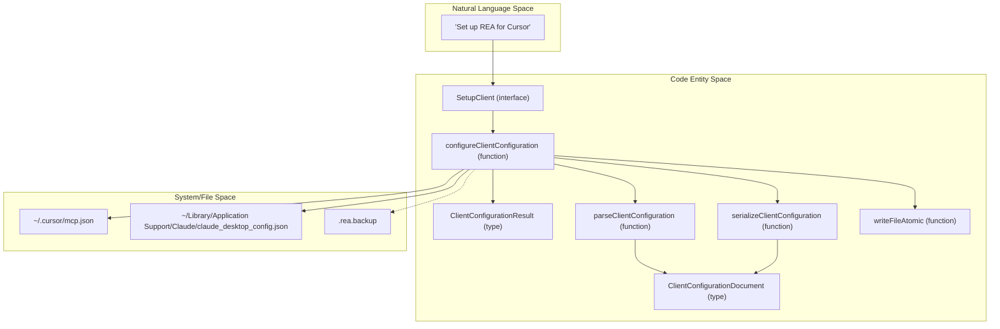

<!-- source: DeepWiki mcp.deepwiki.com · repo morluto/rea · page 1.1 Getting Started · fetched 2026-10-09 -->

# Getting Started

<details>
<summary>Relevant source files</summary>

The following files were used as context for generating this wiki page:

- [.github/workflows/pages.yml](.github/workflows/pages.yml)
- [docs/.vitepress/config.ts](docs/.vitepress/config.ts)
- [docs/android-analysis.md](docs/android-analysis.md)
- [docs/firmware-analysis.md](docs/firmware-analysis.md)
- [docs/index.md](docs/index.md)
- [docs/installation.md](docs/installation.md)
- [docs/roadmap.md](docs/roadmap.md)
- [docs/windows-ghidra-p0.md](docs/windows-ghidra-p0.md)
- [src/application/Doctor.test.ts](src/application/Doctor.test.ts)
- [src/application/DoctorDiagnostics.ts](src/application/DoctorDiagnostics.ts)
- [src/application/Setup.fixture.ts](src/application/Setup.fixture.ts)
- [src/application/Setup.initialSnapshot.test.ts](src/application/Setup.initialSnapshot.test.ts)
- [src/application/Setup.recovery.test.ts](src/application/Setup.recovery.test.ts)
- [src/application/SetupClientConfiguration.ts](src/application/SetupClientConfiguration.ts)
- [src/application/SetupHost.ts](src/application/SetupHost.ts)
- [src/application/SetupPlan.ts](src/application/SetupPlan.ts)
- [src/application/SetupSkill.ts](src/application/SetupSkill.ts)
- [src/application/SetupTypes.ts](src/application/SetupTypes.ts)
- [src/cli/browserCommands.ts](src/cli/browserCommands.ts)
- [src/cli/interactiveSetup.ts](src/cli/interactiveSetup.ts)
- [src/cli/setupCommands.ts](src/cli/setupCommands.ts)
- [src/domain/runtimeVersion.ts](src/domain/runtimeVersion.ts)
- [tests/boundary/cli/cliSetup.test.ts](tests/boundary/cli/cliSetup.test.ts)

</details>


This page provides a technical guide for installing and configuring REA. It covers the idempotent setup workflow, environment verification, and integration with Model Context Protocol (MCP) clients like Claude Code, Codex, Cursor, Gemini, and VS Code.

## Prerequisites

REA supports various operating systems and Node.js versions. Specific providers may have additional requirements.

| Requirement | Minimum Version | Verification Command |
| :--- | :--- | :--- |
| **Operating System** | macOS 12+, Ubuntu 24.04+, Fedora 41+, 64-bit Arch Linux, CachyOS, or experimental Windows x64 | `uname -a` or `sw_vers -productVersion` |
| **Node.js** | 22.x (>=22.19), 24.x (>=24.11), or 26+ | `node --version` |
| **Hopper Disassembler** | v4 or v5 (macOS/Linux) | `rea doctor` |
| **Ghidra** | 12.1.x (Windows/Linux/macOS) | `rea doctor` |
| **JDK** | 17+ (for JADX), 21+ (for Ghidra 12.1.x) | `java -version` |

Sources: [docs/installation.md:39](), [docs/windows-ghidra-p0.md:13-16](), [src/application/DoctorDiagnostics.ts:108-120](), [docs/android-analysis.md:13-14](), [docs/roadmap.md:48-51]()

## Installation and Setup

The primary entry point for configuration is the `setup` command. This command is designed to be idempotent and safe for execution by both humans and AI agents.

### Automated Setup
To perform a complete installation including dependencies and client configuration, use `npx`:

```bash
npx rea-agents setup
```

To explicitly request the latest release:
```bash
npx rea-agents@latest setup
```

For unattended package downloads, add `--yes` before the package name. Note that this does not approve REA's setup changes, which require separate approval.
```bash
npx --yes rea-agents@latest setup
```

To install globally for a shell-visible `rea` command:
```bash
npm install --global rea-agents
```

An optional `curl` wrapper can also install the global npm package:
```bash
curl -fsSL https://raw.githubusercontent.com/morluto/rea/main/install.sh | bash
```
This script prints version, runtime, npm command, and destination before installing. It starts `rea setup` if a controlling terminal exists, otherwise it prints the command to run later. Options can be passed with `bash -s --`:
```bash
curl -fsSL https://raw.githubusercontent.com/morluto/rea/main/install.sh | \
  bash -s -- --dry-run
```
Supported options are `--version <semver>`, `--dry-run`, `--no-setup`, `--no-prompt`, and `--verbose`.
Sources: [docs/installation.md:9-11](), [docs/installation.md:19-22](), [docs/installation.md:26-27](), [docs/installation.md:44-46](), [docs/installation.md:49-51](), [docs/installation.md:54-63]()

### Skill-only Installation
To install only the agent instructions and bundled references without REA MCP registration or analysis engines, use `skills add`:
```bash
npx skills add morluto/rea --skill reverse-engineer-anything
```
This allows for conditional connection of the skill.
Sources: [docs/installation.md:86-90]()

### Setup Logic Flow
The `runSetup` function coordinates the environment preparation. It utilizes a `SetupHost` interface to abstract side effects, allowing for both production execution and unit testing. The process involves discovering the current state, planning actions, confirming with the user (if interactive), and then applying the changes.

**Data Flow: Setup Workflow**
Title: Setup Logic Flow (`runSetup`)
```mermaid
graph TD
    A[Start `runSetup`] --> B{Discover Setup State};
    B --> C{Plan Setup Actions};
    C --> D{Is Interactive?};
    D -- Yes --> E{Confirm Interactive Setup};
    D -- No --> F{Apply Setup Actions};
    E --> F;
    F --> G[Return Setup Result];

    subgraph "Discovery (`discoverSetupState`)"
        B --> B1[Initial Doctor Report];
        B --> B2[Detect Clients];
        B --> B3[Check Skill Needs Install];
        B --> B4[Determine Hopper Install Need];
        B1 & B2 & B3 & B4 --> B_out[SetupDiscovery];
    end

    subgraph "Planning (`planSetupActions`)"
        C --> C1[Filter Selected Clients];
        C --> C2[Inspect Client Configurations];
        C --> C3[Generate Client Plans];
        C --> C4[Generate Hopper Plan];
        C --> C5[Generate Skill Plan];
        C1 & C2 & C3 & C4 & C5 --> C_out[PlannedActions];
    end

    subgraph "Application (`applySetupActions`)"
        F --> F1[Install Hopper (if planned)];
        F --> F2[Configure Clients (if planned)];
        F --> F3[Install Skill (if planned)];
        F1 & F2 & F3 --> F_out[AppliedResults];
    end

    B_out --> C;
    C_out --> D;
    F_out --> G;
```
Sources: [src/application/SetupPlan.ts:34-115](), [src/application/SetupPlan.ts:118-131](), [src/application/Setup.recovery.test.ts:10-10](), [src/application/Setup.initialSnapshot.test.ts:10-10]()

## Verifying the Environment (`rea doctor`)

The `doctor` command performs a non-mutating check of the system state. It is used both as a standalone CLI tool and as the final verification step in the setup process.

```bash
rea doctor
```
To check readiness for a specific client, provider, or skill:
```bash
rea doctor --client codex --provider ghidra --skill
```
The `doctor` command returns a `healthy` boolean and a list of `DoctorCheck` objects, indicating the status of various components.

### Implementation: `DoctorHost`
The `Doctor` module, specifically `collectDoctorDiagnostics` [src/application/DoctorDiagnostics.ts:26-54](), gathers diagnostics from the `DoctorHost` interface. This includes checks for Node.js version, host operating system, and the presence and version of analysis engines like Hopper and Ghidra.

The `findHopper` function [src/application/DoctorDiagnostics.ts:123-141]() identifies the Hopper binary by searching several candidate locations in order:
1.  `configuredHopperPath` (from environment variables like `HOPPER_LAUNCHER_PATH`).
2.  The default macOS path: `/Applications/Hopper Disassembler.app/Contents/MacOS/hopper`.
3.  The default Linux path: `/opt/hopper/bin/Hopper`.
4.  User-local Linux Hopper path: `~/.local/share/hopper/Hopper`.
5.  Manual Hopper paths provided by the host.
6.  Homebrew cask path via `brew --prefix --cask hopper-disassembler`.

### Diagnostics Table
The `runDoctor` function returns a `healthy` boolean and a list of `DoctorCheck` objects.

| Check Name | Success Condition | Code Entity |
| :--- | :--- | :--- |
| `node` | Version >= 22.19, 24.11, or 26+ | `host.nodeVersion` |
| `host` | Supported OS (macOS 12+, Linux (Ubuntu 24.04+, Fedora 41+, Arch, CachyOS), Windows x64) | `host.macosVersion()`, `host.linuxDistribution()`, `host.platform`, `host.architecture` |
| `hopper` | Executable binary found | `host.executable(path)` |
| `hopper-version` | Supported Linux Hopper version | `host.supportedLinuxHopper(path)` |
| `hopper-demo-runtime` | Hopper demo runtime available | `host.hopperDemoRuntimeAvailable()` |
| `ilspycmd` | Configured and runnable `ilspycmd` | `host.ilspyCmdVersion(path)` |
| `ghidra` | Configured and runnable Ghidra | `host.ghidraVersion(path)` |
| `jadx` | Configured and runnable JADX | `host.jadxVersion(path)` |
| `target` | (Optional) Valid binary target | `host.validTarget(path)` |
| `skill:identity` | Installed REA skill identity is aligned | `installedSkillIdentity()` |

Sources: [src/application/DoctorDiagnostics.ts:96-100](), [src/application/DoctorDiagnostics.ts:102-120](), [src/application/DoctorDiagnostics.ts:152-170](), [src/application/DoctorDiagnostics.ts:173-187](), [src/application/DoctorDiagnostics.ts:190-193](), [src/application/Doctor.test.ts:109-127](), [src/application/Doctor.test.ts:129-146](), [src/application/Doctor.test.ts:194-208]()

## MCP Client Integration

REA integrates with coding agents by modifying their local MCP configuration files. This process is handled by `configureClientConfiguration` [src/application/SetupClientConfiguration.ts:51-56]().

### Supported Agents
`rea setup` can configure the following clients for REA's local MCP server:

| Client             | `--client` value |
| :----------------- | :--------------- |
| Claude Code        | `claude_code`    |
| Claude Desktop     | `claude_desktop` |
| Codex              | `codex`          |
| Cursor             | `cursor`         |
| Gemini CLI         | `gemini_cli`     |
| Windsurf           | `windsurf`       |
| Devin              | `devin`          |
| OpenCode           | `opencode`       |
| Antigravity        | `antigravity`    |
| GitHub Copilot CLI | `copilot_cli`    |
| Command Code       | `commandcode`    |
| VS Code            | `vscode`         |

For OpenCode, setup writes the V1 `mcp.rea` entry. If OpenCode V2's native `mcp.servers` table is already in use, setup registers REA there instead.
Sources: [docs/installation.md:119-132](), [docs/installation.md:134-137]()

### Transactional Configuration
To ensure stability, REA follows a strict update protocol for client configuration files (e.g., `claude_desktop_config.json`, `mcp.json`):
1.  **Resolve Transaction Path**: Determine the safe path for the configuration file, handling potential symlinks or unsafe paths. [src/application/SetupClientConfiguration.ts:185-193]()
2.  **Read Original**: Load existing configuration content. [src/application/SetupClientConfiguration.ts:73-75]()
3.  **Parse**: Parse the content into a `ClientConfigurationDocument`. [src/application/SetupClientConfiguration.ts:78-84]()
4.  **Determine Desired State**: Construct the desired MCP server entry for REA. [src/application/SetupClientConfiguration.ts:89-94]()
5.  **Check Alignment**: If the current configuration already matches the desired state, no changes are made. [src/application/SetupClientConfiguration.ts:95-95]()
6.  **Backup**: If changes are needed, create a `.rea.backup` file of the original content. [src/application/SetupClientConfiguration.ts:96-102]()
7.  **Merge**: Inject the `rea` server definition into the `mcpServers` key, potentially removing legacy entries. [src/application/SetupClientConfiguration.ts:104-113]()
8.  **Atomic Write**: Write the new configuration back to disk using `writeFileAtomic` for atomicity. [src/application/SetupClientConfiguration.ts:115-126]()
9.  **Verification**: Read the file back and parse it to ensure the write was successful and the configuration is valid and aligned. If not, the backup is restored. [src/application/SetupClientConfiguration.ts:133-146]()

### Code Entity Mapping: Client Configuration
Title: Configuration Space to File System Space

Sources: [src/application/SetupClientConfiguration.ts:1-11](), [src/application/SetupClientConfiguration.ts:51-56](), [src/application/SetupClientConfiguration.ts:60-151]()

## Environment Variables

While `setup` automates configuration, the following variables can be used to override default behavior or provide paths to optional providers:

| Variable | Purpose |
| :--- | :--- |
| `HOPPER_LAUNCHER_PATH` | Explicit path to the Hopper executable. Used by `Doctor` and injected into MCP configs. |
| `GHIDRA_INSTALL_DIR` | Path to the Ghidra installation directory. |
| `JAVA_HOME` | Path to the Java Development Kit (JDK) installation. Required for Ghidra and JADX. |
| `REA_JADX_MCP_JAR` | Path to the `jadx-headless-mcp-0.7.1-all.jar` for Android analysis. |
| `REA_JADX_HEAP_MIB` | Sets the maximum heap size for JADX in MiB. |
| `REA_JADX_ACTIVE_PROCESSOR_COUNT` | Sets the number of active processors for JADX. |
| `REA_ANALYSIS_PROVIDER` | Specifies the default analysis provider (e.g., `ghidra`). |
| `REA_LOG_LEVEL` | Controls verbosity (`debug`, `info`, `warn`, `error`). |
| `NONINTERACTIVE` | Set to `1` during Homebrew installation to prevent blocking. |
| `JAVA_TOOL_OPTIONS`, `JDK_JAVA_OPTIONS`, `_JAVA_OPTIONS` | Standard Java environment options for JVM arguments. |

Sources: [src/application/SetupHost.ts:63-66](), [src/application/DoctorDiagnostics.ts:159-163](), [docs/windows-ghidra-p0.md:43-44](), [docs/android-analysis.md:20-23](), [docs/android-analysis.md:136-139](), [docs/android-analysis.md:140-141](), [docs/android-analysis.md:143-145]()

## Connecting to Agents

Once setup is complete, the REA toolset is available via the Model Context Protocol.

### Claude Code, Claude Desktop, Codex, Cursor, Gemini CLI, Windsurf, Devin, OpenCode, Antigravity, GitHub Copilot CLI, Command Code, VS Code
After running `rea setup`, these agents will detect the new `rea` server defined in their configuration. You may need to restart the agent for changes to take effect. For Cursor, you can verify the connection in the "Features" -> "MCP" settings pane.

### Manual Configuration
For other MCP-compatible clients, add the following entry to your configuration, adjusting `command` and `args` as necessary for your installation:

```json
{
  "mcpServers": {
    "rea": {
      "command": "npx",
      "args": ["-y", "rea-agents@latest", "mcp"],
      "env": {
        "REA_ANALYSIS_PROVIDER": "ghidra",
        "GHIDRA_INSTALL_DIR": "C:\\tools\\ghidra_12.1.4_PUBLIC",
        "JAVA_HOME": "C:\\tools\\jdk-21"
      }
    }
  }
}
```
The `command` and `args` are resolved by `setupRegistrationCommand` [src/application/SetupHost.ts:33-45]() to point to the `rea` CLI's `mcp` subcommand. The `env` block can be used to specify provider-specific environment variables.
Sources: [docs/installation.md:119-132](), [docs/windows-ghidra-p0.md:67-78](), [src/application/SetupHost.ts:33-45]()

## Optional Providers

REA supports "bring-your-own" analysis providers. `rea setup` can help configure paths for some of these.

### Hopper Disassembler
REA can install Hopper on macOS and supported Linux distributions. If Hopper is already installed, `rea setup` can detect and use it.
Sources: [docs/installation.md:150-153](), [src/application/SetupPlan.ts:54-64]()

### Ghidra
`rea setup` can save verified paths for an existing Ghidra installation in agent configurations. REA does not install or upgrade Ghidra or Java.
Sources: [docs/installation.md:150-153](), [docs/windows-ghidra-p0.md:30-31]()

### JADX (for Android Analysis)
For Android APK analysis, REA wraps an existing headless JADX engine. You need to supply a full JDK 17 or newer and `jadx-headless-mcp 0.7.1`. These are configured via environment variables like `REA_JADX_MCP_JAR` and `JAVA_HOME`.
Sources: [docs/android-analysis.md:13-14](), [docs/android-analysis.md:19-23]()

## Maintenance Commands

REA provides commands for updating and uninstalling the tool.

### Update (`rea update`)
The `update` command updates the REA installation and verifies the installed release.
```bash
rea update
```
This command is registered via `registerMaintenanceCommands` [src/cli/setupCommands.ts:145-161]() and executed by `runUpdate` [src/cli/setupCommands.ts:153-157]().
Sources: [src/cli/setupCommands.ts:145-161]()

### Uninstall (`rea uninstall`)
The `uninstall` command removes REA-owned agent configuration and skill files.
```bash
rea uninstall
```
To also remove REA caches and state:
```bash
rea uninstall --purge-data
```
This command is registered via `registerMaintenanceCommands` [src/cli/setupCommands.ts:127-143]() and executed by `runUninstall` [src/cli/setupCommands.ts:141-141]().
Sources: [src/cli/setupCommands.ts:127-143]()

---

