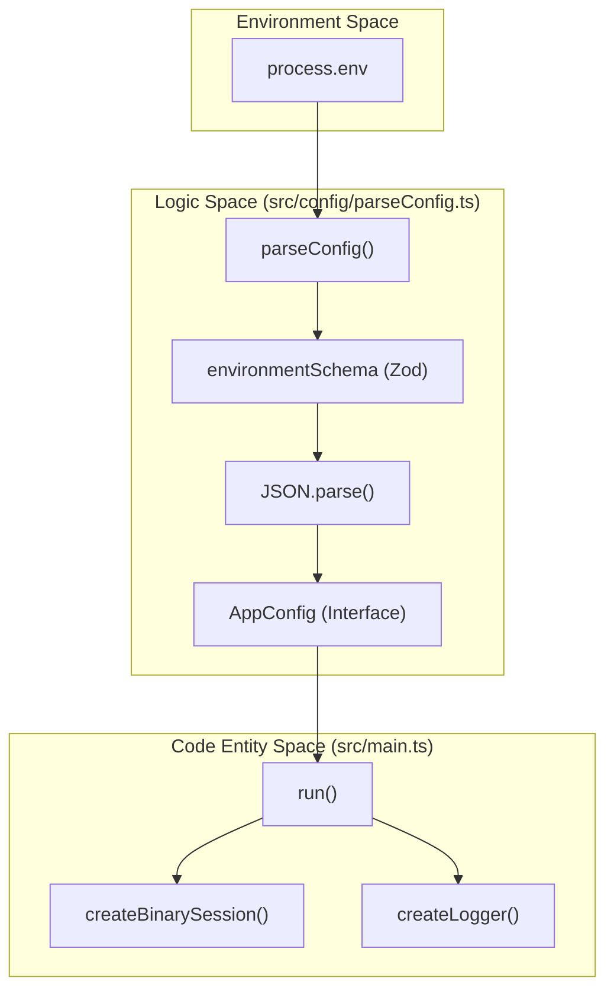
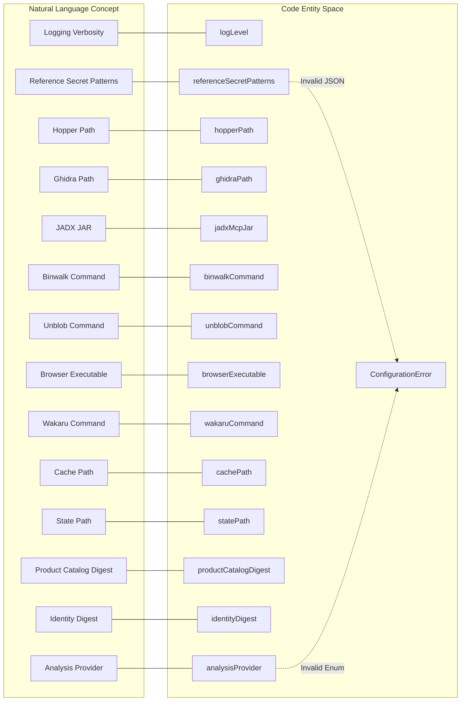

<!-- source: DeepWiki mcp.deepwiki.com · repo morluto/rea · page 1.2 Configuration Reference · fetched 2026-10-09 -->

# Configuration Reference

<details>
<summary>Relevant source files</summary>

The following files were used as context for generating this wiki page:

- [scripts/verify-package-environment.d.mts](scripts/verify-package-environment.d.mts)
- [scripts/verify-package-environment.mjs](scripts/verify-package-environment.mjs)
- [src/application/ClientConfigurationDocument.test.ts](src/application/ClientConfigurationDocument.test.ts)
- [src/application/ClientConfigurationDocument.ts](src/application/ClientConfigurationDocument.ts)
- [src/application/ClientRegistrationStatus.ts](src/application/ClientRegistrationStatus.ts)
- [src/application/SupportedClients.ts](src/application/SupportedClients.ts)
- [src/application/Uninstall.ts](src/application/Uninstall.ts)
- [src/cliCommandNames.ts](src/cliCommandNames.ts)
- [src/cliLogging.test.ts](src/cliLogging.test.ts)
- [src/cliLogging.ts](src/cliLogging.ts)
- [src/config.ts](src/config.ts)
- [src/contracts/toolContracts.ts](src/contracts/toolContracts.ts)
- [src/contracts/toolEffects.ts](src/contracts/toolEffects.ts)
- [src/identity.ts](src/identity.ts)
- [src/logger.ts](src/logger.ts)
- [src/main.ts](src/main.ts)
- [src/server/createServer.ts](src/server/createServer.ts)
- [src/server/registerSessionTools.ts](src/server/registerSessionTools.ts)
- [tests/boundary/cli/projectedErrorStatus.test.ts](tests/boundary/cli/projectedErrorStatus.test.ts)
- [tests/boundary/filesystem/clientConfigurationBom.test.ts](tests/boundary/filesystem/clientConfigurationBom.test.ts)
- [tests/boundary/filesystem/clientConfigurationDialects.test.ts](tests/boundary/filesystem/clientConfigurationDialects.test.ts)
- [tests/boundary/filesystem/clientLifecycle.test.ts](tests/boundary/filesystem/clientLifecycle.test.ts)

</details>


The REA configuration system manages how the application interacts with various analysis providers, validates target files, and handles logging. Configuration is primarily driven by environment variables, which are parsed and validated into a type-safe `AppConfig` object at the application's composition root. It also covers client configuration documents and dialects, identity/product catalog digests, cache and state paths, and logging levels.

## Configuration Data Flow

The configuration process begins at the entry point (`src/main.ts`) where the process environment is passed to a validator. This validator ensures that all required paths are present (or defaults are applied) and that complex types like JSON-encoded arguments are correctly formed.

### Configuration Lifecycle Diagram

This diagram illustrates how environment variables are transformed into the `AppConfig` entity used by the `BinarySession` and `McpServer`.

"Configuration Flow: Environment to Runtime"


**Sources:** [src/config.ts:2](), [src/main.ts:8](), [src/main.ts:54-61]()

---

## Environment Variables Reference

REA uses the following environment variables to control its behavior. These are parsed by `parseConfig` [src/config/parseConfig.ts:34-67]().

| Variable | Type | Default | Description |
| :--- | :--- | :--- | :--- |
| `REA_LOG_LEVEL` | Enum | `info` | Logging verbosity: `trace`, `debug`, `info`, `warn`, `error`, `fatal`, `silent`. [src/config/parseConfig.ts:23-26]() |
| `REA_ANALYSIS_PROVIDER` | String | `auto` | Specifies the preferred analysis provider (e.g., `hopper`, `ghidra`, `auto`). [src/config/parseConfig.ts:7-11]() |
| `REA_HOPPER_PATH` | String | `/Applications/Hopper Disassembler.app/Contents/MacOS/hopper` | Path to the Hopper Disassembler CLI executable. [src/config/parseConfig.ts:12-16]() |
| `REA_GHIDRA_PATH` | String | `undefined` | Path to the Ghidra `analyzeHeadless` executable. [src/config/parseConfig.ts:17-21]() |
| `REA_JADX_MCP_JAR` | String | `undefined` | Path to the JADX MCP bridge JAR for Android analysis. [src/config/parseConfig.ts:27-31]() |
| `REA_BINWALK_COMMAND` | String | `undefined` | Path to the `binwalk` command for firmware analysis. [src/config/parseConfig.ts:32-36]() |
| `REA_UNBLOB_COMMAND` | String | `undefined` | Path to the `unblob` command for firmware extraction. [src/config/parseConfig.ts:37-41]() |
| `REA_BROWSER_EXECUTABLE` | String | `undefined` | Path to a specific browser executable for web analysis. [src/config/parseConfig.ts:42-46]() |
| `REA_WAKARU_COMMAND` | String | `undefined` | Path to the `wakaru` command for JavaScript recovery. [src/config/parseConfig.ts:47-51]() |
| `REA_CACHE_PATH` | String | `~/.rea/cache` | Path to the directory used for caching analysis results. [src/config/parseConfig.ts:52-56]() |
| `REA_STATE_PATH` | String | `~/.rea/state` | Path to the directory used for persistent application state. [src/config/parseConfig.ts:57-61]() |
| `REA_PRODUCT_CATALOG_DIGEST` | String | `undefined` | SHA-256 digest of the expected product catalog. [src/config/parseConfig.ts:62-66]() |
| `REA_IDENTITY_DIGEST` | String | `undefined` | SHA-256 digest of the expected identity configuration. [src/config/parseConfig.ts:67]() |
| `REA_REFERENCE_SECRET_PATTERNS_JSON` | JSON Array | `[]` | JSON-encoded array of glob patterns for secret files in reference sources. [src/config/parseConfig.ts:67]() |

**Sources:** [src/config/parseConfig.ts:7-67]()

---

## The AppConfig Interface

The `AppConfig` interface represents the validated, internal state of the application's configuration. It is defined as a `readonly` structure to prevent runtime mutations.

```typescript
export interface AppConfig {
  readonly logLevel: LogLevel;
  readonly analysisProvider: AnalysisProviderSelection;
  readonly hopperPath: string | undefined;
  readonly ghidraPath: string | undefined;
  readonly jadxMcpJar: string | undefined;
  readonly binwalkCommand: string | undefined;
  readonly unblobCommand: string | undefined;
  readonly browserExecutable: string | undefined;
  readonly wakaruCommand: string | undefined;
  readonly cachePath: string;
  readonly statePath: string;
  readonly productCatalogDigest: string | undefined;
  readonly identityDigest: string | undefined;
  readonly referenceSecretPatterns: readonly string[];
}
```

**Sources:** [src/config/types.ts:5-18]()

---

## Validation Logic (`parseConfig`)

Validation is implemented using the `zod` library. The `parseConfig` function performs validation on environment variables [src/config/parseConfig.ts:67]().

1.  **Schema Validation**: The `environmentSchema` validates basic types and enums for all environment variables [src/config/parseConfig.ts:8-67]().
2.  **JSON Parsing**: If `REA_REFERENCE_SECRET_PATTERNS_JSON` is provided, it is parsed via `JSON.parse()` [src/config/parseConfig.ts:67]().
3.  **Path Resolution**: `cachePath` and `statePath` are resolved relative to the user's home directory if not absolute [src/config/parseConfig.ts:67]().

If any step fails, the function returns a `Result.err` containing a `ConfigurationError` [src/config/parseConfig.ts:67]().

### Configuration Mapping to Code Entities

"Mapping Config to Internal Logic"


**Sources:** [src/config/parseConfig.ts:67](), [src/domain/analysisErrorBase.ts:10-10]()

---

## Client Configuration Documents and Dialects

REA interacts with various client applications (e.g., VS Code, OpenCode, Cursor) by registering itself as an MCP server in their configuration files. These client configurations can be in different formats (JSON, JSONC, TOML) and have different structures, referred to as "dialects".

The `ClientConfigurationDocument` interface [src/application/ClientConfigurationDocument.ts:26-38]() represents a parsed client configuration file, providing access to the document itself, the specific server table where REA registers, its path within the document, and the detected dialect.

### Client Configuration Parsing

The `parseClientConfiguration` function [src/application/ClientConfigurationDocument.ts:100-139]() is responsible for parsing the raw text of a client's configuration file into a `ClientConfigurationDocument`. It handles different formats (`toml`, `json`, `jsonc`) and identifies the correct location for MCP server registrations.

Key aspects:
*   **Format Detection**: Based on the `ClientConfigurationFormat` [src/application/ClientConfigurationDocument.ts:14]() (e.g., `"toml"`, `"opencode"`, `"vscode"`).
*   **Server Key Resolution**: `clientConfigurationServersKey` [src/application/ClientConfigurationDocument.ts:63-76]() determines the top-level key for MCP server registrations (e.g., `"mcp_servers"` for TOML, `"mcp"` for OpenCode, `"servers"` for VS Code).
*   **Dialect Handling**: Specifically for OpenCode, it distinguishes between `opencode` (V1) and `opencode_v2` dialects [src/application/ClientConfigurationDocument.ts:110-138](), which have different structures for their server tables.
*   **Legacy Servers**: It can identify and preserve "legacy" server entries that might exist alongside newer formats [src/application/ClientConfigurationDocument.ts:134-137]().

### Client Configuration Diagram

"Client Configuration Document Processing"
```mermaid
graph TD
    A[Client Config File Text] --> B{parseClientConfiguration(text, format)}
    B --> C{Parse Document (TOML/JSONC)}
    C --> D{Determine serversKey}
    D --> E{Extract Servers Table}
    E --> F{Detect Dialect (e.g., opencode_v2)}
    F --> G[ClientConfigurationDocument]

    G --"document"--> H[Original Document]
    G --"servers"--> I[MCP Servers Table]
    G --"serversPath"--> J[Path to Servers Table]
    G --"dialect"--> K[ClientRegistrationDialect]
    G --"legacyServers"--> L[Legacy MCP Servers]

    style A fill:#ace,stroke:#333,stroke-width:2px
    style G fill:#ace,stroke:#333,stroke-width:2px
```

**Sources:**
*   [src/application/ClientConfigurationDocument.ts:14]()
*   [src/application/ClientConfigurationDocument.ts:26-38]()
*   [src/application/ClientConfigurationDocument.ts:63-76]()
*   [src/application/ClientConfigurationDocument.ts:100-139]()
*   [tests/boundary/filesystem/clientConfigurationDialects.test.ts:73-78]()

---

## Identity and Product Catalog Digests

REA uses SHA-256 digests to ensure the integrity and consistency of its identity and product catalog. These digests can be specified via environment variables:
*   `REA_PRODUCT_CATALOG_DIGEST`: Expected digest for the product catalog [src/config/parseConfig.ts:62-66]().
*   `REA_IDENTITY_DIGEST`: Expected digest for the identity configuration [src/config/parseConfig.ts:67]().

These digests are part of the `AppConfig` [src/config/types.ts:17-18]() and can be used for verification during startup or setup processes to prevent tampering or ensure a specific version of the configuration is loaded.

**Sources:**
*   [src/config/parseConfig.ts:62-67]()
*   [src/config/types.ts:17-18]()

---

## Cache and State Paths

REA manages local data in two primary locations, configurable via environment variables:
*   `REA_CACHE_PATH`: Specifies the directory for caching analysis results and temporary files [src/config/parseConfig.ts:52-56](). This path defaults to `~/.rea/cache` if not provided and is resolved to an absolute path [src/config/parseConfig.ts:67]().
*   `REA_STATE_PATH`: Specifies the directory for persistent application state, such as session information or provider configurations [src/config/parseConfig.ts:57-61](). This path defaults to `~/.rea/state` if not provided and is resolved to an absolute path [src/config/parseConfig.ts:67]().

These paths are crucial for the application's operation and are managed by the `systemUninstallHost` for cleanup during uninstallation [src/application/Uninstall.ts:116-119]().

**Sources:**
*   [src/config/parseConfig.ts:52-61]()
*   [src/config/parseConfig.ts:67]()
*   [src/application/Uninstall.ts:116-119]()

---

## Logging Configuration

Logging is handled by `pino`. The `REA_LOG_LEVEL` environment variable determines the threshold for log output [src/config/parseConfig.ts:23-26]().

*   **Destination**: In MCP mode, logs are directed to `stderr` (file descriptor 2) to avoid corrupting the `stdout` stream used for JSON-RPC communication [src/logger.ts:16-28]().
*   **Redaction**: Sensitive fields such as `token`, `params`, and `arguments` are automatically redacted to prevent leaking binary data or credentials into log files [src/logger.ts:21-28]().
*   **Logger Creation**: The `createLogger` function [src/logger.ts:28]() initializes the logger based on the configured `logLevel`.

**Sources:**
*   [src/config/parseConfig.ts:23-26]()
*   [src/logger.ts:16-28]()
*   [src/logger.ts:21-28]()
*   [src/logger.ts:28]()

---

## Error Handling

When `parseConfig` encounters an invalid configuration, it returns a `ConfigurationError`. In the main entry point, this error is caught, and the application exits with a non-zero status code after printing the error tag and message to `stderr`.

```typescript
const config = parseConfig(dependencies.env);
if (!config.ok) {
  dependencies.writeStderr(`${projectAnalysisError(config.error).message}\n`);
  return 1;
}
```

**Sources:** [src/main.ts:54-58](), [src/config/parseConfig.ts:67]()

---

