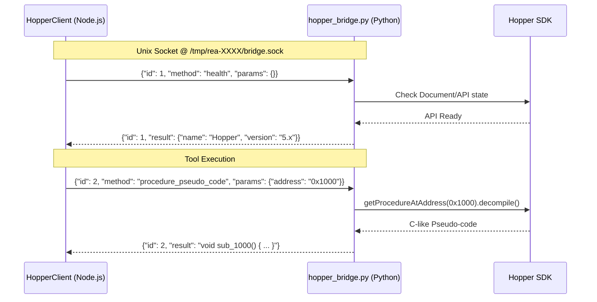
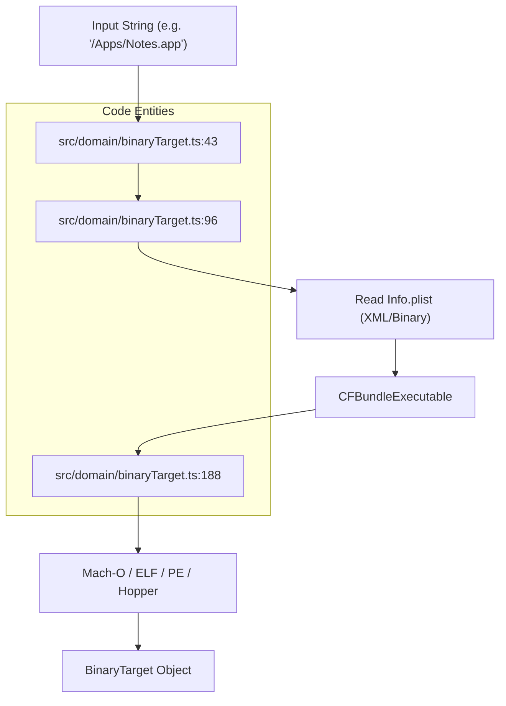

<!-- source: DeepWiki mcp.deepwiki.com · repo morluto/rea · page 10 Glossary · fetched 2026-10-09 -->

# Glossary

<details>
<summary>Relevant source files</summary>

The following files were used as context for generating this wiki page:

- [.github/pull_request_template.md](.github/pull_request_template.md)
- [.github/workflows/ci.yml](.github/workflows/ci.yml)
- [.github/workflows/regen-generated.yml](.github/workflows/regen-generated.yml)
- [.gitignore](.gitignore)
- [.release-please-manifest.json](.release-please-manifest.json)
- [AGENTS.md](AGENTS.md)
- [CHANGELOG.md](CHANGELOG.md)
- [CONTRIBUTING.md](CONTRIBUTING.md)
- [README.md](README.md)
- [README_ar.md](README_ar.md)
- [README_ja.md](README_ja.md)
- [README_ko.md](README_ko.md)
- [README_zh.md](README_zh.md)
- [docs/mcp-contracts.md](docs/mcp-contracts.md)
- [docs/product-catalog.json](docs/product-catalog.json)
- [docs/testing.md](docs/testing.md)
- [docs/tool-design.md](docs/tool-design.md)
- [docs/verification/managed-conformance-manifest.json](docs/verification/managed-conformance-manifest.json)
- [package-lock.json](package-lock.json)
- [package.json](package.json)
- [scripts/generate-mcp-tool-catalog.mjs](scripts/generate-mcp-tool-catalog.mjs)
- [skills/reverse-engineer-anything/SKILL.md](skills/reverse-engineer-anything/SKILL.md)
- [skills/reverse-engineer-anything/references/native-and-artifacts.md](skills/reverse-engineer-anything/references/native-and-artifacts.md)
- [src/cliCommandNames.ts](src/cliCommandNames.ts)
- [src/config.ts](src/config.ts)
- [src/contracts/toolContracts.ts](src/contracts/toolContracts.ts)
- [src/contracts/toolEffects.ts](src/contracts/toolEffects.ts)
- [src/generatedPackageMetadata.ts](src/generatedPackageMetadata.ts)
- [src/main.ts](src/main.ts)
- [src/server/createServer.ts](src/server/createServer.ts)
- [src/server/registerSessionTools.ts](src/server/registerSessionTools.ts)
- [tests/boundary/filesystem/setupSkill.test.ts](tests/boundary/filesystem/setupSkill.test.ts)
- [tests/boundary/mcp/toolRegistrationOptions.test.ts](tests/boundary/mcp/toolRegistrationOptions.test.ts)
- [tsconfig.json](tsconfig.json)
- [turbo.json](turbo.json)

</details>


This page defines the technical terms, abbreviations, and domain concepts used throughout the REA codebase. It serves as a reference for onboarding engineers to understand how high-level reverse engineering concepts map to specific implementation details in the code.

## Core System Terms

| Term | Definition | Code Pointer |
| :--- | :--- | :--- |
| **REA** | Reverse Engineer Anything. The overarching project name, a local-only CLI + MCP server for analyzing various binary types. | `[README.md:5-5]()` |
| **MCP** | Model Context Protocol. The standard REA uses to expose its tools to AI agents like Claude or Cursor. | `[package.json:22-22]()`, `[README.md:7-7]()` |
| **Evidence** | Structured data representing observations, inferences, and limitations from an analysis. It's a core part of REA's epistemic model. | `[README.md:52-52]()`, `[skills/reverse-engineer-anything/SKILL.md:28-28]()` |
| **Unknown** | A specific type of evidence record indicating a gap in knowledge or an unresolvable aspect of an analysis. | `[skills/reverse-engineer-anything/SKILL.md:68-68]()` |
| **BYO provider** | "Bring Your Own" provider. Refers to REA's model where users provide their own installations of analysis tools like Ghidra, IDA, JADX, Binwalk, or Unblob, which REA then integrates with. | `[AGENTS.md:5-5]()`, `[skills/reverse-engineer-anything/SKILL.md:42-43]()` |
| **ToolContract** | The formal definition of an MCP tool, including its name, description, and Zod-validated input/output schemas. | `[src/contracts/toolContracts.ts:35-42]()` |
| **ToolEffects** | Annotations on `ToolContract` definitions that describe side effects or specific behaviors of a tool, such as whether it modifies the target or requires a session. | `[src/contracts/toolEffects.ts:1-10]()` |
| **BinaryTarget** | A validated local file (Executable, Mach-O, ELF, PE) or Hopper database (`.hop`) that REA can analyze. | `[src/domain/binaryTarget.ts:28-36]()` |
| **AnalysisSnapshot** | A cached representation of analysis results for a specific binary target, allowing for faster retrieval and comparison. | `[src/application/analysisSnapshotCache.ts:1-10]()` |
| **Obligation Ledger** | A record of outstanding tasks or requirements for reconstruction verification, tracking what needs to be confirmed or resolved. | `[docs/product-catalog.json:186-186]()` |
| **CDP** | Chrome DevTools Protocol. Used by REA for browser observation and interaction, enabling dynamic analysis of web applications. | `[src/browser/cdp.ts:1-10]()` |
| **ASAR** | Atom Shell Archive. A simple, concatenative archive format used by Electron to package application code. REA can inspect and extract these. | `[package-lock.json:15-15]()`, `[skills/reverse-engineer-anything/SKILL.md:79-79]()` |
| **CIL/PE** | Common Intermediate Language (CIL) is the bytecode for .NET applications. Portable Executable (PE) is the file format for executables in Windows, often containing CIL for .NET assemblies. REA's managed provider analyzes these. | `[src/dotnet/managedPeReader.ts:1-10]()` |
| **NativeAOT** | Native Ahead-of-Time compilation for .NET, which compiles CIL directly to native code, making it behave more like a traditional native binary. REA's Ghidra provider can integrate with optional NativeAOT metadata recovery. | `[CHANGELOG.md:14-14]()`, `[skills/reverse-engineer-anything/SKILL.md:94-95]()` |
| **JADX** | A DEX to Java decompiler. REA integrates with JADX for static analysis of Android APKs. | `[CHANGELOG.md:8-8]()`, `[skills/reverse-engineer-anything/SKILL.md:43-43]()` |
| **Binwalk/Unblob** | Tools used by REA for firmware analysis, specifically for identifying and extracting embedded filesystems and executable code from firmware images. | `[CHANGELOG.md:10-10]()`, `[skills/reverse-engineer-anything/SKILL.md:90-91]()` |
| **Conformance Trust Gate** | A mechanism in REA's testing framework that verifies the correctness and consistency of analysis results against a known corpus of binaries and expected outputs. | `[AGENTS.md:12-12]()` |
| **Skill** | A set of instructions and capabilities provided to an AI coding assistant, enabling it to use REA's tools and workflows. | `[README.md:72-72]()`, `[skills/reverse-engineer-anything/SKILL.md:1-10]()` |
| **Product Catalog Digest** | A SHA-256 hash of the generated MCP tool catalog, used for versioning and integrity checking of the available tools and their schemas. | `[skills/reverse-engineer-anything/SKILL.md:7-7]()` |

## Technical Concepts & Implementation

### 1. The Hopper Bridge Protocol
REA communicates with Hopper using an **NDJSON** (Newline Delimited JSON) protocol over a Unix Domain Socket.

*   **NDJSON Framing**: Every request and response is a single line of JSON followed by a newline `\n`.
*   **Request Correlation**: Requests include a numeric `id` which the bridge mirrors in the response to allow concurrent execution.
*   **Authentication**: Secured via `REA_TOKEN`, a 32-byte random hex string generated by the `HopperClient` and validated by the bridge using `hmac`.

**Bridge Communication Flow**

**Sources:** `[src/hopper/HopperClient.ts:54-61]()`, `[bridge/hopper_bridge.py:1-12]()`, `[src/hopper/protocol.ts:1-22]()`

### 2. Binary Target Resolution
Before launching Hopper, REA performs "Natural Language to Path" resolution. This includes:
*   **App Bundle Support**: If a user provides `Notes.app`, REA parses `Info.plist` to find the `CFBundleExecutable` and validates that it resides safely within `Contents/MacOS`.
*   **Architecture Selection**: For FAT (Universal) Mach-O binaries, REA automatically selects the slice matching the host's `process.arch` to avoid interactive prompts in Hopper.

**Target Resolution Mapping**

**Sources:** `[src/domain/binaryTarget.ts:43-88]()`, `[src/domain/binaryTarget.ts:96-144]()`, `[src/domain/binaryTarget.ts:188-204]()`

### 3. Tool Classification
REA organizes its tools into distinct `ToolKind` categories, as defined in the `product-catalog.json`.

| Kind | Description | Implementation |
| :--- | :--- | :--- |
| `official-proxy` | Direct 1:1 mappings to Hopper Python API functions. | `[src/contracts/toolContracts.ts:56]()` |
| `enhanced` | High-level workflows that compose multiple bridge calls (e.g., `analyze_function` combines info, assembly, and pseudo-code). | `[src/contracts/enhancedInputs.ts:4-38]()` |
| `session` | Tools for managing the REA lifecycle, such as `open_binary` and `close_binary`. | `[src/server/registerSessionTools.ts:1-10]()` |
| `native-provider` | Tools specific to the native macOS provider, interacting with `xcrun` and Mach-O binaries. | `[docs/product-catalog.json:84-96]()` |
| `artifact-provider` | Tools for inspecting and extracting contents from various archive formats. | `[docs/product-catalog.json:99-107]()` |
| `managed` | Tools for analyzing .NET assemblies (CIL/PE). | `[docs/product-catalog.json:110-121]()` |
| `firmware-provider` | Tools for firmware analysis using Binwalk/Unblob. | `[docs/product-catalog.json:124-128]()` |
| `android-provider` | Tools for Android APK analysis using JADX. | `[docs/product-catalog.json:131-140]()` |
| `browser-provider` | Tools for web browser observation via CDP. | `[docs/product-catalog.json:143-158]()` |
| `electron-provider` | Tools for Electron application inspection. | `[docs/product-catalog.json:161-169]()` |
| `javascript-runtime` | Tools for observing JavaScript runtimes. | `[docs/product-catalog.json:172-177]()` |
| `application-workflow` | Higher-level workflows that combine multiple tools to achieve application-level analysis, comparison, or reconstruction. | `[docs/product-catalog.json:180-199]()` |

**Sources:** `[src/contracts/toolContracts.ts:32-42]()`, `[src/contracts/enhancedInputs.ts:4-38]()`, `[docs/product-catalog.json:12-228]()`

### 4. MCP Tool Catalog Generation
The `product-catalog.json` file, which lists all available tools and their classifications, is a generated artifact. It is built from the `ToolContract` definitions and other metadata within the codebase.

**Tool Catalog Generation Flow**
```mermaid
graph TD
    A[ToolContract Definitions] --> B(scripts/generate-mcp-tool-catalog.mjs)
    C[ToolEffect Annotations] --> B
    D[Package Metadata] --> B
    B --> E(docs/product-catalog.json)
    E --> F[MCP Server Tool Registration]
    E --> G[Skill Metadata (SKILL.md)]

    subgraph "Code Entities"
        A["src/contracts/toolContracts.ts"]
        C["src/contracts/toolEffects.ts"]
        D["src/generatedPackageMetadata.ts"]
        B["scripts/generate-mcp-tool-catalog.mjs"]
        E["docs/product-catalog.json"]
        F["src/server/createServer.ts"]
        G["skills/reverse-engineer-anything/SKILL.md"]
    end
```
**Sources:** `[scripts/generate-mcp-tool-catalog.mjs:1-10]()`, `[src/contracts/toolContracts.ts:1-10]()`, `[src/contracts/toolEffects.ts:1-10]()`, `[src/generatedPackageMetadata.ts:1-9]()`, `[docs/product-catalog.json:1-11]()`, `[src/server/createServer.ts:1-10]()`, `[skills/reverse-engineer-anything/SKILL.md:5-7]()`

## Domain Vocabulary

### Analysis Entities
*   **Procedure**: A function or routine identified by the disassembler. Often referred to as `sub_XXXX` if no symbol name is available. `[bridge/hopper_bridge.py:75-81]()`
*   **Xref (Cross-reference)**: A link between code/data. `incoming` xrefs show what calls a function; `outgoing` xrefs show what a function calls. `[bridge/hopper_bridge.py:124-165]()`
*   **Segment/Section**: Logical divisions of a binary (e.g., `__TEXT` for code, `__DATA` for variables). `[src/contracts/toolContracts.ts:56]()`
*   **Pseudo-code**: A high-level, C-like representation of assembly code generated by Hopper's decompiler. `[src/contracts/toolContracts.ts:56]()`

### Error Algebra
REA uses a tagged error system for deterministic error handling without `try/catch` ambiguity.
*   **`AnalysisError`**: The base class for all expected failures. `[src/domain/errors.ts:2-4]()`
*   **`Result<T, E>`**: A container that is either `ok` with a value or `err` with an `AnalysisError`. `[src/domain/result.ts:1-10]()`
*   **`HopperProcessError`**: Specifically indicates that the underlying Hopper process crashed or was killed. `[src/domain/errors.ts:50-56]()`

**Sources:** `[src/domain/errors.ts:1-92]()`, `[src/domain/result.ts:1-10]()`

### Pagination
Tools that return lists (like `list_procedures` or `list_strings`) use a standard pagination object:
*   **`offset`**: Starting index.
*   **`limit`**: Number of items to return (max 500).
*   **`has_more`**: Boolean indicating if more data is available.
*   **`next_offset`**: The value to use for the next call's `offset`.

**Sources:** `[src/contracts/toolContracts.ts:19-22]()`, `[bridge/hopper_bridge.py:158-160]()`