<!-- source: DeepWiki mcp.deepwiki.com · repo morluto/rea · page 2 Architecture · fetched 2026-10-09 -->

# Architecture

Relevant source files

The following files were used as context for generating this wiki page:

- [.github/pull_request_template.md](.github/pull_request_template.md)
- [.github/workflows/ci.yml](.github/workflows/ci.yml)
- [.github/workflows/regen-generated.yml](.github/workflows/regen-generated.yml)
- [.gitignore](.gitignore)
- [.oxlintrc.json](.oxlintrc.json)
- [AGENTS.md](AGENTS.md)
- [CONTRIBUTING.md](CONTRIBUTING.md)
- [docs/architecture.mermaid](docs/architecture.mermaid)
- [docs/capability-migration.md](docs/capability-migration.md)
- [docs/testing.md](docs/testing.md)
- [docs/tool-design.md](docs/tool-design.md)
- [scripts/generate-mcp-tool-catalog.mjs](scripts/generate-mcp-tool-catalog.mjs)
- [scripts/lib/catalog-builders.mjs](scripts/lib/catalog-builders.mjs)
- [scripts/lib/catalog-core.mjs](scripts/lib/catalog-core.mjs)
- [scripts/lib/module-boundaries.d.mts](scripts/lib/module-boundaries.d.mts)
- [scripts/lib/module-boundaries.mjs](scripts/lib/module-boundaries.mjs)
- [scripts/verify-package-install.mjs](scripts/verify-package-install.mjs)
- [src/application/ReconstructionObligationCandidates.ts](src/application/ReconstructionObligationCandidates.ts)
- [src/application/ReconstructionObligationLedger.authority.test.ts](src/application/ReconstructionObligationLedger.authority.test.ts)
- [src/cliEnvironmentSeam.test.ts](src/cliEnvironmentSeam.test.ts)
- [src/contracts/contractSnapshot.test.ts](src/contracts/contractSnapshot.test.ts)
- [src/contracts/toolContracts.test.ts](src/contracts/toolContracts.test.ts)
- [src/contracts/toolOutputSchemaGroups.ts](src/contracts/toolOutputSchemaGroups.ts)
- [src/ida/IdaProviderCapabilities.ts](src/ida/IdaProviderCapabilities.ts)
- [tests/boundary/cli/productCatalog.test.ts](tests/boundary/cli/productCatalog.test.ts)
- [tests/boundary/mcp/toolRegistrationOptions.test.ts](tests/boundary/mcp/toolRegistrationOptions.test.ts)
- [tests/evaluation/moduleBoundaries.test.ts](tests/evaluation/moduleBoundaries.test.ts)
- [tsconfig.json](tsconfig.json)
- [turbo.json](turbo.json)

REA is a layered ESM TypeScript application. It exposes reverse-engineering tools through a CLI and an MCP (Model Context Protocol) server. The architecture is designed with a strict inward-flowing dependency model, meaning that lower layers (Domain, Contracts) are independent of higher-level execution environments (CLI, MCP Server). This structure ensures modularity and testability.

This page provides a high-level overview of REA's layered architecture, its dependency rules, module boundary enforcement, and data flow. For detailed information on each layer, refer to the linked child pages.

## Layered Architecture Overview

The system is organized into distinct layers, with dependencies flowing inward from pure domain logic through contracts, providers, application workflows, and finally to CLI/MCP adapters. This structure is explicitly enforced to maintain separation of concerns and prevent circular dependencies.

### Architecture Layers and Their Responsibilities

```mermaid
graph TD
    subgraph "Entry Points"
        DISPATCH["scripts/rea.mjs<br/>Executable dispatcher<br/>routes mcp / one-shot"]
        CLI["src/cli.ts + src/cli/<br/>One-shot CLI adapter<br/>setup, diagnostics, analysis, decompilation"]
        MAIN["src/main.ts + src/main/<br/>MCP stdio server adapter<br/>config, session, process lifetime"]
    end

    subgraph "Adapters"
        SERVER["src/server/<br/>MCP request translation<br/>createServer, tool registration, toolResult"]
        INSTALL["src/cli/ + src/application/Setup*<br/>Host installation adapters"]
    end

    subgraph "Application Layer"
        APP["src/application/<br/>Shared CLI/MCP workflows<br/>enhanced analysis and investigations"]
        SESSION["SessionProviderRouter + BinarySession<br/>one immutable deep binding per target"]
        REGISTRY["AnalysisProviderRegistry<br/>sorted deep candidates<br/>deterministic selection, no fallback"]
        RECORDS["src/application/investigation/<br/>composed InvestigationRecords + narrow ports<br/>EvidenceLedger and Unknown ownership"]
        SNAPSHOT["BinarySessionRecords + AnalysisSnapshotCache<br/>binary target/profile snapshots"]
        JS_RECON["src/application/javascript/ + src/artifacts/javascript/<br/>JavaScript artifact reconstruction"]
    end

    subgraph "Provider Layers"
        HOPPER["src/hopper/<br/>Hopper launch & Unix-socket protocol"]
        GHIDRA["src/ghidra/<br/>Ghidra discovery, profile & function analysis"]
        IDA["src/ida/<br/>Upstream MCP contract adaptation"]
        AUX["src/artifacts/ + src/native/<br/>disjoint artifact and native capabilities"]
        BROWSER["src/browser/<br/>CDP / Playwright capture"]
        JS_CODEC["src/javascript/sourceMaps/<br/>pinned upstream map codec"]
        INSPECTOR["src/inspector/<br/>passive V8 Inspector discovery and capture"]
        DOTNET["src/dotnet/<br/>Managed static metadata provider"]
        FIRMWARE["src/firmware/<br/>Binwalk / Unblob adapters"]
        ANDROID["src/android/<br/>Static APK adapter"]
        REFERENCE["src/reference/<br/>Filesystem reference-source reader"]
    end

    subgraph "Provider Process Foundation"
        PROCESS["src/process/<br/>owned process groups, private roots<br/>deadlines, bounded file reads and diagnostics, cleanup"]
        WINDOWS["src/windows/<br/>Windows host boundary adapters"]
        WINDOWS_NATIVE["native/windows/src/<br/>Node-API implementation"]
    end

    subgraph "Contracts Layer"
        CONTRACTS["src/contracts/<br/>Caller-visible schemas for analysis, managed, browser, Electron, application, and session tools"]
        ERRORS["src/contracts/errorSchemas.ts<br/>Shared analysis error schemas"]
    end

    subgraph "Domain Layer"
        DOMAIN["src/domain/<br/>Pure side-effect-free modules<br/>evidence, comparisons, application graphs"]
    end

    subgraph "Configuration"
        CONFIG["src/config.ts + src/config/<br/>Zod-validated env parsing<br/>provider settings and origins"]
    end

    subgraph "Tests"
        TESTS["tests/<br/>Vitest suite<br/>fixtures/ holds fake launcher, bridge, and CDP seams"]
    end

    subgraph "Evaluation"
        EVALUATION["src/evaluation/<br/>Agent release evaluation<br/>session transcript scoring"]
    end

    subgraph "Bridges (External Process)"
        HOPPER_BRIDGE["bridge/hopper_bridge.py<br/>Runs inside Hopper<br/>adapts operations to Hopper Python API"]
        GHIDRA_BRIDGE["bridge/ghidra/ReaGhidraBridge.java<br/>Packaged HeadlessScript<br/>inventory, decompiler, references, CFG"]
        IDA_MCP["External ida-pro-mcp<br/>GUI proxy or database supervisor"]
    end

    DISPATCH --> CLI
    DISPATCH --> MAIN
    MAIN --> CONFIG
    MAIN --> SERVER
    MAIN --> APP
    CLI --> APP
    MAIN --> COMPOSITION["src/composition/<br/>fresh typed provider and session factories"]
    CLI --> COMPOSITION
    SERVER --> COMPOSITION
    COMPOSITION --> SESSION
    APP --> FIRMWARE
    FIRMWARE --> PROCESS
    FIRMWARE --> CONTRACTS
    APP --> ANDROID
    ANDROID --> PROCESS
    ANDROID --> CONTRACTS
    ANDROID --> DOMAIN
    CLI --> ERRORS
    APP --> SESSION
    SESSION --> REGISTRY
    SESSION --> SNAPSHOT
    SNAPSHOT --> RECORDS
    APP --> RECORDS
    SERVER --> RECORDS
    RECORDS --> DOMAIN
    COMPOSITION --> HOPPER
    COMPOSITION --> GHIDRA
    COMPOSITION --> IDA
    COMPOSITION --> AUX
    IDA --> IDA_MCP
    IDA --> CONTRACTS
    IDA --> DOMAIN
    SESSION --> AUX
    APP --> JS_RECON
    APP --> INSTALL
    SERVER --> CONTRACTS
    SERVER --> APP
    APP --> BROWSER
    APP --> JS_CODEC
    JS_CODEC --> PROCESS
    JS_CODEC --> DOMAIN
    APP --> INSPECTOR
    INSPECTOR --> BROWSER
    INSPECTOR --> DOMAIN
    APP --> DOTNET
    DOTNET --> DOMAIN
    HOPPER --> HOPPER_BRIDGE
    GHIDRA --> GHIDRA_BRIDGE
    HOPPER --> PROCESS
    GHIDRA --> PROCESS
    GHIDRA --> WINDOWS
    PROCESS --> WINDOWS
    WINDOWS --> WINDOWS_NATIVE
    APP --> PROCESS
    APP --> DOMAIN
    JS_RECON --> AUX
    JS_RECON --> DOMAIN
    APP --> REFERENCE
    REFERENCE --> DOMAIN
    CONTRACTS --> DOMAIN
    HOPPER --> DOMAIN
    GHIDRA --> DOMAIN
    AUX --> DOMAIN
    BROWSER --> DOMAIN
    PROCESS --> DOMAIN
    TESTS -.-> MAIN
    TESTS -.-> HOPPER
    TESTS -.-> GHIDRA
    TESTS -.-> IDA
    TESTS -.-> PROCESS
    TESTS -.-> BROWSER
    TESTS -.-> EVALUATION
    TESTS -.-> ERRORS
```

**Sources:** [AGENTS.md:20-22](), [docs/architecture.mermaid:1-70]()

## Dependency Rules and Module Boundaries

REA enforces strict dependency rules to maintain its layered architecture. Dependencies flow inward, meaning a module in a higher layer (e.g., `src/application/`) can import from a lower layer (e.g., `src/domain/`), but not vice-versa. This is explicitly stated in the `AGENTS.md` guidelines [AGENTS.md:20-22]() and enforced by module boundary checks [tests/evaluation/moduleBoundaries.test.ts:1-31]().

Key rules include:
- `src/domain/` owns pure provider-neutral semantics.
- `src/contracts/` owns caller-visible schemas and the canonical tool inventory.
- Provider-specific code (e.g., `src/hopper/`, `src/ghidra/`) must remain isolated and not leak into domain or application layers.
- `src/application/` composes shared CLI/MCP workflows.
- `src/server/` translates MCP requests.
- `src/cli.ts` and `src/main.ts` are the CLI and MCP entry points.

The `npm run verify:module-boundaries` command parses source imports and checks their resolved layer, rejecting violations [docs/capability-migration.md:63-69]().

**Sources:** [AGENTS.md:20-29](), [docs/capability-migration.md:63-69](), [tests/evaluation/moduleBoundaries.test.ts:1-31]()

## Data Flow

Data flows through the layers, starting from user input via CLI or MCP, processed by the application layer, and potentially interacting with provider layers to perform analysis. Results are then returned through the application and adapter layers. Canonical data structures and schemas are defined in the Contracts and Domain layers to ensure consistency.

For example, the `src/generatedMcpToolCatalog.ts` file, which is build-generated and gitignored [AGENTS.md:28-28](), represents a key data flow artifact, ensuring that the MCP server has an up-to-date inventory of available tools and their contracts.

**Sources:** [AGENTS.md:27-28](), [scripts/lib/catalog-core.mjs:35-114]()

---

## Architectural Layers (Detailed Overview)

### 2.1 Entry Points and Dispatching
The `scripts/rea.mjs` dispatcher serves as the initial entry point for all REA operations. It determines whether to launch the MCP server via `src/main.ts` or execute a one-shot CLI command via `src/cli.ts`. This dispatcher ensures that the correct execution environment is set up based on the invocation method. The `src/main.ts` module handles the MCP stdio adapter, managing the server's startup, transport, and shutdown, while `src/cli.ts` is responsible for command registration and handling CLI-specific output and JSON input/status.

For details, see [Entry Points and Dispatching](#2.1).

**Sources:** [docs/architecture.mermaid:3-5](), [AGENTS.md:24-24]()

### 2.2 Domain Layer
The `src/domain/` directory contains pure, provider-neutral modules that define the core semantics and data structures of REA. This layer includes fundamental concepts like the `Result` type for robust error handling, canonical digests for data integrity, evidence schemas, binary target definitions, comparison and normalization logic, call path representations, error projection, and Unicode ordering. These modules are designed to be side-effect-free and independent of any specific provider implementation.

For details, see [Domain Layer](#2.2).

**Sources:** [AGENTS.md:22-22](), [docs/architecture.mermaid:54-56]()

### 2.3 Contracts and Tool Catalog
The `src/contracts/` layer defines the caller-visible schemas and the canonical inventory of tools. This includes `ToolContract` definitions, tool effects and annotations, and output schema groups. The system generates an MCP tool catalog (`src/generatedMcpToolCatalog.ts`) and a `product-catalog.json` based on these contracts. This layer is crucial for ensuring consistent communication between REA and external agents, and it includes mechanisms for capability migration and contract snapshot tests to prevent regressions.

For details, see [Contracts and Tool Catalog](#2.3).

**Sources:** [AGENTS.md:22-22](), [AGENTS.md:27-28](), [scripts/lib/catalog-core.mjs:35-114]()

### 2.4 Application Layer
The `src/application/` layer orchestrates shared CLI/MCP workflows. It manages binary sessions, `DirectAnalysis` operations, and an analysis snapshot cache. This layer is responsible for the provider registry and evaluation, capability inventory, artifact inventory and graph construction, and reference source import. It composes functionalities from lower layers to provide higher-level analysis capabilities.

For details, see [Application Layer](#2.4).

**Sources:** [AGENTS.md:23-23](), [docs/architecture.mermaid:20-26]()

### 2.5 Server Layer (MCP Adapter)
The `src/server/` layer is responsible for adapting REA's internal logic to the MCP. It includes the `createServer` assembly, which registers various tool modules (official, enhanced, session, artifact, managed, electron, investigation, application). This layer handles the mapping of internal `ToolResult` objects to the MCP protocol, manages prompts, and defines tool registration options.

For details, see [Server Layer (MCP Adapter)](#2.5).

**Sources:** [AGENTS.md:24-24](), [docs/architecture.mermaid:13-14]()

---

