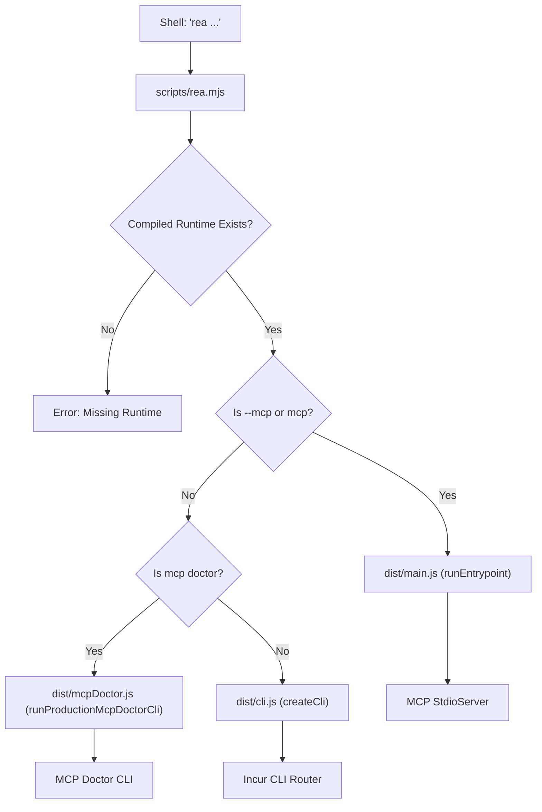
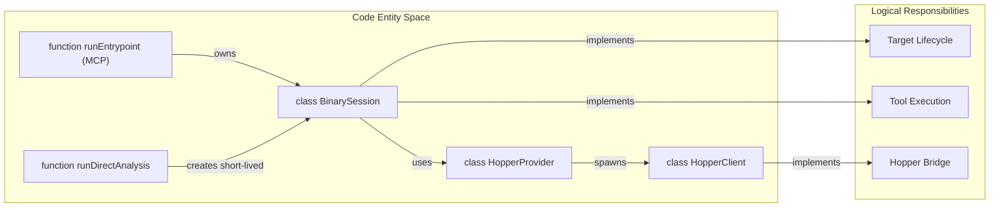

<!-- source: DeepWiki mcp.deepwiki.com · repo morluto/rea · page 2.1 Entry Points and Dispatching · fetched 2026-10-09 -->

# Entry Points and Dispatching

<details>
<summary>Relevant source files</summary>

The following files were used as context for generating this wiki page:

- [docs/error-contract.schema.json](docs/error-contract.schema.json)
- [scripts/rea.mjs](scripts/rea.mjs)
- [src/browser/PlaywrightScenarioActions.test.ts](src/browser/PlaywrightScenarioActions.test.ts)
- [src/cli/browserAdvancedCommands.ts](src/cli/browserAdvancedCommands.ts)
- [src/cli/electronCommands.ts](src/cli/electronCommands.ts)
- [src/cli/firmwareCommands.ts](src/cli/firmwareCommands.ts)
- [src/cliBrowserScenarioCommands.ts](src/cliBrowserScenarioCommands.ts)
- [src/cliJsonInput.ts](src/cliJsonInput.ts)
- [src/cliJsonInputStatus.test.ts](src/cliJsonInputStatus.test.ts)
- [src/cliOutput.ts](src/cliOutput.ts)
- [src/contracts/errorSchemas.ts](src/contracts/errorSchemas.ts)
- [src/contracts/sessionLifecycleInputs.ts](src/contracts/sessionLifecycleInputs.ts)
- [src/contracts/sessionPathInputs.test.ts](src/contracts/sessionPathInputs.test.ts)
- [src/contracts/sessionStatusContract.ts](src/contracts/sessionStatusContract.ts)
- [src/domain/firmware/firmwareAnalysis.ts](src/domain/firmware/firmwareAnalysis.ts)
- [src/main/shutdown.ts](src/main/shutdown.ts)
- [src/main/startup.ts](src/main/startup.ts)
- [src/main/transport.ts](src/main/transport.ts)
- [src/server/registerManagedTools.ts](src/server/registerManagedTools.ts)
- [src/server/registerManagedWorkflowTools/types.ts](src/server/registerManagedWorkflowTools/types.ts)
- [tests/acceptance/nonBinaryComposition.test.ts](tests/acceptance/nonBinaryComposition.test.ts)
- [tests/boundary/cli/browserCli.test.ts](tests/boundary/cli/browserCli.test.ts)
- [tests/boundary/cli/cliOutput.test.ts](tests/boundary/cli/cliOutput.test.ts)
- [tests/boundary/cli/dispatcher.test.ts](tests/boundary/cli/dispatcher.test.ts)
- [tests/boundary/cli/jsonInputStatus.test.ts](tests/boundary/cli/jsonInputStatus.test.ts)
- [tests/boundary/filesystem/cliJsonInput.test.ts](tests/boundary/filesystem/cliJsonInput.test.ts)
- [tests/boundary/filesystem/directAnalysisPermissions.test.ts](tests/boundary/filesystem/directAnalysisPermissions.test.ts)
- [tests/boundary/mcp/shutdown.test.ts](tests/boundary/mcp/shutdown.test.ts)
- [tests/composition/analysis-sessions/investigationRecords.test.ts](tests/composition/analysis-sessions/investigationRecords.test.ts)
- [tests/process-global/cliJsonInputStatus.test.ts](tests/process-global/cliJsonInputStatus.test.ts)

</details>


REA provides three primary entry points to facilitate interaction via coding agents (MCP), direct terminal usage (CLI), and internal script routing. The system is designed around a shared `BinarySession` that manages the lifecycle of the Hopper Disassembler bridge.

## The Dispatcher: `scripts/rea.mjs`

The `scripts/rea.mjs` file serves as the universal binary entry point. It is responsible for routing the execution flow based on command-line arguments before the heavy TypeScript-transpiled modules are fully loaded.

- **MCP Routing**: If the first argument is `--mcp` or the command is simply `mcp`, it imports and invokes the `runEntrypoint` function from `dist/main.js` [scripts/rea.mjs:14-15, 30-32]().
- **MCP Doctor Routing**: If the command is `mcp doctor`, it imports and invokes `runProductionMcpDoctorCli` from `dist/mcpDoctor.js` [scripts/rea.mjs:16, 33-39]().
- **CLI Routing**: For all other commands (e.g., `setup`, `analyze`, `doctor`), it imports `createCli` from `dist/cli.js` and passes the arguments to the Incur-based CLI handler, also handling output sanitization and validation via `dist/cliOutput.js` [scripts/rea.mjs:40-63]().
- **Runtime Check**: Before any module is loaded, `scripts/rea.mjs` checks for the existence of compiled runtime files (`dist/main.js`, `dist/cli.js`, `dist/cliOutput.js`, `dist/mcpDoctor.js`). If missing, it prints an error message and exits with code 1 [scripts/rea.mjs:24-28, 66-85]().

### Entry Point Flow
The following diagram illustrates how a command is dispatched from the shell to the specific runtime implementation.

**Title: Entry Point Dispatch Logic**

Sources: [scripts/rea.mjs:5-63](), [scripts/rea.mjs:66-85]()

---

## MCP Stdio Adapter: `src/main.ts`

The `src/main.ts` module implements the long-lived Model Context Protocol (MCP) server. It acts as the bridge between an AI agent (like Claude Desktop) and the Hopper instance.

### Initialization and Session Startup
1. **Config Parsing**: It parses environment variables (e.g., `HOPPER_TARGET_PATH`) into an `AppConfig` object [src/main/startup.ts:22-26]().
2. **Session Creation**: It initializes a `BinarySession` using the `createBinarySession` wiring utility [src/main/startup.ts:26]().
3. **Initial Target**: If `HOPPER_TARGET_PATH` is provided in the environment, the server attempts to open that binary immediately before starting the transport [src/main/startup.ts:26]().
4. **Transport**: It establishes the MCP `serveStdio` transport, registering tools via `createServer` [src/main/transport.ts:47-52]().

### Process Lifetime and Shutdown
The adapter installs idempotent shutdown handlers for `SIGINT`, `SIGTERM`, and `stdin` EOF. This ensures that the `BinarySession` is closed, which in turn shuts down the Hopper bridge and cleans up Unix sockets [src/main/shutdown.ts:61-74]().

Sources: [src/main/startup.ts:21-26](), [src/main/transport.ts:47-52](), [src/main/shutdown.ts:61-74]()

---

## One-Shot CLI: `src/cli.ts`

The `src/cli.ts` module defines the terminal interface using the `incur` library. Unlike the MCP adapter, CLI commands are typically "one-shot"—they open a session, perform an action, and close the session immediately.

### Command Registration
The `createCli` function [src/cli.ts:15]() initializes the Incur CLI instance. Various `register*Commands` functions are then called to add specific command groups:
- `registerCoreCommands` [src/cli.ts:20]()
- `registerSetupCommands` [src/cli.ts:21]()
- `registerArtifactCommands` [src/cli.ts:22]()
- `registerManagedCommands` [src/cli.ts:23]()
- `registerFirmwareCommands` [src/cli/firmwareCommands.ts:15]()
- `registerBrowserCommands` [src/cli/browserAdvancedCommands.ts:15]()
- `registerElectronCommands` [src/cli/electronCommands.ts:29]()
- `registerApplicationCommands` [src/cli.ts:27]()
- `registerEvidenceCommands` [src/cli.ts:28]()

### JSON Input and Output Handling
CLI commands frequently accept JSON input and produce JSON output.
- **JSON Input**: The `parseCliJsonInput` function [src/cliJsonInput.ts:10]() handles parsing inline JSON strings or reading JSON from a specified file path. It also includes logic to differentiate between malformed inline JSON and non-existent file paths [src/cliJsonInput.ts:17-34]().
- **Path Resolution**: `resolveCliJsonPaths` [src/cliJsonInput.ts:44]() is used to resolve relative paths within JSON input objects to absolute paths, ensuring consistency with MCP contracts that expect absolute paths [src/cliJsonInput.ts:44-50](). For example, in `capture_browser_scenario`, the `executable_path` for the browser is resolved [src/cliBrowserScenarioCommands.ts:36-37](). Similarly, firmware paths are resolved before validation [src/cli/firmwareCommands.ts:43]().
- **Output Sanitization**: `sanitizeCliOutput` [src/cliOutput.ts:136]() removes internal validator details from CLI output, especially for `VALIDATION_ERROR` messages, to present a user-friendly error message [src/cliOutput.ts:145-162]().
- **Output Argument Validation**: `validateCliOutputArguments` [src/cliOutput.ts:88]() checks for incompatible output arguments, such as using `--token-limit` with structured output formats like JSON or YAML, which could corrupt the output [src/cliOutput.ts:95-103]().

### Example CLI Command Registration
The following diagram illustrates the registration of a specific CLI command, `capture-browser-scenario`.

**Title: CLI Command Registration Example**
```mermaid
graph TD
    A[src/cli.ts] --> B{createCli()}
    B --> C[registerBrowserCommands]
    C --> D[registerBrowserScenarioCommands]
    D --> E{cli.command("capture-browser-scenario")}
    E --> F[args: inputJson]
    E --> G[run: logCliCommand(...)]
    G --> H[parseCliJsonInput(args.inputJson)]
    H -- "ok: true" --> I[resolveCliJsonPaths(input.value, [["browser", "executable_path"]])]
    I --> J[browserScenarioSchema.safeParse(...)]
    J -- "success: true" --> K[captureBrowserScenario(...)]
    J -- "success: false" --> L[cliError(AnalysisInputError)]
    K -- "ok: true" --> M[Return result.value]
    K -- "ok: false" --> L
```
Sources: [src/cli.ts:15-28](), [src/cliBrowserScenarioCommands.ts:20-52](), [src/cliJsonInput.ts:10](), [src/cliJsonInput.ts:44]()

---

## The Dispatching Core: `BinarySession`

The `BinarySession` class in `src/application/BinarySession.ts` is the central coordinator for both entry points. It manages the `AnalysisClient` lifecycle and ensures that only one Hopper bridge is active at a time.

### Session Management Implementation
- **Serialization**: All target transitions (opening/closing) are serialized using a promise chain (`#transition`) to prevent race conditions during Hopper bridge teardown [src/application/BinarySession.ts:43, 152-159]().
- **Draining**: Before closing a client, the session waits for all pending tool executions to complete via `#drainCalls` [src/application/BinarySession.ts:103, 161-163]().
- **Restoration**: If a new target fails to open, the session attempts to restore the previous valid client [src/application/BinarySession.ts:85-90, 165-175]().

### Natural Language to Code Entity Mapping
The following diagram bridges the conceptual "Session" to the specific classes and functions that implement it.

**Title: Session Management Entity Map**

Sources: [src/application/BinarySession.ts:39-47](), [src/application/runtime.ts:11-16](), [src/hopper/HopperProvider.ts:3](), [src/main/startup.ts:26](), [src/application/DirectAnalysis.ts:21]()

### Execution State Table
| Method | Description | Implementation Detail |
| :--- | :--- | :--- |
| `open()` | Opens or switches the active binary. | Serializes via `#transition` [src/application/BinarySession.ts:58-96](). |
| `execute()` | Runs a Hopper tool command. | Waits for active transitions before dispatching [src/application/BinarySession.ts:134-150](). |
| `close()` | Shuts down the bridge. | Drains pending calls and closes the `AnalysisClient` [src/application/BinarySession.ts:99-107](). |
| `status()` | Returns session metadata. | Returns `BinaryTarget` info (path, sha256, format) [src/application/BinarySession.ts:110-122](). |

Sources: [src/application/BinarySession.ts:18-29, 39-150]()

---

