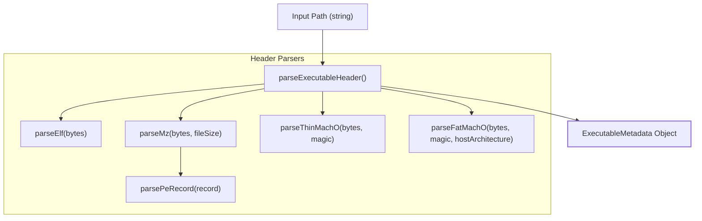
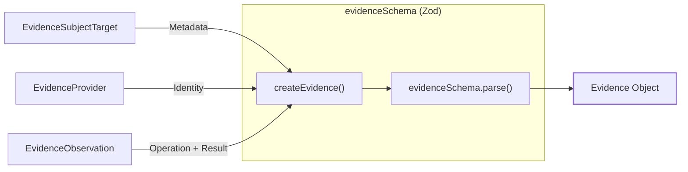
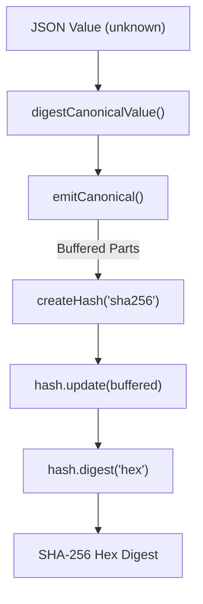
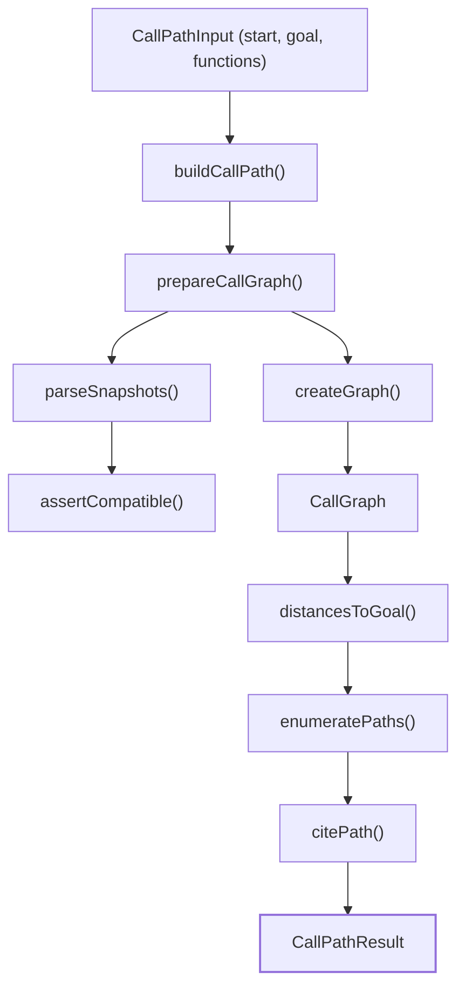

<!-- source: DeepWiki mcp.deepwiki.com · repo morluto/rea · page 2.2 Domain Layer · fetched 2026-10-09 -->

# Domain Layer

Relevant source files

The following files were used as context for generating this wiki page:

- [docs/javascript-artifact-reconstruction.md](docs/javascript-artifact-reconstruction.md)
- [scripts/lib/real-hopper-inventory.mjs](scripts/lib/real-hopper-inventory.mjs)
- [src/application/ArtifactInventory/classify.ts](src/application/ArtifactInventory/classify.ts)
- [src/application/ArtifactInventory/reader.ts](src/application/ArtifactInventory/reader.ts)
- [src/contracts/toolOutputSchemaPrimitives.ts](src/contracts/toolOutputSchemaPrimitives.ts)
- [src/domain/analysisSnapshot.ts](src/domain/analysisSnapshot.ts)
- [src/domain/artifactGraph.ts](src/domain/artifactGraph.ts)
- [src/domain/binaryTarget.ts](src/domain/binaryTarget.ts)
- [src/domain/bundleComparison.test.ts](src/domain/bundleComparison.test.ts)
- [src/domain/bundleComparison.ts](src/domain/bundleComparison.ts)
- [src/domain/callPath.test.ts](src/domain/callPath.test.ts)
- [src/domain/callPath.ts](src/domain/callPath.ts)
- [src/domain/canonicalDigest.test.ts](src/domain/canonicalDigest.test.ts)
- [src/domain/canonicalDigest.ts](src/domain/canonicalDigest.ts)
- [src/domain/comparisonSemantics.ts](src/domain/comparisonSemantics.ts)
- [src/domain/comparisonStatus.test.ts](src/domain/comparisonStatus.test.ts)
- [src/domain/comparisonStatus.ts](src/domain/comparisonStatus.ts)
- [src/domain/evidence.ts](src/domain/evidence.ts)
- [src/domain/evidenceCompletionLedger.ts](src/domain/evidenceCompletionLedger.ts)
- [src/domain/functionComparison.test.ts](src/domain/functionComparison.test.ts)
- [src/domain/functionComparisonNormalization.ts](src/domain/functionComparisonNormalization.ts)
- [src/domain/functionComparisonSchemas.ts](src/domain/functionComparisonSchemas.ts)
- [src/domain/peInspection.ts](src/domain/peInspection.ts)
- [tests/boundary/providers/managed/managedArmMachine.test.ts](tests/boundary/providers/managed/managedArmMachine.test.ts)

The **Domain Layer** contains the pure, side-effect-free logic of REA. It defines the core data structures, error algebra, and boundary parsers used to transform raw data from Hopper or the filesystem into typed entities. This layer has no dependencies on the network, disk (except for target validation), or the Hopper bridge protocol implementation.

## Core Result and Error Algebra

REA uses a functional approach to error handling via a `Result` type and a tagged error class hierarchy. This ensures that expected failures (like a missing file or a Hopper timeout) are handled explicitly by the compiler.

### Result Type
The `Result<T, E>` type is a discriminated union used to represent the outcome of operations without throwing exceptions.
- `ok(value)`: Wraps a successful value [[src/domain/result.ts:7-7]()]
- `err(error)`: Wraps a failure [[src/domain/result.ts:10-10]()]

### Analysis Error Hierarchy
All domain-specific errors inherit from `AnalysisError`, which uses a `_tag` property for type-safe narrowing [[src/domain/errors.ts:1-4]()].

| Error Class | Tag | Purpose |
| :--- | :--- | :--- |
| `AnalysisError` | (abstract) | Base class for all expected failures [[src/domain/errors.ts:2-4]()] |
| `HopperError` | (abstract) | Base for errors originating from the Hopper provider [[src/domain/errors.ts:7-7]()] |
| `HopperTimeoutError` | `HopperTimeoutError` | Hopper failed to respond within the deadline [[src/domain/errors.ts:15-21]()] |
| `HopperProtocolError` | `HopperProtocolError` | Malformed JSON or NDJSON from the bridge [[src/domain/errors.ts:33-35]()] |
| `HopperRemoteError` | `HopperRemoteError` | Hopper's Python API returned an explicit error [[src/domain/errors.ts:38-47]()] |
| `BinaryTargetError` | `BinaryTargetError` | Failure to resolve or validate a binary path [[src/domain/errors.ts:83-92]()] |

**Sources:** [[src/domain/result.ts:1-10]()] [[src/domain/errors.ts:1-92]()]

---

## Binary Target Resolution

The `BinaryTarget` module handles the identification and validation of analysis targets before they are passed to Hopper. This includes resolving macOS `.app` bundles to their internal executables and selecting the correct architecture slice from FAT Mach-O binaries.

### Target Parsing Flow
The `parseExecutableHeader` function performs a multi-step validation to ensure Hopper launches with non-interactive loader arguments [[src/domain/binaryTarget.ts:29-48]()].

#### Target Selection Logic
1.  **Bundle Resolution**: If the path is a `.app` directory, it reads `Contents/Info.plist` to find the `CFBundleExecutable` [[src/domain/binaryTarget.ts:96-117]()].
2.  **Security Checks**: It ensures the executable name is safe and does not escape the bundle via symlinks [[src/domain/binaryTarget.ts:118-143]()].
3.  **Metadata Extraction**: It reads the file header (Mach-O, ELF, or PE) to determine the architecture [[src/domain/binaryTarget.ts:29-48]()].
4.  **Loader Arguments**: It generates deterministic flags (e.g., `--aarch64`, `--intel-64`) so Hopper does not show a selection dialog [[src/domain/binaryTarget.ts:88-96]()].

### Binary Target Relationships
The following diagram associates the logical target resolution steps with the code entities responsible for them.

"Binary Target Resolution Flow"

**Sources:** [[src/domain/binaryTarget.ts:29-48]()] [[src/domain/binaryTarget.ts:50-64]()] [[src/domain/binaryTarget.ts:67-104]()] [[src/domain/binaryTarget.ts:106-118]()] [[src/domain/binaryTarget.ts:121-142]()] [[src/domain/binaryTarget.ts:145-174]()]

---

## Boundary Parsers (hopperValues.ts)

Hopper's Python bridge returns raw JSON values that often vary in shape (e.g., sometimes a map, sometimes a list, sometimes wrapped in a property). `hopperValues.ts` uses `Zod` to normalize these into stable TypeScript interfaces.

### Normalized Interfaces
- `AddressedName`: A standard pair of hex `address` and string `name` [[src/domain/hopperValues.ts:7-10]()].
- `AddressedPage`: Pagination metadata including `items`, `nextOffset`, and `hasMore` [[src/domain/hopperValues.ts:18-22]()].
- `SegmentSummary`: Details for binary segments (`name`, `start`, `end`) [[src/domain/hopperValues.ts:12-16]()].

### Key Parsing Functions
| Function | Input Shape | Output |
| :--- | :--- | :--- |
| `parseProcedures` | `{ procedures: { "0x1": "fn" } }` or map | `AddressedName[]` [[src/domain/hopperValues.ts:58-74]()] |
| `parseNames` | `[{ address, name }]` or map | `AddressedName[]` [[src/domain/hopperValues.ts:77-96]()] |
| `parseAddressedPage` | `{ items, next_offset, has_more }` | `AddressedPage` [[src/domain/hopperValues.ts:41-55]()] |
| `parseListCount` | Any list, map, or `{ total: N }` | `number` [[src/domain/hopperValues.ts:134-151]()] |

**Sources:** [[src/domain/hopperValues.ts:7-22]()] [[src/domain/hopperValues.ts:41-151]()]

---

## Symbol Analysis

The `symbolAnalysis.ts` module provides pure functions for filtering and categorizing symbols based on language-specific mangling conventions (Swift and Objective-C).

### Supported Analyses
- **Swift Classes**: Identifies symbols containing the `_TtC` mangling prefix [[src/domain/symbolAnalysis.ts:8-20]()].
- **Objective-C Classes**: Filters for `OBJC_CLASS`, `OBJC_$_CLASS`, or `_OBJC_` markers and deduplicates them by name [[src/domain/symbolAnalysis.ts:23-41]()].
- **Swift Type Categorization**: Groups symbols into `classes` (`_TtC`), `structs` (`_TtV`), `enums` (`_TtO`), `protocols` (`_TtP`), and `extensions` (`_TtE`) [[src/domain/symbolAnalysis.ts:58-94]()].

**Sources:** [[src/domain/symbolAnalysis.ts:7-94]()]

---

## Evidence Schema

The `evidence.ts` module defines a strict schema for analysis observations. This ensures that every tool output includes deterministic metadata about the artifact and the operation performed.

### Evidence Structure
The `Evidence` object contains:
- `subject`: Path, SHA-256, format, and architecture of the binary [[src/domain/evidence.ts:20-51]()].
- `provider`: Identity of the analysis provider (e.g., Hopper, Ghidra) [[src/domain/evidence.ts:15-19]()].
- `operation`: The name of the tool or analysis performed [[src/domain/evidence.ts:91-91]()].
- `parameters`: The input arguments used for the tool [[src/domain/evidence.ts:92-92]()].
- `normalized_result`: The actual data returned by the analysis, normalized to a stable schema [[src/domain/evidence.ts:94-94]()].
- `confidence`: How the evidence was obtained (e.g., `observed`, `derived`, `inferred`) [[src/domain/evidence.ts:95-95]()].
- `authority`: The source of the evidence (e.g., `shipped-artifact`, `external-service`) [[src/domain/evidence.ts:70-75]()].
- `limitations`: Any known limitations or caveats of the observation [[src/domain/evidence.ts:98-98]()].

### Evidence Generation Flow
The following diagram shows how raw analysis results are wrapped into the formal Evidence schema.

"Evidence Construction Flow"

**Sources:** [[src/domain/evidence.ts:15-19]()] [[src/domain/evidence.ts:20-51]()] [[src/domain/evidence.ts:70-75]()] [[src/domain/evidence.ts:86-102]()] [[src/domain/evidence.ts:128-130]()] [[src/domain/evidence.ts:146-151]()] [[src/domain/evidence.ts:155-174]()]

---

## Canonical Digests and Comparison

The domain layer provides utilities for creating canonical digests of JSON values and comparing structured data. This is crucial for detecting changes in analysis results and ensuring deterministic behavior.

### Canonical Digest
The `digestCanonicalValue` function generates a SHA-256 hash of a JSON-serializable value after canonicalizing it. This ensures that semantically equivalent JSON objects (e.g., with reordered keys) produce the same digest.
The implementation processes JSON incrementally to avoid memory issues with very large objects [[src/domain/canonicalDigest.ts:4-23]()].

"Canonical Digest Process"

**Sources:** [[src/domain/canonicalDigest.ts:4-23]()] [[src/domain/canonicalDigest.ts:27-85]()] [[src/domain/canonicalDigest.test.ts:16-20]()] [[src/domain/canonicalDigest.test.ts:58-63]()] [[src/domain/canonicalDigest.test.ts:65-70]()]

### Function Comparison Normalization
The `functionComparisonNormalization.ts` module provides functions to normalize `FunctionSnapshot` objects for comparison. This involves projecting specific aspects of a function (e.g., name, signature, control flow graph, references) into a canonical form.

- `identityProjection`: Extracts name, signature, and sorted local variable descriptions [[src/domain/functionComparisonNormalization.ts:10-16]()].
- `normalizeCfg`: Normalizes the control flow graph by ordering basic blocks by address and representing successors as indices [[src/domain/functionComparisonNormalization.ts:41-77]()].
- `referenceProjection`: Collects and sorts incoming and outgoing references, citing source and target procedure names [[src/domain/functionComparisonNormalization.ts:79-91]()].
- `commentProjection`: Extracts and normalizes comments, converting addresses to offsets relative to the procedure's start [[src/domain/functionComparisonNormalization.ts:136-147]()].
- `sorted`: A utility function to sort arrays of arbitrary values by their canonical JSON representation, handling Unicode collation ties [[src/domain/functionComparisonNormalization.ts:179-192]()].

The `functionMatch` function determines if two functions match based on their names, considering auto-generated names as ambiguous [[src/domain/functionComparisonNormalization.ts:18-38]()].

**Sources:** [[src/domain/functionComparisonNormalization.ts:10-16]()] [[src/domain/functionComparisonNormalization.ts:18-38]()] [[src/domain/functionComparisonNormalization.ts:41-77]()] [[src/domain/functionComparisonNormalization.ts:79-91]()] [[src/domain/functionComparisonNormalization.ts:136-147]()] [[src/domain/functionComparisonNormalization.ts:179-192]()] [[src/domain/functionComparison.test.ts:106-131]()] [[src/domain/functionComparison.test.ts:134-155]()] [[src/domain/functionComparison.test.ts:187-202]()]

### Bundle Comparison
The `bundleComparison.ts` module provides functionality to compare two `EvidenceBundle` objects. It identifies added, removed, and changed evidence records and residual unknowns.

- `compareBundles`: The main function that takes two evidence bundles and a list of explicit record pairs, then returns a detailed comparison result [[src/domain/bundleComparison.ts:85-122]()].
- `bundleComparisonInputSchema`: Defines the expected input for bundle comparison, including paths to bundles and optional record pairs [[src/domain/bundleComparison.ts:26-37]()].
- `bundleComparisonResultSchema`: Describes the output, including a summary of changes, individual change records, and limitations [[src/domain/bundleComparison.ts:56-74]()].

**Sources:** [[src/domain/bundleComparison.ts:26-37]()] [[src/domain/bundleComparison.ts:56-74]()] [[src/domain/bundleComparison.ts:85-122]()] [[src/domain/bundleComparison.ts:125-192]()]

---

## Call Path Analysis

The `callPath.ts` module implements algorithms to reconstruct and analyze call paths between functions based on `analyze_function` evidence.

### Call Graph Representation
A `CallGraph` class is used to represent the directed caller-to-callee relationships. It stores successors and predecessors for each function address [[src/domain/callPath.ts:18-49]()].

### Pathfinding Algorithm
The `buildCallPath` function takes a set of `analyze_function` evidence records, a start function, and a goal function. It constructs a call graph and then uses a breadth-first search-like approach to find the shortest paths from the start to the goal.

1.  **Prepare Graph**: `prepareCallGraph` parses `FunctionSnapshot` evidence and creates a `CallGraph` instance [[src/domain/callPath.ts:147-155]()]. It also validates that all snapshots belong to the same artifact and provider [[src/domain/callPath.ts:173-193]()].
2.  **Calculate Distances**: `distancesToGoal` performs a reverse BFS from the goal to find the shortest distance (in hops) from any reachable node to the goal [[src/domain/callPath.ts:52-70]()].
3.  **Enumerate Paths**: If a path exists, `enumeratePaths` (not fully shown in provided code, but implied by `buildCallPath`'s usage) reconstructs all shortest paths.
4.  **Result Generation**: The function returns a `CallPathResult` indicating whether a path was found, the shortest number of hops, the paths themselves, and any limitations (e.g., functions without evidence) [[src/domain/callPath.ts:81-129]()].

"Call Path Reconstruction Flow"

**Sources:** [[src/domain/callPath.ts:18-49]()] [[src/domain/callPath.ts:52-70]()] [[src/domain/callPath.ts:81-129]()] [[src/domain/callPath.ts:147-155]()] [[src/domain/callPath.ts:157-171]()] [[src/domain/callPath.ts:173-193]()] [[src/domain/callPath.ts:195-208]()] [[src/domain/callPath.test.ts:65-89]()] [[src/domain/callPath.test.ts:101-114]()] [[src/domain/callPath.test.ts:184-199]()]

---

## Error Projection

The `analysisErrorProjectionSchema` in `src/contracts/errorSchemas.ts` (not fully provided, but referenced) defines a standardized way to represent errors that occur during analysis. This ensures that errors from various providers are consistently structured for client consumption.

The `PROVIDER_REJECTION_CODES` enum [[src/contracts/toolOutputSchemaPrimitives.ts:14-16]()] and `providerRejectionCode` schema [[src/contracts/toolOutputSchemaPrimitives.ts:172-174]()] are used to categorize why a provider might be unavailable or reject a target. This allows for structured error reporting and client-side remediation suggestions.

**Sources:** [[src/contracts/toolOutputSchemaPrimitives.ts:14-16]()] [[src/contracts/toolOutputSchemaPrimitives.ts:172-174]()]

---

## Unicode Ordering

The `canonicalOrdering.ts` module (not provided, but referenced by `functionComparisonNormalization.ts`) provides utilities for comparing strings based on their Unicode code points. This is used in `functionComparisonNormalization.ts` to ensure deterministic sorting of collections when their canonical JSON representations are identical but the underlying string values might differ due to Unicode normalization forms (e.g., composed vs. decomposed characters).

The `compareCodePoints` function is used as a tie-breaker in sorting algorithms to ensure stable ordering across different environments or string representations [[src/domain/functionComparisonNormalization.ts:188-189]()].

**Sources:** [[src/domain/functionComparisonNormalization.ts:188-189]()] [[src/domain/functionComparison.test.ts:176-209]()]

---

