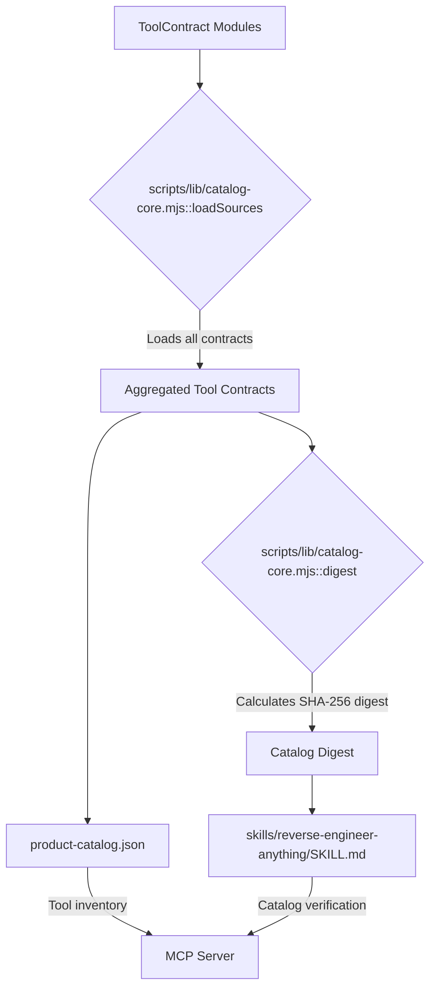
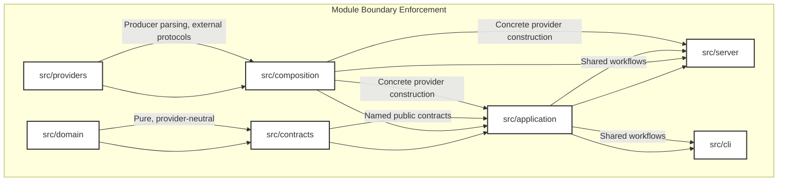

<!-- source: DeepWiki mcp.deepwiki.com · repo morluto/rea · page 2.3 Contracts and Tool Catalog · fetched 2026-10-09 -->

# Contracts and Tool Catalog

Relevant source files

The following files were used as context for generating this wiki page:

- [.oxlintrc.json](.oxlintrc.json)
- [docs/capability-migration.md](docs/capability-migration.md)
- [docs/mcp-contracts.md](docs/mcp-contracts.md)
- [docs/product-catalog.json](docs/product-catalog.json)
- [docs/verification/managed-conformance-manifest.json](docs/verification/managed-conformance-manifest.json)
- [scripts/lib/catalog-builders.mjs](scripts/lib/catalog-builders.mjs)
- [scripts/lib/catalog-core.mjs](scripts/lib/catalog-core.mjs)
- [scripts/lib/module-boundaries.d.mts](scripts/lib/module-boundaries.d.mts)
- [scripts/lib/module-boundaries.mjs](scripts/lib/module-boundaries.mjs)
- [scripts/verify-package-install.mjs](scripts/verify-package-install.mjs)
- [skills/reverse-engineer-anything/SKILL.md](skills/reverse-engineer-anything/SKILL.md)
- [skills/reverse-engineer-anything/references/native-and-artifacts.md](skills/reverse-engineer-anything/references/native-and-artifacts.md)
- [src/application/EnhancedTools.ts](src/application/EnhancedTools.ts)
- [src/application/ReconstructionObligationCandidates.ts](src/application/ReconstructionObligationCandidates.ts)
- [src/application/ReconstructionObligationLedger.authority.test.ts](src/application/ReconstructionObligationLedger.authority.test.ts)
- [src/cliEnvironmentSeam.test.ts](src/cliEnvironmentSeam.test.ts)
- [src/contracts/contractSnapshot.test.ts](src/contracts/contractSnapshot.test.ts)
- [src/contracts/enhancedInputs.ts](src/contracts/enhancedInputs.ts)
- [src/contracts/sessionToolSchemas.ts](src/contracts/sessionToolSchemas.ts)
- [src/contracts/toolContractExamples.ts](src/contracts/toolContractExamples.ts)
- [src/contracts/toolContracts.test.ts](src/contracts/toolContracts.test.ts)
- [src/contracts/toolOutputSchemaGroups.ts](src/contracts/toolOutputSchemaGroups.ts)
- [src/contracts/toolOutputSchemas.ts](src/contracts/toolOutputSchemas.ts)
- [src/domain/browserScenario.test.ts](src/domain/browserScenario.test.ts)
- [src/domain/browserScenarioValues.ts](src/domain/browserScenarioValues.ts)
- [src/domain/hopperValues.ts](src/domain/hopperValues.ts)
- [src/domain/result.ts](src/domain/result.ts)
- [src/domain/symbolAnalysis.ts](src/domain/symbolAnalysis.ts)
- [src/ida/IdaProviderCapabilities.ts](src/ida/IdaProviderCapabilities.ts)
- [src/server/toolRegistrationOptions.ts](src/server/toolRegistrationOptions.ts)
- [tests/boundary/cli/productCatalog.test.ts](tests/boundary/cli/productCatalog.test.ts)
- [tests/boundary/filesystem/setupSkill.test.ts](tests/boundary/filesystem/setupSkill.test.ts)
- [tests/evaluation/moduleBoundaries.test.ts](tests/evaluation/moduleBoundaries.test.ts)

This page details the structure and management of tool contracts within REA, including their inventory, annotations, output schemas, and how they are aggregated into the generated tool catalog. It also covers the `product-catalog.json` file, capability migration, and contract snapshot tests.

## ToolContract Inventory

REA defines a comprehensive set of `ToolContract`s, which are essentially specifications for the tools available in the system. Each `ToolContract` describes a tool's name, title, description, input schema, output schema, and annotations. These contracts are central to how REA understands and interacts with its various analysis capabilities.

The `ToolContract`s are organized into different modules based on their functionality. For example, `officialToolContracts.ts` [src/contracts/officialToolContracts.ts]() defines contracts for direct bridge tools, `enhancedToolContracts.ts` [src/contracts/enhancedToolContracts.ts]() for composed workflows, and `sessionToolContracts.ts` [src/contracts/sessionToolContracts.ts]() for session management.

The `scripts/lib/catalog-core.mjs` [scripts/lib/catalog-core.mjs:35-114]() script is responsible for loading all these tool contracts from their respective compiled source modules. It uses `SOURCE_PATHS` [scripts/lib/catalog-core.mjs:35-114]() to identify the location of each contract module.

### Tool Registration Options

When tools are registered with the MCP (Multi-Client Protocol) server, their `ToolContract`s are projected into a format suitable for SDK registration. The `toolRegistrationOptions` function [src/server/toolRegistrationOptions.ts:5-19]() extracts the `title`, `description`, `inputSchema`, `outputSchema`, and `annotations` from a `ToolContract` to create the registration payload. The `inputSchema` is further processed by `toolInputSchemaWithMetadata` [src/server/toolRegistrationOptions.ts:10]() to include additional metadata.

Sources:
- [src/contracts/toolContracts.test.ts]()
- [src/server/toolRegistrationOptions.ts:5-19]()
- [src/contracts/toolOutputSchemas.ts:1-2]()
- [scripts/lib/catalog-core.mjs:35-114]()

## Tool Effects and Annotations

`ToolContract`s include `annotations` [src/server/toolRegistrationOptions.ts:18]() which provide additional metadata about the tool's behavior or effects. These annotations can describe various aspects, such as whether a tool modifies the analysis environment, requires specific provider capabilities, or has side effects.

For example, the `EnhancedTools` class [src/application/EnhancedTools.ts:50-51]() composes direct provider operations into bounded reverse-engineering tools. Its methods, like `execute` [src/application/EnhancedTools.ts:53-126]() and `executeValidated` [src/application/EnhancedTools.ts:129-173](), handle the dispatching of various enhanced tools, each with its own input schema and potential effects.

Sources:
- [src/server/toolRegistrationOptions.ts:18]()
- [src/application/EnhancedTools.ts:50-51]()
- [src/application/EnhancedTools.ts:53-126]()
- [src/application/EnhancedTools.ts:129-173]()

## Output Schema Groups

Tool output schemas are organized into groups to promote reusability and consistency. The `toolOutputSchemas.ts` [src/contracts/toolOutputSchemas.ts:1-2]() file exports both primitive schema types and schema groups. These groups define common structures for different types of analysis results, such as `functionDossierSchema` [src/domain/hopperValues.ts:17-20]() for function information or `nativeApiBoundarySchema` [src/domain/hopperValues.ts:6-9]() for native API boundaries.

The `functionBodySchema` [src/domain/hopperValues.ts:66-152]() is a detailed example of an output schema, defining the structure for reporting observed function-body ranges, including provenance, byte counts, and contiguity information. This schema also includes superRefine logic to ensure data integrity and consistency.

Sources:
- [src/contracts/toolOutputSchemas.ts:1-2]()
- [src/domain/hopperValues.ts:17-20]()
- [src/domain/hopperValues.ts:6-9]()
- [src/domain/hopperValues.ts:66-152]()

## Generated MCP Tool Catalog

The MCP tool catalog is a comprehensive inventory of all available tools, generated from the `ToolContract`s. This catalog is crucial for clients to discover and understand the capabilities of the REA server.

The `product-catalog.json` [docs/product-catalog.json]() file serves as a snapshot of the generated tool catalog. It lists all tools, categorized by families (e.g., "direct", "enhanced", "native", "artifact", "managed", "firmware", "android", "browser", "electron", "javascript-runtime", "application", "session"), along with their counts. It also includes metadata about the REA package, SDK versions, and a `skill_version` [docs/product-catalog.json:11]().

The `catalog_digest` [skills/reverse-engineer-anything/SKILL.md:7]() in `SKILL.md` ensures that the skill's advertised capabilities match the actual generated catalog. The `digest` function [scripts/lib/catalog-core.mjs:15-21]() in `catalog-core.mjs` calculates a stable SHA-256 digest of the canonicalized JSON representation of the catalog, allowing for verification of catalog integrity.

### Tool Catalog Generation Process

The generation of the MCP tool catalog involves:
1.  **Loading Contracts**: All `ToolContract`s are loaded from their respective modules using `loadSources` [scripts/lib/catalog-core.mjs:117-124]().
2.  **Aggregation**: The loaded contracts are aggregated into a single catalog structure.
3.  **Digest Calculation**: A stable digest of the catalog is computed using `canonicalize` and SHA-256 hashing [scripts/lib/catalog-core.mjs:15-21]().
4.  **Output**: The catalog is written to `product-catalog.json` [docs/product-catalog.json]() and its digest is used in `SKILL.md` [skills/reverse-engineer-anything/SKILL.md:7]().

### Diagram: Tool Catalog Generation

Sources:
- [docs/product-catalog.json]()
- [skills/reverse-engineer-anything/SKILL.md:7]()
- [scripts/lib/catalog-core.mjs:15-21]()
- [scripts/lib/catalog-core.mjs:117-124]()

## `product-catalog.json`

The `product-catalog.json` [docs/product-catalog.json]() file is a machine-readable inventory of all tools and providers available in REA. It contains:
-   **Package Information**: `name`, `version`, `sdk` versions, and `skill_version` [docs/product-catalog.json:3-11]().
-   **Tools**: A list of tool families, each with an `id`, `surface`, `count`, and an array of `tools` [docs/product-catalog.json:13-228](). This provides a structured overview of all available tools.
-   **Providers**: A list of `providers` [docs/product-catalog.json:231-234](), each with an `id` and `name`.

This file is essential for clients and agents to understand the capabilities offered by the REA server without needing to parse individual contract definitions.

Sources:
- [docs/product-catalog.json]()

## Capability Migration and Contract Snapshot Tests

REA employs a rigorous approach to managing capability changes and ensuring contract stability through migration guidelines and snapshot testing.

### Capability Migration

The `docs/capability-migration.md` [docs/capability-migration.md]() document outlines the process for incremental capability migration. Key principles include:
-   **Preserving Ownership**: Clearly defining responsibilities for analyst semantics, contracts, producer parsing, shared workflows, and subprocess ownership [docs/capability-migration.md:9-20]().
-   **Migrate Before Generalizing**: Emphasizing concrete migration steps before abstracting common patterns [docs/capability-migration.md:28-39]().
-   **Checks Before and After a Move**: Utilizing tools like `npm run verify:test-discovery` and `npm run verify:module-boundaries` to enforce module boundaries and prevent unintended dependencies [docs/capability-migration.md:46-77](). The `inspectModuleBoundaries` function [tests/evaluation/moduleBoundaries.test.ts:11-30]() is used in tests to verify these boundaries.

### Contract Snapshot Tests

Contract snapshot tests are a critical part of ensuring the stability of tool contracts. These tests capture the current state of the contracts and compare them against a previously recorded snapshot. Any deviation indicates a change in the contract, which must be reviewed and approved. This prevents accidental breaking changes to the API.

The `src/contracts/contractSnapshot.test.ts` [src/contracts/contractSnapshot.test.ts]() file likely contains these tests, ensuring that the input and output schemas, as well as other contract properties, remain consistent across releases.

### Diagram: Module Boundary Enforcement

Sources:
- [docs/capability-migration.md]()
- [tests/evaluation/moduleBoundaries.test.ts:11-30]()
- [src/contracts/contractSnapshot.test.ts]()
- [.oxlintrc.json:55-66]()
- [.oxlintrc.json:69-93]()

---

