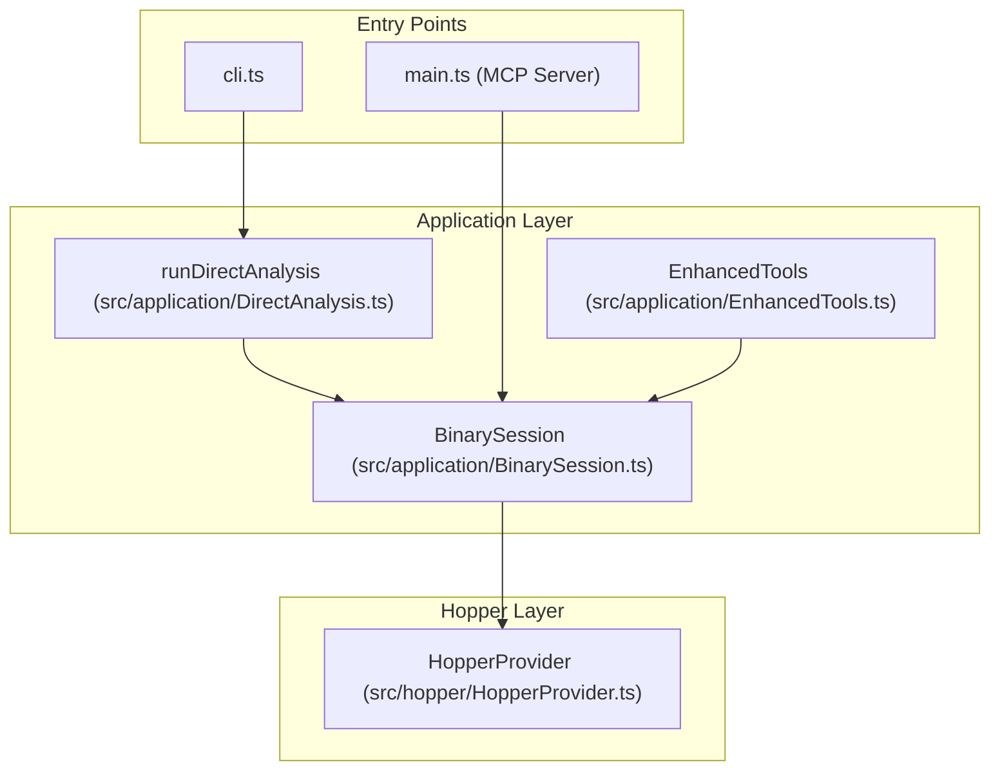
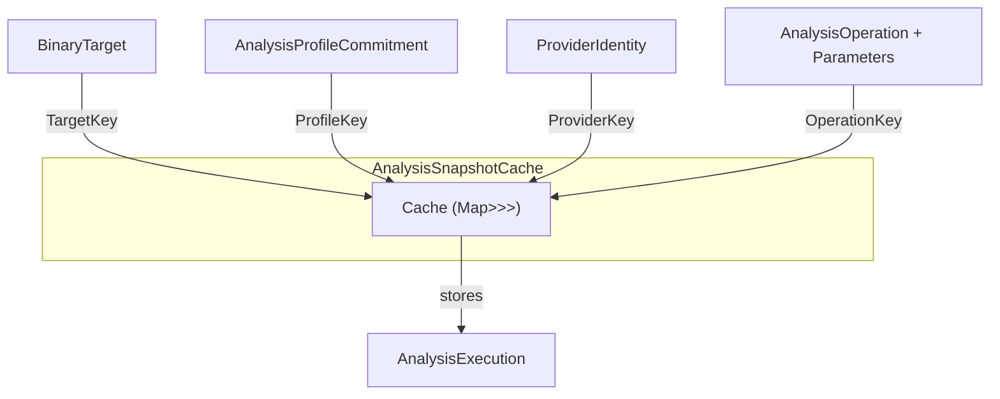
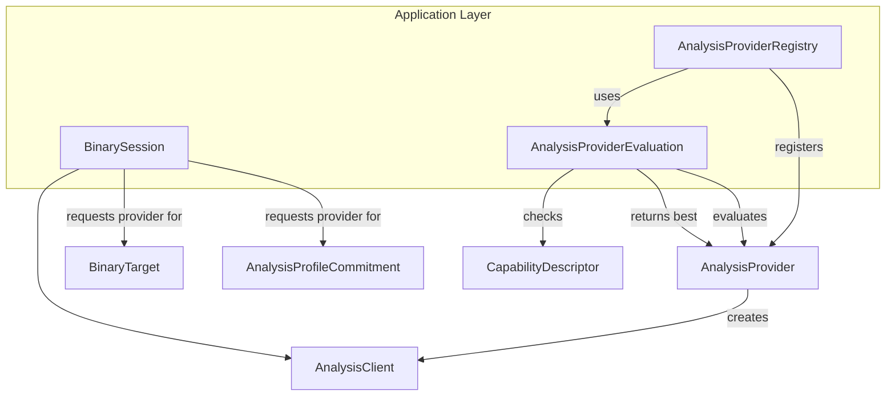
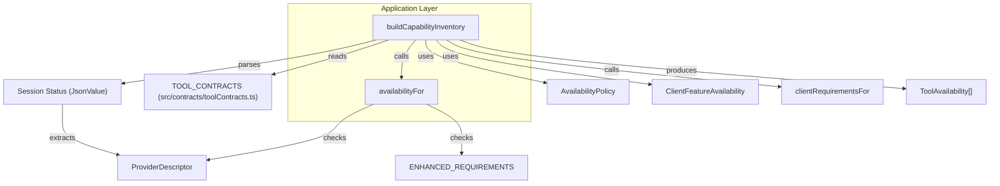
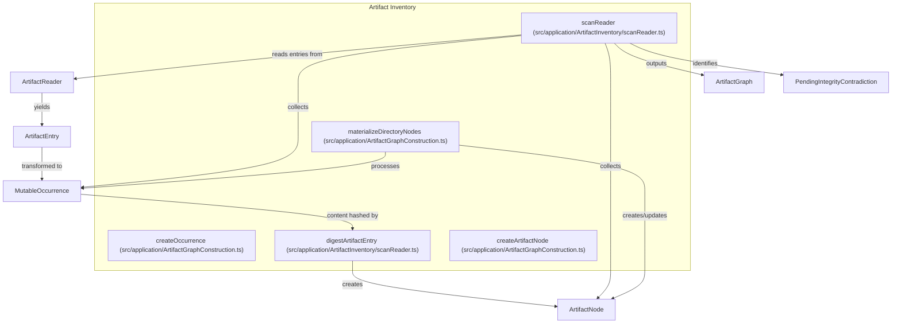

<!-- source: DeepWiki mcp.deepwiki.com · repo morluto/rea · page 2.4 Application Layer · fetched 2026-10-09 -->

# Application Layer

<details>
<summary>Relevant source files</summary>

The following files were used as context for generating this wiki page:

- [src/application/AnalysisProvider.ts](src/application/AnalysisProvider.ts)
- [src/application/ArtifactGraphConstruction.test.ts](src/application/ArtifactGraphConstruction.test.ts)
- [src/application/ArtifactGraphConstruction.ts](src/application/ArtifactGraphConstruction.ts)
- [src/application/ArtifactInventory/scanReader.ts](src/application/ArtifactInventory/scanReader.ts)
- [src/application/ArtifactInventory/types.ts](src/application/ArtifactInventory/types.ts)
- [src/application/CapabilityInventory.ts](src/application/CapabilityInventory.ts)
- [src/application/ReferenceSourceImport.ts](src/application/ReferenceSourceImport.ts)
- [src/application/ReferenceSourceImportTypes.ts](src/application/ReferenceSourceImportTypes.ts)
- [src/application/binary/AbortablePromise.ts](src/application/binary/AbortablePromise.ts)
- [src/application/binary/AnalysisClientCleanup.ts](src/application/binary/AnalysisClientCleanup.ts)
- [src/application/binary/AnalysisProviderEvaluation.ts](src/application/binary/AnalysisProviderEvaluation.ts)
- [src/application/binary/AnalysisProviderRegistry.test.ts](src/application/binary/AnalysisProviderRegistry.test.ts)
- [src/application/binary/AnalysisProviderRegistry.ts](src/application/binary/AnalysisProviderRegistry.ts)
- [src/application/binary/AnalysisSnapshotCache.test.ts](src/application/binary/AnalysisSnapshotCache.test.ts)
- [src/application/binary/AnalysisSnapshotCache.ts](src/application/binary/AnalysisSnapshotCache.ts)
- [src/catalogIdentity.ts](src/catalogIdentity.ts)
- [src/cli/referenceSourceImportStatus.ts](src/cli/referenceSourceImportStatus.ts)
- [src/cliReferenceSourceImportStatus.test.ts](src/cliReferenceSourceImportStatus.test.ts)
- [src/contracts/officialToolContracts.ts](src/contracts/officialToolContracts.ts)
- [src/domain/referenceSourceGraph.ts](src/domain/referenceSourceGraph.ts)
- [tests/boundary/cli/referenceSourceImportStatus.test.ts](tests/boundary/cli/referenceSourceImportStatus.test.ts)
- [tests/boundary/filesystem/artifactDirectoryIdentity.test.ts](tests/boundary/filesystem/artifactDirectoryIdentity.test.ts)
- [tests/boundary/filesystem/artifactInventoryEntryOrder.test.ts](tests/boundary/filesystem/artifactInventoryEntryOrder.test.ts)
- [tests/boundary/filesystem/asarInventoryContainment.test.ts](tests/boundary/filesystem/asarInventoryContainment.test.ts)
- [tests/boundary/mcp/artifactEntryOrderMcp.test.ts](tests/boundary/mcp/artifactEntryOrderMcp.test.ts)
- [tests/boundary/mcp/enhancedTools.01-lists-the-complete-target-open.test.ts](tests/boundary/mcp/enhancedTools.01-lists-the-complete-target-open.test.ts)
- [tests/boundary/mcp/officialTools.test.ts](tests/boundary/mcp/officialTools.test.ts)
- [tests/boundary/mcp/serverIdentity.test.ts](tests/boundary/mcp/serverIdentity.test.ts)
- [tests/boundary/mcp/serverLifecycleMcp.test.ts](tests/boundary/mcp/serverLifecycleMcp.test.ts)
- [tests/fixtures/artifactEntryOrder.ts](tests/fixtures/artifactEntryOrder.ts)

</details>


The Application Layer provides a shared runtime for the CLI and MCP adapters. It manages the lifecycle of analysis sessions, composes low-level Hopper operations into high-level "Enhanced Tools," and provides idempotent system utilities for environment diagnostics and automated configuration.

## Session Management

The core of the application layer is the `BinarySession`, which maintains the state of a single active analysis target. Because Hopper dispatches work on a dedicated Python thread and requires a bridge teardown to switch binaries, `BinarySession` serializes all target transitions to prevent race conditions [src/application/BinarySession.ts:34-37]().

### BinarySession Lifecycle
1.  **Open**: Parses the `BinaryTarget`, drains any pending calls to the previous target, closes the old bridge, and initializes a new `AnalysisClient` [src/application/BinarySession.ts:64-95]().
2.  **Execute**: Proxies tool calls to the active client. If a transition is in progress, calls wait for the transition to settle [src/application/BinarySession.ts:134-150]().
3.  **Restore**: If a switch to a new binary fails, the session attempts to recreate the previous target's client to avoid leaving the system in a broken state [src/application/BinarySession.ts:165-175]().
4.  **Close**: Drains calls and shuts down the bridge [src/application/BinarySession.ts:99-107]().

### Session Data Flow
The following diagram illustrates how the `BinarySession` manages the transition between two different binary targets.

**Binary Target Transition Flow**
```mermaid
sequenceDiagram
    participant A as Adapter (CLI/MCP)
    participant S as "BinarySession"
    participant C1 as "AnalysisClient (Target A)"
    participant C2 as "AnalysisClient (Target B)"

    A->>S: open(path_B)
    S->>S: #serialize() (locks transition)
    S->>S: #drainCalls()
    S->>C1: close()
    destroy C1
    S->>C2: createClient(target_B)
    S->>C2: execute("health")
    C2-->>S: ok
    S-->>A: ok(target_B)
    Note over S: transition lock released
```
Sources: [src/application/BinarySession.ts:39-206](), [src/application/AnalysisProvider.ts:20-22]()

## Enhanced Tools Composition

The `EnhancedTools` class composes the 31 "official" proxy tools into 8 high-level workflows. These tools handle complex logic such as recursive call graph traversal, batching decompilation requests, and language-specific symbol analysis (Swift/Objective-C).

| Tool | Implementation Logic |
| :--- | :--- |
| `get_call_graph` | Recursively calls `procedure_callees` or `procedure_callers` up to a specified depth [src/application/EnhancedTools.ts:142-202](). |
| `batch_decompile` | Maps multiple addresses to concurrent `procedure_pseudo_code` calls [src/application/EnhancedTools.ts:116-140](). |
| `swift_classes` | Fetches all procedures and filters them using `discoverSwiftClasses` domain logic [src/application/EnhancedTools.ts:99-104](). |
| `trace_feature` | Scans strings for a pattern, finds XREFs to those strings, and maps them to containing procedures [src/application/EnhancedTools.ts:211-255](). |

Sources: [src/application/EnhancedTools.ts:34-255](), [src/contracts/enhancedInputs.ts:3-3]()

## System Diagnostics and Setup

REA includes a diagnostic engine (`Doctor`) and an idempotent installer (`Setup`) to ensure the host environment (macOS, Node.js, Hopper, Homebrew) is correctly configured.

### The Doctor Utility
The `runDoctor` function executes a series of `DoctorCheck` operations. It probes for the Hopper binary in several locations:
1.  The `HOPPER_LAUNCHER_PATH` environment variable [src/application/Doctor.ts:70]().
2.  Standard `/Applications` paths [src/application/Doctor.ts:149]().
3.  Homebrew cask prefix via `brew --prefix --cask hopper-disassembler` [src/application/Doctor.ts:133-142]().

### The Setup Workflow
The `runSetup` function provides a "one-click" configuration experience. It is designed to be safe for use by coding agents by reporting `needs_human` instead of blocking on interactive prompts [src/application/Setup.ts:59-62]().

**Setup Implementation Details:**
*   **Idempotency**: Checks if Homebrew, Hopper, or configuration keys already exist before attempting mutation [src/application/Setup.ts:76-143]().
*   **Atomic Updates**: When configuring MCP clients (Claude/Cursor), it creates a `.rea.backup` file before performing an atomic write [src/application/Setup.ts:198-210]().
*   **Validation**: Performs a "readback" check after writing JSON configs to ensure the file remains valid and the changes were persisted [src/application/Setup.ts:27-36]().

Sources: [src/application/Doctor.ts:40-103](), [src/application/Setup.ts:76-143](), [tests/setupConfig.test.ts:16-35]()

## Runtime Wiring

The `runtime.ts` module serves as the dependency injection point for the application. It connects the `BinarySession` to the concrete `HopperProvider`.

**Runtime Composition Diagram**

Sources: [src/application/runtime.ts:11-16](), [src/application/DirectAnalysis.ts:12-37](), [src/cli.ts:15-73]()

## Direct Analysis (CLI Mode)

For one-shot commands like `rea analyze <path>`, the `runDirectAnalysis` function manages a transient session. Unlike the MCP server which keeps the bridge open, `DirectAnalysis` follows a strict "Open -> Execute -> Close" pattern to ensure no background processes are left running after the CLI exits [src/application/DirectAnalysis.ts:12-37](). It also wraps the output in the `Evidence` schema, associating the result with the binary's SHA-256 hash [src/application/DirectAnalysis.ts:28-32]().

Sources: [src/application/DirectAnalysis.ts:12-37](), [src/domain/evidence.ts:5-5]()

## Analysis Snapshot Cache

The `AnalysisSnapshotCache` [src/application/binary/AnalysisSnapshotCache.ts]() stores results of analysis operations to avoid redundant computations. It partitions cached data by `BinaryTarget`, `AnalysisProfileCommitment`, and `ProviderIdentity` [src/application/binary/AnalysisSnapshotCache.ts:100-102]().

Key aspects:
*   **Partitioning**: Snapshots are stored in a nested map structure, ensuring that results from different targets, profiles, or providers do not conflict [src/application/binary/AnalysisSnapshotCache.ts:100-102]().
*   **Cacheability**: The `isSnapshotCacheable` function determines if an operation's result can be cached. Operations that require explicit document or address parameters are generally cacheable, while those without such specificity are not [src/application/binary/AnalysisSnapshotCache.ts:19-20](). For example, `list_strings` is not cacheable without a `document` parameter, but `address_name` is cacheable with both `document` and `address` [src/application/binary/AnalysisSnapshotCache.test.ts:28-43]().
*   **Integrity**: When importing a snapshot, the cache verifies that the `EvidenceBundle` matches the expected `AnalysisExecution` to prevent tampering [src/application/binary/AnalysisSnapshotCache.ts:150-152]().
*   **Limitations**: Cached results are marked with a `local REA analysis snapshot` limitation to indicate their provenance [src/application/binary/AnalysisSnapshotCache.ts:160-161]().

**Analysis Snapshot Cache Structure**

Sources: [src/application/binary/AnalysisSnapshotCache.ts](), [src/application/binary/AnalysisSnapshotCache.test.ts:22-168]()

## Provider Registry and Evaluation

The `AnalysisProviderRegistry` [src/application/binary/AnalysisProviderRegistry.ts]() manages the collection of available `AnalysisProvider` instances. It allows for dynamic registration and selection of providers based on their capabilities and the analysis target.

Key functions:
*   `registerProvider`: Adds a new `AnalysisProvider` to the registry [src/application/binary/AnalysisProviderRegistry.ts:26-28]().
*   `resolveProvider`: Selects the most suitable provider for a given `BinaryTarget` and `AnalysisProfileCommitment`. This involves evaluating provider capabilities and compatibility [src/application/binary/AnalysisProviderRegistry.ts:30-32]().
*   `allProviders`: Returns all registered providers [src/application/binary/AnalysisProviderRegistry.ts:34-36]().

The `AnalysisProviderEvaluation` module [src/application/binary/AnalysisProviderEvaluation.ts]() contains the logic for determining which provider is best suited for a given task. This involves:
*   **Capability Matching**: Checking if a provider declares the necessary `CapabilityDescriptor` for an operation [src/application/binary/AnalysisProviderEvaluation.ts:100-102]().
*   **Profile Resolution**: Providers can offer `resolveAnalysisProfile` to determine specific analysis settings for a target [src/application/AnalysisProvider.ts:174-177]().
*   **Target Compatibility**: Ensuring the provider can handle the specific `BinaryTarget` (e.g., architecture, format) [src/application/binary/AnalysisProviderEvaluation.ts:100-102]().

**Provider Registry and Evaluation Flow**

Sources: [src/application/binary/AnalysisProviderRegistry.ts](), [src/application/binary/AnalysisProviderEvaluation.ts](), [src/application/AnalysisProvider.ts:174-177]()

## Capability Inventory

The `buildCapabilityInventory` function [src/application/CapabilityInventory.ts:127-189]() constructs a comprehensive list of all available tools and their current availability status. This inventory is crucial for the client to understand what operations can be performed and why certain tools might be unavailable.

Key aspects:
*   **Tool Contracts**: It iterates through `TOOL_CONTRACTS` [src/catalogIdentity.ts:17]() to get a baseline of all known tools.
*   **Provider Descriptors**: It incorporates `ProviderDescriptor` objects from the active session status, which indicate what operations individual providers support [src/application/CapabilityInventory.ts:133-135]().
*   **Availability Policy**: An `AvailabilityPolicy` [src/application/CapabilityInventory.ts:33-46]() is applied to determine if certain features (e.g., process capture, firmware inspection) are enabled, influencing tool availability.
*   **Client Requirements**: `clientRequirementsFor` [src/application/CapabilityInventory.ts:145-147]() checks if the connected client supports the necessary features for a tool. If not, the tool is marked as unavailable with a `client_capability_missing` reason [src/application/CapabilityInventory.ts:168-174]().
*   **Enhanced Tool Requirements**: The `ENHANCED_REQUIREMENTS` constant [src/application/CapabilityInventory.ts:81-109]() defines dependencies between enhanced tools and official tools, ensuring that an enhanced tool is only available if its underlying official tools are also available.

**Capability Inventory Construction**

Sources: [src/application/CapabilityInventory.ts:127-189](), [src/application/CapabilityInventory.ts:81-109](), [src/catalogIdentity.ts:17](), [src/application/CapabilityInventory.ts:145-147]()

## Artifact Inventory and Graph Construction

The `ArtifactInventory` module is responsible for scanning artifacts (like ZIP files, ASAR archives, or directories) and constructing a graph representation of their contents. This graph (`ArtifactNode`s and `ArtifactEdge`s) provides a canonical, content-addressed identity for each file and directory within an artifact.

Key functions and concepts:
*   `scanReader`: Recursively traverses an `ArtifactReader` (e.g., `ZipArtifactReader`, `AsarArtifactReader`) to discover entries [src/application/ArtifactInventory/scanReader.ts:56-64]().
*   `createOccurrence`: Creates a `MutableOccurrence` for each entry, representing its logical path and initial metadata [src/application/ArtifactGraphConstruction.ts:39-59]().
*   `digestArtifactEntry`: Hashes the content of file entries to generate SHA-256 digests, which form the basis of content-addressed `ArtifactNode` IDs [src/application/ArtifactInventory/scanReader.ts:184-199]().
*   `createArtifactNode`: Creates an `ArtifactNode` with a content-addressed `artifact_id` based on its SHA-256 hash and other properties [src/application/ArtifactGraphConstruction.ts:153-172]().
*   `materializeDirectoryNodes`: Assigns canonical IDs to directories based on the sorted list of their children's names and artifact IDs. This ensures that directory identity is stable even if child order changes in the archive [src/application/ArtifactGraphConstruction.ts:72-115]().
*   `compareDirectoryChildNames`: Provides a deterministic sorting order for directory children, crucial for stable directory hashing [src/application/ArtifactGraphConstruction.ts:61-70]().
*   `PendingIntegrityContradiction`: Records instances where an artifact's declared SHA-256 hash does not match the observed hash, indicating potential tampering or corruption [src/application/ArtifactInventory/scanReader.ts:27-33]().

**Artifact Inventory and Graph Construction Flow**

Sources: [src/application/ArtifactInventory/scanReader.ts](), [src/application/ArtifactGraphConstruction.ts](), [tests/boundary/filesystem/artifactDirectoryIdentity.test.ts:81-183]()

## Reference Source Import

The `importReferenceSource` function [src/application/ReferenceSourceImport.ts:133-188]() imports a directory of source code into a `HistoricalSourceGraph`. This graph captures the structure, content, and relationships within the source code, enabling semantic analysis and comparison.

Key steps:
*   **Policy Preparation**: `prepareReferenceSourceImport` applies policies to identify ignored files (e.g., secrets, caller-excluded paths) [src/application/ReferenceSourceImport.ts:137-138]().
*   **Source Reading**: `readReferenceSource` reads the file system, respecting exclusion rules [src/application/ReferenceSourceImport.ts:155-159]().
*   **VCS Integration**: `readReferenceSourceVcs` extracts version control system (VCS) information (e.g., Git head, dirty status) [src/application/ReferenceSourceImport.ts:160-161]().
*   **Entry Parsing**: `parseReferenceSourceEntries` processes the raw file entries, identifies languages, and extracts relationships (imports, references) [src/application/ReferenceSourceImport.ts:180-181]().
*   **Deduplication and Normalization**: Relationships and parse failures are deduplicated and sorted for deterministic graph construction [src/application/ReferenceSourceImport.ts:185-186]().
*   **Graph Creation**: `createHistoricalSourceGraph` constructs the final `HistoricalSourceGraph` from the processed entries, relationships, and metadata [src/domain/referenceSourceGraph.ts:9]().
*   **Inventory State**: The `deriveInventoryState` function determines if the imported graph is `complete`, `partial`, or `unknown` based on the presence of limitations, exclusions, or unhashed content [src/application/ReferenceSourceImport.ts:87-115]().

**Reference Source Import Flow**
```mermaid
graph TD
    subgraph "Reference Source Import"
        IRS["importReferenceSource (src/application/ReferenceSourceImport.ts)"]
        PRSI["prepareReferenceSourceImport (src/application/ReferenceSourceImportPolicy.ts)"]
        RRS["readReferenceSource (src/reference/ReferenceSourceReader.ts)"]
        RRSV["readReferenceSourceVcs (src/application/ReferenceSourceVcsAdapter.ts)"]
        PRSE["parseReferenceSourceEntries (src/application/ReferenceSourceImportEntries.ts)"]
        DDR["deduplicateRelationships (src/application/ReferenceSourceImport.ts)"]
        NHSPF["normalizeHistoricalSourceParseFailures (src/application/ReferenceSourceImport.ts)"]
        CHSG["createHistoricalSourceGraph (src/domain/referenceSourceGraph.ts)"]
        DIS["deriveInventoryState (src/application/ReferenceSourceImport.ts)"]
    end

    RSIO["ReferenceSourceImportOptions"]
    PP["PreparedPolicy"]
    RR["ReadResult"]
    VCS["VCSInfo"]
    E["Entries"]
    R["Relationships"]
    PF["ParseFailures"]
    L["Limitations"]
    HSG["HistoricalSourceGraph"]

    RSIO -- "configures" --> PRSI
    PRSI -- "outputs" --> PP
    IRS -- "uses" --> PP
    IRS -- "calls" --> RRS
    IRS -- "calls" --> RRSV
    RRS -- "outputs" --> RR
    RRSV -- "outputs" --> VCS
    IRS -- "calls" --> PRSE
    PRSE -- "inputs" --> RR
    PRSE -- "outputs" --> E, R, PF, L
    IRS -- "calls" --> DDR
    DDR -- "inputs" --> R
    DDR -- "outputs" --> R
    IRS -- "calls" --> NHSPF
    NHSPF -- "inputs" --> PF
    NHSPF -- "outputs" --> PF
    IRS -- "calls" --> DIS
    DIS -- "inputs" --> E, R, PF, L
    IRS -- "calls" --> CHSG
    CHSG -- "inputs" --> E, R, PF, L, VCS, PP
    CHSG -- "outputs" --> HSG
    IRS -- "returns" --> HSG
```
Sources: [src/application/ReferenceSourceImport.ts](), [src/domain/referenceSourceGraph.ts:9](), [src/application/ReferenceSourceImport.ts:87-115]()

---

