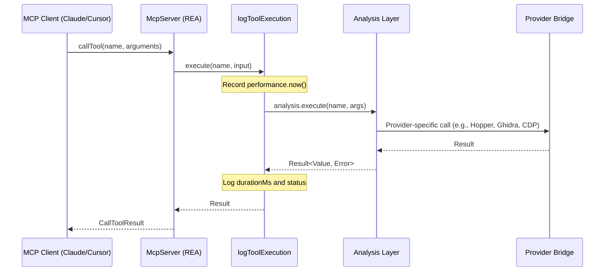

<!-- source: DeepWiki mcp.deepwiki.com · repo morluto/rea · page 2.5 Server Layer (MCP Adapter) · fetched 2026-10-09 -->

# Server Layer (MCP Adapter)

Relevant source files

The following files were used as context for generating this wiki page:

- [docs/mcp-prompts.md](docs/mcp-prompts.md)
- [src/cliCommandNames.ts](src/cliCommandNames.ts)
- [src/cliJavaScriptRuntimeCommands.ts](src/cliJavaScriptRuntimeCommands.ts)
- [src/config.ts](src/config.ts)
- [src/contracts/managed/managedToolContracts.ts](src/contracts/managed/managedToolContracts.ts)
- [src/contracts/promptContracts.test.ts](src/contracts/promptContracts.test.ts)
- [src/contracts/promptContracts.ts](src/contracts/promptContracts.ts)
- [src/contracts/sessionToolContracts.ts](src/contracts/sessionToolContracts.ts)
- [src/contracts/toolContracts.ts](src/contracts/toolContracts.ts)
- [src/contracts/toolEffects.ts](src/contracts/toolEffects.ts)
- [src/domain/inputIssueProjection.test.ts](src/domain/inputIssueProjection.test.ts)
- [src/domain/inputIssueProjection.ts](src/domain/inputIssueProjection.ts)
- [src/domain/localPath.ts](src/domain/localPath.ts)
- [src/main.ts](src/main.ts)
- [src/server/createServer.ts](src/server/createServer.ts)
- [src/server/registerElectronTools.ts](src/server/registerElectronTools.ts)
- [src/server/registerEnhancedTools.ts](src/server/registerEnhancedTools.ts)
- [src/server/registerInvestigationTools.ts](src/server/registerInvestigationTools.ts)
- [src/server/registerJavaScriptRuntimeObservationTools.ts](src/server/registerJavaScriptRuntimeObservationTools.ts)
- [src/server/registerOfficialTools.ts](src/server/registerOfficialTools.ts)
- [src/server/registerSessionTools.ts](src/server/registerSessionTools.ts)
- [src/server/toolResult.ts](src/server/toolResult.ts)
- [tests/boundary/cli/processCli.test.ts](tests/boundary/cli/processCli.test.ts)
- [tests/boundary/mcp/electronMcp.test.ts](tests/boundary/mcp/electronMcp.test.ts)
- [tests/boundary/mcp/outputSchemaSemanticConstraints.test.ts](tests/boundary/mcp/outputSchemaSemanticConstraints.test.ts)
- [tests/boundary/mcp/serverWorkflowMcp.test.ts](tests/boundary/mcp/serverWorkflowMcp.test.ts)
- [tests/boundary/mcp/sessionMcp.test.ts](tests/boundary/mcp/sessionMcp.test.ts)
- [tests/boundary/mcp/toolSchemaValidity.test.ts](tests/boundary/mcp/toolSchemaValidity.test.ts)

The Server Layer acts as the interface between the Model Context Protocol (MCP) and the REA application logic. It is responsible for assembling the `McpServer` instance, registering tools from various providers, and translating domain results into MCP-compliant responses.

## Core Assembly: `createServer`

The `createServer` function is the primary entry point for constructing the MCP server. It determines the server's capabilities and instructions based on whether a `BinarySession` is provided.

- **Fixed-Target Mode**: If `session` is `undefined`, the server assumes a fixed analysis target (provided via environment variables). It registers 43 tools (Official + Enhanced) [tests/boundary/mcp/sessionMcp.test.ts:59-60]().
- **Session Mode**: If a `BinarySession` is provided, the server registers 46 tools, adding target lifecycle management (open/close/status). This mode allows the LLM to switch between different binaries during a single execution [tests/boundary/mcp/sessionMcp.test.ts:59-60]().

The `createServer` function also handles the dynamic availability of optional providers and features, which influences the `SessionAvailability` policy [src/server/createServer.ts:75-112](). This policy is then used to determine which tools are available to the client.

### Server Initialization Flow
The following diagram illustrates how `createServer` wires the internal components.

**Server Assembly and Wiring**

```mermaid
graph TD
    subgraph "Server Layer"
        CS["createServer(analysis, session?, options)"]
        RO["registerOfficialTools"]
        RE["registerEnhancedTools"]
        RS["registerSessionTools"]
        RA["registerArtifactTools"]
        RM["registerManagedTools"]
        RMW["registerManagedWorkflowTools"]
        RN["registerNativeTools"]
        RF["registerFirmwareTools"]
        RAn["registerAndroidTools"]
        RB["registerBrowserTools"]
        RBS["registerBrowserScenarioTool"]
        RJS["registerJavaScriptRecoveryTool"]
        RJR["registerJavaScriptRuntimeObservationTools"]
        REl["registerElectronTools"]
        RWS["registerWebScriptTool"]
        RWM["registerWebModuleTool"]
        RWSL["registerWebSourceLocationTool"]
        RWR["registerWebRuntimeTools"]
        RInv["registerInvestigationTools"]
        RApp["registerApplicationTools"]
RGP["registerGuidedPrompts"]
        TR["toCallToolResult"]
    end

    subgraph "Application Layer"
        AP["AnalysisOperationPort"]
        BS["BinarySessionPort"]
        ET["EnhancedTools"]
        FAS["FirmwareAnalysisService"]
        AAS["AndroidAnalysisService"]
        JRS["JavaScriptRecoveryService"]
        WMTS["WebModuleTraceService"]
        WSLS["WebSourceLocationService"]
        WRS["WebRuntimeService"]
        BO["BrowserObservationPort"]
        BSC["BrowserScenarioCapturePort"]
        EO["ElectronObservationPort"]
        EAO["ElectronActiveObservationPort"]
        JRO["JavaScriptRuntimeObservationPort"]
    end

    subgraph "MCP SDK"
        MS["McpServer Instance"]
    end

    CS --> MS
    CS --> RO
    CS --> RE
    CS --> RS
    CS --> RA
    CS --> RM
    CS --> RMW
    CS --> RN
    CS --> RF
    CS --> RAn
    CS --> RB
    CS --> RBS
    CS --> RJS
    CS --> RJR
    CS --> REl
    CS --> RWS
    CS --> RWM
    CS --> RWSL
    CS --> RWR
    CS --> RInv
    CS --> RApp
    CS --> RGP

    RO -- "proxies to" --> AP
    RE -- "proxies to" --> AP & ET
    RS -- "proxies to" --> BS
    RA -- "proxies to" --> AP
    RM -- "proxies to" --> AP
    RMW -- "proxies to" --> AP
    RN -- "proxies to" --> AP
    RF -- "proxies to" --> FAS
    RAn -- "proxies to" --> AAS
    RB -- "proxies to" --> BO
    RBS -- "proxies to" --> BSC
    RJS -- "proxies to" --> JRS
    RJR -- "proxies to" --> JRO
    REl -- "proxies to" --> EO & EAO
    RWS -- "proxies to" --> AP
    RWM -- "proxies to" --> WMTS
    RWSL -- "proxies to" --> WSLS
    RWR -- "proxies to" --> WRS
    RInv -- "proxies to" --> BS
    RApp -- "proxies to" --> AP
    
    RO & RE & RS & RA & RM & RMW & RN & RF & RAn & RB & RBS & RJS & RJR & REl & RWS & RWM & RWSL & RWR & RInv & RApp -- "maps output via" --> TR
```

**Sources:** [src/server/createServer.ts:1-117](), [src/server/registerApplicationTools.ts:1-10](), [src/server/registerArtifactTools.ts:1-10](), [src/server/registerBrowserScenarioTool.ts:1-10](), [src/server/registerBrowserTools.ts:1-10](), [src/server/registerWebScriptTool.ts:1-10](), [src/server/registerWebModuleTool.ts:1-10](), [src/server/registerWebSourceLocationTool.ts:1-10](), [src/server/registerWebRuntimeTools.ts:1-10](), [src/server/registerJavaScriptRecoveryTool.ts:1-10](), [src/server/registerElectronTools.ts:1-10](), [src/server/registerEnhancedTools.ts:1-10](), [src/server/registerJavaScriptRuntimeObservationTools.ts:1-10](), [src/server/registerManagedTools.ts:1-10](), [src/server/registerFirmwareTools.ts:1-10](), [src/server/registerAndroidTools.ts:1-10](), [src/server/registerManagedWorkflowTools.ts:1-10](), [src/server/registerNativeTools.ts:1-10](), [src/server/registerOfficialTools.ts:1-10](), [src/server/registerPrompts.ts:1-10](), [src/server/registerSessionTools.ts:1-10]()

## Tool Registration Modules

REA organizes its toolset into several distinct registration functions, each handling a specific category of functionality. The `TOOL_CONTRACTS` array in [src/contracts/toolContracts.ts:21-38]() provides a complete ordered public inventory of all tools.

### 1. Official Tools (`registerOfficialTools`)
Registers tools that map directly to core analysis operations. These tools use the `OFFICIAL_TOOL_CONTRACTS` to define their schema and parameters [src/contracts/toolContracts.ts:22]().
- **Argument Projection**: The `projectOfficialArguments` function ensures that input from the MCP client matches the expected `JsonValue` structure required by the `AnalysisOperationPort` [src/server/registerOfficialTools.ts:133-151]().
- **Evidence Creation**: Successful results are wrapped in an "Evidence" object using `createEvidence`, which attaches metadata about the `activeTarget` (SHA256, path, etc.) to the tool output [src/server/registerOfficialTools.ts:78-91]().

### 2. Enhanced Tools (`registerEnhancedTools`)
Registers composed workflows (e.g., `analyze_function`, `trace_feature`) that coordinate multiple analysis operations. These tools are defined in `ENHANCED_TOOL_CONTRACTS` [src/contracts/toolContracts.ts:23]().
- **Implementation**: It instantiates the `EnhancedTools` class and registers each tool [src/server/registerEnhancedTools.ts:47-187]().
- **Validation**: Inputs are strictly validated against the `ToolContract`'s input schema before being passed to the service [src/server/registerEnhancedTools.ts:71-74]().

### 3. Session Tools (`registerSessionTools`)
Registers tools that manage the `BinarySession` lifecycle, including `open_binary`, `close_binary`, and `binary_session` [src/contracts/toolContracts.ts:37]().
- **Target Switching**: These tools allow the server to transition between different binary files or Hopper databases [src/server/registerSessionTools.ts:157-186]().
- **Status Reporting**: The `binary_session` tool provides the current state of the analysis session, including the loaded architecture and SHA256 hash [src/server/registerSessionTools.ts:148-154]().
- **Process Capture**: Includes `capture_process_scenario` for recording process execution and `recordProcessResidualUnknowns` for tracking unobserved behavior [src/server/registerSessionTools.ts:86-127]().

### 4. Artifact Tools (`registerArtifactTools`)
Registers tools for inspecting and extracting artifacts, defined in `ARTIFACT_TOOL_CONTRACTS` [src/contracts/toolContracts.ts:25]().

### 5. Managed Tools (`registerManagedTools`, `registerManagedWorkflowTools`)
Registers tools for analyzing managed code, including `MANAGED_TOOL_CONTRACTS` and `MANAGED_WORKFLOW_TOOL_CONTRACTS` [src/contracts/toolContracts.ts:26](), [src/contracts/toolContracts.ts:29]().

### 6. Electron Tools (`registerElectronTools`)
Registers tools for Electron application analysis, using `ELECTRON_TOOL_CONTRACTS` [src/contracts/toolContracts.ts:31]().

### 7. Investigation Tools (`registerInvestigationTools`)
Registers tools for complex investigation workflows, such as `find_changed_behavior`, `build_call_path`, and `correlate_static_and_runtime` [src/server/registerInvestigationTools.ts:29-48](). These tools operate on existing evidence within the session.

### 8. Application Tools (`registerApplicationTools`)
Registers tools for application-level analysis, defined in `APPLICATION_TOOL_CONTRACTS` [src/contracts/toolContracts.ts:33]().

### 9. Firmware Tools (`registerFirmwareTools`)
Registers tools for firmware analysis, using `FIRMWARE_TOOL_CONTRACTS` [src/contracts/toolContracts.ts:27]().

### 10. Android Tools (`registerAndroidTools`)
Registers tools for Android application analysis, using `ANDROID_TOOL_CONTRACTS` [src/contracts/toolContracts.ts:28]().

### 11. Browser Tools (`registerBrowserTools`, `registerBrowserScenarioTool`)
Registers tools for browser observation and scenario capture, using `BROWSER_PROVIDER_TOOL_CONTRACTS` [src/contracts/toolContracts.ts:30]().

### 12. JavaScript Runtime Tools (`registerJavaScriptRuntimeObservationTools`, `registerWebScriptTool`, `registerWebModuleTool`, `registerWebSourceLocationTool`, `registerWebRuntimeTools`, `registerJavaScriptRecoveryTool`)
Registers tools for JavaScript runtime observation, web script analysis, module tracing, source location mapping, web runtime inspection, and JavaScript recovery. These are defined across `JAVASCRIPT_RUNTIME_OBSERVATION_TOOL_CONTRACTS`, `WEB_SCRIPT_TOOL_CONTRACTS`, `WEB_MODULE_TOOL_CONTRACTS`, `WEB_SOURCE_LOCATION_TOOL_CONTRACTS`, `WEB_RUNTIME_TOOL_CONTRACTS`, and `JAVASCRIPT_RECOVERY_TOOL_CONTRACTS` [src/contracts/toolContracts.ts:32](), [src/contracts/toolContracts.ts:34](), [src/contracts/toolContracts.ts:35](), [src/contracts/toolContracts.ts:36](), [src/contracts/toolContracts.ts:13]().

### 13. Native Tools (`registerNativeTools`)
Registers tools for native binary analysis, using `NATIVE_TOOL_CONTRACTS` [src/contracts/toolContracts.ts:24]().

### Tool Registration Options
The `toolRegistrationOptions` function generates MCP-specific options for each tool, including `readOnlyHint`, `destructiveHint`, `idempotentHint`, and `openWorldHint`, derived from the `ToolEffects` defined in [src/contracts/toolEffects.ts:1-12]() [src/server/toolRegistrationOptions.ts:1-19](). These hints provide valuable context to MCP clients about the nature of the tool's operation.

**Sources:** [src/server/registerOfficialTools.ts:16-25](), [src/server/registerEnhancedTools.ts:44-50](), [src/server/registerSessionTools.ts:130-155](), [src/contracts/toolContracts.ts:21-38](), [src/server/toolRegistrationOptions.ts:1-19](), [src/contracts/toolEffects.ts:1-12]()

## Tool Result Mapping (`toCallToolResult`)

The `toCallToolResult` function serves as the boundary between REA's internal `Result<T, E>` type and the MCP `CallToolResult` format.

### Translation Logic
| Source State | MCP Representation | Details |
| :--- | :--- | :--- |
| `ok(value)` | `content` (text) + `structuredContent` | The value is formatted as a string for `content` and preserved as JSON for `structuredContent` [src/server/toolResult.ts:46-49](). |
| `err(error)` | `isError: true` | The error `_tag` and `message` are returned as text content. Sensitive stack traces are omitted [src/server/toolResult.ts:19-27](). |
| Contract Mismatch | `isError: true` | If the analysis output does not match the `outputSchema` in the `ToolContract`, a `HopperProtocolError` is returned [src/server/toolResult.ts:35-44](). |

**Sources:** [src/server/toolResult.ts:13-57]()

## Guided Prompts (`registerGuidedPrompts`)

REA exposes several provider-neutral investigation workflows through the MCP `prompts` capability. These guided prompts complement the generated tool catalog by offering structured starting points for common analysis tasks.

### Prompt Inventory
The `PROMPT_CONTRACTS` array in [src/contracts/promptContracts.ts:94-402]() defines the available prompts, including:
- `investigate_feature`
- `compare_application_versions`
- `verify_reconstruction`
- `trace_crash`
- `audit_residual_unknowns`
- `prepare_bounded_process_capture`

Each prompt contract specifies its `name`, `title`, `description`, `objective`, `arguments` (with `description`, `required` status, and optional `completion` kind), and `steps` (listing suggested tools and instructions) [src/contracts/promptContracts.ts:29-36]().

### Prompt Rendering
The `renderGuidedPrompt` function formats a `PromptContract` and its arguments into a human-readable string, including an objective, requested context, optional starting points, and "Evidence discipline" rules [src/contracts/promptContracts.ts:60-91]().

### Session-Aware Completion
MCP `completion/complete` provides session-aware suggestions for optional prompt arguments. These suggestions are live projections of the current session, including:
- **Document**: From `list_documents` [src/contracts/promptContracts.ts:92-102]().
- **Procedure**: From `list_procedures` inventory [src/contracts/promptContracts.ts:92-102]().
- **Provider**: Configured provider identities [src/contracts/promptContracts.ts:92-102]().
- **Evidence**: IDs from the current session ledger [src/contracts/promptContracts.ts:92-102]().
- **Process capture**: IDs for retained process capture evidence [src/contracts/promptContracts.ts:92-102]().
- **Artifact manifest/occurrence**: IDs from retained artifact inventories [src/contracts/promptContracts.ts:92-102]().
- **Residual unknown**: Current non-resolved unknown heads [src/contracts/promptContracts.ts:92-102]().

Completion suggestions are Unicode-normalized, case-insensitive prefix matches, deduplicated and sorted for deterministic results [docs/mcp-prompts.md:103-107]().

**Sources:** [src/server/registerPrompts.ts:1-10](), [src/contracts/promptContracts.ts:29-36](), [src/contracts/promptContracts.ts:60-91](), [src/contracts/promptContracts.ts:94-402](), [docs/mcp-prompts.md:1-110]()

## Tool Execution Lifecycle

Every tool execution is wrapped in a logging and telemetry wrapper to monitor performance and reliability.

**Tool Call Sequence**

### Logging and Telemetry
The `logToolExecution` function captures:
- **Duration**: The time taken for the tool to complete in milliseconds [src/server/toolLogging.ts:15]().
- **Status**: Whether the tool succeeded (`info`) or failed (`warn`) [src/server/toolLogging.ts:12-19]().
- **Safety**: It explicitly avoids logging caller inputs to prevent leaking sensitive binary data or logic into the server logs [src/server/toolLogging.ts:4]().

**Sources:** [src/server/toolLogging.ts:5-21](), [src/server/registerOfficialTools.ts:117-129]()

---

