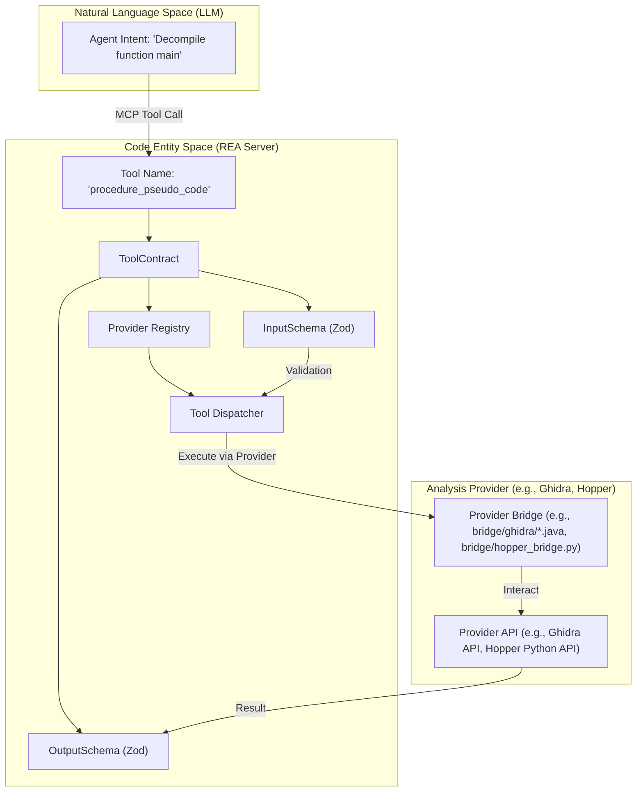
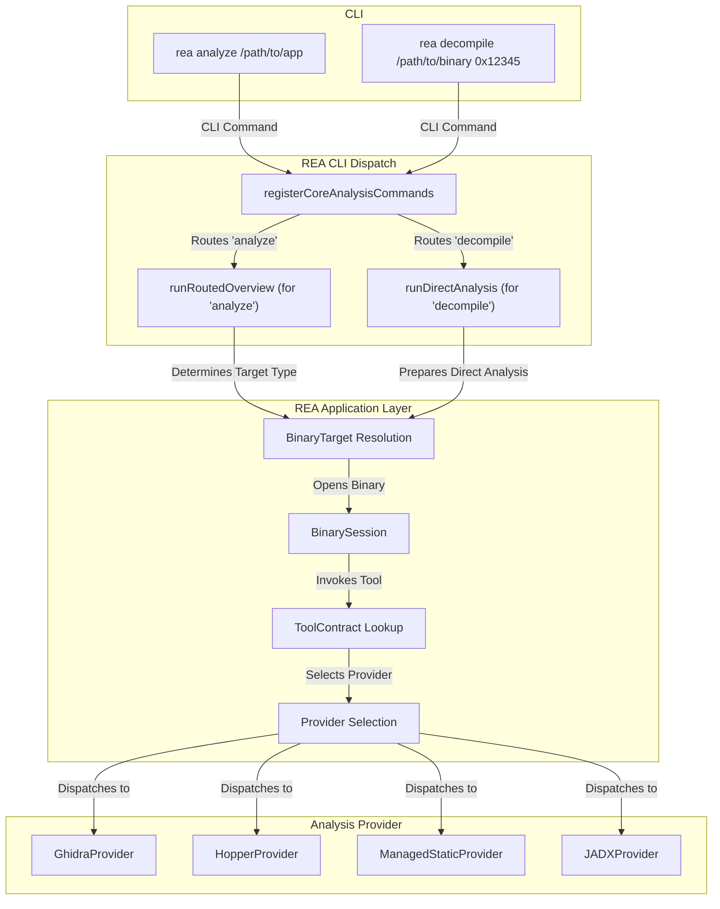

<!-- source: DeepWiki mcp.deepwiki.com · repo morluto/rea · page 3 Tool and CLI Reference · fetched 2026-10-09 -->

# Tool and CLI Reference

Relevant source files

The following files were used as context for generating this wiki page:

- [docs/mcp-contracts.md](docs/mcp-contracts.md)
- [docs/product-catalog.json](docs/product-catalog.json)
- [docs/verification/managed-conformance-manifest.json](docs/verification/managed-conformance-manifest.json)
- [skills/reverse-engineer-anything/SKILL.md](skills/reverse-engineer-anything/SKILL.md)
- [skills/reverse-engineer-anything/references/native-and-artifacts.md](skills/reverse-engineer-anything/references/native-and-artifacts.md)
- [src/application/DirectAnalysisDependencies.ts](src/application/DirectAnalysisDependencies.ts)
- [src/cli/coreAnalysisCommands.ts](src/cli/coreAnalysisCommands.ts)
- [src/cli/coreBinaryCommands.ts](src/cli/coreBinaryCommands.ts)
- [src/cli/coreNativeCommands.ts](src/cli/coreNativeCommands.ts)
- [tests/boundary/filesystem/setupSkill.test.ts](tests/boundary/filesystem/setupSkill.test.ts)

REA provides a comprehensive set of tools and CLI commands for analyzing various binary targets, managed assemblies, JavaScript/Electron applications, browsers, Android packages, and firmware. This page offers a high-level overview of these capabilities, organized by tool family, and links to child pages for detailed information.

The system currently exposes a total of 133 tools, as indicated in the `product-catalog.json` [docs/product-catalog.json:12-13](), and approximately 88 CLI commands. These tools are categorized into families based on their functionality and the type of target they operate on.

### Tool Architecture

All tools in REA are defined using a formal `ToolContract`. This contract acts as the single source of truth for the tool's identity, providing:
- **Name and Description**: Human-readable identifiers and agent guidance.
- **Kind**: Classification as `official-proxy`, `enhanced`, or `session` [docs/product-catalog.json:17-18]().
- **Input/Output Schemas**: Zod-based validation for both incoming arguments and outgoing results.
- **Annotations**: Metadata hints (e.g., `readOnlyHint`, `destructiveHint`) that help the LLM understand the side effects of a tool call.

#### Tool Metadata Mapping
The following diagram illustrates how natural language tool calls are mapped to the internal `ToolContract` and eventually to the underlying analysis providers.

Sources: [docs/product-catalog.json:12-228](), [src/application/DirectAnalysisDependencies.ts:6-12]()

---

### Tool Families

REA's tools are organized into several families, each addressing specific analysis needs. The `product-catalog.json` [docs/product-catalog.json:12-228]() lists these families and their associated tools.

#### 1. Direct Tools (41 Tools)
These tools provide a direct bridge to the underlying analysis provider's core functionalities, such as reading memory, listing basic blocks, or setting comments. They are fundamental for granular interaction with a binary.
For details, see [Official Proxy Tools](#3.1).
Sources: [docs/product-catalog.json:16-61]()

#### 2. Enhanced Workflow Tools (14 Tools)
Enhanced tools compose multiple direct tool calls or integrate advanced analysis techniques to provide higher-level insights and automate complex workflows. These tools often involve budgeting and pagination for large results.
For details, see [Enhanced Workflow Tools](#3.2).
Sources: [docs/product-catalog.json:63-82]()

#### 3. Native Tools (7 Tools)
These tools are specific to native binary analysis, often leveraging platform-specific capabilities like inspecting Mach-O files, demangling Swift symbols, or observing native UI interactions.
Sources: [docs/product-catalog.json:84-96]()

#### 4. Artifact Tools (5 Tools)
Artifact tools focus on inspecting and extracting contents from various package formats, such as application bundles, ZIP archives, or keyed archives.
Sources: [docs/product-catalog.json:98-108]()

#### 5. Managed Tools (7 Tools)
Managed tools are designed for analyzing .NET assemblies, including inspecting members, comparing managed code across versions, and verifying managed-native boundaries.
Sources: [docs/product-catalog.json:110-121]()

#### 6. Firmware Tools (2 Tools)
These tools assist in analyzing firmware images, including extracting firmware components and inspecting regions.
Sources: [docs/product-catalog.json:125-128]()

#### 7. Android Tools (5 Tools)
Android-specific tools enable inspection of APK packages, classes, methods, and tracing references within Android applications.
Sources: [docs/product-catalog.json:130-140]()

#### 8. Browser Tools (11 Tools)
Browser tools facilitate observation and analysis of web applications, including capturing scenarios, inspecting web pages, and analyzing web bundles.
Sources: [docs/product-catalog.json:142-158]()

#### 9. Electron Tools (5 Tools)
Electron tools are tailored for analyzing Electron applications, allowing for scenario capture, page inspection, and reconciliation of JavaScript runtimes.
Sources: [docs/product-catalog.json:160-170]()

#### 10. JavaScript Runtime Tools (2 Tools)
These tools provide capabilities for observing and listing targets within JavaScript runtimes.
Sources: [docs/product-catalog.json:172-179]()

#### 11. Application Tools (13 Tools)
Application tools focus on higher-level application analysis, such as projecting application graphs, comparing versions, recovering JavaScript sources, and tracing application features.
Sources: [docs/product-catalog.json:181-198]()

#### 12. Session Tools (21 Tools)
Session tools manage the lifecycle of analysis sessions, including opening and closing binaries, comparing artifacts, and managing evidence bundles.
For details, see [Session and Evidence Tools](#3.3).
Sources: [docs/product-catalog.json:200-227]()

---

### CLI Command Surface

REA provides a rich command-line interface (CLI) that mirrors many of its tool capabilities. CLI commands are registered per domain, offering direct access to analysis functions without requiring an MCP client.

The CLI commands are organized into categories such as core analysis, utility, artifact, managed, firmware, browser, electron, android, application, setup, and evidence. For example, `rea inspect-native-load-image` [src/cli/coreNativeCommands.ts:20-42]() and `rea read-bytes` [src/cli/coreNativeCommands.ts:43-73]() are core native analysis commands. The `rea analyze` command can intelligently route to `analyze_javascript_application` if the target is a JavaScript application [src/cli/coreBinaryCommands.ts:113-121]().

CLI commands adhere to JSON input conventions and project errors and status consistently.
For details on how CLI commands are registered and their input/output conventions, see [CLI Command Surface](#3.4).
Sources: [src/cli/coreAnalysisCommands.ts:7-13](), [src/cli/coreBinaryCommands.ts:18-28](), [src/cli/coreNativeCommands.ts:15-20]()

---

### Pagination and Limits
To ensure stability and prevent excessive resource consumption, tools that return lists of items (like `list_names` or `list_strings`) follow a strict pagination convention:
- **Default Limit**: Many tools, such as `trace_native_values`, have default limits for nodes, edges, and functions [src/cli/coreNativeCommands.ts:111-142]().
- **Response Metadata**: Paged results include `next_offset` and `has_more` fields to guide the agent through exhaustive searches.

### Tool Execution Flow
The following diagram illustrates the general flow of a tool call, from the CLI to the underlying analysis.

Sources: [src/cli/coreAnalysisCommands.ts:7-13](), [src/cli/coreBinaryCommands.ts:40-50](), [src/cli/coreBinaryCommands.ts:72-101](), [src/cli/coreBinaryCommands.ts:104-133](), [src/cli/coreNativeCommands.ts:20-42](), [src/cli/coreNativeCommands.ts:43-73]()

---

