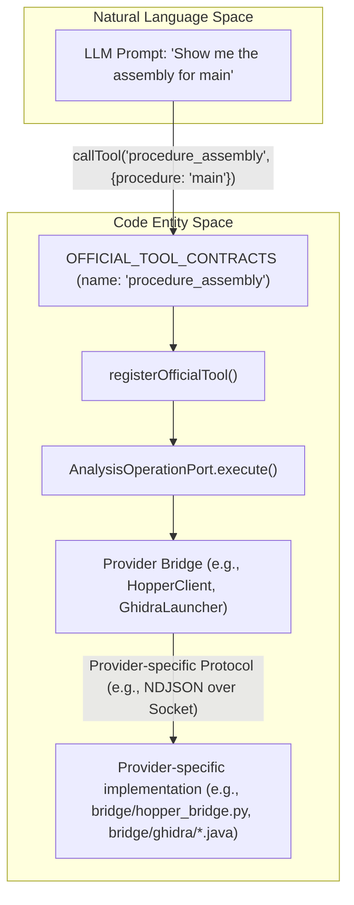
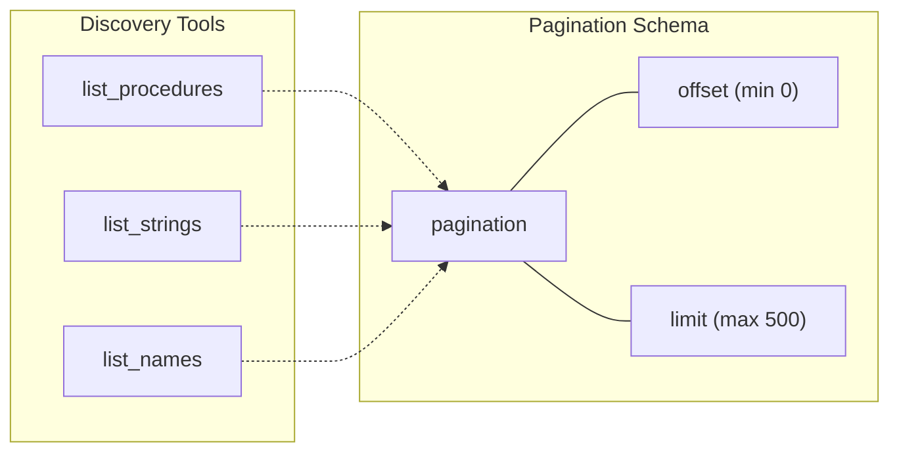

<!-- source: DeepWiki mcp.deepwiki.com · repo morluto/rea · page 3.1 Official Proxy Tools · fetched 2026-10-09 -->

# Official Proxy Tools (31 tools)

<details>
<summary>Relevant source files</summary>

The following files were used as context for generating this wiki page:

- [src/application/AnalysisProvider.ts](src/application/AnalysisProvider.ts)
- [src/contracts/officialToolContracts.ts](src/contracts/officialToolContracts.ts)
- [src/server/registerEnhancedTools.ts](src/server/registerEnhancedTools.ts)
- [src/server/registerOfficialTools.ts](src/server/registerOfficialTools.ts)
- [src/server/toolResult.ts](src/server/toolResult.ts)
- [tests/boundary/mcp/officialTools.test.ts](tests/boundary/mcp/officialTools.test.ts)

</details>


The **Official Proxy Tools** are a set of Model Context Protocol (MCP) tools that provide a direct, low-latency bridge to underlying analysis providers like Hopper or Ghidra. Unlike "Enhanced Tools" which compose multiple operations, these tools generally map 1:1 to the provider's internal analysis engine, providing the raw primitives necessary for reverse engineering.

## Architecture and Data Flow

Official tools are registered via `registerOfficialTools` [src/server/registerOfficialTools.ts:35-46]() and operate by dispatching commands through the `AnalysisOperationPort` [src/application/AnalysisProvider.ts:71-75](). Every tool execution is wrapped in an "Evidence" envelope, which attaches metadata about the binary target (SHA-256, path, architecture) to the result [src/server/registerOfficialTools.ts:78-91]().

### Natural Language to Code Entity Mapping: Official Dispatch


Sources: [src/contracts/officialToolContracts.ts:39-40](), [src/server/registerOfficialTools.ts:49-98](), [src/application/AnalysisProvider.ts:71-75]()

## Tool Categories and Implementation

The tools are defined in `OFFICIAL_TOOL_CONTRACTS` [src/contracts/officialToolContracts.ts:39]() and use Zod schemas for strict input/output validation.

### 1. Navigation and State Tools
These tools interact with the provider's GUI state or provide basic linear navigation through the database.

| Tool Name | Purpose | Implementation Detail |
| :--- | :--- | :--- |
| `current_address` | Returns the provider's current cursor address. | [src/contracts/officialToolContracts.ts:76-79]() |
| `goto_address` | Moves the provider's GUI cursor to a hexadecimal address. | [src/contracts/officialToolContracts.ts:91-94]() |
| `next_address` | Returns the next analyzed object address after an explicit address or current cursor. | [src/contracts/officialToolContracts.ts:130-132]() |
| `prev_address` | Returns the previous analyzed object address. | [src/contracts/officialToolContracts.ts:133-136]() |
| `current_document` | Returns the document currently selected by REA's provider bridge. | [src/contracts/officialToolContracts.ts:88-90]() |

Sources: [src/contracts/officialToolContracts.ts:76-94](), [src/contracts/officialToolContracts.ts:130-136]()

### 2. Analysis Discovery (Paginated)
Tools that return lists of symbols, strings, or procedures. These use a standardized `pagination` schema (offset/limit) to handle large binaries.


Sources: [src/contracts/officialToolContracts.ts:115-118](), [src/contracts/officialToolContracts.ts:126-129]()

### 3. Procedure Analysis
Detailed inspection of functions, including decompilation and cross-references.

*   **`procedure_pseudo_code`**: Returns the C-like decompiled output for a given symbol or address. [src/contracts/officialToolContracts.ts:186-189]()
*   **`procedure_assembly`**: Returns the raw disassembly instructions. [src/contracts/officialToolContracts.ts:178-181]()
*   **`procedure_info`**: Returns metadata including `basicblock_count`, `length`, and `locals`. [src/contracts/officialToolContracts.ts:182-185]()
*   **`xrefs`**: Returns a flat list of addresses referencing the target address. [src/contracts/officialToolContracts.ts:229-232]()

Sources: [src/contracts/officialToolContracts.ts:178-189](), [src/contracts/officialToolContracts.ts:229-232]()

### 4. Mutation Tools (Destructive)
Tools that modify the provider's analysis database. These are marked with `destructiveHint: true` in their annotations.

*   **`annotate_native_function`**: Atomically updates a function name and/or entry comments, returning a refreshed function dossier. [src/contracts/officialToolContracts.ts:41-44]()
*   **`set_address_name`**: Renames a symbol at an address. [src/contracts/officialToolContracts.ts:211-214]()
*   **`set_comment`**: Persists a regular analysis comment. [src/contracts/officialToolContracts.ts:219-222]()
*   **`set_bookmark`**: Authors a navigation aid in the document. [src/contracts/officialToolContracts.ts:215-218]()

Sources: [src/contracts/officialToolContracts.ts:41-44](), [src/contracts/officialToolContracts.ts:211-222]()

## Schema and Constraints

### Input Schema Logic
Official tools utilize `projectOfficialArguments` [src/server/registerOfficialTools.ts:133-151]() to ensure that optional arguments (like `document` or `address`) are projected as `null` when omitted, matching the expectations of the Python bridge.

Sources: [src/server/registerOfficialTools.ts:133-151]()

### Output Evidence Envelope
All results from official tools are wrapped in an `Evidence` object, defined in `toolOutputSchemas.ts`. This ensures that every piece of data provided to the LLM is cryptographically linked to a specific binary version. The `createEvidence` function [src/domain/evidence.ts:24-36]() is used to construct this envelope.

```typescript
// Simplified representation of the evidence structure
interface Evidence {
  schema_version: 1;
  artifact: {
      path: string;
      sha256: string;
      format: "hopper" | "mach-o" | "elf" | "pe";
      architecture: "x86" | "x86_64" | "arm" | "arm64" | null;
  } | null;
  operation: string;
  parameters: Readonly<Record<string, JsonValue>>;
  result: JsonValue; // The actual tool output
  analysisProfile?: AnalysisProfileCommitment;
  rawResult: JsonValue | null;
  limitations: readonly string[];
  locations: readonly EvidenceLocation[];
}
```
Sources: [src/server/registerOfficialTools.ts:78-91](), [src/domain/evidence.ts:24-36]()

## Known Provider API Limitations
The following limitations apply to the official tools due to the underlying provider APIs:
1.  **Segment Permissions**: In `list_segments`, the `writable` and `executable` fields may be `null` if the provider's public API does not expose these bits reliably. [src/contracts/officialToolContracts.ts:121-124]()
2.  **Reference Kinds**: In `procedure_references`, the `kind` of reference (e.g., Data, Call) might be `unavailable` depending on the provider. [src/contracts/officialToolContracts.ts:190-193]()
3.  **CFG Successors**: Successor information for basic blocks may be `unavailable` depending on the architecture's analysis depth and provider capabilities. [src/contracts/officialToolContracts.ts:174-177]()

Sources: [src/contracts/officialToolContracts.ts:121-124](), [src/contracts/officialToolContracts.ts:174-177](), [src/contracts/officialToolContracts.ts:190-193]()

---

