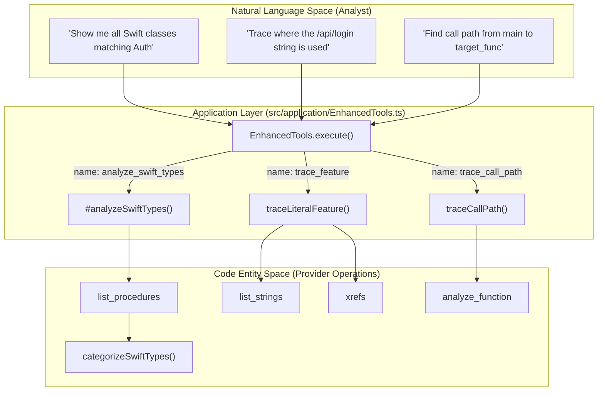
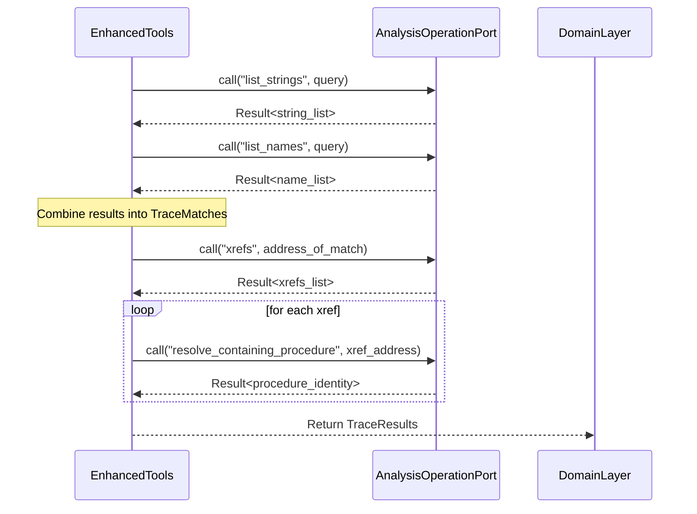

<!-- source: DeepWiki mcp.deepwiki.com · repo morluto/rea · page 3.2 Enhanced Workflow Tools · fetched 2026-10-09 -->

# Enhanced Workflow Tools

Relevant source files

The following files were used as context for generating this wiki page:

- [scripts/lib/real-hopper-inventory.mjs](scripts/lib/real-hopper-inventory.mjs)
- [src/application/EnhancedTools.ts](src/application/EnhancedTools.ts)
- [src/contracts/enhancedInputs.ts](src/contracts/enhancedInputs.ts)
- [src/contracts/toolOutputSchemas.ts](src/contracts/toolOutputSchemas.ts)
- [src/domain/callPath.test.ts](src/domain/callPath.test.ts)
- [src/domain/callPath.ts](src/domain/callPath.ts)
- [src/domain/hopperValues.ts](src/domain/hopperValues.ts)
- [src/domain/result.ts](src/domain/result.ts)
- [src/domain/symbolAnalysis.ts](src/domain/symbolAnalysis.ts)

The **Enhanced Workflow Tools** layer in REA provides high-level, composed workflows that aggregate multiple low-level provider operations into a single logical action. Unlike "Official Proxy Tools" which map 1:1 to a provider's API, enhanced tools handle complex logic such as recursive call-graph traversal, pattern-based symbol analysis for Swift/Objective-C, and feature tracing across binary segments.

## Architecture and Data Flow

Enhanced tools are implemented in the `EnhancedTools` application service [src/application/EnhancedTools.ts:50-51](). They consume the `AnalysisOperationPort` [src/application/EnhancedTools.ts:4-6]() to communicate with the underlying analysis providers.

### Composition Logic
The `EnhancedTools` class serves as an orchestrator. It executes sequences of official tools, handles pagination automatically to provide exhaustive results (e.g., `#allProcedures` [src/application/EnhancedTools.ts:251-260]()), and applies domain-specific parsers to the raw results. The `execute` method [src/application/EnhancedTools.ts:53-125]() dispatches calls based on the `EnhancedToolName`, while `executeValidated` [src/application/EnhancedTools.ts:128-173]() handles already parsed inputs.

### Natural Language to Code Entity Mapping

The following diagram illustrates how high-level analyst requests (Natural Language Space) are decomposed into specific code entities and provider operations (Code Entity Space).

**Tool Dispatch and Composition Flow**

**Sources:** [src/application/EnhancedTools.ts:53-125](), [src/application/EnhancedTools.ts:148-170](), [src/domain/symbolAnalysis.ts:47-81]()

---

## Tool Reference

### 1. `analyze_function`
Provides a comprehensive view of a procedure by aggregating metadata, disassembly, and relationship data.
*   **Implementation:** Dispatches directly to the provider's `analyze_function` operation. It allows for parameter overrides like `include_assembly` and character limits. The input schema is defined in `enhancedInputSchemas.analyze_function` [src/contracts/enhancedInputs.ts:39-41]().
*   **Data Flow:** `EnhancedTools.#executeFunctionAnalysis` [src/application/EnhancedTools.ts:74-75]() calls `this.#call("analyze_function", ...)` [src/application/EnhancedTools.ts:336-340]().

### 2. `binary_overview`
Generates a summary of the binary, including segment layouts and counts of procedures, names, and strings.
*   **Implementation:** Sequentially calls `list_segments`, `list_procedures` (with count), `list_names`, and `list_strings` [src/application/EnhancedTools.ts:233-249]().
*   **Budgeting:** Uses `parseListCount` [src/domain/hopperValues.ts:201-207]() to extract totals without fetching all items.

### 3. `batch_decompile`
Decompiles multiple addresses in parallel.
*   **Implementation:** Maps an array of addresses to concurrent `procedure_pseudo_code` calls [src/application/EnhancedTools.ts:122-138]().
*   **Constraint:** The input `addresses` array is validated by `enhancedInputSchemas.batch_decompile` [src/contracts/enhancedInputs.ts:16-20]().

### 4. `get_call_graph`
Recursively traverses callers or callees to build a tree of a specific depth.
*   **Implementation:** Uses a queue-based BFS (Breadth-First Search) to explore relationships [src/application/EnhancedTools.ts:154-200]().
*   **Logic:** For each node, it calls `procedure_callees` or `procedure_callers` and tracks discovered addresses to avoid cycles [src/application/EnhancedTools.ts:193-199](). The input schema `enhancedInputSchemas.get_call_graph` specifies the `address` and `direction` [src/contracts/enhancedInputs.ts:21-24]().

### 5. `trace_call_path`
Reconstructs the shortest call paths between a `start` and `goal` function based on provided `analyze_function` evidence.
*   **Implementation:** This tool leverages the `buildCallPath` function [src/domain/callPath.ts:81-130]() which constructs a `CallGraph` [src/domain/callPath.ts:18-49]() from `FunctionSnapshot` evidence [src/domain/callPath.ts:10-12](). It then performs a search to find the shortest paths.
*   **Data Flow:** `EnhancedTools.execute` dispatches to `traceCallPath` [src/application/EnhancedTools.ts:165-170](). The `CallPathInput` schema [src/domain/callPath.ts:1-8]() defines the `start`, `goal`, and `functions` (evidence) parameters.
*   **Example:** The test suite `src/domain/callPath.test.ts` demonstrates various scenarios, including finding shortest paths, handling cycles, and deep function chains [src/domain/callPath.test.ts:64-89](), [src/domain/callPath.test.ts:135-152](), [src/domain/callPath.test.ts:184-199]().

### 6. Swift/Objective-C Class Analysis (`analyze_swift_types`, `get_objc_classes`, `get_objc_protocols`)
These tools analyze Swift and Objective-C metadata by scanning procedure names for mangled symbols or specific prefixes.
*   **`analyze_swift_types`**:
    *   **Implementation:** Fetches all procedures via `list_procedures` and passes them to `categorizeSwiftTypes` [src/application/EnhancedTools.ts:204-210]().
    *   **Domain Logic:** `categorizeSwiftTypes` [src/domain/symbolAnalysis.ts:47-81]() uses prefixes like `_TtC` (classes), `_TtV` (structs), `_TtO` (enums), `_TtP` (protocols), and `_TtE` (extensions) to categorize Swift symbols. It supports filtering by `category` and `pattern` [src/contracts/enhancedInputs.ts:25-36]().
*   **`get_objc_classes`**:
    *   **Implementation:** Fetches all names and applies `discoverObjcClasses` [src/application/EnhancedTools.ts:140-141]().
    *   **Domain Logic:** `discoverObjcClasses` [src/domain/symbolAnalysis.ts:5-20]() identifies Objective-C classes by looking for `OBJC_CLASS` or `OBJC_$_CLASS` in names. It supports pattern matching [src/contracts/enhancedInputs.ts:14-15]().
*   **`get_objc_protocols`**:
    *   **Implementation:** Fetches all names and applies `discoverObjcProtocols` [src/application/EnhancedTools.ts:142-143]().
    *   **Domain Logic:** `discoverObjcProtocols` [src/domain/symbolAnalysis.ts:23-35]() identifies Objective-C and Swift protocols by looking for `OBJC_PROTOCOL` or `_TtP` in names.

### 7. `find_xrefs_to_name`
Resolves a name to an address and then finds all cross-references to it.
*   **Implementation:** Calls `list_names` with a filter, then `xrefs` on the resulting address [src/application/EnhancedTools.ts:223-231](). The input schema `enhancedInputSchemas.find_xrefs_to_name` requires a `name` [src/contracts/enhancedInputs.ts:37-37]().

### 8. `trace_feature`
A "super-tool" that searches for a query (string or symbol) and immediately finds its callers to provide context.
*   **Implementation:**
    1.  Searches for strings and names matching the query [src/application/EnhancedTools.ts:276-285]().
    2.  For each match, it resolves the address and finds cross-references [src/application/EnhancedTools.ts:311-316]().
    3.  Resolves the containing procedure for each reference to show *where* the feature is being used [src/application/EnhancedTools.ts:317-325]().
    *   **Data Flow:** `EnhancedTools.execute` dispatches to `traceLiteralFeature` [src/application/EnhancedTools.ts:158-164](). The input schema `enhancedInputSchemas.trace_feature` defines `query` and `case_sensitive` [src/contracts/enhancedInputs.ts:3-6]().

---

## Technical Implementation Details

### Multi-Step Composition
The following diagram shows the internal sequence for `trace_feature`, demonstrating how it bridges from a string search to code structure.

**Feature Tracing Logic Flow**

**Sources:** [src/application/EnhancedTools.ts:262-334](), [src/domain/symbolAnalysis.ts:1-18]()

### Pagination and Budgeting
To prevent timeouts and memory exhaustion, enhanced tools use strict limits defined in `enhancedInputs.ts` and within the implementation:
*   **`inspect_native_dispatch_metadata`**: Max 20,000 records [src/contracts/enhancedInputs.ts:11-13]().
*   **`batch_decompile`**: No explicit limit in schema, but implementation may have implicit concurrency limits [src/contracts/enhancedInputs.ts:16-20]().
*   **`trace_native_ui_action`**: `max_depth` (0-32), `max_nodes` (1-2,000), `max_edges` (1-5,000) [src/contracts/enhancedInputs.ts:54-64]().

### Error Handling
Enhanced tools wrap provider errors in a `Result` type [src/domain/result.ts:4-10](). If a sub-step fails (e.g., a specific decompile fails in a batch), the tool often continues processing other items but includes the error message in the output for that specific entry [src/application/EnhancedTools.ts:135](). The `AnalysisCancelledError` and `AnalysisOutputError` are specific error types handled [src/application/EnhancedTools.ts:10-12]().

| Tool Name | Key Dependency | Primary Domain Parser |
| :--- | :--- | :--- |
| `analyze_swift_types` | `list_procedures` | `categorizeSwiftTypes` [src/domain/symbolAnalysis.ts:47-81]() |
| `get_objc_classes` | `list_names` | `discoverObjcClasses` [src/domain/symbolAnalysis.ts:5-20]() |
| `get_objc_protocols` | `list_names` | `discoverObjcProtocols` [src/domain/symbolAnalysis.ts:23-35]() |
| `get_call_graph` | `procedure_callees`/`procedure_callers` | `parseRelatedAddresses` [src/domain/hopperValues.ts:21-23]() |
| `binary_overview` | `list_segments` | `parseSegments` [src/domain/hopperValues.ts:22-23]() |
| `trace_call_path` | `analyze_function` | `buildCallPath` [src/domain/callPath.ts:81-130]() |

**Sources:** [src/application/EnhancedTools.ts:1-20](), [src/contracts/enhancedInputs.ts:1-67](), [src/domain/hopperValues.ts:1-23](), [src/domain/symbolAnalysis.ts:1-81](), [src/domain/callPath.ts:1-378]()

---

