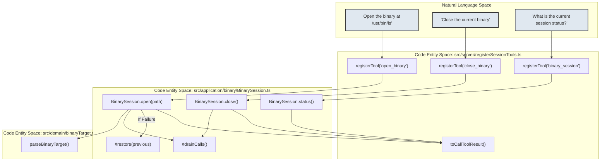

<!-- source: DeepWiki mcp.deepwiki.com · repo morluto/rea · page 3.3 Session and Evidence Tools · fetched 2026-10-09 -->

# Session and Evidence Tools

<details>
<summary>Relevant source files</summary>

The following files were used as context for generating this wiki page:

- [src/application/EvidenceBundleCommands.ts](src/application/EvidenceBundleCommands.ts)
- [src/application/EvidenceInputResolver.test.ts](src/application/EvidenceInputResolver.test.ts)
- [src/application/binary/BinarySessionRecords.ts](src/application/binary/BinarySessionRecords.ts)
- [src/application/investigation/EvidenceLedger.residualUnknown.test.ts](src/application/investigation/EvidenceLedger.residualUnknown.test.ts)
- [src/application/investigation/EvidenceLedger.test.ts](src/application/investigation/EvidenceLedger.test.ts)
- [src/application/investigation/EvidenceLedger.ts](src/application/investigation/EvidenceLedger.ts)
- [src/application/investigation/InvestigationRecords.test.ts](src/application/investigation/InvestigationRecords.test.ts)
- [src/application/investigation/InvestigationRecords.ts](src/application/investigation/InvestigationRecords.ts)
- [src/application/investigation/UnknownEvidence.ts](src/application/investigation/UnknownEvidence.ts)
- [src/contracts/managed/managedToolContracts.ts](src/contracts/managed/managedToolContracts.ts)
- [src/contracts/sessionToolContracts.ts](src/contracts/sessionToolContracts.ts)
- [src/contracts/sessionToolSchemas.ts](src/contracts/sessionToolSchemas.ts)
- [src/contracts/toolContractExamples.ts](src/contracts/toolContractExamples.ts)
- [src/domain/browserScenario.test.ts](src/domain/browserScenario.test.ts)
- [src/domain/browserScenarioValues.ts](src/domain/browserScenarioValues.ts)
- [src/domain/evidenceBundle.test.ts](src/domain/evidenceBundle.test.ts)
- [src/domain/evidenceBundle.ts](src/domain/evidenceBundle.ts)
- [src/domain/inputIssueProjection.test.ts](src/domain/inputIssueProjection.test.ts)
- [src/domain/inputIssueProjection.ts](src/domain/inputIssueProjection.ts)
- [src/domain/localPath.ts](src/domain/localPath.ts)
- [tests/boundary/cli/processCli.test.ts](tests/boundary/cli/processCli.test.ts)
- [tests/boundary/mcp/outputSchemaSemanticConstraints.test.ts](tests/boundary/mcp/outputSchemaSemanticConstraints.test.ts)
- [tests/boundary/mcp/sessionMcp.test.ts](tests/boundary/mcp/sessionMcp.test.ts)
- [tests/boundary/mcp/toolSchemaValidity.test.ts](tests/boundary/mcp/toolSchemaValidity.test.ts)
- [tests/composition/analysis-sessions/binarySession.test.ts](tests/composition/analysis-sessions/binarySession.test.ts)

</details>


This page details the lifecycle of binary analysis sessions, the management of unknown findings, and the import/export/comparison of evidence bundles within REA. It covers the `open_binary`, `close_binary`, and `binary_session` tools, as well as the `record_unknown`, `update_unknown`, `list_unknowns`, `export_evidence_bundle`, `import_evidence_bundle`, and `compare_bundles` commands.

## The BinarySession Lifecycle

The `BinarySession` class in [src/application/binary/BinarySession.ts]() manages the state transitions of the underlying analysis provider process. It ensures that only one binary is being analyzed at a time and handles the complexities of tearing down and rebuilding the bridge during target switches.

### Serialized Transitions
Because analysis providers (like Hopper or Ghidra) are often bound to a specific process and communication channel, transitions (opening or closing a binary) must be serialized. The `BinarySession` uses a promise chain (`#transition`) to ensure that a new `open` request waits for any pending transitions to settle [src/application/binary/BinarySession.ts:43-43](), [src/application/binary/BinarySession.ts:152-159]().

### Safe Target Switching
If an attempt to open a new binary fails (e.g., a corrupt file or provider launch error), `BinarySession` attempts to restore the previous session rather than leaving the server in a broken state [src/application/binary/BinarySession.ts:83-87]().

### Call Draining
Before a session is closed or switched, the system waits for all active tool executions to complete. This is managed by the `#calls` set, which tracks pending `execute` promises [src/application/binary/BinarySession.ts:44-44](), [src/application/binary/BinarySession.ts:143-150]().

**Sources:** [src/application/binary/BinarySession.ts:39-150](), [tests/composition/analysis-sessions/binarySession.test.ts:100-107]()

## Tool Reference

### Session Management Tools

| Tool Name | Purpose | Key Output Fields |
| :--- | :--- | :--- |
| `open_binary` | Open a local executable, application bundle, archive, JavaScript, source map, plist, or analysis database after validation. | `path`, `sha256`, `format`, `loaderArgs` |
| `close_binary` | Optionally write a provider-neutral analysis snapshot, then close the active target and every provider resource. | `ok: true` |
| `binary_session` | Report the complete current target, provider, capability availability, client-feature, analysis, and server-identity status. | `open`, `path`, `kind`, `architecture`, `capabilities` |

#### `open_binary`
The `open_binary` tool takes a file path and performs several steps:
1.  **Validation**: Calls `parseBinaryTarget` to resolve the path, check for Mach-O slices, and calculate a SHA-256 hash [src/application/binary/BinarySession.ts:67-72]().
2.  **Cleanup**: Closes any existing bridge after draining active calls [src/application/binary/BinarySession.ts:77-80]().
3.  **Launch**: Uses the `AnalysisClientFactory` to spawn a new provider process [src/application/binary/BinarySession.ts:81-81]().
4.  **Health Check**: Executes a `health` operation to verify the bridge is responsive before confirming success [src/application/binary/BinarySession.ts:82-82]().

#### `close_binary`
Idempotently shuts down the current analysis bridge. If no binary is open, it returns success immediately [src/application/binary/BinarySession.ts:99-107]().

#### `binary_session`
Provides metadata about the current target. This is useful for the LLM to verify which file is currently being analyzed and what its architecture is (e.g., `x86_64` vs `aarch64`) [src/application/binary/BinarySession.ts:110-122](). It also reports the capabilities available for the current session [tests/boundary/mcp/sessionMcp.test.ts:143-149]().

**Sources:** [src/contracts/sessionToolContracts.ts:66-80](), [src/server/registerSessionTools.ts:16-75]()

### Unknown Registry Tools

REA maintains an "unknown registry" to track residual unknowns identified during analysis or investigation. These tools allow for recording, updating, listing, and verifying the resolution of these unknowns.

| Tool Name | Purpose | Key Input Fields | Key Output Fields |
| :--- | :--- | :--- | :--- |
| `record_unknown` | Record a new residual unknown, optionally linking it to a specific binary target. | `question`, `severity`, `domain`, `supporting_evidence_ids`, `contradicting_evidence_ids`, `required_authority`, `required_confidence`, `required_environment`, `recommended_probes`, `relationships` | `unknown_id`, `revision`, `scope_digest` |
| `update_unknown` | Update the status or resolution of an existing residual unknown. | `unknown_id`, `expected_revision`, `status`, `severity`, `supporting_evidence_ids`, `contradicting_evidence_ids`, `required_authority`, `required_confidence`, `required_environment`, `recommended_probes`, `relationships`, `resolution` | `unknown_id`, `revision`, `scope_digest` |
| `list_unknowns` | List residual unknowns, optionally filtered by status, severity, or domain. | `status`, `severity`, `domain` | Array of `ResidualUnknown` objects |
| `verify_unknown_resolution` | Revalidate the resolution of a specific unknown, ensuring all supporting evidence is still present and valid. | `unknown_id` | `unknown_id`, `status`, `resolution_valid` |

The `InvestigationRecords` class [src/application/investigation/InvestigationRecords.ts]() manages the lifecycle of unknowns. When an unknown is recorded or updated, a corresponding `rea.residual-unknown-mutation` evidence record is created [src/application/investigation/UnknownEvidence.ts:13-20](). This ensures an auditable history of changes to unknowns.

**Sources:** [src/contracts/sessionToolContracts.ts:131-171](), [src/domain/residualUnknown.ts:1-10](), [src/application/investigation/InvestigationRecords.test.ts:35-120]()

### Evidence Bundle Tools

Evidence bundles are canonical, byte-stable JSON files that encapsulate all evidence records and unknown findings related to an investigation. These tools facilitate the management and comparison of these bundles.

| Tool Name | Purpose | Key Input Fields | Key Output Fields |
| :--- | :--- | :--- | :--- |
| `export_evidence_bundle` | Atomically write the session's deterministic Evidence bundle to the requested local path. | `path`, `overwrite` | `path` |
| `import_evidence_bundle` | Read the JSON bundle at the supplied local path, validate every Evidence ID and canonical manifest, then atomically merge it. | `path` | `recordsAdded`, `unknownsAdded`, `changed`, `metadataChanged` |
| `compare_bundles` | Compare two canonical Evidence bundles by exact record membership, explicit one-to-one observation pairs, and complete residual-unknown revision histories. | `left_bundle_path`, `right_bundle_path` | `left_only`, `right_only`, `changed` |

The `createEvidenceBundle` function [src/domain/evidenceBundle.ts:49-104]() projects records and unknowns into a deterministic bundle, ensuring consistent ordering. `parseEvidenceBundle` [src/domain/evidenceBundle.ts:186-199]() validates the integrity and canonical form of imported bundles.

**Sources:** [src/contracts/sessionToolContracts.ts:49-62](), [src/contracts/sessionToolContracts.ts:81-90](), [src/contracts/sessionToolContracts.ts:112-116](), [src/domain/evidenceBundle.ts:36-44](), [src/domain/evidenceBundle.test.ts:1-10]()

## Architecture and Data Flow

The following diagrams illustrate how session and evidence tools bridge the gap between Natural Language requests and the underlying code entities.

### Natural Language Space to Code Entity Space: Session Transition

This diagram shows the transition from an MCP tool call to the `BinarySession` logic.


Sources: [src/server/registerSessionTools.ts:17-47](), [src/application/binary/BinarySession.ts:58-96](), [src/application/binary/BinarySession.ts:99-107](), [src/application/binary/BinarySession.ts:110-122]()

### Natural Language Space to Code Entity Space: Evidence Management

This diagram illustrates the flow for managing evidence bundles and unknowns.

```mermaid
graph TD
    subgraph "Natural Language Space"
        UserExport["'Export evidence to /tmp/bundle.json'"]
        UserImport["'Import evidence from /tmp/bundle.json'"]
        UserCompare["'Compare bundles A and B'"]
        UserRecordUnknown["'Record unknown: Is this function safe?'"]
        UserUpdateUnknown["'Update unknown unk_123 to resolved'"]
        UserListUnknowns["'List open unknowns'"]
    end

    subgraph "Code Entity Space: src/server/registerSessionTools.ts"
        ExportTool["registerTool('export_evidence_bundle')"]
        ImportTool["registerTool('import_evidence_bundle')"]
        CompareTool["registerTool('compare_bundles')"]
        RecordUnknownTool["registerTool('record_unknown')"]
        UpdateUnknownTool["registerTool('update_unknown')"]
        ListUnknownsTool["registerTool('list_unknowns')"]
        VerifyUnknownTool["registerTool('verify_unknown_resolution')"]
        ToResult["toCallToolResult()"]
    end

    subgraph "Code Entity Space: src/application/EvidenceBundleCommands.ts"
        ExportCmd["exportEvidenceBundle(path, overwrite)"]
        ImportCmd["importEvidenceBundle(path)"]
        CompareCmd["compareEvidenceBundles(left, right)"]
    end

    subgraph "Code Entity Space: src/application/investigation/InvestigationRecords.ts"
        RecordUnknown["InvestigationRecords.recordUnknown(...)"]
        UpdateUnknown["InvestigationRecords.updateUnknown(...)"]
        ListUnknowns["InvestigationRecords.listUnknowns(...)"]
        VerifyUnknown["InvestigationRecords.verifyUnknownResolution(...)"]
        ExportBundle["InvestigationRecords.exportEvidenceBundle()"]
        MergeBundle["InvestigationRecords.mergeEvidenceBundle(...)"]
    end

    subgraph "Code Entity Space: src/domain/evidenceBundle.ts"
        CreateBundle["createEvidenceBundle(...)"]
        ParseBundle["parseEvidenceBundle(...)"]
    end

    UserExport --> ExportTool
    ExportTool --> ExportCmd
    ExportCmd --> ExportBundle
    ExportBundle --> CreateBundle
    ExportCmd --> ToResult

    UserImport --> ImportTool
    ImportTool --> ImportCmd
    ImportCmd --> ParseBundle
    ImportCmd --> MergeBundle
    MergeBundle --> ToResult

    UserCompare --> CompareTool
    CompareTool --> CompareCmd
    CompareCmd --> ParseBundle
    CompareCmd --> ToResult

    UserRecordUnknown --> RecordUnknownTool
    RecordUnknownTool --> RecordUnknown
    RecordUnknown --> ToResult

    UserUpdateUnknown --> UpdateUnknownTool
    UpdateUnknownTool --> UpdateUnknown
    UpdateUnknown --> ToResult

    UserListUnknowns --> ListUnknownsTool
    ListUnknownsTool --> ListUnknowns
    ListUnknowns --> ToResult

    style UserExport fill:#e0e8f0,stroke:#333,stroke-width:2px
    style UserImport fill:#e0e8f0,stroke:#333,stroke-width:2px
    style UserCompare fill:#e0e8f0,stroke:#333,stroke-width:2px
    style UserRecordUnknown fill:#e0e8f0,stroke:#333,stroke-width:2px
    style UserUpdateUnknown fill:#e0e8f0,stroke:#333,stroke-width:2px
    style UserListUnknowns fill:#e0e8f0,stroke:#333,stroke-width:2px
```


Sources: [src/server/registerSessionTools.ts:77-150](), [src/application/EvidenceBundleCommands.ts:1-10](), [src/application/investigation/InvestigationRecords.ts:1-10](), [src/domain/evidenceBundle.ts:49-104](), [src/domain/evidenceBundle.ts:186-199]()

### System Component Mapping: Tool Inventory

This diagram shows how the `createServer` function determines which tools to expose based on the presence of a `BinarySession`.

```mermaid
graph DT
    subgraph "Server Assembly: src/server/createServer.ts"
        CS["createServer(analysis, session?)"]
    end

    subgraph "Tool Groups"
        Official["registerOfficialTools"]
        Enhanced["registerEnhancedTools"]
        SessionTools["registerSessionTools"]
        InvestigationTools["registerInvestigationTools"]
        ApplicationTools["registerApplicationTools"]
    end

    subgraph "Inventory Result"
        InvBase["Base Tools (e.g., 43 tools)"]
        InvSession["Session-enabled Tools (e.g., 50+ tools)"]
    end

    CS --> Official
    CS --> Enhanced
    CS --> InvestigationTools
    CS --> ApplicationTools
    CS -- "If session exists" --> SessionTools
    
    Official & Enhanced & InvestigationTools & ApplicationTools --> InvBase
    Official & Enhanced & InvestigationTools & ApplicationTools & SessionTools --> InvSession
```
Sources: [tests/boundary/mcp/sessionMcp.test.ts:118-129](), [src/server/createServer.ts:1-10]() (conceptual, actual tool count varies)

## Implementation Details

### `BinarySessionPort`
The `BinarySession` implements the `BinarySessionPort` interface, which extends `AnalysisOperationPort`. This allows the session to act as a transparent proxy for analysis tools: if a tool is called, the session ensures the transition is finished and then forwards the call to the active `AnalysisClient` [src/application/binary/BinarySession.ts:18-29](), [src/application/binary/BinarySession.ts:134-150]().

### Error Handling
If a tool is executed while no binary is open, the session returns a `NoBinaryOpenError` (`_tag: "NoBinaryOpenError"`) [src/application/binary/BinarySession.ts:142-142](). If a transition is cancelled via an `AbortSignal`, it returns a `HopperCancelledError` [src/application/binary/BinarySession.ts:66-66](). Input validation errors are projected using `projectInputIssues` [src/domain/inputIssueProjection.ts:5-8](), providing detailed, secret-safe feedback to the caller [src/domain/inputIssueProjection.test.ts:8-24]().

### `InvestigationRecords`
The `InvestigationRecords` class [src/application/investigation/InvestigationRecords.ts]() is central to managing evidence and unknowns. It provides methods for:
*   `recordEvidence`: Stores new evidence records [src/application/investigation/InvestigationRecords.ts:100-102]().
*   `recordUnknown`: Records a new unknown, optionally scoped to a binary target [src/application/investigation/InvestigationRecords.ts:110-112]().
*   `updateUnknown`: Modifies an existing unknown, incrementing its revision [src/application/investigation/InvestigationRecords.ts:120-122]().
*   `listUnknowns`: Retrieves unknowns based on various filters [src/application/investigation/InvestigationRecords.ts:124-126]().
*   `exportEvidenceBundle`: Creates a canonical `EvidenceBundle` from the current state [src/application/investigation/InvestigationRecords.ts:130-132]().
*   `mergeEvidenceBundle`: Incorporates records and unknowns from an external bundle [src/application/investigation/InvestigationRecords.ts:134-136]().

This class ensures that all operations maintain the integrity and provenance of the evidence ledger.

**Sources:** [src/application/binary/BinarySession.ts:1-206](), [src/domain/errors.ts:1-10](), [src/application/investigation/InvestigationRecords.ts:1-10](), [src/domain/inputIssueProjection.ts:1-123]()

---

