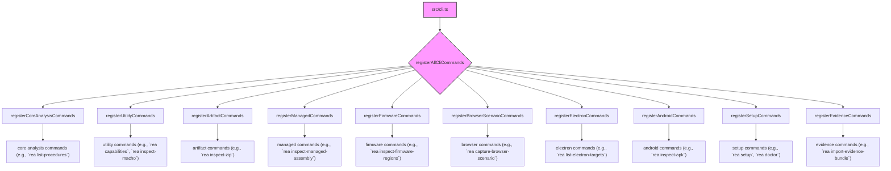

<!-- source: DeepWiki mcp.deepwiki.com · repo morluto/rea · page 3.4 CLI Command Surface · fetched 2026-10-09 -->

# CLI Command Surface

<details>
<summary>Relevant source files</summary>

The following files were used as context for generating this wiki page:

- [docs/user-visible-errors.csv](docs/user-visible-errors.csv)
- [install.sh](install.sh)
- [src/application/AppBundleExecutable.ts](src/application/AppBundleExecutable.ts)
- [src/application/BinaryTargetResolver.ts](src/application/BinaryTargetResolver.ts)
- [src/application/DirectAnalysisDependencies.ts](src/application/DirectAnalysisDependencies.ts)
- [src/browser/PlaywrightScenarioActions.test.ts](src/browser/PlaywrightScenarioActions.test.ts)
- [src/cli/coreAnalysisCommands.ts](src/cli/coreAnalysisCommands.ts)
- [src/cli/coreBinaryCommands.ts](src/cli/coreBinaryCommands.ts)
- [src/cli/coreNativeCommands.ts](src/cli/coreNativeCommands.ts)
- [src/cli/electronCommands.ts](src/cli/electronCommands.ts)
- [src/cli/firmwareCommands.ts](src/cli/firmwareCommands.ts)
- [src/cli/utilityCommands.ts](src/cli/utilityCommands.ts)
- [src/cliBrowserScenarioCommands.ts](src/cliBrowserScenarioCommands.ts)
- [src/cliJsonInput.ts](src/cliJsonInput.ts)
- [src/contracts/sessionLifecycleInputs.ts](src/contracts/sessionLifecycleInputs.ts)
- [src/contracts/sessionPathInputs.test.ts](src/contracts/sessionPathInputs.test.ts)
- [src/contracts/sessionStatusContract.ts](src/contracts/sessionStatusContract.ts)
- [src/domain/analysisErrorPresentation.ts](src/domain/analysisErrorPresentation.ts)
- [src/domain/analysisErrorProjection.ts](src/domain/analysisErrorProjection.ts)
- [src/domain/binaryTargetTypes.ts](src/domain/binaryTargetTypes.ts)
- [src/domain/firmware/firmwareAnalysis.ts](src/domain/firmware/firmwareAnalysis.ts)
- [src/native/NativeMacOSProvider.ts](src/native/NativeMacOSProvider.ts)
- [tests/acceptance/nonBinaryComposition.test.ts](tests/acceptance/nonBinaryComposition.test.ts)
- [tests/boundary/cli/nativePlistSelectionFailureCli.test.ts](tests/boundary/cli/nativePlistSelectionFailureCli.test.ts)
- [tests/boundary/filesystem/binaryTarget.test.ts](tests/boundary/filesystem/binaryTarget.test.ts)
- [tests/boundary/filesystem/cliJsonInput.test.ts](tests/boundary/filesystem/cliJsonInput.test.ts)
- [tests/boundary/filesystem/installScript.test.ts](tests/boundary/filesystem/installScript.test.ts)
- [tests/boundary/providers/native/nativeProvider.test.ts](tests/boundary/providers/native/nativeProvider.test.ts)

</details>


This page details how REA's Command Line Interface (CLI) commands are structured and registered across different domains, including core analysis, utility, artifact, managed, firmware, browser, Electron, Android, application, setup, and evidence. It also covers conventions for JSON input and how errors and status are projected to the user.

## Command Registration by Domain

REA organizes its CLI commands into logical domains, each handled by specific registration functions. This modular approach ensures maintainability and clear separation of concerns.

### Core Analysis Commands

Core analysis commands are fundamental operations for binary analysis. They are registered by `registerCoreAnalysisCommands` [src/cli/coreAnalysisCommands.ts:20-22] and include tools for inspecting procedures, strings, names, segments, and performing searches and cross-references.

### Utility Commands

Utility commands provide general-purpose functionalities, such as listing provider capabilities and status, and native macOS-specific inspections. These are registered by `registerUtilityCommands` [src/cli/utilityCommands.ts:24-28] and include operations like `capabilities`, `providers`, `inspect-macho`, `inspect-signature`, `list-architectures`, `inspect-plist`, and `demangle-swift`.

For example, the `observe-native-ui` and `capture-native-ui-scenario` commands are registered here [src/cli/utilityCommands.ts:31-113]. These commands allow interaction with native application UIs.

Sources:
* [src/cli/utilityCommands.ts:24-28]()
* [src/cli/utilityCommands.ts:31-113]()

### Artifact Commands

Artifact commands deal with the inspection and extraction of various archive and artifact formats. These are registered by `registerArtifactCommands` [src/cli/coreAnalysisCommands.ts:20-22] and include operations like `inspect-zip`, `extract-zip`, `inspect-asar`, `extract-asar`, `inspect-dmg`, `extract-dmg`, `inspect-pkg`, `extract-pkg`, `inspect-javascript`, `inspect-source-map`, and `inspect-plist`.

### Managed (.NET) Commands

Managed commands focus on analyzing .NET binaries. They are registered by `registerManagedCommands` [src/cli/coreAnalysisCommands.ts:20-22] and provide tools for inspecting managed assemblies, types, methods, and comparing managed artifacts.

### Firmware Commands

Firmware commands are used for inspecting and extracting firmware images. These are registered by `registerFirmwareCommands` [src/cli/firmwareCommands.ts:16-18] and include `inspect-firmware-regions` and `extract-firmware`.

Sources:
* [src/cli/firmwareCommands.ts:16-18]()

### Browser Commands

Browser commands facilitate interaction with web browsers, primarily through Playwright scenarios. The `capture-browser-scenario` command is registered by `registerBrowserScenarioCommands` [src/cliBrowserScenarioCommands.ts:19-22]. This command takes a JSON input describing the scenario to execute.

Sources:
* [src/cliBrowserScenarioCommands.ts:19-22]()

### Electron Commands

Electron commands are designed for inspecting and interacting with Electron applications. These are registered by `registerElectronCommands` [src/cli/electronCommands.ts:29-37] and include `list-electron-targets`, `inspect-electron-page`, `capture-electron-scenario`, and `analyze-javascript-application`.

Sources:
* [src/cli/electronCommands.ts:29-37]()

### Android Commands

Android commands provide functionality for analyzing Android packages (APKs). These are registered by `registerAndroidCommands` [src/cli/coreAnalysisCommands.ts:20-22] and include `inspect-apk` and `extract-apk`.

### Application Commands

Application commands are higher-level workflows that combine multiple analysis steps, such as analyzing JavaScript applications. The `analyze-javascript-application` command is registered by `registerJavaScriptApplicationCommand` [src/cli/electronCommands:172-175].

Sources:
* [src/cli/electronCommands:172-175]()

### Setup Commands

Setup commands are used for initial configuration and diagnostics of the REA environment. These are registered by `registerSetupCommands` [src/cli/coreAnalysisCommands.ts:20-22] and include `setup`, `doctor`, and `uninstall`. The `install.sh` script [install.sh:118-118] also triggers `rea setup` after installation.

Sources:
* [install.sh:118-118]()

### Evidence Commands

Evidence commands manage the collection, import, and export of analysis evidence. These are registered by `registerEvidenceCommands` [src/cli/coreAnalysisCommands.ts:20-22] and include `import-evidence-bundle` and `export-evidence-bundle`.

## CLI Command Registration Flow

The following diagram illustrates the overall flow of how CLI commands are registered within REA.


Sources:
* [src/cli/coreAnalysisCommands.ts:13]()
* [src/cli/utilityCommands.ts:24-28]()
* [src/cli/firmwareCommands.ts:16-18]()
* [src/cliBrowserScenarioCommands.ts:19-22]()
* [src/cli/electronCommands.ts:29-37]()

## JSON Input Conventions

Many REA CLI commands accept JSON input, either directly as an inline string or from a file path. This allows for complex and structured parameters to be passed to analysis operations.

The `parseCliJsonInput` function [src/cliJsonInput.ts:10-16] is responsible for parsing this input. It first attempts to parse the input string as inline JSON. If that fails, it treats the input as a file path and attempts to read and parse the JSON content from that file.

```mermaid
graph TD
    A[CLI Command Input String] --> B{parseCliJsonInput(value, operation)}
    B --> C{Is `value` inline JSON?}
    C -- Yes --> D[Parse inline JSON]
    C -- No --> E[Treat `value` as file path]
    E --> F[Read file content]
    F --> G[Parse file content as JSON]
    D --> H{Parsed JSON}
    G --> H
    H --> I[Return { ok: true, value: parsedJson }]
    B -- Error --> J[Return { ok: false, error: JsonValue }]
```
Sources:
* [src/cliJsonInput.ts:10-16]()

### Path Resolution in JSON Input

For certain commands, JSON input may contain paths that need to be resolved relative to the current working directory. The `resolveCliJsonPaths` function [src/cliJsonInput.ts:44-51] handles this by taking a parsed JSON object and a list of key paths. It recursively traverses the JSON structure and resolves string values at the specified key paths to absolute paths. This is crucial because internal MCP contracts often require absolute paths.

For example, in `capture-electron-scenario`, `executable_path`, `application_path`, and `application_root` are resolved [src/cli/electronCommands.ts:60-64]. Similarly, `executable_path` for browser scenarios is resolved [src/cliBrowserScenarioCommands.ts:36-37].

```mermaid
graph TD
    A[Raw JSON Input] --> B{parseCliJsonInput}
    B --> C[Parsed JSON Object]
    C --> D{resolveCliJsonPaths(parsedJson, pathsToResolve)}
    D --> E{Iterate over `pathsToResolve`}
    E --> F{resolveJsonPath(currentValue, keys)}
    F --> G[Resolve string path to absolute path]
    G --> H[Updated JSON Object]
    H --> I[Validated Input Schema]
```
Sources:
* [src/cliJsonInput.ts:44-51]()
* [src/cli/electronCommands.ts:60-64]()
* [src/cliBrowserScenarioCommands.ts:36-37]()

### Absolute Path Requirements

Many input schemas, particularly for session management and artifact handling, explicitly require absolute local file paths. This is enforced by `isAbsoluteLocalPath` [src/contracts/sessionLifecycleInputs.ts:10-13] and validated using Zod schemas. Examples include `snapshot_path` and `path` in `openBinaryInputSchema` [src/contracts/sessionLifecycleInputs.ts:31-40], `exportEvidenceBundleInputSchema` [src/contracts/sessionPathInputs.test.ts:56-59], `managedArtifactInputSchema` [src/contracts/sessionPathInputs.test.ts:81-84], and firmware input schemas [src/contracts/sessionPathInputs.test.ts:161-164].

Sources:
* [src/contracts/sessionLifecycleInputs.ts:10-13]()
* [src/contracts/sessionLifecycleInputs.ts:31-40]()
* [src/contracts/sessionPathInputs.test.ts:56-59]()
* [src/contracts/sessionPathInputs.test.ts:81-84]()
* [src/contracts/sessionPathInputs.test.ts:161-164]()

## Error and Status Projection

REA aims to provide clear and actionable feedback to the user, especially when errors occur. The `projectAnalysisError` function [src/domain/analysisErrorProjection.ts:1-1] is central to this, transforming internal `AnalysisError` objects into a user-friendly JSON representation.

The `docs/user-visible-errors.csv` [docs/user-visible-errors.csv:1-25] document outlines various error types, their triggers, and proposed user-facing messages, ensuring consistency and helpfulness.

Common error types projected include:
*   `AnalysisCapabilityUnavailableError`: When a requested analysis is not available for the current target or provider [docs/user-visible-errors.csv:2-2] [src/native/NativeMacOSProvider.ts:108-115].
*   `ProviderAdapterError`: When an analysis provider encounters an internal failure [docs/user-visible-errors.csv:3-3].
*   `AnalysisOutputError`: When the output from an analysis cannot be parsed [docs/user-visible-errors.csv:6-6] [src/native/NativeMacOSProvider.ts:192-195].
*   `BinaryTargetError`: When the specified binary target cannot be opened or is invalid [docs/user-visible-errors.csv:10-10] [src/application/BinaryTargetResolver.ts:12-12].
*   `AnalysisInputError`: When the input parameters for an analysis are invalid [docs/user-visible-errors.csv:20-20] [src/cli/utilityCommands.ts:122-124].

The `logCliCommand` function [src/cli/utilityCommands.ts:73-73] wraps command execution, ensuring that errors are caught and projected consistently.

Sources:
* [src/domain/analysisErrorProjection.ts:1-1]()
* [docs/user-visible-errors.csv:1-25]()
* [src/native/NativeMacOSProvider.ts:108-115]()
* [src/native/NativeMacOSProvider.ts:192-195]()
* [src/application/BinaryTargetResolver.ts:12-12]()
* [src/cli/utilityCommands.ts:122-124]()
* [src/cli/utilityCommands.ts:73-73]()

### Example Error Projection

When an `AnalysisInputError` occurs due to invalid JSON input, the `invalidNativeUiScenarioInput` helper function [src/cli/utilityCommands.ts:118-124] is used to format the error for CLI output. This function leverages `projectAnalysisError` to provide a structured error message.

```json
{
  "error": "Application workflow failed",
  "analysis_error": {
    "kind": "input-validation",
    "operation": "capture_native_ui_scenario",
    "issues": [
      {
        "path": ["steps"],
        "reason": "invalid_format",
        "expected": "JSON"
      }
    ]
  }
}
```
Sources:
* [src/cli/utilityCommands.ts:118-124]()

---

