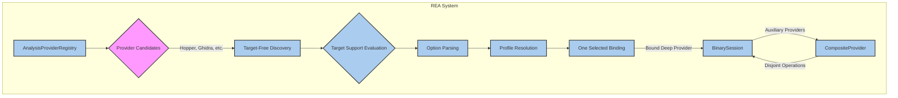

<!-- source: DeepWiki mcp.deepwiki.com · repo morluto/rea · page 4 Analysis Providers · fetched 2026-10-09 -->

# Analysis Providers

<details>
<summary>Relevant source files</summary>

The following files were used as context for generating this wiki page:

- [docs/adr/0001-provider-selection-and-analysis-profiles.md](docs/adr/0001-provider-selection-and-analysis-profiles.md)
- [docs/adr/0002-controlled-replay-authority-and-sandbox.md](docs/adr/0002-controlled-replay-authority-and-sandbox.md)
- [docs/adr/0003-managed-code-evidence-and-provider-boundary.md](docs/adr/0003-managed-code-evidence-and-provider-boundary.md)
- [docs/adr/README.md](docs/adr/README.md)
- [docs/javascript-application-workflows.md](docs/javascript-application-workflows.md)
- [docs/managed-code-analysis.md](docs/managed-code-analysis.md)
- [docs/native-investigation.md](docs/native-investigation.md)
- [docs/provider-evaluation.md](docs/provider-evaluation.md)
- [src/android/JadxMcpTransport.ts](src/android/JadxMcpTransport.ts)
- [src/application/AnalysisProvider.ts](src/application/AnalysisProvider.ts)
- [src/cli/androidCommands.ts](src/cli/androidCommands.ts)
- [src/composition/android.ts](src/composition/android.ts)
- [src/contracts/officialToolContracts.ts](src/contracts/officialToolContracts.ts)
- [src/process/ProviderProcess.ts](src/process/ProviderProcess.ts)
- [tests/boundary/android/jadxIntegration.test.ts](tests/boundary/android/jadxIntegration.test.ts)
- [tests/boundary/android/jadxMcpTransport.test.ts](tests/boundary/android/jadxMcpTransport.test.ts)
- [tests/boundary/mcp/officialTools.test.ts](tests/boundary/mcp/officialTools.test.ts)
- [tests/boundary/providers/managed/managedMemberComparisonFromMetadata.test.ts](tests/boundary/providers/managed/managedMemberComparisonFromMetadata.test.ts)
- [tests/fixtures/android/jadx.ts](tests/fixtures/android/jadx.ts)
- [tests/fixtures/captureGhidraLaunch.cmd](tests/fixtures/captureGhidraLaunch.cmd)
- [tests/fixtures/captureGhidraLaunch.mjs](tests/fixtures/captureGhidraLaunch.mjs)

</details>


REA employs a "bring-your-own" provider model, allowing integration with various analysis engines. This page provides a high-level overview of how these providers are identified, how their capabilities are described, the mechanisms for their selection and analysis profiles, their process ownership, and the assets found in the `bridge/` directory. Detailed information for each specific provider is available on their respective child pages.

## Provider Identity and Capability Descriptors

Each analysis provider in REA has a unique identity, comprising an `id`, `name`, and `version` [src/application/AnalysisProvider.ts:122-126](). This identity is crucial for tracking provenance and ensuring consistent analysis results. Providers declare their capabilities through `CapabilityDescriptor` objects [src/application/AnalysisProvider.ts:160-168](). These descriptors detail the operations a provider can perform, their availability, and any associated effects such as whether they mutate artifacts, launch processes, or access the network [src/application/AnalysisProvider.ts:139-147, 160-168]().

The `AnalysisOperation` type defines the closed set of operations that provider-backed analysis sessions can accept, encompassing official tools, enhanced tools, native tools, artifact analysis, and managed tools [src/application/AnalysisProvider.ts:24-30](). This structured approach ensures that REA can understand and dispatch requests to the appropriate provider based on its declared capabilities.

## Provider Selection and Analysis Profiles

The selection of an analysis provider is a deterministic process, as outlined in [ADR-0001: Provider selection and analysis profiles](docs/adr/0001-provider-selection-and-analysis-profiles.md) [docs/adr/0001-provider-selection-and-analysis-profiles.md:1-14](). Instead of a simple composite model, REA uses an `AnalysisProviderRegistry` to manage candidate deep providers like Hopper and Ghidra [docs/adr/0001-provider-selection-and-analysis-profiles.md:88-93](). This registry handles discovery, target-support evaluation, option parsing, and profile resolution. Once a provider is selected, it is bound to an active target for its lifetime, preventing silent failovers between providers [docs/adr/0001-provider-selection-and-analysis-profiles.md:36-37, 104-105]().

An `AnalysisProfileCommitment` captures the selected provider, its version, and normalized semantic analysis settings [src/application/AnalysisProvider.ts:8-8](). This commitment is vital for snapshot compatibility and ensuring that analyses of the same bytes yield consistent results across different runs or environments [docs/adr/0001-provider-selection-and-analysis-profiles.md:45-46]().

The following diagram illustrates the high-level flow of provider selection and binding:


Sources:
- [docs/adr/0001-provider-selection-and-analysis-profiles.md:1-14]()
- [docs/adr/0001-provider-selection-and-analysis-profiles.md:36-37]()
- [docs/adr/0001-provider-selection-and-analysis-profiles.md:45-46]()
- [docs/adr/0001-provider-selection-and-analysis-profiles.md:88-93]()
- [docs/adr/0001-provider-selection-and-analysis-profiles.md:104-105]()
- [src/application/AnalysisProvider.ts:8-8]()
- [src/application/AnalysisProvider.ts:122-126]()
- [src/application/AnalysisProvider.ts:139-147]()
- [src/application/AnalysisProvider.ts:160-168]()
- [src/application/AnalysisProvider.ts:24-30]()

## Process Ownership

Many analysis providers operate as external processes. REA takes ownership of these processes to ensure proper lifecycle management, including startup, shutdown, and cleanup. The `spawnOwnedProviderProcess` function is responsible for launching provider processes, either in an owned Windows job or a dedicated POSIX process group [src/process/ProviderProcess.ts:132-135](). This ensures that all child processes are properly tracked and terminated, even if the main REA process crashes.

The `ProviderProcessSupervisor` monitors the spawned processes, capturing their stdout and stderr for diagnostics and managing their lifecycle [src/process/ProviderProcess.ts:190-192](). This includes handling termination signals and ensuring that resources are released. For example, the `JadxMcpTransport` uses this mechanism to manage the JADX process, ensuring that it's properly acquired and closed [src/android/JadxMcpTransport.ts:59-62, 101-105]().

```mermaid
graph TD
    subgraph "REA Process"
        A[AnalysisClient] --> B[spawnOwnedProviderProcess];
        B --> C{Platform Check};
        C -- "Windows" --> D[WindowsOwnedProcess];
        C -- "POSIX" --> E[spawn (detached)];
        D --> F[SpawnedOwnedProviderProcess];
        E --> F;
        F --> G[ProviderProcessSupervisor];
        G -- "Monitors" --> H[Provider Process];
        G -- "Diagnostics" --> I[ProviderProcessDiagnostic];
        G -- "Cleanup" --> J[cleanupOwnedProcessGroup];
    end

    style A fill:#ace,stroke:#333,stroke-width:2px
    style B fill:#ace,stroke:#333,stroke-width:2px
    style C fill:#f9f,stroke:#333,stroke-width:2px
    style D fill:#ace,stroke:#333,stroke-width:2px
    style E fill:#ace,stroke:#333,stroke-width:2px
    style F fill:#ace,stroke:#333,stroke-width:2px
    style G fill:#ace,stroke:#333,stroke-width:2px
    style H fill:#f9f,stroke:#333,stroke-width:2px
    style I fill:#ace,stroke:#333,stroke-width:2px
    style J fill:#ace,stroke:#333,stroke-width:2px
```
Sources:
- [src/android/JadxMcpTransport.ts:59-62]()
- [src/android/JadxMcpTransport.ts:101-105]()
- [src/process/ProviderProcess.ts:132-135]()
- [src/process/ProviderProcess.ts:190-192]()

## `bridge/` Directory Assets

The `bridge/` directory contains various assets that facilitate communication and interaction with external analysis providers. These assets often include:

*   **Python scripts:** For providers like Hopper, Python scripts (`bridge/hopper_bridge.py`) are used to launch the analysis engine and establish communication, often via Unix sockets. For details, see [Hopper Provider](#4.1).
*   **Java code:** For Ghidra, Java bridge code (`bridge/ghidra/*.java`) is used to interact with the Ghidra headless analyzer. For details, see [Ghidra Provider](#4.2).
*   **Native helpers:** For macOS, native helpers might be used to interact with system services or specific frameworks. For details, see [Apple / Native macOS Provider](#4.3).
*   **Configuration files:** These might include settings or manifests required by the external tools.

These bridge assets are crucial for abstracting away the complexities of interacting with diverse external tools, allowing REA to maintain a consistent interface for analysis operations.

## Specific Analysis Providers

REA supports a range of analysis providers, each tailored to specific binary types or analysis needs. For detailed information on each provider, refer to their dedicated child pages:

*   **[Hopper Provider](#4.1)**: Focuses on Hopper integration, including its client protocol and process management.
*   **[Ghidra Provider](#4.2)**: Details the headless Ghidra launch, Java bridge, and its capabilities.
*   **[Apple / Native macOS Provider](#4.3)**: Covers native macOS analysis using tools like `otool` and `xcrun`, and parsing Apple-specific metadata.
*   **[Managed (.NET) Provider](#4.4)**: Explains the analysis of .NET PE/CLI artifacts, including metadata inspection and member comparison.
*   **[Android, Firmware and IDA Providers](#4.5)**: Describes the integration with JADX for Android APKs, `binwalk`/`unblob` for firmware, and the IDA Pro provider.

---

