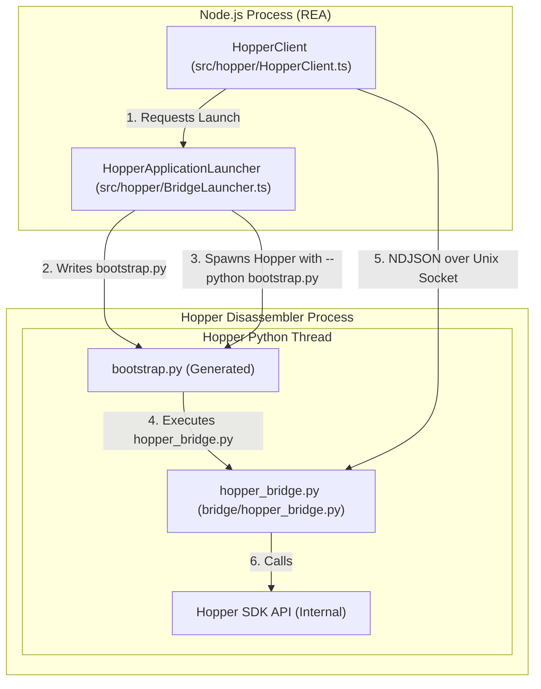

<!-- source: DeepWiki mcp.deepwiki.com · repo morluto/rea · page 4.1 Hopper Provider · fetched 2026-10-09 -->

# Hopper Provider

<details>
<summary>Relevant source files</summary>

The following files were used as context for generating this wiki page:

- [bridge/hopper_bridge.py](bridge/hopper_bridge.py)
- [scripts/hopper-demo-x11.py](scripts/hopper-demo-x11.py)
- [src/application/LinuxHopper.test.ts](src/application/LinuxHopper.test.ts)
- [src/application/LinuxHopper.ts](src/application/LinuxHopper.ts)
- [src/browser/BrowserProcessStartup.ts](src/browser/BrowserProcessStartup.ts)
- [src/domain/hopperStartupFailure.ts](src/domain/hopperStartupFailure.ts)
- [src/ghidra/GhidraResponseBuffer.test.ts](src/ghidra/GhidraResponseBuffer.test.ts)
- [src/ghidra/GhidraResponseBuffer.ts](src/ghidra/GhidraResponseBuffer.ts)
- [src/hopper/BridgeLauncher.ts](src/hopper/BridgeLauncher.ts)
- [src/hopper/HopperClient.ts](src/hopper/HopperClient.ts)
- [src/hopper/HopperDiagnostics.ts](src/hopper/HopperDiagnostics.ts)
- [src/hopper/HopperRequestQueue.ts](src/hopper/HopperRequestQueue.ts)
- [src/hopper/HopperResponseStream.test.ts](src/hopper/HopperResponseStream.test.ts)
- [src/hopper/HopperResponseStream.ts](src/hopper/HopperResponseStream.ts)
- [src/hopper/LinuxPrivateDisplayProbe.ts](src/hopper/LinuxPrivateDisplayProbe.ts)
- [src/hopper/protocol.ts](src/hopper/protocol.ts)
- [src/javascript/recovery/WakaruCommand.test.ts](src/javascript/recovery/WakaruCommand.test.ts)
- [src/javascript/recovery/WakaruCommand.ts](src/javascript/recovery/WakaruCommand.ts)
- [tests/boundary/providers/hopper/hopperClient.cleanup.test.ts](tests/boundary/providers/hopper/hopperClient.cleanup.test.ts)
- [tests/boundary/providers/hopper/hopperClient.protocol.test.ts](tests/boundary/providers/hopper/hopperClient.protocol.test.ts)
- [tests/boundary/providers/hopper/linuxPrivateDisplay.test.ts](tests/boundary/providers/hopper/linuxPrivateDisplay.test.ts)
- [tests/fixtures/fakeHopper.mjs](tests/fixtures/fakeHopper.mjs)
- [tests/fixtures/hopperBridgeFacadeProbe.py](tests/fixtures/hopperBridgeFacadeProbe.py)
- [tests/fixtures/x11ProbeOutput.py](tests/fixtures/x11ProbeOutput.py)

</details>


This page details the `HopperProvider`, which integrates REA with Hopper Disassembler. It covers the `HopperClient`'s role in managing the Unix-socket NDJSON protocol, the request queue, and response stream. It also explains the `BridgeLauncher`'s injection mechanism, bootstrap process, and specific handling for Linux X11/private displays. The core Python bridge script, `bridge/hopper_bridge.py`, is also examined.

## The Hopper Bridge

The Hopper Bridge is a Python-based adapter that executes directly within Hopper Disassembler's dedicated Python thread. It serves as the low-level execution engine for all analysis tasks, providing a secure, authenticated, and structured interface between the REA Node.js environment and Hopper's internal SDK.

The bridge is implemented in `bridge/hopper_bridge.py` [bridge/hopper_bridge.py:1-6]() and is designed to operate within the constraints of Hopper's public Python API while maintaining a robust communication channel via Unix sockets and NDJSON (Newline Delimited JSON).

## Bridge Execution Environment

The bridge does not run as a standalone process. Instead, it is injected into a Hopper instance using Hopper's `--python` command-line argument. To ensure security and thread safety, the bridge follows a specific lifecycle:

1.  **Injection**: The `HopperApplicationLauncher` creates a `bootstrap.py` script that defines the connection parameters (`REA_SOCKET`, `REA_TOKEN`) and then executes the main bridge script [src/hopper/BridgeLauncher.ts:125-127]().
2.  **Thread Affinity**: All Hopper API calls are kept on the initial execution thread. Moving these calls to background worker threads within Python can cause Hopper to deadlock [bridge/hopper_bridge.py:1-6]().
3.  **Authentication**: Every connection requires an HMAC-based handshake using a random bearer token generated by the `HopperClient` [src/hopper/HopperClient.ts:91-91, 114-114]().

### Bridge Component Interaction
This diagram illustrates how the Node.js `HopperClient` interacts with the Python `hopper_bridge.py` inside the Hopper process.


**Sources:** [src/hopper/HopperClient.ts:81-91](), [src/hopper/BridgeLauncher.ts:125-127](), [bridge/hopper_bridge.py:1-6]()

## The NDJSON Protocol

Communication between REA and the bridge uses a request-response pattern over a Unix domain socket. Each message is a single line of JSON.

-   **Requests**: Contain an incrementing numeric `id`, a `method` name, and a `params` object, along with an authentication `token` [src/hopper/HopperClient.ts:125-125]().
-   **Responses**: Contain the matching `id` and either a `result` or an `error` object [src/hopper/protocol.ts:27-40]().
-   **Events**: The bridge can also send `event` messages, such as `progress` updates or `diagnostic` errors, associated with a request `id` [src/hopper/protocol.ts:43-77]().

The `HopperResponseStream` [src/hopper/HopperResponseStream.ts:14-14]() handles incremental parsing of incoming NDJSON chunks, buffering them until a newline is encountered and then validating the message against the protocol schema [src/hopper/HopperResponseStream.ts:20-31]().

### Request Queue and Response Stream

The `HopperClient` manages concurrent requests using a `HopperRequestQueue` [src/hopper/HopperRequestQueue.ts:1-1]() and processes responses with a `HopperResponseStream` [src/hopper/HopperResponseStream.ts:14-14]().

```mermaid
graph TD
    A[HopperClient.callTool()] --> B{HopperRequestQueue.enqueue()};
    B --> C{Socket.write(NDJSON Request)};
    C --> D[Hopper Bridge (hopper_bridge.py)];
    D --> E{Socket.on('data')};
    E --> F{HopperResponseStream.push(chunk)};
    F --> G{HopperResponseStream.acceptLine()};
    G --> H{HopperClient.#acceptBridgeMessage()};
    H --> I{HopperRequestQueue.resolve() / reject()};
```
**Sources:** [src/hopper/HopperClient.ts:116-137](), [src/hopper/HopperRequestQueue.ts:1-1](), [src/hopper/HopperResponseStream.ts:14-14]()

## Dispatch and Operations

The core of the bridge is the `_dispatch` function (internal to `hopper_bridge.py`). It receives incoming JSON requests, validates the authentication token, and routes the request to the appropriate Python helper function.

### Implemented Operations
The bridge implements over 30 operations that map directly to Hopper's SDK. Common operations include:
-   **Navigation**: `goto_address`, `get_current_address`.
-   **Analysis**: `procedure_pseudo_code`, `procedure_assembly`, `list_procedures`.
-   **Metadata**: `set_comment`, `set_address_name`, `bookmarks`.
-   **Search**: `search_strings`, `search_procedures`.

### Data Projection
Because Hopper's Python objects (like `Address` or `Segment`) cannot be directly serialized to JSON, the bridge uses a `_json_safe` utility to project these values into standard primitives (strings, numbers, lists, and dicts) [bridge/hopper_bridge.py:165-173]().

## Linux X11/Private Display Handling

On Linux, Hopper requires an X11 display. To ensure a consistent and isolated environment, REA can launch Hopper on a private X11 display using `Xvfb` and `xauth`. This is managed by the `LinuxPrivateDisplayProbe` [src/hopper/LinuxPrivateDisplayProbe.ts:20-23]() and orchestrated by the `HopperApplicationLauncher` [src/hopper/BridgeLauncher.ts:169-170]().

The `scripts/hopper-demo-x11.py` script [scripts/hopper-demo-x11.py:1-1]() is used to:
-   Probe for available X11 display strategies.
-   Launch `Xvfb` and configure `xauth` for a private display.
-   Activate the Hopper demo dialog if present, allowing headless operation.
-   Verify the Hopper launcher's SHA256 digest to ensure a supported build [scripts/hopper-demo-x11.py:22-25]().

This mechanism ensures that Hopper can run in a headless or background mode without interfering with the user's primary display.

## Known Hopper API Limitations

The bridge is designed to be "truthful"—it explicitly reports when the Hopper API lacks specific information rather than returning deceptive default values.

| Feature | Limitation | Bridge Behavior |
| :--- | :--- | :--- |
| **Segment Permissions** | Hopper's public API does not expose W^X bits reliably. | Returns `None` for `writable`/`executable` and marks `permissions` as `_unavailable` [bridge/hopper_bridge.py:600-605](). |
| **Reference Kinds** | The SDK provides XREFs but does not classify them (e.g., Data vs. Code). | Returns `kind: _unavailable` in reference lists [bridge/hopper_bridge.py:481-482](). |
| **CFG Edges** | Basic block successors are not always available via the public `BasicBlock` API. | Marks `successors` as `_unavailable` instead of returning an empty list [bridge/hopper_bridge.py:524-524](). |

**Sources:** [bridge/hopper_bridge.py:481-482](), [bridge/hopper_bridge.py:524-524](), [bridge/hopper_bridge.py:600-605]()

## Code Entity Mapping
This table maps conceptual bridge actions to the specific Python functions and Node.js classes that implement them.

| Concept | Code Entity (Python) | Code Entity (Node.js) |
| :--- | :--- | :--- |
| **Process Launch** | `bootstrap.py` | `HopperApplicationLauncher` [src/hopper/BridgeLauncher.ts:103-107]() |
| **Request Routing** | `_dispatch` [bridge/hopper_bridge.py:700-700]() | `HopperClient.#requests` [src/hopper/HopperClient.ts:84-84, 116-130]() |
| **Address Resolution** | `_address` [bridge/hopper_bridge.py:201-201]() | `HopperClient.callTool` [src/hopper/HopperClient.ts:300-300]() |
| **Decompilation** | `procedure_pseudo_code` [bridge/hopper_bridge.py:800-800]() | `HopperClient.callTool("procedure_pseudo_code", ...)` [src/hopper/HopperClient.ts:300-300]() |
| **JSON Sanitization** | `_json_safe` [bridge/hopper_bridge.py:165-165]() | `parseBridgeMessageLine` [src/hopper/protocol.ts:86-86]() |

**Sources:** [bridge/hopper_bridge.py:165-173](), [bridge/hopper_bridge.py:201-201](), [bridge/hopper_bridge.py:700-700](), [bridge/hopper_bridge.py:800-800](), [src/hopper/HopperClient.ts:84-84](), [src/hopper/HopperClient.ts:116-130](), [src/hopper/HopperClient.ts:300-300](), [src/hopper/BridgeLauncher.ts:103-107](), [src/hopper/protocol.ts:86-86]()

---

