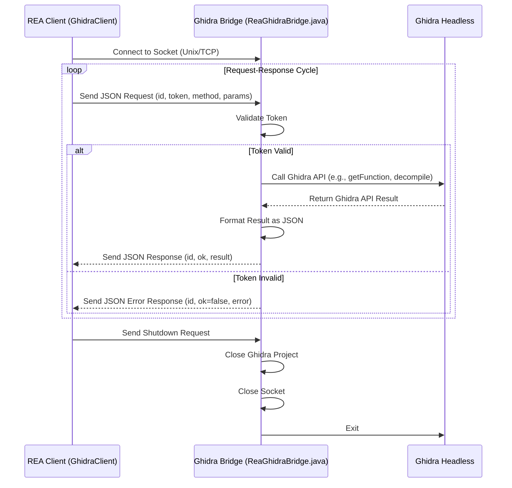

<!-- source: DeepWiki mcp.deepwiki.com · repo morluto/rea · page 4.2 Ghidra Provider · fetched 2026-10-09 -->

# Ghidra Provider

<details>
<summary>Relevant source files</summary>

The following files were used as context for generating this wiki page:

- [bridge/ghidra/ReaGhidraBridge.java](bridge/ghidra/ReaGhidraBridge.java)
- [native/windows/README.md](native/windows/README.md)
- [native/windows/src/authority.hpp](native/windows/src/authority.hpp)
- [native/windows/src/filesystem.cc](native/windows/src/filesystem.cc)
- [native/windows/src/process.cc](native/windows/src/process.cc)
- [scripts/verify-packaged-ghidra-windows.mjs](scripts/verify-packaged-ghidra-windows.mjs)
- [scripts/verify-windows-native.mjs](scripts/verify-windows-native.mjs)
- [src/application/ReconstructionObligationCandidates.test.ts](src/application/ReconstructionObligationCandidates.test.ts)
- [src/browser/CdpSafeMetadata.ts](src/browser/CdpSafeMetadata.ts)
- [src/cliBrowserContext.ts](src/cliBrowserContext.ts)
- [src/cliHostInputs.test.ts](src/cliHostInputs.test.ts)
- [src/ghidra/GhidraAnnotations.test.ts](src/ghidra/GhidraAnnotations.test.ts)
- [src/ghidra/GhidraClient.ts](src/ghidra/GhidraClient.ts)
- [src/ghidra/GhidraClientTypes.ts](src/ghidra/GhidraClientTypes.ts)
- [src/ghidra/GhidraDiagnostics.ts](src/ghidra/GhidraDiagnostics.ts)
- [src/ghidra/GhidraLauncher.ts](src/ghidra/GhidraLauncher.ts)
- [src/ghidra/GhidraLoadImageAttest.ts](src/ghidra/GhidraLoadImageAttest.ts)
- [src/ghidra/GhidraProvider.behavior.test.ts](src/ghidra/GhidraProvider.behavior.test.ts)
- [src/ghidra/GhidraProvider.ts](src/ghidra/GhidraProvider.ts)
- [src/ghidra/GhidraProviderCapabilities.ts](src/ghidra/GhidraProviderCapabilities.ts)
- [src/ghidra/GhidraProviderClient.ts](src/ghidra/GhidraProviderClient.ts)
- [src/ghidra/GhidraSessionValues.ts](src/ghidra/GhidraSessionValues.ts)
- [src/ghidra/GhidraSocketConnection.ts](src/ghidra/GhidraSocketConnection.ts)
- [src/ghidra/GhidraTargetSnapshot.ts](src/ghidra/GhidraTargetSnapshot.ts)
- [src/ghidra/GhidraTransport.ts](src/ghidra/GhidraTransport.ts)
- [src/ghidra/extensions/GhidraExtensions.test.ts](src/ghidra/extensions/GhidraExtensions.test.ts)
- [src/ghidra/extensions/nativeaot/NativeAotReport.ts](src/ghidra/extensions/nativeaot/NativeAotReport.ts)
- [src/hopper/HopperProvider.test.ts](src/hopper/HopperProvider.test.ts)
- [src/hopper/HopperProvider.ts](src/hopper/HopperProvider.ts)
- [src/windows/WindowsOwnedProcess.ts](src/windows/WindowsOwnedProcess.ts)
- [tests/boundary/browser/cdpSafeMetadata.test.ts](tests/boundary/browser/cdpSafeMetadata.test.ts)
- [tests/boundary/filesystem/clientRegistrationStatus.test.ts](tests/boundary/filesystem/clientRegistrationStatus.test.ts)
- [tests/boundary/filesystem/referenceSourceFailureDetails.test.ts](tests/boundary/filesystem/referenceSourceFailureDetails.test.ts)
- [tests/boundary/mcp/ghidraMcpHarness.ts](tests/boundary/mcp/ghidraMcpHarness.ts)
- [tests/boundary/providers/ghidra/ghidraClient.test.ts](tests/boundary/providers/ghidra/ghidraClient.test.ts)
- [tests/boundary/providers/ghidra/ghidraLauncher.test.ts](tests/boundary/providers/ghidra/ghidraLauncher.test.ts)
- [tests/boundary/providers/native/nativeTextRobustness.test.ts](tests/boundary/providers/native/nativeTextRobustness.test.ts)
- [tests/fixtures/fakeGhidra.mjs](tests/fixtures/fakeGhidra.mjs)
- [tests/fixtures/processReactiveScenario.mjs](tests/fixtures/processReactiveScenario.mjs)

</details>


The Ghidra Provider integrates Ghidra as a headless analysis backend for REA. This page details the architecture, implementation, and data flow for launching Ghidra, communicating with it via a Java bridge, and leveraging its capabilities within REA. It covers the `GhidraLauncher` for headless execution, the Java bridge implementation, socket-based transport, response buffering, provider capabilities, Ghidra annotations, NativeAOT extensions, and considerations for packaged Ghidra on Windows.

## Ghidra Headless Launch

The `GhidraHeadlessLauncher` class [src/ghidra/GhidraLauncher.ts:77-77]() is responsible for initiating a headless Ghidra analysis session. It orchestrates the creation of a temporary runtime environment, prepares session-specific configuration, and executes Ghidra's `analyzeHeadless` script.

### Launch Process

1.  **Runtime Environment Setup**: A private runtime directory is created for each Ghidra session [src/ghidra/GhidraLauncher.ts:90-90](). This directory contains all necessary files for the session, including project files, logs, and the session descriptor.
2.  **Extension Snapshotting**: Configured Ghidra extensions are snapshotted into the runtime directory [src/ghidra/GhidraLauncher.ts:91-94]().
3.  **Session Descriptor**: A JSON descriptor file is written to the runtime directory [src/ghidra/GhidraLauncher.ts:95-110](). This file contains critical session parameters such as:
    *   `transport`: The communication method (e.g., `unix-socket`, `authenticated-loopback-tcp`) [src/ghidra/GhidraLauncher.ts:98-98]().
    *   `endpoint_path`: The path to the socket for communication [src/ghidra/GhidraLauncher.ts:99-99]().
    *   `token`: An authentication token for secure communication [src/ghidra/GhidraLauncher.ts:100-100]().
    *   `run_id`: A unique identifier for the analysis run [src/ghidra/GhidraLauncher.ts:101-101]().
    *   `target_sha256`: SHA-256 hash of the binary being analyzed [src/ghidra/GhidraLauncher.ts:102-102]().
    *   `provider_version`: Version of the Ghidra provider [src/ghidra/GhidraLauncher.ts:103-103]().
    *   `profile_digest`: Digest of the analysis profile used [src/ghidra/GhidraLauncher.ts:104-104]().
    *   `analysis_extensions`: List of active extensions [src/ghidra/GhidraLauncher.ts:105-107]().
4.  **Headless Arguments Construction**: The `ghidraHeadlessArguments` function [src/ghidra/GhidraLauncher.ts:113-126]() constructs the command-line arguments for `analyzeHeadless`. These arguments include:
    *   Project root and name.
    *   Target binary path.
    *   Path to the Java bridge script (`ReaGhidraBridge.java`).
    *   Path to the session descriptor.
    *   Paths for Ghidra's log and the script's log.
    *   Specific loader and processor options for DOS MZ/COM binaries [tests/boundary/providers/ghidra/ghidraLauncher.test.ts:91-115](), [tests/boundary/providers/ghidra/ghidraLauncher.test.ts:119-136]().
    *   Flags for read-only import and project deletion after analysis [tests/boundary/providers/ghidra/ghidraLauncher.test.ts:134-135]().
5.  **Command Execution**: The `ghidraHeadlessCommand` function [src/ghidra/GhidraLauncher.ts:127-134]() determines the actual command and arguments to execute, handling platform-specific details (e.g., wrapping Windows batch scripts with `cmd.exe`) [tests/boundary/providers/ghidra/ghidraLauncher.test.ts:161-185]().
6.  **Process Spawning**: `spawnOwnedProviderProcess` [src/ghidra/GhidraLauncher.ts:135-150]() is used to launch Ghidra as an owned process, ensuring proper cleanup. The environment variables are set up to isolate Ghidra's runtime, including `JAVA_HOME`, `HOME`, `TMPDIR`, and `XDG_*` paths [tests/boundary/providers/ghidra/ghidraLauncher.test.ts:46-81]().
7.  **Ownership Tracking**: A file detailing process ownership (PID, run ID, parent PID, ownership kind) is written [src/ghidra/GhidraLauncher.ts:151-163]() to facilitate robust process management and cleanup.

### Ghidra Headless Launch Flow

```mermaid
graph TD
    A[GhidraHeadlessLauncher.launch()] --> B{Create Runtime Dirs};
    B --> C{Snapshot Extensions};
    C --> D{Write Session Descriptor};
    D --> E{Construct Headless Arguments};
    E --> F{Determine Headless Command};
    F --> G[spawnOwnedProviderProcess()];
    G --> H{Write Process Ownership Info};
    H --> I[Return GhidraLaunch Object];
```
Sources: [src/ghidra/GhidraLauncher.ts:84-175]()

## Java Bridge (`bridge/ghidra/*.java`)

The core of the Ghidra integration is the Java bridge, implemented primarily in `ReaGhidraBridge.java` [bridge/ghidra/ReaGhidraBridge.java:99-99](). This script runs within the headless Ghidra instance and acts as a server, communicating with the REA client.

### Bridge Initialization

1.  **Argument Parsing**: The bridge expects a single argument: the path to the session descriptor file [bridge/ghidra/ReaGhidraBridge.java:160-162]().
2.  **Descriptor Reading**: It reads and parses the session descriptor, extracting transport details, authentication token, and other session parameters [bridge/ghidra/ReaGhidraBridge.java:163-164]().
3.  **Descriptor Cleanup**: On POSIX systems, the descriptor file is deleted after reading to prevent residue [bridge/ghidra/ReaGhidraBridge.java:168-171]().
4.  **Program Context**: It ensures that a program is loaded within Ghidra; otherwise, it reports an error [bridge/ghidra/ReaGhidraBridge.java:173-173]().
5.  **Decompiler Setup**: A `DecompInterface` is initialized for pseudocode generation [bridge/ghidra/ReaGhidraBridge.java:153-153]().
6.  **Extension Loading**: Custom analysis extensions are loaded and initialized [bridge/ghidra/ReaGhidraBridge.java:154-154]().

### Communication Protocol

The bridge implements a JSON-RPC-like protocol over a socket.

1.  **Socket Server**: Based on the `transport` specified in the descriptor, the bridge creates either a Unix domain socket or a TCP loopback socket [bridge/ghidra/ReaGhidraBridge.java:10-15]().
2.  **Request Handling Loop**: It enters a loop, accepting client connections and processing incoming requests [bridge/ghidra/ReaGhidraBridge.java:200-200]().
3.  **Request Format**: Each request is a JSON object with `id`, `token`, `method`, and `params` fields [bridge/ghidra/ReaGhidraBridge.java:113-117]().
4.  **Authentication**: The `token` in the request is validated against the session token [bridge/ghidra/ReaGhidraBridge.java:210-212]().
5.  **Method Dispatch**: The `method` field determines which Ghidra operation to perform (e.g., `list_procedures`, `procedure_pseudo_code`, `read_bytes`) [bridge/ghidra/ReaGhidraBridge.java:214-214]().
6.  **Response Format**: Responses are JSON objects containing `id`, `ok` (boolean), and either `result` (on success) or `error` (on failure) [bridge/ghidra/ReaGhidraBridge.java:220-220]().

### Key Bridge Operations

The `ReaGhidraBridge` supports a wide range of operations, including:

*   **Inventory**: `list_names`, `list_procedures`, `list_segments`, `list_strings` [bridge/ghidra/ReaGhidraBridge.java:127-130]().
*   **Procedure Analysis**: `procedure_address`, `resolve_containing_procedure`, `search_procedures`, `analyze_function`, `procedure_assembly`, `procedure_callees`, `procedure_callers`, `procedure_info`, `procedure_pseudo_code`, `read_function_instructions` [bridge/ghidra/ReaGhidraBridge.java:131-142]().
*   **Data Inspection**: `read_bytes`, `address_to_file_offset`, `inspect_native_instruction`, `inspect_native_data_type` [bridge/ghidra/ReaGhidraBridge.java:122-123](), [bridge/ghidra/ReaGhidraBridge.java:143-144]().
*   **Cross-References**: `procedure_references`, `xrefs` [bridge/ghidra/ReaGhidraBridge.java:146-147]().
*   **Annotations**: `annotate_native_function` [bridge/ghidra/ReaGhidraBridge.java:120-120]().
*   **Session Management**: `ping`, `shutdown` [bridge/ghidra/ReaGhidraBridge.java:124-125]().

### Java Bridge Request-Response Flow


Sources: [bridge/ghidra/ReaGhidraBridge.java:199-220]()

## Socket Transport and Response Buffering

Communication between the REA client (`GhidraClient`) and the Ghidra Java bridge occurs over a socket. This transport mechanism is designed for reliability and efficiency.

### Transport Kinds

REA supports two primary transport mechanisms for Ghidra:

1.  **Unix Domain Sockets**: Used on POSIX systems (Linux, macOS) for efficient inter-process communication on the same host [src/ghidra/GhidraTransport.ts:10-10](). The `endpointPath` refers to a file system path.
2.  **Authenticated Loopback TCP**: Used on Windows, or as a fallback. This uses `127.0.0.1` and a dynamically assigned port. Authentication is handled via a shared secret token [src/ghidra/GhidraTransport.ts:11-11](). The `endpointPath` refers to a file containing the host and port.

### `GhidraClient` Socket Management

The `GhidraClient` [src/ghidra/GhidraClient.ts:24-24]() manages the connection to the Ghidra bridge:

1.  **Endpoint Resolution**: For TCP, it reads the host and port from the `endpointPath` file [src/ghidra/GhidraClient.ts:200-200]().
2.  **Connection Establishment**: It establishes a `net.Socket` connection to the determined endpoint [src/ghidra/GhidraSocketConnection.ts:40-40]().
3.  **Request Serialization**: JSON requests are serialized and sent over the socket, terminated by a newline [src/ghidra/GhidraSocketConnection.ts:100-100]().
4.  **Response Buffering**: Incoming data from the socket is buffered. The `GhidraSocketConnection` [src/ghidra/GhidraSocketConnection.ts:24-24]() accumulates chunks until a newline character is encountered, indicating a complete JSON response [src/ghidra/GhidraSocketConnection.ts:110-118]().
5.  **Response Deserialization**: Complete lines are parsed as JSON [src/ghidra/GhidraSocketConnection.ts:119-119]().
6.  **Request-Response Matching**: Each request is assigned a unique ID. Responses are matched to their corresponding requests using this ID [src/ghidra/GhidraSocketConnection.ts:120-120]().
7.  **Error Handling**: The client handles various connection errors, malformed responses, and protocol violations [src/ghidra/GhidraSocketConnection.ts:121-121]().

### Response Buffering Mechanism

The `GhidraSocketConnection` employs a robust buffering strategy:

*   **Accumulation**: Raw socket data chunks are appended to an internal buffer [src/ghidra/GhidraSocketConnection.ts:110-110]().
*   **Line Extraction**: The buffer is continuously scanned for newline characters (`\n`). Each segment ending in a newline is treated as a complete message [src/ghidra/GhidraSocketConnection.ts:111-111]().
*   **Partial Messages**: If a newline is not found, the data remains in the buffer, awaiting subsequent chunks [src/ghidra/GhidraSocketConnection.ts:118-118]().
*   **Fragmented Responses**: The system is designed to handle fragmented JSON responses, where a single JSON object might arrive across multiple TCP packets [tests/boundary/providers/ghidra/ghidraClient.test.ts:161-191]().

## Provider Capabilities

The `GhidraProvider` [src/ghidra/GhidraProvider.ts:55-55]() exposes a set of capabilities that define the analysis operations it can perform. These capabilities are declared in `GhidraProviderCapabilities.ts` [src/ghidra/GhidraProviderCapabilities.ts:1-1]().

### Core Capabilities

The `CAPABILITIES` array [src/ghidra/GhidraProviderCapabilities.ts:14-14]() lists the operations supported by the Ghidra provider, including:

*   `ping`: Check bridge liveness.
*   `shutdown`: Gracefully terminate the Ghidra session.
*   `inspect_native_load_image`: Get details about the loaded binary.
*   `read_bytes`: Read raw bytes from memory.
*   `address_to_file_offset`: Convert virtual address to file offset.
*   `address_name`: Resolve name at an address.
*   `list_documents`, `list_names`, `list_procedures`, `list_segments`, `list_strings`: Inventory various program elements.
*   `procedure_address`, `resolve_containing_procedure`, `search_procedures`, `search_strings`: Locate procedures and strings.
*   `annotate_native_function`: Apply annotations to functions.
*   `inspect_native_data_type`, `inspect_native_instruction`: Inspect data types and instructions.
*   `resolve_native_call_targets`: Resolve call targets.
*   `analyze_function`: Perform detailed function analysis.
*   `procedure_assembly`, `procedure_callees`, `procedure_callers`, `procedure_info`, `procedure_pseudo_code`, `read_function_instructions`: Retrieve function-specific details.
*   `procedure_references`, `xrefs`: Get cross-references.

### Windows-Specific Capabilities

On Windows, due to the reliance on NativeAOT extensions and specific process isolation mechanisms, a slightly different set of capabilities (`windowsP0Capabilities`) is exposed [src/ghidra/GhidraProviderCapabilities.ts:10-10](), which includes `inspect_native_load_image_attest` for enhanced load image verification. The provider checks for Windows native authority [src/ghidra/GhidraProvider.ts:82-83]() and adjusts its availability accordingly.

### Target Support

The `inspectTargetSupport` method [src/ghidra/GhidraProvider.ts:110-155]() determines if Ghidra can analyze a given `BinaryTarget`.

*   **Executable Only**: Ghidra primarily supports executable targets [src/ghidra/GhidraProvider.ts:124-128]().
*   **Architecture Support**: It supports `x86`, `x86_64`, `arm`, and `arm64` architectures [src/ghidra/GhidraProvider.ts:141-148]().
*   **Mach-O Universal Binaries**: Ghidra v1 has limitations with universal Mach-O binaries, requiring thinned slices for analysis [src/ghidra/GhidraProvider.ts:135-140]().
*   **DOS MZ/COM**: Special handling for DOS MZ/COM targets is provided, committing specific loaders and real-mode languages in the analysis profile [src/ghidra/GhidraProvider.behavior.test.ts:97-124]().

### Analysis Profile Resolution

The `resolveAnalysisProfile` method [src/ghidra/GhidraProvider.ts:157-184]() constructs an `AnalysisProfileCommitment` for a given target. This profile includes:

*   Target format, architecture, loader, language ID, and compiler spec ID.
*   Specific parameters for jump table evidence (`typed-case-default-blocks-v1`) and decompiler jump loads [src/ghidra/GhidraProvider.behavior.test.ts:68-71]().
*   Function body evidence (`complete-inclusive-ranges-v1`) [src/ghidra/GhidraProvider.behavior.test.ts:92-94]().
*   Integration of `analysis_extensions` into the profile parameters [src/ghidra/GhidraProvider.ts:179-182]().

## Annotations

The Ghidra provider supports annotating native functions, which is crucial for enriching the analysis results with external information. The `annotate_native_function` operation [src/ghidra/GhidraProviderCapabilities.ts:20-20]() allows REA to provide Ghidra with structured data about functions.

### Annotation Data Model

Annotations are represented as JSON objects with specific fields:

*   `address`: The starting address of the function to annotate.
*   `name`: The new name for the function.
*   `comment`: A comment to apply to the function.
*   `signature`: A C-style function signature.
*   `tags`: A list of string tags.
*   `call_convention`: The calling convention.
*   `return_type`: The return type.
*   `parameters`: An array of parameter objects, each with `name`, `type`, and `storage` (register or stack offset).

### Implementation in `ReaGhidraBridge.java`

The `annotateNativeFunction` method in `ReaGhidraBridge.java` [bridge/ghidra/ReaGhidraBridge.java:2490-2490]() handles the application of these annotations:

1.  **Function Lookup**: It resolves the function at the given address [bridge/ghidra/ReaGhidraBridge.java:2496-2496]().
2.  **Name Update**: If a `name` is provided, it attempts to rename the function [bridge/ghidra/ReaGhidraBridge.java:2500-2500]().
3.  **Comment Update**: If a `comment` is provided, it sets the function's comment [bridge/ghidra/ReaGhidraBridge.java:2504-2504]().
4.  **Signature Application**: If a `signature` is provided, it parses and applies the signature, including return type, calling convention, and parameters [bridge/ghidra/ReaGhidraBridge.java:2508-2508](). This involves:
    *   Parsing the signature string into its components.
    *   Resolving data types within Ghidra's data type manager.
    *   Setting the function's prototype.
5.  **Tagging**: If `tags` are provided, they are applied to the function [bridge/ghidra/ReaGhidraBridge.java:2512-2512]().

### Annotation Example

```json
{
  "address": "0x1000",
  "name": "my_custom_function",
  "comment": "This function handles important logic.",
  "signature": "int __cdecl my_custom_function(int a, char *b)",
  "tags": ["custom", "important"],
  "call_convention": "cdecl",
  "return_type": "int",
  "parameters": [
    { "name": "a", "type": "int", "storage": "stack:0x4" },
    { "name": "b", "type": "char*", "storage": "register:ecx" }
  ]
}
```
Sources: [src/ghidra/GhidraAnnotations.test.ts:10-10]()

## NativeAOT Extensions

REA extends Ghidra's capabilities with custom analysis extensions, particularly for handling NativeAOT binaries. These extensions are implemented in Java and loaded by the `ReaGhidraBridge`.

### Extension Mechanism

1.  **`GhidraExtension` Interface**: REA defines a `GhidraExtension` interface [src/ghidra/extensions/GhidraExtensions.ts:24-24]() that describes an extension, including its name, version, and a path to its JAR file.
2.  **Snapshotting**: During Ghidra launch, specified extensions are snapshotted into the Ghidra runtime directory [src/ghidra/GhidraLauncher.ts:91-94]().
3.  **Bridge Loading**: The `ReaGhidraBridge` initializes `ReaGhidraExtensions` [bridge/ghidra/ReaGhidraBridge.java:154-154](), which is responsible for dynamically loading and executing these extensions.
4.  **Extension Execution**: Extensions can register callbacks or provide custom analysis routines that the bridge can invoke during its operation.

### NativeAOT Report Extension

A notable extension is the `NativeAotReport` [src/ghidra/extensions/nativeaot/NativeAotReport.ts:1-1]() extension, designed to extract specific metadata from .NET NativeAOT compiled binaries. This extension aims to:

*   **Identify NativeAOT Artifacts**: Detect characteristics of NativeAOT compilation.
*   **Extract Metadata**: Parse specific sections or patterns within the binary to recover .NET metadata that might be embedded or inferred.
*   **Generate Reports**: Produce structured reports detailing the identified .NET components, types, and methods, even in a native context.

This extension enhances REA's ability to analyze complex binaries that combine native code with managed runtime components.

## Windows Packaged Ghidra

Running Ghidra on Windows introduces specific considerations, especially when dealing with packaged installations and process isolation.

### Windows Native Authority

REA leverages a native Windows addon (`WindowsNativeLoader`) [scripts/verify-windows-native.mjs:27-29]() to achieve robust process ownership and filesystem isolation. This is critical for:

*   **Process Tree Management**: Ensuring that all child processes spawned by Ghidra are properly tracked and terminated [src/windows/WindowsOwnedProcess.ts:1-1]().
*   **Job Objects**: Utilizing Windows Job Objects to group and manage processes, providing a strong isolation boundary [native/windows/src/process.cc:10-10]().
*   **Filesystem Security**: Applying specific DACLs (Discretionary Access Control Lists) to runtime directories to prevent unauthorized access or modification by the Ghidra process [native/windows/src/filesystem.cc:124-127](). This includes preventing reparse point conversions on pinned ancestors [scripts/verify-windows-native.mjs:151-164]().

### Packaged Ghidra Verification

The `scripts/verify-packaged-ghidra-windows.mjs` script [scripts/verify-packaged-ghidra-windows.mjs:1-1]() is used to verify the correct functioning of Ghidra when installed as a package on Windows. This script performs checks such as:

*   **Installation Path**: Verifying that Ghidra can be located and launched from its installed directory.
*   **Java Runtime**: Ensuring that the correct Java runtime is detected and used by Ghidra.
*   **Headless Execution**: Confirming that `analyzeHeadless.bat` executes successfully and the bridge script can communicate.
*   **Process Isolation**: Validating that Ghidra runs within the expected process boundaries and does not interfere with other system resources.
*   **Filesystem Access**: Testing that Ghidra can read its input binary and write to its designated temporary directories, while being restricted from other areas.

These verification steps ensure that the Ghidra provider is reliable and secure in a Windows environment.

Sources:
- [src/ghidra/GhidraLauncher.ts:1-446]()
- [src/ghidra/GhidraProvider.ts:1-265]()
- [src/hopper/HopperProvider.ts:1-242]()
- [tests/boundary/providers/ghidra/ghidraLauncher.test.ts:1-261]()
- [bridge/ghidra/ReaGhidraBridge.java:1-3278]()
- [src/ghidra/GhidraProvider.behavior.test.ts:1-860]()
- [tests/fixtures/fakeGhidra.mjs:1-334]()
- [src/browser/CdpSafeMetadata.ts:1-362]()
- [tests/boundary/providers/ghidra/ghidraClient.test.ts:1-643]()
- [native/windows/src/filesystem.cc:1-549]()
- [scripts/verify-windows-native.mjs:1-526]()
- [tests/boundary/browser/cdpSafeMetadata.test.ts:1-292]()
- [src/ghidra/GhidraClient.ts]()
- [src/ghidra/GhidraDiagnostics.ts]()
- [src/ghidra/GhidraProviderCapabilities.ts]()
- [scripts/verify-packaged-ghidra-windows.mjs]()
- [tests/boundary/providers/native/nativeTextRobustness.test.ts]()
- [src/ghidra/GhidraLoadImageAttest.ts]()
- [tests/boundary/mcp/ghidraMcpHarness.ts]()
- [src/ghidra/GhidraProviderClient.ts]()
- [src/ghidra/GhidraClientTypes.ts]()
- [tests/boundary/filesystem/clientRegistrationStatus.test.ts]()
- [src/ghidra/GhidraAnnotations.test.ts]()
- [tests/fixtures/processReactiveScenario.mjs]()
- [src/cliBrowserContext.ts]()
- [src/hopper/HopperProvider.test.ts]()
- [src/cliHostInputs.test.ts]()
- [src/ghidra/GhidraSessionValues.ts]()
- [src/ghidra/extensions/GhidraExtensions.test.ts]()
- [src/ghidra/extensions/nativeaot/NativeAotReport.ts]()
- [src/ghidra/GhidraTargetSnapshot.ts]()
- [src/ghidra/GhidraTransport.ts]()
- [src/application/ReconstructionObligationCandidates.test.ts]()
- [tests/boundary/filesystem/referenceSourceFailureDetails.test.ts]()
- [src/windows/WindowsOwnedProcess.ts]()
- [native/windows/src/process.cc]()
- [native/windows/README.md]()
- [native/windows/src/authority.hpp]()
- [src/ghidra/GhidraSocketConnection.ts]()

---

