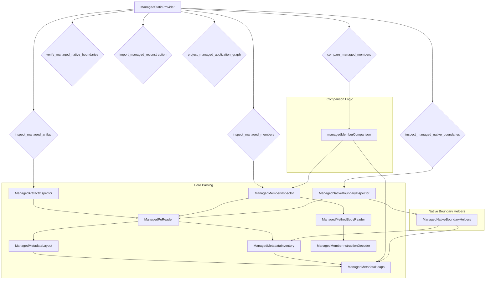
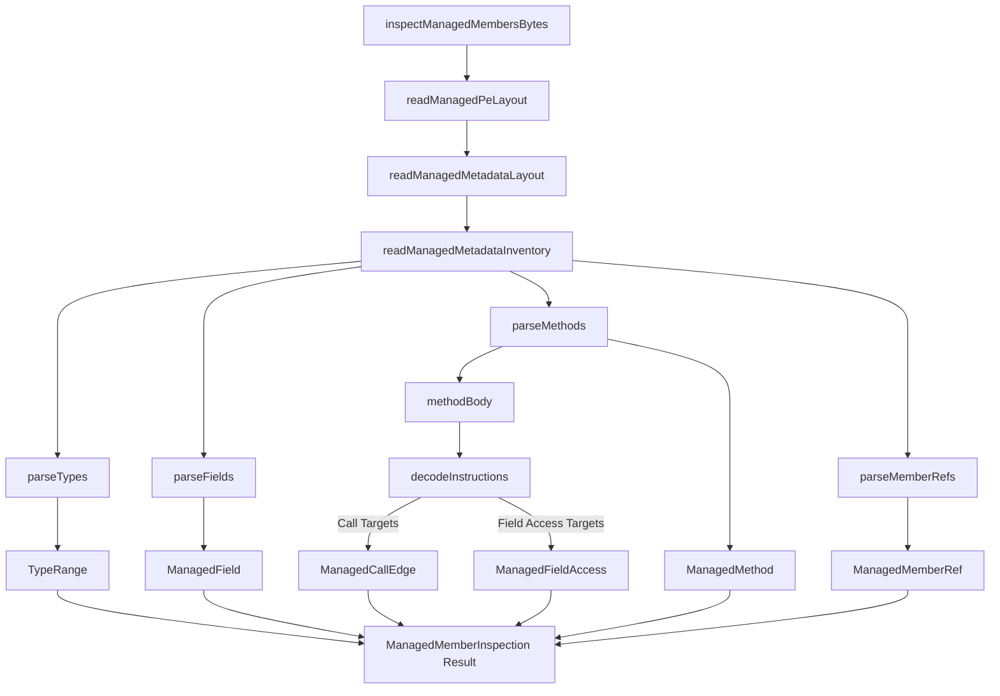
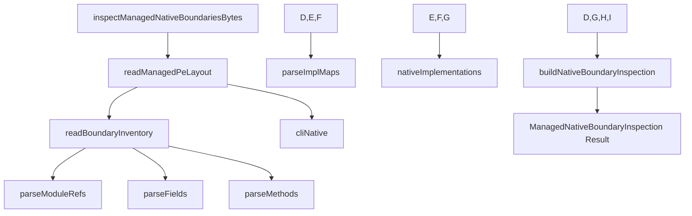

<!-- source: DeepWiki mcp.deepwiki.com · repo morluto/rea · page 4.4 Managed (.NET) Provider · fetched 2026-10-09 -->

# Managed (.NET) Provider

<details>
<summary>Relevant source files</summary>

The following files were used as context for generating this wiki page:

- [docs/adr/0001-provider-selection-and-analysis-profiles.md](docs/adr/0001-provider-selection-and-analysis-profiles.md)
- [docs/adr/0002-controlled-replay-authority-and-sandbox.md](docs/adr/0002-controlled-replay-authority-and-sandbox.md)
- [docs/adr/0003-managed-code-evidence-and-provider-boundary.md](docs/adr/0003-managed-code-evidence-and-provider-boundary.md)
- [docs/adr/README.md](docs/adr/README.md)
- [docs/javascript-application-workflows.md](docs/javascript-application-workflows.md)
- [docs/managed-code-analysis.md](docs/managed-code-analysis.md)
- [docs/native-investigation.md](docs/native-investigation.md)
- [docs/provider-evaluation.md](docs/provider-evaluation.md)
- [scripts/verify-package-managed.mjs](scripts/verify-package-managed.mjs)
- [src/dotnet/ManagedArtifactFailures.test.ts](src/dotnet/ManagedArtifactFailures.test.ts)
- [src/dotnet/ManagedArtifactInspector.test.ts](src/dotnet/ManagedArtifactInspector.test.ts)
- [src/dotnet/ManagedCilDecoding.test.ts](src/dotnet/ManagedCilDecoding.test.ts)
- [src/dotnet/ManagedMemberInspector.test.ts](src/dotnet/ManagedMemberInspector.test.ts)
- [src/dotnet/ManagedMemberInspector.ts](src/dotnet/ManagedMemberInspector.ts)
- [src/dotnet/ManagedMemberInspectorCore.ts](src/dotnet/ManagedMemberInspectorCore.ts)
- [src/dotnet/ManagedMemberInstructionDecoder.ts](src/dotnet/ManagedMemberInstructionDecoder.ts)
- [src/dotnet/ManagedMemberRows.ts](src/dotnet/ManagedMemberRows.ts)
- [src/dotnet/ManagedMetadataHeaps.ts](src/dotnet/ManagedMetadataHeaps.ts)
- [src/dotnet/ManagedMetadataInventory.ts](src/dotnet/ManagedMetadataInventory.ts)
- [src/dotnet/ManagedMetadataInventoryRows.ts](src/dotnet/ManagedMetadataInventoryRows.ts)
- [src/dotnet/ManagedMethodBodyReader.ts](src/dotnet/ManagedMethodBodyReader.ts)
- [src/dotnet/ManagedNativeBoundaryHelpers.ts](src/dotnet/ManagedNativeBoundaryHelpers.ts)
- [src/dotnet/ManagedNativeBoundaryInspector.test.ts](src/dotnet/ManagedNativeBoundaryInspector.test.ts)
- [src/dotnet/ManagedNativeBoundaryInspector.ts](src/dotnet/ManagedNativeBoundaryInspector.ts)
- [src/dotnet/ManagedPeReader.ts](src/dotnet/ManagedPeReader.ts)
- [src/dotnet/ManagedStaticProvider.ts](src/dotnet/ManagedStaticProvider.ts)
- [src/dotnet/ManagedStaticProviderMetadata.ts](src/dotnet/ManagedStaticProviderMetadata.ts)
- [tests/boundary/providers/managed/managedMemberComparison.test.ts](tests/boundary/providers/managed/managedMemberComparison.test.ts)
- [tests/boundary/providers/managed/managedMemberComparisonFromMetadata.test.ts](tests/boundary/providers/managed/managedMemberComparisonFromMetadata.test.ts)
- [tests/boundary/providers/managed/managedStaticProvider.test.ts](tests/boundary/providers/managed/managedStaticProvider.test.ts)

</details>


REA provides comprehensive inspection capabilities for .NET PE/CLI artifacts without requiring code execution. This allows for identification of assemblies, detailed inspection of metadata and Common Intermediate Language (CIL), comparison of members across different builds, and analysis of declared native calls. The managed code analysis focuses on static inspection and does not involve runtime execution [docs/managed-code-analysis.md:3-5]().

The managed provider implements several tools to address key questions about .NET artifacts:
1.  **Artifact Identification**: Determine the exact artifact and its managed deployment form.
2.  **Metadata and CIL Inspection**: Examine admitted metadata and CIL bytes.
3.  **Reconstruction and Inference**: Reconstruct or infer source-like or behavioral structure.
4.  **Build Comparison**: Identify findings that remain consistent across exact-build checks or structural comparisons.
5.  **Native Analysis Requirements**: Pinpoint areas requiring native analysis or runtime evidence beyond static inspection.

The ordinary workflow typically concludes after addressing the fourth question, as static analysis never loads or executes the target code [docs/managed-code-analysis.md:47-58]().

## ManagedStaticProvider

The `ManagedStaticProvider` is the primary entry point for managed code analysis within REA. It offers a suite of tools for inspecting various aspects of .NET assemblies. These tools are exposed as MCP (Multi-Capability Provider) commands and corresponding CLI commands [docs/managed-code-analysis.md:9-22]().

The `ManagedStaticProvider` implements the following core functionalities:
*   `inspect_managed_artifact`: Identifies an artifact and its managed deployment form [docs/managed-code-analysis.md:11]().
*   `inspect_managed_members`: Inspects types, signatures, method bodies, calls, and field access [docs/managed-code-analysis.md:12]().
*   `inspect_managed_native_boundaries`: Lists declared native calls and native implementation indicators [docs/managed-code-analysis.md:13]().
*   `compare_managed_members`: Compares members across builds and maps build-local tokens [docs/managed-code-analysis.md:14]().
*   `verify_managed_native_boundaries`: Checks native call declarations against supplied export or function evidence [docs/managed-code-analysis.md:15]().
*   `import_managed_reconstruction`: Imports decompiled code against verified static member identities [docs/managed-code-analysis.md:16]().
*   `project_managed_application_graph`: Adds managed findings to an application graph [docs/managed-code-analysis.md:17]().

These tools are designed to operate on PE/CLI bytes and their metadata/CIL without loading the assembly. The provider reports observed implementation markers and unavailable facts, but it does not unpack .NET single-file hosts, decode IL2CPP metadata, or infer NativeAOT identity from a native PE [docs/managed-code-analysis.md:32-37]().

### ManagedStaticProvider Architecture
The `ManagedStaticProvider` orchestrates calls to various internal modules responsible for parsing and analyzing different parts of a .NET assembly.


Title: ManagedStaticProvider Internal Structure
Sources:
- [src/dotnet/ManagedStaticProvider.ts]()
- [src/dotnet/ManagedArtifactInspector.ts]()
- [src/dotnet/ManagedMemberInspector.ts]()
- [src/dotnet/ManagedNativeBoundaryInspector.ts]()
- [src/domain/managed/managedMemberComparison.js]()
- [src/dotnet/ManagedPeReader.ts]()
- [src/dotnet/ManagedMetadataLayout.ts]()
- [src/dotnet/ManagedMetadataInventory.ts]()
- [src/dotnet/ManagedMetadataHeaps.ts]()
- [src/dotnet/ManagedMethodBodyReader.ts]()
- [src/dotnet/ManagedMemberInstructionDecoder.ts]()
- [src/dotnet/ManagedNativeBoundaryHelpers.ts]()

## ManagedPeReader

The `ManagedPeReader` module is responsible for parsing the Portable Executable (PE) file format, which is the container for .NET assemblies. It extracts crucial information about the PE structure, including section headers, data directories, and the Common Language Infrastructure (CLI) header [src/dotnet/ManagedPeReader.ts:33-45]().

Key functionalities of `ManagedPeReader`:
*   **PE Header Parsing**: Reads the PE signature, COFF header, and optional header to determine machine architecture, section count, and characteristics [src/dotnet/ManagedPeReader.ts:220-228]().
*   **Section Mapping**: Maps Relative Virtual Addresses (RVAs) to file offsets, allowing access to data within PE sections [src/dotnet/ManagedPeReader.ts:124-147]() and [src/dotnet/ManagedPeReader.ts:43-44]().
*   **CLI Header Extraction**: Locates and parses the CLI header, which contains essential metadata about the managed assembly, such as metadata root RVA, flags, and entry point [src/dotnet/ManagedPeReader.ts:157-216]().
*   **Error Handling**: Catches and reports parsing failures using `ManagedReaderFailure` [src/dotnet/ManagedPeReader.ts:3-5]().

The `readManagedPeLayout` function is the main entry point for parsing a PE file [src/dotnet/ManagedPeReader.ts:370-377](). It performs initial validation and then delegates to helper functions to read different parts of the PE structure.

```mermaid
graph TD
    A[readManagedPeLayout] --> B{Read DOS Header}
    B --> C{Read PE Signature}
    C --> D{Read COFF Header}
    D --> E{Read Optional Header}
    E --> F{Read Section Headers}
    F --> G{Map RVAs to Offsets}
    G --> H{Read CLI Header (if present)}
    H --> I[ManagedPeLayout Object]

    subgraph Error Handling
        A -- "ManagedReaderFailure" --> J[Report Issue]
    end
```
Title: ManagedPeReader Data Flow
Sources:
- [src/dotnet/ManagedPeReader.ts:370-377]()
- [src/dotnet/ManagedPeReader.ts:220-228]()
- [src/dotnet/ManagedPeReader.ts:230-238]()
- [src/dotnet/ManagedPeReader.ts:240-260]()
- [src/dotnet/ManagedPeReader.ts:262-300]()
- [src/dotnet/ManagedPeReader.ts:124-147]()
- [src/dotnet/ManagedPeReader.ts:157-216]()
- [src/dotnet/ManagedPeReader.ts:3-5]()

## Metadata Heaps and Inventory Rows

After the PE structure is parsed, the `ManagedMetadataLayout` and `ManagedMetadataInventory` modules work together to interpret the .NET metadata.

### ManagedMetadataLayout
The `ManagedMetadataLayout` module is responsible for understanding the structure of the metadata root and its streams (e.g., `#Strings`, `#US`, `#GUID`, `#Blob`, `#~`). It determines the sizes of various indices and the layout of metadata tables [src/dotnet/ManagedMetadataLayout.ts:11-12]().

Key aspects:
*   **Metadata Root Parsing**: Reads the metadata root signature, version string, and stream headers [src/dotnet/ManagedMetadataLayout.ts:100-119]().
*   **Stream Layout**: Identifies the offsets and sizes of the different metadata streams [src/dotnet/ManagedMetadataLayout.ts:121-160]().
*   **Index Sizing**: Calculates the size of indices used to reference rows in metadata tables and entries in heaps, which can vary based on the number of rows/entries [src/dotnet/ManagedMetadataLayout.ts:162-200]().

### ManagedMetadataInventory
The `ManagedMetadataInventory` module builds an inventory of the metadata tables. It iterates through each metadata table (e.g., `TypeDef`, `MethodDef`, `FieldDef`, `ImplMap`) and records their row counts and offsets [src/dotnet/ManagedMetadataInventory.ts:11-12]().

Key aspects:
*   **Table Row Counts**: Determines the number of rows in each metadata table [src/dotnet/ManagedMetadataInventory.ts:100-109]().
*   **Table Offsets**: Calculates the starting offset of each table within the `#~` stream [src/dotnet/ManagedMetadataInventory.ts:111-120]().
*   **Metadata Token Generation**: Provides utilities to construct metadata tokens (e.g., `0x02000001` for the first `TypeDef` row) [src/dotnet/ManagedMetadataHeaps.ts:17-18]().
*   **Heap Access**: Offers functions to read data from the `#Strings`, `#US`, `#GUID`, and `#Blob` heaps [src/dotnet/ManagedMetadataHeaps.ts:20-21]().

These modules are foundational for all subsequent managed code analysis, as they provide the means to navigate and interpret the metadata tables and heaps.

## Member Inspector and CIL Decoding

The `ManagedMemberInspector` is responsible for extracting detailed information about types, fields, and methods from the metadata tables. It leverages the `ManagedMetadataLayout` and `ManagedMetadataInventory` to read specific rows and interpret their contents.

### Member Inspection
The `inspectManagedMembersBytes` function in `ManagedMemberInspector.ts` orchestrates the parsing of types, fields, methods, and member references [src/dotnet/ManagedMemberInspector.ts:127-130]().

*   **Types**: `parseTypes` extracts information about defined types, including their names, namespaces, and ranges of associated fields and methods [src/dotnet/ManagedMemberRows.ts:193-205]().
*   **Fields**: `parseFields` extracts field definitions, including flags, names, and signatures [src/dotnet/ManagedMemberRows.ts:27-68]().
*   **Methods**: `parseMethods` extracts method definitions, including RVAs, implementation flags, names, and signatures [src/dotnet/ManagedMemberRows.ts:140-188]().
*   **Member References**: `parseMemberRefs` extracts references to members defined in other modules or assemblies [src/dotnet/ManagedMemberRows.ts:71-131]().

### CIL Decoding
For methods, the `ManagedMemberInspector` also decodes the Common Intermediate Language (CIL) instructions within their method bodies. This is handled by the `ManagedMethodBodyReader` and `ManagedMemberInstructionDecoder` modules.

*   **Method Body Reading**: `methodBody` in `ManagedMethodBodyReader.ts` reads the CIL method body from the PE file, handling different method body formats (tiny or fat) and extracting local variable signatures and exception handling clauses [src/dotnet/ManagedMethodBodyReader.ts:11-12]().
*   **Instruction Decoding**: `decodeInstructions` in `ManagedMemberInstructionDecoder.ts` iterates through the CIL byte stream and decodes each instruction, identifying its opcode, operand kind, and operand value [src/dotnet/ManagedMemberInstructionDecoder.ts:11-12](). This process also identifies call targets and field access targets, which are then used to build call graphs and field access graphs [src/dotnet/ManagedMemberRows.ts:199-216]().


Title: Member Inspection and CIL Decoding Flow
Sources:
- [src/dotnet/ManagedMemberInspector.ts:127-130]()
- [src/dotnet/ManagedMemberRows.ts:193-205]()
- [src/dotnet/ManagedMemberRows.ts:27-68]()
- [src/dotnet/ManagedMemberRows.ts:140-188]()
- [src/dotnet/ManagedMemberRows.ts:71-131]()
- [src/dotnet/ManagedMethodBodyReader.ts:11-12]()
- [src/dotnet/ManagedMemberInstructionDecoder.ts:11-12]()
- [src/dotnet/ManagedMemberRows.ts:199-216]()

## Native Boundary Inspection

The `ManagedNativeBoundaryInspector` focuses on identifying and reporting declarations that bridge managed code to native code. This includes P/Invoke (Platform Invoke) declarations and indicators of ReadyToRun or mixed-mode assemblies [src/dotnet/ManagedNativeBoundaryInspector.ts:127-130]().

Key functionalities:
*   **P/Invoke Import Parsing**: `parseImplMaps` extracts information from the `ImplMap` metadata table, which describes P/Invoke declarations. This includes the imported function name, the target native module, and calling convention details [src/dotnet/ManagedNativeBoundaryHelpers.ts:134-208]().
*   **Module Reference Parsing**: `parseModuleRefs` extracts references to external modules (e.g., DLLs) from the `ModuleRef` table [src/dotnet/ManagedNativeBoundaryHelpers.ts:38-58]().
*   **Native Implementation Indicators**: It identifies methods or fields that are declared as native implementations based on their flags and P/Invoke associations [src/dotnet/ManagedNativeBoundaryHelpers.ts:30]().
*   **CLI Native Header Analysis**: Extracts information from the CLI header related to native code, such as `ready_to_run_signature` and `managed_native_header_rva`, which indicate the presence of pre-compiled native code [src/dotnet/ManagedNativeBoundaryHelpers.ts:191]().
*   **Limitations Reporting**: Explicitly states that the inspection only covers managed declarations and does not verify the existence of native exports or thunks [src/dotnet/ManagedNativeBoundaryInspector.ts:87-88]().

The `inspectManagedNativeBoundariesBytes` function is the main entry point for this analysis [src/dotnet/ManagedNativeBoundaryInspector.ts:127-130](). It builds a comprehensive report of all identified native boundary declarations.


Title: Native Boundary Inspection Flow
Sources:
- [src/dotnet/ManagedNativeBoundaryInspector.ts:127-130]()
- [src/dotnet/ManagedNativeBoundaryInspector.ts:132-139]()
- [src/dotnet/ManagedNativeBoundaryHelpers.ts:38-58]()
- [src/dotnet/ManagedNativeBoundaryHelpers.ts:60-89]()
- [src/dotnet/ManagedNativeBoundaryHelpers.ts:91-123]()
- [src/dotnet/ManagedNativeBoundaryHelpers.ts:134-208]()
- [src/dotnet/ManagedNativeBoundaryHelpers.ts:30]()
- [src/dotnet/ManagedNativeBoundaryHelpers.ts:191]()
- [src/dotnet/ManagedNativeBoundaryInspector.ts:87-88]()

## Member Comparison Across Builds

The `compareManagedMembers` function provides a robust mechanism for comparing managed members (types, methods, fields) between two different builds of an assembly. This is crucial for identifying changes, additions, or removals, even when members have been renamed or reordered [tests/boundary/providers/managed/managedMemberComparisonFromMetadata.test.ts:6-8]().

Key aspects of the comparison logic:
*   **Matching Algorithm**: The primary matching strategy is based on exact CIL and signature. If CIL differs but the signature is identical, it's considered a change. Names alone are explicitly not used as a primary matching basis [tests/boundary/providers/managed/managedMemberComparisonFromMetadata.test.ts:31-51]().
*   **Comparison Tiers**: The comparison proceeds through several tiers to establish matches:
    1.  **Exact CIL/Signature**: The strongest match, indicating no change in implementation or signature.
    2.  **Exact Signature**: Indicates a change in CIL but an identical signature.
    3.  **Declared Type, Name, and Signature**: A fallback for methods where CIL or signature might have minor differences but the overall declaration is similar.
    4.  **Structural Shape**: A weaker inference based on the overall structure of the member.
*   **Status Classification**: Each member is classified as `unchanged`, `changed`, `added`, `removed`, or `unknown` [tests/boundary/providers/managed/managedMemberComparisonFromMetadata.test.ts:38]().
*   **Limitations and Uncertainty**: The comparison explicitly reports limitations, such as when structural matches cannot be inferred due to undecoded signature fields or when members remain `unknown` due to incomplete metadata in one of the inputs [tests/boundary/providers/managed/managedMemberComparisonFromMetadata.test.ts:120-155]().
*   **Schema Validation**: The comparison results are validated against `managedMemberComparisonResultSchema` to ensure consistency and correctness [tests/boundary/providers/managed/managedMemberComparisonFromMetadata.test.ts:52-57]().

The comparison process is designed to be resilient to common build-time variations and provides detailed insights into the nature of changes between assembly versions.

```mermaid
graph TD
    A[compareManagedMembers(Left, Right)] --> B{Inspect Left Members}
    A --> C{Inspect Right Members}

    B --> B1[Left ManagedMemberInspection]
    C --> C1[Right ManagedMemberInspection]

    B1, C1 --> D{Match Members by Exact CIL/Signature}
    D --> E{Match Remaining by Exact Signature}
    E --> F{Match Remaining by Declared Type, Name, Signature}
    F --> G{Match Remaining by Structural Shape}

    G --> H[Classify Members: Unchanged, Changed, Added, Removed, Unknown]
    H --> I[Generate Comparison Result]

    subgraph Limitations and Validation
        I --> J[Report Limitations (e.g., undecoded signatures)]
        I --> K[Validate against managedMemberComparisonResultSchema]
    end
```
Title: Managed Member Comparison Workflow
Sources:
- [tests/boundary/providers/managed/managedMemberComparisonFromMetadata.test.ts:6-8]()
- [tests/boundary/providers/managed/managedMemberComparisonFromMetadata.test.ts:31-51]()
- [tests/boundary/providers/managed/managedMemberComparisonFromMetadata.test.ts:38]()
- [tests/boundary/providers/managed/managedMemberComparisonFromMetadata.test.ts:120-155]()
- [tests/boundary/providers/managed/managedMemberComparisonFromMetadata.test.ts:52-57]()

---

