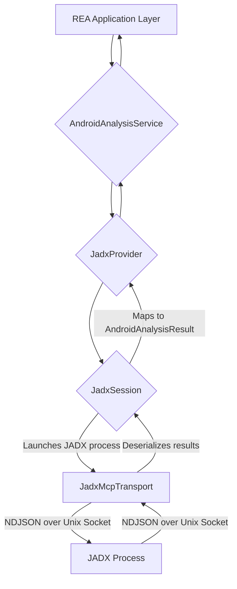

<!-- source: DeepWiki mcp.deepwiki.com · repo morluto/rea · page 4.5 Android, Firmware and IDA Providers · fetched 2026-10-09 -->

# Android, Firmware and IDA Providers

<details>
<summary>Relevant source files</summary>

The following files were used as context for generating this wiki page:

- [.github/workflows/pages.yml](.github/workflows/pages.yml)
- [docs/.vitepress/config.ts](docs/.vitepress/config.ts)
- [docs/android-analysis.md](docs/android-analysis.md)
- [docs/firmware-analysis.md](docs/firmware-analysis.md)
- [docs/index.md](docs/index.md)
- [docs/installation.md](docs/installation.md)
- [docs/roadmap.md](docs/roadmap.md)
- [docs/windows-ghidra-p0.md](docs/windows-ghidra-p0.md)
- [src/android/JadxAnalysis.ts](src/android/JadxAnalysis.ts)
- [src/android/JadxConfiguration.ts](src/android/JadxConfiguration.ts)
- [src/android/JadxMcpTransport.ts](src/android/JadxMcpTransport.ts)
- [src/android/JadxProvider.ts](src/android/JadxProvider.ts)
- [src/android/JadxRelease.ts](src/android/JadxRelease.ts)
- [src/android/JadxSession.ts](src/android/JadxSession.ts)
- [src/browser/PlaywrightScenarioActions.test.ts](src/browser/PlaywrightScenarioActions.test.ts)
- [src/cli/androidCommands.ts](src/cli/androidCommands.ts)
- [src/cli/electronCommands.ts](src/cli/electronCommands.ts)
- [src/cli/firmwareCommands.ts](src/cli/firmwareCommands.ts)
- [src/cliBrowserScenarioCommands.ts](src/cliBrowserScenarioCommands.ts)
- [src/cliJsonInput.ts](src/cliJsonInput.ts)
- [src/composition/android.ts](src/composition/android.ts)
- [src/contracts/sessionLifecycleInputs.ts](src/contracts/sessionLifecycleInputs.ts)
- [src/contracts/sessionPathInputs.test.ts](src/contracts/sessionPathInputs.test.ts)
- [src/contracts/sessionStatusContract.ts](src/contracts/sessionStatusContract.ts)
- [src/domain/android/androidApplication.ts](src/domain/android/androidApplication.ts)
- [src/domain/browserObservationSchemas.ts](src/domain/browserObservationSchemas.ts)
- [src/domain/browserSession.ts](src/domain/browserSession.ts)
- [src/domain/firmware/firmwareAnalysis.ts](src/domain/firmware/firmwareAnalysis.ts)
- [src/domain/webMcpDiscovery.ts](src/domain/webMcpDiscovery.ts)
- [src/domain/webScreenshot.ts](src/domain/webScreenshot.ts)
- [src/process/ProviderProcess.ts](src/process/ProviderProcess.ts)
- [tests/acceptance/nonBinaryComposition.test.ts](tests/acceptance/nonBinaryComposition.test.ts)
- [tests/boundary/android/jadxConfiguration.test.ts](tests/boundary/android/jadxConfiguration.test.ts)
- [tests/boundary/android/jadxIntegration.test.ts](tests/boundary/android/jadxIntegration.test.ts)
- [tests/boundary/android/jadxMcpTransport.test.ts](tests/boundary/android/jadxMcpTransport.test.ts)
- [tests/boundary/filesystem/cliJsonInput.test.ts](tests/boundary/filesystem/cliJsonInput.test.ts)
- [tests/composition/android/application.test.ts](tests/composition/android/application.test.ts)
- [tests/fixtures/android/jadx.ts](tests/fixtures/android/jadx.ts)
- [tests/fixtures/captureGhidraLaunch.cmd](tests/fixtures/captureGhidraLaunch.cmd)
- [tests/fixtures/captureGhidraLaunch.mjs](tests/fixtures/captureGhidraLaunch.mjs)

</details>


This page details the implementation of providers for Android application analysis using JADX, firmware inspection and extraction using `binwalk` and `unblob`, and the capabilities offered by the IDA Pro provider. It covers the architecture, data flow, and key components involved in integrating these tools into REA.

## Android Provider (JADX)

The Android provider leverages JADX for static analysis of Android Package Kits (APKs) and Java Archive (JAR) files. It enables inspection of package contents, class structures, and decompiled code.

### Architecture and Data Flow

The `JadxProvider` [src/android/JadxProvider.ts]() acts as the interface between REA's application layer and the JADX tool. It manages the lifecycle of JADX processes and handles communication.

1.  **Initialization**: When an Android analysis operation is requested, `AndroidAnalysisService` [src/application/android/AndroidAnalysisService.js]() creates a `JadxProvider` instance.
2.  **Session Management**: The `JadxProvider` maintains `JadxSession` [src/android/JadxSession.ts]() instances. Each session corresponds to a specific APK/JAR and JADX engine configuration. Sessions are retired if the APK bytes, JADX engine bytes, or JVM options change [tests/boundary/android/jadxIntegration.test.ts:90-121](). Idle sessions are also retired after a timeout [tests/boundary/android/jadxIntegration.test.ts:123-150]().
3.  **JADX Process Launch**: The `JadxSession` launches a JADX process using `JadxMcpTransport` [src/android/JadxMcpTransport.ts](). This transport establishes a Unix socket (or equivalent on Windows) for NDJSON communication.
4.  **Command Execution**: Analysis requests (e.g., `inspect_android_package`, `inspect_android_class`) are serialized into NDJSON and sent to the JADX process.
5.  **Result Processing**: JADX processes the command and sends back NDJSON results. `JadxMcpTransport` deserializes these results, and `JadxAnalysis` [src/android/JadxAnalysis.ts]() maps them to REA's `AndroidAnalysisResult` schema.

#### JADX Provider Data Flow

Sources:
- [src/android/JadxProvider.ts]()
- [src/application/android/AndroidAnalysisService.js]()
- [src/android/JadxSession.ts]()
- [src/android/JadxMcpTransport.ts]()
- [src/android/JadxAnalysis.ts]()
- [tests/boundary/android/jadxIntegration.test.ts:90-121]()
- [tests/boundary/android/jadxIntegration.test.ts:123-150]()

### Key Components

*   **`JadxProvider`** [src/android/JadxProvider.ts](): Manages JADX sessions, ensuring that the correct JADX engine and JVM options are used for each analysis request. It handles the creation and retirement of `JadxSession` instances.
*   **`JadxSession`** [src/android/JadxSession.ts](): Represents an active JADX analysis session for a specific Android target. It manages the underlying JADX process and its communication channel. It ensures that the JADX engine is launched with the correct JVM arguments and environment variables [tests/boundary/android/jadxIntegration.test.ts:109-118]().
*   **`JadxMcpTransport`** [src/android/JadxMcpTransport.ts](): Handles the low-level communication with the JADX process. It uses NDJSON over a Unix socket (or named pipe on Windows) for efficient message passing. It also manages the input and output streams of the JADX process.
*   **`AndroidAnalysisService`** [src/application/android/AndroidAnalysisService.js](): The application-level service that orchestrates Android analysis. It uses the `JadxProvider` to execute analysis operations and returns structured results.
*   **`JadxConfiguration`** [src/android/JadxConfiguration.ts](): Defines the configuration for launching JADX, including JVM options, JADX JAR path, and other settings. It ensures that the JADX engine is launched with appropriate memory limits and other parameters [tests/boundary/android/jadxIntegration.test.ts:64-66]().
*   **`hashAndroidFile`** [src/android/AndroidTargetSnapshot.js:8-8](): Used to compute the SHA-256 hash of Android files (APKs/JARs) to detect changes and manage session retirement.
*   **`snapshotAndroidEngine`** [src/android/AndroidTargetSnapshot.js:9-9](): Verifies the integrity of the JADX engine JAR by comparing its hash against the expected value, rejecting analysis if the bytes have changed [tests/boundary/android/jadxIntegration.test.ts:19-37]().

### CLI Commands

The Android provider exposes several CLI commands through `registerAndroidCommands` [src/cli/androidCommands.ts]():

*   `inspect-android-package`: Inspects the manifest and basic information of an APK.
*   `inspect-android-class`: Decompiles and inspects a specific class within an APK.
*   `search-android-classes`: Searches for classes matching a query within an APK. This supports case-sensitive searches [tests/boundary/android/jadxIntegration.test.ts:152-175]().

All Android CLI commands require absolute local paths for the APK/JAR files [src/contracts/sessionPathInputs.test.ts:176-183]().

## Firmware Provider

The firmware provider integrates `binwalk` and `unblob` for inspecting and extracting regions from firmware images.

### Architecture and Data Flow

The `FirmwareAnalysisService` [src/application/firmware/FirmwareAnalysisService.js]() orchestrates firmware analysis. It uses `createFirmwareAnalysisProvider` [src/composition/firmware.js]() to obtain a provider instance that wraps `binwalk` and `unblob`.

1.  **Initialization**: `FirmwareAnalysisService` is instantiated with a firmware analysis provider.
2.  **Command Execution**: When a firmware operation (e.g., `inspect_firmware_regions`, `extract_firmware`) is requested, the service executes it through the provider.
3.  **Tool Invocation**: The provider invokes `binwalk` for region inspection and `unblob` for extraction. These tools are run as external processes.
4.  **Result Processing**: The output from `binwalk` or `unblob` is parsed and mapped to REA's `FirmwareAnalysisResult` schema [src/domain/firmware/firmwareAnalysis.ts]().

#### Firmware Provider Data Flow
```mermaid
graph TD
    A[REA Application Layer] --> B{FirmwareAnalysisService};
    B --> C{FirmwareAnalysisProvider};
    C -- "Invokes binwalk/unblob" --> D[External Firmware Tools (binwalk/unblob)];
    D -- "Tool Output" --> C;
    C -- "Parses and maps results" --> B;
    B --> A;
```
Sources:
- [src/application/firmware/FirmwareAnalysisService.js]()
- [src/composition/firmware.js]()
- [src/domain/firmware/firmwareAnalysis.ts]()

### Key Components

*   **`FirmwareAnalysisService`** [src/application/firmware/FirmwareAnalysisService.js](): The application-level service for firmware analysis. It dispatches requests to the underlying provider.
*   **`createFirmwareAnalysisProvider`** [src/composition/firmware.js](): A factory function that creates the concrete firmware analysis provider, potentially configuring it based on the environment.
*   **`binwalk`**: An external tool used for identifying file signatures and extracting embedded files from firmware images.
*   **`unblob`**: An external tool used for extracting contents from various binary formats, often used in conjunction with `binwalk`.

### CLI Commands

The firmware provider exposes CLI commands through `registerFirmwareCommands` [src/cli/firmwareCommands.ts]():

*   `inspect-firmware-regions`: Inspects firmware signature candidates without performing extraction [src/cli/firmwareCommands.ts:35-45]().
*   `extract-firmware`: Extracts selected firmware bytes and returns verified files and provenance [src/cli/firmwareCommands.ts:46-100](). This command supports specifying an offset, length, maximum depth, output byte budget, and output file budget.

All firmware CLI commands require absolute local paths for the firmware image and output directory [src/contracts/sessionPathInputs.test.ts:159-183](). CLI paths are resolved against the operator's working directory before validation [src/cli/firmwareCommands.ts:42-43]().

## IDA Pro Provider

The IDA Pro provider integrates with IDA Pro for native binary analysis. While the full implementation details are not provided in the given context, the capability surface is described.

### Capability Surface

The IDA Pro provider aims to offer a similar set of analysis capabilities as the Ghidra and Hopper providers. This includes:

*   **Basic Binary Information**: Listing procedures, strings, names, and segments.
*   **Code Inspection**: Decompilation (pseudocode) and assembly views of procedures.
*   **Cross-references**: Identifying references to code and data.
*   **Symbol Management**: Reading and setting comments, managing bookmarks.
*   **Memory Access**: Reading bytes from specific addresses.

The IDA provider, like other native providers, would likely involve:

*   **`IDALauncher`**: A component responsible for launching IDA Pro in a headless or script-driven mode.
*   **Bridge Script**: A Python script (or similar) running within IDA Pro to expose its API over a communication channel (e.g., Unix socket, named pipe).
*   **`IDAClient`**: A client in REA that communicates with the IDA bridge script, sending commands and receiving results.
*   **`IDAProvider`**: The main provider class that manages IDA sessions and translates REA's analysis requests into IDA-specific commands.

The `open_binary` and `close_binary` operations, defined by `openBinaryInputSchema` [src/contracts/sessionLifecycleInputs.ts:31-40]() and `closeBinaryInputSchema` [src/contracts/sessionLifecycleInputs.ts:43-46](), would be used to manage IDA Pro analysis sessions. These schemas enforce the use of absolute local paths for binary targets and analysis snapshots [src/contracts/sessionPathInputs.test.ts:128-140]().

### Process Ownership and Security

Similar to the Ghidra provider on Windows [docs/windows-ghidra-p0.md:117-141](), the IDA provider would likely employ robust process ownership and security mechanisms:

*   **Job Objects (Windows)**: On Windows, IDA processes would be assigned to Job Objects to ensure proper cleanup and resource isolation [src/process/ProviderProcess.ts:142-163]().
*   **Protected DACLs**: Access Control Lists (DACLs) would be used to restrict access to runtime directories and communication channels.
*   **Authenticated IPC**: Communication with the IDA process would use authenticated Inter-Process Communication (IPC) to prevent unauthorized access.
*   **Snapshotting**: The binary target would be snapshotted to an immutable, private location before analysis to ensure integrity and prevent tampering during the analysis process.

### IDA Provider Capability Surface
```mermaid
graph TD
    A[REA Application Layer] --> B{IDAProvider};
    B -- "open_binary(path, provider_id)" --> C[IDALauncher];
    C -- "Launches IDA Pro" --> D[IDA Pro Process];
    D -- "IDA Bridge Script (Python)" --> E[IPC Channel (e.g., Unix Socket)];
    E -- "Commands/Results (NDJSON)" --> F[IDAClient];
    F --> B;
    B -- "list_procedures" --> F;
    B -- "procedure_pseudo_code" --> F;
    B -- "read_bytes" --> F;
    B -- "close_binary(snapshot_path)" --> F;
    F --> D;
    D -- "Terminates" --> C;
```
Sources:
- [src/contracts/sessionLifecycleInputs.ts:31-40]()
- [src/contracts/sessionLifecycleInputs.ts:43-46]()
- [src/contracts/sessionPathInputs.test.ts:128-140]()
- [docs/windows-ghidra-p0.md:117-141]()
- [src/process/ProviderProcess.ts:142-163]()

Sources:
- [src/android/JadxProvider.ts]()
- [src/application/android/AndroidAnalysisService.js]()
- [src/android/JadxSession.ts]()
- [src/android/JadxMcpTransport.ts]()
- [src/android/JadxAnalysis.ts]()
- [src/android/JadxConfiguration.ts]()
- [src/android/AndroidTargetSnapshot.js:8-8]()
- [src/android/AndroidTargetSnapshot.js:9-9]()
- [src/cli/androidCommands.ts]()
- [src/contracts/sessionPathInputs.test.ts:176-183]()
- [tests/boundary/android/jadxIntegration.test.ts:19-37]()
- [tests/boundary/android/jadxIntegration.test.ts:64-66]()
- [tests/boundary/android/jadxIntegration.test.ts:90-121]()
- [tests/boundary/android/jadxIntegration.test.ts:123-150]()
- [tests/boundary/android/jadxIntegration.test.ts:152-175]()
- [src/application/firmware/FirmwareAnalysisService.js]()
- [src/composition/firmware.js]()
- [src/domain/firmware/firmwareAnalysis.ts]()
- [src/cli/firmwareCommands.ts]()
- [src/contracts/sessionPathInputs.test.ts:159-183]()
- [src/cli/firmwareCommands.ts:42-43]()
- [src/contracts/sessionLifecycleInputs.ts:31-40]()
- [src/contracts/sessionLifecycleInputs.ts:43-46]()
- [src/contracts/sessionPathInputs.test.ts:128-140]()
- [docs/windows-ghidra-p0.md:117-141]()
- [src/process/ProviderProcess.ts:142-163]()

---

