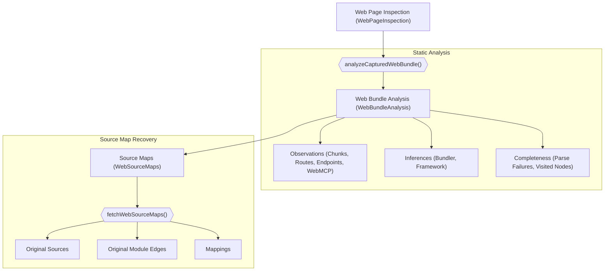
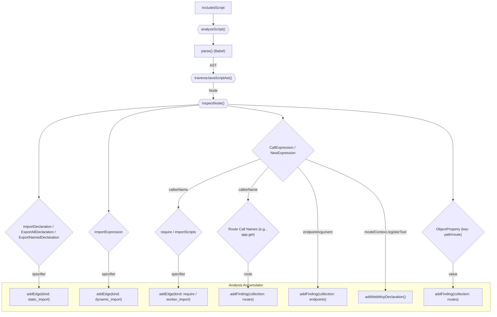

<!-- source: DeepWiki mcp.deepwiki.com · repo morluto/rea · page 6 Web, JavaScript and Runtime Observation · fetched 2026-10-09 -->

# Web, JavaScript and Runtime Observation

Relevant source files

The following files were used as context for generating this wiki page:

- [docs/browser-observation.md](docs/browser-observation.md)
- [docs/electron-observation.md](docs/electron-observation.md)
- [docs/javascript-application-graph.md](docs/javascript-application-graph.md)
- [docs/javascript-runtime-observation.md](docs/javascript-runtime-observation.md)
- [docs/javascript-runtime-reconciliation.md](docs/javascript-runtime-reconciliation.md)
- [src/browser/WebSourceMapFetcher.ts](src/browser/WebSourceMapFetcher.ts)
- [src/domain/javascript/javascriptSemanticAnalysis.ts](src/domain/javascript/javascriptSemanticAnalysis.ts)
- [src/domain/webBundleAnalyzer.test.ts](src/domain/webBundleAnalyzer.test.ts)
- [src/domain/webBundleAnalyzerAst.ts](src/domain/webBundleAnalyzerAst.ts)
- [src/domain/webBundleAnalyzerInspection.ts](src/domain/webBundleAnalyzerInspection.ts)
- [src/domain/webModuleImports.test.ts](src/domain/webModuleImports.test.ts)
- [src/domain/webModuleImports.ts](src/domain/webModuleImports.ts)
- [tests/boundary/browser/webSourceMapFetcher.test.ts](tests/boundary/browser/webSourceMapFetcher.test.ts)

This page provides a high-level overview of REA's capabilities for analyzing web applications, JavaScript code, and runtime environments. This includes observing browser behavior via the Chrome DevTools Protocol (CDP), capturing scenarios with Playwright and Electron, performing static and semantic analysis of JavaScript, and recovering source map information. These capabilities enable a comprehensive understanding of web-based applications, from their deployed bundles to their dynamic execution.

## CDP Browser Observation

REA can attach to a running Chrome-family browser using the Chrome DevTools Protocol (CDP) to passively observe web pages. This allows for the capture of various aspects of a web page, including DOM structure, accessibility nodes, scripts, network resources, storage fingerprints, and WebMCP declarations. REA's CDP integration focuses on passive observation rather than active browser automation.

For details, see [CDP Browser Observation](#6.1).

Sources:
- [docs/browser-observation.md]()

## Scenario Capture (Playwright and Electron)

Beyond passive observation, REA can actively drive browser and Electron environments to capture specific user scenarios. The `PlaywrightBrowserScenarioProvider` orchestrates browser interactions, recording events and artifacts throughout a defined scenario. For Electron applications, REA can launch and control the application, capturing IPC messages, window events, and process metrics. This provides a controlled and reproducible way to gather runtime evidence.

For details, see [Scenario Capture (Playwright and Electron)](#6.2).

Sources:
- [docs/electron-observation.md]()

## JavaScript Static and Semantic Analysis

REA provides robust capabilities for analyzing JavaScript code without execution. This includes parsing web bundles to identify module imports, routes, API endpoints, and vendor fingerprints using `analyzeCapturedWebBundle` [src/domain/webBundleAnalyzer.test.ts:5](). The system can also perform deeper semantic analysis to understand scopes, bindings, calls, and dataflow within JavaScript code using `analyzeJavaScriptSemantics` [src/domain/javascript/javascriptSemanticAnalysis.ts:67](). Furthermore, REA can trace and recover original source code from source maps, even when they are unavailable or partial [src/browser/WebSourceMapFetcher.ts:41-68]().

### JavaScript Analysis Flow

Sources:
- [src/domain/webBundleAnalyzer.test.ts:5]()
- [src/domain/webBundleAnalyzerInspection.ts:46-71]()
- [src/browser/WebSourceMapFetcher.ts:41-68]()
- [src/domain/javascript/javascriptSemanticAnalysis.ts:67]()
- [src/domain/webModuleImports.ts:9-15]()

### Web Bundle Analysis Details

The `analyzeCapturedWebBundle` function [src/domain/webBundleAnalyzer.test.ts:5]() processes `WebPageInspection` data to extract various insights. It identifies static and dynamic module imports, API endpoints, and potential application routes. It also detects WebMCP tool declarations and infers bundler or framework usage. The analysis accounts for parsing errors and reports completeness metrics, including visited AST nodes and parse failures [src/domain/webBundleAnalyzer.test.ts:71-96]().

Sources:
- [src/domain/webBundleAnalyzerInspection.ts:46-71]()
- [src/domain/webBundleAnalyzerInspection.ts:73-108]()
- [src/domain/webBundleAnalyzerInspection.ts:110-167]()
- [src/domain/webBundleAnalyzerInspection.ts:169-184]()
- [src/domain/webBundleAnalyzer.test.ts:71-96]()

For details, see [JavaScript Static and Semantic Analysis](#6.3).

## Application Workflows and Version Comparison

REA can project an application graph from collected evidence, enabling advanced workflows like tracing application features and comparing different versions of an application. This involves correlating static analysis results with runtime observations, reconstructing JavaScript artifacts, and classifying reference sources. The `reconcile_javascript_runtime` tool [docs/javascript-runtime-reconciliation.md:3]() is central to combining static JavaScript Application Graphs with runtime captures from browsers, Electron pages, or Node/Electron V8 Inspector.

For details, see [Application Workflows and Version Comparison](#6.4).

Sources:
- [docs/javascript-runtime-reconciliation.md:3]()

---

