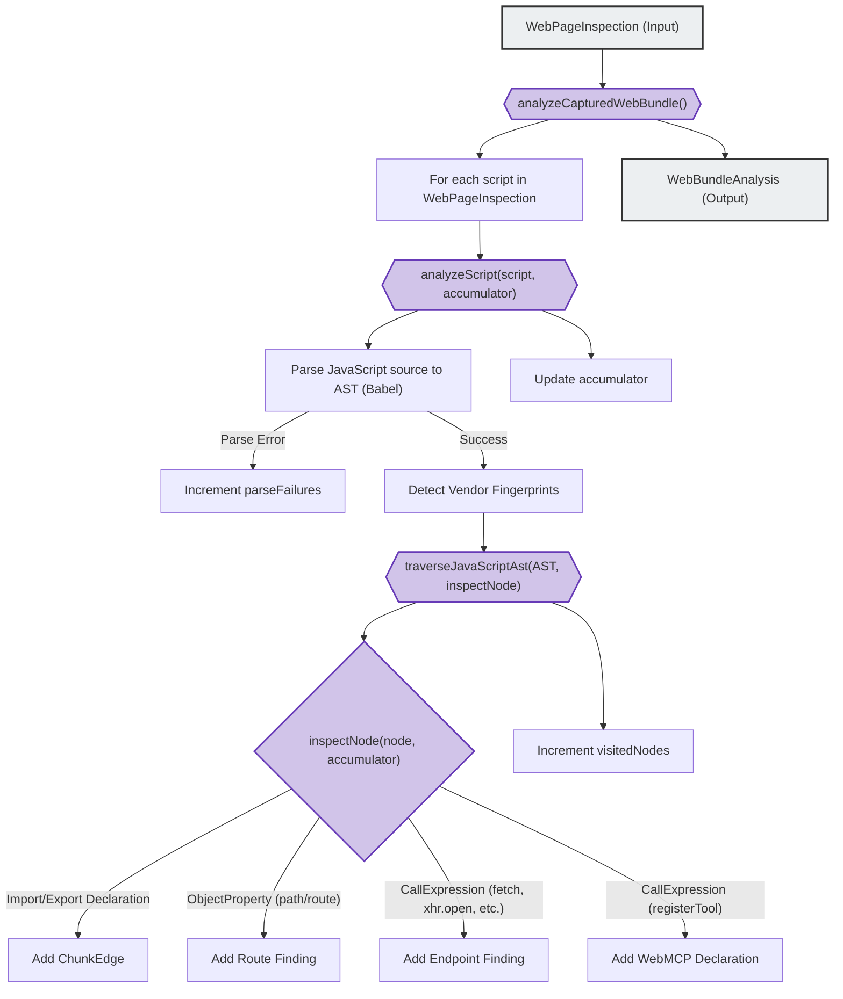
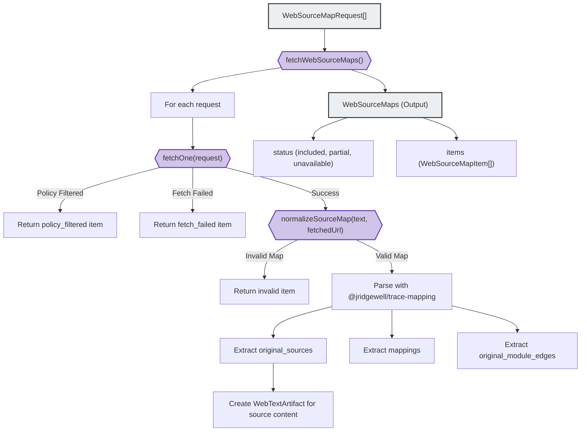

<!-- source: DeepWiki mcp.deepwiki.com · repo morluto/rea · page 6.3 JavaScript Static and Semantic Analysis · fetched 2026-10-09 -->

# JavaScript Static and Semantic Analysis

Relevant source files

The following files were used as context for generating this wiki page:

- [src/application/javascript/JavaScriptArtifactGraphFindings.ts](src/application/javascript/JavaScriptArtifactGraphFindings.ts)
- [src/application/javascript/JavaScriptArtifactPathResolution.test.ts](src/application/javascript/JavaScriptArtifactPathResolution.test.ts)
- [src/application/javascript/JavaScriptArtifactPathResolution.ts](src/application/javascript/JavaScriptArtifactPathResolution.ts)
- [src/browser/WebSourceMapFetcher.ts](src/browser/WebSourceMapFetcher.ts)
- [src/domain/javascript/electronStaticAnalysisNative.ts](src/domain/javascript/electronStaticAnalysisNative.ts)
- [src/domain/javascript/javascriptAstFingerprint.ts](src/domain/javascript/javascriptAstFingerprint.ts)
- [src/domain/javascript/javascriptSemanticAnalysis.dataflow.test.ts](src/domain/javascript/javascriptSemanticAnalysis.dataflow.test.ts)
- [src/domain/javascript/javascriptSemanticAnalysis.member_depth.test.ts](src/domain/javascript/javascriptSemanticAnalysis.member_depth.test.ts)
- [src/domain/javascript/javascriptSemanticAnalysis.recoveredArguments.test.ts](src/domain/javascript/javascriptSemanticAnalysis.recoveredArguments.test.ts)
- [src/domain/javascript/javascriptSemanticAnalysis.rejection.test.ts](src/domain/javascript/javascriptSemanticAnalysis.rejection.test.ts)
- [src/domain/javascript/javascriptSemanticAnalysis.ts](src/domain/javascript/javascriptSemanticAnalysis.ts)
- [src/domain/javascript/javascriptSemanticCalls.ts](src/domain/javascript/javascriptSemanticCalls.ts)
- [src/domain/javascript/javascriptSemanticMemberMutations.ts](src/domain/javascript/javascriptSemanticMemberMutations.ts)
- [src/domain/javascript/javascriptSemanticProjection.ts](src/domain/javascript/javascriptSemanticProjection.ts)
- [src/domain/javascript/javascriptSemanticRequireOrigin.ts](src/domain/javascript/javascriptSemanticRequireOrigin.ts)
- [src/domain/javascript/javascriptSemanticTraversal.test.ts](src/domain/javascript/javascriptSemanticTraversal.test.ts)
- [src/domain/javascript/javascriptSemanticTraversal.ts](src/domain/javascript/javascriptSemanticTraversal.ts)
- [src/domain/javascript/javascriptSemanticValues.ts](src/domain/javascript/javascriptSemanticValues.ts)
- [src/domain/javascript/javascriptStaticAnalysis.member_path_depth.test.ts](src/domain/javascript/javascriptStaticAnalysis.member_path_depth.test.ts)
- [src/domain/javascript/javascriptStaticAnalysis.ts](src/domain/javascript/javascriptStaticAnalysis.ts)
- [src/domain/javascript/javascriptStaticAnalysisBundler.ts](src/domain/javascript/javascriptStaticAnalysisBundler.ts)
- [src/domain/javascript/javascriptStaticAnalysisHelpers.ts](src/domain/javascript/javascriptStaticAnalysisHelpers.ts)
- [src/domain/webBundleAnalyzer.test.ts](src/domain/webBundleAnalyzer.test.ts)
- [src/domain/webBundleAnalyzerAst.ts](src/domain/webBundleAnalyzerAst.ts)
- [src/domain/webBundleAnalyzerInspection.ts](src/domain/webBundleAnalyzerInspection.ts)
- [src/domain/webModuleImports.test.ts](src/domain/webModuleImports.test.ts)
- [src/domain/webModuleImports.ts](src/domain/webModuleImports.ts)
- [src/javascript/sourceMaps/TraceSourceMap.test.ts](src/javascript/sourceMaps/TraceSourceMap.test.ts)
- [src/javascript/sourceMaps/TraceSourceMap.ts](src/javascript/sourceMaps/TraceSourceMap.ts)
- [tests/boundary/browser/webSourceMapFetcher.test.ts](tests/boundary/browser/webSourceMapFetcher.test.ts)
- [tests/boundary/filesystem/javascriptSourceMapLocations.test.ts](tests/boundary/filesystem/javascriptSourceMapLocations.test.ts)

This page details REA's capabilities for static and semantic analysis of JavaScript code, focusing on web bundles. It covers Abstract Syntax Tree (AST) inspection, module import analysis, construction of a JavaScript semantic Intermediate Representation (IR), AST fingerprinting, bundler-specific adaptations, and source map tracing and recovery.

## Web Bundle Analyzer AST Inspection

The web bundle analyzer processes JavaScript code extracted from web pages to identify key characteristics such as module dependencies, API endpoints, routing information, and WebMCP (Web Model Context Protocol) declarations. This analysis is performed by traversing the AST of each JavaScript script.

The core logic resides in `analyzeCapturedWebBundle` [src/domain/webBundleAnalyzer.js:5-5](), which orchestrates the analysis of a `WebPageInspection` object. For each included script, `analyzeScript` [src/domain/webBundleAnalyzerInspection.ts:46-71]() is called. This function first attempts to parse the script's source code into an AST using `@babel/parser` [src/domain/webBundleAnalyzerInspection.ts:52-56](). If parsing fails, it increments `parseFailures` [src/domain/webBundleAnalyzerInspection.ts:60]() and skips further analysis for that script.

After successful parsing, `detectVendorFingerprints` [src/domain/webBundleAnalyzerInspection.ts:64]() is called to identify common JavaScript frameworks or bundlers. Then, `traverseJavaScriptAst` [src/domain/javascript/javascriptSemanticTraversal.ts:13-44]() is used to walk the AST, calling `inspectNode` [src/domain/webBundleAnalyzerInspection.ts:68]() for each node.

The `inspectNode` function [src/domain/webBundleAnalyzerInspection.ts:73-108]() identifies various patterns:
*   **Module Imports/Exports**: `ImportDeclaration`, `ExportAllDeclaration`, `ExportNamedDeclaration` [src/domain/webBundleAnalyzerInspection.ts:78-96]() and `ImportExpression` [src/domain/webBundleAnalyzerInspection.ts:97-104]() are analyzed to extract module specifiers and their types (static, dynamic).
*   **Routes**: `ObjectProperty` nodes are inspected for keys like `"path"` or `"route"` [src/domain/webBundleAnalyzerInspection.ts:170-184]().
*   **API Endpoints**: `CallExpression` and `NewExpression` nodes are analyzed to detect calls to `fetch`, `XMLHttpRequest.open`, `axios`, etc., extracting the endpoint URLs [src/domain/webBundleAnalyzerInspection.ts:152-161]().
*   **WebMCP Declarations**: Calls to `document.modelContext.registerTool` are identified to extract WebMCP tool definitions [src/domain/webBundleAnalyzerInspection.ts:162-166]().

All identified observations are accumulated in an `AnalysisAccumulator` [src/domain/webBundleAnalyzerInspection.ts:34-44]().

**Diagram: Web Bundle Analysis Data Flow**

Sources:
*   [src/domain/webBundleAnalyzer.test.ts:11-69]()
*   [src/domain/webBundleAnalyzer.js:5-5]()
*   [src/domain/webBundleAnalyzerInspection.ts:34-44]()
*   [src/domain/webBundleAnalyzerInspection.ts:46-71]()
*   [src/domain/webBundleAnalyzerInspection.ts:73-108]()
*   [src/domain/webBundleAnalyzerInspection.ts:152-161]()
*   [src/domain/webBundleAnalyzerInspection.ts:162-166]()
*   [src/domain/webBundleAnalyzerInspection.ts:170-184]()
*   [src/domain/javascript/javascriptSemanticTraversal.ts:13-44]()

## Module Imports

The analysis of module imports is a crucial part of understanding the structure of web bundles. The `webBundleAnalyzer` identifies various types of module dependencies:

*   **Static Imports**: `import ... from "specifier"` and `export ... from "specifier"` statements are captured as `static_import` edges [src/domain/webBundleAnalyzerInspection.ts:78-96]().
*   **Dynamic Imports**: `import("specifier")` expressions are captured as `dynamic_import` edges [src/domain/webBundleAnalyzerInspection.ts:97-104]().
*   **CommonJS `require`**: Calls to `require("specifier")` are captured as `require` edges [src/domain/webBundleAnalyzerInspection.ts:117-124]().
*   **Worker Imports**: Calls to `importScripts("specifier")` (used in Web Workers) are captured as `worker_import` edges [src/domain/webBundleAnalyzerInspection.ts:125-130]().

For each edge, the `specifier` is recorded, and if it's a URL-like specifier or a worker import, `resolveSpecifier` [src/domain/webBundleAnalyzerAst.ts:41-55]() attempts to resolve it against the script's base URL to provide a `resolved_url` [src/domain/webBundleAnalyzerInspection.ts:201-205]().

The `isUrlLikeModuleSpecifier` function [src/domain/webBundleAnalyzerAst.ts:35-39]() determines if a specifier looks like a URL (e.g., starts with `/`, `./`, `../`, or a protocol).

Sources:
*   [src/domain/webBundleAnalyzer.test.ts:33-44]()
*   [src/domain/webBundleAnalyzerAst.ts:35-39]()
*   [src/domain/webBundleAnalyzerAst.ts:41-55]()
*   [src/domain/webBundleAnalyzerInspection.ts:78-96]()
*   [src/domain/webBundleAnalyzerInspection.ts:97-104]()
*   [src/domain/webBundleAnalyzerInspection.ts:117-124]()
*   [src/domain/webBundleAnalyzerInspection.ts:125-130]()
*   [src/domain/webBundleAnalyzerInspection.ts:201-205]()

## JavaScript Semantic IR (Scopes, Bindings, Calls, Dataflow)

REA constructs a detailed JavaScript Semantic Intermediate Representation (IR) to capture the deeper meaning of the code beyond its syntax. This IR includes information about scopes, bindings, call sites, and data flow. The primary function for this is `analyzeJavaScriptSemantics` [src/domain/javascript/javascriptSemanticAnalysis.ts:10-10]().

### Scopes and Bindings

The semantic analysis identifies lexical scopes and the bindings (variables, functions, classes) declared within them.
*   `collectSemanticCallable` [src/domain/javascript/javascriptSemanticProjection.ts:39-63]() identifies functions, classes, and methods, assigning them unique `callableId`s and linking them to their containing and body scopes.
*   `immutableSemanticScopes` [src/domain/javascript/javascriptSemanticProjection.ts:153-165]() converts the mutable scope state into an immutable representation, including `scopeId`, `parentScopeId`, `kind`, `location`, and `bindingIds`.
*   `immutableSemanticBindings` [src/domain/javascript/javascriptSemanticProjection.ts:168-182]() evaluates and freezes bindings, capturing `bindingId`, `scopeId`, `name`, `kind`, `mutable` status, `definitions`, `value` (literal, object, unknown), and `provenance`.

### Calls and Dataflow

The analysis also tracks function calls and the flow of data.
*   `collectJavaScriptSemanticCalls` [src/domain/javascript/javascriptSemanticCalls.ts:64-124]() is responsible for recovering direct-call and lexical-capture candidates. It populates:
    *   `callSites`: Details about each function call or constructor invocation, including `callSiteId`, `kind` (call/construct), `callerCallableId`, `location`, `calleeCallableIds` (resolved targets), and `arguments`.
    *   `argumentFlows`: Tracks the flow of values from call arguments to function parameters.
    *   `callReturnFlows`: Tracks values returned from function calls.
    *   `callResultFlows`: Links the result of a call to the binding it's assigned to.
    *   `closureCaptures`: Identifies variables captured by closures.
    *   `frontiers`: Marks points where static analysis cannot fully resolve a call or data flow (e.g., dynamic property access, dynamic scope).
*   `collectCallSite` [src/domain/javascript/javascriptSemanticCalls.ts:127-174]() resolves the target callable(s) for a given call expression using `resolveLocalCallables` [src/domain/javascript/javascriptSemanticCallResolution.js:30-30]().
*   `collectCallResultFlow` [src/domain/javascript/javascriptSemanticCalls.ts:176-192]() identifies direct assignments of call results to variables.
*   `collectSemanticReferences` [src/domain/javascript/javascriptSemanticProjection.ts:96-150]() identifies all lexical references to identifiers, their `role` (read/write), and their `resolution` status (resolved, unbound, unknown).

```mermaid
graph TD
    A["JavaScript Source Code"] --> B{{"analyzeJavaScriptSemantics()"}};
    B --> C["Parse to AST"];
    C --> D{{"collectSemanticCallable()"}};
    C --> E{{"collectSemanticModuleLink()"}};
    C --> F{{"collectJavaScriptSemanticCalls()"}};
    C --> G{{"collectSemanticReferences()"}};
    D --> D1["Identify Functions, Classes, Methods"];
    D1 --> D2["Assign callableId, link to scopes"];
    E --> E1["Identify Import/Export relationships"];
    F --> F1["Identify Call Sites"];
    F1 --> F2["Resolve Call Targets"];
    F1 --> F3["Track Argument Flow"];
    F1 --> F4["Track Return Flow"];
    F1 --> F5["Track Call Result Flow"];
    F1 --> F6["Identify Closure Captures"];
    F1 --> F7["Identify Frontiers (dynamic calls, etc.)"];
    G --> G1["Identify Identifier References"];
    G1 --> G2["Determine Reference Role (read/write)"];
    G1 --> G3["Resolve Reference to Binding"];
    B --> H["JavaScript Semantic IR"];
    H --> H1["Scopes (immutableSemanticScopes)"];
    H --> H2["Bindings (immutableSemanticBindings)"];
    H --> H3["Callables"];
    H --> H4["Call Sites"];
    H --> H5["Data Flows (Argument, Return, Result)"];
    H --> H6["Closure Captures"];
    H --> H7["Frontiers"];
    H --> H8["Module Links"];
    H --> H9["References"];

    style A fill:#ECEFF1,stroke:#333,stroke-width:2px
    style B fill:#D1C4E9,stroke:#673AB7,stroke-width:2px
    style H fill:#ECEFF1,stroke:#333,stroke-width:2px
```

**Diagram: JavaScript Semantic Analysis Process**

Sources:
*   [src/domain/javascript/javascriptSemanticAnalysis.dataflow.test.ts:106-106]()
*   [src/domain/javascript/javascriptSemanticAnalysis.ts:10-10]()
*   [src/domain/javascript/javascriptSemanticCalls.ts:64-124]()
*   [src/domain/javascript/javascriptSemanticCalls.ts:127-174]()
*   [src/domain/javascript/javascriptSemanticCalls.ts:176-192]()
*   [src/domain/javascript/javascriptSemanticProjection.ts:39-63]()
*   [src/domain/javascript/javascriptSemanticProjection.ts:96-150]()
*   [src/domain/javascript/javascriptSemanticProjection.ts:153-165]()
*   [src/domain/javascript/javascriptSemanticProjection.ts:168-182]()
*   [src/domain/javascript/javascriptSemanticCallResolution.js:30-30]()

## AST Fingerprints

AST fingerprinting provides a rename-resistant way to identify code patterns without executing the code. The `fingerprintJavaScriptAst` function [src/domain/javascript/javascriptAstFingerprint.ts:17-26]() generates a SHA-256 hash of a canonical representation of the AST.

The process involves:
1.  Traversing the AST using `traverseJavaScriptAst` [src/domain/javascript/javascriptSemanticTraversal.js:13-44]().
2.  For each node, `semanticTokens` [src/domain/javascript/javascriptAstFingerprint.ts:44-65]() extracts a list of semantic tokens. These tokens include the node type, literal values (strings, numbers, booleans, regexps), operators, and property names (for member expressions and object properties).
3.  The collected tokens are then JSON-stringified and hashed using SHA-256.

This fingerprint can be used for various purposes, such as detecting code reuse, identifying known library functions, or tracking changes across different versions of a codebase.

Additionally, `collectJavaScriptExports` [src/domain/javascript/javascriptAstFingerprint.ts:29-41]() analyzes an AST node to find statically declared CommonJS/bundler export names. This is useful for understanding the public interface of a module.

Sources:
*   [src/domain/javascript/javascriptAstFingerprint.ts:17-26]()
*   [src/domain/javascript/javascriptAstFingerprint.ts:29-41]()
*   [src/domain/javascript/javascriptAstFingerprint.ts:44-65]()
*   [src/domain/javascript/javascriptSemanticTraversal.js:13-44]()

## Bundler Adapters

REA includes specific logic to understand and extract information from common JavaScript bundler outputs. This is primarily handled within the static analysis phase.

The `javascriptStaticAnalysisBundler.ts` module contains functions to recognize and parse bundler-specific structures. For example, `chunkRuntime` [src/domain/javascript/javascriptStaticAnalysisHelpers.ts:61-73]() identifies the runtime variable used by Webpack or Rspack for their chunk push operations. `moduleFactory` [src/domain/javascript/javascriptStaticAnalysisHelpers.ts:111-127]() extracts module factory functions from bundler-generated module tables.

These adaptations allow REA to:
*   Identify individual modules within a bundled file.
*   Extract module IDs and their corresponding factory functions.
*   Understand the module graph constructed by the bundler.
*   Recognize bundler-specific `require` calls.

This enables a more granular analysis of bundled applications, treating individual modules as distinct units rather than a single monolithic script.

Sources:
*   [src/domain/javascript/javascriptStaticAnalysisBundler.ts]()
*   [src/domain/javascript/javascriptStaticAnalysisHelpers.ts:61-73]()
*   [src/domain/javascript/javascriptStaticAnalysisHelpers.ts:111-127]()

## Source Map Tracing and Recovery (Wakaru)

Source maps are critical for understanding minified or transpiled JavaScript code by mapping it back to its original source. REA provides robust capabilities for fetching, validating, and utilizing source maps.

The `WebSourceMapFetcher.ts` module is responsible for this process.
*   `fetchWebSourceMaps` [src/browser/WebSourceMapFetcher.ts:40-69]() orchestrates the fetching of multiple source maps. It takes a list of `WebSourceMapRequest` objects, each containing `scriptKey`, `declaredUrl`, and `fetchUrl`.
*   For each request, `fetchOne` [src/browser/WebSourceMapFetcher.ts:71-114]() attempts to fetch the source map. It includes origin policy checks using `approvedUrl` [src/browser/WebSourceMapFetcher.ts:77-77]() and `fetchFollowingApprovedRedirects` [src/browser/WebSourceMapFetcher.ts:116-145]() to ensure only approved URLs are accessed and redirects stay within allowed origins.
*   After fetching, `normalizeSourceMap` [src/browser/WebSourceMapFetcher.ts:147-200]() validates the source map content using `validSourceMapEnvelope` [src/browser/WebSourceMapFetcher.ts:153-153]() and `isVersion3Map` [src/domain/sourceMapEnvelope.js:21-21](). It then uses `@jridgewell/trace-mapping` to parse the map and extract:
    *   `original_sources`: A list of original source files, potentially including their content as artifacts [src/browser/WebSourceMapFetcher.ts:161-173]().
    *   `mappings`: Detailed mappings between generated and original code locations [src/browser/WebSourceMapFetcher.ts:174-192]().
    *   `original_module_edges`: Module dependencies inferred from the original sources [src/browser/WebSourceMapFetcher.ts:193-193]().

The `TraceSourceMap` module [src/javascript/sourceMaps/TraceSourceMap.ts]() provides utilities for using these parsed source maps to trace locations from generated code back to original source code. This is crucial for presenting analysis results in the context of the developer's original source files.

The `reconstructJavaScriptArtifact` function [src/application/javascript/JavaScriptArtifactReconstruction.js:7-7]() (tested in `javascriptSourceMapLocations.test.ts`) leverages source map information to reconstruct a more complete view of the JavaScript artifact graph, including resolving paths to source map files and worker scripts.

**Diagram: Web Source Map Fetching and Normalization**

Sources:
*   [src/browser/WebSourceMapFetcher.ts:40-69]()
*   [src/browser/WebSourceMapFetcher.ts:71-114]()
*   [src/browser/WebSourceMapFetcher.ts:116-145]()
*   [src/browser/WebSourceMapFetcher.ts:147-200]()
*   [src/domain/sourceMapEnvelope.js:21-21]()
*   [src/javascript/sourceMaps/TraceSourceMap.ts]()
*   [src/application/javascript/JavaScriptArtifactReconstruction.js:7-7]()
*   [tests/boundary/filesystem/javascriptSourceMapLocations.test.ts:10-43]()
*   [tests/boundary/browser/webSourceMapFetcher.test.ts:103-169]()

---

