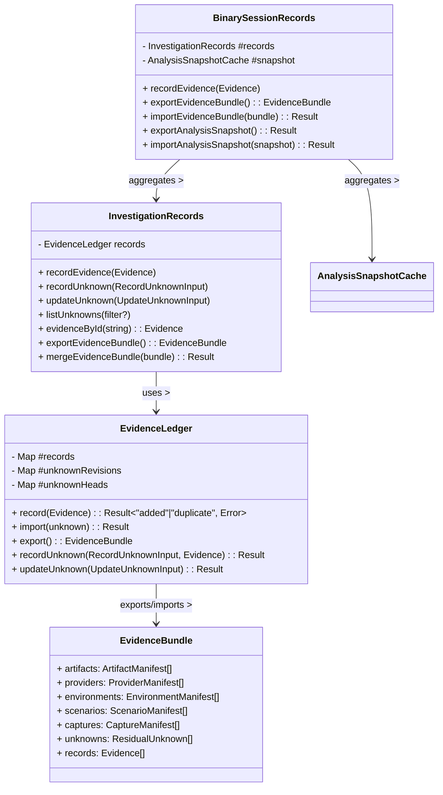
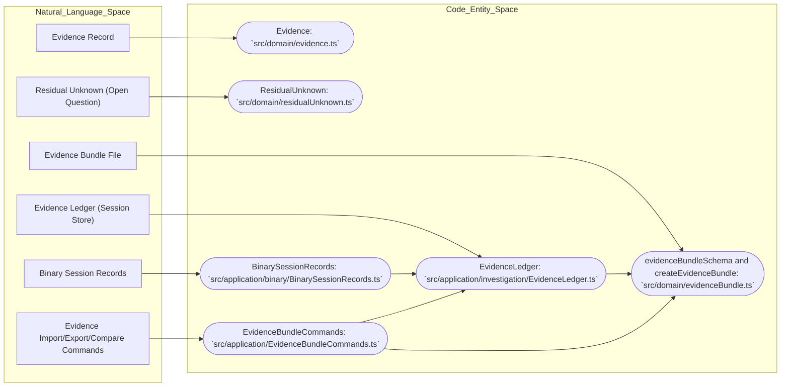

<!-- source: DeepWiki mcp.deepwiki.com · repo morluto/rea · page 7.1 Evidence Model and Ledger · fetched 2026-10-09 -->

# Evidence Model and Ledger

Relevant source files

The following files were used as context for generating this wiki page:

- [src/application/ArtifactInventory/classify.ts](src/application/ArtifactInventory/classify.ts)
- [src/application/ArtifactInventory/reader.ts](src/application/ArtifactInventory/reader.ts)
- [src/application/EvidenceBundleCommands.ts](src/application/EvidenceBundleCommands.ts)
- [src/application/EvidenceInputResolver.test.ts](src/application/EvidenceInputResolver.test.ts)
- [src/application/binary/BinarySessionRecords.ts](src/application/binary/BinarySessionRecords.ts)
- [src/application/investigation/EvidenceLedger.residualUnknown.test.ts](src/application/investigation/EvidenceLedger.residualUnknown.test.ts)
- [src/application/investigation/EvidenceLedger.test.ts](src/application/investigation/EvidenceLedger.test.ts)
- [src/application/investigation/EvidenceLedger.ts](src/application/investigation/EvidenceLedger.ts)
- [src/application/investigation/InvestigationRecords.test.ts](src/application/investigation/InvestigationRecords.test.ts)
- [src/application/investigation/InvestigationRecords.ts](src/application/investigation/InvestigationRecords.ts)
- [src/application/investigation/UnknownEvidence.ts](src/application/investigation/UnknownEvidence.ts)
- [src/contracts/toolOutputSchemaPrimitives.ts](src/contracts/toolOutputSchemaPrimitives.ts)
- [src/domain/analysisSnapshot.ts](src/domain/analysisSnapshot.ts)
- [src/domain/artifactGraph.ts](src/domain/artifactGraph.ts)
- [src/domain/evidence.ts](src/domain/evidence.ts)
- [src/domain/evidenceBundle.test.ts](src/domain/evidenceBundle.test.ts)
- [src/domain/evidenceBundle.ts](src/domain/evidenceBundle.ts)
- [tests/composition/analysis-sessions/binarySession.test.ts](tests/composition/analysis-sessions/binarySession.test.ts)

This page documents the **Evidence Model and Ledger** subsystem of REA (Reverse Engineer Anything). It covers the **evidence schema and provenance**, the **ledgers managing evidence and unknowns**, **investigation records**, **handling of unknown evidence**, **evidence bundle files**, and the **import/export/compare workflow for evidence bundles**. The intent is to explain how evidence is modeled, structured, and managed, including data flows and relevant classes and functions.

---

## 7.1.1 Evidence Model: Schema and Semantics

### Purpose and Overview

In REA, *Evidence* represents an immutable record of a public observation or assertion about an artifact or binary target, produced by an analysis provider. Such observations can cover a broad range of information—from static binary analysis results to runtime or provenance data.

Evidence records are strict, provider-neutral JSON envelopes with standardized fields and semantic identification. They include:

- **Static metadata**: provider identity, artifact subject, predicate, source environment.
- **Observation results**: raw and normalized results of an operation, parameters used.
- **Provenance and confidence**: authority, confidence level, limitations.
- **Source location(s)**: optional references to addresses, file offsets, or paths.
- **Cross-references**: links to related evidence by ID.

### Core Evidence Schema

Implemented in `src/domain/evidence.ts`, the core schema uses [zod](https://github.com/colinhacks/zod) for validation. Primary schemas include:

- **providerSchema**: identity of the analysis provider with ID, name, and version.
- **subjectSchema**: the artifact subject, including digest (sha256), format, architecture, and local path.
- **evidenceLocationSchema**: discriminated union type specifying locations of evidence within artifacts.
- **evidenceAuthoritySchema**: enumerates levels of trust (e.g., shipped artifact, controlled replay, analyst inference).
- **executionEnvironmentSchema**: the environment where observation was made (platform, isolation level).

The **evidenceBaseSchema** (lines 85-102) defines fields such as:

- `evidence_id`: a deterministic prefixed sha256 digest identifying the evidence record.
- `subject`: nullable artifact subject.
- `provider`: provider identity.
- `predicate_type`: string identifier describing the kind of observation.
- `operation`: name of producing operation.
- `parameters`: operation inputs.
- `raw_result` and `normalized_result`: JSON values representing the observation output.
- `confidence` and `authority`: subjective confidence and authority of the evidence.
- `limitations`: array of strings describing known limits of the evidence.
- `locations`: zero or more locations tied to the evidence.
- `evidence_links`: cross-reference evidence IDs.

These schemas ensure that evidence can be serialized, validated, and compared consistently.

### Evidence Identity and Projection

Each evidence’s **semantic identity** (its `evidence_id`) is a cryptographic digest derived from the normalized projection of its immutable components, including provider, subject digest, operation, parameters, and results. This makes the `evidence_id` a content-addressed reference for deduplication.

The function `parseEvidence()` (in `src/domain/evidence.ts`) parses and validates an Evidence record and enforces identity consistency via semantic projection.

---

## 7.1.2 Residual Unknowns: Handling Incomplete Knowledge

REA supports the notion of *Residual Unknowns*, which represent open questions or unknown facts in the investigation. These unknowns can evolve over time and are linked to evidence via *mutation evidence* records tracking their state history.

The `ResidualUnknown` domain entity is implemented in `src/domain/residualUnknown.ts` and includes:

- `unknown_id`: stable unique ID derived cryptographically from the unknown’s question and context.
- `revision`: a positive integer representing the version of a particular unknown.
- `status`: enumeration tracking investigation progress (e.g., open, investigating, resolved).
- Lists of supporting, contradicting, and mutation evidence IDs that provide or challenge the unknown.
- Relationships linking unknowns transitively (e.g., depends-on).

This design enables provenance of evolving hypotheses during analysis.

---

## 7.1.3 Evidence Bundles: Grouping and Canonicalization

### Structure

The *EvidenceBundle* aggregates arrays of:

- `artifacts`: immutable manifests of artifacts referenced by evidence.
- `providers`: identities of providers for the included evidence.
- `environments`: execution environments cited.
- `scenarios`: controlled replay scenarios (special authority).
- `captures`: process captures.
- `unknowns`: the set of residual unknowns.
- `records`: the main evidence records.

This structure is defined and validated by the `evidenceBundleSchema` in `src/domain/evidenceBundle.ts`.

### Creation and Projection

The function `createEvidenceBundle(records, unknowns)` produces a deterministic canonical form:

- Records are sorted by evidence ID.
- Artifacts, providers, and environments are de-duplicated and sorted.
- Unknowns are sorted by their IDs and revisions.

There is also `evidenceBundleForTarget(bundle, sha256)` to restrict a bundle to a specific artifact identified by sha256. It preserves comprehensive unknown histories rooted in that artifact.

### Validation

`parseEvidenceBundle(input)` parses and validates bundles, enforcing:

- No duplicate evidence IDs.
- Consistent unknown graphs (resolving dependencies and mutation evidence).
- Canonical JSON ordering to guarantee semantic integrity.

---

## 7.1.4 EvidenceLedger: Managing Records and Unknowns

### Overview

`EvidenceLedger` (class in `src/application/investigation/EvidenceLedger.ts`) manages a **session-owned, in-memory set of immutable evidence records and unknown revisions**.

Key responsibilities:

- **Idempotent recording of evidence:** Rejects conflicting records with the same evidence ID.
- **Atomic import of evidence bundles:** Validates and merges records and unknowns, rejecting partial or conflicting merges.
- **Unknown registry handling:** Manages the residual unknowns, their revisions and dependencies.
- **Consistency and integrity enforcement:** Uses cryptographic canonicalization to detect conflicts.

### Data Structures

- `#records = Map<string, Evidence>`: maps evidence_id to Evidence.
- `#unknownRevisions = Map<string, ResidualUnknown>`: tracks revisions by stable keys.
- `#unknownHeads = Map<string, ResidualUnknown>`: tracks current "head" unknown per unknown_id.

### Core Functions

- `record(input: Evidence)`: Adds a single evidence record, returning `"added"` or `"duplicate"`, or error on conflict.
- `import(input: unknown)`: Imports a full evidence bundle atomically, validating conflicts and unknown revisions. Returns metadata about records and unknowns added, and if metadata has changed requiring invalidation or update.
- `export()`: Exports current ledger state as an `EvidenceBundle` object.
- `get(evidenceId)`, `has(evidenceId)`: Queries evidence presence and retrieves detached copies.
- `recordUnknown(input: RecordUnknownInput, mutationEvidence: Evidence)`: Atomically creates a new residual unknown with linked mutation evidence.
- `updateUnknown(input: UpdateUnknownInput)`: Updates existing unknown metadata and verifies revisions.
- `listUnknowns(filter?)`: Lists unknowns optionally filtered by status or severity.
- `verifyUnknownResolution(unknownId)`: Validates the resolution of an unknown against criteria.

Internally, ledger uses consistent canonicalization via `canonicalize()` to compare evidence records and robust validation to guard from corruption.

---

## 7.1.5 Investigation Records

Investigation records wrap the EvidenceLedger and extend it to the binary session domain (`src/application/investigation/InvestigationRecords.ts`). They provide:

- Immutable detached reads and defensively copied storage.
- Preserving explicit unknown subjects and mutations.
- Rollback support if linked unknown validation fails.
- Optimistic concurrency control over unknowns via revision semantics.
- Support for external bundles merge and change detection.

Code tests demonstrate:

- Deduplication of evidence records.
- Updates and validation of unknowns.
- Importing and merging bundles with unknown-only or mixed content.
- Handling of revision conflicts and optimistic updates.

---

## 7.1.6 BinarySessionRecords and Session Integration

`BinarySessionRecords` (abstract class in `src/application/binary/BinarySessionRecords.ts`) acts as a compatibility facade combining:

- `InvestigationRecords` (evidence ledger and unknown store).
- `AnalysisSnapshotCache` (caching higher-level analysis snapshots).

It handles:

- Recording and querying evidence during sessions.
- Atomic import and export of evidence bundles and snapshots.
- Emitting change notifications on updates.
- Isolating snapshots per active binary target and analysis profile.

This ties the evidence provenance to a concrete binary session lifecycle.

---

## 7.1.7 Evidence Bundle File Handling and Commands

REA supports importing, exporting, and comparing evidence bundles via async commands wrapping ledger and file I/O:

- `importEvidenceBundleCommand(path)`: reads a JSON evidence bundle file, validates it, and merges it into a new ledger instance, returning import statistics.
- `exportEvidenceBundleCommand(sourcePath, outputPath, overwrite)`: reads a source bundle, validates it, and serializes it canonically to a specified output path.
- `compareEvidenceBundlesCommand({ leftPath, rightPath })`: reads and validates two bundles, then compares them semantically, returning a JSON diff result.

These commands use `readEvidenceBundle` and `writeEvidenceBundle` utilities to parse and serialize canonical JSON data and guard integrity.

---

## 7.1.8 Data Flow and Class Interaction Diagram

**Diagram explanation:**  
- `EvidenceLedger` is the core store of immutable evidence records and unknown revisions.  
- `InvestigationRecords` orchestrates ledger access and provides additional semantics.  
- `BinarySessionRecords` bridges evidence management with active analysis snapshots for session management.  
- Evidence bundles aggregate various manifests, unknowns, and evidence records for persistence and interchange.

Sources:  
`src/application/investigation/EvidenceLedger.ts:36-186`  
`src/application/investigation/InvestigationRecords.ts:30-155`  
`src/application/binary/BinarySessionRecords.ts:30-197`  
`src/domain/evidenceBundle.ts:1-201`  

---

## 7.1.9 Bridging Evidence Concepts to Code Entities

**Diagram explanation:**  
- Natural language concepts align directly to domain or application classes and modules.  
- Evidence and unknowns are defined as domain schemas (`evidence.ts`, `residualUnknown.ts`).  
- Bundling and canonicalization live in `evidenceBundle.ts`.  
- Session ledger is implemented by `EvidenceLedger.ts`.  
- The session's combined record management is `BinarySessionRecords.ts`.  
- File I/O commands are exposed via `EvidenceBundleCommands.ts`.

Sources:  
`src/domain/evidence.ts`  
`src/domain/residualUnknown.ts`  
`src/domain/evidenceBundle.ts`  
`src/application/investigation/EvidenceLedger.ts`  
`src/application/binary/BinarySessionRecords.ts`  
`src/application/EvidenceBundleCommands.ts`  

---

## 7.1.10 Limitations and Provenance Considerations

- Evidence is **immutable** once recorded, enforcing content-addressed reproducibility.
- Conflicting records with the same ID are rejected to preserve consistency.
- Unknowns require tracking mutation evidence to evolve states safely.
- Bundles are validated in entirety before import to preserve ledger atomicity.
- Artifacts and providers are stored as detached manifests to minimize state bloat.
- Evidence relies on canonical JSON serialization (`canonicalize`) for identity.
- Current implementation does not support live editing of evidence; instead, new revisions and updates create new evidence with new IDs and revision tracking.
- Provenance is preserved by linking evidence to provider info, environment, and known limitations.

---

## 7.1.11 Summary

The **Evidence Model and Ledger** subsystem in REA offers a rigorous and immutable representation of analysis observations, tied cryptographically by semantic IDs. Its integration with residual unknowns supports managing questions and hypotheses in a controlled manner. The `EvidenceLedger` class manages the integrity and merging of these records within analysis sessions, supported by canonical bundling as JSON files for import, export, and comparison. The design ensures reproducibility and auditability in complex reverse engineering workflows.

---

# References and Sources

- `src/domain/evidence.ts:1-206`  
- `src/domain/evidenceBundle.ts:1-201`  
- `src/domain/residualUnknown.ts` (implied from usage, not shown)  
- `src/application/investigation/EvidenceLedger.ts:1-186`  
- `src/application/investigation/InvestigationRecords.ts:1-155`  
- `src/application/binary/BinarySessionRecords.ts:1-197`  
- `src/application/EvidenceBundleCommands.ts:1-80`  
- Test files validating ledger integrity and unknown management also referenced conceptually.

---

