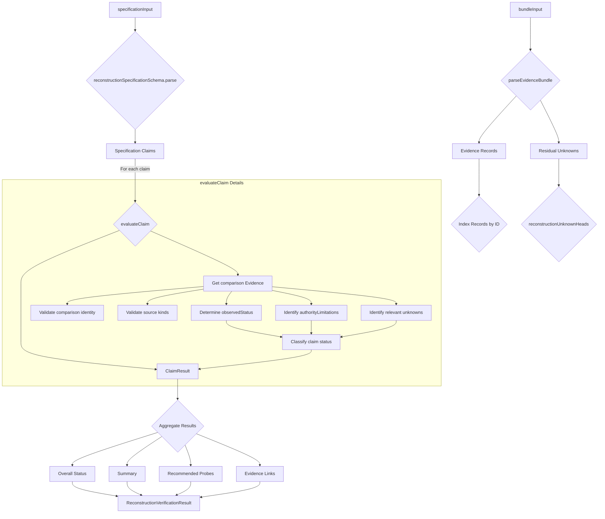
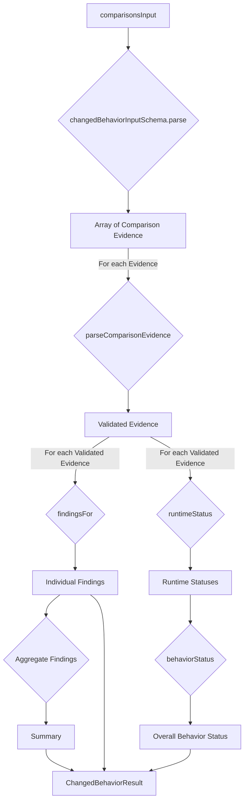
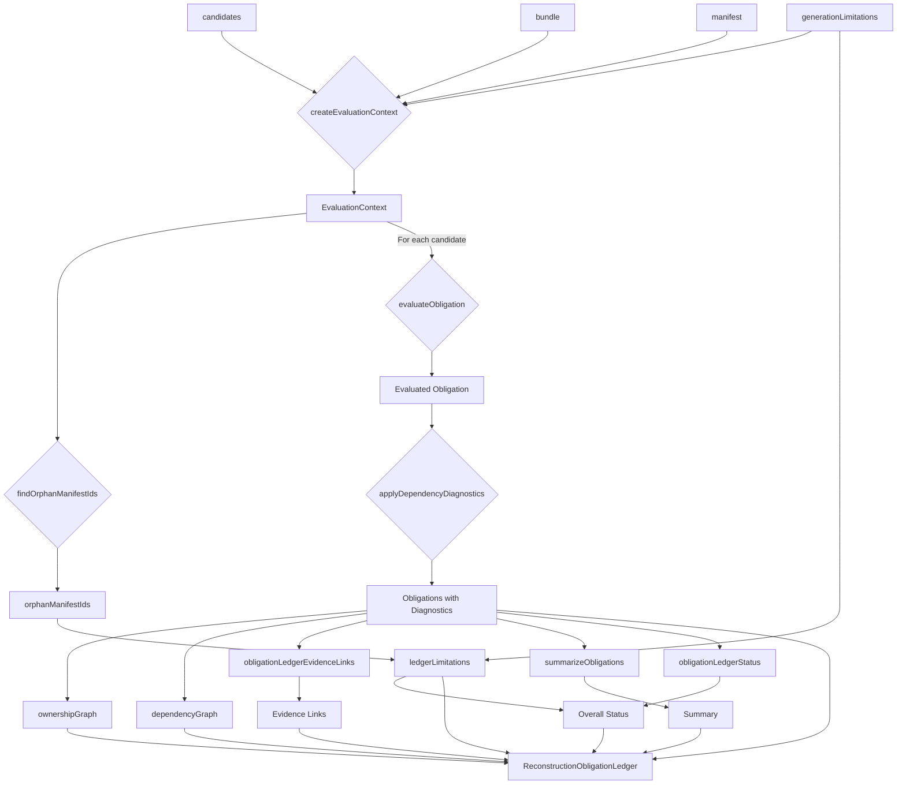
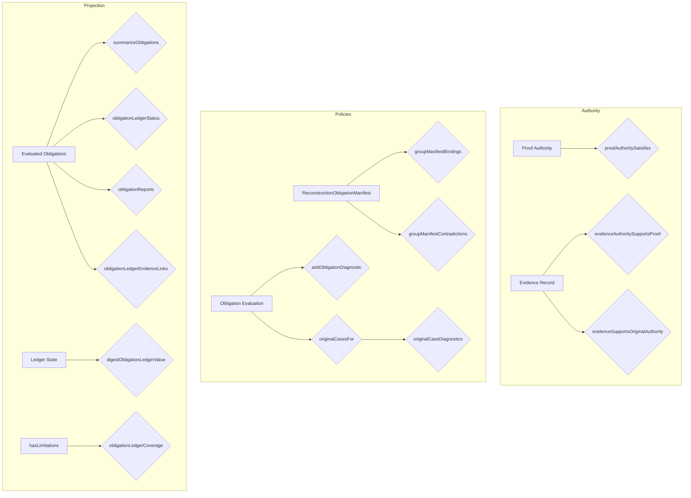

<!-- source: DeepWiki mcp.deepwiki.com · repo morluto/rea · page 7.2 Reconstruction Verification and Obligations · fetched 2026-10-09 -->

# Reconstruction Verification and Obligations

<details>
<summary>Relevant source files</summary>

The following files were used as context for generating this wiki page:

- [src/application/EvidenceBundleFiles.ts](src/application/EvidenceBundleFiles.ts)
- [src/application/ReconstructionObligationAuthority.ts](src/application/ReconstructionObligationAuthority.ts)
- [src/application/ReconstructionObligationLedgerDiagnostics.ts](src/application/ReconstructionObligationLedgerDiagnostics.ts)
- [src/application/ReconstructionObligationLedgerEvaluation.ts](src/application/ReconstructionObligationLedgerEvaluation.ts)
- [src/application/ReconstructionObligationLedgerProjection.ts](src/application/ReconstructionObligationLedgerProjection.ts)
- [src/application/ReconstructionObligationLedgerService.ts](src/application/ReconstructionObligationLedgerService.ts)
- [src/application/ReconstructionObligationOriginalCases.ts](src/application/ReconstructionObligationOriginalCases.ts)
- [src/application/ReconstructionObligationPolicies.ts](src/application/ReconstructionObligationPolicies.ts)
- [src/contracts/investigationExamples.ts](src/contracts/investigationExamples.ts)
- [src/domain/bundleComparison.test.ts](src/domain/bundleComparison.test.ts)
- [src/domain/bundleComparison.ts](src/domain/bundleComparison.ts)
- [src/domain/changedBehavior.ts](src/domain/changedBehavior.ts)
- [src/domain/comparisonStatus.test.ts](src/domain/comparisonStatus.test.ts)
- [src/domain/comparisonStatus.ts](src/domain/comparisonStatus.ts)
- [src/domain/evidenceCompletionLedger.ts](src/domain/evidenceCompletionLedger.ts)
- [src/domain/functionComparison.test.ts](src/domain/functionComparison.test.ts)
- [src/domain/functionComparisonNormalization.ts](src/domain/functionComparisonNormalization.ts)
- [src/domain/functionComparisonSchemas.ts](src/domain/functionComparisonSchemas.ts)
- [src/domain/reconstructionCoverage.test.ts](src/domain/reconstructionCoverage.test.ts)
- [src/domain/reconstructionCoverage.ts](src/domain/reconstructionCoverage.ts)
- [src/domain/reconstructionCoverageEvaluation.ts](src/domain/reconstructionCoverageEvaluation.ts)
- [src/domain/reconstructionObligationLedgerSchemas.ts](src/domain/reconstructionObligationLedgerSchemas.ts)
- [src/domain/reconstructionVerification.functionSources.test.ts](src/domain/reconstructionVerification.functionSources.test.ts)
- [src/domain/reconstructionVerification.test.ts](src/domain/reconstructionVerification.test.ts)
- [src/domain/reconstructionVerification.ts](src/domain/reconstructionVerification.ts)
- [src/domain/reconstructionVerificationSchemas.ts](src/domain/reconstructionVerificationSchemas.ts)
- [src/domain/staticRuntimeCorrelation.ts](src/domain/staticRuntimeCorrelation.ts)
- [src/server/promptCompletion.ts](src/server/promptCompletion.ts)
- [src/server/registerApplicationTools/obligationLedger.ts](src/server/registerApplicationTools/obligationLedger.ts)
- [src/server/registerProcessComparisonTool.ts](src/server/registerProcessComparisonTool.ts)
- [src/server/sessionToolPolicies.ts](src/server/sessionToolPolicies.ts)
- [tests/boundary/mcp/functionComparisonMcp.test.ts](tests/boundary/mcp/functionComparisonMcp.test.ts)
- [tests/boundary/mcp/processEvidenceIdentityMcp.test.ts](tests/boundary/mcp/processEvidenceIdentityMcp.test.ts)
- [tests/boundary/mcp/processTraceAdaptersParity.test.ts](tests/boundary/mcp/processTraceAdaptersParity.test.ts)
- [tests/boundary/mcp/serverUnknownsMcp.test.ts](tests/boundary/mcp/serverUnknownsMcp.test.ts)
- [tests/boundary/process/processCaptureTerminal.test.ts](tests/boundary/process/processCaptureTerminal.test.ts)

</details>


This page details REA's mechanisms for verifying the accuracy and completeness of reconstructed artifacts and behaviors. It covers how REA evaluates `reconstructionVerification` results, identifies `changedBehavior`, correlates static and runtime observations, assesses `reconstructionCoverageEvaluation`, and manages the `obligationLedger` through authorities, policies, and projections.

## Reconstruction Verification
Reconstruction verification is the process of comparing a reconstructed artifact or behavior against a known good (original) version or a set of expectations. This is primarily handled by the `verifyReconstruction` function [src/domain/reconstructionVerification.ts:74-120]().

### Data Flow for `verifyReconstruction`
The `verifyReconstruction` function takes a `specificationInput` and a `bundleInput`.
1.  **Parse Specification**: The `specificationInput` is parsed into a `reconstructionSpecificationSchema` [src/domain/reconstructionVerification.ts:78](). This schema defines a set of `claims` that need to be evaluated.
2.  **Parse Evidence Bundle**: The `bundleInput` is parsed into an `EvidenceBundle` [src/domain/reconstructionVerification.ts:79](). This bundle contains all the `Evidence` records and `ResidualUnknown` entries relevant to the reconstruction.
3.  **Index Records and Unknowns**: The `Evidence` records from the bundle are indexed by their `evidence_id` for quick lookup [src/domain/reconstructionVerification.ts:80-83](). `ResidualUnknown` entries are processed to identify "heads" (the most recent or primary unknowns) using `reconstructionUnknownHeads` [src/domain/reconstructionVerification.ts:84]().
4.  **Evaluate Claims**: Each `claim` in the specification is evaluated by the `evaluateClaim` function [src/domain/reconstructionVerification.ts:86]().
5.  **Aggregate Results**: The results from each claim evaluation are aggregated to determine the overall status (`pass`, `fail`, `unknown`), and summaries are generated.
6.  **Generate Probes**: Based on the evaluation results and unresolved unknowns, `recommended_probes` are generated using `reconstructionProbes` [src/domain/reconstructionVerification.ts:91](). These probes suggest further actions to resolve uncertainties.
7.  **Output**: A `ReconstructionVerificationResult` is returned, containing the overall status, a summary, individual claim results, recommended probes, and any limitations.

### Key Functions and Classes

*   `verifyReconstruction(specificationInput, bundleInput)`: The main entry point for reconstruction verification [src/domain/reconstructionVerification.ts:74-120]().
*   `reconstructionSpecificationSchema`: Zod schema for defining the claims to be verified [src/domain/reconstructionVerificationSchemas.ts]().
*   `EvidenceBundle`: A collection of `Evidence` records and `ResidualUnknown` entries [src/domain/evidenceBundle.js:8-9]().
*   `evaluateClaim(claim, records, heads)`: Evaluates a single reconstruction claim [src/domain/reconstructionVerification.ts:122-177]().
    *   It retrieves the comparison `Evidence` record specified by `claim.comparison_evidence_id` [src/domain/reconstructionVerification.ts:127-131]().
    *   It validates the identity and source kinds of the comparison evidence [src/domain/reconstructionVerification.ts:132-149]().
    *   It determines the `observedStatus` of the claim based on the comparison result [src/domain/reconstructionVerification.ts:150]().
    *   It identifies `authorityLimitations` [src/domain/reconstructionVerification.ts:151]() and `reconstructionClaimUnknowns` [src/domain/reconstructionVerification.ts:152-155]() relevant to the claim.
    *   Finally, it classifies the claim's status (`pass`, `fail`, `unknown`) based on observed status, limitations, and unknowns [src/domain/reconstructionVerification.ts:157]().
*   `reconstructionVerificationResultSchema`: Zod schema for the output of the verification process [src/domain/reconstructionVerificationSchemas.js:27-30]().

### Example Claim Evaluation
A claim might assert that a specific function's pseudocode should remain unchanged between two versions of a binary. `evaluateClaim` would:
1.  Look up the `compare_functions` evidence record.
2.  Extract the comparison result for the "pseudocode" dimension.
3.  If the pseudocode is "changed", the claim would fail. If "unchanged", it passes. If there are relevant unknowns or limitations, the status might be "unknown".


Title: Reconstruction Verification Data Flow
Sources:
- [src/domain/reconstructionVerification.ts:74-120]()
- [src/domain/reconstructionVerification.ts:122-177]()
- [src/domain/reconstructionVerificationSchemas.ts]()
- [src/domain/evidenceBundle.js:8-9]()

## Changed Behavior
The `changedBehavior` analysis identifies and categorizes differences observed across various comparison evidence records, distinguishing between runtime observations and static analysis findings. The `findChangedBehavior` function [src/domain/changedBehavior.ts:115-157]() is the primary entry point.

### Data Flow for `findChangedBehavior`
1.  **Input Parsing**: The `comparisonsInput` is parsed using `changedBehaviorInputSchema` [src/domain/changedBehavior.ts:118-121](). This input is an array of `Evidence` records, each representing a comparison (e.g., process capture comparison, artifact comparison, function comparison).
2.  **Evidence Validation**: Each comparison `Evidence` record is parsed and validated by `parseComparisonEvidence` [src/domain/changedBehavior.ts:122-123](). This ensures the evidence is of an expected type (`compare_process_captures`, `compare_artifacts`, `compare_functions`) and meets specific criteria (e.g., `confidence: "derived"`, `authority: "analyst-inference"`) [src/domain/changedBehavior.ts:160-195]().
3.  **Finding Generation**: For each validated `Evidence` record, `findingsFor` extracts individual findings. These findings are categorized by `scope` (e.g., `runtime`, `static_candidate`) and `classification` (e.g., `observed_change`, `derived_relationship`, `contradiction`, `unresolved_branch`) [src/domain/changedBehavior.ts:127]().
4.  **Runtime Status Extraction**: `runtimeStatus` extracts the status of process capture comparisons, which are crucial for determining the overall `behavior_status` [src/domain/changedBehavior.ts:128]().
5.  **Aggregation and Summary**: The findings are aggregated, and a summary is generated, counting observed changes, static candidates, contradictions, and unresolved items [src/domain/changedBehavior.ts:134-139]().
6.  **Overall Behavior Status**: The `behaviorStatus` function determines the overall `behavior_status` based on the runtime statuses (e.g., `observed_changed`, `observed_unchanged`, `unknown`, `truncated`) [src/domain/changedBehavior.ts:133]().
7.  **Output**: A `ChangedBehaviorResult` is returned, including the overall status, summary, detailed findings, evidence links, and limitations.

### Key Functions and Classes

*   `findChangedBehavior(comparisonsInput)`: The main function for analyzing changed behavior [src/domain/changedBehavior.ts:115-157]().
*   `changedBehaviorInputSchema`: Zod schema for the input, an array of comparison `Evidence` [src/domain/changedBehavior.ts:21-24]().
*   `parseComparisonEvidence(input)`: Validates and parses individual comparison `Evidence` records [src/domain/changedBehavior.ts:160-195]().
*   `ChangedBehaviorResult`: The output schema, summarizing observed changes and static candidates [src/domain/changedBehavior.ts:42-84]().
*   `findingSchema`: Defines the structure of an individual finding, including its scope, dimension, and classification [src/domain/changedBehavior.ts:26-39]().


Title: Changed Behavior Analysis Data Flow
Sources:
- [src/domain/changedBehavior.ts:115-157]()
- [src/domain/changedBehavior.ts:160-195]()
- [src/domain/changedBehavior.ts:21-24]()
- [src/domain/changedBehavior.ts:42-84]()
- [src/domain/changedBehavior.ts:26-39]()

## Static/Runtime Correlation
The `staticRuntimeCorrelation` module allows analysts to explicitly define and evaluate hypotheses about how static code changes correlate with observed runtime behavior changes. The `correlateStaticAndRuntime` function [src/domain/staticRuntimeCorrelation.ts:164-207]() performs this analysis.

### Data Flow for `correlateStaticAndRuntime`
1.  **Input Parsing**: The `input` is parsed using `staticRuntimeCorrelationInputSchema` [src/domain/staticRuntimeCorrelation.ts:167](). This schema expects arrays of `static_comparisons` (artifact or function comparisons), `runtime_comparisons` (process capture comparisons), and `mappings` that define the hypotheses.
2.  **Evidence Parsing and Validation**:
    *   `static_comparisons` are parsed by `parseStatic` [src/domain/staticRuntimeCorrelation.ts:168]().
    *   `runtime_comparisons` are parsed by `parseRuntime` [src/domain/staticRuntimeCorrelation.ts:169]().
    *   Uniqueness of evidence IDs is asserted [src/domain/staticRuntimeCorrelation.ts:170-171]().
3.  **Evidence Indexing**: The parsed static and runtime evidence records are indexed by their `evidence_id` for efficient lookup [src/domain/staticRuntimeCorrelation.ts:172-173]().
4.  **Correlation Evaluation**: Each `mapping` (hypothesis) is evaluated by the `correlate` function [src/domain/staticRuntimeCorrelation.ts:174-176]().
    *   `correlate` retrieves the relevant static and runtime comparison results based on the `mapping`'s selectors and dimensions.
    *   It determines the `observed_pattern` (e.g., `cochanged`, `static_only`, `runtime_only`, `both_unchanged`, `unknown`, `truncated`) by comparing the statuses of the static and runtime dimensions.
    *   It classifies the correlation as `hypothesis`, `contradiction`, or `unresolved_branch` based on whether the `observed_pattern` matches the `expected_pattern` defined in the hypothesis.
5.  **Aggregation and Summary**: The individual correlation results are aggregated. A summary counts hypotheses, contradictions, and unresolved correlations [src/domain/staticRuntimeCorrelation.ts:205-207]().
6.  **Overall Status**: The overall status (`correlated`, `contradicted`, `unknown`, `truncated`) is determined based on the presence of contradictions, unresolved items, or truncated observations [src/domain/staticRuntimeCorrelation.ts:196-204]().
7.  **Output**: A `StaticRuntimeCorrelationResult` is returned, containing the overall status, summary, detailed correlations, evidence links, and limitations.

### Key Functions and Classes

*   `correlateStaticAndRuntime(input)`: The main function for static/runtime correlation [src/domain/staticRuntimeCorrelation.ts:164-207]().
*   `staticRuntimeCorrelationInputSchema`: Zod schema defining the input, including static/runtime comparisons and mappings [src/domain/staticRuntimeCorrelation.ts:86-91]().
*   `mappingSchema`: Defines a single hypothesis, linking a static comparison selector to a runtime comparison dimension, specifying side alignment, and an expected pattern [src/domain/staticRuntimeCorrelation.ts:61-81]().
*   `correlationItemSchema`: Describes the result of evaluating a single mapping, including observed pattern and classification [src/domain/staticRuntimeCorrelation.ts:93-119]().
*   `StaticRuntimeCorrelationResult`: The output schema for the correlation analysis [src/domain/staticRuntimeCorrelation.ts:122-134]().

```mermaid
graph TD
    A[input] --> B{staticRuntimeCorrelationInputSchema.parse};
    B --> C[static_comparisons];
    B --> D[runtime_comparisons];
    B --> E[mappings];

    C -- For each --> F{parseStatic};
    D -- For each --> G{parseRuntime};

    F --> H[Static Evidence by ID];
    G --> I[Runtime Evidence by ID];

    E -- For each mapping --> J{correlate(mapping, H, I)};
    J --> K[CorrelationItem];

    K --> L{Aggregate CorrelationItems};
    L --> M[Summary];
    L --> N[Overall Status];
    M & N & K --> O[StaticRuntimeCorrelationResult];
```
Title: Static/Runtime Correlation Data Flow
Sources:
- [src/domain/staticRuntimeCorrelation.ts:164-207]()
- [src/domain/staticRuntimeCorrelation.ts:86-91]()
- [src/domain/staticRuntimeCorrelation.ts:61-81]()
- [src/domain/staticRuntimeCorrelation.ts:93-119]()
- [src/domain/staticRuntimeCorrelation.ts:122-134]()

## Reconstruction Coverage Evaluation
Reconstruction coverage evaluation assesses how well the current set of evidence and claims fulfills a defined reconstruction boundary. This is handled by the `evaluateReconstructionObligationLedger` function [src/application/ReconstructionObligationLedgerEvaluation.ts:50-134]().

### Data Flow for `evaluateReconstructionObligationLedger`
1.  **Input**: Takes `candidates` (potential obligations), an `EvidenceBundle`, a `manifest` (explicit bindings and contradictions), and `generationLimitations`.
2.  **Context Creation**: An `EvaluationContext` is created, indexing candidates, evidence, manifest bindings, and contradictions for efficient lookup [src/application/ReconstructionObligationLedgerEvaluation.ts:136-149]().
3.  **Orphan Manifest IDs**: Identifies any `obligation_id`s in the manifest that do not correspond to a candidate obligation [src/application/ReconstructionObligationLedgerEvaluation.ts:151-170]().
4.  **Evaluate Obligations**: Each `candidate` obligation is evaluated by `evaluateObligation` [src/application/ReconstructionObligationLedgerEvaluation.ts:68-70]().
    *   `evaluateObligation` checks for manifest bindings and contradictions.
    *   It assesses the `proofAuthoritySatisfies` [src/application/ReconstructionObligationAuthority.ts:29-61]() and `evidenceAuthoritySupportsProof` [src/application/ReconstructionObligationAuthority.ts:64-90]() for any proofs.
    *   It also checks `evidenceSupportsOriginalAuthority` [src/application/ReconstructionObligationAuthority.ts:93-109]() for original evidence.
    *   It generates diagnostics based on these checks and the obligation's status.
5.  **Dependency Diagnostics**: `applyDependencyDiagnostics` processes the evaluated obligations to identify issues related to dependencies between obligations [src/application/ReconstructionObligationLedgerEvaluation.ts:71-74]().
6.  **Graph Construction**: `ownershipGraph` and `dependencyGraph` are constructed from the evaluated obligations [src/application/ReconstructionObligationLedgerEvaluation.ts:75-92]().
7.  **Evidence Links and Limitations**: `obligationLedgerEvidenceLinks` [src/application/ReconstructionObligationLedgerProjection.ts]() and `ledgerLimitations` [src/application/ReconstructionObligationLedgerEvaluation.ts:172-191]() are generated.
8.  **Coverage and Summary**: `obligationLedgerCoverage` [src/application/ReconstructionObligationLedgerProjection.ts]() and `summarizeObligations` [src/application/ReconstructionObligationLedgerProjection.ts]() provide high-level metrics.
9.  **Overall Status**: `obligationLedgerStatus` [src/application/ReconstructionObligationLedgerProjection.ts]() determines the overall status of the ledger.
10. **Digest and Output**: A `closureDigest` is computed, and a `ReconstructionObligationLedger` is returned.

### Key Functions and Classes

*   `evaluateReconstructionObligationLedger(...)`: The main function for evaluating the obligation ledger [src/application/ReconstructionObligationLedgerEvaluation.ts:50-134]().
*   `ReconstructionObligationCandidate`: Represents a potential obligation to be fulfilled.
*   `ReconstructionObligationManifest`: Explicitly defines bindings and contradictions for obligations [src/domain/reconstructionObligationLedgerSchemas.js:10-11]().
*   `evaluateObligation(candidate, context)`: Evaluates a single obligation candidate [src/application/ReconstructionObligationLedgerEvaluation.ts:193-198]().
*   `proofAuthoritySatisfies(actual, required)`: Checks if an actual proof authority meets a required level [src/application/ReconstructionObligationAuthority.ts:29-61]().
*   `evidenceAuthoritySupportsProof(evidence, authority, expected)`: Verifies if evidence supports a declared proof authority [src/application/ReconstructionObligationAuthority.ts:64-90]().
*   `evidenceSupportsOriginalAuthority(evidence, authority)`: Checks if evidence supports the original authority boundary (static, runtime, process) [src/application/ReconstructionObligationAuthority.ts:93-109]().
*   `ReconstructionObligationLedger`: The output schema for the evaluated ledger [src/domain/reconstructionObligationLedgerSchemas.js:7-9]().


Title: Reconstruction Coverage Evaluation Data Flow
Sources:
- [src/application/ReconstructionObligationLedgerEvaluation.ts:50-134]()
- [src/application/ReconstructionObligationLedgerEvaluation.ts:136-149]()
- [src/application/ReconstructionObligationLedgerEvaluation.ts:151-170]()
- [src/application/ReconstructionObligationLedgerEvaluation.ts:68-70]()
- [src/application/ReconstructionObligationAuthority.ts:29-61]()
- [src/application/ReconstructionObligationAuthority.ts:64-90]()
- [src/application/ReconstructionObligationAuthority.ts:93-109]()
- [src/domain/reconstructionObligationLedgerSchemas.js:7-9]()
- [src/application/ReconstructionObligationLedgerEvaluation.ts:71-74]()
- [src/application/ReconstructionObligationLedgerEvaluation.ts:75-92]()
- [src/application/ReconstructionObligationLedgerProjection.ts]()
- [src/application/ReconstructionObligationLedgerEvaluation.ts:172-191]()
- [src/application/ReconstructionObligationLedgerProjection.ts]()
- [src/application/ReconstructionObligationLedgerProjection.ts]()
- [src/application/ReconstructionObligationLedgerProjection.ts]()

## Obligation Ledger Authority, Policies, and Projection
The obligation ledger tracks the status of reconstruction obligations, ensuring that claims are backed by sufficient evidence and authority.

### Authority
The `ReconstructionObligationAuthority.ts` module defines how different levels of authority are established and verified.

*   **Proof Authority**: `proofAuthoritySatisfies` [src/application/ReconstructionObligationAuthority.ts:29-61]() determines if an actual proof (e.g., `unit`, `integration`, `protocol`) meets a required level. For example, an `integration` test can satisfy a `unit` requirement, but not vice-versa.
*   **Evidence Authority**: `evidenceAuthoritySupportsProof` [src/application/ReconstructionObligationAuthority.ts:64-90]() checks if a given `Evidence` record has the necessary `confidence` (`observed`) and `authority` (e.g., `shipped-artifact`, `controlled-replay`) to serve as a proof for a specific `ProofAuthority`. It also verifies that the evidence is a `rea.reconstruction-proof` and its result indicates success for the relevant obligation.
*   **Original Authority**: `evidenceSupportsOriginalAuthority` [src/application/ReconstructionObligationAuthority.ts:93-109]() verifies if an `Evidence` record observes the original artifact or behavior at the required boundary (`static`, `runtime`, `process`). For instance, `static` authority requires `shipped-artifact` evidence, while `runtime` and `process` require `controlled-replay` or `external-service`.

### Policies
Policies govern how obligations are bound, contradicted, and diagnosed.

*   **Manifest Bindings and Contradictions**: The `ReconstructionObligationManifest` [src/domain/reconstructionObligationLedgerSchemas.js:10-11]() allows explicit declaration of `bindings` (linking an obligation to an owner) and `contradictions` (declaring that an obligation is contradicted by specific evidence). These are processed by `groupManifestBindings` and `groupManifestContradictions` [src/application/ReconstructionObligationLedgerDiagnostics.ts:21-22]().
*   **Diagnostics**: The `ReconstructionObligationLedgerDiagnostics.ts` module provides functions like `addObligationDiagnostic` [src/application/ReconstructionObligationLedgerDiagnostics.ts:19]() to record issues during evaluation. These diagnostics can include missing proofs, insufficient authority, or contradictions.
*   **Original Cases**: `originalCasesFor` [src/application/ReconstructionObligationOriginalCases.ts:28-30]() identifies the original evidence records relevant to an obligation, and `originalCaseDiagnostics` [src/application/ReconstructionObligationOriginalCases.ts:32-34]() generates diagnostics if these original cases are missing or have insufficient authority.

### Projection
The `ReconstructionObligationLedgerProjection.ts` module provides functions to summarize and project the state of the obligation ledger.

*   `summarizeObligations(obligations)`: Provides a high-level summary of the obligations, counting passed, failed, unknown, and contradicted obligations [src/application/ReconstructionObligationLedgerProjection.ts:37-49]().
*   `obligationLedgerStatus(obligations)`: Determines the overall status of the ledger (e.g., `passed`, `failed`, `unknown`) [src/application/ReconstructionObligationLedgerProjection.ts:51-60]().
*   `obligationLedgerCoverage(hasLimitations)`: Indicates the completeness of the coverage evaluation [src/application/ReconstructionObligationLedgerProjection.ts:62-69]().
*   `obligationReports(obligations)`: Generates detailed reports for each obligation, including its status, diagnostics, and relevant evidence [src/application/ReconstructionObligationLedgerProjection.ts:71-80]().
*   `obligationLedgerEvidenceLinks(obligations, manifest)`: Collects all evidence IDs linked to the obligations and manifest entries [src/application/ReconstructionObligationLedgerProjection.ts:82-91]().
*   `digestObligationLedgerValue(value)`: Computes a canonical digest of the ledger's state for integrity checking [src/application/ReconstructionObligationLedgerProjection.ts:29-35]().


Title: Obligation Ledger Authority, Policies, and Projection
Sources:
- [src/application/ReconstructionObligationAuthority.ts:29-61]()
- [src/application/ReconstructionObligationAuthority.ts:64-90]()
- [src/application/ReconstructionObligationAuthority.ts:93-109]()
- [src/domain/reconstructionObligationLedgerSchemas.js:10-11]()
- [src/application/ReconstructionObligationLedgerDiagnostics.ts:21-22]()
- [src/application/ReconstructionObligationLedgerDiagnostics.ts:19]()
- [src/application/ReconstructionObligationOriginalCases.ts:28-30]()
- [src/application/ReconstructionObligationOriginalCases.ts:32-34]()
- [src/application/ReconstructionObligationLedgerProjection.ts:37-49]()
- [src/application/ReconstructionObligationLedgerProjection.ts:51-60]()
- [src/application/ReconstructionObligationLedgerProjection.ts:62-69]()
- [src/application/ReconstructionObligationLedgerProjection.ts:71-80]()
- [src/application/ReconstructionObligationLedgerProjection.ts:82-91]()
- [src/application/ReconstructionObligationLedgerProjection.ts:29-35]()

---

