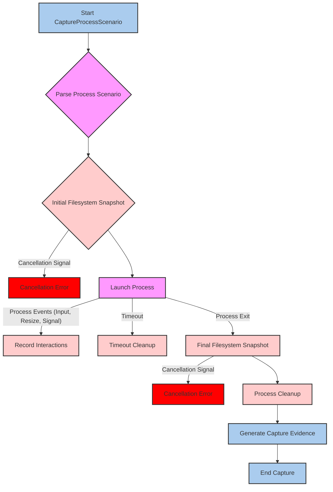

<!-- source: DeepWiki mcp.deepwiki.com · repo morluto/rea · page 7.3 Process Capture and Ownership · fetched 2026-10-09 -->

# Process Capture and Ownership

<details>
<summary>Relevant source files</summary>

The following files were used as context for generating this wiki page:

- [docs/process-capture.md](docs/process-capture.md)
- [native/windows/README.md](native/windows/README.md)
- [native/windows/src/authority.hpp](native/windows/src/authority.hpp)
- [native/windows/src/filesystem.cc](native/windows/src/filesystem.cc)
- [native/windows/src/process.cc](native/windows/src/process.cc)
- [scripts/verify-packaged-ghidra-windows.mjs](scripts/verify-packaged-ghidra-windows.mjs)
- [scripts/verify-windows-native.mjs](scripts/verify-windows-native.mjs)
- [src/process/ProcessCommandIdentity.ts](src/process/ProcessCommandIdentity.ts)
- [src/process/ProcessOwnership.ts](src/process/ProcessOwnership.ts)
- [src/process/ProcessOwnershipIdentity.ts](src/process/ProcessOwnershipIdentity.ts)
- [src/process/ProcessOwnershipObservation.ts](src/process/ProcessOwnershipObservation.ts)
- [src/process/ProcessOwnershipProcessTree.ts](src/process/ProcessOwnershipProcessTree.ts)
- [src/windows/WindowsOwnedProcess.ts](src/windows/WindowsOwnedProcess.ts)
- [tests/boundary/process/filesystemSnapshotFifoRace.test.ts](tests/boundary/process/filesystemSnapshotFifoRace.test.ts)
- [tests/boundary/process/processCaptureCapability.ts](tests/boundary/process/processCaptureCapability.ts)
- [tests/boundary/process/processCaptureLifecycle.test.ts](tests/boundary/process/processCaptureLifecycle.test.ts)
- [tests/fixtures/filesystemSnapshotFifoProbe.mjs](tests/fixtures/filesystemSnapshotFifoProbe.mjs)
- [tests/fixtures/processSnapshotCancellation.mjs](tests/fixtures/processSnapshotCancellation.mjs)

</details>


This page details REA's process capture subsystem, focusing on how it manages process ownership, command identity, filesystem snapshots, and the lifecycle of captured processes including cancellation and cleanup. It also covers the specifics of Windows-owned processes and the native addon used for low-level interactions.

## Process Capture Subsystem Overview

The process capture subsystem in REA allows for the execution of a command and the recording of bounded evidence about its behavior. This includes terminal output, scheduled interactions, process lifetime, and selected filesystem state. It's designed for comparing two runs of the same scenario, such as an authority build versus a reconstruction. The captured command runs with the current user's permissions and inherits the host environment, with explicit overrides applied from the scenario. It's important to note that this is not a sandbox; filesystem observation paths only define what REA snapshots, not what the process can read or write [docs/process-capture.md:9-12]().

Currently, capturing new scenarios requires Linux or macOS due to the reliance on a native PTY backend. Native Windows capture is not yet supported for new scenarios because the PTY adapter does not verify descendant cleanup [docs/process-capture.md:16-19](). However, comparing existing capture evidence is available on Windows.

### Capturing a Command

To capture a command, a JSON scenario file is provided to the CLI [docs/process-capture.md:36-69](). The scenario defines the `executable`, `arguments`, `working_directory`, `environment` overrides, `filesystem_observation_paths`, terminal settings, timed `events`, and various timeouts.

**Process Scenario Example:**
```json
{
  "executable": "node",
  "arguments": ["./signup.mjs"],
  "working_directory": ".",
  "environment": { "APP_MODE": "test" },
  "filesystem_observation_paths": ["./state"],
  "terminal": { "columns": 80, "rows": 24, "scrollback": 1000 },
  "events": [
    {
      "type": "input",
      "at_ms": 250,
      "data": "user@example.test\r",
      "sensitive": true
    },
    { "type": "resize", "at_ms": 500, "columns": 100, "rows": 30 },
    { "type": "signal", "at_ms": 1000, "signal": "SIGINT" }
  ],
  "timeout_ms": 30000,
  "idle_timeout_ms": 30000,
  "settle_ms": 100
}
```
[docs/process-capture.md:49-69]()

The capture output includes raw PTY output, rendered terminal states, interaction dispatch outcomes, exit reasons, sampled process-tree observations, and settlement status. If filesystem paths are specified, REA records `files_before` and `files_after` snapshots, classifying entries as created, deleted, modified, or unchanged [docs/process-capture.md:81-85]().

Sources:
- [docs/process-capture.md:9-12]()
- [docs/process-capture.md:16-19]()
- [docs/process-capture.md:36-69]()
- [docs/process-capture.md:81-85]()

## Process Ownership and Command Identity

REA establishes "ownership" over launched processes to ensure proper cleanup and to prevent interference from unrelated processes. This ownership is primarily managed through a `runId` token injected into the process environment [src/process/ProcessOwnership.ts:155-159]().

The `OwnedProcessGroup` interface defines the necessary identity proof for REA to signal an owned process group. It includes a `runId`, `leaderPid`, `processGroupId`, and optional `expectedCommand` and `expectedParentPid` for verification [src/process/ProcessOwnership.ts:14-24]().

### Process Table and Lineage

The `ProcessTableEntry` interface represents a single entry from an operating system's process table snapshot, containing `pid`, `parentPid`, `processGroupId`, `state`, and `command` [src/process/ProcessOwnership.ts:26-33]().

`OwnedProcessLineage` captures the token-verified lineage of an owned process, including the `runId`, `launcherPid`, `launcherParentPid`, `processGroupId`, and a list of its `descendants` [src/process/ProcessOwnership.ts:36-45]().

The `ProcessOwnershipHost` interface provides a narrow operating-system seam for inspecting processes and signaling groups. It defines methods like `listProcesses()`, `environment(pid)`, and `signalGroup(processGroupId, signal)` [src/process/ProcessOwnership.ts:65-70](). The `createSystemProcessOwnershipHost()` function provides a concrete implementation for the current platform [src/process/ProcessOwnershipObservation.ts:148-192]().

**Process Ownership Data Flow**
```mermaid
graph TD
    A[REA Application] --> B{ProcessOwnershipHost};
    B -- "listProcesses()" --> C[OS Process Table];
    B -- "environment(pid)" --> D[Process Environment Variables];
    B -- "signalGroup(processGroupId, signal)" --> E[OS Signal Mechanism];
    C -- "ProcessTableEntry[]" --> F[liveProcesses()];
    F -- "Filtered Processes" --> G{observeOwnedProcessGroupWithHost()};
    G -- "OwnedProcessGroup" --> H[readProcessRunId()];
    H -- "REA_PROCESS_RUN_ID" --> I{Verification Logic};
    I -- "status: 'verified' | 'unavailable'" --> J[ProcessGroupObservation];
    G -- "OwnedProcessGroup" --> K{observeOwnedProcessLineageWithHost()};
    K -- "OwnedProcessLineage" --> L[ProcessLineageObservation];
    style A fill:#ace,stroke:#333,stroke-width:2px;
    style B fill:#f9f,stroke:#333,stroke-width:2px;
    style C fill:#afa,stroke:#333,stroke-width:2px;
    style D fill:#afa,stroke:#333,stroke-width:2px;
    style E fill:#afa,stroke:#333,stroke-width:2px;
    style F fill:#fcc,stroke:#333,stroke-width:2px;
    style G fill:#f9f,stroke:#333,stroke-width:2px;
    style H fill:#fcc,stroke:#333,stroke-width:2px;
    style I fill:#fcc,stroke:#333,stroke-width:2px;
    style J fill:#ace,stroke:#333,stroke-width:2px;
    style K fill:#f9f,stroke:#333,stroke-width:2px;
    style L fill:#ace,stroke:#333,stroke-width:2px;
```
Sources:
- [src/process/ProcessOwnership.ts:14-24]()
- [src/process/ProcessOwnership.ts:26-33]()
- [src/process/ProcessOwnership.ts:36-45]()
- [src/process/ProcessOwnership.ts:65-70]()
- [src/process/ProcessOwnership.ts:155-159]()
- [src/process/ProcessOwnershipObservation.ts:148-192]()

### Command Identity Matching

The `matchesOwnedProcessCommand()` function handles matching process-table command text, specifically accounting for macOS executable-name normalization [src/process/ProcessCommandIdentity.ts:4-27](). This is crucial for reliably identifying the launcher process across different operating systems.

Sources:
- [src/process/ProcessCommandIdentity.ts:4-27]()

## Filesystem Snapshots

Filesystem snapshots are a critical part of process capture, recording the state of specified directories before and after a process execution. This allows REA to classify changes (created, deleted, modified, unchanged) [docs/process-capture.md:81-85]().

The `snapshotRoots()` function is responsible for creating these snapshots [tests/boundary/process/processCaptureLifecycle.test.ts:11](). It's designed to handle various filesystem scenarios, including external symlinks, where it records metadata without following the target [tests/boundary/process/processCaptureLifecycle.test.ts:24-46]().

A specific test case `filesystemSnapshotFifoRace.test.ts` ensures that the snapshot mechanism does not block when an observed regular file is replaced by a FIFO (named pipe) [tests/boundary/process/filesystemSnapshotFifoRace.test.ts:13-15](). This involves a probe that attempts to hash a file that is replaced by a FIFO, expecting the hash operation to be rejected rather than hanging [tests/fixtures/filesystemSnapshotFifoProbe.mjs:21-22]().

Sources:
- [docs/process-capture.md:81-85]()
- [tests/boundary/process/processCaptureLifecycle.test.ts:11]()
- [tests/boundary/process/processCaptureLifecycle.test.ts:24-46]()
- [tests/boundary/process/filesystemSnapshotFifoRace.test.ts:13-15]()
- [tests/fixtures/filesystemSnapshotFifoProbe.mjs:21-22]()

## Cancellation and Lifecycle

The lifecycle of a captured process includes robust handling of timeouts and explicit cancellation. The `captureProcessScenario()` function manages this lifecycle [tests/boundary/process/processCaptureLifecycle.test.ts:10]().

When a process times out, the `exit.reason` in the capture result is "timeout", and a cleanup is performed on the owned process group and temporary root [tests/boundary/process/processCaptureLifecycle.test.ts:66-70]().

Explicit cancellation, typically via an `AbortController`, results in the `captureProcessScenario()` call returning an error with a "cancelled" reason [tests/boundary/process/processCaptureLifecycle.test.ts:84-86]().

Cancellation can occur at different stages, including during the initial or final filesystem snapshot. The system classifies these cancellations appropriately [tests/boundary/process/processCaptureLifecycle.test.ts:90-120](), [tests/boundary/process/processCaptureLifecycle.test.ts:124-158](). It also distinguishes between caller cancellation and other filesystem errors, ensuring that non-cancellation errors are preserved [tests/boundary/process/processCaptureLifecycle.test.ts:162-192]().

**Process Capture Lifecycle**

Sources:
- [tests/boundary/process/processCaptureLifecycle.test.ts:10]()
- [tests/boundary/process/processCaptureLifecycle.test.ts:66-70]()
- [tests/boundary/process/processCaptureLifecycle.test.ts:84-86]()
- [tests/boundary/process/processCaptureLifecycle.test.ts:90-120]()
- [tests/boundary/process/processCaptureLifecycle.test.ts:124-158]()
- [tests/boundary/process/processCaptureLifecycle.test.ts:162-192]()

## Windows Owned Processes and Native Addon

For Windows, REA utilizes a native addon to manage process ownership and filesystem interactions. This is particularly important for robust cleanup and ensuring the integrity of filesystem snapshots.

The `cleanupWindowsProcessTree()` function provides a bounded P0 cleanup mechanism for terminating a process tree on Windows, using `taskkill.exe` [src/process/ProcessOwnership.ts:110-128](). This is a temporary measure until a native authority verifies Job Object creation, membership, and cleanup semantics [src/process/ProcessOwnership.ts:106-109]().

The `WindowsProcessTreeHost` interface defines the `terminateTree(rootPid)` method for this purpose [src/process/ProcessOwnership.ts:73-75]().

The native addon, implemented in C++ (e.g., `native/windows/src/process.cc`, `native/windows/src/filesystem.cc`), provides low-level access to Windows APIs. For filesystem operations, it includes functions like `openFile()` for opening files with specific access rights and `identity()` for retrieving stable 128-bit Windows file identities [native/windows/src/filesystem.cc:63-94](), [native/windows/src/filesystem.cc:96-121](). It enforces strict validation for paths, supporting only absolute local NTFS drive paths and rejecting reparse points (junctions, symlinks) within observed paths to prevent unexpected behavior [native/windows/src/filesystem.cc:17-38](), [native/windows/src/filesystem.cc:50-55]().

The `scripts/verify-windows-native.mjs` script is a conformance test that verifies the behavior of the Windows native authority. It tests file opening, identity retrieval, snapshot ownership, and ensures that operations like renaming a directory with an open handle are rejected, demonstrating the robustness of the native controls [scripts/verify-windows-native.mjs:82-100](), [scripts/verify-windows-native.mjs:111-141](), [scripts/verify-windows-native.mjs:146-149]().

**Windows Native Addon Interactions**
```mermaid
graph TD
    A[REA Node.js Process] --> B{WindowsNativeLoader.js};
    B -- "requireWindowsNativeAuthority()" --> C[Native Addon (process.cc, filesystem.cc)];
    C -- "call('process_spawn', ...)" --> D[Windows OS Process APIs];
    C -- "call('open', path)" --> E[Windows OS Filesystem APIs];
    C -- "call('read', handle, ...)" --> E;
    C -- "call('close', handle)" --> E;
    C -- "call('runtime_create', ...)" --> F[WindowsPrivateRuntime];
    F -- "snapshot(path, ...)" --> E;
    D -- "Process Creation/Management" --> G[Owned Windows Processes];
    E -- "File Operations" --> H[Windows Filesystem];
    G -- "Process Lifetime" --> I[Process Cleanup (taskkill.exe)];
    I --> D;

    style A fill:#ace,stroke:#333,stroke-width:2px;
    style B fill:#f9f,stroke:#333,stroke-width:2px;
    style C fill:#fcc,stroke:#333,stroke-width:2px;
    style D fill:#afa,stroke:#333,stroke-width:2px;
    style E fill:#afa,stroke:#333,stroke-width:2px;
    style F fill:#f9f,stroke:#333,stroke-width:2px;
    style G fill:#ace,stroke:#333,stroke-width:2px;
    style H fill:#ace,stroke:#333,stroke-width:2px;
    style I fill:#fcc,stroke:#333,stroke-width:2px;
```
Sources:
- [src/process/ProcessOwnership.ts:106-109]()
- [src/process/ProcessOwnership.ts:110-128]()
- [src/process/ProcessOwnership.ts:73-75]()
- [native/windows/src/filesystem.cc:63-94]()
- [native/windows/src/filesystem.cc:96-121]()
- [native/windows/src/filesystem.cc:17-38]()
- [native/windows/src/filesystem.cc:50-55]()
- [scripts/verify-windows-native.mjs:82-100]()
- [scripts/verify-windows-native.mjs:111-141]()
- [scripts/verify-windows-native.mjs:146-149]()

---

