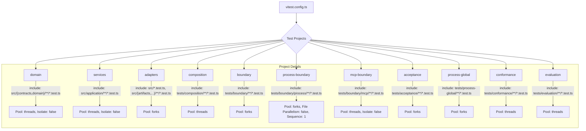
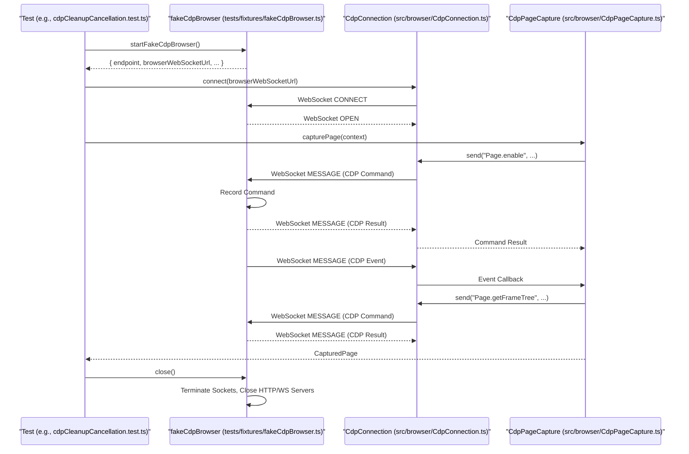
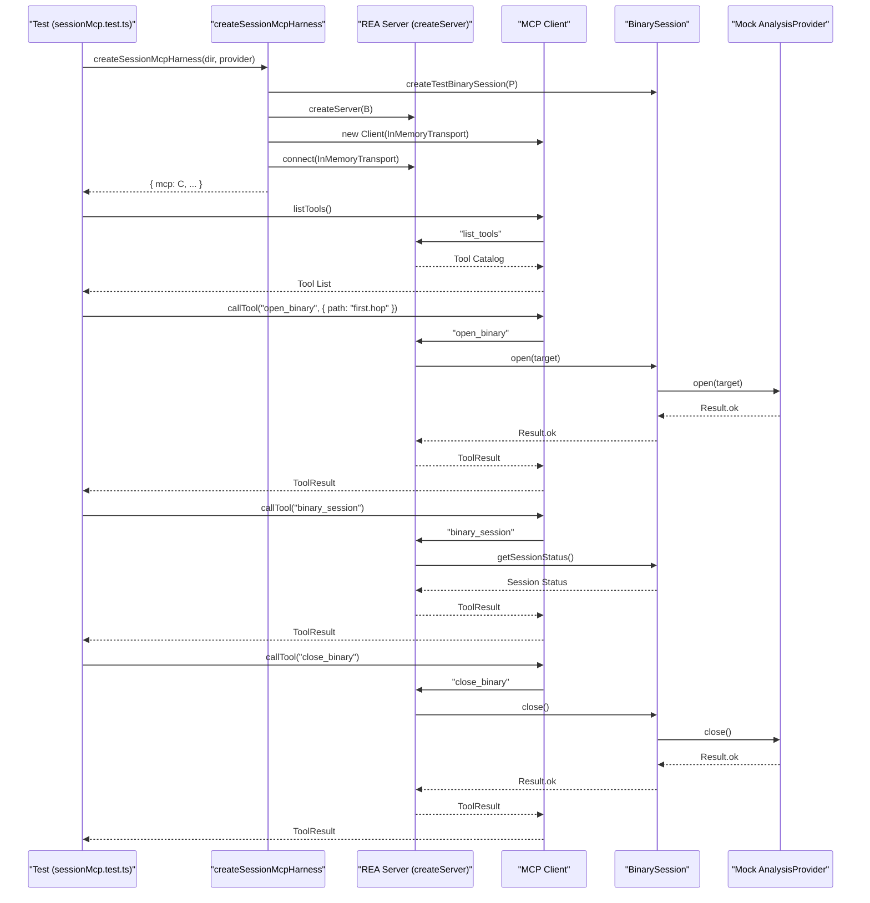

<!-- source: DeepWiki mcp.deepwiki.com · repo morluto/rea · page 8.1 Unit, Boundary and Composition Tests · fetched 2026-10-09 -->

# Unit, Boundary and Composition Tests

<details>
<summary>Relevant source files</summary>

The following files were used as context for generating this wiki page:

- [.oxlintrc.json](.oxlintrc.json)
- [docs/capability-migration.md](docs/capability-migration.md)
- [scripts/lib/catalog-builders.mjs](scripts/lib/catalog-builders.mjs)
- [scripts/lib/catalog-core.mjs](scripts/lib/catalog-core.mjs)
- [scripts/lib/module-boundaries.d.mts](scripts/lib/module-boundaries.d.mts)
- [scripts/lib/module-boundaries.mjs](scripts/lib/module-boundaries.mjs)
- [scripts/verify-package-install.mjs](scripts/verify-package-install.mjs)
- [src/application/ReconstructionObligationCandidates.ts](src/application/ReconstructionObligationCandidates.ts)
- [src/application/ReconstructionObligationLedger.authority.test.ts](src/application/ReconstructionObligationLedger.authority.test.ts)
- [src/browser/CdpAuthorizedMainFrame.ts](src/browser/CdpAuthorizedMainFrame.ts)
- [src/browser/CdpBrowserProvider.ts](src/browser/CdpBrowserProvider.ts)
- [src/browser/CdpCaptureEvents.ts](src/browser/CdpCaptureEvents.ts)
- [src/browser/CdpConnection.ts](src/browser/CdpConnection.ts)
- [src/browser/CdpElectronInspection.ts](src/browser/CdpElectronInspection.ts)
- [src/browser/CdpElectronProvider.ts](src/browser/CdpElectronProvider.ts)
- [src/browser/CdpElectronScripts.ts](src/browser/CdpElectronScripts.ts)
- [src/browser/CdpElectronWorkers.ts](src/browser/CdpElectronWorkers.ts)
- [src/browser/CdpObservationSession.ts](src/browser/CdpObservationSession.ts)
- [src/browser/CdpPageCapture.ts](src/browser/CdpPageCapture.ts)
- [src/browser/CdpTargetSession.ts](src/browser/CdpTargetSession.ts)
- [src/browser/CdpWebMcpDiscovery.ts](src/browser/CdpWebMcpDiscovery.ts)
- [src/cliEnvironmentSeam.test.ts](src/cliEnvironmentSeam.test.ts)
- [src/contracts/contractSnapshot.test.ts](src/contracts/contractSnapshot.test.ts)
- [src/contracts/managed/managedToolContracts.ts](src/contracts/managed/managedToolContracts.ts)
- [src/contracts/sessionToolContracts.ts](src/contracts/sessionToolContracts.ts)
- [src/contracts/toolContracts.test.ts](src/contracts/toolContracts.test.ts)
- [src/contracts/toolOutputSchemaGroups.ts](src/contracts/toolOutputSchemaGroups.ts)
- [src/domain/inputIssueProjection.test.ts](src/domain/inputIssueProjection.test.ts)
- [src/domain/inputIssueProjection.ts](src/domain/inputIssueProjection.ts)
- [src/domain/localPath.ts](src/domain/localPath.ts)
- [src/ida/IdaProviderCapabilities.ts](src/ida/IdaProviderCapabilities.ts)
- [tests/acceptance/applications/runtime.test.ts](tests/acceptance/applications/runtime.test.ts)
- [tests/boundary/browser/cdpCleanupCancellation.test.ts](tests/boundary/browser/cdpCleanupCancellation.test.ts)
- [tests/boundary/cli/processCli.test.ts](tests/boundary/cli/processCli.test.ts)
- [tests/boundary/cli/productCatalog.test.ts](tests/boundary/cli/productCatalog.test.ts)
- [tests/boundary/mcp/outputSchemaSemanticConstraints.test.ts](tests/boundary/mcp/outputSchemaSemanticConstraints.test.ts)
- [tests/boundary/mcp/sessionMcp.test.ts](tests/boundary/mcp/sessionMcp.test.ts)
- [tests/boundary/mcp/toolSchemaValidity.test.ts](tests/boundary/mcp/toolSchemaValidity.test.ts)
- [tests/evaluation/moduleBoundaries.test.ts](tests/evaluation/moduleBoundaries.test.ts)
- [tests/fixtures/fakeCdpBrowser.ts](tests/fixtures/fakeCdpBrowser.ts)
- [tests/process-global/vitestConfiguration.test.ts](tests/process-global/vitestConfiguration.test.ts)
- [tsconfig.build.json](tsconfig.build.json)
- [vitest.config.ts](vitest.config.ts)

</details>


This page details the setup and strategy for unit, boundary, and composition tests within the REA codebase. These tests ensure the correctness of individual components, the integrity of module boundaries, and the proper orchestration of multiple components. The focus is on Vitest configuration, testing against fake seams (like `fakeHopper`, `fakeGhidra`, `fakeCdpBrowser`), MCP harnesses, and contract/schema validity checks.

## Vitest Configuration and Test Tiers

The REA test suite uses **Vitest** and is configured to run tests in distinct "projects" or tiers, each with specific `include` patterns, worker pools, and isolation settings. This allows for efficient parallel execution and appropriate resource management for different test types.

The `vitest.config.ts` file defines these projects:
- `domain`: Pure domain and contract modules. [vitest.config.ts:18-26]()
- `services`: Application layer services using recording ports. [vitest.config.ts:27-35]()
- `adapters`: Tests for various provider adapters. [vitest.config.ts:36-44]()
- `composition`: Tests for how components are assembled. [vitest.config.ts:45-50]()
- `boundary`: Tests against external seams, excluding MCP and process-related tests. [vitest.config.ts:51-60]()
- `process-boundary`: Specific boundary tests for process-tree observations, run serially. [vitest.config.ts:61-70]()
- `mcp-boundary`: Boundary tests for MCP sessions, reusing the server graph. [vitest.config.ts:71-79]()
- `acceptance`: End-to-end acceptance tests. [vitest.config.ts:80-85]()
- `process-global`: Tests that might affect global process state. [vitest.config.ts:86-91]()
- `conformance`: Tests against a set of known good inputs. [vitest.config.ts:92-97]()
- `evaluation`: Tests for code quality and architectural constraints, such as module boundaries. [vitest.config.ts:98-103]()

Each project specifies its `pool` (threads or forks) and `maxWorkers` to optimize execution. For example, `domain` and `services` tests run in `threads` with `isolate: false` because they are pure or use recording ports and don't have process-global state, reducing startup overhead. [vitest.config.ts:20-35]() `adapters` and `boundary` tests often use `forks` for better isolation when interacting with external resources or processes. [vitest.config.ts:42-43,58-59]()

### Vitest Project Configuration

Sources: [vitest.config.ts:17-103]()

## Boundary Tests Against Fake Seams

Boundary tests are crucial for verifying interactions with external systems or complex internal components without relying on their actual availability or full functionality. This is achieved by using "fake" implementations that mimic the behavior of real systems.

### Fake CDP Browser (`fakeCdpBrowser`)

The `fakeCdpBrowser` fixture [tests/fixtures/fakeCdpBrowser.ts]() simulates a Chrome DevTools Protocol (CDP) enabled browser. It sets up a real HTTP and WebSocket server to respond to CDP commands and emit events, allowing the `CdpConnection` and related modules to be tested in isolation.

Key features of `fakeCdpBrowser`:
- **HTTP Server**: Responds to `/json/version` and `/json/list` endpoints, mimicking browser discovery. [tests/fixtures/fakeCdpBrowser.ts:44-71]()
- **WebSocket Server**: Handles CDP command messages, records them, and sends back configurable results or errors. [tests/fixtures/fakeCdpBrowser.ts:88-133]()
- **Configurable Behavior**: Allows injecting custom command results, errors, event emissions, and even simulating malformed messages or disconnections. [tests/fixtures/fakeCdpBrowser.ts:95-117,185-197]()
- **Event Emission**: Provides methods to `emitRawMessage` or `emitEvent` to simulate asynchronous browser events. [tests/fixtures/fakeCdpBrowser.ts:146-151]()

This fake is used to test modules like `CdpPageCapture` [src/browser/CdpPageCapture.ts]() and `CdpObservationSession` [src/browser/CdpObservationSession.ts]() without launching a real browser.

### Fake CDP Browser Interaction Flow

Sources: [tests/fixtures/fakeCdpBrowser.ts:16-162](), [src/browser/CdpPageCapture.ts:69-95](), [src/browser/CdpConnection.ts:39-60]()

### Other Fake Seams and Fixtures

- **`fakeHopper` / `fakeGhidra`**: These fixtures simulate the Hopper and Ghidra analysis providers, respectively. They are used to test the provider client implementations and ensure the bridge protocol is correctly handled, including error conditions and concurrent requests.
- **JADX Fixtures**: For Android analysis, JADX fixtures provide mock APK structures or responses to test the `JadxProvider` without requiring a full JADX installation.

## MCP Harnesses

MCP (Model Context Protocol) harnesses are used to test the REA server's interaction with an MCP client. These harnesses set up an in-memory MCP server and client, allowing for comprehensive testing of tool invocation, session management, and error handling.

The `createSessionMcpHarness` function [tests/boundary/mcp/sessionMcpHarness.ts]() is a key utility for these tests. It sets up:
- A temporary directory for binary targets.
- A `TestBinarySession` with a mock `AnalysisProvider`.
- An REA server created with `createServer`. [tests/boundary/mcp/sessionMcp.test.ts:59]()
- An MCP client using `InMemoryTransport` for direct communication. [tests/boundary/mcp/sessionMcp.test.ts:60-63]()

This setup allows tests to simulate a full MCP workflow, including:
- Opening and closing binaries. [tests/boundary/mcp/sessionMcp.test.ts:67-71,188-192]()
- Switching between binary targets. [tests/boundary/mcp/sessionMcp.test.ts:194-200]()
- Listing available tools and their descriptions. [tests/boundary/mcp/sessionMcp.test.ts:118-126]()
- Calling tools and verifying their results and side effects. [tests/boundary/mcp/sessionMcp.test.ts:131-133]()
- Managing unknown evidence and its resolution. [tests/boundary/mcp/sessionMcp.test.ts:153-178]()

### MCP Session Workflow Test

Sources: [tests/boundary/mcp/sessionMcp.test.ts:110-183](), [tests/boundary/mcp/sessionMcpHarness.ts:15-40]()

## Contract Snapshot and Schema Validity Tests

These tests ensure the stability and correctness of REA's public API contracts, including tool input/output schemas and tool effects.

### Contract Snapshot Tests

The `src/contracts/contractSnapshot.test.ts` file contains tests that verify the structure and properties of `ToolContract` definitions.
- **Tool Effect Auditing**: It asserts that every published tool has an explicitly defined set of `TOOL_EFFECTS`, preventing any heuristic fallbacks. [src/contracts/contractSnapshot.test.ts:66-87]()
- **Annotation Verification**: Checks specific annotations like `openWorldHint` for tools like `capture_process_scenario` [src/contracts/contractSnapshot.test.ts:109-114]() and `destructiveHint` for `export_evidence_bundle`. [src/contracts/contractSnapshot.test.ts:117-132]()
- **Input Schema Structure**: Verifies that complex input schemas, such as `compare_web_captures`, correctly advertise alternatives on an object root rather than using `oneOf` at the top level, ensuring better client usability. [src/contracts/contractSnapshot.test.ts:28-64]()

### Schema Validity Tests

The `tests/boundary/mcp/toolSchemaValidity.test.ts` file (not fully shown, but implied by context) uses `ajv` to validate that the generated JSON schemas for tool inputs and outputs are valid against the JSON Schema Draft 2020-12 specification. This ensures that external clients can reliably parse and validate tool arguments and results.

Additionally, `tests/boundary/mcp/outputSchemaSemanticConstraints.test.ts` (not fully shown) verifies semantic constraints within output schemas, ensuring that the data produced by tools adheres to expected logical rules beyond just structural validity.

### Tool Contract Verification Flow
```mermaid
graph TD
    A[ToolContract Definitions] --> B{contractSnapshot.test.ts};
    B --> B1[Verify TOOL_EFFECTS for all tools];
    B --> B2[Check specific tool annotations (e.g., openWorldHint, destructiveHint)];
    B --> B3[Validate input schema structure (e.g., compare_web_captures alternatives)];

    A --> C{toolSchemaValidity.test.ts};
    C --> C1[Generate JSON Schema from Zod];
    C --> C2[Validate generated schema against Draft 2020-12 using AJV];

    A --> D{toolOutputSchemaSemanticConstraints.test.ts};
    D --> D1[Verify semantic rules within output schemas];
```
Sources: [src/contracts/contractSnapshot.test.ts:28-132](), [src/contracts/toolContracts.test.ts:181-184]()

---

