<!-- source: DeepWiki mcp.deepwiki.com · repo morluto/rea · page 8.3 Real-Provider and Package Verification · fetched 2026-10-09 -->

# Real-Provider and Package Verification

<details>
<summary>Relevant source files</summary>

The following files were used as context for generating this wiki page:

- [.github/workflows/real-browser.yml](.github/workflows/real-browser.yml)
- [bridge/native/NativeUIChildren.swift](bridge/native/NativeUIChildren.swift)
- [bridge/native/ReaNativeUI.swift](bridge/native/ReaNativeUI.swift)
- [scripts/fixtures/browser-verifier-site.mjs](scripts/fixtures/browser-verifier-site.mjs)
- [scripts/fixtures/page-cdp-proxy.mjs](scripts/fixtures/page-cdp-proxy.mjs)
- [scripts/lib/browser-dom-destinations-e2e.mjs](scripts/lib/browser-dom-destinations-e2e.mjs)
- [scripts/lib/browser-verifier-assertions.mjs](scripts/lib/browser-verifier-assertions.mjs)
- [scripts/lib/real-hopper-semantic.mjs](scripts/lib/real-hopper-semantic.mjs)
- [scripts/verify-browser-dom-destinations.mjs](scripts/verify-browser-dom-destinations.mjs)
- [scripts/verify-native-ui.mjs](scripts/verify-native-ui.mjs)
- [scripts/verify-package.mjs](scripts/verify-package.mjs)
- [scripts/verify-real-browser.mjs](scripts/verify-real-browser.mjs)
- [scripts/verify-real-ghidra-assertions.mjs](scripts/verify-real-ghidra-assertions.mjs)
- [scripts/verify-real-ghidra-function.mjs](scripts/verify-real-ghidra-function.mjs)
- [scripts/verify-real-ghidra.mjs](scripts/verify-real-ghidra.mjs)
- [scripts/verify-real-hopper.mjs](scripts/verify-real-hopper.mjs)
- [src/application/DirectAnalysis.ts](src/application/DirectAnalysis.ts)
- [src/application/Doctor.ts](src/application/Doctor.ts)
- [src/application/Setup.ts](src/application/Setup.ts)
- [src/browser/CdpCaptureDocuments.baseUrl.test.ts](src/browser/CdpCaptureDocuments.baseUrl.test.ts)
- [src/browser/CdpCaptureDocuments.ts](src/browser/CdpCaptureDocuments.ts)
- [src/cli.ts](src/cli.ts)
- [src/cliEvidenceCommands.ts](src/cliEvidenceCommands.ts)
- [src/domain/native/nativeUiObservation.ts](src/domain/native/nativeUiObservation.ts)
- [src/ghidra/GhidraDefaults.ts](src/ghidra/GhidraDefaults.ts)
- [src/native/NativeUiHelperRuntime.ts](src/native/NativeUiHelperRuntime.ts)
- [src/native/NativeUiObservation.test.ts](src/native/NativeUiObservation.test.ts)
- [src/native/NativeUiObservation.ts](src/native/NativeUiObservation.ts)
- [tests/conformance/ghidra/inventory.c](tests/conformance/ghidra/inventory.c)
- [tests/conformance/native/native-ui-children/main.swift](tests/conformance/native/native-ui-children/main.swift)

</details>


This section documents the end-to-end verification strategies used to ensure REA functions correctly when interacting with live provider instances (Hopper, Ghidra, Browser, Native UI) and when distributed as a packed NPM artifact. Unlike unit tests, these verifiers exercise the full system, including process injection, socket communication, and external configuration mutation.

## 1. Real-Provider End-to-End Verification

### 1.1. Hopper Verification (`scripts/verify-real-hopper.mjs`)

The `scripts/verify-real-hopper.mjs` script performs a full integration test by launching a real instance of Hopper Disassembler and exercising the MCP server against actual binaries.

#### 1.1.1. Requirements and Setup
The verifier requires two distinct Mach-O binaries to test session transitions and target switching. These are provided via environment variables:
*   `HOPPER_TARGET_PATH`: The primary binary for initial analysis.
*   `HOPPER_SECOND_TARGET_PATH`: A secondary binary used to verify that the session can close the first target and open another without leaking state.

The script snapshots existing Hopper processes before starting to ensure that `cleanup()` only terminates instances spawned by the verifier [scripts/verify-real-hopper.mjs:50-52]().

#### 1.1.2. Tool Exercise Sequence
The verifier connects to the MCP server via `StdioClientTransport` [scripts/verify-real-hopper.mjs:6-7]() and executes a sequence of operations to validate the bridge:

| Step | Tool / Action | Purpose |
| :--- | :--- | :--- |
| 1 | `listTools` | Validates that all tools are exposed [scripts/verify-real-hopper.mjs:219-224](). |
| 2 | `binary_session` | Confirms the server starts in a "no-target" state [scripts/verify-real-hopper.mjs:227-232](). |
| 3 | `open_binary` | Triggers `BridgeLauncher` to inject `hopper_bridge.py` into a new Hopper process [scripts/verify-real-hopper.mjs:233-237](). |
| 4 | Metadata Tools | Calls `list_documents`, `binary_overview`, and `list_segments` to verify basic document state [scripts/verify-real-hopper.mjs:238-249](). |
| 5 | Analysis Tools | Resolves a procedure address and calls `analyze_function` to verify pseudocode generation and XREFs [scripts/verify-real-hopper.mjs:191-215](). |
| 6 | Target Switch | Closes the first binary and opens `targetB` to ensure session isolation [scripts/verify-real-hopper.mjs:250-262]().

#### 1.1.3. Safety and Cleanup
The verifier monitors `stderr` for unsafe diagnostics. Any log entry with a level $\ge$ 40 (Error/Fatal) or malformed JSON results in a verification failure [scripts/verify-real-hopper.mjs:270-286](). Upon completion, the script identifies and kills the specific Hopper PIDs it created [scripts/verify-real-hopper.mjs:480-494]().

Sources:
* [scripts/verify-real-hopper.mjs:1-506]()

### 1.2. Ghidra Verification (`scripts/verify-real-ghidra.mjs`)

The `scripts/verify-real-ghidra.mjs` script verifies the integration with a real Ghidra installation. It compiles various C/assembly fixtures and then uses the Ghidra provider to analyze them.

#### 1.2.1. Requirements and Setup
The script requires the `GHIDRA_INSTALL_DIR` environment variable to be set to the absolute path of an extracted Ghidra release [scripts/verify-real-ghidra.mjs:46-50](). It also checks for the correct Ghidra version [scripts/verify-real-ghidra.mjs:64-65](). Depending on the `--cross-format` or `--aarch64-jump-table` arguments, it verifies the presence of `clang`, `lld`, and `lld-link` compilers/linkers [scripts/verify-real-ghidra.mjs:98-119]().

The script compiles several fixtures:
*   `inventory.c` into a debug binary, a stripped binary, and an object file for layout analysis [scripts/verify-real-ghidra.mjs:121-136]().
*   `cross-format.c` and `relative-switch.S` into various cross-compiled targets (e.g., AArch64 ELF, Windows PE, Mach-O) if `--cross-format` or `--aarch64-jump-table` are specified [scripts/verify-real-ghidra.mjs:138-200]().

#### 1.2.2. Analysis Sequence
The verifier uses `GhidraHeadlessLauncher` [scripts/verify-real-ghidra.mjs:18]() to start Ghidra and `GhidraClient` [scripts/verify-real-ghidra.mjs:12]() to interact with it. It performs the following checks:
*   **Session Management**: Asserts that a session can be opened and closed [scripts/verify-real-ghidra-assertions.mjs:10-12]().
*   **Inventory Operations**: Verifies `list_procedures`, `list_segments`, `list_strings`, `list_data_types`, and `list_symbols` [scripts/verify-real-ghidra-inventory.mjs:10-12]().
*   **Function Analysis**: Checks `procedure_pseudo_code`, `procedure_assembly`, `analyze_function`, `xrefs`, `procedure_callers`, `procedure_callees` [scripts/verify-real-ghidra-function.mjs:10-12]().
*   **Data Type and Value Tracing**: Verifies `inspect_native_data_type` and `trace_native_values` [scripts/verify-real-ghidra-function.mjs:10-12]().
*   **Cross-Format Analysis**: If enabled, it analyzes binaries compiled for different architectures and formats to ensure Ghidra's cross-platform capabilities are correctly exposed [scripts/verify-real-ghidra.mjs:300-302]().
*   **Switch Table Recognition**: Specifically tests Ghidra's ability to recognize and analyze switch tables in AArch64 binaries [scripts/verify-real-ghidra.mjs:303-305]().

#### 1.2.3. Cleanup
The script removes the temporary fixture root directory upon completion [scripts/verify-real-ghidra.mjs:540-541]().

Sources:
* [scripts/verify-real-ghidra.mjs:1-545]()
* [scripts/verify-real-ghidra-assertions.mjs]()
* [scripts/verify-real-ghidra-inventory.mjs]()
* [scripts/verify-real-ghidra-function.mjs]()

### 1.3. Browser Verification (`scripts/verify-real-browser.mjs`)

The `scripts/verify-real-browser.mjs` script performs end-to-end verification of REA's browser observation capabilities using a real Chrome/Chromium instance.

#### 1.3.1. Requirements and Setup
The script launches a headless Chrome/Chromium instance [scripts/verify-real-browser.mjs:56-75]() and a local web server (`browser-verifier-site.mjs`) [scripts/verify-real-browser.mjs:53]() to serve test content. It also sets environment variables for scenario secrets [scripts/verify-real-browser.mjs:45-47]().

#### 1.3.2. CDP Observation
It uses `CdpBrowserProvider` [scripts/verify-real-browser.mjs:89]() to connect to the browser's DevTools Protocol (CDP) endpoint. It performs the following observations:
*   **Basic Page Inspection**: `inspectPage` to capture network requests, storage, and basic DOM information, asserting that sensitive data is redacted by default [scripts/verify-real-browser.mjs:91-127]().
*   **Detailed Page Inspection**: `inspectPage` with `include_script_sources`, `include_accessibility_text`, `include_json_body_shapes`, and `include_websocket_shapes` to verify deeper data capture [scripts/verify-real-browser.mjs:129-161]().
*   **Web Bundle Analysis**: `analyzeBundle` to perform static and semantic analysis of JavaScript bundles, including source map fetching [scripts/verify-real-browser.mjs:163-173]().
*   **Capture Comparison**: `compareCaptures` to verify that stable capture identities reconcile across different observation depths [scripts/verify-real-browser.mjs:175-186]().
*   **Screenshot Capture**: `captureScreenshot` to verify visual capture capabilities [scripts/verify-real-browser.mjs:188-197]().
*   **Scenario Capture**: Uses `PlaywrightBrowserScenarioProvider` [scripts/verify-real-browser.mjs:10]() to capture user interactions and verify event coverage [scripts/verify-real-browser.mjs:200-210]().

#### 1.3.3. Cleanup
The script ensures that the spawned browser process is killed and temporary profiles are removed [scripts/verify-real-browser.mjs:490-491]().

Sources:
* [scripts/verify-real-browser.mjs:1-503]()
* [scripts/fixtures/browser-verifier-site.mjs]()
* [scripts/lib/browser-verifier-assertions.mjs]()
* [scripts/lib/browser-scenario-verifier.mjs]()

### 1.4. Native UI Verification (`scripts/verify-native-ui.mjs`)

The `scripts/verify-native-ui.mjs` script verifies REA's ability to observe and interact with native macOS UI elements.

#### 1.4.1. Requirements and Setup
This script is macOS-specific [scripts/verify-native-ui.mjs:11-13](). It compiles a Swift helper (`NativeUIChildren.swift`) [scripts/verify-native-ui.mjs:21-33]() to test JSON serialization boundaries and then compiles a test application (`ui.swift`) [scripts/verify-native-ui.mjs:78-83]() into a `.app` bundle. It then launches this application [scripts/verify-native-ui.mjs:86-90]() and waits for it to report its process ID and window ID [scripts/verify-native-ui.mjs:91-100]().

#### 1.4.2. UI Observation and Interaction
The script uses `observeNativeUi` [src/native/NativeUiObservation.ts:10]() to:
*   **Observe Initial State**: Captures the initial UI state of the test application [scripts/verify-native-ui.mjs:108-110](). It checks for accessibility permissions and throws an error if denied, unless explicitly allowed for diagnostic purposes [scripts/verify-native-ui.mjs:111-121]().
*   **Simulate Interaction**: Finds a specific button ("Increment REA fixture") [scripts/verify-native-ui.mjs:124-127]() and then uses `capture_native_ui_scenario` to simulate a click on it, verifying that the UI state changes as expected (e.g., "REA fixture incremented" text appears) [scripts/verify-native-ui.mjs:128-151]().
*   **CLI Parity**: Executes the same scenario via the `rea capture-native-ui-scenario` CLI command to ensure parity between the programmatic API and the CLI [scripts/verify-native-ui.mjs:152-181]().

#### 1.4.3. Implementation Details
The native UI observation relies on a Swift helper (`ReaNativeUI.swift`) [bridge/native/ReaNativeUI.swift:1-171]() which is compiled on-the-fly by `createNativeUiHelperRuntime` [src/native/NativeUiHelperRuntime.ts:11-71](). This helper uses macOS Accessibility APIs (`AXUIElement`) and ScreenCaptureKit to interact with and observe UI elements.

#### 1.4.4. Cleanup
The temporary application bundle and compiled helpers are removed [scripts/verify-native-ui.mjs:199-200]().

Sources:
* [scripts/verify-native-ui.mjs:1-207]()
* [src/native/NativeUiHelperRuntime.ts:1-71]()
* [bridge/native/ReaNativeUI.swift:1-171]()
* [src/native/NativeUiObservation.ts:1-10]()

### 1.5. Windows Native Verification (`scripts/verify-windows-native.mjs`)

This script is not provided in the given file contents. However, based on the naming convention, it would likely perform similar end-to-end verification for Windows-specific native analysis capabilities, potentially involving tools like WinDbg, Process Monitor, or other Windows APIs.

## 2. Package Verification (`scripts/verify-package.mjs`)

The `scripts/verify-package.mjs` script ensures that the NPM artifact (`.tgz`) is self-contained, correctly structured, and functions in an isolated environment. This script orchestrates a series of sub-verifiers.

### 2.1. Isolated Environment Construction
To prevent mutation of the developer's machine, the script creates a `workspace` in `tmpdir()` [scripts/verify-package.mjs:30-31](). It then calls `verifyPackageEnvironment` [scripts/verify-package.mjs:41-45]() to set up a controlled environment, including:
*   **Fake `HOME`**: Redirects configuration files for agents like Claude and Cursor.
*   **Mock Binaries**: Provides dummy implementations of system commands (e.g., `brew`, `sw_vers`, `npx`) to test environment detection and MCP registration without side effects.

### 2.2. Verification Steps

The `verify-package.mjs` script executes a sequence of verification modules:

1.  **`verifyPackagePack`**: Creates the NPM tarball (`.tgz`) and performs basic checks on its contents [scripts/verify-package.mjs:39]().
2.  **`verifyPackageEnvironment`**: Sets up the isolated environment for subsequent tests [scripts/verify-package.mjs:40-45]().
3.  **`verifyPackageInstall`**: Installs the packed tarball into a local prefix and verifies the CLI's basic functionality [scripts/verify-package.mjs:46-52]().
4.  **`verifyPackageUpdate`**: Tests the `rea update` command within the isolated environment [scripts/verify-package.mjs:53-64]().
5.  **MCP Startup Probes**: Measures and profiles the MCP server's startup time and module loading [scripts/verify-package.mjs:65-81]().
6.  **`verifyPackageDiscovery`**: Verifies that the CLI can discover available providers and setup hosts [scripts/verify-package.mjs:82-86]().
7.  **`verifyPackageArtifactAndElectron`**: Tests artifact handling and Electron-specific capabilities [scripts/verify-package.mjs:87-91]().
8.  **`verifyManaged`**: Verifies managed code analysis capabilities [scripts/verify-package.mjs:92-96]().
9.  **`verifyUnknownProvider`**: Ensures graceful handling of unknown providers [scripts/verify-package.mjs:97-100]().
10. **`verifyPackagePlatform`**: Verifies platform-specific functionalities [scripts/verify-package.mjs:101-104]().
11. **`verifyPackageCapabilitiesAndSearch`**: Checks that the CLI correctly reports capabilities and search functionality [scripts/verify-package.mjs:105-108]().
12. **`verifyPackageEvidence`**: Tests evidence import/export and comparison [scripts/verify-package.mjs:109-114]().
13. **`verifyPackageSetup`**: Runs `rea setup` to verify its idempotency, configuration integrity, and failure recovery [scripts/verify-package.mjs:115-129]().
    *   **Idempotency**: Runs `rea setup` twice. The second run must report `ready` with zero actions, confirming the setup logic is idempotent.
    *   **Configuration Integrity**: Verifies that client configuration files (e.g., `claude_desktop_config.json`, Cursor's `mcp.json`) are updated correctly and backups are created.
    *   **Failure Recovery**: Intentionally corrupts a config file and verifies that `rea setup` handles the error gracefully without deleting the malformed input.
14. **`verifyPackageMcp`**: Starts the packaged MCP server and connects a test client to verify:
    *   The server exposes the expected number of tools [scripts/verify-package.mjs:137]().
    *   Calling a tool without an active binary session returns a proper `isError` result instead of crashing.

### 2.3. Cleanup
The script ensures that the temporary tarball and workspace directory are removed [scripts/verify-package.mjs:140-141]().

Sources:
* [scripts/verify-package.mjs:1-142]()
* [src/application/Setup.ts:1-198]()
* [src/cli.ts:1-73]()
* [src/application/DirectAnalysis.ts:1-182]()
* [src/cliEvidenceCommands.ts:1-71]()

## 3. Implementation Data Flow

### Diagram: Package Verification Flow
This diagram illustrates the overall flow of `verify-package.mjs` and its sub-verifiers.

Title: Package Verification Orchestration

```mermaid
graph TD
    subgraph "Host Environment"
        OS["Operating System"]
        TMPDIR["Temporary Directory (tmpdir())"]
    end

    subgraph "Verification Script (scripts/verify-package.mjs)"
        VP["verify-package.mjs"]
        VPP["verifyPackagePack"]
        VPE["verifyPackageEnvironment"]
        VPI["verifyPackageInstall"]
        VPU["verifyPackageUpdate"]
        MSP["measureMcpStartup / profileMcpModuleLoading"]
        VPD["verifyPackageDiscovery"]
        VPAE["verifyPackageArtifactAndElectron"]
        VM["verifyManaged"]
        VUP["verifyUnknownProvider"]
        VPPF["verifyPackagePlatform"]
        VPCS["verifyPackageCapabilitiesAndSearch"]
        VPEV["verifyPackageEvidence"]
        VPS["verifyPackageSetup"]
        VPM["verifyPackageMcp"]
    end

    subgraph "Isolated Workspace (in tmpdir())"
        W["Workspace Root"]
        EVIDENCEROOT["evidence/"]
        REFERENCEROOT["reference-source/"]
        PREFIX["prefix/ (npm install target)"]
        CLI_BIN["cli (rea executable)"]
        PACKAGE_RUNNER_CLI["packageRunnerCli (npx rea)"]
        MOCK_ENV["Mocked Environment Variables"]
        CONFIG_FILES["Agent Config Files (e.g., .claude, .cursor)"]
    end

    subgraph "REA Components Under Test"
        REA_CLI["REA CLI (installed)"]
        MCP_SERVER["MCP Server (installed)"]
        PROVIDERS["Providers (Hopper, Ghidra, etc.)"]
        SETUP_LOGIC["Setup Logic (runSetup)"]
        DOCTOR_LOGIC["Doctor Logic (runDoctor)"]
    end

    OS --> TMPDIR
    TMPDIR --> W

    VP --> VPP
    VPP -->|Creates tarball| W
    VP --> VPE
    VPE -->|Sets up| MOCK_ENV
    VPE -->|Creates| EVIDENCEROOT
    VPE -->|Creates| REFERENCEROOT
    VP --> VPI
    VPI -->|Installs tarball to| PREFIX
    VPI -->|Provides| CLI_BIN
    VPI -->|Provides| PACKAGE_RUNNER_CLI
    VP --> VPU
    VPU -->|Tests update of| PREFIX
    VP --> MSP
    MSP -->|Executes| CLI_BIN
    MSP -->|Interacts with| MCP_SERVER
    VP --> VPD
    VPD -->|Uses| CLI_BIN
    VPD -->|Interacts with| DOCTOR_LOGIC
    VP --> VPAE
    VPAE -->|Uses| CLI_BIN
    VP --> VM
    VM -->|Uses| CLI_BIN
    VP --> VUP
    VUP -->|Uses| CLI_BIN
    VP --> VPPF
    VPPF -->|Uses| CLI_BIN
    VP --> VPCS
    VPCS -->|Uses| CLI_BIN
    VP --> VPEV
    VPEV -->|Uses| CLI_BIN
    VPEV -->|Reads/Writes| EVIDENCEROOT
    VPEV -->|Reads/Writes| REFERENCEROOT
    VP --> VPS
    VPS -->|Uses| CLI_BIN
    VPS -->|Uses| PACKAGE_RUNNER_CLI
    VPS -->|Interacts with| SETUP_LOGIC
    VPS -->|Modifies| CONFIG_FILES
    VP --> VPM
    VPM -->|Uses| CLI_BIN
    VPM -->|Interacts with| MCP_SERVER
    MCP_SERVER --> PROVIDERS

    CLI_BIN --> REA_CLI
    REA_CLI --> SETUP_LOGIC
    REA_CLI --> DOCTOR_LOGIC
    REA_CLI --> MCP_SERVER
    SETUP_LOGIC --> CONFIG_FILES

    W -- Cleanup --> OS
```

Sources:
* [scripts/verify-package.mjs:1-142]()
* [src/application/Setup.ts:1-198]()
* [src/application/Doctor.ts:1-184]()

### Diagram: Real-Hopper Verification Flow
The following diagram illustrates how `verify-real-hopper.mjs` orchestrates the MCP Client to exercise the Bridge.

Title: Real-Hopper Verification Flow
```mermaid
graph TD
    subgraph "Verification Process"
        V["scripts/verify-real-hopper.mjs"]
        MC["MCP Client (@modelcontextprotocol/client)"]
    end

    subgraph "REA System Under Test"
        MAIN["dist/main.js (MCP Server)"]
        BL["BridgeLauncher (src/hopper/BridgeLauncher.ts)"]
        HC["HopperClient (dist/hopper/HopperClient.js)"]
    end

    subgraph "External Process"
        H["Hopper Disassembler (real application)"]
        BP["hopper_bridge.py (injected)"]
    end

    V -->|1. Start MCP Server| MAIN
    V -->|2. Connect via StdioClientTransport| MC
    MC -->|3. callTool("open_binary")| MAIN
    MAIN -->|4. launch()| BL
    BL -->|5. Inject hopper_bridge.py into| H
    H -->|6. Loads and runs| BP
    BP -->|7. Establishes Unix socket connection| HC
    V -->|8. Exercise various Hopper tools (e.g., list_procedures, analyze_function)| MC
    MC -->|9. JSON-RPC Request| HC
    HC -->|10. Transmits via Unix socket| BP
    BP -->|11. Calls Hopper SDK API| H
    H -->|12. Returns result| BP
    BP -->|13. Transmits result| HC
    HC -->|14. Returns result| MC
    MC -->|15. Result to verifier| V
    V -->|16. callTool("close_binary")| MC
    MC -->|17. Request close| MAIN
    MAIN -->|18. Terminates Hopper process| H
    V -->|19. Cleanup (kill remaining PIDs)| H
```
Sources:
* [scripts/verify-real-hopper.mjs:6-7]()
* [scripts/verify-real-hopper.mjs:137-173]()
* [scripts/verify-real-hopper.mjs:480-494]()

## 4. Bridge Truthfulness Requirements
A specific suite of tests in `tests/bridgeTruthfulness.test.ts` ensures that the bridge does not "hallucinate" or simplify data in ways that mislead the LLM.

| Constraint | Implementation Detail |
| :--- | :--- |
| **CFG Successors** | Must use `_unavailable()` if Hopper cannot provide them, rather than returning an empty array `[]` `[tests/bridgeTruthfulness.test.ts:11-14]()`. |
| **Permissions** | Must return `None` for segment permissions that are not explicitly provided by the API, avoiding false `False` values `[tests/bridgeTruthfulness.test.ts:16-22]()`. |
| **Reference Kinds** | Must use raw Hopper containment and reference APIs without attempting to guess the "kind" of reference (e.g., Data vs. Code) if the API doesn't classify them `[tests/bridgeTruthfulness.test.ts:24-31]()`. |

Sources:
* `[tests/bridgeTruthfulness.test.ts:1-33]()`

---

