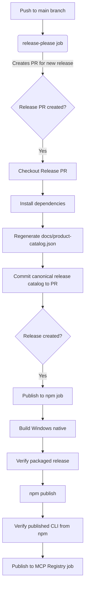
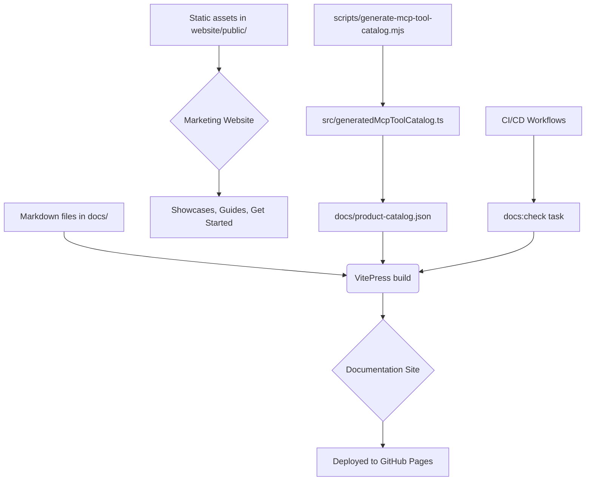

<!-- source: DeepWiki mcp.deepwiki.com · repo morluto/rea · page 9 CI/CD, Release and Website · fetched 2026-10-09 -->

# CI/CD, Release and Website

<details>
<summary>Relevant source files</summary>

The following files were used as context for generating this wiki page:

- [.github/pull_request_template.md](.github/pull_request_template.md)
- [.github/workflows/ci.yml](.github/workflows/ci.yml)
- [.github/workflows/regen-generated.yml](.github/workflows/regen-generated.yml)
- [.github/workflows/release.yml](.github/workflows/release.yml)
- [.gitignore](.gitignore)
- [AGENTS.md](AGENTS.md)
- [CONTRIBUTING.md](CONTRIBUTING.md)
- [docs/testing.md](docs/testing.md)
- [docs/tool-design.md](docs/tool-design.md)
- [release-please-config.json](release-please-config.json)
- [scripts/generate-mcp-tool-catalog.mjs](scripts/generate-mcp-tool-catalog.mjs)
- [scripts/verify-published-package.mjs](scripts/verify-published-package.mjs)
- [tests/boundary/mcp/toolRegistrationOptions.test.ts](tests/boundary/mcp/toolRegistrationOptions.test.ts)
- [tests/conformance/readmeConsistency.test.ts](tests/conformance/readmeConsistency.test.ts)
- [tests/conformance/releaseConfiguration.test.ts](tests/conformance/releaseConfiguration.test.ts)
- [tsconfig.json](tsconfig.json)
- [turbo.json](turbo.json)

</details>


This page provides a high-level overview of the automation pipelines that ensure the quality and delivery of the REA project. REA utilizes GitHub Actions to execute a comprehensive suite of static analysis, testing, and automated release workflows, alongside managing its documentation and marketing websites.

## CI Pipeline Overview

The Continuous Integration (CI) pipeline is triggered on every push and pull request to the `main` branch [.github/workflows/ci.yml:4-7](). It consists of several parallel jobs designed to validate code integrity, maintain style consistency, and prevent technical debt. For details, see [CI Pipeline and Code Quality Gates](#9.1).

### Quality Assurance Jobs
The pipeline executes the following checks in parallel:
*   **Conventional PR title**: Ensures pull request titles adhere to Conventional Commits for `release-please` compatibility [.github/workflows/ci.yml:17-31]().
*   **Changes Classification**: Determines if code changes require full CI runs or if only documentation/non-code changes are present [.github/workflows/ci.yml:33-60]().
*   **Static checks**: Runs `npm run check:ci` which includes type checking, linting, and other static analysis tools like `oxlint`, `knip`, `jscpd`, and `scan-todos` [.github/workflows/ci.yml:62-84]().
*   **Test shards**: Divides the test suite into multiple shards for parallel execution, speeding up feedback [.github/workflows/ci.yml:86-117]().
*   **Build package**: Compiles the REA package using `npm run build:cached` and uploads the `dist` directory as an artifact [.github/workflows/ci.yml:119-137]().
*   **Test (coverage + timing)**: Merges test reports from shards, calculates coverage, and identifies slow tests [.github/workflows/ci.yml:139-196]().

### Testing and Documentation
The pipeline also handles automated test execution and documentation verification:
*   **Conformance**: Verifies that REA's behavior aligns with expected outcomes against a set of conformance fixtures. This includes checks for README consistency and release configuration [.github/workflows/ci.yml:200-220](), [tests/conformance/readmeConsistency.test.ts:1-104](), [tests/conformance/releaseConfiguration.test.ts:1-10]().
*   **Windows Native**: Builds and tests Windows-specific native components [.github/workflows/ci.yml:222-242]().
*   **Package E2E**: Performs end-to-end tests on the packaged REA artifact to ensure it installs and functions correctly [.github/workflows/ci.yml:244-264]().
*   **Docs**: Builds and verifies the documentation site, ensuring all links are valid and content is correctly rendered [.github/workflows/ci.yml:266-286]().

For a detailed breakdown of each job and the pre-commit hooks that mirror these checks locally, see [CI Pipeline and Code Quality Gates](#9.1).

**CI Pipeline Job Graph**
```mermaid
graph TD
    A[Trigger: push/PR] --> B{Conventional PR title};
    A --> C{Classify changes};

    C -- code changes --> D[Static checks];
    C -- code changes --> E[Build package];

    E --> F[Test shard (1/4)];
    E --> G[Test shard (2/4)];
    E --> H[Test shard (3/4)];
    E --> I[Test shard (4/4)];

    D --> J[Conformance];
    E --> J;

    J --> K[Windows Native];
    E --> K;

    K --> L[Package E2E];
    E --> L;

    L --> M[Docs];
    E --> M;

    F & G & H & I --> N[Test (coverage + timing)];

    N --> O[All CI Jobs Complete];
    M --> O;
```
Sources: [.github/workflows/ci.yml:1-475]()

---

## Release Process

REA follows an automated release strategy using `release-please`. This system manages versioning and changelog generation based on Conventional Commits. For details, see [Release Process](#9.2).

### Automated Versioning
The `release-please` job monitors the `main` branch for merged pull requests [.github/workflows/release.yml:3-5](). Based on the commit types (e.g., `feat`, `fix`), it automatically:
1.  Updates the version in `.release-please-manifest.json` [release-please-config.json:1-20]().
2.  Generates or updates the `CHANGELOG.md`.
3.  Creates a GitHub Release and tags the repository [.github/workflows/release.yml:13-31]().
4.  Regenerates release documentation, specifically `docs/product-catalog.json`, and commits it back to the release PR [.github/workflows/release.yml:39-91](). This ensures the canonical tool catalog is always up-to-date with the release.

### NPM Publishing
Once a release is created by `release-please`, a secondary `publish` job is triggered [.github/workflows/release.yml:92-95](). This job:
*   Builds the project, including Windows native components [.github/workflows/release.yml:111-115]().
*   Verifies the packaged release before publishing using `npm run verify:package` [.github/workflows/release.yml:117-118]().
*   Publishes the package to the npm registry with public access [.github/workflows/release.yml:120-129]().
*   Verifies the published CLI from npm by installing it in a temporary directory and running basic commands like `rea --help` and `rea --llms` [.github/workflows/release.yml:131-159](). It also checks the update mechanism by attempting to update a previously installed version of REA to the newly published one [.scripts/verify-published-package.mjs:93-193]().
*   A `publish-mcp` job also runs to verify package and registry metadata versions after publishing [.github/workflows/release.yml:160-174]().

For details on conventional commit categories and the maintainer checklist, see [Release Process](#9.2).

**Release Workflow Diagram**

Sources: [.github/workflows/release.yml:1-196](), [release-please-config.json:1-20](), [.github/pull_request_template.md:1-73](), [scripts/verify-published-package.mjs:1-214]()

---

## Documentation Site and Website

REA maintains a comprehensive documentation site and a marketing website to serve different purposes. For details, see [Documentation Site and Website](#9.3).

### Documentation Site
The documentation site, located in the `docs/` directory, is built using VitePress. It hosts guides, API references, and detailed explanations of REA's features and architecture.
*   The site uses Markdown files for content [CONTRIBUTING.md:30-31]().
*   It can be run locally for live editing with `npm run docs:dev` [CONTRIBUTING.md:32-33]().
*   The `docs:build` command checks the production build and links, and `docs:preview` allows previewing the built site [CONTRIBUTING.md:33-34]().
*   The site is deployed to GitHub Pages at `https://morluto.github.io/rea/` [CONTRIBUTING.md:30-31]().
*   Navigation is configured in `docs/.vitepress/config.ts` [CONTRIBUTING.md:36-36]().
*   Generated reference documents, such as the MCP tool catalog, are managed by `npm run docs:generate` [CONTRIBUTING.md:38-38]().

### Marketing Website
The `website/public` directory contains static assets for a marketing website. This site showcases REA's capabilities, provides "get started" information, and potentially hosts figures and style guides. The `website/public/examples/notes-example.zip` is a generated download for the website and is ignored by Git [.gitignore:49-50]().

**Documentation and Website Workflow**

Sources: [CONTRIBUTING.md:29-44](), [.gitignore:49-50](), [scripts/generate-mcp-tool-catalog.mjs:1-201](), [AGENTS.md:27-28](), [turbo.json:111-130]()

---

