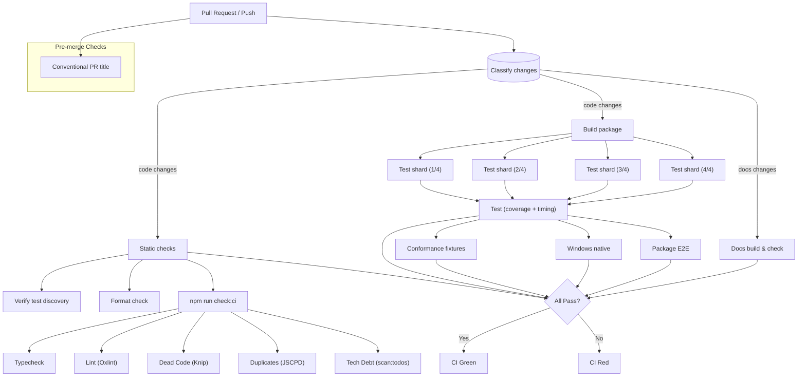
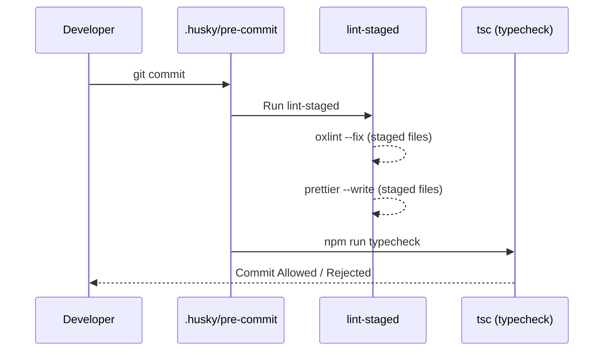

<!-- source: DeepWiki mcp.deepwiki.com · repo morluto/rea · page 9.1 CI Pipeline and Code Quality Gates · fetched 2026-10-09 -->

# CI Pipeline and Code Quality Gates

<details>
<summary>Relevant source files</summary>

The following files were used as context for generating this wiki page:

- [.github/pull_request_template.md](.github/pull_request_template.md)
- [.github/workflows/ci.yml](.github/workflows/ci.yml)
- [.github/workflows/regen-generated.yml](.github/workflows/regen-generated.yml)
- [.gitignore](.gitignore)
- [.husky/pre-commit](.husky/pre-commit)
- [.husky/pre-push](.husky/pre-push)
- [.oxlintrc.json](.oxlintrc.json)
- [AGENTS.md](AGENTS.md)
- [CONTRIBUTING.md](CONTRIBUTING.md)
- [docs/capability-migration.md](docs/capability-migration.md)
- [docs/testing.md](docs/testing.md)
- [docs/tool-design.md](docs/tool-design.md)
- [knip.json](knip.json)
- [scripts/generate-mcp-tool-catalog.mjs](scripts/generate-mcp-tool-catalog.mjs)
- [scripts/lib/catalog-builders.mjs](scripts/lib/catalog-builders.mjs)
- [scripts/lib/catalog-core.mjs](scripts/lib/catalog-core.mjs)
- [scripts/lib/module-boundaries.d.mts](scripts/lib/module-boundaries.d.mts)
- [scripts/lib/module-boundaries.mjs](scripts/lib/module-boundaries.mjs)
- [scripts/scan-todos.mjs](scripts/scan-todos.mjs)
- [scripts/verify-package-install.mjs](scripts/verify-package-install.mjs)
- [src/application/ReconstructionObligationCandidates.ts](src/application/ReconstructionObligationCandidates.ts)
- [src/application/ReconstructionObligationLedger.authority.test.ts](src/application/ReconstructionObligationLedger.authority.test.ts)
- [src/artifacts/AsarArtifactReader.ts](src/artifacts/AsarArtifactReader.ts)
- [src/artifacts/AsarEntryStream.ts](src/artifacts/AsarEntryStream.ts)
- [src/cliEnvironmentSeam.test.ts](src/cliEnvironmentSeam.test.ts)
- [src/contracts/contractSnapshot.test.ts](src/contracts/contractSnapshot.test.ts)
- [src/contracts/toolContracts.test.ts](src/contracts/toolContracts.test.ts)
- [src/contracts/toolOutputSchemaGroups.ts](src/contracts/toolOutputSchemaGroups.ts)
- [src/ida/IdaProviderCapabilities.ts](src/ida/IdaProviderCapabilities.ts)
- [tests/boundary/cli/productCatalog.test.ts](tests/boundary/cli/productCatalog.test.ts)
- [tests/boundary/filesystem/asarInventoryFreshness.test.ts](tests/boundary/filesystem/asarInventoryFreshness.test.ts)
- [tests/boundary/filesystem/asarStreamingAllocation.test.ts](tests/boundary/filesystem/asarStreamingAllocation.test.ts)
- [tests/boundary/filesystem/directoryArtifactReaderFifoRace.test.ts](tests/boundary/filesystem/directoryArtifactReaderFifoRace.test.ts)
- [tests/boundary/filesystem/javascriptArtifactContentIdentity.test.ts](tests/boundary/filesystem/javascriptArtifactContentIdentity.test.ts)
- [tests/boundary/mcp/toolRegistrationOptions.test.ts](tests/boundary/mcp/toolRegistrationOptions.test.ts)
- [tests/evaluation/moduleBoundaries.test.ts](tests/evaluation/moduleBoundaries.test.ts)
- [tests/fixtures/directoryReaderFifoProbe.mjs](tests/fixtures/directoryReaderFifoProbe.mjs)
- [tsconfig.json](tsconfig.json)
- [turbo.json](turbo.json)

</details>


The REA CI pipeline is designed to ensure code quality, maintainability, and reliability through a series of parallel automated checks. It enforces strict type safety, detects code duplication, monitors technical debt, and validates test coverage thresholds before any code is merged into the `main` branch.

## Pipeline Architecture

The pipeline is implemented via GitHub Actions and triggered on every push or pull request to the `main` branch [ .github/workflows/ci.yml:3-7 ](). It consists of several distinct jobs that run in parallel on `ubuntu-latest` environments [ .github/workflows/ci.yml:16-476 ](). The `concurrency` setting ensures that only one CI run is active for a given pull request, canceling in-progress runs if a new commit is pushed [ .github/workflows/ci.yml:9-11 ]().

### Data Flow and Job Execution

The following diagram illustrates how the CI pipeline processes the codebase from a pull request to a successful build.

**CI Job Flow**

Sources: [ .github/workflows/ci.yml:1-476 ]()

## CI Job Details

### 1. Pre-merge Checks
*   **Conventional PR title**: For pull requests, this job validates that the PR title adheres to Conventional Commits specifications, which is crucial for `release-please` to generate changelogs correctly [ .github/workflows/ci.yml:17-31 ]().

### 2. Change Classification
*   **Classify changes**: This job determines if the changes in a pull request affect code or only documentation. This classification is used to conditionally run subsequent jobs, skipping expensive code-related checks if only documentation has changed [ .github/workflows/ci.yml:33-60 ]().

### 3. Static Analysis and Quality (`static` job)
This job runs various static checks to ensure code quality and adherence to standards.
*   **Require successful change classification**: Ensures that the `changes` job completed successfully before proceeding [ .github/workflows/ci.yml:68-71 ]().
*   **`npm run check:ci`**: This script orchestrates several static analysis tools:
    *   **Typecheck**: Uses `tsc` to verify TypeScript integrity across the project, including `src`, `tests`, and `scripts` [ turbo.json:28-42 ]().
    *   **Lint (Oxlint)**: Employs `oxlint` for high-performance linting. It enforces complexity limits (max 20), function length (max 100 lines), and parameter counts (max 4) [ .oxlintrc.json:4-18 ]().
    *   **Dead Code (Knip)**: Uses `knip` to identify unused files, exports, and dependencies. It specifically monitors entry points like `src/main.ts`, `src/cli.ts`, and `src/contracts/errorSchemas.ts` [ knip.json:3-8 ]().
    *   **Duplicate Code (JSCPD)**: Scans for structural code duplication with a strict 3% threshold [ .jscpd.json:2 ]().
    *   **Tech Debt Scan (`scan:todos`)**: Runs `scripts/scan-todos.mjs` to track and report `TODO` and `FIXME` comments in the codebase [ turbo.json:90-96 ]().
*   **Verify test discovery**: Runs `npm run verify:test-discovery` to ensure all test files are correctly discovered by Vitest and that there are no overlapping project ownerships [ .github/workflows/ci.yml:81 ](), [ docs/capability-migration.md:48-54 ]().
*   **Format check**: If only documentation changes are detected, this job runs `npm run format:check` to ensure formatting consistency [ .github/workflows/ci.yml:83-84 ]().

Sources: [ .github/workflows/ci.yml:63-84 ](), [ .oxlintrc.json:1-33 ](), [ knip.json:1-29 ](), [ .jscpd.json:1-17 ](), [ turbo.json:28-96 ](), [ docs/capability-migration.md:48-54 ]()

### 4. Build (`build` job)
*   **Build package**: This job compiles the REA package using `npm run build:cached`. The `build:cached` script leverages Turborepo's caching mechanism to speed up builds by only rebuilding tasks whose inputs have changed [ .github/workflows/ci.yml:130 ](), [ turbo.json:4-26 ]().
*   **Upload artifact**: The compiled `dist` directory is uploaded as an artifact named `rea-dist` for use by subsequent jobs [ .github/workflows/ci.yml:131-136 ]().

Sources: [ .github/workflows/ci.yml:118-136 ](), [ turbo.json:4-26 ]()

### 5. Testing and Coverage (`test-shard` and `test` jobs)
Testing is split into sharded execution and a final merge/reporting step.
*   **Test shards**: The `test-shard` job runs Vitest tests in parallel across four shards (1/4, 2/4, 3/4, 4/4) to reduce overall test execution time [ .github/workflows/ci.yml:85-117 ](). Each shard downloads the `rea-dist` artifact, generates the MCP tool catalog, and runs its portion of the tests [ .github/workflows/ci.yml:101-107 ](). Test reports are uploaded as artifacts [ .github/workflows/ci.yml:108-116 ]().
*   **Test (coverage + timing)**: This job merges the test reports from all shards, calculates overall test coverage, and summarizes the slowest test files [ .github/workflows/ci.yml:138-196 ]().
    *   **Coverage Thresholds**: The pipeline enforces minimum coverage: 65% statements, 60% branches, 60% functions, and 68% lines [ vitest.config.ts:12-17 ]().
    *   **Artifacts**: JUnit results are uploaded as an action artifact (`test-results.xml`) and retained for 7 days [ .github/workflows/ci.yml:178 ]().

Sources: [ .github/workflows/ci.yml:85-196 ](), [ vitest.config.ts:1-21 ]()

### 6. Conformance (`conformance` job)
*   **Conformance fixtures**: This job runs `npm run verify:conformance` to execute conformance tests against source-built fixtures. These tests ensure that REA's analysis results match expected outputs for various binary formats and providers [ .github/workflows/ci.yml:200-210 ](), [ docs/testing.md:23 ]().

Sources: [ .github/workflows/ci.yml:198-210 ](), [ docs/testing.md:23 ]()

### 7. Windows Native Verification (`windows-native` job)
*   **Windows native**: This job runs `npm run verify:windows-native` on a Windows environment to verify native Windows-specific functionalities and integrations [ .github/workflows/ci.yml:212-222 ]().

Sources: [ .github/workflows/ci.yml:212-222 ]()

### 8. Package E2E Verification (`package-e2e` job)
*   **Package E2E**: This job runs `npm run verify:package` to perform end-to-end tests on the packaged REA artifact, ensuring that the installed package functions correctly in a real-world scenario [ .github/workflows/ci.yml:224-234 ]().

Sources: [ .github/workflows/ci.yml:224-234 ]()

### 9. Documentation (`docs` job)
*   **Docs build & check**: This job builds the documentation site and performs checks to ensure its integrity and correctness [ .github/workflows/ci.yml:236-246 ]().

Sources: [ .github/workflows/ci.yml:236-246 ]()

## Turborepo Task Caching

Turborepo is used to optimize the CI pipeline by caching task outputs. This means that if a task's inputs (defined in `turbo.json`) have not changed since the last run, Turborepo will restore the outputs from its cache instead of re-executing the task. This significantly speeds up subsequent CI runs and local development.

**Turborepo Task Caching Example (`build` task)**
```json
{
  "$schema": "https://turborepo.dev/schema.json",
  "tasks": {
    "build": {
      "inputs": [
        ".nvmrc",
        "package.json",
        "package-lock.json",
        "scripts/check-dependency-install.mjs",
        "scripts/clean-build-output.mjs",
        "scripts/generate-mcp-tool-catalog.mjs",
        "scripts/generate-package-metadata.mjs",
        "scripts/lib/generated-file.mjs",
        "skills/reverse-engineer-anything/SKILL.md",
        "src/**/*.ts",
        "!src/**/*.test.ts",
        "!src/**/*.fixture.ts",
        "!src/generatedMcpToolCatalog.ts",
        "tsconfig.json",
        "tsconfig.build.json"
      ],
      "outputs": [
        "dist/**",
        ".cache/tsconfig.build.tsbuildinfo",
        "src/generatedMcpToolCatalog.ts"
      ]
    },
    // ... other tasks
  }
}
```
The `inputs` array specifies all files and patterns that, if changed, would invalidate the cache for the `build` task. The `outputs` array specifies the files and directories that are produced by the `build` task and should be cached [ turbo.json:4-26 ]().

Sources: [ turbo.json:1-132 ]()

## Module Boundary Checks

REA enforces strict module boundaries to maintain its layered architecture and prevent unwanted dependencies. This is crucial for keeping provider-specific code out of domain and application layers, as described in `AGENTS.md` [ AGENTS.md:22-23 ]().

The `scripts/lib/module-boundaries.mjs` script is responsible for inspecting module imports and ensuring they adhere to the defined architectural layers. This check runs as part of the CI pipeline and can also be run locally via `npm run verify:module-boundaries` [ docs/capability-migration.md:64-69 ]().

**Module Boundary Enforcement Example**
```mermaid
graph TD
    Domain["src/domain/"]
    Contracts["src/contracts/"]
    Providers["src/hopper/, src/ghidra/, etc."]
    Application["src/application/"]
    Composition["src/composition/"]
    Server["src/server/"]
    CLI["src/cli.ts"]

    Domain --> Contracts
    Contracts --> Application
    Providers --> Application
    Composition --> Providers
    Application --> Server
    Application --> CLI

    style Domain fill:#fff,stroke:#333,stroke-width:2px
    style Contracts fill:#fff,stroke:#333,stroke-width:2px
    style Providers fill:#fff,stroke:#333,stroke-width:2px
    style Application fill:#fff,stroke:#333,stroke-width:2px
    style Composition fill:#fff,stroke:#333,stroke-width:2px
    style Server fill:#fff,stroke:#333,stroke-width:2px
    style CLI fill:#fff,stroke:#333,stroke-width:2px

    subgraph "Allowed Dependencies"
        Domain --> Contracts
        Contracts --> Application
        Providers --> Application
        Composition --> Providers
        Application --> Server
        Application --> CLI
    end

    subgraph "Disallowed Dependencies (Examples)"
        Application --X Domain
        Server --X Application
        Providers --X Domain
        CLI --X Application
    end
```
For instance, `src/domain/` modules are not allowed to import from `src/application/` or provider-specific directories [ tests/evaluation/moduleBoundaries.test.ts:72-73 ](). Similarly, `src/application/` modules cannot import concrete provider implementations directly, but `src/composition/` can [ tests/evaluation/moduleBoundaries.test.ts:43-47 ]().

Sources: [ AGENTS.md:22-23 ](), [ docs/capability-migration.md:64-69 ](), [ tests/evaluation/moduleBoundaries.test.ts:1-350 ](), [ scripts/lib/module-boundaries.mjs:1-100 ]()

## Pre-commit Hooks

To catch errors before they reach the remote repository, REA utilizes Husky and `lint-staged`.

**Commit Verification Sequence**

Sources: [ .husky/pre-commit:1-3 ](), [ CONTRIBUTING.md:70-74 ]()

### Implementation Details
*   **Husky**: Triggered on `pre-commit`, it runs `lint-staged` followed by a full project `typecheck` [ .husky/pre-commit:1-3 ]().
*   **Lint-Staged**: Configured to run `oxlint` and `prettier` only on files currently being committed, ensuring style consistency without checking the entire project every time [ CONTRIBUTING.md:70-74 ]().

## Code Quality Configurations

| Tool | Config File | Enforcement |
| :--- | :--- | :--- |
| **TypeScript** | `tsconfig.json` | `strict: true`, no implicit returns, no unchecked indexed access [ tsconfig.json:12-17 ]() |
| **Oxlint** | `.oxlintrc.json` | Plugins: `typescript`, `import`, `unicorn`. Max depth: 4 [ .oxlintrc.json:3-6 ]() |
| **Knip** | `knip.json` | Rejects unused exports, types, and enum members [ knip.json:22-27 ]() |
| **JSCPD** | `.jscpd.json` | Min 5 lines and 50 tokens to qualify as duplication [ .jscpd.json:14-15 ]() |
| **Vitest** | `vitest.config.ts` | Uses `v8` provider, retries failed tests twice [ vitest.config.ts:6-10 ]() |

Sources: [ tsconfig.json:1-24 ](), [ .oxlintrc.json:1-33 ](), [ knip.json:1-29 ](), [ .jscpd.json:1-17 ](), [ vitest.config.ts:1-21 ]()

---

