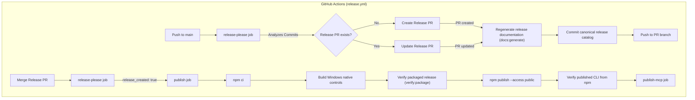
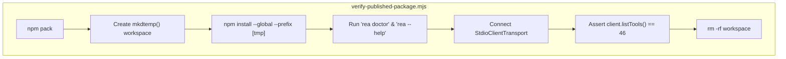

<!-- source: DeepWiki mcp.deepwiki.com · repo morluto/rea · page 9.2 Release Process · fetched 2026-10-09 -->

# Release Process

Relevant source files

The following files were used as context for generating this wiki page:

- [.github/workflows/release.yml](.github/workflows/release.yml)
- [.release-please-manifest.json](.release-please-manifest.json)
- [CHANGELOG.md](CHANGELOG.md)
- [README.md](README.md)
- [README_ar.md](README_ar.md)
- [README_ja.md](README_ja.md)
- [README_ko.md](README_ko.md)
- [README_zh.md](README_zh.md)
- [package-lock.json](package-lock.json)
- [package.json](package.json)
- [release-please-config.json](release-please-config.json)
- [scripts/verify-published-package.mjs](scripts/verify-published-package.mjs)
- [src/generatedPackageMetadata.ts](src/generatedPackageMetadata.ts)
- [tests/conformance/readmeConsistency.test.ts](tests/conformance/readmeConsistency.test.ts)
- [tests/conformance/releaseConfiguration.test.ts](tests/conformance/releaseConfiguration.test.ts)

REA utilizes an automated release workflow powered by **release-please**. This system manages versioning, generates changelogs from Conventional Commits, and handles the publishing of the `rea-agents` package to the npm registry.

## Automated Versioning Workflow

The release process is divided into two distinct stages: version management via Pull Request and the automated publication job.

### Stage 1: Release Please (PR Generation)
When changes are merged into the `main` branch, the `release-please` job in [.github/workflows/release.yml:15-31]() triggers. It analyzes the commit history since the last release tag to determine the next version number (SemVer).

1.  **Changelog Generation**: It updates `CHANGELOG.md` by grouping commits into categories based on their type [release-please-config.json:5-14]().
2.  **Manifest Update**: It updates the version in `.release-please-manifest.json` [.release-please-manifest.json:2-2]() and `package.json`.
3.  **Pull Request**: It opens (or updates) a "Release PR". Merging this PR signals that the release is ready.
4.  **Generated Documentation**: If a Release PR is created, the workflow checks out the PR branch, installs dependencies, and regenerates release documentation via `npm run docs:generate` [.github/workflows/release.yml:32-53](). This ensures `docs/product-catalog.json` is canonical for the release [.github/workflows/release.yml:55-91]().

### Stage 2: Publication
Once the Release PR is merged, the `release-please` job outputs `release_created: true` [.github/workflows/release.yml:22-22](). This triggers the `publish` job [.github/workflows/release.yml:93-159](), which performs the following:
1.  **Environment Setup**: Configures Node.js and the npm registry URL [.github/workflows/release.yml:103-107]().
2.  **Build Windows Native Controls**: Installs the necessary toolchain and builds the bundled Windows native controls, then verifies the artifact [.github/workflows/release.yml:111-115]().
3.  **Verify Packaged Release**: Runs `npm run verify:package` to ensure the package integrity before publishing [.github/workflows/release.yml:117-118]().
4.  **Publish**: Checks if the version is already published. If not, it executes `npm publish --access public` to distribute the package [.github/workflows/release.yml:121-129]().
5.  **Verify Published CLI**: After publishing, it attempts to install and run the newly published `rea-agents` package from npm to verify its functionality, including `rea --help`, `rea --llms`, and a more comprehensive verification script `scripts/verify-published-package.mjs` [.github/workflows/release.yml:131-158](). This step includes retries to account for npm registry propagation delays.
6.  **Publish to MCP Registry**: A separate `publish-mcp` job is triggered if the release was created and the npm publish was successful [.github/workflows/release.yml:161-164](). This job checks out the release tag and verifies package and registry metadata versions [.github/workflows/release.yml:169-174]().

### Release Data Flow
The following diagram illustrates the transition from commit to published artifact.

**Release Pipeline Flow**

Sources: [.github/workflows/release.yml:1-196](), [release-please-config.json:1-21]()

## Conventional Commits

The versioning logic depends on the format of commit messages. REA follows the Conventional Commits specification.

| Commit Type | Changelog Section | SemVer Impact |
| :--- | :--- | :--- |
| `feat` | Features | Minor (0.x.0) |
| `fix` | Bug Fixes | Patch (0.0.x) |
| `perf` | Performance Improvements | Patch (0.0.x) |
| `refactor` | Code Refactoring | Patch (0.0.x) |
| `docs` | Documentation | Patch (0.0.x) |
| `ci` | Continuous Integration | Patch (0.0.x) |
| `test` | Tests | Patch (0.0.x) |
| `chore` | (Hidden) | Patch (0.0.x) |

Any commit containing `BREAKING CHANGE` in the footer or a `!` after the type (e.g., `feat!:`) will trigger a Major version bump.

Sources: [release-please-config.json:5-14](), [CHANGELOG.md:1-55]()

## Verification and Safety

Before a release is finalized, the codebase undergoes rigorous verification to ensure the package integrity.

### Package Verification Script
The `scripts/verify-published-package.mjs` script is used to smoke-test the actual npm tarball in an isolated environment. This ensures that:
*   **No Bytecode Leakage**: It checks that `__pycache__` or `.pyc` files are not included in the package [scripts/verify-published-package.mjs:31-37]().
*   **Isolated Execution**: It creates a temporary workspace with a fake `HOME` and `PATH` to ensure the CLI doesn't rely on local development files [scripts/verify-published-package.mjs:38-80]().
*   **Tool Integrity**: It spins up an MCP client and verifies that exactly 46 tools are exposed by the server [scripts/verify-published-package.mjs:164-165]().
*   **Idempotency**: It runs the `setup` command twice to ensure it is idempotent and correctly handles existing configurations [scripts/verify-published-package.mjs:100-109]().

**Package Verification Logic**

Sources: [scripts/verify-published-package.mjs:20-185]()

### README Consistency and Release Configuration Tests
The `tests/conformance/readmeConsistency.test.ts` file contains tests to ensure that the `README.md` and its localized versions (`README_zh.md`, `README_ja.md`, `README_ko.md`, `README_ar.md`) are consistent with the project's configuration and facts.
These tests verify:
*   **MCP Server Configuration**: The `mcpServers` configuration in JSON examples within the READMEs correctly points to the `rea-agents` package and its `mcp` command [.github/workflows/release.yml:145-146](), [tests/conformance/readmeConsistency.test.ts:29-42]().
*   **System Requirements**: The READMEs accurately list Node.js, macOS, Ubuntu, Fedora, Arch Linux, and CachyOS requirements [tests/conformance/readmeConsistency.test.ts:43-48]().
*   **Supported Clients**: All `SUPPORTED_CLIENT_DEFINITIONS` are mentioned in the READMEs [tests/conformance/readmeConsistency.test.ts:49-50]().
*   **CLI Onboarding Paths**: Both `npx rea-agents setup` and `npm install --global rea-agents` followed by `rea setup` are discoverable in the English README [tests/conformance/readmeConsistency.test.ts:55-64]().
*   **Installation Documentation Links**: Links to `docs/installation.md` are present and the installation guide documents specific commands like `curl -fsSL ... install.sh` and `rea setup --install-hopper` [tests/conformance/readmeConsistency.test.ts:66-77]().
*   **Setup Freshness and Rollback**: The installation documentation explicitly mentions `npx rea-agents@latest setup` and `npm exec ... rea setup` for freshness and rollback [tests/conformance/readmeConsistency.test.ts:79-87]().
*   **MCP Registry Path**: The documentation correctly states the MCP Registry installation path as `io.github.morluto/rea` [tests/conformance/readmeConsistency.test.ts:90-104]().

The `tests/conformance/releaseConfiguration.test.ts` file also includes tests to ensure that the `package.json` version matches the `PACKAGE_METADATA` in `src/generatedPackageMetadata.ts` and the `.release-please-manifest.json` file. This ensures internal consistency of version numbers across different configuration files.

**README Consistency and Release Configuration Test Flow**

```mermaid
graph TD
    subgraph "tests/conformance/readmeConsistency.test.ts"
        A[Start Test] --> B{Read README.md and localized versions}
        B --> C{Verify MCP Server Config}
        C --> D{Verify System Requirements}
        D --> E{Verify Supported Clients}
        E --> F{Verify CLI Onboarding Paths}
        F --> G{Verify Installation Doc Links}
        G --> H{Verify Setup Freshness/Rollback}
        H --> I{Verify MCP Registry Path}
        I --> J[End Test]
    end

    subgraph "tests/conformance/releaseConfiguration.test.ts"
        K[Start Test] --> L{Read package.json}
        L --> M{Read generatedPackageMetadata.ts}
        M --> N{Read .release-please-manifest.json}
        N --> O{Assert package.json version == PACKAGE_METADATA version}
        O --> P{Assert package.json version == release-please-manifest version}
        P --> Q[End Test]
    end
```

Sources: [tests/conformance/readmeConsistency.test.ts:1-105](), [tests/conformance/releaseConfiguration.test.ts:1-15](), [package.json:4-4](), [src/generatedPackageMetadata.ts:4-4](), [.release-please-manifest.json:2-2]()

## Maintainer Release Checklist

While the process is automated, maintainers should follow this checklist when preparing a release:

1.  **Review Conventional Commits**: Ensure recent commits use the correct prefixes (`feat`, `fix`, etc.) to trigger the intended version bump.
2.  **Verify CI Green**: Ensure the standard CI pipeline (Typecheck, Lint, Test) is passing on the `main` branch [.github/workflows/ci.yml:1-111]().
3.  **Inspect Release PR**: When `release-please` opens the PR, review the generated `CHANGELOG.md` [CHANGELOG.md:1-55]() to ensure all significant changes are captured.
4.  **Local Smoke Test**: (Optional) Run `node scripts/verify-published-package.mjs` locally to confirm the package builds and installs correctly.
5.  **Merge Release PR**: Merging the PR will automatically trigger the npm publication.
6.  **Verify npm**: Confirm the new version is available via `npm view rea-agents version`.

Sources: [.github/workflows/release.yml:12-164](), [scripts/verify-published-package.mjs:1-193]()

---

