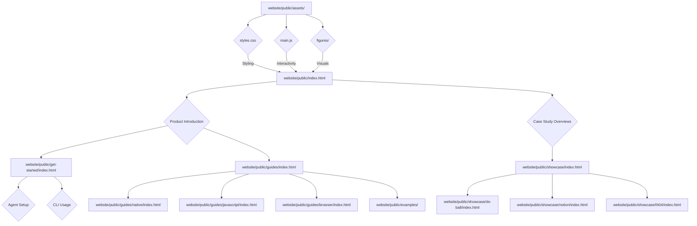
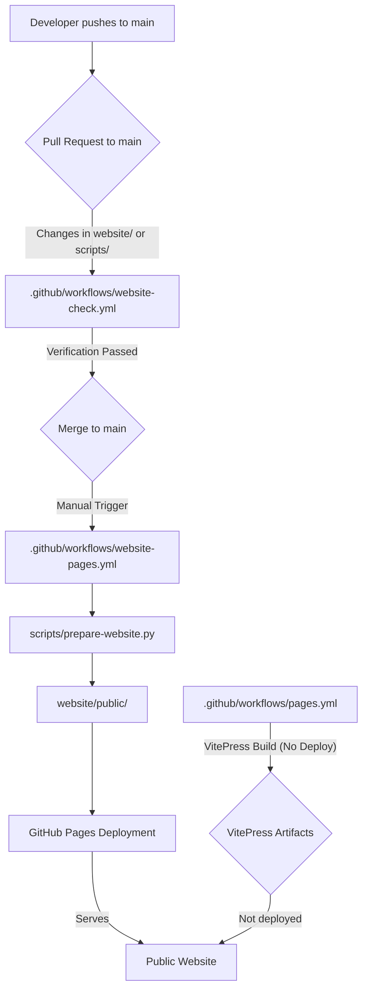

<!-- source: DeepWiki mcp.deepwiki.com · repo morluto/rea · page 9.3 Documentation Site and Website · fetched 2026-10-09 -->

# Documentation Site and Website

<details>
<summary>Relevant source files</summary>

The following files were used as context for generating this wiki page:

- [.github/workflows/pages.yml](.github/workflows/pages.yml)
- [.github/workflows/website-check.yml](.github/workflows/website-check.yml)
- [.github/workflows/website-pages.yml](.github/workflows/website-pages.yml)
- [docs/.vitepress/config.ts](docs/.vitepress/config.ts)
- [docs/android-analysis.md](docs/android-analysis.md)
- [docs/firmware-analysis.md](docs/firmware-analysis.md)
- [docs/index.md](docs/index.md)
- [docs/installation.md](docs/installation.md)
- [docs/roadmap.md](docs/roadmap.md)
- [docs/windows-ghidra-p0.md](docs/windows-ghidra-p0.md)
- [scripts/verify-website.py](scripts/verify-website.py)
- [website/AGENTS.md](website/AGENTS.md)
- [website/README.md](website/README.md)
- [website/evidence/guide-examples.md](website/evidence/guide-examples.md)
- [website/figures.md](website/figures.md)
- [website/public/assets/figures/dx-ball-sound-pan-investigation.svg](website/public/assets/figures/dx-ball-sound-pan-investigation.svg)
- [website/public/assets/main.js](website/public/assets/main.js)
- [website/public/assets/styles.css](website/public/assets/styles.css)
- [website/public/get-started/index.html](website/public/get-started/index.html)
- [website/public/guides/browser/index.html](website/public/guides/browser/index.html)
- [website/public/guides/index.html](website/public/guides/index.html)
- [website/public/guides/javascript/index.html](website/public/guides/javascript/index.html)
- [website/public/guides/native/index.html](website/public/guides/native/index.html)
- [website/public/index.html](website/public/index.html)
- [website/public/showcase/dx-ball/index.html](website/public/showcase/dx-ball/index.html)
- [website/public/showcase/index.html](website/public/showcase/index.html)
- [website/public/showcase/notion/index.html](website/public/showcase/notion/index.html)
- [website/public/showcase/th04/index.html](website/public/showcase/th04/index.html)
- [website/style-guide.md](website/style-guide.md)

</details>


This page details the implementation and structure of REA's documentation site and public website. It covers the VitePress-based documentation, the static marketing website, the style guide, figure generation, and the GitHub Pages deployment workflows.

## Documentation Site (VitePress)

The primary documentation for REA is built using VitePress. This site provides comprehensive guides and references for developers and users.

### Configuration

The VitePress configuration is managed in `docs/.vitepress/config.ts` [docs/.vitepress/config.ts](). This file defines the site's title, description, theme, and navigation structure.

### Content Structure

The documentation content is written in Markdown files within the `docs/` directory. The `docs/index.md` [docs/index.md]() serves as the homepage for the documentation. Specific topics like installation are covered in `docs/installation.md` [docs/installation.md]().

Sources:
- `docs/.vitepress/config.ts`
- `docs/index.md`
- `docs/installation.md`

## Public Static Website

The public-facing website, located in `website/public/`, is a static site designed to showcase REA's capabilities, provide getting started guides, and present case studies. It is built using plain HTML, CSS, and a small amount of JavaScript, without a frontend bundler or npm dependencies for the public assets.

### Website Structure

The website's content is organized into several key pages:
- `website/public/index.html` [website/public/index.html](): The product introduction and overview of case studies.
- `website/public/showcase/index.html` [website/public/showcase/index.html](): An index of all case studies.
- `website/public/showcase/dx-ball/index.html` [website/public/showcase/dx-ball/index.html](): Details the DX-Ball sound-pan investigation.
- `website/public/showcase/notion/index.html` [website/public/showcase/notion/index.html](): Explores Notion's Electron clipboard bridge.
- `website/public/showcase/th04/index.html` [website/public/showcase/th04/index.html](): Focuses on TH04's bullet-angle calculation.
- `website/public/get-started/index.html` [website/public/get-started/index.html](): Guides users through agent setup and initial CLI usage.
- `website/public/guides/` [website/public/guides/index.html](): A hub for various guides, including native, JavaScript/Electron, and browser examples.
- `website/public/examples/`: Contains downloadable Electron source and an interactive Notes browser app.
- `website/public/assets/`: Stores shared styles, interactions, favicon, and explanatory figures.

Navigation and asset paths are relative, ensuring the site functions correctly whether hosted at the root or a project path like `/rea/` on GitHub Pages [website/README.md:38-40]().

### Styling and Interactivity

The website's visual presentation is defined in `website/public/assets/styles.css` [website/public/assets/styles.css](). This CSS file establishes a light color scheme, typography, and layout for various components like headers, buttons, and code blocks.

Key CSS variables define the color palette:
- `--ink`: `#20252b` (main text color)
- `--muted`: `#5b6570` (secondary text color)
- `--line`: `#e0e5e9` (border color)
- `--soft`: `#f4f6f8` (background for soft elements)
- `--accent`: `#294f82` (accent color for links)
- `--page`: `#ffffff` (page background)
[website/public/assets/styles.css:3-8]()

Interactivity, such as the "Copy" buttons for code snippets and the "Back to top" link, is handled by `website/public/assets/main.js` [website/public/assets/main.js](). The "Back to top" link appears after scrolling and uses smooth scrolling when reduced motion is disabled [website/README.md:68-71]().

### Content Guidelines

The `website/README.md` [website/README.md:1-145]() and `website/style-guide.md` [website/style-guide.md]() provide detailed guidelines for content creation. Key principles include:
- **Direct and Specific Copy**: Explaining tasks and results before listing tool names [website/README.md:43-44]().
- **Matching Setup Commands**: Ensuring setup commands and runtime requirements align with the released package [website/README.md:44-45]().
- **Core Learning Path**: Keeping essential learning content within the site, while external links can point to repositories for source, issues, or evidence [website/README.md:45-47]().
- **Example Prompts**: Agent terminals display example prompts, not transcripts of past investigations [website/README.md:62-63]().
- **Figures**: Explanatory figures are maintained as SVG source, with initial layouts generated by an image generation tool [website/README.md:81-83](). They provide an overview, while REA requests, assembly, and C code remain selectable HTML text [website/README.md:83-84]().

### Example Data and Fixtures

The `website/evidence/guide-examples.md` [website/evidence/guide-examples.md]() records the published REA package, example digests, and observed results used in the guides.
The Notes Electron fixture is used for static analysis, and Electron is not a prerequisite for following that example [website/README.md:50-52](). The Notes browser app runs in local preview and generates a CSV download [website/README.md:52-53]().

The Electron guide provides a ZIP file containing six source files from `notes-example/`. This ZIP is generated by `scripts/prepare-website.py` [scripts/prepare-website.py]() with fixed timestamps and permissions, and its entries are verified to match the current source [website/README.md:54-60]().

### Case Studies

The website features detailed case studies:
- **DX-Ball**: Reconstructing the sound-pan calculation from a 1996 Windows game [website/public/showcase/dx-ball/index.html:45-57](). Figures and findings refer to a specific checkpoint (`a55dca27ec0a07018c1b2c95ae2be027f7d8c3c4`) [website/README.md:73-75]().
- **Notion**: Tracing Notion's Electron clipboard bridge and rich clipboard format [website/public/showcase/notion/index.html]().
- **TH04**: Inspecting the 16-bit DOS bullet-angle calculation [website/public/showcase/th04/index.html:39-43]().

Sources:
- `website/public/index.html`
- `website/public/showcase/index.html`
- `website/public/showcase/dx-ball/index.html`
- `website/public/showcase/notion/index.html`
- `website/public/showcase/th04/index.html`
- `website/public/get-started/index.html`
- `website/public/guides/index.html`
- `website/public/examples/`
- `website/public/assets/styles.css`
- `website/public/assets/main.js`
- `website/README.md`
- `website/style-guide.md`
- `website/evidence/guide-examples.md`
- `scripts/prepare-website.py`

## Website Preparation and Verification

The website content is prepared and verified using Python scripts.

### Local Preview

To preview the website locally, navigate to the repository root and run:
```sh
python3 scripts/prepare-website.py
python3 -m http.server 4173 --bind 127.0.0.1 --directory website/public
```
This serves the `website/public` directory, allowing for live edits and browser refreshes [website/README.md:17-22]().

### Preparation Script

The `scripts/prepare-website.py` [scripts/prepare-website.py]() script is responsible for generating necessary assets, such as the downloadable ZIP for the Electron guide, ensuring fixed timestamps and permissions [website/README.md:54-57]().

### Verification Script

The `scripts/verify-website.py` [scripts/verify-website.py]() script performs checks on the website content, including local links, HTML fragments, and SVG XML [website/README.md:117-118](). These checks can be run locally:
```sh
python3 scripts/prepare-website.py
python3 scripts/verify-website.py
```
[website/README.md:122-124]()

Sources:
- `scripts/prepare-website.py`
- `scripts/verify-website.py`
- `website/README.md`

## GitHub Pages Workflows

The deployment of the public website to GitHub Pages is managed by specific GitHub Actions workflows.

### Deployment Workflow

The `.github/workflows/website-pages.yml` [website-pages.yml]() workflow is responsible for preparing and deploying only the `website/public` directory. This workflow is manually triggered and restricted to the `main` branch, preventing ordinary pushes and pull requests from publishing the site [website/README.md:112-114]().

### Website Check Workflow

A separate workflow, `.github/workflows/website-check.yml` [website-check.yml](), runs checks only for pull requests that modify the `website/` directory, the verification script, or workflow definitions. These checks do not install npm dependencies and run before each manual deployment [website/README.md:115-118]().

### Legacy VitePress Build

The `.github/workflows/pages.yml` [pages.yml]() is a separate, manual-only VitePress build. It does not include a Pages artifact upload or deployment job, ensuring that documentation updates do not inadvertently replace the public website [website/README.md:126-130]().

### Deployment Process

After a site is approved and merged, the deployment involves selecting **GitHub Actions** under the repository's **Settings → Pages → Build and deployment**, then running **Publish REA** [website/README.md:132-133]().

Sources:
- `.github/workflows/website-pages.yml`
- `.github/workflows/website-check.yml`
- `.github/workflows/pages.yml`
- `website/README.md`

## Diagrams

### Website Content Flow

Sources:
- `website/public/index.html`
- `website/public/showcase/index.html`
- `website/public/showcase/dx-ball/index.html`
- `website/public/showcase/notion/index.html`
- `website/public/showcase/th04/index.html`
- `website/public/get-started/index.html`
- `website/public/guides/index.html`
- `website/public/guides/native/index.html`
- `website/public/guides/javascript/index.html`
- `website/public/guides/browser/index.html`
- `website/public/examples/`
- `website/public/assets/styles.css`
- `website/public/assets/main.js`
- `website/README.md`

### GitHub Pages Deployment Workflow

Sources:
- `.github/workflows/website-pages.yml`
- `.github/workflows/website-check.yml`
- `.github/workflows/pages.yml`
- `scripts/prepare-website.py`
- `website/public/`
- `website/README.md`

---

