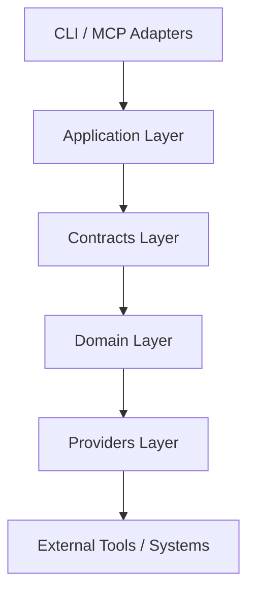
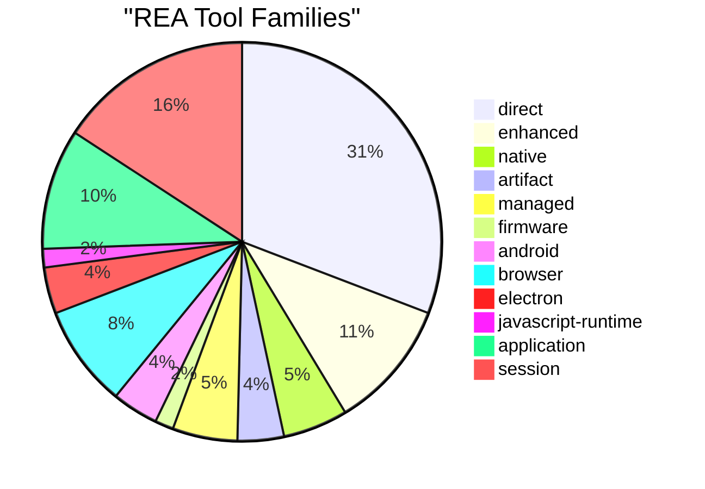
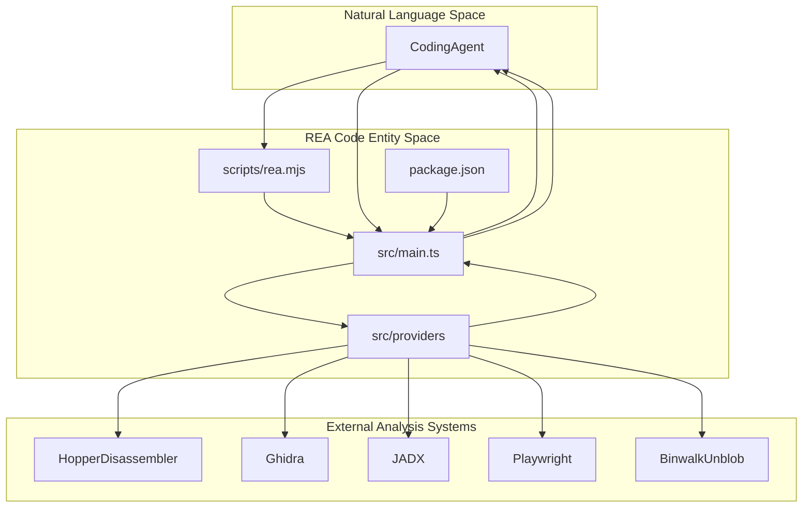

<!-- source: DeepWiki mcp.deepwiki.com · repo morluto/rea · page 1 REA Overview · fetched 2026-10-16 -->

# REA Overview

Relevant source files

The following files were used as context for generating this wiki page:

- [.agents/skills/reverse-engineer-anything/references/connection-and-recovery.md](.agents/skills/reverse-engineer-anything/references/connection-and-recovery.md)
- [.release-please-manifest.json](.release-please-manifest.json)
- [CHANGELOG.md](CHANGELOG.md)
- [README.md](README.md)
- [docs/client-configuration.md](docs/client-configuration.md)
- [docs/installation.md](docs/installation.md)
- [package-lock.json](package-lock.json)
- [package.json](package.json)
- [scripts/lib/catalog-builders.mjs](scripts/lib/catalog-builders.mjs)
- [scripts/lib/catalog-core.mjs](scripts/lib/catalog-core.mjs)
- [scripts/verify-package-environment.d.mts](scripts/verify-package-environment.d.mts)
- [scripts/verify-package-environment.mjs](scripts/verify-package-environment.mjs)
- [server.json](server.json)
- [src/application/CapabilityInventory.test.ts](src/application/CapabilityInventory.test.ts)
- [src/application/CapabilityInventory.ts](src/application/CapabilityInventory.ts)
- [src/application/ClientConfigurationDocument.ts](src/application/ClientConfigurationDocument.ts)
- [src/application/ClientRegistrationEnvironment.ts](src/application/ClientRegistrationEnvironment.ts)
- [src/application/ClientRegistrationStatus.ts](src/application/ClientRegistrationStatus.ts)
- [src/application/SetupClientConfiguration.ts](src/application/SetupClientConfiguration.ts)
- [src/application/SupportedClients.ts](src/application/SupportedClients.ts)
- [src/application/Uninstall.ts](src/application/Uninstall.ts)
- [src/cliCommandNames.ts](src/cliCommandNames.ts)
- [src/contracts/toolContracts.ts](src/contracts/toolContracts.ts)
- [src/contracts/toolEffects.ts](src/contracts/toolEffects.ts)
- [src/domain/hopperValues.test.ts](src/domain/hopperValues.test.ts)
- [src/generatedPackageMetadata.ts](src/generatedPackageMetadata.ts)
- [src/mcpStartupPolicy.ts](src/mcpStartupPolicy.ts)
- [src/server/createServer.ts](src/server/createServer.ts)
- [src/server/mcpClientMetadata.ts](src/server/mcpClientMetadata.ts)
- [src/server/registerSessionStatusTool.ts](src/server/registerSessionStatusTool.ts)
- [src/server/registerSessionTools.ts](src/server/registerSessionTools.ts)
- [tests/boundary/filesystem/clientConfigurationDialects.test.ts](tests/boundary/filesystem/clientConfigurationDialects.test.ts)
- [tests/boundary/filesystem/clientLifecycle.test.ts](tests/boundary/filesystem/clientLifecycle.test.ts)
- [tests/boundary/filesystem/kimiClientConfiguration.test.ts](tests/boundary/filesystem/kimiClientConfiguration.test.ts)
- [tests/boundary/filesystem/ompClientConfiguration.test.ts](tests/boundary/filesystem/ompClientConfiguration.test.ts)
- [tests/boundary/mcp/clientCapabilities.test.ts](tests/boundary/mcp/clientCapabilities.test.ts)
- [tests/boundary/mcp/enhancedTools.04-uses-complete-inventories-inline.test.ts](tests/boundary/mcp/enhancedTools.04-uses-complete-inventories-inline.test.ts)
- [tests/composition/idaProvider.test.ts](tests/composition/idaProvider.test.ts)
- [tests/fixtures/clientEnvironment.ts](tests/fixtures/clientEnvironment.ts)

REA (Reverse Engineer Anything) is a local-only CLI and Model Context Protocol (MCP) server designed to provide coding agents with advanced reverse engineering capabilities. It enables analysis of native binaries, managed assemblies, JavaScript/Electron applications, browsers, Android packages, and firmware. REA helps developers understand how features work at a low level and facilitates building interoperable implementations. [README.md:8-64]()

The project aims to bridge high-level agentic workflows with low-level static and dynamic analysis by integrating with various analysis providers like Hopper Disassembler, Ghidra, JADX, and Playwright [README.md:52]().

## Core Purpose

REA addresses the "black box" problem in software development, where source code is unavailable. It provides a systematic way for agents to:
1.  **Decompile**: Recover readable pseudo-code and assembly from binaries [README.md:66-68]().
2.  **Understand**: Trace execution flows, cross-references, and call graphs to explain how features or algorithms work [README.md:68-69]().
3.  **Recreate**: Translate observed logic into new code tailored to a different technology stack, UI, or requirements [README.md:69-70]().

Sources: [README.md:52-70]()

## Architecture Layers

REA is structured as a layered ESM TypeScript application where dependencies flow inward from adapters to the core domain logic. This design ensures modularity and maintainability.

**Diagram: REA Layered Architecture**

Sources: [README.md:52](), [package.json:32-34]()

## Tool Catalog

REA exposes a comprehensive set of tools to agents and CLI users, categorized by their function and target. The product catalog lists tools across various families [package.json:15-32]().

**Diagram: REA Tool Families**

Sources: [package.json:15-32]()

## Integration with Coding Agents

REA is designed to integrate seamlessly with various AI coding assistants, providing them with the ability to perform reverse engineering tasks. The `rea setup` command registers REA with supported agents and installs matching workflow instructions [README.md:53-55]().

**Diagram: Agent Integration and MCP Flow**

Sources: [README.md:53-55](), [README.md:70-86](), [package.json:32-34]()

## Navigation Guide

This wiki is organized to help you move from initial setup to deep architectural understanding.

### Getting Started
This page covers how to install REA via `npx` or `npm`, run `rea setup` to configure agents and analysis providers, and use `rea doctor` for diagnostics. It also details how to connect various coding agents like Claude Code, Codex, Cursor, Gemini, and VS Code. For details, see [Getting Started](#1.1).
Sources: [README.md:58-64](), [README.md:70-86](), [README.md:100-102]()

### Configuration Reference
This section provides a detailed reference for REA's configuration options, including environment variables, the `AppConfig` and `parseConfig` mechanisms, client configuration documents, identity and product catalog digests, and paths for cache and state management. For details, see [Configuration Reference](#1.2).
Sources: [package.json:1-46]()

### Setup, Doctor and Uninstall Internals
This page delves into the internal workings of REA's setup, doctor, and uninstall processes. It explains the plan/apply state machine used by `runSetup`, the roles of `SetupHost` and `SetupSkill`, how `Doctor` performs diagnostics and checks client registration status, and the mechanics of `Uninstall`. For details, see [Setup, Doctor and Uninstall Internals](#1.3).
Sources: [src/application/Uninstall.ts:1-181](), [src/application/ClientRegistrationStatus.ts:1-120]()

---

