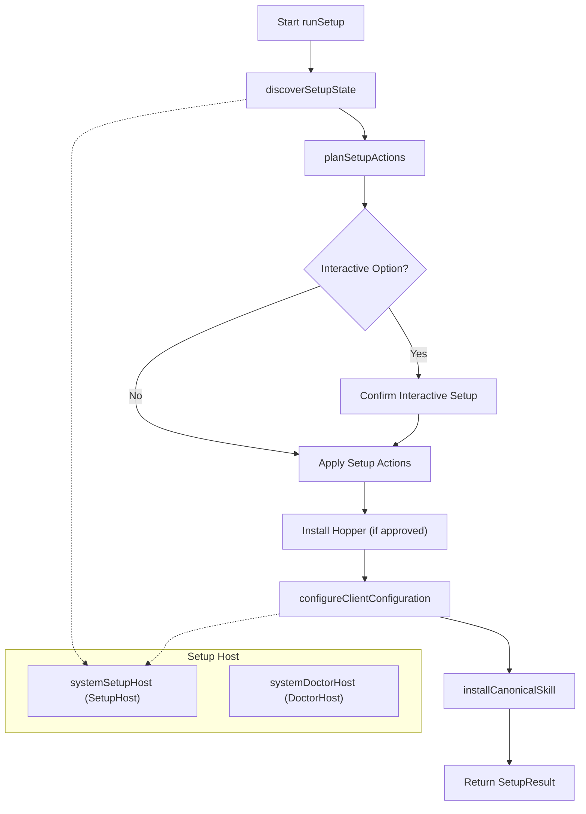
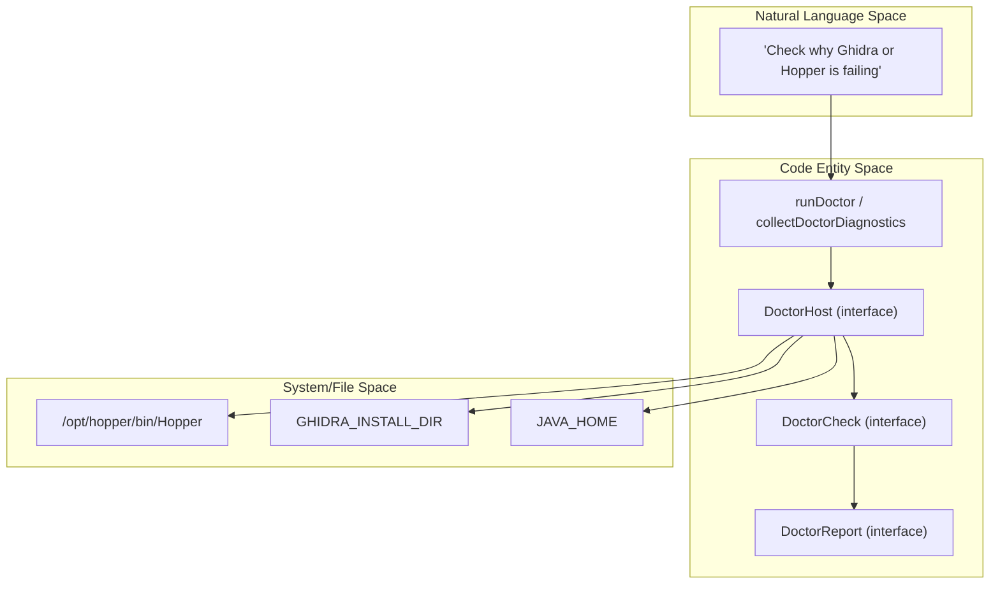
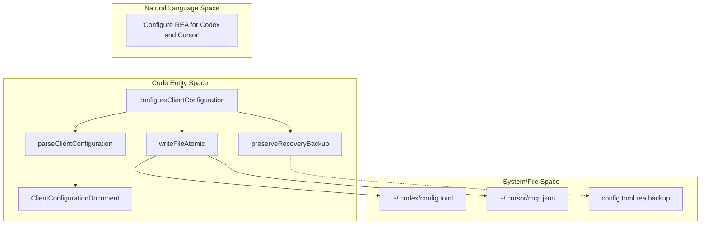

<!-- source: DeepWiki mcp.deepwiki.com · repo morluto/rea · page 1.1 Getting Started · fetched 2026-10-16 -->

# Getting Started

<details>
<summary>Relevant source files</summary>

The following files were used as context for generating this wiki page:

- [.agents/skills/reverse-engineer-anything/references/connection-and-recovery.md](.agents/skills/reverse-engineer-anything/references/connection-and-recovery.md)
- [README.md](README.md)
- [docs/client-configuration.md](docs/client-configuration.md)
- [docs/installation.md](docs/installation.md)
- [scripts/hopper-demo-x11.py](scripts/hopper-demo-x11.py)
- [scripts/verify-package-environment.d.mts](scripts/verify-package-environment.d.mts)
- [scripts/verify-package-environment.mjs](scripts/verify-package-environment.mjs)
- [scripts/verify-package.mjs](scripts/verify-package.mjs)
- [src/application/ClientConfigurationDocument.ts](src/application/ClientConfigurationDocument.ts)
- [src/application/ClientRegistrationEnvironment.ts](src/application/ClientRegistrationEnvironment.ts)
- [src/application/ClientRegistrationIdentity.ts](src/application/ClientRegistrationIdentity.ts)
- [src/application/ClientRegistrationStatus.ts](src/application/ClientRegistrationStatus.ts)
- [src/application/Doctor.test.ts](src/application/Doctor.test.ts)
- [src/application/Doctor.ts](src/application/Doctor.ts)
- [src/application/DoctorDiagnostics.ts](src/application/DoctorDiagnostics.ts)
- [src/application/LinuxHopper.test.ts](src/application/LinuxHopper.test.ts)
- [src/application/LinuxHopper.ts](src/application/LinuxHopper.ts)
- [src/application/Setup.configuration.test.ts](src/application/Setup.configuration.test.ts)
- [src/application/Setup.fixture.ts](src/application/Setup.fixture.ts)
- [src/application/Setup.planning.test.ts](src/application/Setup.planning.test.ts)
- [src/application/Setup.recovery.test.ts](src/application/Setup.recovery.test.ts)
- [src/application/Setup.ts](src/application/Setup.ts)
- [src/application/SetupClientConfiguration.ts](src/application/SetupClientConfiguration.ts)
- [src/application/SetupHost.ts](src/application/SetupHost.ts)
- [src/application/SetupPlan.ts](src/application/SetupPlan.ts)
- [src/application/SetupSkill.ts](src/application/SetupSkill.ts)
- [src/application/SetupTypes.ts](src/application/SetupTypes.ts)
- [src/application/SupportedClients.ts](src/application/SupportedClients.ts)
- [src/application/Uninstall.ts](src/application/Uninstall.ts)
- [src/cli.ts](src/cli.ts)
- [src/cli/interactiveSetup.ts](src/cli/interactiveSetup.ts)
- [src/cli/setupCommands.ts](src/cli/setupCommands.ts)
- [src/domain/runtimeVersion.test.ts](src/domain/runtimeVersion.test.ts)
- [src/domain/runtimeVersion.ts](src/domain/runtimeVersion.ts)
- [src/identity.ts](src/identity.ts)
- [src/mcpStartupPolicy.ts](src/mcpStartupPolicy.ts)
- [src/process/snapshotEnvironment.test.ts](src/process/snapshotEnvironment.test.ts)
- [src/process/snapshotEnvironment.ts](src/process/snapshotEnvironment.ts)
- [src/setupEnvironment.test.ts](src/setupEnvironment.test.ts)
- [tests/boundary/cli/cliSetup.test.ts](tests/boundary/cli/cliSetup.test.ts)
- [tests/boundary/filesystem/clientConfigurationDialects.test.ts](tests/boundary/filesystem/clientConfigurationDialects.test.ts)
- [tests/boundary/filesystem/clientLifecycle.test.ts](tests/boundary/filesystem/clientLifecycle.test.ts)
- [tests/boundary/filesystem/kimiClientConfiguration.test.ts](tests/boundary/filesystem/kimiClientConfiguration.test.ts)
- [tests/boundary/filesystem/ompClientConfiguration.test.ts](tests/boundary/filesystem/ompClientConfiguration.test.ts)
- [tests/boundary/filesystem/setupSkill.test.ts](tests/boundary/filesystem/setupSkill.test.ts)
- [tests/boundary/filesystem/windowsNpxRegistration.test.ts](tests/boundary/filesystem/windowsNpxRegistration.test.ts)
- [tests/fixtures/clientEnvironment.ts](tests/fixtures/clientEnvironment.ts)

</details>


This page provides a technical guide for installing, configuring, and maintaining REA (Reverse Engineer Anything). It covers the idempotent setup workflow, environment verification via `rea doctor`, transactional client configuration for Model Context Protocol (MCP) coding agents, and maintenance commands like `rea update` and `rea uninstall`.

## Prerequisites and System Requirements

REA operates locally across native binaries, managed assemblies, JavaScript/Electron applications, and web runtimes. The installation requires compatible Node.js environments and optional analysis engines depending on target scopes.

| Requirement | Minimum Version / Spec | Verification Command |
| :--- | :--- | :--- |
| **Operating System** | macOS 12+, Ubuntu 24.04+, Fedora 41+, 64-bit Arch Linux, CachyOS, or Windows x64 | `uname -a` or `sw_vers -productVersion` |
| **Node.js** | 22.x (>=22.19), 24.x (>=24.11), or 26+ | `node --version` |
| **Hopper Disassembler** | v4 or v5 (macOS/Linux) | `rea doctor` |
| **Ghidra** | 12.1.x (Windows/Linux/macOS) | `rea doctor` |
| **JDK** | 17+ (for JADX), 21+ (for Ghidra 12.1.x) | `java -version` |

Sources: [docs/installation.md:1-5](), [src/application/Doctor.ts:94-126]()

## Installation and Setup

The primary entry point for agent and CLI configuration is the `setup` command implemented in `runSetup` [src/application/Setup.ts:32-36]() and hosted via `SetupHost` [src/application/SetupHost.ts:144-158]().

### Automated Setup via npx
To configure your agents and verify the local environment, run:
```bash
npx rea-agents setup
```
To explicitly select the latest published release:
```bash
npx rea-agents@latest setup
```
For non-interactive automation or CI pipelines, pass explicit flags such as `--yes`, `--all-detected`, or `--client <name>` along with `--json` [docs/installation.md:104-116]().

### Global Installation
To install the `rea` command globally on your system path:
```bash
npm install --global rea-agents
rea --help
```

### Skill-only Installation
To install only the agent instructions and bundled reference skills without registering REA's MCP server or analysis engines:
```bash
npx skills add morluto/rea --skill reverse-engineer-anything
```
Sources: [docs/installation.md:14-29](), [src/application/Setup.ts:32-36]()

### Setup Logic Flow and State Machine
The setup process follows a strict transaction lifecycle managed by `runSetup` [src/application/Setup.ts:32-36]() and `systemSetupHost` [src/application/SetupHost.ts:144-158](). It inspects system state, plans modifications, verifies existing configuration backups, and applies changes atomically.

Title: Setup State Machine and Execution Flow

Sources: [src/application/Setup.ts:32-84](), [src/application/SetupHost.ts:144-179]()

## Verifying the Environment (`rea doctor`)

The `doctor` command executes a read-only health diagnostic across system dependencies, analysis provider runtimes, and client registrations [src/application/Doctor.ts:129-139]().

```bash
rea doctor
```

To scope diagnostics to specific components:
```bash
rea doctor --client codex --provider ghidra --skill
```

### Diagnostics Architecture
`collectDoctorDiagnostics` queries the `DoctorHost` interface [src/application/Doctor.ts:94-126]() to inspect Node.js compatibility, executable paths (`HOPPER_LAUNCHER_PATH`, `GHIDRA_INSTALL_DIR`, `JAVA_HOME`), OS distribution rules, and client configuration validity.

Title: Natural Language Space to Code Entity Space - Doctor Diagnostics

Sources: [src/application/Doctor.ts:44-52](), [src/application/Doctor.ts:94-126](), [src/application/Doctor.ts:129-139]()

## MCP Client Configuration and Transaction Lifecycle

REA integrates with coding agents by updating their respective JSON or TOML MCP configuration files via `configureClientConfiguration` [src/application/SetupClientConfiguration.ts:82-96]().

### Supported Agents and Configuration Formats
`rea setup` automatically discovers and configures supported agents:
- **Claude Code** (`claude_code`, JSON at `~/.claude.json`) [tests/boundary/filesystem/clientLifecycle.test.ts:50-84]()
- **Claude Desktop** (`claude_desktop`, JSON) [tests/boundary/filesystem/clientLifecycle.test.ts:56]()
- **Codex** (`codex`, TOML at `~/.codex/config.toml`) [tests/boundary/filesystem/clientLifecycle.test.ts:57]()
- **Cursor** (`cursor`, JSON at `~/.cursor/mcp.json`) [tests/boundary/filesystem/clientLifecycle.test.ts:58]()
- **Gemini CLI** (`gemini_cli`, JSON) [tests/boundary/filesystem/clientLifecycle.test.ts:59]()
- **VS Code** (`vscode`, JSON) [tests/boundary/filesystem/clientLifecycle.test.ts:68]()

### Transactional File Updates
To prevent corruption of user configurations, `configureClientConfiguration` executes a robust transaction protocol:
1. **Read Effective Configuration**: Parses existing files using `parseClientConfiguration` [src/application/ClientConfigurationDocument.ts:179-184]() while validating schema constraints (`ClientConfigurationShapeError`) [src/application/ClientConfigurationDocument.ts:144]().
2. **Backup Preservation**: Creates a `.rea.backup` file before overwriting [src/application/SetupClientConfiguration.ts:47-49]().
3. **Atomic Replacement**: Writes updated configuration blocks using `writeFileAtomic` [src/application/SetupClientConfiguration.ts:26]().
4. **Readback Verification**: Verifies the written file can be successfully parsed and loaded back into memory; rolls back automatically if verification fails.

Title: Natural Language Space to Code Entity Space - Client Configuration

Sources: [src/application/SetupClientConfiguration.ts:82-207](), [src/application/ClientConfigurationDocument.ts:179-184]()

## Environment Variables

The following environment variables control REA's runtime setup, timeouts, and analysis engine discovery:

| Variable | Purpose |
| :--- | :--- |
| `HOPPER_LAUNCHER_PATH` | Explicit filesystem path to the Hopper Disassembler executable. |
| `GHIDRA_INSTALL_DIR` | Filesystem path to the Ghidra installation directory. |
| `JAVA_HOME` | Path to the Java Development Kit (JDK 17+ / JDK 21+). Required for Ghidra and JADX. |
| `REA_ANALYSIS_PROVIDER` | Default static/binary analysis provider override (e.g., `ghidra`, `hopper`). |
| `REA_LOG_LEVEL` | Logging verbosity (`debug`, `info`, `warn`, `error`, `silent`). |
| `REA_MCP_MAX_RESPONSE_BYTES` | Maximum allowed response payload size for MCP tool execution. |

Sources: [src/application/Doctor.ts:98-100](), [tests/boundary/filesystem/clientLifecycle.test.ts:103-106]()

## Maintenance: Update and Uninstall

REA provides dedicated CLI maintenance workflows for updating binaries and cleaning up client registrations.

### Updating REA (`rea update`)
To update a global installation of REA:
```bash
rea update
```
This command checks for package updates, downloads the latest distribution, and prompts the user to refresh their agent registrations.

### Uninstalling REA (`rea uninstall`)
To remove REA-owned agent configurations and managed skill files without touching third-party analysis engines like Hopper or Ghidra:
```bash
rea uninstall
```
To purge local caches and evidence state alongside registrations:
```bash
rea uninstall --purge-data
```
The uninstallation logic is implemented in `runUninstall` [src/application/Uninstall.ts:115-118]() via the `UninstallHost` abstraction [src/application/Uninstall.ts:98-107](), ensuring atomic, failure-resilient removal of REA artifacts.

Sources: [src/application/Uninstall.ts:115-118](), [src/application/Uninstall.ts:98-107]()

---

