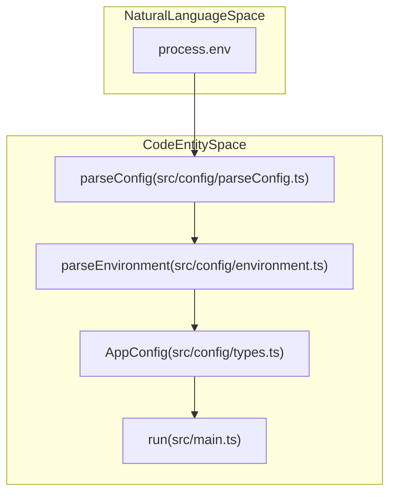
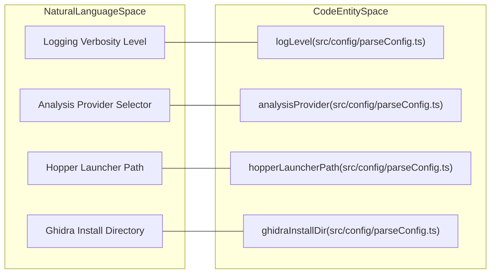
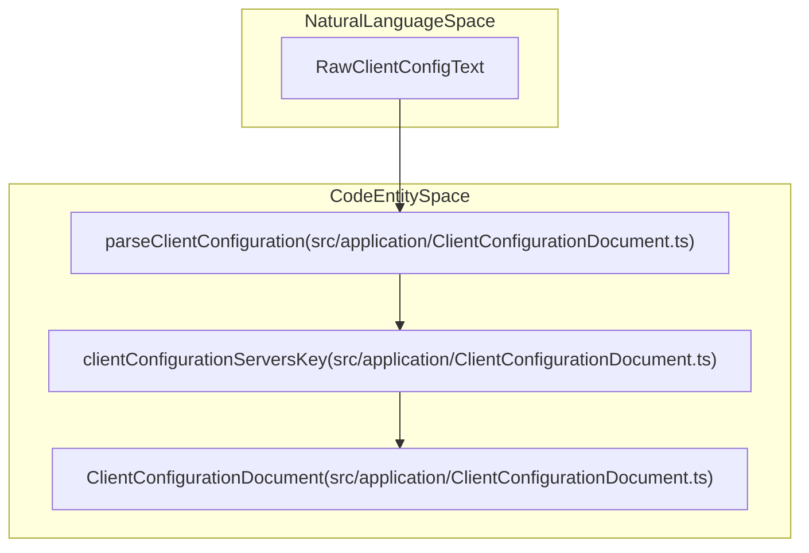

<!-- source: DeepWiki mcp.deepwiki.com · repo morluto/rea · page 1.2 Configuration Reference · fetched 2026-10-16 -->

# Configuration Reference

<details>
<summary>Relevant source files</summary>

The following files were used as context for generating this wiki page:

- [.agents/skills/reverse-engineer-anything/references/connection-and-recovery.md](.agents/skills/reverse-engineer-anything/references/connection-and-recovery.md)
- [README.md](README.md)
- [docs/client-configuration.md](docs/client-configuration.md)
- [docs/installation.md](docs/installation.md)
- [docs/jeb-analysis.md](docs/jeb-analysis.md)
- [scripts/verify-deepseek-client.mjs](scripts/verify-deepseek-client.mjs)
- [scripts/verify-native-agent-client.mjs](scripts/verify-native-agent-client.mjs)
- [scripts/verify-package-environment.d.mts](scripts/verify-package-environment.d.mts)
- [scripts/verify-package-environment.mjs](scripts/verify-package-environment.mjs)
- [src/application/ClientConfigurationDocument.shape.test.ts](src/application/ClientConfigurationDocument.shape.test.ts)
- [src/application/ClientConfigurationDocument.ts](src/application/ClientConfigurationDocument.ts)
- [src/application/ClientRegistrationEnvironment.ts](src/application/ClientRegistrationEnvironment.ts)
- [src/application/ClientRegistrationStatus.ts](src/application/ClientRegistrationStatus.ts)
- [src/application/DshCordisYaml.ts](src/application/DshCordisYaml.ts)
- [src/application/HermesClientHome.ts](src/application/HermesClientHome.ts)
- [src/application/HermesConfigurationYaml.test.ts](src/application/HermesConfigurationYaml.test.ts)
- [src/application/HermesConfigurationYaml.ts](src/application/HermesConfigurationYaml.ts)
- [src/application/SetupClientConfiguration.ts](src/application/SetupClientConfiguration.ts)
- [src/application/SupportedClients.ts](src/application/SupportedClients.ts)
- [src/application/Uninstall.ts](src/application/Uninstall.ts)
- [src/application/jeb/JebAnalysisPort.ts](src/application/jeb/JebAnalysisPort.ts)
- [src/application/jeb/JebAnalysisService.test.ts](src/application/jeb/JebAnalysisService.test.ts)
- [src/composition/jeb.ts](src/composition/jeb.ts)
- [src/config.test.ts](src/config.test.ts)
- [src/config/environment.ts](src/config/environment.ts)
- [src/config/mcpInputSchemaProfile.ts](src/config/mcpInputSchemaProfile.ts)
- [src/config/mcpResponseBudget.ts](src/config/mcpResponseBudget.ts)
- [src/config/parseConfig.ts](src/config/parseConfig.ts)
- [src/config/parsers.ts](src/config/parsers.ts)
- [src/config/types.ts](src/config/types.ts)
- [src/jeb/JebMcpConnection.test.ts](src/jeb/JebMcpConnection.test.ts)
- [src/jeb/JebMcpConnection.ts](src/jeb/JebMcpConnection.ts)
- [src/jeb/JebProvider.test.ts](src/jeb/JebProvider.test.ts)
- [src/jeb/JebProvider.ts](src/jeb/JebProvider.ts)
- [src/mcpStartupPolicy.ts](src/mcpStartupPolicy.ts)
- [tests/acceptance/providers/jebConfigurationIsolation.test.ts](tests/acceptance/providers/jebConfigurationIsolation.test.ts)
- [tests/acceptance/setup/hermesClientSetup.test.ts](tests/acceptance/setup/hermesClientSetup.test.ts)
- [tests/acceptance/setup/piClientSetup.test.ts](tests/acceptance/setup/piClientSetup.test.ts)
- [tests/boundary/cli/jebCli.test.ts](tests/boundary/cli/jebCli.test.ts)
- [tests/boundary/filesystem/clientConfigurationDialects.test.ts](tests/boundary/filesystem/clientConfigurationDialects.test.ts)
- [tests/boundary/filesystem/clientConfigurationEnvironment.test.ts](tests/boundary/filesystem/clientConfigurationEnvironment.test.ts)
- [tests/boundary/filesystem/clientConfigurationTransactions.test.ts](tests/boundary/filesystem/clientConfigurationTransactions.test.ts)
- [tests/boundary/filesystem/clientLifecycle.test.ts](tests/boundary/filesystem/clientLifecycle.test.ts)
- [tests/boundary/filesystem/hermesClientConfiguration.test.ts](tests/boundary/filesystem/hermesClientConfiguration.test.ts)
- [tests/boundary/filesystem/hopperLauncherSelection.test.ts](tests/boundary/filesystem/hopperLauncherSelection.test.ts)
- [tests/boundary/filesystem/kimiClientConfiguration.test.ts](tests/boundary/filesystem/kimiClientConfiguration.test.ts)
- [tests/boundary/filesystem/ompClientConfiguration.test.ts](tests/boundary/filesystem/ompClientConfiguration.test.ts)
- [tests/boundary/filesystem/setupConfig.test.ts](tests/boundary/filesystem/setupConfig.test.ts)
- [tests/boundary/mcp/jebMcp.test.ts](tests/boundary/mcp/jebMcp.test.ts)
- [tests/boundary/providers/jebMcpCatalog.test.ts](tests/boundary/providers/jebMcpCatalog.test.ts)
- [tests/conformance/contracts/mcpInputSchemaProfile.test.ts](tests/conformance/contracts/mcpInputSchemaProfile.test.ts)
- [tests/fixtures/clientEnvironment.ts](tests/fixtures/clientEnvironment.ts)

</details>


The REA configuration system manages how the application interacts with analysis providers, validates target binaries and execution environments, handles logging, and integrates with client applications via Model Context Protocol (MCP) registrations. Configuration is primarily driven by environment variables parsed and validated into a type-safe `AppConfig` object at the application composition root. It also governs client configuration documents, registry dialects, identity and product catalog digests, cache/state paths, and logging levels.

---

## Configuration Data Flow and Composition Root

The configuration lifecycle begins when process inputs and environment maps are ingested at the composition root [src/config/parseConfig.ts:43-46](). The raw environment is processed, validated against schema definitions, and materialized into a structured `AppConfig` record before being supplied to downstream application services like `BinarySession` and transport adapters.

### Diagram: Configuration Flow and Composition Root

"Configuration Flow: Environment to Runtime"


**Sources:** [src/config/parseConfig.ts:43-46](), [src/config/types.ts:5-18]()

---

## Environment Variables Reference

REA evaluates specific environment variables to control its execution profile, provider selections, and integration parameters. These are parsed and validated by `parseConfig` [src/config/parseConfig.ts:43-103]().

| Variable | Type | Default | Description |
| :--- | :--- | :--- | :--- |
| `REA_LOG_LEVEL` | Enum | `info` | Logging verbosity threshold (`trace`, `debug`, `info`, `warn`, `error`, `fatal`, `silent`). [src/config/parseConfig.ts:98]() |
| `REA_ANALYSIS_PROVIDER` | String | `auto` | Preferred analysis engine selector. [src/config/parseConfig.ts:61]() |
| `HOPPER_LAUNCHER_PATH` | String | Platform-specific | Path to Hopper Disassembler launcher or binary. [src/config/parseConfig.ts:88-93]() |
| `GHIDRA_INSTALL_DIR` | String | `undefined` | Installation root directory for Ghidra headless analyzer. [src/config/parseConfig.ts:65]() |
| `JAVA_HOME` | String | `undefined` | Java runtime path for Ghidra initialization. [src/config/parseConfig.ts:66]() |
| `REA_GHIDRA_STARTUP_TIMEOUT_MS` | Number | `undefined` | Initialization timeout threshold for Ghidra headless runs. [src/config/parseConfig.ts:67]() |
| `REA_GHIDRA_LANGUAGE_ID` | String | `undefined` | Optional Ghidra language override identifier. [src/config/parseConfig.ts:68-76]() |
| `REA_GHIDRA_COMPILER_SPEC_ID` | String | `undefined` | Optional Ghidra compiler specification ID. [src/config/parseConfig.ts:73-76]() |
| `REA_ILSPY_CMD_PATH` | String | `undefined` | Executable path for ILSpy CLI managed analysis provider. [src/config/parseConfig.ts:87]() |
| `REA_MCP_MAX_RESPONSE_BYTES` | Number | `undefined` | Maximum response byte limit for MCP payloads. [src/config/parseConfig.ts:55-57]() |
| `REA_MCP_INPUT_SCHEMA_PROFILE` | String | `undefined` | Schema profile level (`compact`, `full`) for MCP tool advertisements. [src/config/parseConfig.ts:58-60]() |

**Sources:** [src/config/parseConfig.ts:43-103]()

---

## The AppConfig Interface and Parsing

The internal configuration state is encapsulated by the `AppConfig` interface, ensuring type safety across boundaries.

```typescript
export interface AppConfig {
  readonly logLevel: LogLevel;
  readonly analysisProvider: AnalysisProviderSelection;
  readonly hopperPath: string | undefined;
  readonly ghidraPath: string | undefined;
  // ... additional provider paths and runtime policies
}
```

The parsing utility `parseConfig` validates the input environment map, resolves default tool locations (such as `defaultHopperLauncherPath` for Hopper binaries), and maps individual environment keys to `AppConfig` properties [src/config/parseConfig.ts:25-40]().

### Diagram: Mapping Natural Language Configuration Concepts to Code Entities

"Mapping Config Concepts to Code Symbols"


**Sources:** [src/config/parseConfig.ts:25-103](), [src/config/types.ts:5-18]()

---

## Client Configuration Documents and Dialects

REA registers itself as an MCP server within various coding agents and client applications. Each client uses distinct configuration structures, formats (JSON, JSONC, TOML, YAML), and server table paths, categorized as dialects via `ClientRegistrationDialect` [src/application/ClientConfigurationDocument.ts:37-48]().

The `ClientConfigurationDocument` structure holds the parsed configuration root, the resolved server table reference (`servers`), its structural location (`serversPath`), and legacy server mappings [src/application/ClientConfigurationDocument.ts:42-54]().

### Client Configuration Processing

The function `parseClientConfiguration` evaluates raw configuration text according to the target client format specification, handling JSONC comment stripping, TOML parsing, and OpenCode V1/V2 variations [src/application/ClientConfigurationDocument.ts:179-184]().

### Diagram: Client Configuration Document Processing

"Client Configuration Document Processing"


**Sources:** [src/application/ClientConfigurationDocument.ts:37-54](), [src/application/ClientConfigurationDocument.ts:179-184](), [src/application/SupportedClients.ts:14-54]()

---

## Digests, Cache, State Paths, and Logging Levels

REA relies on deterministic path resolution and cryptographic digests for configuration integrity:
*   **Cache and State Paths**: Temporary storage and caching directories default to local user paths (`~/.rea/cache` and `~/.rea/state`), governed by environment definitions and managed by setup/uninstall hosts [src/application/Uninstall.ts:69-82]().
*   **Logging Levels**: Managed via `pino` based on `REA_LOG_LEVEL`, writing output strictly to `stderr` during MCP operations to protect `stdout` JSON-RPC streams [src/config/parseConfig.ts:98]().
*   **Identity & Catalog Digests**: SHA-256 verification strings ensure immutable product catalog and capability matching during composition.

**Sources:** [src/config/parseConfig.ts:98](), [src/application/Uninstall.ts:69-82]()

---

