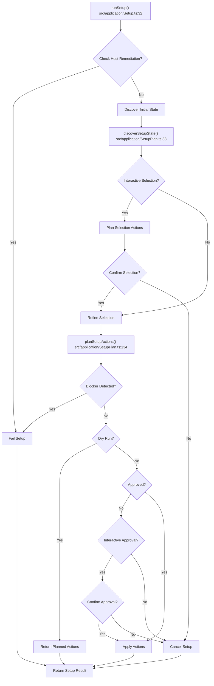
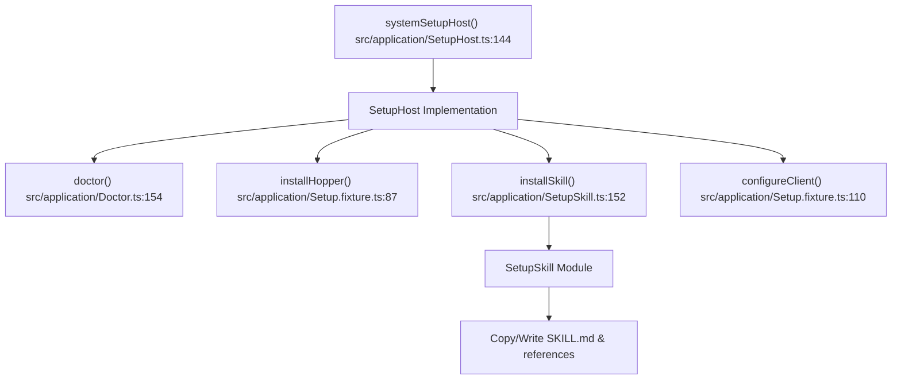
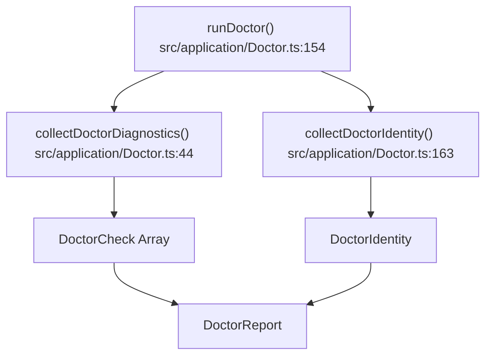
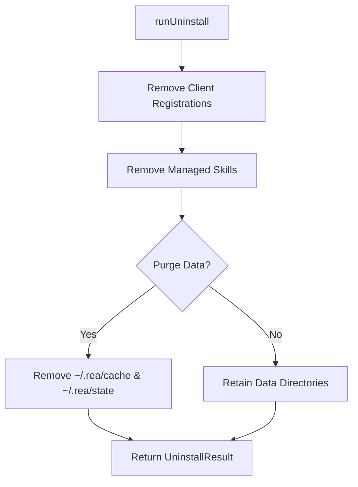

<!-- source: DeepWiki mcp.deepwiki.com · repo morluto/rea · page 1.3 Setup, Doctor and Uninstall Internals · fetched 2026-10-16 -->

# Setup, Doctor and Uninstall Internals

Relevant source files

The following files were used as context for generating this wiki page:

- [.agents/skills/rea-changelog-update/SKILL.md](.agents/skills/rea-changelog-update/SKILL.md)
- [scripts/hopper-demo-x11.py](scripts/hopper-demo-x11.py)
- [scripts/lib/release-notes-github.mjs](scripts/lib/release-notes-github.mjs)
- [scripts/lib/release-notes-publication.mjs](scripts/lib/release-notes-publication.mjs)
- [scripts/lib/release-notes.mjs](scripts/lib/release-notes.mjs)
- [scripts/release-notes.mjs](scripts/release-notes.mjs)
- [scripts/verify-package-update.mjs](scripts/verify-package-update.mjs)
- [scripts/verify-package.mjs](scripts/verify-package.mjs)
- [scripts/verify-published-package.mjs](scripts/verify-published-package.mjs)
- [src/application/ClientConfigurationFiles.ts](src/application/ClientConfigurationFiles.ts)
- [src/application/Doctor.test.ts](src/application/Doctor.test.ts)
- [src/application/Doctor.ts](src/application/Doctor.ts)
- [src/application/DoctorDiagnostics.ts](src/application/DoctorDiagnostics.ts)
- [src/application/GeminiClientSettings.ts](src/application/GeminiClientSettings.ts)
- [src/application/LinuxHopper.test.ts](src/application/LinuxHopper.test.ts)
- [src/application/LinuxHopper.ts](src/application/LinuxHopper.ts)
- [src/application/Setup.fixture.ts](src/application/Setup.fixture.ts)
- [src/application/Setup.planning.test.ts](src/application/Setup.planning.test.ts)
- [src/application/Setup.recovery.test.ts](src/application/Setup.recovery.test.ts)
- [src/application/Setup.ts](src/application/Setup.ts)
- [src/application/SetupHost.ts](src/application/SetupHost.ts)
- [src/application/SetupPlan.ts](src/application/SetupPlan.ts)
- [src/application/SetupSkill.ts](src/application/SetupSkill.ts)
- [src/application/SetupTypes.ts](src/application/SetupTypes.ts)
- [src/application/Update.test.ts](src/application/Update.test.ts)
- [src/application/Update.ts](src/application/Update.ts)
- [src/application/UpdateFailure.ts](src/application/UpdateFailure.ts)
- [src/application/UpdateMaintenance.ts](src/application/UpdateMaintenance.ts)
- [src/application/UpdateRuntime.release.test.ts](src/application/UpdateRuntime.release.test.ts)
- [src/application/UpdateRuntime.ts](src/application/UpdateRuntime.ts)
- [src/cli.ts](src/cli.ts)
- [src/cliLogging.test.ts](src/cliLogging.test.ts)
- [src/cliLogging.ts](src/cliLogging.ts)
- [src/domain/runtimeVersion.test.ts](src/domain/runtimeVersion.test.ts)
- [src/domain/runtimeVersion.ts](src/domain/runtimeVersion.ts)
- [src/identity.ts](src/identity.ts)
- [tests/acceptance/setup/geminiWorkspaceTrust.test.ts](tests/acceptance/setup/geminiWorkspaceTrust.test.ts)
- [tests/boundary/cli/clientProfileLifecycle.test.ts](tests/boundary/cli/clientProfileLifecycle.test.ts)
- [tests/boundary/cli/clientProfiles.test.ts](tests/boundary/cli/clientProfiles.test.ts)
- [tests/boundary/cli/projectedErrorStatus.test.ts](tests/boundary/cli/projectedErrorStatus.test.ts)
- [tests/boundary/filesystem/releaseNotes.test.ts](tests/boundary/filesystem/releaseNotes.test.ts)
- [tests/boundary/filesystem/setupSkill.test.ts](tests/boundary/filesystem/setupSkill.test.ts)
- [tests/boundary/filesystem/zcodeClientConfiguration.test.ts](tests/boundary/filesystem/zcodeClientConfiguration.test.ts)
- [tests/process-global/updateMaintenance.test.ts](tests/process-global/updateMaintenance.test.ts)

This page details the internal workings of REA's setup, doctor, update maintenance, and uninstall processes. It covers the state machine used by `runSetup`, the roles of `SetupHost` and `SetupSkill`, how `Doctor` performs diagnostics and reports client registration status, update maintenance rules, and the mechanics of `Uninstall`. The goal is to provide a deep technical understanding of these core lifecycle operations.

## Setup Internals

The `runSetup` function orchestrates the setup process, which involves discovering the current state of the system, planning necessary actions, and then applying those actions. It operates as a state machine, moving through discovery, planning, and application phases, with optional interactive confirmation steps.

### Setup State Machine (`runSetup`)

The `runSetup` function [src/application/Setup.ts:32-36]() is the entry point for the setup process. It takes `SetupOptions`, a `SetupHost` implementation [src/application/SetupHost.ts:144-147](), and an optional `SetupConfirmation` callback.

The process begins by checking for unsupported host environments using `hostRemediation` [src/application/Setup.ts:108-109](). If the host is unsupported, the setup fails.

Next, it discovers the initial setup state, including the current Hopper path and provider environment, from the `SetupHost` [src/application/Setup.ts:110-111]().

The core discovery phase is handled by `discoverSetupState` [src/application/Setup.ts:112-120](), which identifies detected clients, default clients, and whether the REA skill needs installation [src/application/SetupPlan.ts:38-45]().

Based on the discovery, `runSetup` determines which clients are selected for configuration [src/application/Setup.ts:131-139](). If interactive selection is enabled, `planSetupActions` is called to generate a preliminary set of actions for user confirmation [src/application/Setup.ts:159-173]().

After selection, `planSetupActions` is called again with the resolved client IDs and skill installation status to generate the final `plannedActions` [src/application/SetupPlan.ts:134-147](). This plan includes actions like installing Hopper, installing the REA skill, and configuring clients.

Finally, the `plannedActions` are iterated, and each action is applied [src/application/Setup.ts:200-240]().

Sources: [src/application/Setup.ts:32-139](), [src/application/SetupPlan.ts:38-45](), [src/application/SetupPlan.ts:134-147]()

### `SetupHost` and `SetupSkill`

`SetupHost` is an interface that abstracts system operations required for setup. `systemSetupHost` provides a concrete implementation [src/application/SetupHost.ts:144-147]().

Key responsibilities of `SetupHost` include:
* `doctor()`: Runs diagnostics to assess system health and readiness [src/application/Doctor.ts:154-184]().
* `installHopper()` / `uninstallHopper()`: Manages Hopper binaries [src/application/Setup.fixture.ts:87-105]().
* `installSkill()` / `uninstallSkill()`: Manages the canonical skill bundle via `SetupSkill` [src/application/SetupSkill.ts:152-168]().
* `configureClient()` / `unconfigureClient()`: Modifies agent configuration documents [src/application/Setup.fixture.ts:110-121]().

Sources: [src/application/SetupHost.ts:144-147](), [src/application/Setup.fixture.ts:87-121](), [src/application/SetupSkill.ts:152-168]()

## Doctor Internals

The `doctor` command provides diagnostics about the REA environment, including system health, provider readiness, and client registration status [src/application/Doctor.ts:129-139]().

### `DoctorHost` and `DoctorReport`

`runDoctor` executes diagnostic checks across the system and gathers runtime details through `DoctorHost` [src/application/Doctor.ts:94-126](). The resulting `DoctorReport` structures information into healthy/unhealthy checks, scope reports, and installation identities [src/application/Doctor.ts:129-139]().

Sources: [src/application/Doctor.ts:44-46](), [src/application/Doctor.ts:129-139](), [src/application/Doctor.ts:154-163]()

## Update Maintenance Internals

Update maintenance handles updating existing client registrations and skill files when a new version of REA is installed [tests/process-global/updateMaintenance.test.ts:10-12]().

* `existingMaintenanceScope` checks which installed agent integrations currently reference REA and require updates [tests/process-global/updateMaintenance.test.ts:92-93]().
* User-disabled or natively foreign integrations are carefully excluded from automatic maintenance updates to prevent overriding user intent [tests/process-global/updateMaintenance.test.ts:106-116]().

Sources: [tests/process-global/updateMaintenance.test.ts:10-12](), [tests/process-global/updateMaintenance.test.ts:92-116]()

## Uninstall Internals

The `uninstall` command removes REA-owned state from the system, including client registrations, the REA skill, and cached data [tests/boundary/cli/clientProfileLifecycle.test.ts:92-120]().

### `runUninstall` and Purge Behavior

When run with `--purge-data`, `runUninstall` removes local state and cache directories, ensuring that symbolic links or unrelated application directories are properly verified or retained [tests/boundary/cli/clientProfileLifecycle.test.ts:92-130]().

Sources: [tests/boundary/cli/clientProfileLifecycle.test.ts:92-130]()

---
Sources: `scripts/verify-package.mjs`, `src/application/Doctor.ts`, `src/application/Setup.ts`, `src/cli.ts`, `src/application/SetupHost.ts`, `src/application/SetupPlan.ts`, `src/application/SetupSkill.ts`, `tests/boundary/cli/clientProfileLifecycle.test.ts`, `src/application/Doctor.test.ts`, `tests/process-global/updateMaintenance.test.ts`, `scripts/verify-published-package.mjs`, `src/application/Setup.fixture.ts`

---

