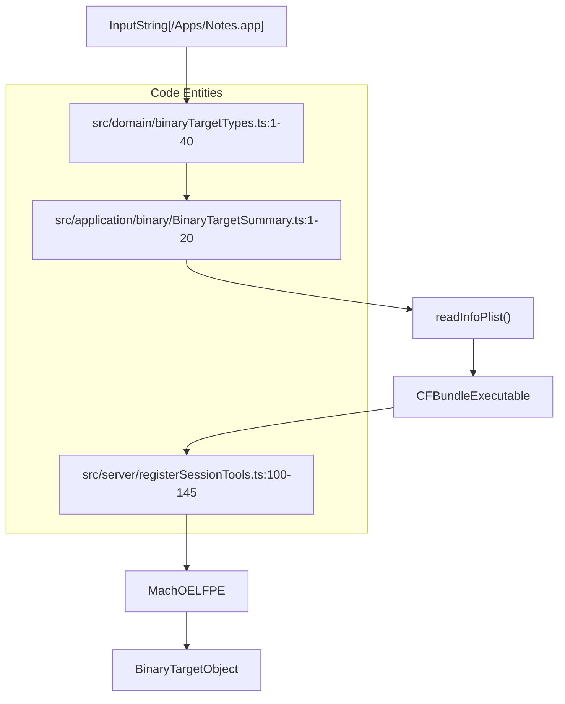
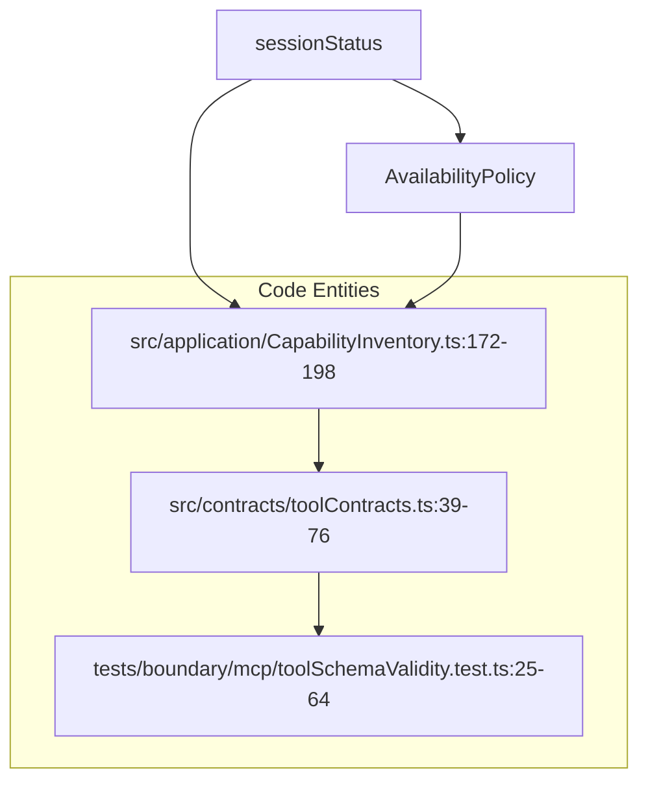

<!-- source: DeepWiki mcp.deepwiki.com · repo morluto/rea · page 10 Glossary · fetched 2026-10-16 -->

# Glossary

Relevant source files

The following files were used as context for generating this wiki page:

- [docs/mcp-contracts.md](docs/mcp-contracts.md)
- [scripts/lib/catalog-builders.mjs](scripts/lib/catalog-builders.mjs)
- [scripts/lib/catalog-core.mjs](scripts/lib/catalog-core.mjs)
- [scripts/verify-gemini-client.mjs](scripts/verify-gemini-client.mjs)
- [scripts/verify/clients/gemini-model-fixture.mjs](scripts/verify/clients/gemini-model-fixture.mjs)
- [src/application/CapabilityInventory.test.ts](src/application/CapabilityInventory.test.ts)
- [src/application/CapabilityInventory.ts](src/application/CapabilityInventory.ts)
- [src/application/binary/AnalysisSnapshotCache.test.ts](src/application/binary/AnalysisSnapshotCache.test.ts)
- [src/application/binary/AnalysisSnapshotCache.ts](src/application/binary/AnalysisSnapshotCache.ts)
- [src/cliCommandNames.ts](src/cliCommandNames.ts)
- [src/contracts/analysisViewApiSurfaceExample.ts](src/contracts/analysisViewApiSurfaceExample.ts)
- [src/contracts/inputSchemaPresentation.ts](src/contracts/inputSchemaPresentation.ts)
- [src/contracts/toolContracts.ts](src/contracts/toolContracts.ts)
- [src/contracts/toolEffects.ts](src/contracts/toolEffects.ts)
- [src/contracts/toolInputReferences.test.ts](src/contracts/toolInputReferences.test.ts)
- [src/contracts/toolOutputReferences.test.ts](src/contracts/toolOutputReferences.test.ts)
- [src/contracts/toolSchemaMetadata.ts](src/contracts/toolSchemaMetadata.ts)
- [src/domain/analysisSnapshot.test.ts](src/domain/analysisSnapshot.test.ts)
- [src/domain/analysisSnapshot.ts](src/domain/analysisSnapshot.ts)
- [src/domain/evidence.test.ts](src/domain/evidence.test.ts)
- [src/domain/evidence.ts](src/domain/evidence.ts)
- [src/domain/hopperValues.test.ts](src/domain/hopperValues.test.ts)
- [src/domain/jsonValue.test.ts](src/domain/jsonValue.test.ts)
- [src/domain/jsonValue.ts](src/domain/jsonValue.ts)
- [src/server/createServer.ts](src/server/createServer.ts)
- [src/server/mcpClientMetadata.ts](src/server/mcpClientMetadata.ts)
- [src/server/registerSessionStatusTool.ts](src/server/registerSessionStatusTool.ts)
- [src/server/registerSessionTools.ts](src/server/registerSessionTools.ts)
- [src/server/toolRegistrationOptions.ts](src/server/toolRegistrationOptions.ts)
- [tests/boundary/mcp/browserComparisonInput.test.ts](tests/boundary/mcp/browserComparisonInput.test.ts)
- [tests/boundary/mcp/clientCapabilities.test.ts](tests/boundary/mcp/clientCapabilities.test.ts)
- [tests/boundary/mcp/compactInputSchemaMcp.test.ts](tests/boundary/mcp/compactInputSchemaMcp.test.ts)
- [tests/boundary/mcp/enhancedTools.04-uses-complete-inventories-inline.test.ts](tests/boundary/mcp/enhancedTools.04-uses-complete-inventories-inline.test.ts)
- [tests/boundary/mcp/outputSchemaSemanticConstraints.test.ts](tests/boundary/mcp/outputSchemaSemanticConstraints.test.ts)
- [tests/boundary/mcp/outputValidatorReuse.test.ts](tests/boundary/mcp/outputValidatorReuse.test.ts)
- [tests/boundary/mcp/toolSchemaValidity.test.ts](tests/boundary/mcp/toolSchemaValidity.test.ts)
- [tests/composition/idaProvider.test.ts](tests/composition/idaProvider.test.ts)
- [tests/conformance/providers/conformancePackage.test.ts](tests/conformance/providers/conformancePackage.test.ts)
- [tests/conformance/providers/hopper/realHopperAssertions.test.ts](tests/conformance/providers/hopper/realHopperAssertions.test.ts)
- [tests/fixtures/mcpClientSchemaConstraints.ts](tests/fixtures/mcpClientSchemaConstraints.ts)

## Purpose and Scope
This page defines the technical terms, abbreviations, and domain concepts used throughout the REA codebase. It serves as a reference for onboarding engineers to understand how high-level reverse engineering concepts map to specific implementation details in the code.

## Core System Terms

| Term | Definition | Code Pointer |
| :--- | :--- | :--- |
| **REA** | Reverse Engineer Anything. The overarching project name, a local-only CLI + MCP server for analyzing various binary types. | `[package.json:1-10]()` |
| **MCP** | Model Context Protocol. The standard REA uses to expose its tools to AI agents like Claude or Cursor. | `[package.json:20-30]()`, `[src/main.ts:1-10]()` |
| **Evidence** | Structured data representing observations, inferences, and limitations from an analysis. It's a core part of REA's epistemic model. | `[src/domain/evidence.ts:1-15]()` |
| **Unknown** | A specific type of evidence record indicating a gap in knowledge or an unresolvable aspect of an analysis. | `[src/server/registerSessionTools.ts:45-78]()` |
| **BYO provider** | "Bring Your Own" provider. Refers to REA's model where users provide their own installations of analysis tools like Ghidra, IDA, JADX, Binwalk, or Unblob, which REA then integrates with. | `[src/application/AnalysisProvider.ts:1-20]()` |
| **ToolContract** | The formal definition of an MCP tool, including its name, description, and Zod-validated input/output schemas. | `[src/contracts/toolContracts.ts:38-76]()` |
| **ToolEffects** | Annotations on `ToolContract` definitions that describe side effects or specific behaviors of a tool, such as whether it modifies the target or requires a session. | `[src/contracts/toolEffects.ts:2-23]()` |
| **BinaryTarget** | A validated local file (Executable, Mach-O, ELF, PE) or Hopper database (`.hop`) that REA can analyze. | `[src/domain/binaryTargetTypes.ts:1-40]()` |
| **AnalysisSnapshot** | A cached representation of analysis results for a specific binary target, allowing for faster retrieval and comparison. | `[src/application/binary/AnalysisSnapshotCache.ts:1-25]()` |
| **Obligation Ledger** | A record of outstanding tasks or requirements for reconstruction verification, tracking what needs to be confirmed or resolved. | `[src/cliCommandNames.ts:152-152]()` |
| **CDP** | Chrome DevTools Protocol. Used by REA for browser observation and interaction, enabling dynamic analysis of web applications. | `[src/server/createServer.ts:53-53]()` |
| **ASAR** | Atom Shell Archive. A simple, concatenative archive format used by Electron to package application code. REA can inspect and extract these. | `[src/cliCommandNames.ts:139-142]()` |
| **CIL/PE** | Common Intermediate Language (CIL) is the bytecode for .NET applications. Portable Executable (PE) is the file format for executables in Windows, often containing CIL for .NET assemblies. REA's managed provider analyzes these. | `[src/contracts/managed/managedToolContracts.ts:1-15]()` |
| **NativeAOT** | Native Ahead-of-Time compilation for .NET, which compiles CIL directly to native code, making it behave more like a traditional native binary. REA's Ghidra provider can integrate with optional NativeAOT metadata recovery. | `[src/cliCommandNames.ts:109-112]()` |
| **JADX** | A DEX to Java decompiler. REA integrates with JADX for static analysis of Android APKs. | `[src/contracts/android/androidToolContracts.ts:1-15]()` |
| **Binwalk/Unblob** | Tools used by REA for firmware analysis, specifically for identifying and extracting embedded filesystems and executable code from firmware images. | `[src/contracts/firmware/firmwareToolContracts.ts:1-15]()` |
| **Conformance Trust Gate** | A mechanism in REA's testing framework that verifies the correctness and consistency of analysis results against a known corpus of binaries and expected outputs. | `[tests/conformance/providers/conformancePackage.test.ts:1-20]()` |
| **Skill** | A set of instructions and capabilities provided to an AI coding assistant, enabling it to use REA's tools and workflows. | `[package.json:1-10]()` |
| **Product Catalog Digest** | A SHA-256 hash of the generated MCP tool catalog, used for versioning and integrity checking of the available tools and their schemas. | `[src/contracts/toolSchemaMetadata.ts:103-107]()` |

Sources: `[package.json:1-30]`, `[src/main.ts:1-10]`, `[src/domain/evidence.ts:1-15]`, `[src/server/registerSessionTools.ts:45-78]`, `[src/application/AnalysisProvider.ts:1-20]`, `[src/contracts/toolContracts.ts:38-76]`, `[src/contracts/toolEffects.ts:2-23]`, `[src/domain/binaryTargetTypes.ts:1-40]`, `[src/application/binary/AnalysisSnapshotCache.ts:1-25]`, `[src/cliCommandNames.ts:109-152]`, `[src/server/createServer.ts:53-53]`, `[src/contracts/managed/managedToolContracts.ts:1-15]`, `[src/contracts/android/androidToolContracts.ts:1-15]`, `[src/contracts/firmware/firmwareToolContracts.ts:1-15]`, `[tests/conformance/providers/conformancePackage.test.ts:1-20]`, `[src/contracts/toolSchemaMetadata.ts:103-107]`

## Technical Concepts & Implementation

### 1. Binary Target Resolution
Before launching a deep analysis provider, REA performs "Natural Language to Path" resolution to parse container bundles and select architecture slices.

**Target Resolution Mapping**

Sources: `[src/domain/binaryTargetTypes.ts:1-40]`, `[src/application/binary/BinaryTargetSummary.ts:1-20]`, `[src/server/registerSessionTools.ts:100-145]`

### 2. Tool Classification and Capability Inventory
REA organizes its tools into distinct `ToolKind` categories, evaluated dynamically via the capability inventory.

| Kind | Description | Implementation |
| :--- | :--- | :--- |
| `official-proxy` | Direct 1:1 mappings to bridge proxy functions. | `[src/contracts/toolContracts.ts:39-41]()` |
| `enhanced` | High-level workflows that compose multiple lower-level queries. | `[src/contracts/toolContracts.ts:41-41]()` |
| `session` | Tools for managing the REA lifecycle and evidence ledgers. | `[src/contracts/toolContracts.ts:70-70]()` |
| `native-provider` | Tools specific to native operating system inspection. | `[src/contracts/toolContracts.ts:42-42]()` |
| `artifact-provider` | Tools for inspecting archive and file container structures. | `[src/contracts/toolContracts.ts:45-45]()` |
| `managed` | Tools for analyzing .NET and managed assemblies. | `[src/contracts/toolContracts.ts:53-53]()` |

**Capability Evaluation Flow**

Sources: `[src/contracts/toolContracts.ts:39-76]`, `[src/application/CapabilityInventory.ts:172-198]`, `[tests/boundary/mcp/toolSchemaValidity.test.ts:25-64]`

## Domain Vocabulary

### Analysis Entities
*   **Procedure**: A function or routine identified by the analysis provider or disassembler. `[src/contracts/toolSchemaMetadata.ts:9-11]()`
*   **Xref (Cross-reference)**: A link between code or data references within the binary layout. `[src/cliCommandNames.ts:23-23]()`
*   **Segment/Section**: Logical divisions of a binary executable layout (e.g., code segments vs data segments). `[src/contracts/toolContracts.ts:9-10]()`

### Error Algebra and Validation
REA uses strict schema metadata projections and validation gates for wire compatibility.
*   **`ToolContract`**: Defines the strict schema inputs, outputs, and documentation metadata for MCP tools. `[src/contracts/toolContractTypes.ts:1-15]()`
*   **`ToolEffects`**: Declares side effects such as target mutation, network access, or process execution. `[src/contracts/toolEffects.ts:2-23]()`

Sources: `[src/contracts/toolSchemaMetadata.ts:9-11]`, `[src/cliCommandNames.ts:23-23]`, `[src/contracts/toolContracts.ts:9-10]`, `[src/contracts/toolContractTypes.ts:1-15]`, `[src/contracts/toolEffects.ts:2-23]`