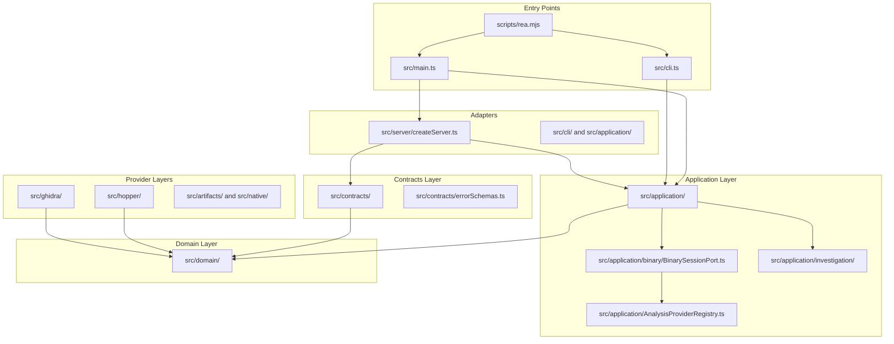

<!-- source: DeepWiki mcp.deepwiki.com · repo morluto/rea · page 2 Architecture · fetched 2026-10-16 -->

# Architecture

Relevant source files

The following files were used as context for generating this wiki page:

- [.github/workflows/ci.yml](.github/workflows/ci.yml)
- [.github/workflows/release.yml](.github/workflows/release.yml)
- [.husky/pre-commit](.husky/pre-commit)
- [.husky/pre-push](.husky/pre-push)
- [.oxlintrc.json](.oxlintrc.json)
- [AGENTS.md](AGENTS.md)
- [CONTRIBUTING.md](CONTRIBUTING.md)
- [docs/releasing.md](docs/releasing.md)
- [docs/testing.md](docs/testing.md)
- [docs/tool-design.md](docs/tool-design.md)
- [knip.json](knip.json)
- [scripts/ci/plan.mjs](scripts/ci/plan.mjs)
- [scripts/ci/scopes.mjs](scripts/ci/scopes.mjs)
- [scripts/lib/catalog-builders.mjs](scripts/lib/catalog-builders.mjs)
- [scripts/lib/catalog-core.mjs](scripts/lib/catalog-core.mjs)
- [scripts/lib/module-boundaries.d.mts](scripts/lib/module-boundaries.d.mts)
- [scripts/lib/module-boundaries.mjs](scripts/lib/module-boundaries.mjs)
- [scripts/lib/release-checkpoint.mjs](scripts/lib/release-checkpoint.mjs)
- [scripts/scan-todos.mjs](scripts/scan-todos.mjs)
- [scripts/verify-release-checkpoint.mjs](scripts/verify-release-checkpoint.mjs)
- [src/application/CapabilityInventory.test.ts](src/application/CapabilityInventory.test.ts)
- [src/application/CapabilityInventory.ts](src/application/CapabilityInventory.ts)
- [src/cliCommandNames.ts](src/cliCommandNames.ts)
- [src/contracts/toolContracts.ts](src/contracts/toolContracts.ts)
- [src/contracts/toolEffects.ts](src/contracts/toolEffects.ts)
- [src/domain/hopperValues.test.ts](src/domain/hopperValues.test.ts)
- [src/hopper/HopperProvider.test.ts](src/hopper/HopperProvider.test.ts)
- [src/server/createServer.ts](src/server/createServer.ts)
- [src/server/mcpClientMetadata.ts](src/server/mcpClientMetadata.ts)
- [src/server/registerSessionStatusTool.ts](src/server/registerSessionStatusTool.ts)
- [src/server/registerSessionTools.ts](src/server/registerSessionTools.ts)
- [tests/boundary/filesystem/ciChangeScope.test.ts](tests/boundary/filesystem/ciChangeScope.test.ts)
- [tests/boundary/filesystem/ciRequiredLanes.test.ts](tests/boundary/filesystem/ciRequiredLanes.test.ts)
- [tests/boundary/filesystem/releaseCheckpoint.test.ts](tests/boundary/filesystem/releaseCheckpoint.test.ts)
- [tests/boundary/filesystem/releaseWorkflow.test.ts](tests/boundary/filesystem/releaseWorkflow.test.ts)
- [tests/boundary/filesystem/staticTaskCache.test.ts](tests/boundary/filesystem/staticTaskCache.test.ts)
- [tests/boundary/mcp/clientCapabilities.test.ts](tests/boundary/mcp/clientCapabilities.test.ts)
- [tests/boundary/mcp/enhancedTools.04-uses-complete-inventories-inline.test.ts](tests/boundary/mcp/enhancedTools.04-uses-complete-inventories-inline.test.ts)
- [tests/composition/idaProvider.test.ts](tests/composition/idaProvider.test.ts)
- [tests/evaluation/moduleBoundaries.test.ts](tests/evaluation/moduleBoundaries.test.ts)
- [tests/support/workflowGit.ts](tests/support/workflowGit.ts)
- [turbo.json](turbo.json)

Purpose: Overview of the layered architecture (`src/domain/` → `src/contracts/` → `src/hopper/`, `src/ghidra/` → `src/application/` → `src/server/`, `src/cli.ts`), dependency rules from `AGENTS.md`, module boundary enforcement, and data flow. This is a parent page; detailed explanations reside in the linked child pages.

Sources: [AGENTS.md:15-18](), [tests/evaluation/moduleBoundaries.test.ts:1-31]()

## Layered Architecture Overview

The system is organized into distinct layers, with dependencies flowing inward from pure domain logic through contracts, providers, application workflows, and finally to CLI/MCP adapters. This structure is explicitly enforced to maintain separation of concerns and prevent circular dependencies.

Sources: [AGENTS.md:15-18](), [docs/architecture.mermaid:1-70]()

## Dependency Rules and Module Boundaries

REA enforces strict dependency rules to maintain its layered architecture. Dependencies flow inward: domain semantics and contracts, provider adapters, shared application workflows, then CLI/MCP adapters [AGENTS.md:15-18](). Engine protocols and provider-specific code are strictly kept out of domain and application layers.

Module boundaries are programmatically enforced via `src/evaluation/moduleBoundaries.test.ts` and `scripts/lib/module-boundaries.mjs`, which inspect import paths during static analysis checks [tests/evaluation/moduleBoundaries.test.ts:1-31]().

Sources: [AGENTS.md:15-18](), [tests/evaluation/moduleBoundaries.test.ts:1-31]()

## Data Flow

Data flows inward from entry points (`scripts/rea.mjs`, `src/main.ts`, `src/cli.ts`) to application services (`src/application/`), which query provider adapters (`src/hopper/`, `src/ghidra/`) or artifact readers (`src/artifacts/`). Results are projected through typed structures in `src/contracts/` before delivery via MCP `createServer` or CLI stdout.

Sources: [AGENTS.md:15-18](), [src/server/createServer.ts:1-50]()

---

## Architectural Sub-Topics

### 2.1 Entry Points and Dispatching
The script `scripts/rea.mjs` acts as the primary dispatcher routing execution to `src/main.ts` (MCP stdio server) or `src/cli.ts` (one-shot command router). 

For details, see [Entry Points and Dispatching](#2.1).

Sources: [docs/architecture.mermaid:3-5]()

### 2.2 Domain Layer
Pure, provider-neutral logic resides in `src/domain/`, implementing core concepts such as `Result` error algebras, canonical digests, evidence schemas, and binary target parsers [AGENTS.md:15-18]().

For details, see [Domain Layer](#2.2).

Sources: [AGENTS.md:15-18](), [docs/architecture.mermaid:54-56]()

### 2.3 Contracts and Tool Catalog
`src/contracts/` defines `ToolContract` inventories, input/output schemas, tool effects, and generates build artifacts like `.cache/mcp-tool-catalog.json` and `docs/public/product-catalog.json`.

For details, see [Contracts and Tool Catalog](#2.3).

Sources: [AGENTS.md:27-28](), [src/contracts/toolContracts.ts:1-38]()

### 2.4 Application Layer
`src/application/` coordinates binary sessions, `CapabilityInventory`, `DirectAnalysis`, and analysis snapshot caching across providers.

For details, see [Application Layer](#2.4).

Sources: [src/application/CapabilityInventory.ts:1-40]()

### 2.5 Server Layer (MCP Adapter)
`src/server/createServer.ts` assembles the MCP server instance, registering tool modules (`registerOfficialTools`, `registerEnhancedTools`, `registerSessionTools`, etc.) and mapping execution outputs via `toolResult.ts`.

For details, see [Server Layer (MCP Adapter)](#2.5).

Sources: [src/server/createServer.ts:1-60]()

---

