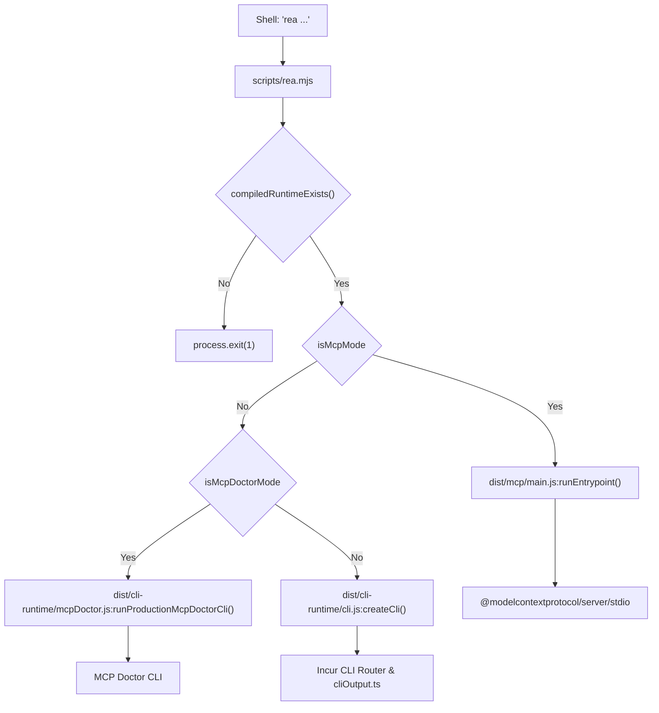
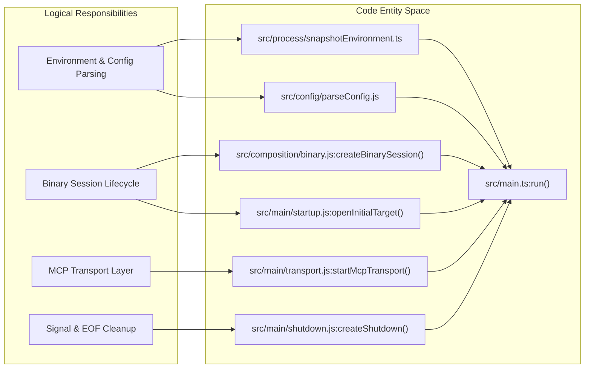
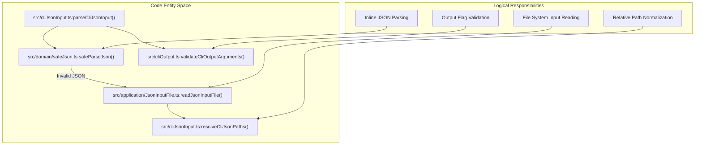

<!-- source: DeepWiki mcp.deepwiki.com · repo morluto/rea · page 2.1 Entry Points and Dispatching · fetched 2026-10-16 -->

# Entry Points and Dispatching

Relevant source files

The following files were used as context for generating this wiki page:

- [docs/.vitepress/config.ts](docs/.vitepress/config.ts)
- [docs/cli.md](docs/cli.md)
- [docs/error-contract.schema.json](docs/error-contract.schema.json)
- [docs/index.md](docs/index.md)
- [scripts/bundle-runtime.mjs](scripts/bundle-runtime.mjs)
- [scripts/prepack.mjs](scripts/prepack.mjs)
- [scripts/rea.mjs](scripts/rea.mjs)
- [scripts/verify/javascript/output.mjs](scripts/verify/javascript/output.mjs)
- [src/application/JsonFiles.ts](src/application/JsonFiles.ts)
- [src/application/JsonInputFile.ts](src/application/JsonInputFile.ts)
- [src/application/RegularFileRead.ts](src/application/RegularFileRead.ts)
- [src/application/Utf8JsonInput.ts](src/application/Utf8JsonInput.ts)
- [src/application/binary/AnalysisSnapshotFiles.ts](src/application/binary/AnalysisSnapshotFiles.ts)
- [src/cli/cliResultOutput.ts](src/cli/cliResultOutput.ts)
- [src/cli/jsonOutput.ts](src/cli/jsonOutput.ts)
- [src/cliBrowserContext.ts](src/cliBrowserContext.ts)
- [src/cliHostInputs.test.ts](src/cliHostInputs.test.ts)
- [src/cliJsonInput.ts](src/cliJsonInput.ts)
- [src/cliOutput.ts](src/cliOutput.ts)
- [src/contracts/errorSchemas.ts](src/contracts/errorSchemas.ts)
- [src/main.ts](src/main.ts)
- [src/main/processShutdown.ts](src/main/processShutdown.ts)
- [src/main/shutdown.ts](src/main/shutdown.ts)
- [src/main/startup.ts](src/main/startup.ts)
- [src/main/transport.ts](src/main/transport.ts)
- [tests/boundary/cli/cliOutput.test.ts](tests/boundary/cli/cliOutput.test.ts)
- [tests/boundary/cli/closedStdout.test.ts](tests/boundary/cli/closedStdout.test.ts)
- [tests/boundary/cli/dispatcher.test.ts](tests/boundary/cli/dispatcher.test.ts)
- [tests/boundary/cli/jsonInputSize.test.ts](tests/boundary/cli/jsonInputSize.test.ts)
- [tests/boundary/cli/jsonInputStatus.test.ts](tests/boundary/cli/jsonInputStatus.test.ts)
- [tests/boundary/cli/jsonOutput.test.ts](tests/boundary/cli/jsonOutput.test.ts)
- [tests/boundary/filesystem/analysisSnapshot.test.ts](tests/boundary/filesystem/analysisSnapshot.test.ts)
- [tests/boundary/filesystem/analysisSnapshotInput.test.ts](tests/boundary/filesystem/analysisSnapshotInput.test.ts)
- [tests/boundary/filesystem/boundedFileBytes.test.ts](tests/boundary/filesystem/boundedFileBytes.test.ts)
- [tests/boundary/filesystem/cliJsonInput.test.ts](tests/boundary/filesystem/cliJsonInput.test.ts)
- [tests/boundary/mcp/shutdown.test.ts](tests/boundary/mcp/shutdown.test.ts)
- [tests/boundary/process/browserScenarioProbeLifecycle.test.ts](tests/boundary/process/browserScenarioProbeLifecycle.test.ts)
- [tests/boundary/process/runtimeBundle.test.ts](tests/boundary/process/runtimeBundle.test.ts)
- [tests/process-global/cliJsonInputStatus.test.ts](tests/process-global/cliJsonInputStatus.test.ts)

REA provides three primary entry points to facilitate interaction via coding agents (MCP), direct terminal usage (CLI), and internal script routing. The system is designed around a shared `BinarySession` that manages the lifecycle of analysis providers.

## The Dispatcher: `scripts/rea.mjs`

The `scripts/rea.mjs` file serves as the universal binary entry point [scripts/rea.mjs:1-15](). It is responsible for routing execution flow based on command-line arguments before heavyweight TypeScript-transpiled modules are loaded.

- **MCP Routing**: If the arguments specify `--mcp` or `mcp`, it imports and invokes `runEntrypoint` from `dist/mcp/main.js` [scripts/rea.mjs:14-15, 58-60]().
- **MCP Doctor Routing**: If the command is `mcp doctor`, it invokes `runProductionMcpDoctorCli` from `dist/cli-runtime/mcpDoctor.js` [scripts/rea.mjs:16, 63-70]().
- **CLI Routing**: For all other commands, it loads `createCli`, `cliResultOutput`, and output validation utilities from the `dist/cli-runtime/` bundle [scripts/rea.mjs:71-84](). It guards against closed output pipes via `guardClosedStdout()` to handle `SIGPIPE` (`SIGPIPE_EXIT_STATUS = 141`) gracefully [scripts/rea.mjs:17-20, 82, 119-129]().
- **Runtime Check**: Before loading modules, it checks for compiled runtime existence using `compiledRuntimeExists()` [scripts/rea.mjs:53, 135-145](). If missing, it outputs an instruction to run `npm ci && npm run build:cached` and exits with status 1 [scripts/rea.mjs:53-57]().

### Entry Point Dispatch Logic

**Title: Entry Point Dispatch Logic**

Sources: [scripts/rea.mjs:1-111]()

---

## MCP Stdio Adapter: `src/main.ts`

The `src/main.ts` module implements the long-lived Model Context Protocol (MCP) server adapter. It acts as the bridge between AI agents and analysis engines.

### Initialization and Session Startup
1. **Environment & Config**: It snapshots `process.env` via `snapshotEnvironment()` and validates configuration using `parseConfig()` [src/main.ts:44-45](). Invalid configuration prints a projected error to `stderr` and exits with code 1 [src/main.ts:46-49]().
2. **Logger & Session**: It instantiates a pino logger (`createLogger`) and a `BinarySession` via `createBinarySession()` [src/main.ts:50-52]().
3. **Initial Target**: It opens an initial target if specified (`openInitialTarget`) [src/main.ts:53-58]().
4. **Transport**: It starts the MCP transport via `startMcpTransport()` and attaches tool result delivery constraints (`mcpMaxResponseBytes`) [src/main.ts:60-71]().
5. **Shutdown**: Idempotent process shutdown handlers are registered via `createShutdown()` and `registerProcessShutdown` [src/main.ts:24, 73-80]().

### Natural Language to Code Entity Mapping: MCP Lifecycle

**Title: MCP Stdio Adapter Code Entity Map**

Sources: [src/main.ts:41-82]()

---

## One-Shot CLI and Command Registration: `src/cli.ts`

The `src/cli.ts` module defines the terminal interface using the Incur library. CLI commands operate in a "one-shot" mode: they parse parameters, execute a single command, and exit.

### Command Families Registered
The `createCli` function registers numerous domains:
- Core analysis (`registerCoreCommands`)
- Setup and diagnostics (`registerSetupCommands`)
- Artifact inspection (`registerArtifactCommands`)
- Managed assemblies (`registerManagedCommands`)
- Firmware and hardware (`registerFirmwareCommands`)
- Browser observation (`registerBrowserCommands`)
- Electron inspection (`registerElectronCommands`)
- Application graphs (`registerApplicationCommands`)
- Evidence ledgers (`registerEvidenceCommands`)

Sources: [src/cli.ts:15-28]()

---

## JSON Input and Output Handling

CLI commands frequently accept JSON input (either inline strings or file paths) and structured output formats.

### JSON Input Resolution (`src/cliJsonInput.ts`)
- **Parsing**: `parseCliJsonInput()` tests if the input string is valid inline JSON via `safeParseJson()`. If that fails, it treats the input as a filesystem path using `readJsonInputFile()` [src/cliJsonInput.ts:14-24]().
- **Path Resolution**: `resolveCliJsonPaths()` resolves operator-relative path fields within JSON input documents against the working directory while ignoring non-file schemes and URLs [src/cliJsonInput.ts:75-114]().
- **Error Diagnostics**: File access denials (`EACCES`, `EPERM`) and non-regular file reads (e.g., named pipes, character devices like `/dev/null`) are caught and projected with typed error codes (`invalid_request`, `read-failed`) [src/cliJsonInput.ts:39-57]().

### CLI Output Controls (`src/cliOutput.ts`)
- **Argument Normalization**: `normalizeCliOutputArguments()` splits `--flag=value` formats for valued output flags so Incur can consume them [src/cliOutput.ts:19-29]().
- **Validation**: `validateCliOutputArguments()` ensures output combinations are safe (e.g., rejecting `--token-limit` combined with structured formats like `json`, `jsonl`, or `yaml` which would corrupt structured payloads) [src/cliOutput.ts:142-176]().

### Natural Language to Code Entity Mapping: CLI Input Pipeline

**Title: CLI JSON Input Pipeline Entity Map**

Sources: [src/cliJsonInput.ts:14-114](), [src/cliOutput.ts:142-176]()

---

## The Dispatching Core: `BinarySession`

The `BinarySession` class in `src/application/BinarySession.ts` coordinates target lifecycle management for both the MCP server and CLI commands.

### Session Management Implementation
- **Serialization**: All target transitions (opening and closing) are serialized using a promise chain (`#transition`) to prevent race conditions during engine teardown [src/application/BinarySession.ts:43, 152-159]().
- **Draining**: Prior to closing a provider client, the session drains pending tool executions via `#drainCalls` [src/application/BinarySession.ts:103, 161-163]().
- **Restoration**: If opening a new target fails, the session attempts to restore the prior valid client state [src/application/BinarySession.ts:85-90, 165-175]().

Sources: [src/application/BinarySession.ts:39-175]()

---

