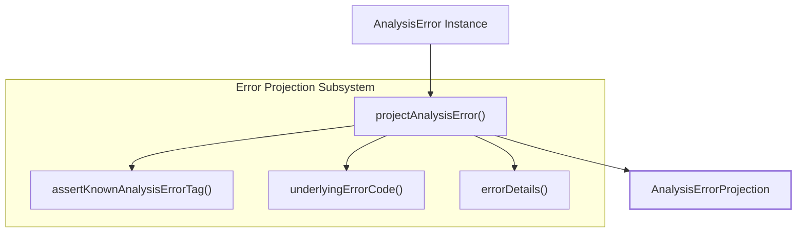
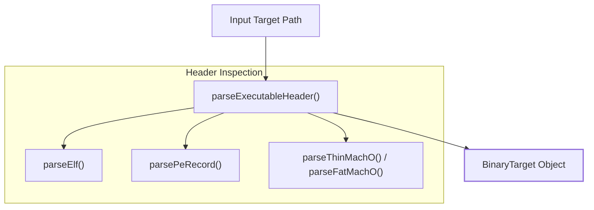

<!-- source: DeepWiki mcp.deepwiki.com · repo morluto/rea · page 2.2 Domain Layer · fetched 2026-10-16 -->

# Domain Layer

Relevant source files

The following files were used as context for generating this wiki page:

- [docs/user-visible-errors.csv](docs/user-visible-errors.csv)
- [install.sh](install.sh)
- [scripts/verify-real-ghidra-swift.mjs](scripts/verify-real-ghidra-swift.mjs)
- [src/application/binary/AnalysisSnapshotCache.test.ts](src/application/binary/AnalysisSnapshotCache.test.ts)
- [src/application/binary/AnalysisSnapshotCache.ts](src/application/binary/AnalysisSnapshotCache.ts)
- [src/application/managed/ManagedReconstructionService.test.ts](src/application/managed/ManagedReconstructionService.test.ts)
- [src/contracts/analysisViewApiSurfaceExample.ts](src/contracts/analysisViewApiSurfaceExample.ts)
- [src/domain/analysisErrorBase.ts](src/domain/analysisErrorBase.ts)
- [src/domain/analysisErrorPresentation.ts](src/domain/analysisErrorPresentation.ts)
- [src/domain/analysisErrorProjection.test.ts](src/domain/analysisErrorProjection.test.ts)
- [src/domain/analysisErrorProjection.ts](src/domain/analysisErrorProjection.ts)
- [src/domain/analysisProfile.test.ts](src/domain/analysisProfile.test.ts)
- [src/domain/analysisProfile.ts](src/domain/analysisProfile.ts)
- [src/domain/analysisSnapshot.test.ts](src/domain/analysisSnapshot.test.ts)
- [src/domain/analysisSnapshot.ts](src/domain/analysisSnapshot.ts)
- [src/domain/configurationErrors.ts](src/domain/configurationErrors.ts)
- [src/domain/evidence.test.ts](src/domain/evidence.test.ts)
- [src/domain/evidence.ts](src/domain/evidence.ts)
- [src/domain/functionComparison.test.ts](src/domain/functionComparison.test.ts)
- [src/domain/functionComparison.ts](src/domain/functionComparison.ts)
- [src/domain/functionComparisonDimensions.ts](src/domain/functionComparisonDimensions.ts)
- [src/domain/functionComparisonNormalization.ts](src/domain/functionComparisonNormalization.ts)
- [src/domain/functionComparisonResults.ts](src/domain/functionComparisonResults.ts)
- [src/domain/functionComparisonSchemas.ts](src/domain/functionComparisonSchemas.ts)
- [src/domain/functionDossierEvidence.ts](src/domain/functionDossierEvidence.ts)
- [src/domain/jsonValue.test.ts](src/domain/jsonValue.test.ts)
- [src/domain/jsonValue.ts](src/domain/jsonValue.ts)
- [src/domain/managed/managedReconstruction.ts](src/domain/managed/managedReconstruction.ts)
- [src/domain/native/objcSwiftMetadata.test.ts](src/domain/native/objcSwiftMetadata.test.ts)
- [src/domain/native/objcSwiftMetadata.ts](src/domain/native/objcSwiftMetadata.ts)
- [src/domain/rawBinary.test.ts](src/domain/rawBinary.test.ts)
- [src/domain/rawBinary.ts](src/domain/rawBinary.ts)
- [src/domain/reconstructionUnknowns.test.ts](src/domain/reconstructionUnknowns.test.ts)
- [src/domain/reconstructionUnknowns.ts](src/domain/reconstructionUnknowns.ts)
- [src/domain/residualUnknown.test.ts](src/domain/residualUnknown.test.ts)
- [src/domain/residualUnknown.ts](src/domain/residualUnknown.ts)
- [src/domain/result.ts](src/domain/result.ts)
- [src/domain/swiftSymbolClassification.ts](src/domain/swiftSymbolClassification.ts)
- [src/domain/symbolAnalysis.test.ts](src/domain/symbolAnalysis.test.ts)
- [src/domain/symbolAnalysis.ts](src/domain/symbolAnalysis.ts)
- [src/native/parsers/demangle.test.ts](src/native/parsers/demangle.test.ts)
- [src/native/parsers/demangle.ts](src/native/parsers/demangle.ts)
- [tests/boundary/cli/nativeDemangleCli.test.ts](tests/boundary/cli/nativeDemangleCli.test.ts)
- [tests/boundary/cli/rawBinaryCli.test.ts](tests/boundary/cli/rawBinaryCli.test.ts)
- [tests/boundary/filesystem/installScript.test.ts](tests/boundary/filesystem/installScript.test.ts)
- [tests/boundary/filesystem/targetDiagnostics.test.ts](tests/boundary/filesystem/targetDiagnostics.test.ts)
- [tests/boundary/mcp/enhancedTools.swiftTypes.test.ts](tests/boundary/mcp/enhancedTools.swiftTypes.test.ts)
- [tests/boundary/mcp/evidenceBundleInline.test.ts](tests/boundary/mcp/evidenceBundleInline.test.ts)
- [tests/boundary/mcp/functionComparisonMcp.test.ts](tests/boundary/mcp/functionComparisonMcp.test.ts)
- [tests/boundary/mcp/nativeDemangleMcp.test.ts](tests/boundary/mcp/nativeDemangleMcp.test.ts)
- [tests/conformance/providers/conformancePackage.test.ts](tests/conformance/providers/conformancePackage.test.ts)
- [tests/conformance/providers/hopper/realHopperAssertions.test.ts](tests/conformance/providers/hopper/realHopperAssertions.test.ts)

The **Domain Layer** contains the pure, side-effect-free modules located in `src/domain`. It defines core data structures, error algebra, boundary parsers, comparison semantics, and symbol analysis. This layer operates independently of network protocols, disk I/O (aside from direct target validation), or provider runtime managers.

## Core Result and Error Algebra

REA uses a functional approach to error handling through a `Result` type and a tagged error class hierarchy. This ensures expected failures are explicitly modeled.

### Result Type
The `Result<T, E>` type represents the outcome of operations without throwing exceptions:
- `ok(value)` wraps a successful result `[src/domain/result.ts:7-7]()`.
- `err(error)` wraps a failure `[src/domain/result.ts:10-10]()`.

### Analysis Error Hierarchy
All domain-specific errors inherit from `AnalysisError` (`[src/domain/analysisErrorBase.ts:64-121]()`), which defines stable tags (`_tag`) for type-safe error projection and remediation `[src/domain/analysisErrorBase.ts:4-35]()`. Expected failures are projected into structured error outputs via `projectAnalysisError` (`[src/domain/analysisErrorProjection.ts:46-96]()`).

**Sources:** `[src/domain/result.ts:1-10]()`, `[src/domain/analysisErrorBase.ts:4-121]`, `[src/domain/analysisErrorProjection.ts:46-96]()`

---

## Binary Target Resolution and App Bundles

The domain layer handles target identification and validation before passing binaries to providers. This includes resolving bundle structures and parsing headers.

### Target Parsing Flow
Binary target identification validates file formats and loads architectural metadata.

**Sources:** `[src/domain/evidence.ts:201-205]()`, `[src/domain/analysisSnapshot.ts:108-121]()`

---

## Evidence Schema

The `evidence.ts` module defines a strict schema (`evidenceSchema`) for analysis observations. Every tool output embeds deterministic provenance metadata.

### Evidence Structure
- `subject`: Path, SHA-256 hash, format, and architecture of the target `[src/domain/evidence.ts:71-86]()`.
- `provider`: Identity of the analysis provider `[src/domain/evidence.ts:36-40]()`.
- `operation`: The executed tool or analysis name `[src/domain/evidence.ts:130-130]()`.
- `parameters`: Input arguments supplied to the operation `[src/domain/evidence.ts:131-131]()`.
- `normalized_result`: Stable normalized output schema `[src/domain/evidence.ts:133-133]()`.
- `confidence`: Observed, derived, or inferred status `[src/domain/evidence.ts:134-134]()`.

**Sources:** `[src/domain/evidence.ts:36-142]`, `[src/domain/evidence.ts:167-169]()`

---

## Canonical Digests and Comparison

The domain layer provides utilities for creating canonical JSON digests and comparing structured values.

### Canonical Digest
`digestCanonicalValue` generates a SHA-256 hash of a JSON-serializable value after canonicalizing its keys and formatting, ensuring identical semantics produce deterministic digests regardless of key ordering.

### Function Comparison Normalization
The `functionComparisonNormalization.ts` module prepares `FunctionSnapshot` records for comparative analysis:
- `identityProjection`: Extracts names, signatures, and sorted local variables `[src/domain/functionComparisonNormalization.ts:7-13]()`.
- `functionMatch`: Evaluates symbol stability and determines whether a function match is `matched`, `mismatched`, or `ambiguous` `[src/domain/functionComparisonNormalization.ts:15-35]()`.
- `normalizeCfg`: Orders basic blocks by address and maps successors to indices `[src/domain/functionComparisonNormalization.ts:37-73]()`.

**Sources:** `[src/domain/canonicalDigest.ts:1-25]()`, `[src/domain/functionComparisonNormalization.ts:7-73]()`

---

## Symbol Analysis and Unicode Ordering

Symbol analysis and ordering utilities handle language-specific naming conventions and string sorting.

### Symbol Analysis
The `symbolAnalysis.ts` module classifies mangled symbols for Swift and Objective-C targets, categorizing types into classes (`_TtC`), structs (`_TtV`), enums (`_TtO`), and protocols (`_TtP`).

### Unicode Ordering
`compareUnicodeCodePoints` and `compositeKey` provide deterministic collation ties based on Unicode code points (`[src/domain/unicodeCodePointOrder.js]`), ensuring consistent sorting across platforms.

**Sources:** `[src/domain/symbolAnalysis.ts]`, `[src/domain/analysisSnapshot.ts:7-9]()`

---

