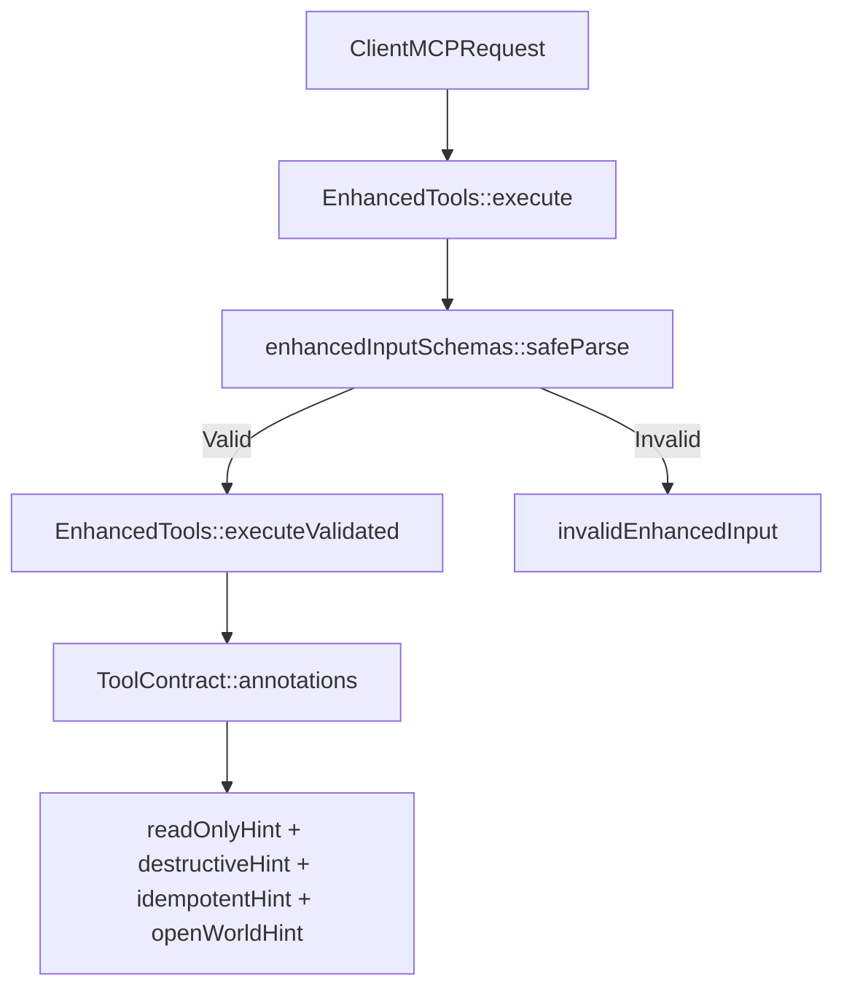
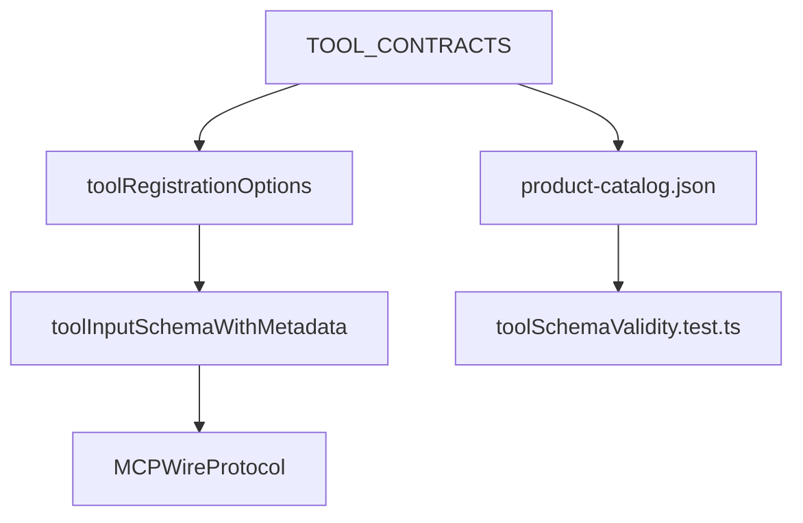

<!-- source: DeepWiki mcp.deepwiki.com · repo morluto/rea · page 2.3 Contracts and Tool Catalog · fetched 2026-10-16 -->

# Contracts and Tool Catalog

Relevant source files

The following files were used as context for generating this wiki page:

- [docs/mcp-contracts.md](docs/mcp-contracts.md)
- [scripts/verify-gemini-client.mjs](scripts/verify-gemini-client.mjs)
- [scripts/verify/clients/gemini-model-fixture.mjs](scripts/verify/clients/gemini-model-fixture.mjs)
- [src/application/CallPathTracing.ts](src/application/CallPathTracing.ts)
- [src/application/EnhancedLiteralTracing.ts](src/application/EnhancedLiteralTracing.ts)
- [src/application/EnhancedToolSelectorOrigin.test.ts](src/application/EnhancedToolSelectorOrigin.test.ts)
- [src/application/EnhancedTools.ts](src/application/EnhancedTools.ts)
- [src/application/ProcedureAddressResolution.ts](src/application/ProcedureAddressResolution.ts)
- [src/browser/history/CaptureFailures.test.ts](src/browser/history/CaptureFailures.test.ts)
- [src/browser/history/CaptureFailures.ts](src/browser/history/CaptureFailures.ts)
- [src/browser/history/CaptureRelease.ts](src/browser/history/CaptureRelease.ts)
- [src/composition/webNetworkCaptures.ts](src/composition/webNetworkCaptures.ts)
- [src/contracts/enhancedInputs.ts](src/contracts/enhancedInputs.ts)
- [src/contracts/enhancedToolContracts.ts](src/contracts/enhancedToolContracts.ts)
- [src/contracts/fridaToolContracts.ts](src/contracts/fridaToolContracts.ts)
- [src/contracts/gdbToolContracts.ts](src/contracts/gdbToolContracts.ts)
- [src/contracts/inputSchemaPresentation.ts](src/contracts/inputSchemaPresentation.ts)
- [src/contracts/rizinDebugToolContracts.ts](src/contracts/rizinDebugToolContracts.ts)
- [src/contracts/toolInputReferences.test.ts](src/contracts/toolInputReferences.test.ts)
- [src/contracts/toolOutputReferences.test.ts](src/contracts/toolOutputReferences.test.ts)
- [src/contracts/toolOutputSchemaGroups.ts](src/contracts/toolOutputSchemaGroups.ts)
- [src/contracts/toolSchemaMetadata.ts](src/contracts/toolSchemaMetadata.ts)
- [src/domain/hopperValues.ts](src/domain/hopperValues.ts)
- [src/domain/webNetworkCaptureCoordinates.ts](src/domain/webNetworkCaptureCoordinates.ts)
- [src/ida/IdaOperationFailures.test.ts](src/ida/IdaOperationFailures.test.ts)
- [src/process/ProviderDiagnosticRedaction.ts](src/process/ProviderDiagnosticRedaction.ts)
- [src/process/capture/ProcessScenarioRuntimeValidation.test.ts](src/process/capture/ProcessScenarioRuntimeValidation.test.ts)
- [src/process/capture/ProcessScenarioRuntimeValidation.ts](src/process/capture/ProcessScenarioRuntimeValidation.ts)
- [src/server/registerWebNetworkCaptureTool.ts](src/server/registerWebNetworkCaptureTool.ts)
- [src/server/toolRegistrationOptions.ts](src/server/toolRegistrationOptions.ts)
- [tests/acceptance/tools/historicalCaptureResources.test.ts](tests/acceptance/tools/historicalCaptureResources.test.ts)
- [tests/acceptance/tools/inspectorLifecycle.test.ts](tests/acceptance/tools/inspectorLifecycle.test.ts)
- [tests/acceptance/tools/localToolContracts.test.ts](tests/acceptance/tools/localToolContracts.test.ts)
- [tests/boundary/filesystem/javascript-applications/javascriptBundlerAdapters.test.ts](tests/boundary/filesystem/javascript-applications/javascriptBundlerAdapters.test.ts)
- [tests/boundary/mcp/browserComparisonInput.test.ts](tests/boundary/mcp/browserComparisonInput.test.ts)
- [tests/boundary/mcp/compactInputSchemaMcp.test.ts](tests/boundary/mcp/compactInputSchemaMcp.test.ts)
- [tests/boundary/mcp/enhancedTools.03-returns-typed-graph-failures-and.test.ts](tests/boundary/mcp/enhancedTools.03-returns-typed-graph-failures-and.test.ts)
- [tests/boundary/mcp/enhancedTools.callPathsAndBatches.test.ts](tests/boundary/mcp/enhancedTools.callPathsAndBatches.test.ts)
- [tests/boundary/mcp/outputSchemaSemanticConstraints.test.ts](tests/boundary/mcp/outputSchemaSemanticConstraints.test.ts)
- [tests/boundary/mcp/outputValidatorReuse.test.ts](tests/boundary/mcp/outputValidatorReuse.test.ts)
- [tests/boundary/mcp/toolSchemaValidity.test.ts](tests/boundary/mcp/toolSchemaValidity.test.ts)
- [tests/boundary/process/providerProcessOutput.test.ts](tests/boundary/process/providerProcessOutput.test.ts)
- [tests/boundary/providers/ida/calleeRelationships.test.ts](tests/boundary/providers/ida/calleeRelationships.test.ts)
- [tests/fixtures/mcpClientSchemaConstraints.ts](tests/fixtures/mcpClientSchemaConstraints.ts)

This page details the structure and management of tool contracts within REA, covering `ToolContract` inventory, tool effects and annotations, output schema groups, the generated MCP tool catalog, `product-catalog.json`, capability migration guidelines, and contract snapshot verification.

## ToolContract Inventory

REA defines a comprehensive set of `ToolContract` specifications representing the available capabilities exposed to clients. Each `ToolContract` defines its unique tool name, human-readable title, detailed description, Zod-backed `inputSchema`, `outputSchema`, and operational `annotations`. These contracts are managed across domain-specific contract modules such as official bridge tools, enhanced workflow tools, and session management facilities [tests/boundary/mcp/toolSchemaValidity.test.ts:8-11]().

Tool registration uses `toolRegistrationOptions` [src/server/toolRegistrationOptions.ts:20-34]() to project the canonical Zod schemas into Model Context Protocol (MCP) registration records. Input schemas are wrapped with metadata transformations using `toolInputSchemaWithMetadata` [src/contracts/toolSchemaMetadata.ts:56-76](), while output schemas receive content-bound validation identities via `toolOutputSchemaWithMetadata` [src/contracts/toolSchemaMetadata.ts:87-109]().

Sources:
- [tests/boundary/mcp/toolSchemaValidity.test.ts:8-11]()
- [src/server/toolRegistrationOptions.ts:20-34]()
- [src/contracts/toolSchemaMetadata.ts:56-109]()

## Tool Effects and Annotations

Tool contracts specify operational `annotations` that declare authority and safety hints to clients and execution guards [tests/boundary/mcp/toolSchemaValidity.test.ts:98-180](). These hints include:
- `readOnlyHint`: Indicates if the operation avoids modifying state.
- `destructiveHint`: Indicates if the operation mutates analysis state, filesystems, or live processes.
- `idempotentHint`: Indicates if repeating the operation yields identical side effects.
- `openWorldHint`: Indicates if the operation interacts with external environments or open-world targets.

The `EnhancedTools` class [src/application/EnhancedTools.ts:98-174]() routes and validates execution requests for high-level workflows. It provides both `execute` [src/application/EnhancedTools.ts:102-174]() for untrusted input payloads and `executeValidated` [src/application/EnhancedTools.ts:177-182]() for pre-parsed trusted calls.

### Diagram: Tool Execution and Annotation Flow

Sources:
- [tests/boundary/mcp/toolSchemaValidity.test.ts:98-180]()
- [src/application/EnhancedTools.ts:98-182]()

## Output Schema Groups

Tool output schemas are structured into reusable groups that standardize analysis return types. The official output schemas are cataloged in `officialOutputSchemas` [src/contracts/toolOutputSchemaGroups.ts:114-150](), tying execution responses to explicit structures such as `evidenceResultOf` wrappers and domain models.

Domain models enforce strict invariants using Zod refinements. For example, `functionBodySchema` [src/domain/hopperValues.ts:93-179]() verifies inclusive address ranges, continuity flags, and span arithmetic using `.superRefine()` [src/domain/hopperValues.ts:117-178]().

Sources:
- [src/contracts/toolOutputSchemaGroups.ts:114-150]()
- [src/domain/hopperValues.ts:93-179]()

## Generated MCP Tool Catalog and `product-catalog.json`

The MCP tool catalog aggregates all `ToolContract` definitions into a machine-readable inventory. The snapshot of this catalog is persisted in `product-catalog.json`, which categorizes capabilities by family (such as direct, enhanced, native, artifact, managed, firmware, android, browser, electron, javascript-runtime, application, and session).

Catalog validation is enforced through test harnesses such as `toolSchemaValidity.test.ts` [tests/boundary/mcp/toolSchemaValidity.test.ts:1-64](), which compiles schemas using Ajv2020 to verify wire compatibility.

### Diagram: Catalog Generation to MCP Registration

Sources:
- [tests/boundary/mcp/toolSchemaValidity.test.ts:1-64]()
- [src/contracts/toolSchemaMetadata.ts:56-84]()
- [src/server/toolRegistrationOptions.ts:20-34]()

## Capability Migration and Contract Snapshot Tests

Capability changes follow strict architecture boundaries to prevent accidental API breakage. 

### Capability Migration Rules
- **Explicit Ownership**: Maintain separation between domain analytics, contract schemas, and provider transport adapters.
- **Incremental Refactoring**: Validate boundary rules before generalizing common utilities.
- **Snapshot and Schema Tests**: Ensure wire schema transformations and input reference handling remain consistent across targets (such as draft-07 and draft-2020-12) as tested in `toolInputReferences.test.ts` [src/contracts/toolInputReferences.test.ts:14-41]().

Sources:
- [src/contracts/toolInputReferences.test.ts:14-41]()
- [tests/boundary/mcp/toolSchemaValidity.test.ts:66-96]()

---

