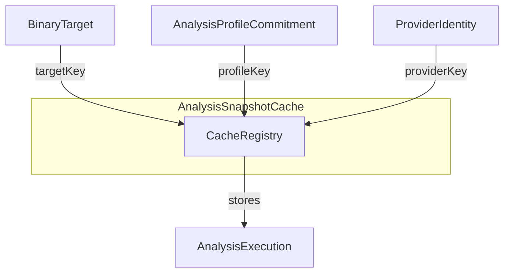
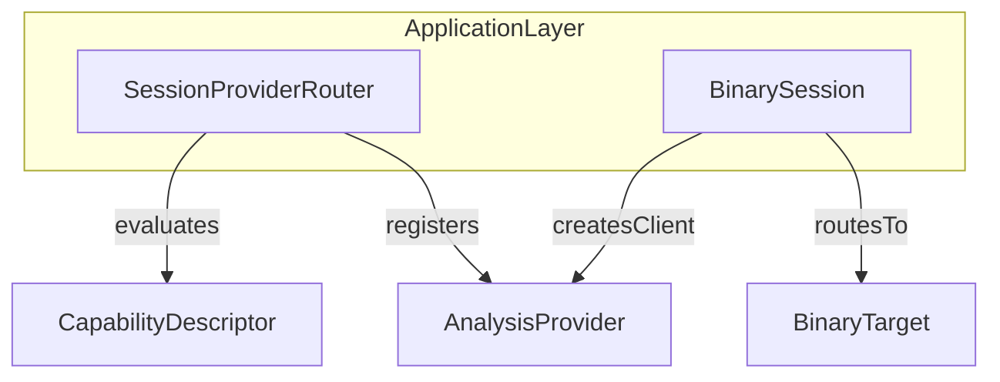
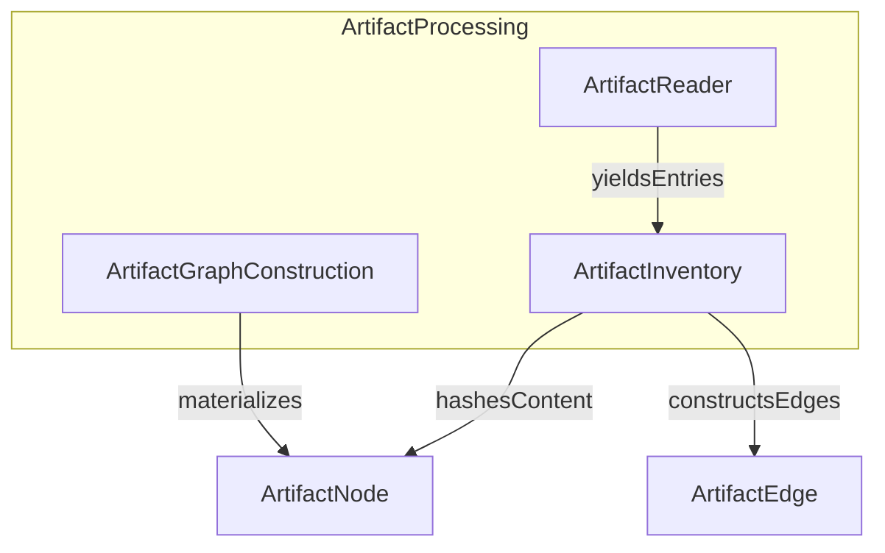

<!-- source: DeepWiki mcp.deepwiki.com · repo morluto/rea · page 2.4 Application Layer · fetched 2026-10-16 -->

# Application Layer

<details>
<summary>Relevant source files</summary>

The following files were used as context for generating this wiki page:

- [.agents/skills/reverse-engineer-anything/SKILL.md](.agents/skills/reverse-engineer-anything/SKILL.md)
- [.agents/skills/reverse-engineer-anything/references/android-applications.md](.agents/skills/reverse-engineer-anything/references/android-applications.md)
- [.agents/skills/reverse-engineer-anything/references/evidence-workflows.md](.agents/skills/reverse-engineer-anything/references/evidence-workflows.md)
- [.agents/skills/reverse-engineer-anything/references/native-and-artifacts.md](.agents/skills/reverse-engineer-anything/references/native-and-artifacts.md)
- [.agents/skills/reverse-engineer-anything/references/runtime-observation.md](.agents/skills/reverse-engineer-anything/references/runtime-observation.md)
- [scripts/lib/ghidra-reference-snapshot-e2e.mjs](scripts/lib/ghidra-reference-snapshot-e2e.mjs)
- [scripts/lib/real-ghidra-snapshot-lifecycle.mjs](scripts/lib/real-ghidra-snapshot-lifecycle.mjs)
- [scripts/record-catalog-digests.mjs](scripts/record-catalog-digests.mjs)
- [src/application/DirectAnalysis.ts](src/application/DirectAnalysis.ts)
- [src/application/ReferenceSourceImport.ts](src/application/ReferenceSourceImport.ts)
- [src/application/ReferenceSourceImportPolicy.ts](src/application/ReferenceSourceImportPolicy.ts)
- [src/application/ReferenceSourceImportTypes.test.ts](src/application/ReferenceSourceImportTypes.test.ts)
- [src/application/ReferenceSourceImportTypes.ts](src/application/ReferenceSourceImportTypes.ts)
- [src/application/analysisView/AnalysisViewService.test.ts](src/application/analysisView/AnalysisViewService.test.ts)
- [src/application/analysisView/AnalysisViewService.ts](src/application/analysisView/AnalysisViewService.ts)
- [src/application/binary/BinarySession.ts](src/application/binary/BinarySession.ts)
- [src/application/binary/BinarySessionOpen.ts](src/application/binary/BinarySessionOpen.ts)
- [src/application/binary/BinarySessionPort.ts](src/application/binary/BinarySessionPort.ts)
- [src/application/binary/BinarySessionRecords.ts](src/application/binary/BinarySessionRecords.ts)
- [src/catalogIdentity.ts](src/catalogIdentity.ts)
- [src/cli/referenceSourceImportStatus.ts](src/cli/referenceSourceImportStatus.ts)
- [src/cliEvidenceCommands.ts](src/cliEvidenceCommands.ts)
- [src/contracts/analysisViewToolContracts.ts](src/contracts/analysisViewToolContracts.ts)
- [src/domain/analysisView/WebNetworkApiSurfaceAccumulator.test.ts](src/domain/analysisView/WebNetworkApiSurfaceAccumulator.test.ts)
- [src/domain/analysisView/WebNetworkApiSurfaceAccumulator.ts](src/domain/analysisView/WebNetworkApiSurfaceAccumulator.ts)
- [src/domain/analysisView/analysisView.test.ts](src/domain/analysisView/analysisView.test.ts)
- [src/domain/analysisView/analysisView.ts](src/domain/analysisView/analysisView.ts)
- [src/domain/analysisView/analysisViewDataAdmission.ts](src/domain/analysisView/analysisViewDataAdmission.ts)
- [src/domain/analysisView/binaryLayoutView.ts](src/domain/analysisView/binaryLayoutView.ts)
- [src/domain/analysisView/javascriptApplicationView.ts](src/domain/analysisView/javascriptApplicationView.ts)
- [src/domain/analysisView/nativeFunctionView.ts](src/domain/analysisView/nativeFunctionView.ts)
- [src/domain/analysisView/webNetworkApiSurfaceView.test.ts](src/domain/analysisView/webNetworkApiSurfaceView.test.ts)
- [src/domain/analysisView/webNetworkApiSurfaceView.ts](src/domain/analysisView/webNetworkApiSurfaceView.ts)
- [src/domain/recordedTransportUrl.ts](src/domain/recordedTransportUrl.ts)
- [src/domain/referenceSourceGraph.test.ts](src/domain/referenceSourceGraph.test.ts)
- [src/domain/referenceSourceGraph.ts](src/domain/referenceSourceGraph.ts)
- [src/domain/referenceSourcePolicy.ts](src/domain/referenceSourcePolicy.ts)
- [src/domain/referenceSourceSummary.test.ts](src/domain/referenceSourceSummary.test.ts)
- [src/domain/referenceSourceSummary.ts](src/domain/referenceSourceSummary.ts)
- [src/recordedCatalogDigests.ts](src/recordedCatalogDigests.ts)
- [src/reference/ReferenceSourceReaderErrors.ts](src/reference/ReferenceSourceReaderErrors.ts)
- [src/reference/ReferenceSourceReaderValidate.ts](src/reference/ReferenceSourceReaderValidate.ts)
- [src/server/EvidenceMcpServer.test.ts](src/server/EvidenceMcpServer.test.ts)
- [src/server/EvidenceMcpServer.ts](src/server/EvidenceMcpServer.ts)
- [src/server/registerCloseLifecycleTool.ts](src/server/registerCloseLifecycleTool.ts)
- [src/server/registerEnhancedTools.ts](src/server/registerEnhancedTools.ts)
- [src/server/registerOfficialTools.ts](src/server/registerOfficialTools.ts)
- [src/server/toolResult.ts](src/server/toolResult.ts)
- [src/server/toolResultEncoding.test.ts](src/server/toolResultEncoding.test.ts)
- [src/server/toolResultEncoding.ts](src/server/toolResultEncoding.ts)
- [tests/boundary/cli/analysisViewCli.test.ts](tests/boundary/cli/analysisViewCli.test.ts)
- [tests/boundary/cli/referenceSourceExclusions.test.ts](tests/boundary/cli/referenceSourceExclusions.test.ts)
- [tests/boundary/cli/referenceSourceImportStatus.test.ts](tests/boundary/cli/referenceSourceImportStatus.test.ts)
- [tests/boundary/filesystem/referenceSourceFailureDetails.test.ts](tests/boundary/filesystem/referenceSourceFailureDetails.test.ts)
- [tests/boundary/filesystem/referenceSourceImport.test.ts](tests/boundary/filesystem/referenceSourceImport.test.ts)
- [tests/boundary/mcp/analysisViewMcp.test.ts](tests/boundary/mcp/analysisViewMcp.test.ts)
- [tests/boundary/mcp/contractPresentation.test.ts](tests/boundary/mcp/contractPresentation.test.ts)
- [tests/boundary/mcp/largeToolResult.test.ts](tests/boundary/mcp/largeToolResult.test.ts)
- [tests/boundary/mcp/oversizedErrorDeliveryMcp.test.ts](tests/boundary/mcp/oversizedErrorDeliveryMcp.test.ts)
- [tests/boundary/mcp/serverIdentity.test.ts](tests/boundary/mcp/serverIdentity.test.ts)
- [tests/boundary/mcp/sessionMcp.test.ts](tests/boundary/mcp/sessionMcp.test.ts)
- [tests/boundary/mcp/sessionMcpHarness.ts](tests/boundary/mcp/sessionMcpHarness.ts)
- [tests/composition/analysis-sessions/binarySession.test.ts](tests/composition/analysis-sessions/binarySession.test.ts)
- [tests/process-global/mcpDeliveryEnvironment.test.ts](tests/process-global/mcpDeliveryEnvironment.test.ts)

</details>


The Application Layer provides a shared runtime for the CLI and MCP adapters. It manages the lifecycle of analysis sessions, composes low-level engine operations into high-level workflows, and provides idempotent system utilities for environment diagnostics, capability inventory, artifact graph construction, and reference source imports.

## Session Management

The core of the application layer is the `BinarySession`, which maintains the state of a single active analysis target across CLI and MCP adapters. Because engine dispatches work on dedicated worker threads or background processes and requires bridge teardowns to switch binaries, `BinarySession` serializes all target transitions to prevent race conditions [src/application/binary/BinarySession.ts:34-91]().

### BinarySession Lifecycle
1.  **Open**: Parses the `BinaryTarget`, drains any pending calls to the previous target, closes the old client bridge, and initializes a new `AnalysisClient` [src/application/binary/BinarySession.ts:38-43]().
2.  **Execute**: Proxies tool calls to the active client. If a transition is in progress, calls wait for the transition to settle [src/application/binary/BinarySession.ts:134-150]().
3.  **Restore**: If a switch to a new binary fails, the session attempts to recreate the previous target's client to avoid leaving the system in a broken state [src/application/binary/BinarySession.ts:165-175]().
4.  **Close**: Drains calls and shuts down the active provider bridge [src/application/binary/BinarySession.ts:99-107]().

### Session Data Flow
The following diagram illustrates how the `BinarySession` manages the transition between two different binary targets.

**Binary Target Transition Flow**
```mermaid
sequenceDiagram
    participant A as "Adapter"
    participant S as "BinarySession"
    participant C1 as "AnalysisClientA"
    participant C2 as "AnalysisClientB"

    A->>S: "open(path_B)"
    S->>S: "#serialize()"
    S->>S: "#drainCalls()"
    S->>C1: "close()"
    destroy C1
    S->>C2: "createClient(target_B)"
    S->>C2: "execute(health)"
    C2-->>S: "ok"
    S-->>A: "ok(target_B)"
```
Sources: [src/application/binary/BinarySession.ts:34-107]()

## Direct Analysis (CLI Mode)

For one-shot commands like `rea analyze <path>`, the `runDirectAnalysis` function manages a transient session. Unlike the MCP server which keeps the bridge open, `DirectAnalysis` follows a strict "Open -> Execute -> Close" pattern to ensure no background processes are left running after the CLI exits [src/application/DirectAnalysis.ts:89-127](). It wraps the output in the `Evidence` schema, associating the result with the binary's content hash [src/application/DirectAnalysis.ts:10-38]().

Sources: [src/application/DirectAnalysis.ts:89-127]()

## Analysis Snapshot Cache

The `AnalysisSnapshotCache` stores results of analysis operations to avoid redundant computations. It partitions cached data by `BinaryTarget`, `AnalysisProfileCommitment`, and `ProviderIdentity` [src/application/binary/BinarySession.ts:28-35]().

Key aspects:
*   **Partitioning**: Snapshots are stored in a nested map structure, ensuring that results from different targets, profiles, or providers do not conflict.
*   **Cacheability**: Determines if an operation's result can be cached based on parameter specificity and whether native source admission is required before replay [src/application/DirectAnalysis.ts:28-35]().
*   **Integrity**: Verifies that the imported snapshot entries match expected execution parameters to prevent tampering [src/application/binary/BinarySession.ts:127-129]().

**Analysis Snapshot Cache Structure**

Sources: [src/application/binary/BinarySession.ts:28-35](), [src/application/DirectAnalysis.ts:28-35]()

## Provider Registry and Evaluation

The provider router and evaluation modules manage the collection of available `AnalysisProvider` instances, selecting the most suitable provider based on capability descriptors, profiles, and target compatibility [src/application/binary/BinarySession.ts:31-33]().

**Provider Registry and Evaluation Flow**

Sources: [src/application/binary/BinarySession.ts:31-33]()

## Capability Inventory

The `buildCapabilityInventory` function constructs a comprehensive list of all available tools and their current availability status [tests/boundary/mcp/serverIdentity.test.ts:30-34]().

Key aspects:
*   **Tool Contracts**: Iterates through known tool definitions to establish a baseline.
*   **Provider Descriptors**: Incorporates provider capability metadata from the active session status.
*   **Client Requirements**: Validates whether the connected client supports necessary features for each tool.

Sources: [tests/boundary/mcp/serverIdentity.test.ts:30-34]()

## Analysis Views

The analysis view subsystem projects bounded representations of completed binary-layout, JavaScript application, native function, or capture evidence without repeating analysis [src/domain/analysisView/analysisView.ts:38-116](). It supports paging, collection filtering, and stable view digests [src/domain/analysisView/analysisView.test.ts:66-101]().

Sources: [src/domain/analysisView/analysisView.ts:38-116](), [src/domain/analysisView/analysisView.test.ts:66-101]()

## Artifact Inventory and Graph Construction

The artifact inventory and graph construction modules scan ZIP archives, ASAR bundles, directories, or DMG images, producing content-addressed `ArtifactNode` entries and `ArtifactEdge` relations with deterministic ordering [src/domain/analysisView/analysisView.ts:26-31]().

**Artifact Inventory Graph Flow**

Sources: [src/domain/analysisView/analysisView.ts:26-31]()

## Reference Source Import

The `importReferenceSource` function imports a directory of source code into a `HistoricalSourceGraph`, applying security exclusion policies, parsing file entries, extracting relationships (imports/references), and computing content hashes and inventories [tests/boundary/filesystem/referenceSourceImport.test.ts:10-18]().

**Reference Source Import Flow**
```mermaid
graph TD
    subgraph "ReferenceSource"
        ISR["importReferenceSource"]
        PRS["prepareReferenceSourceImport"]
        RRS["readReferenceSource"]
        H SG["createHistoricalSourceGraph"]
    end
    PP["PreparedPolicy"]
    RR["ReadResult"]
    HSG["HistoricalSourceGraph"]

    ISR -- "configures" --> PRS
    PRS -- "outputs" --> PP
    ISR -- "calls" --> RRS
    RRS -- "outputs" --> RR
    RR -- "buildsGraph" --> HSG
```
Sources: [tests/boundary/filesystem/referenceSourceImport.test.ts:10-18](), [src/domain/referenceSourceGraph.ts:204-214]()

---

