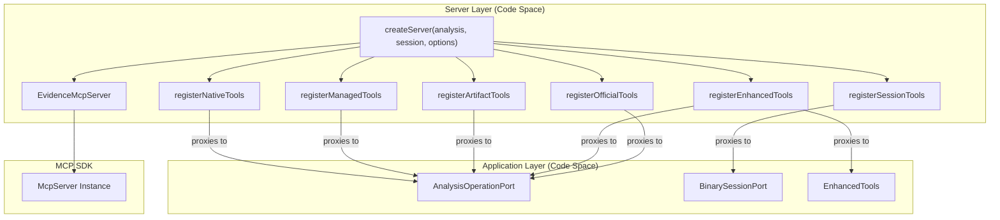
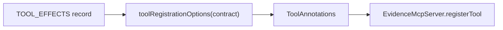
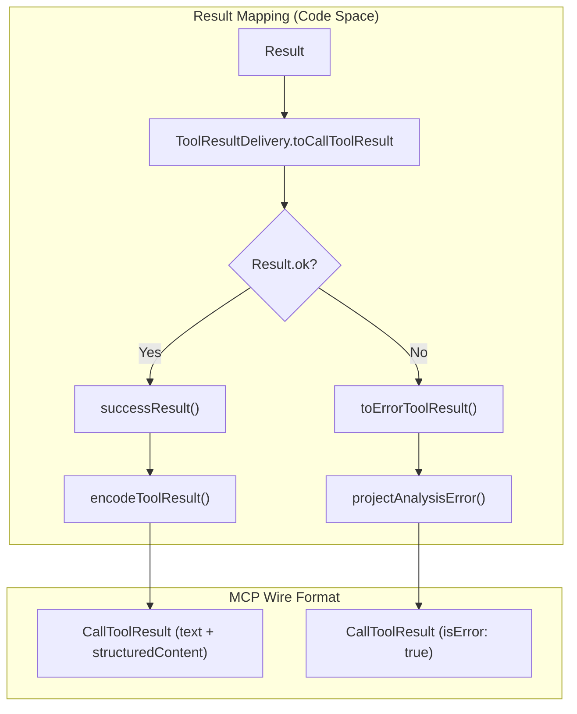
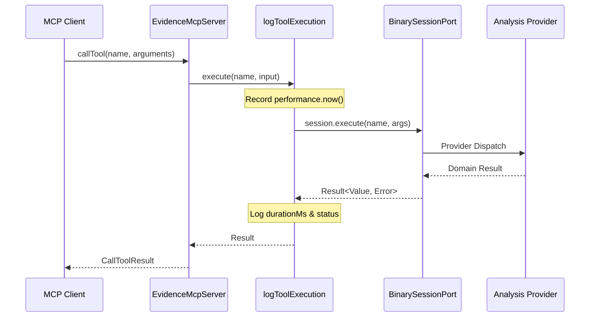

<!-- source: DeepWiki mcp.deepwiki.com · repo morluto/rea · page 2.5 Server Layer (MCP Adapter) · fetched 2026-10-16 -->

# Server Layer (MCP Adapter)

Relevant source files

The following files were used as context for generating this wiki page:

- [scripts/lib/catalog-builders.mjs](scripts/lib/catalog-builders.mjs)
- [scripts/lib/catalog-core.mjs](scripts/lib/catalog-core.mjs)
- [scripts/verify-package-mcp.mjs](scripts/verify-package-mcp.mjs)
- [scripts/verify-package-prompts.mjs](scripts/verify-package-prompts.mjs)
- [src/application/CapabilityInventory.test.ts](src/application/CapabilityInventory.test.ts)
- [src/application/CapabilityInventory.ts](src/application/CapabilityInventory.ts)
- [src/application/DirectAnalysis.ts](src/application/DirectAnalysis.ts)
- [src/cliCommandNames.ts](src/cliCommandNames.ts)
- [src/cliEvidenceCommands.ts](src/cliEvidenceCommands.ts)
- [src/contracts/toolContracts.ts](src/contracts/toolContracts.ts)
- [src/contracts/toolEffects.ts](src/contracts/toolEffects.ts)
- [src/domain/hopperValues.test.ts](src/domain/hopperValues.test.ts)
- [src/server/EvidenceMcpServer.test.ts](src/server/EvidenceMcpServer.test.ts)
- [src/server/EvidenceMcpServer.ts](src/server/EvidenceMcpServer.ts)
- [src/server/createServer.ts](src/server/createServer.ts)
- [src/server/mcpClientMetadata.ts](src/server/mcpClientMetadata.ts)
- [src/server/promptCompletion.ts](src/server/promptCompletion.ts)
- [src/server/registerBrowserScenarioTool.ts](src/server/registerBrowserScenarioTool.ts)
- [src/server/registerBrowserTools.ts](src/server/registerBrowserTools.ts)
- [src/server/registerElectronTools.ts](src/server/registerElectronTools.ts)
- [src/server/registerEnhancedTools.ts](src/server/registerEnhancedTools.ts)
- [src/server/registerJavaScriptRuntimeObservationTools.ts](src/server/registerJavaScriptRuntimeObservationTools.ts)
- [src/server/registerOfficialTools.ts](src/server/registerOfficialTools.ts)
- [src/server/registerPrompts.ts](src/server/registerPrompts.ts)
- [src/server/registerSessionStatusTool.ts](src/server/registerSessionStatusTool.ts)
- [src/server/registerSessionTools.ts](src/server/registerSessionTools.ts)
- [src/server/toolResult.ts](src/server/toolResult.ts)
- [src/server/toolResultEncoding.test.ts](src/server/toolResultEncoding.test.ts)
- [src/server/toolResultEncoding.ts](src/server/toolResultEncoding.ts)
- [tests/boundary/mcp/clientCapabilities.test.ts](tests/boundary/mcp/clientCapabilities.test.ts)
- [tests/boundary/mcp/contractPresentation.test.ts](tests/boundary/mcp/contractPresentation.test.ts)
- [tests/boundary/mcp/enhancedTools.04-uses-complete-inventories-inline.test.ts](tests/boundary/mcp/enhancedTools.04-uses-complete-inventories-inline.test.ts)
- [tests/boundary/mcp/javascriptRuntimeObservationMcp.test.ts](tests/boundary/mcp/javascriptRuntimeObservationMcp.test.ts)
- [tests/boundary/mcp/largeToolResult.test.ts](tests/boundary/mcp/largeToolResult.test.ts)
- [tests/boundary/mcp/oversizedErrorDeliveryMcp.test.ts](tests/boundary/mcp/oversizedErrorDeliveryMcp.test.ts)
- [tests/boundary/mcp/promptCompletion.test.ts](tests/boundary/mcp/promptCompletion.test.ts)
- [tests/boundary/mcp/promptMcp.test.ts](tests/boundary/mcp/promptMcp.test.ts)
- [tests/boundary/mcp/serverWorkflowMcp.test.ts](tests/boundary/mcp/serverWorkflowMcp.test.ts)
- [tests/composition/idaProvider.test.ts](tests/composition/idaProvider.test.ts)
- [tests/process-global/mcpDeliveryEnvironment.test.ts](tests/process-global/mcpDeliveryEnvironment.test.ts)

The Server Layer acts as the bridge between the Model Context Protocol (MCP) and REA's application and domain logic. It is responsible for assembling the `EvidenceMcpServer` instance, registering tools spanning official proxies, enhanced workflows, session management, and specialized observation domains, and translating domain outcomes into robust MCP-compliant responses.

Sources: [src/server/createServer.ts:1-110](), [src/server/EvidenceMcpServer.ts:107-135]()

## Core Assembly: `createServer`

The `createServer` function initializes and wires the MCP server instance based on the presence of a `BinarySessionPort` or fixed-target configuration [src/server/createServer.ts:1-110]().

- **Fixed-Target Mode**: When `session` is `undefined`, the server assumes a pre-configured target from environment variables and registers core official and enhanced toolsets.
- **Session Mode**: When a `BinarySessionPort` is supplied, the server registers session lifecycle tools (`open_binary`, `close_binary`, `binary_session`), enabling dynamic switching across analysis targets [src/server/registerSessionTools.ts:148-170]().
- **Optional Services & Policy**: Dynamic availability of packet capture, signal recording, WebAssembly, EVM interfaces, SQLite databases, and Frida instrumentation are evaluated against environment capabilities and injected into registration functions [src/server/createServer.ts:1-100]().

Sources: [src/server/createServer.ts:1-110](), [src/server/EvidenceMcpServer.ts:107-194]()

## Tool Registration Modules

REA categorizes its tool catalog into granular registration modules that populate the `EvidenceMcpServer` with typed contracts defined in `TOOL_CONTRACTS` [src/contracts/toolContracts.ts:39-76]().

### 1. Official and Enhanced Tools (`registerOfficialTools`, `registerEnhancedTools`)
- **Official Tools (`registerOfficialTools`)**: Bridge directly to low-level target operations (e.g., `address_name`, `read_bytes`, `xrefs`, `set_comment`) using `OFFICIAL_TOOL_CONTRACTS` [src/contracts/toolContracts.ts:29](). Inputs are projected via `projectOfficialArguments` and outcomes are wrapped with target evidence metadata [src/server/registerOfficialTools.ts:78-91]().
- **Enhanced Tools (`registerEnhancedTools`)**: Register composed multi-step workflows like `analyze_function`, `binary_overview`, `batch_decompile`, and `get_call_graph` instantiated via the `EnhancedTools` class [src/server/registerEnhancedTools.ts:14-180]().

### 2. Session and Investigation Tools (`registerSessionTools`, `registerInvestigationTools`)
- **Session Tools**: Manage the target lifecycle (`open_binary`, `close_binary`, `binary_session`) and record process execution via `capture_process_scenario` [src/server/registerSessionTools.ts:91-170]().
- **Investigation Tools**: Operate over the evidence ledger to perform cross-session correlation, find changed behavior, and track unresolved unknowns [src/server/registerSessionTools.ts:28-33]().

### 3. Specialized Domain Modules
- **Artifacts (`registerArtifactTools`)**: Inventory and inspect archive or compressed structures [src/server/createServer.ts:64]().
- **Managed Code (`registerManagedTools`, `registerManagedWorkflowTools`)**: .NET metadata inspection, CIL decoding, and managed application graph projection [src/server/createServer.ts:89]().
- **Electron & Web (`registerElectronTools`, `registerBrowserTools`, `registerWebRuntimeTools`)**: Runtime observation, CDP inspection, source location mapping, and JavaScript recovery (`JavaScriptRecoveryService`) [src/server/createServer.ts:67-85]().
- **Android, Firmware & Binary Diagnostics (`registerAndroidTools`, `registerFirmwareTools`, `registerBinaryDiagnosticsTools`)**: APK analysis, firmware region extraction (`FirmwareAnalysisService`), PE resource diagnostics, and crash analysis [src/server/createServer.ts:33-94]().

Sources: [src/contracts/toolContracts.ts:39-76](), [src/server/registerEnhancedTools.ts:56-180](), [src/server/registerSessionTools.ts:91-170]()

## Tool Registration Options and Effects

Every tool registration applies execution hints derived from `TOOL_EFFECTS` using `toolRegistrationOptions` [src/contracts/toolEffects.ts:55-780]().

Sources: [src/contracts/toolEffects.ts:55-100](), [src/server/toolRegistrationOptions.ts:1-19]()

These annotations provide the MCP client with explicit hints regarding `readOnlyHint`, `destructiveHint`, `idempotentHint`, and `openWorldHint` based on whether operations mutate session state, launch external processes, or access the network [src/contracts/toolEffects.ts:25-30]().

Sources: [src/contracts/toolEffects.ts:25-50](), [src/server/toolRegistrationOptions.ts:1-19]()

## Tool Result Mapping (`toCallToolResult`)

The `ToolResultDelivery` class translates REA's internal `Result<JsonValue, AnalysisError>` structures into MCP `CallToolResult` objects under strict response budget constraints [src/server/toolResult.ts:23-52]().

Sources: [src/server/toolResult.ts:47-65](), [src/server/toolResult.ts:95-103]()

- **Success Delivery (`successResult`)**: Formats the payload into text content while preserving the typed `structuredContent` [src/server/toolResult.ts:152-170](). If results exceed the budget (`resultBudgetBytes`), actionable recovery advice or continuation pointers are returned [src/server/toolResult.ts:171-180]().
- **Error Projection (`toErrorToolResult`)**: Projects domain errors into structured error payloads via `projectAnalysisError`, omitting sensitive stack traces while retaining diagnostic metadata [src/server/toolResult.ts:95-103]().

Sources: [src/server/toolResult.ts:23-152]()

## Guided Prompts and Completion

REA exposes investigation workflows through the MCP `prompts` capability, supported by session-aware argument completers [src/server/promptCompletion.ts:35-52]().

- **Prompt Inventory**: Structured templates like `investigate_feature`, `compare_application_versions`, and `verify_reconstruction` guide agent workflows with defined objectives and steps.
- **Session-Aware Completion (`createPromptCompletionSource`)**: Dynamically resolves completion candidates from the live session state and evidence ledger [src/server/promptCompletion.ts:35-52]().
  - **Documents**: Queried via `list_documents` [src/server/promptCompletion.ts:81-95]().
  - **Procedures**: Queried via `list_procedures` [src/server/promptCompletion.ts:97-132]().
  - **Evidence & Captures**: Extracted from `session.exportEvidenceBundle()` [src/server/promptCompletion.ts:161-170]().
  - **Deduplication**: Results are Unicode-normalized, case-insensitive, filtered by prefix, and sorted deterministically [src/server/promptCompletion.ts:40-51]().

Sources: [src/server/promptCompletion.ts:35-79]()

## Tool Execution Lifecycle

Every tool call dispatched by the MCP client passes through a logging and telemetry wrapper (`logToolExecution`) to record duration and status safely without logging sensitive payload data [src/server/toolLogging.ts:1-21]().

Sources: [src/server/registerSessionTools.ts:110-124](), [src/server/toolLogging.ts:5-21]()

---

