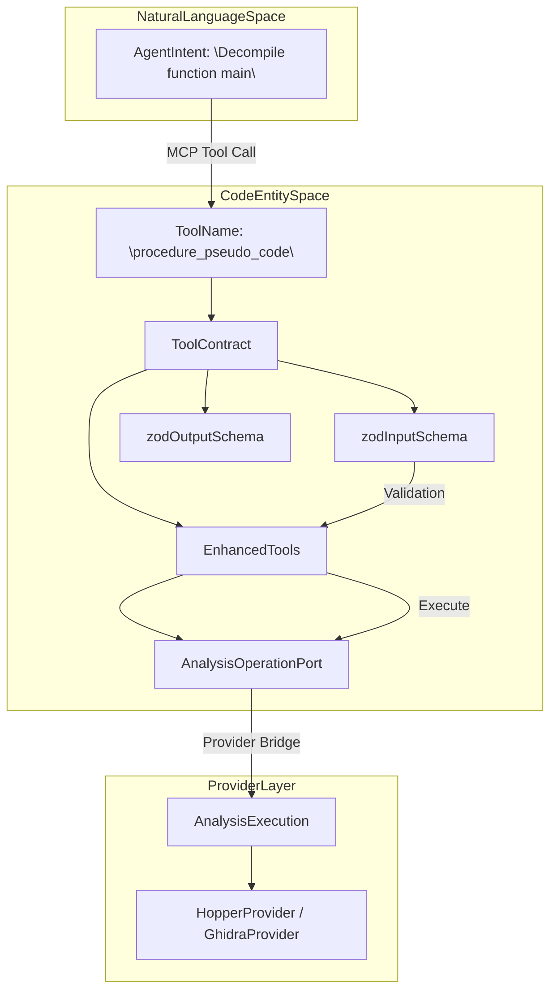
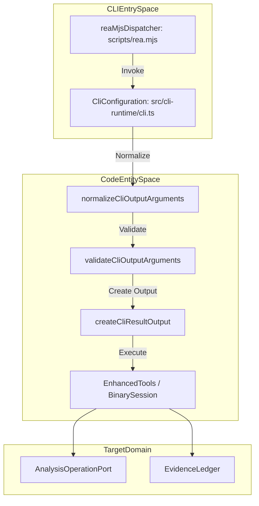

<!-- source: DeepWiki mcp.deepwiki.com · repo morluto/rea · page 3 Tool and CLI Reference · fetched 2026-10-16 -->

# Tool and CLI Reference

Relevant source files

The following files were used as context for generating this wiki page:

- [docs/.vitepress/config.ts](docs/.vitepress/config.ts)
- [docs/cli.md](docs/cli.md)
- [docs/index.md](docs/index.md)
- [scripts/bundle-runtime.mjs](scripts/bundle-runtime.mjs)
- [scripts/prepack.mjs](scripts/prepack.mjs)
- [scripts/rea.mjs](scripts/rea.mjs)
- [scripts/verify/javascript/output.mjs](scripts/verify/javascript/output.mjs)
- [src/application/CallPathTracing.ts](src/application/CallPathTracing.ts)
- [src/application/EnhancedLiteralTracing.ts](src/application/EnhancedLiteralTracing.ts)
- [src/application/EnhancedToolSelectorOrigin.test.ts](src/application/EnhancedToolSelectorOrigin.test.ts)
- [src/application/EnhancedTools.ts](src/application/EnhancedTools.ts)
- [src/application/ProcedureAddressResolution.ts](src/application/ProcedureAddressResolution.ts)
- [src/cli/cliResultOutput.ts](src/cli/cliResultOutput.ts)
- [src/cli/jsonOutput.ts](src/cli/jsonOutput.ts)
- [src/cliOutput.ts](src/cliOutput.ts)
- [src/contracts/enhancedInputs.ts](src/contracts/enhancedInputs.ts)
- [src/contracts/enhancedToolContracts.ts](src/contracts/enhancedToolContracts.ts)
- [src/contracts/toolOutputSchemaGroups.ts](src/contracts/toolOutputSchemaGroups.ts)
- [src/domain/hopperValues.ts](src/domain/hopperValues.ts)
- [src/ida/IdaOperationFailures.test.ts](src/ida/IdaOperationFailures.test.ts)
- [tests/boundary/cli/cliOutput.test.ts](tests/boundary/cli/cliOutput.test.ts)
- [tests/boundary/cli/closedStdout.test.ts](tests/boundary/cli/closedStdout.test.ts)
- [tests/boundary/cli/dispatcher.test.ts](tests/boundary/cli/dispatcher.test.ts)
- [tests/boundary/cli/jsonOutput.test.ts](tests/boundary/cli/jsonOutput.test.ts)
- [tests/boundary/filesystem/javascript-applications/javascriptBundlerAdapters.test.ts](tests/boundary/filesystem/javascript-applications/javascriptBundlerAdapters.test.ts)
- [tests/boundary/mcp/enhancedTools.03-returns-typed-graph-failures-and.test.ts](tests/boundary/mcp/enhancedTools.03-returns-typed-graph-failures-and.test.ts)
- [tests/boundary/mcp/enhancedTools.callPathsAndBatches.test.ts](tests/boundary/mcp/enhancedTools.callPathsAndBatches.test.ts)
- [tests/boundary/process/runtimeBundle.test.ts](tests/boundary/process/runtimeBundle.test.ts)
- [tests/boundary/providers/ida/calleeRelationships.test.ts](tests/boundary/providers/ida/calleeRelationships.test.ts)

REA provides a comprehensive collection of tools and CLI commands designed to analyze native binaries, managed assemblies, JavaScript and Electron applications, browsers, Android packages, and firmware [docs/cli.md:1-120](). This page provides a high-level overview of the tool and CLI command surface organized by family (`direct`, `enhanced`, `native`, `artifact`, `managed`, `firmware`, `android`, `browser`, `electron`, `javascript-runtime`, `application`, `session`), linking to detailed child pages where appropriate.

### Tool Architecture and Contract Mapping

All tools in REA are formally defined using a `ToolContract` inventory [docs/cli.md:117-118]() that governs tool identity, effects, annotations, and input/output schema groups [src/contracts/toolOutputSchemaGroups.ts:114-150]().

The following diagram bridges natural language tool calls from agents to the underlying code entities in the REA server and provider layers:

Sources: [src/contracts/toolOutputSchemaGroups.ts:114-150](), [src/application/EnhancedTools.ts:98-106]()

---

### Tool Families Overview

REA's tool capabilities are organized into 12 distinct families:

1. **Direct Tools**: Direct bridge tools operating on individual procedures, symbols, and memory addresses. For details, see [Official Proxy Tools](#3.1).
2. **Enhanced Workflow Tools**: Composed workflows combining multiple direct steps, such as `get_call_graph` [src/application/EnhancedTools.ts:148-153]() and `trace_call_path` [src/application/CallPathTracing.ts:76-81](). For details, see [Enhanced Workflow Tools](#3.2).
3. **Native Tools**: Specialized native binary analysis commands (Mach-O inspection, Swift/ObjC metadata, native value/UI traces).
4. **Artifact Tools**: Inspection and extraction utilities for ZIP, ASAR, DMG, and directory archive structures.
5. **Managed Tools (.NET)**: PE/CLI metadata inspection, member enumeration, CIL decoding, and managed-native boundary verification.
6. **Firmware Tools**: Binwalk/unblob integration for inspecting and extracting firmware regions.
7. **Android Tools**: APK package structure, class/method discovery, and resource decoding.
8. **Browser Tools**: CDP connection management, target sessions, page capture, and storage fingerprints.
9. **Electron Tools**: Electron app inspection, fuse reporting [src/contracts/toolOutputSchemaGroups.ts:92-92](), and scenario hooks.
10. **JavaScript Runtime Tools**: Runtime target listing and inspection.
11. **Application Tools**: Higher-level application graphing, feature tracing, version comparison, and source-to-bundle reconciliation.
12. **Session Tools**: Session lifecycle management (`open_binary`, `close_binary`), evidence ledgers, and comparison utilities. For details, see [Session and Evidence Tools](#3.3).

Sources: [docs/cli.md:1-160](), [src/contracts/toolOutputSchemaGroups.ts:114-150](), [src/application/EnhancedTools.ts:98-174]()

---

### CLI Command Surface and Execution Flow

The REA CLI (`scripts/rea.mjs`) serves as an independent execution path that shares application workflows and evidence contracts with the MCP server [docs/cli.md:3-6](). Commands are registered per domain and process inputs through explicit CLI argument validation [src/cliOutput.ts:142-176]() and result projection [scripts/rea.mjs:71-110]().

The following diagram bridges CLI command entry points to domain and application execution entities:

Sources: [scripts/rea.mjs:43-110](), [src/cliOutput.ts:19-176](), [src/application/EnhancedTools.ts:98-106]()

For details on command registration across domains, JSON input conventions, and error/status projection, see [CLI Command Surface](#3.4).
Sources: [docs/cli.md:1-160](), [scripts/rea.mjs:1-154](), [src/cliOutput.ts:1-204]()

---

