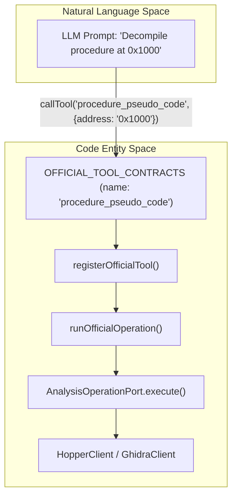
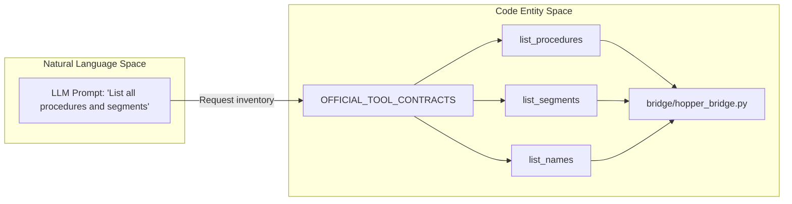
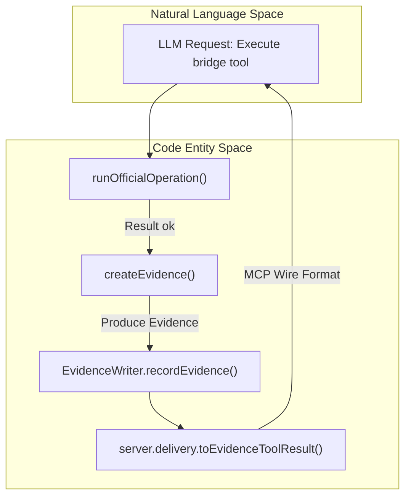

<!-- source: DeepWiki mcp.deepwiki.com · repo morluto/rea · page 3.1 Official Proxy Tools · fetched 2026-10-16 -->

# Official Proxy Tools

Relevant source files

The following files were used as context for generating this wiki page:

- [bridge/hopper_bridge.py](bridge/hopper_bridge.py)
- [src/application/DirectAnalysis.ts](src/application/DirectAnalysis.ts)
- [src/cliEvidenceCommands.ts](src/cliEvidenceCommands.ts)
- [src/contracts/officialToolContracts.ts](src/contracts/officialToolContracts.ts)
- [src/domain/hopperErrors.ts](src/domain/hopperErrors.ts)
- [src/hopper/BridgeLauncher.ts](src/hopper/BridgeLauncher.ts)
- [src/hopper/HopperAnalysisProfile.ts](src/hopper/HopperAnalysisProfile.ts)
- [src/hopper/HopperCleanup.test.ts](src/hopper/HopperCleanup.test.ts)
- [src/hopper/HopperCleanup.ts](src/hopper/HopperCleanup.ts)
- [src/hopper/HopperClient.ts](src/hopper/HopperClient.ts)
- [src/hopper/HopperProvider.ts](src/hopper/HopperProvider.ts)
- [src/hopper/HopperProviderCapabilities.ts](src/hopper/HopperProviderCapabilities.ts)
- [src/hopper/HopperRegexSearch.ts](src/hopper/HopperRegexSearch.ts)
- [src/server/EvidenceMcpServer.test.ts](src/server/EvidenceMcpServer.test.ts)
- [src/server/EvidenceMcpServer.ts](src/server/EvidenceMcpServer.ts)
- [src/server/registerEnhancedTools.ts](src/server/registerEnhancedTools.ts)
- [src/server/registerOfficialTools.ts](src/server/registerOfficialTools.ts)
- [src/server/toolResult.ts](src/server/toolResult.ts)
- [src/server/toolResultEncoding.test.ts](src/server/toolResultEncoding.test.ts)
- [src/server/toolResultEncoding.ts](src/server/toolResultEncoding.ts)
- [tests/boundary/mcp/contractPresentation.test.ts](tests/boundary/mcp/contractPresentation.test.ts)
- [tests/boundary/mcp/largeToolResult.test.ts](tests/boundary/mcp/largeToolResult.test.ts)
- [tests/boundary/mcp/oversizedErrorDeliveryMcp.test.ts](tests/boundary/mcp/oversizedErrorDeliveryMcp.test.ts)
- [tests/boundary/providers/hopper/hopperAnalysisProfile.test.ts](tests/boundary/providers/hopper/hopperAnalysisProfile.test.ts)
- [tests/boundary/providers/hopper/hopperBridgeReconnect.test.ts](tests/boundary/providers/hopper/hopperBridgeReconnect.test.ts)
- [tests/boundary/providers/hopper/hopperClient.cleanup.test.ts](tests/boundary/providers/hopper/hopperClient.cleanup.test.ts)
- [tests/boundary/providers/hopper/hopperClient.cleanupRetry.test.ts](tests/boundary/providers/hopper/hopperClient.cleanupRetry.test.ts)
- [tests/boundary/providers/hopper/hopperClient.externalExit.test.ts](tests/boundary/providers/hopper/hopperClient.externalExit.test.ts)
- [tests/boundary/providers/hopper/hopperClient.fixture.ts](tests/boundary/providers/hopper/hopperClient.fixture.ts)
- [tests/boundary/providers/hopper/hopperClient.handshakeRecovery.test.ts](tests/boundary/providers/hopper/hopperClient.handshakeRecovery.test.ts)
- [tests/boundary/providers/hopper/hopperClient.health.test.ts](tests/boundary/providers/hopper/hopperClient.health.test.ts)
- [tests/boundary/providers/hopper/hopperClient.helperFailure.test.ts](tests/boundary/providers/hopper/hopperClient.helperFailure.test.ts)
- [tests/boundary/providers/hopper/hopperClient.protocol.test.ts](tests/boundary/providers/hopper/hopperClient.protocol.test.ts)
- [tests/boundary/providers/hopper/hopperClient.startupFailures.test.ts](tests/boundary/providers/hopper/hopperClient.startupFailures.test.ts)
- [tests/fixtures/fakeHopper.mjs](tests/fixtures/fakeHopper.mjs)
- [tests/fixtures/hopperBridgeReconnectProbe.py](tests/fixtures/hopperBridgeReconnectProbe.py)
- [tests/process-global/mcpDeliveryEnvironment.test.ts](tests/process-global/mcpDeliveryEnvironment.test.ts)

## Purpose and Scope
The **Official Proxy Tools** provide a direct, low-latency bridge to underlying native analysis backends such as Hopper and Ghidra. Unlike enhanced workflow tools that compose multiple operations, official proxy tools map 1:1 to the provider's internal analysis primitives. This page details their inventory, schema definitions, registration pipeline, execution data flow, and evidence generation. Covered capabilities include address resolution (`address_name`), procedure disassembly and pseudocode (`procedure_pseudo_code`, `procedure_assembly`), structural inventories (`list_procedures`, `list_strings`, `list_names`, `list_segments`), searches, cross-references (`xrefs`), memory reads (`read_bytes`), metadata modifications (`set_comment`), and bookmark management.

Sources: [src/contracts/officialToolContracts.ts:38-40](), [src/server/registerOfficialTools.ts:31-43]()

---

## Architecture and Data Flow

Official tools are registered dynamically via `registerOfficialTools` [src/server/registerOfficialTools.ts:31-43](), which iterates over `OFFICIAL_TOOL_CONTRACTS` [src/contracts/officialToolContracts.ts:39-124](). When an MCP client invokes a tool, the request passes through Zod strict input validation (`contract.inputSchema.parse`), is admitted by session access controls (`withAdmittedAnalysis`), and executes against the active binary session via `runOfficialOperation` [src/server/registerOfficialTools.ts:55-113](). Successful results are automatically wrapped in an `Evidence` envelope via `createEvidence` [src/domain/evidence.ts:10-11]() and registered with the investigation ledger before delivery.

Sources: [src/contracts/officialToolContracts.ts:39-40](), [src/server/registerOfficialTools.ts:31-145](), [src/application/AnalysisProvider.ts:7-16]()

---

## Tool Categories and Implementation

The official proxy tool suite is defined in `OFFICIAL_TOOL_CONTRACTS` [src/contracts/officialToolContracts.ts:39-124](). They enforce strict input schemas and tie directly into output schema groups.

### 1. Navigation and State Tools
These tools manage interactive or session-bound cursor states and document enumeration.

| Tool Name | Purpose | Implementation Detail |
| :--- | :--- | :--- |
| `current_address` | Returns the provider's current cursor address for UI-backed sessions. | [src/contracts/officialToolContracts.ts:76-79]() |
| `goto_address` | Moves the provider's GUI cursor to a mapped address. | [src/contracts/officialToolContracts.ts:91-94]() |
| `current_document` | Returns the document currently selected by the provider bridge. | [src/contracts/officialToolContracts.ts:88-90]() |
| `list_documents` | Enumerates provider program or document identities. | [src/contracts/officialToolContracts.ts:106-109]() |

Sources: [src/contracts/officialToolContracts.ts:76-109]()

### 2. Analysis Discovery and Inventories
Discovery tools extract structural metadata (names, procedures, strings, and memory segments) from the binary database.

Sources: [src/contracts/officialToolContracts.ts:110-124](), [bridge/hopper_bridge.py:137-155]()

### 3. Procedure and Symbol Analysis
These extract low-level disassembly, decompiled pseudocode, basic block boundaries, and incoming/outgoing references.

*   `procedure_pseudo_code`: Retrieves C-like decompiled representations for a specified function or address [src/contracts/officialToolContracts.ts:39-44]().
*   `procedure_assembly`: Retrieves ordered instruction disassembly arrays.
*   `xrefs`: Queries incoming and outgoing cross-reference paths for a target address [src/contracts/officialToolContracts.ts:229-232]().
*   `address_name`: Resolves the primary analyzed symbol name at code or data addresses [src/contracts/officialToolContracts.ts:66-69]().

Sources: [src/contracts/officialToolContracts.ts:66-69](), [src/contracts/officialToolContracts.ts:178-193]()

### 4. Mutation and Annotation Tools
Destructive or state-updating operations modify the ephemeral or persistent analysis database.

*   `annotate_native_function`: Atomically updates function names and/or entry comments, rolling back on validation failure [src/contracts/officialToolContracts.ts:40-44]().
*   `comment`: Reads regular analysis comments at an address [src/contracts/officialToolContracts.ts:71-74]().
*   `list_bookmarks`: Enumerates bookmarks as address-name pairs [src/contracts/officialToolContracts.ts:101-104]().

Sources: [src/contracts/officialToolContracts.ts:40-104]()

---

## Evidence Wrapping and Result Delivery

When an official tool executes successfully, the resulting value is packaged into an immutable `Evidence` record linking the output to the exact SHA-256 binary hash and analysis parameters.

Sources: [src/server/registerOfficialTools.ts:67-105](), [src/domain/evidence.ts:10-11]()

---

## Schema and Input Validation

All official tools use strict Zod schemas defined via `officialToolContracts.ts`. Optional parameters like `document` or `address` are coerced or validated against helper definitions (`toolContractHelpers.ts`). Oversized responses or failure states are processed through `ToolResultDelivery` [src/server/toolResult.ts:47-65]() to guarantee that result payloads remain within MCP transport buffer constraints.

Sources: [src/contracts/officialToolContracts.ts:21-36](), [src/server/toolResult.ts:47-65]()

---

