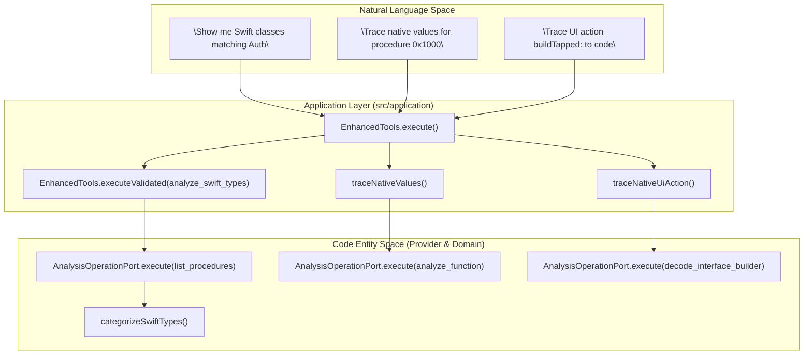
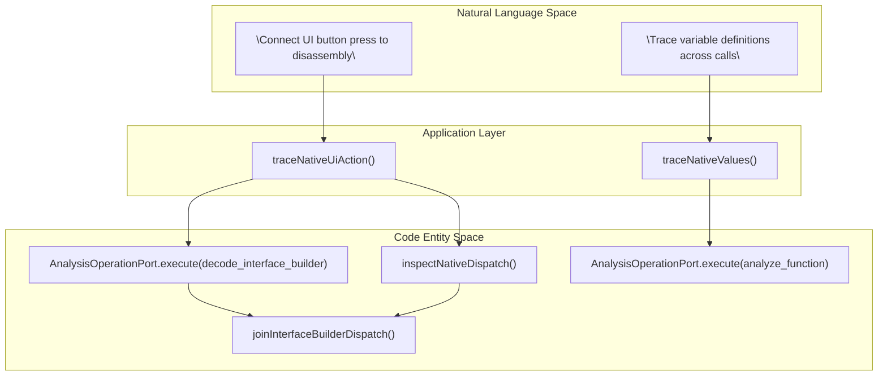

<!-- source: DeepWiki mcp.deepwiki.com · repo morluto/rea · page 3.2 Enhanced Workflow Tools · fetched 2026-10-16 -->

# Enhanced Workflow Tools

Relevant source files

The following files were used as context for generating this wiki page:

- [src/application/CallPathTracing.ts](src/application/CallPathTracing.ts)
- [src/application/EnhancedLiteralTracing.ts](src/application/EnhancedLiteralTracing.ts)
- [src/application/EnhancedToolSelectorOrigin.test.ts](src/application/EnhancedToolSelectorOrigin.test.ts)
- [src/application/EnhancedTools.ts](src/application/EnhancedTools.ts)
- [src/application/ProcedureAddressResolution.ts](src/application/ProcedureAddressResolution.ts)
- [src/application/SourceLimitations.ts](src/application/SourceLimitations.ts)
- [src/application/WorkflowEvidence.test.ts](src/application/WorkflowEvidence.test.ts)
- [src/application/WorkflowEvidence.ts](src/application/WorkflowEvidence.ts)
- [src/application/native/EnhancedNativeInvestigation.test.ts](src/application/native/EnhancedNativeInvestigation.test.ts)
- [src/application/native/NativeApiInspection.test.ts](src/application/native/NativeApiInspection.test.ts)
- [src/application/native/NativeCallRoutes.test.ts](src/application/native/NativeCallRoutes.test.ts)
- [src/application/native/NativeCallRoutes.ts](src/application/native/NativeCallRoutes.ts)
- [src/application/native/NativeDispatchMetadataInspection.ts](src/application/native/NativeDispatchMetadataInspection.ts)
- [src/application/native/NativeUiActionTrace.ts](src/application/native/NativeUiActionTrace.ts)
- [src/application/native/NativeValueTrace.test.ts](src/application/native/NativeValueTrace.test.ts)
- [src/application/native/NativeValueTrace.ts](src/application/native/NativeValueTrace.ts)
- [src/contracts/enhancedInputs.ts](src/contracts/enhancedInputs.ts)
- [src/contracts/enhancedToolContracts.ts](src/contracts/enhancedToolContracts.ts)
- [src/contracts/toolOutputSchemaGroups.ts](src/contracts/toolOutputSchemaGroups.ts)
- [src/domain/hopperValues.ts](src/domain/hopperValues.ts)
- [src/domain/native/nativeValueFlow.ts](src/domain/native/nativeValueFlow.ts)
- [src/ida/IdaOperationFailures.test.ts](src/ida/IdaOperationFailures.test.ts)
- [tests/boundary/filesystem/javascript-applications/javascriptBundlerAdapters.test.ts](tests/boundary/filesystem/javascript-applications/javascriptBundlerAdapters.test.ts)
- [tests/boundary/mcp/enhancedTools.01-lists-the-complete-target-open.test.ts](tests/boundary/mcp/enhancedTools.01-lists-the-complete-target-open.test.ts)
- [tests/boundary/mcp/enhancedTools.03-returns-typed-graph-failures-and.test.ts](tests/boundary/mcp/enhancedTools.03-returns-typed-graph-failures-and.test.ts)
- [tests/boundary/mcp/enhancedTools.callPathsAndBatches.test.ts](tests/boundary/mcp/enhancedTools.callPathsAndBatches.test.ts)
- [tests/boundary/mcp/enhancedTools.limitations.test.ts](tests/boundary/mcp/enhancedTools.limitations.test.ts)
- [tests/boundary/mcp/serverLifecycleMcp.test.ts](tests/boundary/mcp/serverLifecycleMcp.test.ts)
- [tests/boundary/providers/ida/calleeRelationships.test.ts](tests/boundary/providers/ida/calleeRelationships.test.ts)

The **Enhanced Workflow Tools** layer in REA provides high-level, composed workflows that aggregate multiple low-level provider operations into a single logical action [src/application/EnhancedTools.ts:93-97](). Unlike official proxy tools which map 1:1 to a provider's API, enhanced tools handle complex, multi-step reverse-engineering routines such as recursive call-graph traversal, pattern-based symbol analysis for Swift and Objective-C [src/application/EnhancedTools.ts:134-160](), native value flow tracking [src/application/native/NativeValueTrace.ts:24-28](), and UI-to-code investigation [src/application/native/NativeUiActionTrace.ts:27-31]().

---

## Architecture and Composition Logic

Enhanced workflows are centralized in the `EnhancedTools` class located in `src/application/EnhancedTools.ts` [src/application/EnhancedTools.ts:98-100](). They accept an `AnalysisOperationPort` [src/application/EnhancedTools.ts:99-99]() to dispatch primitive operations across analysis providers.

To ensure performance and correctness, callers use `execute` for untrusted inputs which are parsed once via Zod schemas, or `executeValidated` when the input boundary has already validated the payload [src/application/EnhancedTools.ts:101-180](). Additionally, `executeComposedWorkflow` [src/application/WorkflowEvidence.ts:33-43]() tracks all dependent observations and collects source limitations into a unified ledger [src/application/WorkflowEvidence.ts:44-64]().

### Natural Language Space to Code Entity Space: Workflow Orchestration

The following diagram bridges analyst intents (Natural Language Space) to specific application classes, methods, and provider operations (Code Entity Space).

**Workflow Tool Dispatch Flow**

Sources: [src/application/EnhancedTools.ts:102-174](), [src/application/native/NativeValueTrace.ts:24-28](), [src/application/native/NativeUiActionTrace.ts:27-31](), [src/domain/symbolAnalysis.ts:47-81]()

---

## Tool Reference and Implementation Surface

### 1. `analyze_function`
*   **Purpose:** Fetches a comprehensive function dossier combining disassembly, metadata, basic blocks, and native value or API flows [src/application/EnhancedTools.ts:122-123]().
*   **Implementation:** Dispatches directly to the underlying provider via `AnalysisOperationPort` and parses the output through `functionDossierSchema` [src/domain/hopperValues.ts:93-178]().

### 2. `binary_overview`
*   **Purpose:** Aggregates segment layouts, procedure counts, symbol inventories, and string summaries [src/application/EnhancedTools.ts:167-172]().
*   **Implementation:** Executes parallel or sequential probes for `list_segments`, `list_procedures`, `list_names`, and `list_strings` [src/application/EnhancedTools.ts:167-172]().

### 3. `batch_decompile`
*   **Purpose:** Decompiles multiple target addresses concurrently [src/application/EnhancedTools.ts:142-147]().
*   **Implementation:** Maps an array of addresses to concurrent procedure pseudo-code requests, isolating individual failures without crashing the entire batch [src/application/EnhancedTools.ts:142-147]().

### 4. `get_call_graph`
*   **Purpose:** Recursively traverses forward (callees) or backward (callers) relationships up to a requested depth [src/application/EnhancedTools.ts:148-153]().
*   **Implementation:** Maintains a breadth-first search queue with visited address tracking to prevent infinite recursion on cyclic control flow [src/application/EnhancedTools.ts:148-153]().

### 5. `trace_call_path`
*   **Purpose:** Reconstructs call paths between a `start` address and a `goal` address [src/application/EnhancedTools.ts:107-108]().
*   **Implementation:** Delegates to `traceCallPath` [src/application/CallPathTracing.ts]() using recorded function snapshots and call edges.

### 6. Swift and Objective-C Analysis (`analyze_swift_types`, `get_objc_classes`, `get_objc_protocols`)
*   **`analyze_swift_types`**: Scans procedures for mangled Swift symbols using `categorizeSwiftTypes` [src/domain/symbolAnalysis.ts:47-81](), recognizing prefixes like `_TtC` (classes), `_TtV` (structs), and `_TtP` (protocols) [src/application/EnhancedTools.ts:154-160]().
*   **`get_objc_classes` / `get_objc_protocols`**: Inspects symbol tables via `discoverObjcClasses` and `discoverObjcProtocols` to build class and protocol hierarchies [src/application/EnhancedTools.ts:134-141](), [src/domain/symbolAnalysis.ts:5-35]().

### 7. Native Value and UI Traces (`trace_native_values`, `trace_native_ui_action`)
*   **`trace_native_values`**: Composes bounded high-level p-code def-use graphs across resolved call boundaries [src/application/native/NativeValueTrace.ts:24-28]().
*   **`trace_native_ui_action`**: Correlates compiled Interface Builder archives (NIB/Storyboard) with native Objective-C/Swift dispatch metadata to map UI actions to native handlers [src/application/native/NativeUiActionTrace.ts:27-31]().

---

### Natural Language Space to Code Entity Space: Advanced Tracing

**UI and Value Trace Dispatch Flow**

Sources: [src/application/native/NativeUiActionTrace.ts:27-43](), [src/application/native/NativeValueTrace.ts:96-103]()

---

## Budgeting, Pagination, and Evidence Management

Enhanced workflow tools enforce strict resource budgets and produce verifiable `Evidence` records to ensure safety during large-scale binary analysis.

### Budgeting and Pagination Limits
*   **Node and Payload Budgets:** `traceNativeValues` enforces strict node limits (`input.max_nodes`) and an aggregate payload byte ceiling (`NODE_PAYLOAD_BYTES = 8 * 1024 * 1024`) using JSON serialization chunking to prevent memory exhaustion [src/application/native/NativeValueTrace.ts:21-21], [src/application/native/NativeValueTrace.ts:54-70]().
*   **Decompilation Budgets:** Graph and tracing workflows limit recursive function analysis via `input.max_functions` to bound execution time [src/application/native/NativeValueTrace.ts:84-92]().

### Workflow Evidence Generation
Successful tool executions are encapsulated as canonical `Evidence` records via `createWorkflowEvidence` [src/application/WorkflowEvidence.ts:68-76](). These records link upstream analysis profile commitments, capture parameter dictionaries, record limitation ledgers, and associate extracted location markers [src/application/WorkflowEvidence.ts:76-96]().

Sources: [src/application/native/NativeValueTrace.ts:21-73](), [src/application/WorkflowEvidence.ts:68-96]()

---

