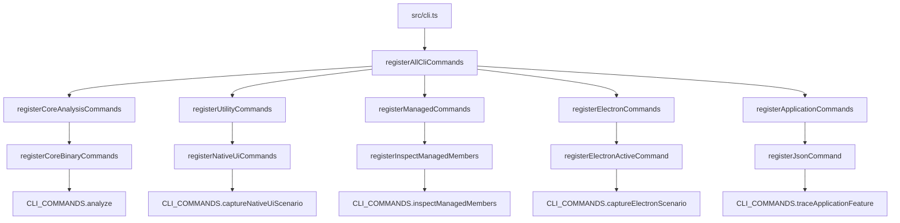
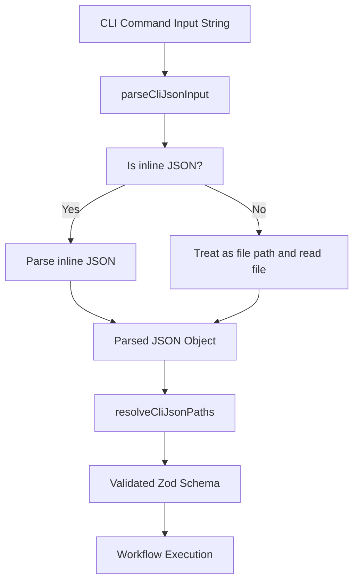

<!-- source: DeepWiki mcp.deepwiki.com · repo morluto/rea · page 3.4 CLI Command Surface · fetched 2026-10-16 -->

# CLI Command Surface

<details>
<summary>Relevant source files</summary>

The following files were used as context for generating this wiki page:

- [scripts/verify-real-ghidra-raw.mjs](scripts/verify-real-ghidra-raw.mjs)
- [src/application/InventoryProjectionEvidence.ts](src/application/InventoryProjectionEvidence.ts)
- [src/application/ReconstructionCoverageService.ts](src/application/ReconstructionCoverageService.ts)
- [src/application/ReconstructionObligationLedgerService.ts](src/application/ReconstructionObligationLedgerService.ts)
- [src/application/binaryDiagnostics/RecordedCrashPort.ts](src/application/binaryDiagnostics/RecordedCrashPort.ts)
- [src/application/managed/ManagedApplicationGraphService.ts](src/application/managed/ManagedApplicationGraphService.ts)
- [src/application/managed/ManagedMemberComparisonService.ts](src/application/managed/ManagedMemberComparisonService.ts)
- [src/application/managed/ManagedNativeVerificationService.ts](src/application/managed/ManagedNativeVerificationService.ts)
- [src/application/managed/ManagedReconstructionService.ts](src/application/managed/ManagedReconstructionService.ts)
- [src/application/reverse/ReverseEngineeringService.ts](src/application/reverse/ReverseEngineeringService.ts)
- [src/cli/analysisViewCommands.ts](src/cli/analysisViewCommands.ts)
- [src/cli/applicationCommands.ts](src/cli/applicationCommands.ts)
- [src/cli/binaryDiagnosticsCommands.ts](src/cli/binaryDiagnosticsCommands.ts)
- [src/cli/coreAnalysisCommands.ts](src/cli/coreAnalysisCommands.ts)
- [src/cli/coreBinaryCommands.ts](src/cli/coreBinaryCommands.ts)
- [src/cli/coreNativeCommands.ts](src/cli/coreNativeCommands.ts)
- [src/cli/electronCommands.ts](src/cli/electronCommands.ts)
- [src/cli/goCommands.ts](src/cli/goCommands.ts)
- [src/cli/javascriptApplicationAnalysis.ts](src/cli/javascriptApplicationAnalysis.ts)
- [src/cli/managedCommands.ts](src/cli/managedCommands.ts)
- [src/cli/omittableDefaults.ts](src/cli/omittableDefaults.ts)
- [src/cli/rustCommands.ts](src/cli/rustCommands.ts)
- [src/cli/utilityCommands.ts](src/cli/utilityCommands.ts)
- [src/dotnet/ManagedDecodeBudget.test.ts](src/dotnet/ManagedDecodeBudget.test.ts)
- [src/dotnet/ManagedDecodeBudget.ts](src/dotnet/ManagedDecodeBudget.ts)
- [src/native/pwndbg/PwndbgCoreContext.ts](src/native/pwndbg/PwndbgCoreContext.ts)
- [src/native/pwntools/PwntoolsRecordedCrashProvider.ts](src/native/pwntools/PwntoolsRecordedCrashProvider.ts)
- [src/native/pwntools/PwntoolsResourceLimits.ts](src/native/pwntools/PwntoolsResourceLimits.ts)
- [tests/acceptance/managedCliOutput.test.ts](tests/acceptance/managedCliOutput.test.ts)
- [tests/boundary/cli/analyzeAppBundlePathCli.test.ts](tests/boundary/cli/analyzeAppBundlePathCli.test.ts)
- [tests/boundary/cli/cliInputSchemaRequired.test.ts](tests/boundary/cli/cliInputSchemaRequired.test.ts)
- [tests/boundary/cli/cliOptionAliases.test.ts](tests/boundary/cli/cliOptionAliases.test.ts)
- [tests/boundary/cli/cliStartupImports.test.ts](tests/boundary/cli/cliStartupImports.test.ts)
- [tests/boundary/cli/javascriptIntegrityPolicyCli.test.ts](tests/boundary/cli/javascriptIntegrityPolicyCli.test.ts)
- [tests/boundary/cli/nativeUiScenarioInputCli.test.ts](tests/boundary/cli/nativeUiScenarioInputCli.test.ts)
- [tests/boundary/cli/reconstructionObligationLedgerCli.test.ts](tests/boundary/cli/reconstructionObligationLedgerCli.test.ts)
- [tests/boundary/mcp/reconstructionObligationLedgerMcp.test.ts](tests/boundary/mcp/reconstructionObligationLedgerMcp.test.ts)
- [tests/boundary/native/PwndbgCoreContext.test.ts](tests/boundary/native/PwndbgCoreContext.test.ts)
- [tests/boundary/providers/managed/managedMemberComparison.test.ts](tests/boundary/providers/managed/managedMemberComparison.test.ts)

</details>


This page details how REA's Command Line Interface (CLI) commands are structured and registered across different domains, including core analysis, utility, artifact, managed, firmware, browser, Electron, Android, application, setup, and evidence. It also covers conventions for JSON input and how errors and status are projected to the user.

## Command Registration by Domain

REA organizes its CLI commands into logical domains, each handled by specific registration functions. This modular approach ensures maintainability and clear separation of concerns.

### Core Analysis Commands

Core analysis commands are fundamental operations for binary analysis. They are registered by `registerCoreAnalysisCommands` [src/cli/coreAnalysisCommands.ts:8-16] and include tools for inspecting procedures, strings, names, segments, and performing searches and cross-references.

Sources:
* [src/cli/coreAnalysisCommands.ts:8-15]()

### Utility Commands

Utility commands provide general-purpose functionalities, such as listing provider capabilities and status, and native macOS-specific inspections. These are registered by `registerUtilityCommands` [src/cli/utilityCommands.ts:26-38] and include operations like `capabilities`, `providers`, `inspect-macho`, `inspect-signature`, `list-architectures`, `inspect-plist`, and `demangle-swift`.

For example, the `observe-native-ui` and `capture-native-ui-scenario` commands are registered here [src/cli/utilityCommands.ts:83-144]. These commands allow interaction with native application UIs.

Sources:
* [src/cli/utilityCommands.ts:26-38]()
* [src/cli/utilityCommands.ts:83-144]()

### Artifact Commands

Artifact commands deal with the inspection and extraction of various archive and artifact formats. These are registered across core analysis and binary pipelines [src/cli/coreAnalysisCommands.ts:8-16] and include operations like `inspect-zip`, `extract-zip`, `inspect-asar`, `extract-asar`, `inspect-dmg`, `extract-dmg`, `inspect-pkg`, `extract-pkg`, `inspect-javascript`, `inspect-source-map`, and `inspect-plist`.

Sources:
* [src/cli/coreAnalysisCommands.ts:8-15]()

### Managed (.NET) Commands

Managed commands focus on analyzing .NET binaries. They are registered by `registerManagedCommands` [src/cli/managedCommands.ts:21-33] and provide tools for inspecting managed assemblies, types, methods via `inspectManagedMembers` [src/cli/managedCommands.ts:57-77], and comparing managed artifacts via `compareManagedMembers` [src/cli/managedCommands.ts:108-163].

Sources:
* [src/cli/managedCommands.ts:21-33]()
* [src/cli/managedCommands.ts:57-77]()
* [src/cli/managedCommands.ts:108-163]()

### Firmware Commands

Firmware commands are used for inspecting and extracting firmware images. These include `inspect-firmware-regions` and `extract-firmware` [tests/boundary/cli/cliInputSchemaRequired.test.ts:138-138].

Sources:
* [tests/boundary/cli/cliInputSchemaRequired.test.ts:138-138]()

### Browser Commands

Browser commands facilitate interaction with web browsers, primarily through Playwright scenarios. The `capture-browser-scenario` command takes a JSON input describing the scenario to execute.

Sources:
* [tests/boundary/cli/cliStartupImports.test.ts:165-176]()

### Electron Commands

Electron commands are designed for inspecting and interacting with Electron applications. These are registered by `registerElectronCommands` [src/cli/electronCommands.ts:27-37] and include `list-electron-targets` [src/cli/electronCommands.ts:176-181], `inspect-electron-page`, `capture-electron-scenario` [src/cli/electronCommands.ts:82-90], and `analyze-javascript-application` [src/cli/coreBinaryCommands.ts:66-77].

Sources:
* [src/cli/electronCommands.ts:27-37]()
* [src/cli/electronCommands.ts:82-90]()
* [src/cli/electronCommands.ts:176-181]()
* [src/cli/coreBinaryCommands.ts:66-77]()

### Android Commands

Android commands provide functionality for analyzing Android packages (APKs). These include `inspect-apk` and `extract-apk`.

Sources:
* [src/cli/coreAnalysisCommands.ts:8-15]()

### Application Commands

Application commands are higher-level workflows that combine multiple analysis steps, such as application graph projection, feature tracing, and version comparisons. These are registered by `registerApplicationCommands` [src/cli/applicationCommands.ts:25-28].

Sources:
* [src/cli/applicationCommands.ts:25-28]()

### Setup Commands

Setup commands are used for initial configuration and diagnostics of the REA environment, including `setup`, `doctor`, and `uninstall` [tests/boundary/cli/cliStartupImports.test.ts:27-44].

Sources:
* [tests/boundary/cli/cliStartupImports.test.ts:27-44]()

### Evidence Commands

Evidence commands manage the collection, import, and export of analysis evidence bundles.

Sources:
* [src/cli/coreAnalysisCommands.ts:8-15]()

## CLI Command Registration Flow

The following diagram illustrates the overall flow of how CLI commands are registered within REA, bridging domain registration modules to code entities.

Diagram: CLI Command Registration Flow

Sources:
* [src/cli/coreAnalysisCommands.ts:8-15]()
* [src/cli/utilityCommands.ts:26-38]()
* [src/cli/managedCommands.ts:21-33]()
* [src/cli/electronCommands.ts:27-37]()
* [src/cli/applicationCommands.ts:25-28]()

## JSON Input Conventions

Many REA CLI commands accept JSON input, either directly as an inline string or from a file path. This allows for complex and structured parameters to be passed to analysis operations.

The `parseCliJsonInput` function is responsible for parsing this input [src/cli/electronCommands.ts:97-100]. It first attempts to parse the input string as inline JSON. If that fails, it treats the input as a file path and attempts to read and parse the JSON content from that file.

Diagram: JSON Input Parsing and Resolution Flow

Sources:
* [src/cli/electronCommands.ts:97-100]()
* [src/cli/electronCommands.ts:103-107]()

### Path Resolution in JSON Input

For certain commands, JSON input may contain paths that need to be resolved relative to the current working directory. The `resolveCliJsonPaths` function handles this by taking a parsed JSON object and a list of key paths [src/cli/electronCommands.ts:103-107]. It recursively traverses the JSON structure and resolves string values at the specified key paths to absolute paths.

Sources:
* [src/cli/electronCommands.ts:103-107]()

### Absolute Path Requirements

Many input schemas, particularly for session management and artifact handling, explicitly require absolute local file paths. This is validated using Zod schemas and helper utilities across application boundaries.

Sources:
* [tests/boundary/cli/cliInputSchemaRequired.test.ts:110-120]()

## Error and Status Projection

REA aims to provide clear and actionable feedback to the user, especially when errors occur. The `projectAnalysisError` function is central to this, transforming internal `AnalysisError` objects into a user-friendly JSON representation [src/cli/electronCommands.ts:12].

Common error types projected include `AnalysisInputError` [src/cli/coreBinaryCommands.ts:17], `ProviderCleanupError` [src/cli/javascriptApplicationAnalysis.ts:8], and other domain-specific error structures.

The `logCliCommand` function wraps command execution, ensuring that errors are caught and projected consistently with appropriate exit codes and logging [src/cli/utilityCommands.ts:18].

Sources:
* [src/cli/utilityCommands.ts:18]()
* [src/cli/electronCommands.ts:12]()
* [src/cli/coreBinaryCommands.ts:17]()
* [src/cli/javascriptApplicationAnalysis.ts:8]()

### Example Error Projection

When an `AnalysisInputError` or validation error occurs, the output is formatted as a structured JSON object containing the error reason, operation name, and validation issues.

```json
{
  "error": "Application workflow failed",
  "analysis_error": {
    "kind": "input-validation",
    "operation": "capture_native_ui_scenario",
    "issues": [
      {
        "path": ["steps"],
        "reason": "invalid_format",
        "expected": "JSON"
      }
    ]
  }
}
```
Sources:
* [src/cli/utilityCommands.ts:146-152]()

---

