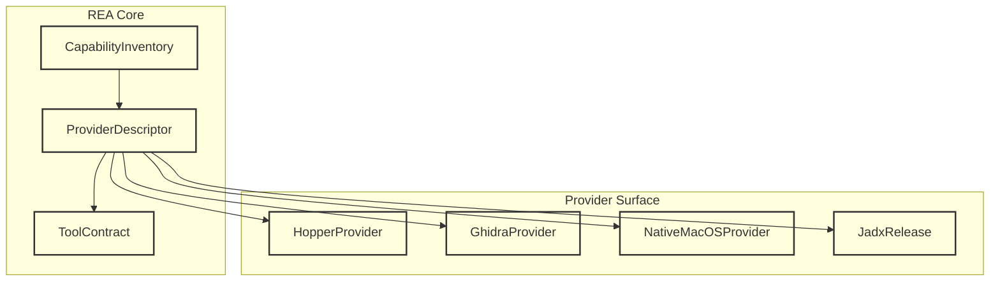
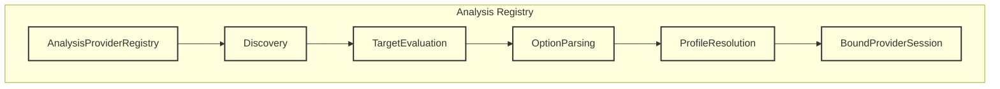
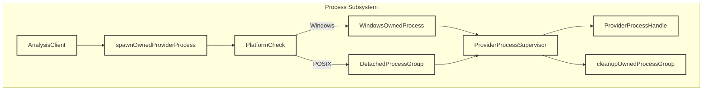

<!-- source: DeepWiki mcp.deepwiki.com · repo morluto/rea · page 4 Analysis Providers · fetched 2026-10-16 -->

# Analysis Providers

Relevant source files

The following files were used as context for generating this wiki page:

- [scripts/lib/catalog-builders.mjs](scripts/lib/catalog-builders.mjs)
- [scripts/lib/catalog-core.mjs](scripts/lib/catalog-core.mjs)
- [src/android/JadxMcpTransport.ts](src/android/JadxMcpTransport.ts)
- [src/application/CapabilityInventory.test.ts](src/application/CapabilityInventory.test.ts)
- [src/application/CapabilityInventory.ts](src/application/CapabilityInventory.ts)
- [src/application/WindowsCapabilities.ts](src/application/WindowsCapabilities.ts)
- [src/cliCommandNames.ts](src/cliCommandNames.ts)
- [src/contracts/toolContracts.ts](src/contracts/toolContracts.ts)
- [src/contracts/toolEffects.ts](src/contracts/toolEffects.ts)
- [src/domain/hopperValues.test.ts](src/domain/hopperValues.test.ts)
- [src/domain/javascript/javascriptAnalysisResourceControls.ts](src/domain/javascript/javascriptAnalysisResourceControls.ts)
- [src/domain/javascript/javascriptApplicationProjectionResources.ts](src/domain/javascript/javascriptApplicationProjectionResources.ts)
- [src/javascript/analysis/JavaScriptAnalysisWorker.ts](src/javascript/analysis/JavaScriptAnalysisWorker.ts)
- [src/javascript/analysis/JavaScriptAnalysisWorkerProtocol.ts](src/javascript/analysis/JavaScriptAnalysisWorkerProtocol.ts)
- [src/javascript/analysis/JavaScriptAnalysisWorkerServer.ts](src/javascript/analysis/JavaScriptAnalysisWorkerServer.ts)
- [src/process/PrivateRuntimeRoot.ts](src/process/PrivateRuntimeRoot.ts)
- [src/process/ProviderProcess.ts](src/process/ProviderProcess.ts)
- [src/process/ProviderProcessOutput.test.ts](src/process/ProviderProcessOutput.test.ts)
- [src/server/createServer.ts](src/server/createServer.ts)
- [src/server/mcpClientMetadata.ts](src/server/mcpClientMetadata.ts)
- [src/server/registerSessionStatusTool.ts](src/server/registerSessionStatusTool.ts)
- [src/server/registerSessionTools.ts](src/server/registerSessionTools.ts)
- [src/windows/WindowsOwnedProcess.test.ts](src/windows/WindowsOwnedProcess.test.ts)
- [src/windows/WindowsOwnedProcess.ts](src/windows/WindowsOwnedProcess.ts)
- [tests/acceptance/applications/javascriptCheckpointReserveCli.test.ts](tests/acceptance/applications/javascriptCheckpointReserveCli.test.ts)
- [tests/boundary/android/jadxMcpTransport.test.ts](tests/boundary/android/jadxMcpTransport.test.ts)
- [tests/boundary/javascript/javascriptSourceAnalysisWorker.test.ts](tests/boundary/javascript/javascriptSourceAnalysisWorker.test.ts)
- [tests/boundary/mcp/clientCapabilities.test.ts](tests/boundary/mcp/clientCapabilities.test.ts)
- [tests/boundary/mcp/enhancedTools.04-uses-complete-inventories-inline.test.ts](tests/boundary/mcp/enhancedTools.04-uses-complete-inventories-inline.test.ts)
- [tests/boundary/process/providerProcess.test.ts](tests/boundary/process/providerProcess.test.ts)
- [tests/composition/idaProvider.test.ts](tests/composition/idaProvider.test.ts)

REA employs a "bring-your-own" (BYO) provider model, allowing integration with various external and internal analysis engines. This page provides a high-level overview of how these providers are identified, how their capabilities are described, the mechanisms for their selection and analysis profiles, their process ownership model, and the assets found in the `bridge/` directory. Detailed information for each specific provider is available on their respective child pages.

## Provider Identity and Capability Descriptors

Each analysis provider in REA has a unique identity comprising an `id`, `name`, and `version` [src/application/CapabilityInventory.ts:72](). This identity is crucial for tracking provenance and ensuring consistent analysis results. Providers declare their capabilities through descriptor objects that specify the operations they can perform, their availability, and any associated effects such as whether they mutate artifacts, launch processes, or access the network [src/application/CapabilityInventory.ts:38-40]().

The `AnalysisOperation` type and capability inventory structures define the closed set of operations that provider-backed analysis sessions can accept, encompassing official proxy tools, enhanced workflows, native tools, artifact inspection, and managed code features [src/application/CapabilityInventory.ts:136-141](). This structured approach ensures that REA can validate and dispatch requests to the appropriate provider based on its declared capabilities.

Sources:
- [src/application/CapabilityInventory.ts:38-40]()
- [src/application/CapabilityInventory.ts:72]()
- [src/application/CapabilityInventory.ts:136-141]()

## Provider Selection and Analysis Profiles

The selection of an analysis provider is a deterministic process governed by target support evaluation, option parsing, and profile resolution. REA uses provider registries to manage candidate deep analysis engines like Hopper and Ghidra. Once a provider is selected, it is bound to an active target for its session lifecycle, preventing silent failovers between distinct analysis engines.

An analysis profile commitment captures the selected provider, its version, and normalized semantic analysis settings. This commitment is vital for snapshot compatibility and ensuring that analyses of the same target bytes yield consistent results across different runs or execution environments.

Sources:
- [src/application/CapabilityInventory.ts:172-180]()
- [src/contracts/toolContracts.ts:39-76]()

## Process Ownership

Many analysis providers operate as external processes (e.g., headless Ghidra, JADX, LLDB, Frida). REA takes ownership of these processes to ensure proper lifecycle management, including startup deadlines, output capture, and cleanup. The `spawnOwnedProviderProcess` function is responsible for launching provider processes, placing them in an owned Windows job object or a dedicated POSIX process group [src/process/ProviderProcess.ts:178-181](). This ensures that all descendant processes are tracked and terminated correctly even if the main REA process exits abruptly.

The `ProviderProcessSupervisor` monitors spawned processes, capturing stdout and stderr streams within strict byte budgets and handling exit signals [src/process/ProviderProcess.ts:147-153]().

Sources:
- [src/process/ProviderProcess.ts:22-47]()
- [src/process/ProviderProcess.ts:147-153]()
- [src/process/ProviderProcess.ts:178-181]()

## `bridge/` Directory Assets

The `bridge/` directory contains assets that facilitate communication and interaction with external analysis engines:
- **Python scripts:** Used by Hopper (`bridge/hopper_bridge.py`) to run analysis commands via Unix sockets.
- **Java code:** Used by Ghidra (`bridge/ghidra/*.java`) to interact with the Ghidra headless analyzer API.
- **Native helpers:** Binaries and wrapper modules for interacting with platform-specific debugging and instrumentation interfaces.

For details, refer to the child pages below.

Sources:
- [scripts/lib/catalog-core.mjs:35-116]()

## Per-Provider Child Pages

REA supports a wide array of analysis engines and runtime integration layers. Detailed information for each provider is organized into the following child pages:

*   **[Hopper Provider](#4.1)** — HopperProvider, BridgeLauncher injection, bootstrap, HopperClient Unix-socket NDJSON protocol, request queue and response stream, Linux X11/private display handling, `bridge/hopper_bridge.py`.
*   **[Ghidra Provider](#4.2)** — GhidraLauncher headless launch, Java bridge (`bridge/ghidra/*.java`), socket transport and response buffering, installation/doctor probes, MIPS/PSP profiles, NativeAOT extensions, Windows packaged Ghidra.
*   **[Apple / Native macOS Provider](#4.3)** — NativeMacOSProvider and `xcrun` command runners, Mach-O/otool/codesign/dyld parsers, plist parsing, Apple dispatch metadata (ObjC/Swift), Interface Builder and keyed-archive decoding, dylib resolution.
*   **[Managed (.NET) Provider](#4.4)** — ManagedStaticProvider, ManagedPeReader, metadata heaps/inventory rows, member inspector and CIL decoding, native boundary inspection, member comparison across builds, managed workflow services.
*   **[Android, Firmware and IDA Providers](#4.5)** — JADX provider/session/MCP transport for APKs, apktool resource decoding, ADB device analysis, binwalk/unblob firmware region inspection, and the IDA provider capability surface.
*   **[Debuggers and Dynamic Instrumentation](#4.6)** — LLDB call tracing bridge, Frida instrumentation manager, GDB/Rizin debug sessions, pwndbg/pwntools recorded-crash providers, Cutter bridge, and their tool contracts and process ownership rules.
*   **[Additional Providers (Kuna, JEB, WASM, EVM, Flutter, Go/Rust)](#4.7)** — Secondary provider adapters: Kuna session client and project reader, JEB MCP connection, WABT WASM artifact provider, evmole EVM interface adapter, Flutter build provider, Go/Rust binary commands, SQLite and signal/pcap capture adapters.

Sources:
- [src/contracts/toolContracts.ts:39-76]()
- [src/application/CapabilityInventory.ts:38-68]()

---

