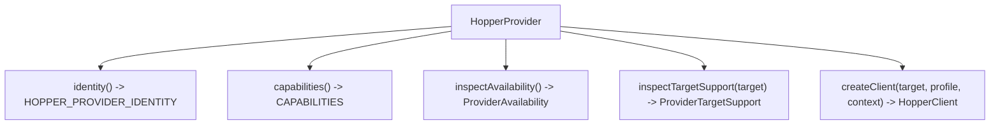
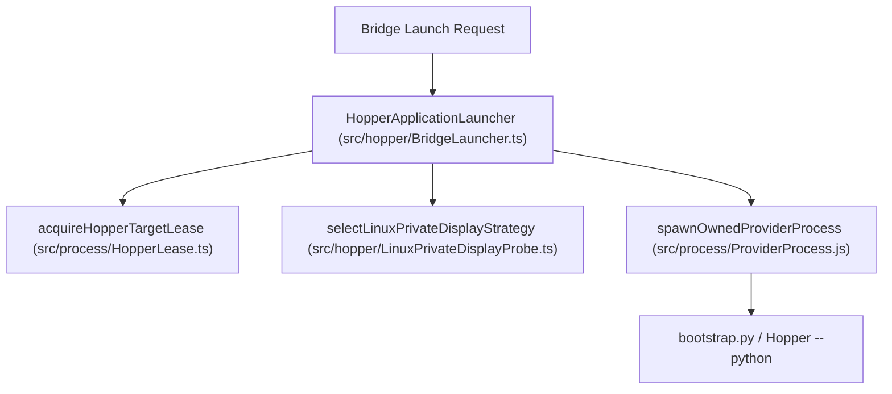
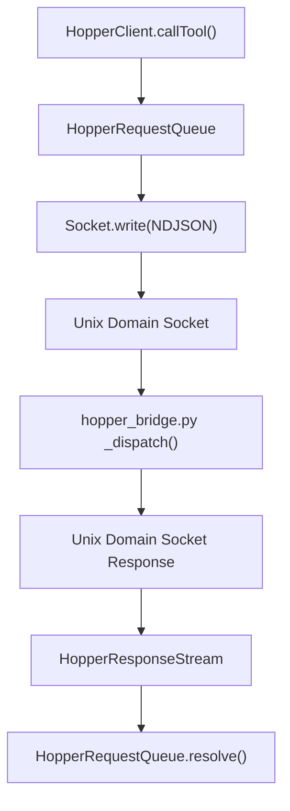
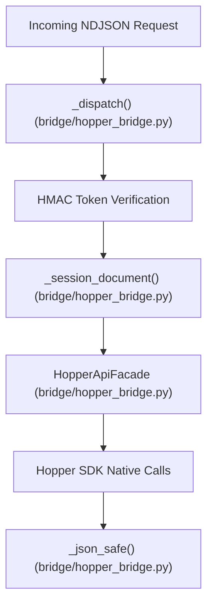

<!-- source: DeepWiki mcp.deepwiki.com · repo morluto/rea · page 4.1 Hopper Provider · fetched 2026-10-16 -->

# Hopper Provider

Relevant source files

The following files were used as context for generating this wiki page:

- [.github/workflows/ci-full-pr.yml](.github/workflows/ci-full-pr.yml)
- [.github/workflows/pr-title.yml](.github/workflows/pr-title.yml)
- [bridge/hopper_bridge.py](bridge/hopper_bridge.py)
- [scripts/lib/clean-linux-hopper-runtime.d.mts](scripts/lib/clean-linux-hopper-runtime.d.mts)
- [scripts/lib/clean-linux-hopper-runtime.mjs](scripts/lib/clean-linux-hopper-runtime.mjs)
- [scripts/lib/real-hopper-boundaries.mjs](scripts/lib/real-hopper-boundaries.mjs)
- [scripts/lib/real-hopper-search.d.mts](scripts/lib/real-hopper-search.d.mts)
- [scripts/lib/real-hopper-search.mjs](scripts/lib/real-hopper-search.mjs)
- [scripts/lib/real-hopper-semantic.mjs](scripts/lib/real-hopper-semantic.mjs)
- [scripts/lib/real-hopper-session-isolation.mjs](scripts/lib/real-hopper-session-isolation.mjs)
- [scripts/verify-linux-setup-e2e.mjs](scripts/verify-linux-setup-e2e.mjs)
- [scripts/verify-real-hopper.mjs](scripts/verify-real-hopper.mjs)
- [src/contracts/officialToolContracts.ts](src/contracts/officialToolContracts.ts)
- [src/domain/ghidraValues.fixture.ts](src/domain/ghidraValues.fixture.ts)
- [src/domain/hopperErrors.ts](src/domain/hopperErrors.ts)
- [src/hopper/BridgeLauncher.ts](src/hopper/BridgeLauncher.ts)
- [src/hopper/HopperAnalysisProfile.ts](src/hopper/HopperAnalysisProfile.ts)
- [src/hopper/HopperCleanup.test.ts](src/hopper/HopperCleanup.test.ts)
- [src/hopper/HopperCleanup.ts](src/hopper/HopperCleanup.ts)
- [src/hopper/HopperClient.ts](src/hopper/HopperClient.ts)
- [src/hopper/HopperProvider.ts](src/hopper/HopperProvider.ts)
- [src/hopper/HopperProviderCapabilities.ts](src/hopper/HopperProviderCapabilities.ts)
- [src/hopper/HopperRegexSearch.ts](src/hopper/HopperRegexSearch.ts)
- [tests/boundary/evm/solidityMetadataWorker.test.ts](tests/boundary/evm/solidityMetadataWorker.test.ts)
- [tests/boundary/filesystem/ciPrEvents.test.ts](tests/boundary/filesystem/ciPrEvents.test.ts)
- [tests/boundary/providers/hopper/bridgeTargetLease.integration.test.ts](tests/boundary/providers/hopper/bridgeTargetLease.integration.test.ts)
- [tests/boundary/providers/hopper/hopperAnalysisProfile.test.ts](tests/boundary/providers/hopper/hopperAnalysisProfile.test.ts)
- [tests/boundary/providers/hopper/hopperBridgeFacade.test.ts](tests/boundary/providers/hopper/hopperBridgeFacade.test.ts)
- [tests/boundary/providers/hopper/hopperBridgeReconnect.test.ts](tests/boundary/providers/hopper/hopperBridgeReconnect.test.ts)
- [tests/boundary/providers/hopper/hopperClient.cleanup.test.ts](tests/boundary/providers/hopper/hopperClient.cleanup.test.ts)
- [tests/boundary/providers/hopper/hopperClient.cleanupRetry.test.ts](tests/boundary/providers/hopper/hopperClient.cleanupRetry.test.ts)
- [tests/boundary/providers/hopper/hopperClient.externalExit.test.ts](tests/boundary/providers/hopper/hopperClient.externalExit.test.ts)
- [tests/boundary/providers/hopper/hopperClient.fixture.ts](tests/boundary/providers/hopper/hopperClient.fixture.ts)
- [tests/boundary/providers/hopper/hopperClient.handshakeRecovery.test.ts](tests/boundary/providers/hopper/hopperClient.handshakeRecovery.test.ts)
- [tests/boundary/providers/hopper/hopperClient.health.test.ts](tests/boundary/providers/hopper/hopperClient.health.test.ts)
- [tests/boundary/providers/hopper/hopperClient.helperFailure.test.ts](tests/boundary/providers/hopper/hopperClient.helperFailure.test.ts)
- [tests/boundary/providers/hopper/hopperClient.protocol.test.ts](tests/boundary/providers/hopper/hopperClient.protocol.test.ts)
- [tests/boundary/providers/hopper/hopperClient.startupFailures.test.ts](tests/boundary/providers/hopper/hopperClient.startupFailures.test.ts)
- [tests/conformance/c/fixture.c](tests/conformance/c/fixture.c)
- [tests/conformance/objc/fixture.m](tests/conformance/objc/fixture.m)
- [tests/conformance/providers/hopper/realHopperSearch.test.ts](tests/conformance/providers/hopper/realHopperSearch.test.ts)
- [tests/fixtures/fakeHopper.mjs](tests/fixtures/fakeHopper.mjs)
- [tests/fixtures/hopperBridgeFacadeProbe.py](tests/fixtures/hopperBridgeFacadeProbe.py)
- [tests/fixtures/hopperBridgeReconnectProbe.py](tests/fixtures/hopperBridgeReconnectProbe.py)
- [tests/process-global/cleanLinuxHopperRuntime.test.ts](tests/process-global/cleanLinuxHopperRuntime.test.ts)

## Purpose and Scope

This page details the implementation of `HopperProvider` [src/hopper/HopperProvider.ts:43-373](), which integrates REA with Hopper Disassembler. It covers `HopperProvider` capability mapping, `BridgeLauncher` injection and bootstrap mechanisms [src/hopper/BridgeLauncher.ts:79-91](), the `HopperClient` Unix-socket NDJSON communication protocol [src/hopper/HopperClient.ts:107-1170](), concurrent request queueing [src/hopper/HopperRequestQueue.ts:1-1](), incremental response streaming [src/hopper/HopperResponseStream.ts:1-1](), Linux X11/private display setup, and the core Python bridge script `bridge/hopper_bridge.py` [bridge/hopper_bridge.py:1-1181]().

Sources: [src/hopper/HopperProvider.ts:43-373](), [src/hopper/BridgeLauncher.ts:79-91](), [src/hopper/HopperClient.ts:107-1170](), [bridge/hopper_bridge.py:1-1181]()

---

## Hopper Provider and Capabilities

The `HopperProvider` class implements `AnalysisProviderCandidate` [src/hopper/HopperProvider.ts:43-373](). It exposes provider identity, capability descriptors, availability probes, and target support rules.

- **Identity**: Defined by `HOPPER_PROVIDER_IDENTITY` [src/hopper/HopperProviderCapabilities.ts:1-1]().
- **Capabilities**: Includes navigation, decompilation, native function inspection, comments, bookmarks, and search [src/hopper/HopperProviderCapabilities.ts:1-1]().
- **Availability Probing**: `inspectAvailability()` checks if the configured `hopperLauncherPath` is executable on macOS or Linux hosts [src/hopper/HopperProvider.ts:69-102]().
- **Target Support**: `inspectTargetSupport()` validates executable and database targets, rejecting unsupported architectures or formats (such as 16-bit DOS MZ/COM or MIPS/RISC-V/PowerPC binaries) [src/hopper/HopperProvider.ts:104-167]().

Sources: [src/hopper/HopperProvider.ts:43-193](), [src/hopper/HopperProviderCapabilities.ts:1-1]()

---

## Bridge Launcher and Bootstrap Injection

Hopper lacks a resident background service API for external automation, so REA injects its own authenticated Python bridge script via Hopper's CLI startup options.

- **`BridgeLauncher`**: Abstracted by the `BridgeLauncher` interface [src/hopper/BridgeLauncher.ts:79-91]().
- **`HopperApplicationLauncher`**: Implements `BridgeLauncher` by writing session parameters (`REA_SOCKET`, `REA_TOKEN`) and executing Hopper with python bootstrap arguments [src/hopper/BridgeLauncher.ts:145-178]().
- **Process Ownership**: REA owns the short-lived launcher helper's process group (`shutdownMode: "bridge-request"` or `"process-cleanup"`), distinguishing between owned helper processes and unowned external GUI instances [src/hopper/BridgeLauncher.ts:54-76]().

### Natural Language to Code Entity Mapping: Launch Subsystem

This diagram maps the conceptual launching actions to concrete TypeScript classes and functions.

Sources: [src/hopper/BridgeLauncher.ts:32-36](), [src/hopper/BridgeLauncher.ts:145-178](), [src/process/ProviderProcess.ts:1-1]()

---

## HopperClient Unix-Socket NDJSON Protocol

The `HopperClient` manages an authenticated NDJSON (Newline-Delimited JSON) session over a private Unix domain socket [src/hopper/HopperClient.ts:107-1170]().

- **Session Initialization**: Creates a secure temporary runtime root directory, generates a random bearer token (`REA_TOKEN`), binds a Unix socket path (`REA_SOCKET`), and starts the bridge process [src/hopper/HopperClient.ts:1-7]().
- **Message Format**: Every request is a single JSON line containing an incrementing numeric `id`, a `method`, parameter objects, and the authentication `token` [src/hopper/HopperClient.ts:123-125]().
- **Error Handling**: Rejects timed-out operations (`HopperTimeoutError`), protocol violations (`HopperProtocolError`), or unreachable process states (`HopperProcessError`) [src/hopper/HopperClient.ts:11-19]().

Sources: [src/hopper/HopperClient.ts:107-184](), [src/hopper/HopperRequestQueue.ts:1-1](), [src/hopper/HopperResponseStream.ts:1-1]()

---

## Request Queue and Response Stream

Because multiple asynchronous analysis operations can occur concurrently against Hopper, the client employs specialized queueing and streaming structures:

- **`HopperRequestQueue`**: Correlates outbound request IDs with pending JavaScript promises, managing timeouts and concurrency limits.
- **`HopperResponseStream`**: Accepts raw chunks from `Socket.on('data')`, buffers text across chunk boundaries, splits on newline characters (`\n`), and feeds parsed objects to the message dispatcher [src/hopper/HopperClient.ts:134-136]().

Sources: [src/hopper/HopperClient.ts:134-184](), [src/hopper/HopperRequestQueue.ts:1-1](), [src/hopper/HopperResponseStream.ts:1-1]()

---

## Linux X11 and Private Display Handling

On Linux hosts, running Hopper headless requires a valid X11 display context. 

- **`LinuxPrivateDisplayProbe`**: Inspects the host environment for available X11 socket directories (e.g., `/tmp/.X11-unix`) and selects an appropriate launch strategy [src/hopper/BridgeLauncher.ts:22-25]().
- **Virtual Framebuffer (`Xvfb`)**: Spawns an isolated `Xvfb` instance with custom `xauth` credentials when no active user display is available, ensuring automated CI or containerized environments can execute Hopper without desktop interference.

Sources: [src/hopper/BridgeLauncher.ts:22-25](), [tests/boundary/providers/hopper/hopperClient.startupFailures.test.ts:75-110]()

---

## Bridge Script Implementation (`bridge/hopper_bridge.py`)

The python bridge script (`bridge/hopper_bridge.py`) runs directly on Hopper's dedicated Python thread to avoid deadlocks in Hopper's internal UI/analysis engine [bridge/hopper_bridge.py:1-6]().

- **API Facade**: `HopperApiFacade` wraps Hopper's global `Document` provider safely [bridge/hopper_bridge.py:45-65]().
- **Session Binding**: `_session_document()` resolves and anchors observations and mutations to the exact target binary path specified by `REA_TARGET_PATH` [bridge/hopper_bridge.py:87-127]().
- **JSON Safety**: `_json_safe()` projects Hopper-specific internal types (such as addresses, segments, and procedures) into standard JSON primitives (`bool`, `int`, `float`, `str`, `list`, `dict`) [bridge/hopper_bridge.py:167-175]().

### Natural Language to Code Entity Mapping: Python Bridge Core

Sources: [bridge/hopper_bridge.py:45-127](), [bridge/hopper_bridge.py:167-175]()

---

## Code Entity Mapping

The following table associates architectural concepts with their implementation symbols across the REA codebase.

| Architectural Concept | Python Code Entity | Node.js Code Entity |
| :--- | :--- | :--- |
| **Provider Initialization** | N/A | `HopperProvider` [src/hopper/HopperProvider.ts:43-373]() |
| **Bridge Process Spawning** | `bootstrap.py` | `HopperApplicationLauncher` [src/hopper/BridgeLauncher.ts:145-178]() |
| **Socket Protocol Client** | N/A | `HopperClient` [src/hopper/HopperClient.ts:107-1170]() |
| **Request Correlation** | `_dispatch()` [bridge/hopper_bridge.py:1-6]() | `HopperRequestQueue` [src/hopper/HopperRequestQueue.ts:1-1]() |
| **Response Parsing** | N/A | `HopperResponseStream` [src/hopper/HopperResponseStream.ts:1-1]() |
| **API Facade & Document Binding**| `HopperApiFacade` / `_session_document()` [bridge/hopper_bridge.py:45-127]() | N/A |

Sources: [src/hopper/HopperProvider.ts:43-373](), [src/hopper/BridgeLauncher.ts:145-178](), [src/hopper/HopperClient.ts:107-1170](), [src/hopper/HopperRequestQueue.ts:1-1](), [src/hopper/HopperResponseStream.ts:1-1](), [bridge/hopper_bridge.py:1-127]()

---

