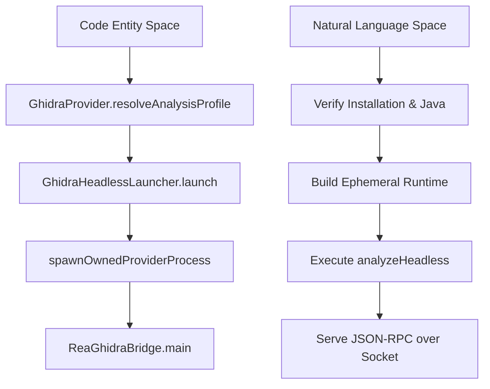
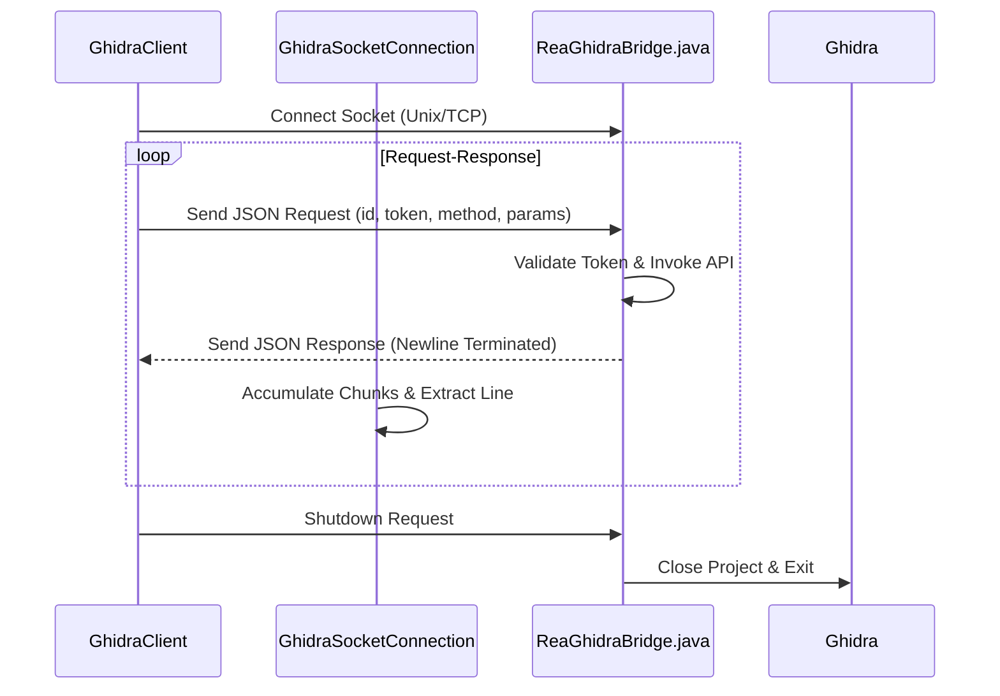
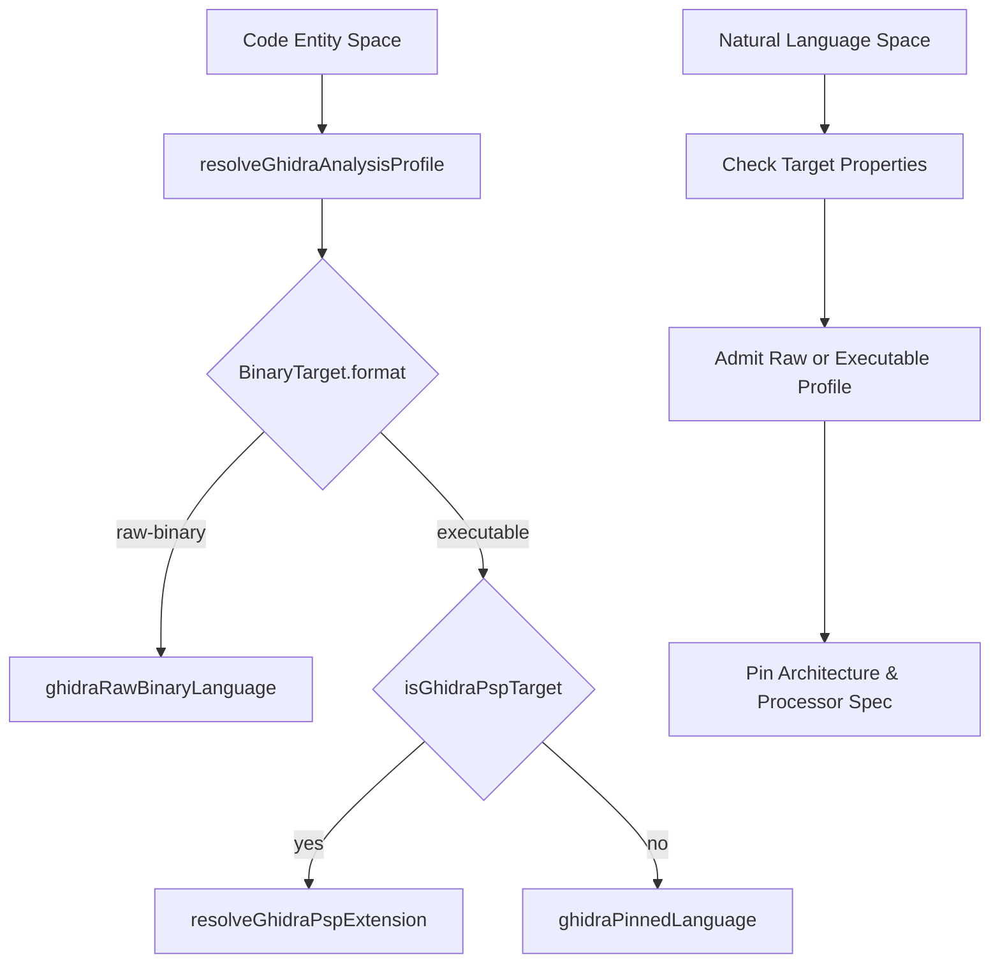

<!-- source: DeepWiki mcp.deepwiki.com · repo morluto/rea · page 4.2 Ghidra Provider · fetched 2026-10-16 -->

# Ghidra Provider

Relevant source files

The following files were used as context for generating this wiki page:

- [bridge/ghidra/ReaGhidraBridge.java](bridge/ghidra/ReaGhidraBridge.java)
- [docs/ghidra-mips.md](docs/ghidra-mips.md)
- [docs/ghidra-provider.md](docs/ghidra-provider.md)
- [docs/ghidra-psp.md](docs/ghidra-psp.md)
- [docs/native-investigation.md](docs/native-investigation.md)
- [docs/windows-ghidra-p0.md](docs/windows-ghidra-p0.md)
- [scripts/create-ghidra-windows-fixture.mjs](scripts/create-ghidra-windows-fixture.mjs)
- [scripts/lib/real-ghidra-boundaries.mjs](scripts/lib/real-ghidra-boundaries.mjs)
- [scripts/lib/real-ghidra-target-admission.mjs](scripts/lib/real-ghidra-target-admission.mjs)
- [scripts/verify-packaged-ghidra-windows.mjs](scripts/verify-packaged-ghidra-windows.mjs)
- [scripts/verify-real-ghidra-mips.mjs](scripts/verify-real-ghidra-mips.mjs)
- [scripts/verify-real-ghidra-windows.mjs](scripts/verify-real-ghidra-windows.mjs)
- [src/application/MipsElfMetadata.ts](src/application/MipsElfMetadata.ts)
- [src/ghidra/GhidraAnalysisProfile.ts](src/ghidra/GhidraAnalysisProfile.ts)
- [src/ghidra/GhidraAnalysisSeeds.test.ts](src/ghidra/GhidraAnalysisSeeds.test.ts)
- [src/ghidra/GhidraClient.ts](src/ghidra/GhidraClient.ts)
- [src/ghidra/GhidraClientTypes.ts](src/ghidra/GhidraClientTypes.ts)
- [src/ghidra/GhidraDiagnostics.ts](src/ghidra/GhidraDiagnostics.ts)
- [src/ghidra/GhidraDoctor.test.ts](src/ghidra/GhidraDoctor.test.ts)
- [src/ghidra/GhidraFunctionValues.test.ts](src/ghidra/GhidraFunctionValues.test.ts)
- [src/ghidra/GhidraFunctionValues.ts](src/ghidra/GhidraFunctionValues.ts)
- [src/ghidra/GhidraInstallation.test.ts](src/ghidra/GhidraInstallation.test.ts)
- [src/ghidra/GhidraInstallation.ts](src/ghidra/GhidraInstallation.ts)
- [src/ghidra/GhidraInstallationPolicy.ts](src/ghidra/GhidraInstallationPolicy.ts)
- [src/ghidra/GhidraJavaLaunch.ts](src/ghidra/GhidraJavaLaunch.ts)
- [src/ghidra/GhidraJavaProperties.ts](src/ghidra/GhidraJavaProperties.ts)
- [src/ghidra/GhidraLanguageCatalog.ts](src/ghidra/GhidraLanguageCatalog.ts)
- [src/ghidra/GhidraLanguageOverride.test.ts](src/ghidra/GhidraLanguageOverride.test.ts)
- [src/ghidra/GhidraLauncher.ts](src/ghidra/GhidraLauncher.ts)
- [src/ghidra/GhidraMipsProfile.test.ts](src/ghidra/GhidraMipsProfile.test.ts)
- [src/ghidra/GhidraMipsProfile.ts](src/ghidra/GhidraMipsProfile.ts)
- [src/ghidra/GhidraProvider.behavior.test.ts](src/ghidra/GhidraProvider.behavior.test.ts)
- [src/ghidra/GhidraProvider.ts](src/ghidra/GhidraProvider.ts)
- [src/ghidra/GhidraProviderCapabilities.ts](src/ghidra/GhidraProviderCapabilities.ts)
- [src/ghidra/GhidraProviderClient.ts](src/ghidra/GhidraProviderClient.ts)
- [src/ghidra/GhidraPspExtension.ts](src/ghidra/GhidraPspExtension.ts)
- [src/ghidra/GhidraPspProfile.ts](src/ghidra/GhidraPspProfile.ts)
- [src/ghidra/GhidraRiscvProfile.test.ts](src/ghidra/GhidraRiscvProfile.test.ts)
- [src/ghidra/GhidraSessionValues.test.ts](src/ghidra/GhidraSessionValues.test.ts)
- [src/ghidra/GhidraSessionValues.ts](src/ghidra/GhidraSessionValues.ts)
- [src/ghidra/GhidraSnapshotCache.test.ts](src/ghidra/GhidraSnapshotCache.test.ts)
- [src/ghidra/GhidraSocketConnection.ts](src/ghidra/GhidraSocketConnection.ts)
- [src/ghidra/GhidraTargetSnapshot.ts](src/ghidra/GhidraTargetSnapshot.ts)
- [src/ghidra/GhidraTransport.ts](src/ghidra/GhidraTransport.ts)
- [src/process/WindowsAuthority.ts](src/process/WindowsAuthority.ts)
- [src/windows/WindowsNativeLoader.test.ts](src/windows/WindowsNativeLoader.test.ts)
- [src/windows/WindowsNativeLoader.ts](src/windows/WindowsNativeLoader.ts)
- [tests/boundary/filesystem/ghidraJavaProbe.test.ts](tests/boundary/filesystem/ghidraJavaProbe.test.ts)
- [tests/boundary/filesystem/ghidraPspExtension.test.ts](tests/boundary/filesystem/ghidraPspExtension.test.ts)
- [tests/boundary/filesystem/mipsAbiFlags.test.ts](tests/boundary/filesystem/mipsAbiFlags.test.ts)
- [tests/boundary/filesystem/mipsSharedLoad.test.ts](tests/boundary/filesystem/mipsSharedLoad.test.ts)
- [tests/boundary/mcp/ghidraEvidenceMcp.test.ts](tests/boundary/mcp/ghidraEvidenceMcp.test.ts)
- [tests/boundary/mcp/ghidraInventoryMcp.test.ts](tests/boundary/mcp/ghidraInventoryMcp.test.ts)
- [tests/boundary/mcp/ghidraMcpHarness.ts](tests/boundary/mcp/ghidraMcpHarness.ts)
- [tests/boundary/mcp/ghidraReopen.test.ts](tests/boundary/mcp/ghidraReopen.test.ts)
- [tests/boundary/process/windowsOutputCapture.test.ts](tests/boundary/process/windowsOutputCapture.test.ts)
- [tests/boundary/providers/ghidra/ghidraClient.test.ts](tests/boundary/providers/ghidra/ghidraClient.test.ts)
- [tests/boundary/providers/ghidra/ghidraJavaLaunch.test.ts](tests/boundary/providers/ghidra/ghidraJavaLaunch.test.ts)
- [tests/boundary/providers/ghidra/ghidraLauncher.test.ts](tests/boundary/providers/ghidra/ghidraLauncher.test.ts)
- [tests/boundary/providers/ghidra/ghidraTargetSnapshot.test.ts](tests/boundary/providers/ghidra/ghidraTargetSnapshot.test.ts)
- [tests/conformance/ghidra/mips-checks.d.mts](tests/conformance/ghidra/mips-checks.d.mts)
- [tests/conformance/ghidra/mips-checks.mjs](tests/conformance/ghidra/mips-checks.mjs)
- [tests/conformance/ghidra/mips-checks.test.ts](tests/conformance/ghidra/mips-checks.test.ts)
- [tests/conformance/ghidra/mips-fixture.mjs](tests/conformance/ghidra/mips-fixture.mjs)
- [tests/conformance/ghidra/psp-checks.test.ts](tests/conformance/ghidra/psp-checks.test.ts)
- [tests/conformance/ghidra/psp-fixture.d.mts](tests/conformance/ghidra/psp-fixture.d.mts)
- [tests/conformance/ghidra/psp-fixture.mjs](tests/conformance/ghidra/psp-fixture.mjs)
- [tests/fixtures/fakeGhidra.mjs](tests/fixtures/fakeGhidra.mjs)

The Ghidra Provider integrates Ghidra as a headless analysis backend for REA. This page details the architecture, implementation, and data flow for launching Ghidra, communicating with it via a Java bridge, and leveraging its capabilities within REA. It covers the `GhidraLauncher` for headless execution, the Java bridge implementation (`bridge/ghidra/*.java`), socket-based transport and response buffering, installation and doctor probes, MIPS/PSP profiles, NativeAOT extensions, and considerations for packaged Ghidra on Windows.

## Ghidra Headless Launch and Installation Probes

The `GhidraHeadlessLauncher` class [src/ghidra/GhidraLauncher.ts:77-88]() is responsible for initiating a headless Ghidra analysis session. It orchestrates the creation of a private runtime environment, prepares session-specific configuration, and executes Ghidra's `analyzeHeadless` script. Prior to launching, `inspectGhidraInstallation` [src/ghidra/GhidraInstallation.ts:167-173]() validates the installation directory, application properties, and compatible Java runtime requirements (`GhidraInstallationInspection`) [src/ghidra/GhidraInstallation.ts:175-188]().

### Launch Process

1.  **Runtime Environment Setup**: A private runtime directory is created for each Ghidra session [src/ghidra/GhidraLauncher.ts:51-61](). This directory contains all necessary files for the session, including project files, logs, and the session descriptor.
2.  **Extension Snapshotting**: Configured Ghidra extensions are snapshotted into the runtime directory via `snapshotGhidraExtensions` [src/ghidra/GhidraLauncher.ts:41-44]().
3.  **Session Descriptor**: A JSON descriptor file is written containing critical session parameters such as `transport`, `endpoint_path`, `token`, `run_id`, `target_sha256`, `provider_version`, and `profile_digest` [src/ghidra/GhidraLauncher.ts:51-61]().
4.  **Headless Arguments Construction**: The `ghidraHeadlessArguments` function [src/ghidra/GhidraLauncher.ts:147-170]() constructs command-line arguments for `analyzeHeadless`, pointing to `ReaGhidraBridge.java` and handling loader/processor options [tests/boundary/providers/ghidra/ghidraLauncher.test.ts:98-120]().
5.  **Process Spawning**: `spawnOwnedProviderProcess` [src/ghidra/GhidraLauncher.ts:34-36]() launches Ghidra as an owned process with an isolated environment (`JAVA_HOME`, `HOME`, `TMPDIR`, `XDG_*`) [tests/boundary/providers/ghidra/ghidraLauncher.test.ts:53-86]().

Sources: [src/ghidra/GhidraLauncher.ts:77-88](), [src/ghidra/GhidraInstallation.ts:167-173](), [tests/boundary/providers/ghidra/ghidraLauncher.test.ts:53-86]()

## Java Bridge (`bridge/ghidra/*.java`)

The core of the Ghidra integration is the Java bridge, implemented primarily in `ReaGhidraBridge.java` [bridge/ghidra/ReaGhidraBridge.java:118-118](). This script runs within the headless Ghidra instance and acts as a server communicating with the REA client.

### Bridge Initialization and Protocol

1.  **Argument Parsing & Descriptor Reading**: The bridge receives the session descriptor path as an argument, reads socket endpoint details, token authentication secrets, and validates constraints [bridge/ghidra/ReaGhidraBridge.java:128-135]().
2.  **Request Handling Loop**: The server binds to a Unix domain socket or TCP loopback socket, accepting JSON requests structured with `id`, `token`, `method`, and `params` [bridge/ghidra/ReaGhidraBridge.java:136-141]().
3.  **Method Dispatch**: Methods are dispatched to inventory builders, procedure analyzers (`analyze_function`), decompiler interfaces (`DecompInterface`), and memory read/annotation managers [bridge/ghidra/ReaGhidraBridge.java:142-174]().

Sources: [bridge/ghidra/ReaGhidraBridge.java:118-174]()

## Socket Transport and Response Buffering

Communication between the REA client (`GhidraClient`) and the Ghidra Java bridge occurs over sockets designed for robustness and fragment reassembly.

### Transport Mechanisms

1.  **Unix Domain Sockets**: Used on POSIX hosts (Linux, macOS) for high-performance IPC [src/ghidra/GhidraTransport.ts:10-10]().
2.  **Authenticated Loopback TCP**: Used on Windows or fallback environments utilizing `127.0.0.1` with bearer tokens [src/ghidra/GhidraTransport.ts:11-11]().

### Buffering and Flow

The `GhidraSocketConnection` accumulates incoming TCP chunks into an internal buffer, splitting lines by newline characters (`\n`) to parse complete JSON messages and handle fragmented payloads without dropping frames [tests/boundary/providers/ghidra/ghidraClient.test.ts:161-191]().

Sources: [src/ghidra/GhidraTransport.ts:10-15](), [tests/boundary/providers/ghidra/ghidraClient.test.ts:161-191]()

## MIPS, PSP Profiles, and Target Admission

The Ghidra provider implements rigorous target admission and profile resolution to pin specific architectures, ABIs, and loaders before analysis.

### Processor Overrides and MIPS/PSP Handling

*   `resolveGhidraAnalysisProfile` inspects binary targets and applies version-bound semantics [src/ghidra/GhidraAnalysisProfile.ts:62-69]().
*   `ghidraPinnedLanguage` commits architectural lanes like MIPS, RISC-V, or PowerPC overrides [src/ghidra/GhidraAnalysisProfile.ts:54-59]().
*   PSP (PlayStation Portable) targets are identified via `isGhidraPspTarget` [src/ghidra/GhidraPspProfile.ts:33-34]() and bound to the Allegrex processor profile with dedicated extension validation (`resolveGhidraPspExtension`) [src/ghidra/GhidraAnalysisProfile.ts:98-101]().

Sources: [src/ghidra/GhidraAnalysisProfile.ts:54-101](), [src/ghidra/GhidraPspProfile.ts:33-34]()

## Provider Capabilities and Annotations

The `GhidraProvider` declares supported operations through capabilities (`CAPABILITIES`) [src/ghidra/GhidraProvider.ts:101-105]() and handles metadata mutation via `annotate_native_function` [src/ghidra/GhidraProviderCapabilities.ts:57-63]().

### Capabilities & Limitations
*   Operations include procedure inspection, pseudocode generation, xrefs, and byte searches [src/ghidra/GhidraProviderCapabilities.ts:25-28]().
*   Metadata edits (renaming functions, adding comments, defining signatures) use Ghidra's `USER_DEFINED` source and are ephemeral to the session [src/ghidra/GhidraProviderCapabilities.ts:60-63]().

Sources: [src/ghidra/GhidraProvider.ts:101-105](), [src/ghidra/GhidraProviderCapabilities.ts:25-63]()

## NativeAOT Extensions

REA extends Ghidra's headless analysis with custom Java extensions packaged as JARs to extract metadata from complex managed-to-native boundaries like .NET NativeAOT binaries [src/ghidra/extensions/GhidraExtensions.ts:24-43]().

### Extension Lifecycle
1.  **Discovery & Snapshotting**: Extensions are discovered and snapshotted into the runtime project folder during launch [src/ghidra/GhidraLauncher.ts:41-44]().
2.  **Bridge Loading**: `ReaGhidraBridge` instantiates and invokes extension routines to parse specialized NativeAOT metadata tables [bridge/ghidra/ReaGhidraBridge.java:154-154]().

Sources: [src/ghidra/extensions/GhidraExtensions.ts:24-43](), [src/ghidra/GhidraLauncher.ts:41-44]()

## Windows Packaged Ghidra

Running Ghidra on Windows requires native isolation enforcement to guarantee safe process ownership and filesystem protection.

### Windows Native Authority
*   `WindowsNativeLoader` leverages native addons (`WindowsNativeLoader`) to manage Windows Job Objects, process tree termination, and strict DACLs on session temp directories [scripts/verify-packaged-ghidra-windows.mjs:133-147]().
*   `scripts/verify-packaged-ghidra-windows.mjs` validates packaged installations, headless batch execution (`analyzeHeadless.bat`), Java runtimes, and loopback socket communication under non-elevated user accounts [scripts/verify-packaged-ghidra-windows.mjs:33-78]().

Sources: [scripts/verify-packaged-ghidra-windows.mjs:33-147](), [src/windows/WindowsNativeLoader.ts:1-20]()

---

